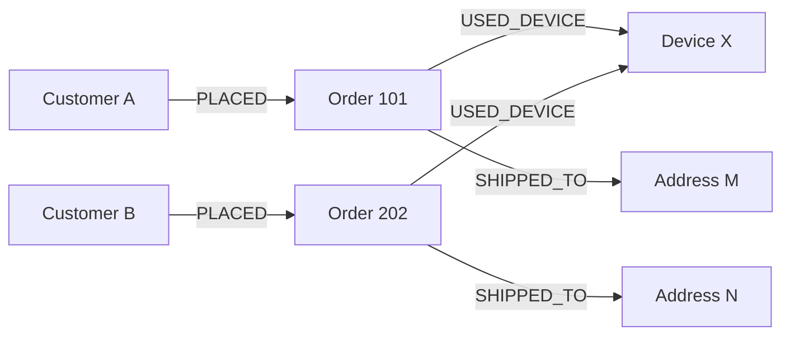

# When Relationships Between Objects Are the Center of the Model

In data design, a system with many related tables does not necessarily need a graph model. The deciding question is: **does the application primarily need to know the attributes of each object, or does it need to understand how objects are connected to one another?** If paths, degree of connectivity, connected components, and changes in relationships determine business outcomes, you should consider a graph model right from the logical design step.

This lesson belongs to the **Graph Modeling** topic of **DATABASE_DATA_MODELING**: training how to translate business requirements into entities, relationships, constraints, keys, indexes, and appropriate storage structures. The goal is not to default to choosing a graph database, but to recognize **when the relationship structure itself is the data to be queried**, and then compare relational, document, graph, and analytical solutions against the same requirement.

After this lesson, you will be able to:

- Distinguish between relationships used to join records and relationships that are the primary subject of analysis.
- Spot queries that are inherently graph traversals, especially multi-hop, variable-length paths.
- Sketch nodes, edges, directions, properties, identifiers, and constraints for a real-world problem.
- Know when a relational or document model is still simpler, and how to validate the decision using real queries.

## 1. What Does "Relationships Are the Center" Mean?

Consider two questions in an e-commerce system:

1. "What is the total amount of order `O-101`, which customer does it belong to, and what is its status?" — the focus is on **the order record** and its attributes. A few foreign-key `JOIN`s are usually sufficient.
2. "Which customers share a device with the customer being viewed, and then also have a shipping address matching a group of accounts under investigation?" — the focus is on **a chain of links** crossing multiple object types. Walking from one node to another is what produces the answer.

In a graph model, we represent:

- **Node (vertex):** an object with an identity, such as `Customer`, `Order`, `Device`, `Address`.
- **Edge (relationship):** a connection with business meaning, such as `PLACED`, `USED_DEVICE`, `SHIPPED_TO`.
- **Property:** data on a node or edge, such as order placement timestamp or when a follow started.
- **Path:** a sequence of edges connecting nodes; a **hop** is a single traversal across an edge.

A graph is **a modeling approach**, whereas a graph database is **a storage and query option**. You can represent a graph using relational tables and query it with SQL; only when query characteristics, operational cost, and performance fit should you choose a dedicated graph management system.

### Questions That Make Link Structure the Primary Data

| Context | Business Question | Characteristics of Relationships |
| --- | --- | --- |
| Social networks | Who is a friend of a friend within up to three hops? How many mutual connections do two people have? | Paths, hop counts, relationships between the same node type |
| Fraud detection | Which accounts are linked through devices, addresses, or payment methods? | Multiple edge types; finding clusters and indirect link chains |
| Authorization | Through which groups, nested subgroups, or roles does a user have access to a resource? | Inheritance relationships, conditional paths |
| System dependencies | If service A fails, which downstream services and processes may be affected along the chain? | Directed dependency relationships; multi-step propagation |
| Logistics | Which routes can transport goods across legs, given costs and constraints? | Weighted, directed, and constrained paths |
| Knowledge / learning | To study topic X, which prerequisite knowledge items must be completed, including indirect ones? | Prerequisite structures and cycle detection |

**Do not assume that having many-to-many relationships automatically requires a graph database.** For example, a sales system with an `order_items` table connecting `orders` and `products` fits a relational database very well if the queries are mainly about order details, inventory, and revenue.

## 2. Signs That a Problem Is Graph-Oriented

Look at **the questions that must be answered frequently** rather than just counting entities.

| Sign | Example Query | Why a Graph Is Worth Considering |
| --- | --- | --- |
| Need to traverse **multiple, variable-length hops** | "Find all components affected by service A, regardless of how many layers away" | Path length is part of the query; hard to express with fixed `JOIN`s |
| Need to find **paths and reachability** | "Is there a valid permission path from this employee to this document?" | Must check the existence of a link chain with rules on each edge |
| Need to analyze **clusters, neighborhoods, shared connections** | "Which accounts cluster around a suspicious device?" | Shape and density of connections affect the result |
| **Multiple relationship types** between the same or different object types | `FOLLOWS`, `BLOCKS`, `MEMBER_OF`, `OWNS` | Edge meaning and direction are a key part of the domain |
| Relationships have **their own properties and lifecycle** | "Since when has A followed B?", "Which permissions have expired?" | Edges do not just express existence; they carry timestamps, roles, provenance |
| Frequently exploring new connections | "Starting from a flagged entity, find related entities across multiple link types" | Queries expand along the connection structure, hard to predict all branches upfront |

A single sign is not enough to decide. For instance, a product category tree has parent–child relationships, but if it only has a few fixed levels, is read by category, and is updated transactionally, a `categories(parent_id)` table may already be a good choice. Conversely, an authorization system with many nested group layers and frequent questions about permission paths may need a clearer approach that supports graph traversal.

## 3. Running Example: Detecting Accounts Connected via Devices

### 3.1. Business Requirement

A transaction platform wants to support investigating accounts showing signs of being linked. The data includes customers, orders, devices used, and shipping addresses. A typical question:

> Starting from a customer, which other customers have shared at least one device within the last 30 days? If we continue through shipping addresses, what groups of related accounts can be formed?

The requirement **must not automatically conclude fraud**: multiple people can share a family phone, a public computer, or a company address. A connection path is a signal for further review, not standalone proof.

### 3.2. Sketching Nodes and Edges



Here `Order` is an **event node** with `orderId`, `placedAt`, `amount`, and `status`. Connecting devices and addresses **through the order** preserves temporal context: a customer used device X to place an order, rather than asserting they permanently own device X. This is a major difference when the model must support investigations or auditing.

A minimal logical model:

| Component | Identifier / Key Properties | Meaning |
| --- | --- | --- |
| `Customer` | `customerId` | Customer account, stable identifier |
| `Order` | `orderId`, `placedAt`, `amount`, `status` | Transaction occurring at a point in time |
| `Device` | `deviceId` | Device identified according to system policy |
| `Address` | `addressId` | Normalized address or managed identifier |
| `(Customer)-[:PLACED]->(Order)` | Can include `source` if needed | Customer placed the order |
| `(Order)-[:USED_DEVICE]->(Device)` | Can include `observedAt` | Device recorded when placing the order |
| `(Order)-[:SHIPPED_TO]->(Address)` | Can include `snapshotVersion` | Shipping address used for the specific order |

Do not use a person's name, raw address string, or a per-session changing fingerprint as a **unique key** if they are not truly stable. Incorrect normalization and identity resolution can create false edges, causing path queries to return wrong results. You should clearly define the confidence level and collection source for each link type.

### 3.3. Illustrative Query in Cypher

The example below uses Cypher syntax in the property graph style. Assume `Order.placedAt` is stored as a `datetime` and parameter `$from` is a valid timestamp string.

```cypher
MATCH (c:Customer {customerId: $customerId})-[:PLACED]->(o1:Order)-[:USED_DEVICE]->(d:Device)
MATCH (other:Customer)-[:PLACED]->(o2:Order)-[:USED_DEVICE]->(d)
WHERE other <> c
  AND o1.placedAt >= datetime($from)
  AND o2.placedAt >= datetime($from)
RETURN other.customerId AS otherCustomerId,
       count(DISTINCT d) AS sharedDeviceCount
ORDER BY sharedDeviceCount DESC
LIMIT 20;
```

The query walks from target customer -> order -> device -> another order -> another customer. The result is **candidate accounts with shared devices in the inspected time window**, along with the count of distinct shared devices; it does not measure order frequency and does not prove anomalous behavior.

For the same requirement, SQL can also solve it if you have tables `orders(customer_id, placed_at, ...)` and `order_devices(order_id, device_id)`:

```sql
SELECT o2.customer_id AS other_customer_id,
       COUNT(DISTINCT od1.device_id) AS shared_device_count
FROM orders AS o1
JOIN order_devices AS od1 ON od1.order_id = o1.id
JOIN order_devices AS od2 ON od2.device_id = od1.device_id
JOIN orders AS o2 ON o2.id = od2.order_id
WHERE o1.customer_id = :customer_id
  AND o2.customer_id <> :customer_id
  AND o1.placed_at >= :from_time
  AND o2.placed_at >= :from_time
GROUP BY o2.customer_id
ORDER BY shared_device_count DESC
LIMIT 20;
```

Both queries carry the same business meaning, though expressed differently. For **short paths with a known number of hops**, SQL can be very clear and fast with appropriate indexes. The expressive advantage of a graph is usually clearer when queries must explore **multiple edge types or variable hop counts**, such as from a device to many customers, from customers to other orders, and then to other addresses and devices without knowing the traversal depth in advance. Such queries must still bound their scope to prevent path explosion.

## 4. Modeling Relationships Correctly Matters More Than Node Count

### 4.1. Choosing Node, Property, or Edge

A property belongs on a node when it describes that object itself: `Customer.status`, `Device.type`. A property belongs on an edge when it describes a **specific relationship** between two objects: `FOLLOWS.since`, `MEMBER_OF.role`, `DEPENDS_ON.criticality`.

An event should become its own node when it connects multiple entities, has an identity or lifecycle, requires historical queries, or contains independent business data. An order is a clear example: a single order connects a customer, device, address, multiple line items, and payment. If you replace it with direct `Customer -> Device` and `Customer -> Address` edges, you can lose the ability to know **which device and which address were actually used in the same order**.

### 4.2. Defining Edge Direction, Type, and Semantics

`(Course A)-[:REQUIRES]->(Course B)` means **A requires taking B first**. If you flip the direction without renaming the edge, all prerequisite queries will be wrong. For symmetric relationships like "shared a device," you should usually **derive them from the source event** rather than writing synthetic bidirectional edges between every pair of customers, because the edge count can blow up and data easily goes stale.

Name edge types specifically using business verbs (`PLACED`, `MEMBER_OF`, `REQUIRES`) instead of using a vague `RELATED_TO` type for everything. When multiple relationships exist, queries must explicitly specify which edge types may be traversed; never assume all edges carry the same meaning.

### 4.3. Defining Constraints and Lifecycle

A logical design still needs rules equivalent to keys and constraints in the relational model:

- **Identity:** each `Customer` has a unique `customerId`; each `Order` has a unique `orderId`.
- **Multiplicity:** each order is placed by exactly one customer per business rules; one customer can have many orders; one device can be associated with many orders.
- **Validity:** do not create an order without a customer, do not attach edges to invalid entities, and do not create duplicate links when forbidden by business rules.
- **Time:** distinguish event time (`placedAt`), system recording time (`recordedAt`), and effective validity (`validFrom`/`validTo`) when changes need to be traced.
- **Access control:** restrict query readers from following sensitive data to entities outside their authorized scope.

Graph database systems **do not necessarily enforce all multiplicity or business constraints automatically**. You must decide which constraints are implemented via database constraints/indexes and which are guaranteed by transactions and application logic.

### 4.4. Do Not Overwrite History

Suppose customer A changes their shipping address from M to N. If you only store a current edge `Customer -> Address`, you no longer know where older orders were shipped. You can keep each `Order -> Address` pointing to the address at order time; if detailed auditing is required, store a snapshot of shipping details per order, because the current `Address` record itself may be edited. Choose event and temporal modeling based on what questions must be reconstructed, rather than optimizing only for the latest state.

## 5. When to Choose Relational, Document, Graph, or Analytical Models?

| Model Type | Best Fit When | Points to Consider |
| --- | --- | --- |
| **Relational** | Structured transactions, referential integrity, few predictable `JOIN` hops, ACID updates, operational reporting | Multi-level traversal can use `WITH RECURSIVE`, though query complexity and performance depend on data, indexes, and engine |
| **Document** | Frequently reading/writing a complete aggregate object, such as configuration or order contents with nested fields | Embedding multiple copies of shared objects can cause inconsistency; traversing arbitrary link networks is not its default strength |
| **Graph (property graph / RDF graph)** | Queries return **links, paths, neighborhoods, clusters** as the primary result; multiple relationship types, flexible path lengths | Must control traversal depth, high-degree nodes, identity management, transactions, and sync costs with source systems |
| **Analytical / warehouse** | Aggregations over very large datasets over time, revenue analysis, cohorts, KPIs, and statistics | Columnar analytical systems excel at scans and aggregations; they are not inherently optimized for interactive path traversals |

A **property graph** typically uses nodes and edges with labels, types, and properties, suited for path-querying applications. **RDF** describes information as *subject–predicate–object* triples, suited when semantics and knowledge-standard interoperability are needed. Choosing between them depends on the query ecosystem, semantic requirements, and tooling; this is a different decision from determining **whether the problem is inherently graph-shaped**.

In practice, **hybrid designs** are common: a relational database holds authoritative orders and transactions, a derived graph model serves link investigations, and an analytical warehouse serves aggregate reporting. In that setup, you must define the source of truth, update mechanism, and acceptable sync lag. Do not replicate data into a graph system without concrete queries that deliver clear value.

## 6. Cases Where a Graph Database Is Not Yet Needed

### Case A: Only a Few Fixed Relationships Need Retrieval

A sales application mainly reads `Order -> OrderItem -> Product`, looks up orders by customer, and computes revenue statistics. The relationships are well-structured, shallow, and transactional integrity is critical. A relational table and index model is usually a sensible starting point.

### Case B: Data Is Primarily Read as a Complete Document

An editor saves document drafts with nested content blocks. If opening a document always fetches the whole block tree and rarely needs to find paths between different documents, a document model or hierarchical relational structure may be more convenient.

### Case C: The Core Requirement Is Whole-Dataset Aggregation

"Monthly revenue by region over three years" involves many records but primarily needs filtering, grouping, and summing. Its nature is **set-oriented analytics**. A graph does not automatically make global aggregations more efficient.

### Case D: No Concrete Path Queries Exist Yet

If the requirement stops at "the data has many connections," without knowing which queries traverse which edges, path lengths, or frequencies, there is not enough evidence to pick a technology. Write down a few concrete business questions, design a baseline relational model, and re-evaluate when you have workload evidence.

## 7. Query-Driven Design and Validating the Choice

You can follow this sequence.

**Step 1 — Express requirements as testable questions.** Example: "Given `customerId`, find up to 20 customers who shared a device on at least one order in the last 30 days." A good requirement specifies inputs, relationship types, time window, output, and limits.

**Step 2 — Draw the paths to be queried.** Record node types, edge types, directions, maximum hops, and conditions on each step. If the query asks for "all indirectly dependent services," specify whether to stop at cycles, whether expired edges count, and whether a hop limit is acceptable.

**Step 3 — Choose data granularity and identifiers.** In the fraud example, `Order` is an independent event, `Customer` is an account, and `Device` is an identified entity. Specify unique keys, identity-matching confidence, and how to fix erroneous links.

**Step 4 — Write at least one query in each candidate option.** If SQL with a few `JOIN`s or a recursive CTE meets the requirement cleanly, there is no default reason to migrate to a graph database. If most of the workload involves variable-length traversals, prototype a property graph and compare.

**Step 5 — Test with real data and operations.** Evaluate node/edge counts, edge degree distribution per node, path lengths, read/write ratio, event updates, sync latency, storage/index cost, p95/p99 latency, and transaction guarantees. Very high-degree nodes (*supernodes*) and unbounded-depth traversals can cause path explosion even in a graph database.

**Step 6 — Choose the physical model and add constraints.** In a property graph, starting-point lookups usually rely on indexes or constraints on identifiers. For example, in a system supporting Neo4j Cypher syntax:

```cypher
CREATE CONSTRAINT customer_id_unique IF NOT EXISTS
FOR (c:Customer) REQUIRE c.customerId IS UNIQUE;

CREATE CONSTRAINT order_id_unique IF NOT EXISTS
FOR (o:Order) REQUIRE o.orderId IS UNIQUE;
```

This is a **physical implementation example of a specific product**, not universal syntax for all graph systems. Indexes for time filtering and transaction boundaries must be chosen from actual queries, data statistics, and the documentation of the database system in use.

### Decision Checklist

Answer the following questions with concrete scenarios and numbers where available:

| Question | If "Yes", Clarify |
| --- | --- |
| Does the result depend on **paths, reachability, or connected groups**? | Which paths, and what output must be returned? |
| Is the traversal depth **variable** depending on the data? | What depth limits and cycle-prevention rules are acceptable? |
| Are there multiple edge types and conditions on edges? | What are the edge types, directions, and validity periods? |
| Are these queries frequent and business-critical? | What are the frequency, target latency, data volume, and supernode profiles? |
| Does the current SQL/document model cause measurable pain? | What is the concrete maintenance complexity, response time, or operational cost? |
| Is the team capable of operating a graph model? | How are sync, security, backup/restore, monitoring, and error handling designed? |

No count of "yes" answers automatically dictates a technology. One critical path query may justify a specialized graph model; conversely, data with many relationships may fit SQL completely fine. **A good decision is one proven with real queries and real constraints.**

## 8. Common Modeling Mistakes

1. **Turning every value into a node.** `Order.amount` or `Customer.displayName` are usually properties; creating separate nodes for them only clutters the model, unless that value has an independent identity and relationships that must be queried.
2. **Using a generic `RELATED_TO` edge without semantics.** Readers cannot tell whether the edge means ownership, dependency, or mere similarity; queries easily traverse invalid links.
3. **Ignoring time and provenance.** "Two customers once shared a device" is very different from "shared it this week"; missing timestamps lead to false associations.
4. **Incorrect identity resolution.** Two similarly spelled addresses are not necessarily the same location; a device ID may change or be shared. You need normalization, matching, and remediation policies.
5. **Unbounded traversal queries.** Networks with cycles or high-degree nodes can generate massive numbers of paths; always bound hops, result counts, edge types, execution time, and query resources per requirements.
6. **Inferring causality from connectivity.** A shared link is a sign of association; it does not automatically prove ownership, collusion, access rights, or root cause of an incident.
7. **Ignoring updates and consistency.** If transactional data remains in SQL and the graph is a replica, you must handle delayed sync, duplicate event delivery, out-of-order updates, and deletions.

## 9. Self-Check Exercise

A learning platform manages `Course` and the `REQUIRES` relationship: course A requires course B, and course B requires course C. The system has two needs:

- **Need 1:** display the direct prerequisites of course A and each prerequisite's details.
- **Need 2:** find **all direct and indirect prerequisites** of A, detect cycles in the prerequisite chain, and determine which courses are affected when C changes.

Answer for yourself: what are the nodes, edges, edge direction, and unique identifiers? Which need is primarily a fixed lookup and which is a path traversal? Is it necessary to move the entire learning platform onto a graph database?

**Suggested solution:** Node `Course(courseId, title, ...)`, edge `(A)-[:REQUIRES]->(B)`. Need 1 can be solved with a `course_prerequisites(course_id, prerequisite_course_id)` table and a `JOIN`. Need 2 has a clearer graph nature: following `REQUIRES` across variable steps, checking for cycles, and traversing in reverse to find courses depending on C. You can start with recursive SQL or adopt a graph model if this query is central and the data is complex enough. Cycle prevention, update rules, and key constraints are still required even if the data lives in a graph database.

## Conclusion

**Relationships between objects are the center of the model when the connection structure itself determines the answer:** who connects to whom, through which relationship types, how far it reaches, which cluster it belongs to, and when the link is valid. Start from business queries, describe paths and constraints, and then compare SQL, document, graph, and analytical warehouse options on real data. Good graph design makes relationships natural to express; choosing the right storage system additionally requires evidence around performance, integrity, and operability.
