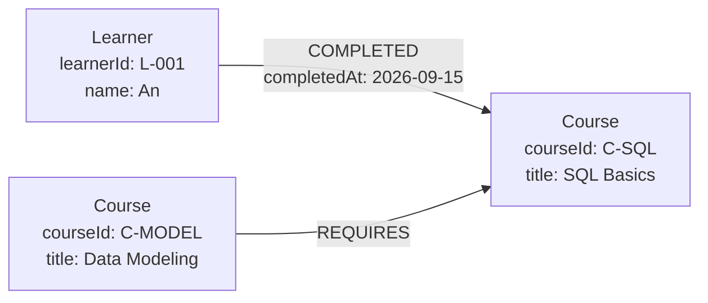
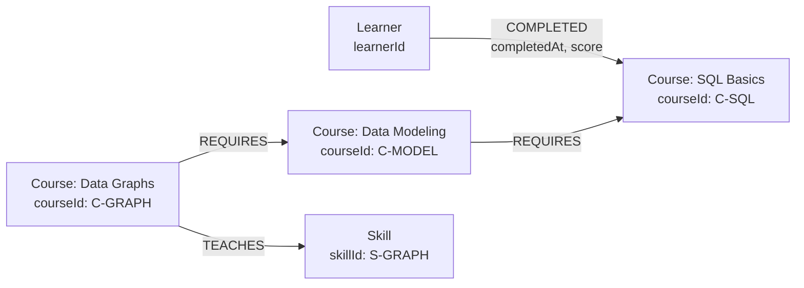
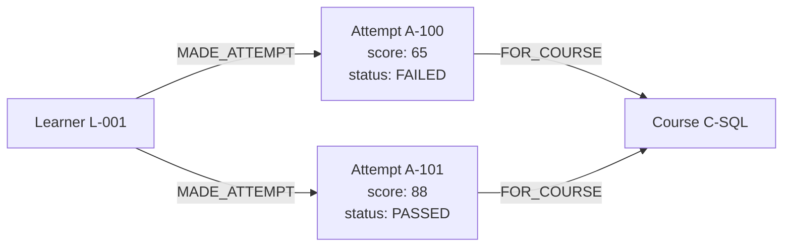

# Vertices, Edges, Labels, and Properties in the Property Graph Model

The **property graph** model represents data using objects and meaningful connections between them. The fundamental unit is no longer a row in a table or a JSON document, but a **vertex** (node) and an **edge** (relationship). **Labels** indicate which category an object belongs to, while **properties** describe specific data on a vertex or edge. These four components work together to answer questions such as "which course requires which knowledge?", "has the learner completed all prerequisites?", or "which services does a given service indirectly depend on?".

In the **Graph Modeling** module of **DATABASE_DATA_MODELING**, we approach graphs from business requirements: identifying entities, relationships, constraints, identifiers, and indexes; only then do we decide on the logical model and physical schema. This approach helps compare graphs with relational, document, and analytical models while keeping the structure verifiable and evolvable. This lesson focuses on **how to model accurately with vertices, edges, labels, and properties**, rather than just learning the query syntax of a single product.

After this lesson, you will be able to:

- Identify vertices, edges, labels, and properties from a business requirement.
- Design edge directions, relationship types, unique identifiers, and multiplicities between objects.
- Distinguish when data belongs on a vertex, an edge, or a separate event vertex.
- Read and write property graph query patterns while understanding engine-dependent limitations.
- Spot modeling mistakes such as vague labels, contextless edges, lost history, or unbounded graph traversals.

## 1. The Four Components and How They Fit Together

Consider the business statement: "Learner An completed the course *SQL Basics*; the course *Data Modeling* requires taking *SQL Basics* first." One representation is:



| Component | In the Example | Question It Answers |
| --- | --- | --- |
| **Vertex / Node** | Learner `L-001`; two courses `C-SQL` and `C-MODEL` | "Which object exists and has its own identity?" |
| **Edge / Relationship** | `COMPLETED`, `REQUIRES` | "How does this object relate to that object?" |
| **Label / Type** | Vertex labels `Learner`, `Course`; edge types `COMPLETED`, `REQUIRES` | "What business kind is this object or relationship?" |
| **Property** | `learnerId`, `title`, `completedAt` | "What values must be stored to identify, filter, or explain?" |

A graph can be described as `G = (V, E)` with vertex set `V` and edge set `E`. In a property graph, each vertex and edge also carries type/label metadata along with **key–value** pairs. This is a logical model; a specific database engine may implement details differently. For example, Neo4j allows a vertex to carry multiple labels and each relationship to carry a single **relationship type**; you should not assume every property graph product shares the same rules for labels, data types, or constraints.

## 2. Vertices: Objects Needing Independent Identity and Lifecycle

A vertex represents an entity that the system needs to identify, reference, or query independently: `Learner`, `Course`, `Skill`, `Company`, `Device`, `Order`, etc. A vertex typically has a set of properties and at least one label indicating the object type.

### 2.1. When to Create a Vertex?

Consider making an object a vertex if it has one or more of these characteristics:

1. It has an **independent identity**, such as course `C-SQL`, even if its display title changes.
2. It is **referenced or connected** by many other objects, such as a skill taught by multiple courses.
3. It has **its own lifecycle and rules**, such as a course being published, hidden, or retired.
4. Users need to **traverse from it to related objects**, for example finding all courses depending on a skill.

Conversely, `Course.durationMinutes = 120` should usually be a property because a duration number is not an entity needing an independent identity. There is no need to create vertices for each value `120`, `90`, or `60` just because they appear in the data.

### 2.2. Business Identifiers Differ from Internal Database IDs

Each `Course` needs a stable `courseId`, and each `Learner` needs a stable `learnerId`. IDs generated automatically by a graph engine may assist internal storage or querying, but should not be treated as durable business keys during data migration or integration.

Example of a vertex:

```text
(:Course {
  courseId: 'C-MODEL',
  title: 'Data Modeling',
  level: 'INTERMEDIATE',
  status: 'PUBLISHED',
  durationMinutes: 180
})
```

`courseId` is the key identifying the object; `title`, `level`, `status`, and `durationMinutes` are properties used for display, filtering, or sorting. A label does not automatically guarantee `courseId` uniqueness: you need the corresponding constraint or write-path logic in the system you use.

### 2.3. A Vertex Can Carry Multiple Labels

In engines that support multiple labels, `(:Person:Instructor)` can represent someone who belongs to the `Person` domain and also holds the `Instructor` role. This helps group and query by each subset. However, **labels do not replace business constraints**: the system must still define who is authorized to add or remove a label, when a role is valid, and whether roles may overlap.

Do not turn every frequently changing value into a label: if `Course` has statuses `DRAFT`, `PUBLISHED`, `ARCHIVED` and the status updates frequently, a `status` property is usually easier to manage than a proliferation of status labels. When a group of objects has stable classification semantics and many dedicated queries, adding a new label can make sense.

## 3. Edges: Relationships with Meaning, Direction, and Context

An edge connects two vertices. In a **directed graph**, an edge has a start point and an end point. In Cypher, a relationship such as:

```cypher
(advanced:Course)-[:REQUIRES]->(basic:Course)
```

is read as: "the advanced course **requires** the basic course." Flipping the direction to `(basic)-[:REQUIRES]->(advanced)` changes the meaning. Edge direction must be standardized from the domain model onward and across all queries.

### 3.1. Name Edge Types Using Business Verbs

| Edge | Read as a Sentence | Semantic Clarity |
| --- | --- | --- |
| `(Learner)-[:COMPLETED]->(Course)` | Learner completed the course | Clear roles on both ends and completion status |
| `(Course)-[:REQUIRES]->(Course)` | Course A requires course B | Clear dependency direction |
| `(Course)-[:TEACHES]->(Skill)` | Course teaches a skill | Clear instructional objective |
| `(Learner)-[:RELATED_TO]->(Course)` | Learner is related to the course | Ambiguous: enrolled, purchased, viewed, or completed? |

An edge type name should express **a specific relationship**, not merely "is related to." A pair of vertices can still have multiple distinct relationships: a learner can both be `ENROLLED_IN` and have `COMPLETED` a course, if those two concepts are defined independently.

### 3.2. Edges Also Have Properties

Properties on `COMPLETED` such as `completedAt`, `score`, or `source` describe **the fact that a specific learner completed a specific course**, not the learner themselves or the course itself.

```text
(:Learner {learnerId: 'L-001'})
  -[:COMPLETED {completedAt: '2026-09-15', score: 88}]->
(:Course {courseId: 'C-SQL'})
```

If you put `completedAt` on `Learner`, you lose which **course** was completed at that time; if you put it on `Course`, every learner would be assigned the same completion date. Choosing where a property lives must match the **grain** of data it describes.

### 3.3. Do Not Assume Only One Edge Exists Between a Pair of Vertices

Many property graph engines allow multiple edges between the same two vertices, even of the same type; some also allow **self-loops** (an edge pointing back to the same vertex). That does not mean all such edges are valid under business rules.

For example, `(Learner)-[:COMPLETED]->(Course)` might be unique if the system only stores **the final completion state**; however, if you need to store three exam attempts at three different timestamps, you should not accidentally overwrite them onto one edge. You can use `ATTEMPTED` edges distinguished by `attemptId` if your engine and design support it, or create an `Attempt` vertex with its own identity (see section 6). Conversely, a self-referencing `REQUIRES` edge `(Course A)-[:REQUIRES]->(Course A)` is usually a bug and must be prevented.

### 3.4. Symmetric Relationships and Storage Direction

"A follows B" is a directed relationship; "A is friends with B" may be defined as a symmetric relationship. Even when a business relationship is symmetric, a property graph engine may still store directed edges. In that case, define a clear convention: store a single canonical direction and query bidirectionally, or store two edges with a consistent update mechanism. Never assume a stored directed edge always implies a one-way meaning in the real world.

## 4. Vertex Labels, Edge Types, and Properties: Where Do They Differ?

These are three decisions that are very easy to confuse:

| What Needs to Be Represented | Appropriate Component | Example | Reason |
| --- | --- | --- | --- |
| What **kind** an object is | Vertex label | `:Course`, `:Learner`, `:Skill` | Categorizes vertices to express query patterns |
| How two objects **relate** | Edge type | `:REQUIRES`, `:COMPLETED` | Clearly states the verb and meaning of the link |
| What **value** an object/relationship has | Property | `courseId`, `title`, `completedAt` | Concrete data that can change and be filtered |
| An event with **identity and multiple participants** | Event vertex + edges | `Attempt`, `Enrollment`, `Order` | Preserves full context and an independent lifecycle |

### 4.1. Distinguishing Labels from Properties

`:Course` is a label, not the name of a specific course. `title = 'SQL Basics'` is a property on **a single `Course` vertex**. Likewise, do not create dynamic edge types like `:REQUIRES_C_SQL` or `:REQUIRES_C_GRAPH` to encode course IDs. Edge types should represent **stable concepts**, while specific IDs belong on the vertices or necessary properties.

### 4.2. Properties Are Values, Not Implicit Linking Nodes

If two courses both have `category = 'Database'`, sharing the same property value **does not automatically create a relationship between them**. To query "other courses in the same category," you can compare properties; however, if a category has an owner, description, hierarchy, or connects to many courses, consider a `Category` vertex and an `IN_CATEGORY` edge.

### 4.3. Property Data Types Depend on the Engine

Many property graphs support strings, numbers, booleans, date/time, and certain collection types; support for `null`, lists, nested maps, or complex objects is **not uniform**. In Neo4j, a property stored on a vertex/edge cannot directly be an arbitrary nested JSON structure; a `null` value typically means **the absence of that property**. Therefore, do not design under the assumption that every property graph can store an arbitrary document inside a single field.

The design needs consistent units (`durationMinutes` instead of ambiguous `duration`), time zones, string normalization rules, default values, and a clear distinction between "unknown" and "not applicable." For properties that determine business correctness, explicitly define valid types and ranges.

## 5. Complete Design Example: Learning Path

Suppose a learning platform needs to satisfy four requirements:

1. Display the list of courses and the skills each course teaches.
2. Identify direct and indirect prerequisite courses for a given course.
3. Check which prerequisite courses a learner has not yet completed.
4. Record each learner's completion date and score for each course.

### 5.1. Identifying Vertices and Edges



Direction convention: `(advanced course)-[:REQUIRES]->(prerequisite course)`. If course `C-GRAPH` requires `C-MODEL`, and `C-MODEL` requires `C-SQL`, then `C-SQL` is an **indirect prerequisite** of `C-GRAPH`.

| Vertex / Edge | Suggested Properties | Business Constraints to Define |
| --- | --- | --- |
| `Learner` | `learnerId`, `displayName` | `learnerId` unique; names may collide |
| `Course` | `courseId`, `title`, `level`, `status` | `courseId` unique; status from a valid set |
| `Skill` | `skillId`, `name` | `skillId` unique; names can be normalized |
| `REQUIRES` (`Course -> Course`) | `mandatory`, optionally `effectiveFrom` | Cannot require itself; no cycles if disallowed by curriculum; avoid duplicate edges |
| `TEACHES` (`Course -> Skill`) | `proficiencyLevel` if applicable | One course can teach many skills, one skill can appear in many courses |
| `COMPLETED` (`Learner -> Course`) | `completedAt`, `score`, `source` | Recorded only upon confirmed completion; clearly define single vs. multiple records per pair |

**Key point:** rules such as "no prerequisite cycles," "a course appears only once in its own prerequisite list," or "score between 0 and 100" are **business constraints**—they do not appear automatically just because you picked good label or edge names. You must decide where each rule is enforced.

### 5.2. Creating Sample Data with Cypher

The snippet below uses **Neo4j Cypher** syntax to illustrate how a property graph is written. Run it on an empty test dataset or change the IDs to avoid colliding with existing data.

```cypher
CREATE
  (sql:Course {
    courseId: 'C-SQL', title: 'SQL Basics', level: 'BEGINNER', status: 'PUBLISHED'
  }),
  (model:Course {
    courseId: 'C-MODEL', title: 'Data Modeling', level: 'INTERMEDIATE', status: 'PUBLISHED'
  }),
  (graph:Course {
    courseId: 'C-GRAPH', title: 'Data Graphs', level: 'ADVANCED', status: 'PUBLISHED'
  }),
  (skill:Skill {skillId: 'S-GRAPH', name: 'Graph modeling'}),
  (learner:Learner {learnerId: 'L-001', displayName: 'An'}),
  (model)-[:REQUIRES {mandatory: true}]->(sql),
  (graph)-[:REQUIRES {mandatory: true}]->(model),
  (graph)-[:TEACHES {proficiencyLevel: 'FOUNDATIONAL'}]->(skill),
  (learner)-[:COMPLETED {
    completedAt: date('2026-09-15'), score: 88, source: 'ASSESSMENT'
  }]->(sql);
```

In this pattern:

- `(:Course { ... })` specifies the **label** and **properties** of a vertex.
- `-[:REQUIRES {mandatory: true}]->` specifies the **type**, **properties**, and **direction** of an edge.
- `sql`, `model`, `graph`, `learner` are **query variables**, not durable IDs stored in the graph.
- `date('2026-09-15')` creates a date value in Neo4j; date representation depends on the product.

### 5.3. Direct Edge Queries

Find the courses directly required by `C-GRAPH`:

```cypher
MATCH (c:Course {courseId: 'C-GRAPH'})-[:REQUIRES]->(prereq:Course)
RETURN prereq.courseId AS courseId, prereq.title AS title
ORDER BY courseId;
```

Based on the sample data, the result is only `C-MODEL`, because this query traverses **one `REQUIRES` edge**.

Find both direct and indirect prerequisites, capped at five hops:

```cypher
MATCH (c:Course {courseId: 'C-GRAPH'})-[:REQUIRES*1..5]->(prereq:Course)
RETURN DISTINCT prereq.courseId AS courseId, prereq.title AS title
ORDER BY courseId;
```

The result is `C-MODEL` and `C-SQL`. `*1..5` is a **variable-length** path pattern in this Cypher syntax. The depth bound must be chosen according to the valid depth of the learning path; if the business depth exceeds five, the query above will miss courses. `DISTINCT` avoids returning the same course multiple times when multiple paths reach it; it does not by itself solve performance issues on highly branched graphs.

### 5.4. Querying Properties on Edges

Retrieve confirmed course completion history for learner `L-001`:

```cypher
MATCH (l:Learner {learnerId: 'L-001'})-[done:COMPLETED]->(c:Course)
RETURN c.courseId AS courseId,
       c.title AS title,
       done.completedAt AS completedAt,
       done.score AS score
ORDER BY completedAt DESC;
```

This query shows the benefit of placing `completedAt` and `score` directly on the `COMPLETED` edge: each learner–course link can hold its own values.

### 5.5. Finding Incomplete Prerequisites

Combining directed edges with an existence condition:

```cypher
MATCH (learner:Learner {learnerId: 'L-001'})
MATCH (target:Course {courseId: 'C-GRAPH'})-[:REQUIRES*1..5]->(need:Course)
WHERE NOT EXISTS {
  MATCH (learner)-[:COMPLETED]->(need)
}
RETURN DISTINCT need.courseId AS missingCourseId, need.title AS title
ORDER BY missingCourseId;
```

With the sample data, the learner has completed `C-SQL` but not `C-MODEL`, so `C-MODEL` is returned. For production use, you must define further rules: whether `mandatory = false` counts, what minimum passing score qualifies, whether certificates expire, and how course waivers are handled. These rules determine **the semantics of the edge** and query output, rather than relying solely on diagram shape.

## 6. When Edge Properties Are Not Enough: Event Vertices

Suppose a learner can make multiple **exam attempts** for the same course. Each attempt has an `attemptId`, start time, submission time, score, grader, and appeal status. Using only a single `COMPLETED {score: ...}` edge cannot adequately represent all three attempts and why a score was updated.

An extended model can turn `Attempt` into a vertex:



In this design, `Attempt` has an independent identity for auditing, score corrections, storing evidence, and querying per attempt. The `COMPLETED` edge can be **derived** from a qualifying attempt; if you still materialize that edge to optimize queries, you need clear sync rules and a defined source of truth.

Similarly, an order placed by a customer, shipped to an address, executed on a device, and containing multiple products is usually an **event vertex** with edges connecting to those related objects. Creating many direct edges from the customer to each piece of info loses the context of "which elements appeared together in the same order."

Practical guidelines:

| Scenario | Usually Appropriate Modeling Pattern |
| --- | --- |
| `Learner` has a display name | `displayName` property on the `Learner` vertex |
| One course requires another course | `REQUIRES` edge from dependent course to prerequisite course |
| Learner completes a course at a single canonical timestamp | `COMPLETED` edge with `completedAt` |
| Learner has multiple attempts, each with its own workflow | `Attempt` vertex and connecting edges |
| Course belongs to a category with description, owner, and hierarchy | `Category` vertex and `IN_CATEGORY` / `PARENT_OF` edges |

## 7. Constraints and Indexes: Turning a Logical Model into a Physical Schema

Property graphs **do not exempt you** from designing keys, constraints, and lookup strategies. Properties such as `courseId`, `learnerId`, and `skillId` must be stable and unique within their respective label sets. Queries typically start from a vertex looked up by ID and then traverse edges; fast starting-point lookups and bounded path expansion are both essential.

Example of constraints and indexes in Neo4j Cypher (syntax, availability, and licensing conditions may vary by version/product):

```cypher
CREATE CONSTRAINT course_id_unique IF NOT EXISTS
FOR (c:Course) REQUIRE c.courseId IS UNIQUE;

CREATE CONSTRAINT learner_id_unique IF NOT EXISTS
FOR (l:Learner) REQUIRE l.learnerId IS UNIQUE;

CREATE CONSTRAINT skill_id_unique IF NOT EXISTS
FOR (s:Skill) REQUIRE s.skillId IS UNIQUE;

CREATE INDEX course_status_idx IF NOT EXISTS
FOR (c:Course) ON (c.status);
```

These example constraints enforce uniqueness **when the ID value is present**. If the application requires every `Course` to have a `courseId`, you need an additional **property existence** rule; support for enforcing that constraint depends on version and product. Similarly, `UNIQUE` on node IDs does not prevent two duplicate `REQUIRES` edges between a pair of vertices or a prerequisite cycle. Those conditions require dedicated controls in the write path and data validation.

### 7.1. `CREATE` and `MERGE` Serve Two Different Scenarios

- `CREATE` inserts new vertices/edges matching a pattern; re-running an ingestion script can create duplicate data or violate constraints.
- `MERGE` finds an existing matching pattern or creates it if missing. It is useful for idempotent data loading, but **does not automatically create unique keys**, and the choice of properties in a `MERGE` pattern can inadvertently spawn unwanted new entities.

For example, once unique constraints exist on `learnerId` and `courseId`, to record completion for a learner–course pair:

```cypher
MERGE (l:Learner {learnerId: 'L-001'})
MERGE (c:Course {courseId: 'C-SQL'})
MERGE (l)-[r:COMPLETED]->(c)
ON CREATE SET r.completedAt = date('2026-09-15'), r.score = 88;
```

This snippet is only suitable if the business decides there is **at most one** `COMPLETED` edge per pair; `MERGE` does not delete pre-existing duplicate edges. When multiple completion records must be stored, use an event identifier or an `Attempt` model instead of repeating the pattern above.

### 7.2. Do Not Optimize Only the Starting Point

When a popular skill links to hundreds of thousands of courses, the `Skill` vertex can accumulate a massive number of edges. High-degree vertices (*supernodes*) cause queries that "walk all links" to generate enormous work. Monitor edge degree distributions, restrict traversable relationship types, and apply time/status filters, depth limits, and result limits. An index on ID keys is no substitute for evaluating **edge traversal cost**.

### 7.3. Temporal Data Constraints

If a `REQUIRES` edge only takes effect starting in a new academic year, `effectiveFrom` and `effectiveTo` properties may be appropriate. Queries must filter on effective dates; otherwise, "current prerequisites" and "last year's prerequisites" get mixed together. When you need to store multiple rule versions with approvers and edit history, use `CurriculumVersion` or `RequirementRule` vertices instead of mutating a historyless edge.

## 8. Comparing Representations with Relational and Document Databases

The same course data can be represented across multiple models:

| Goal | Relational | Document | Property Graph |
| --- | --- | --- | --- |
| Store courses and metadata | `courses` table | `course` document | `:Course` vertex with properties |
| Store prerequisite courses | Junction table `course_prerequisites` with two foreign keys | `prerequisiteIds` array in document, depending on needs | `(Course)-[:REQUIRES]->(Course)` edge |
| Store learner progress | `course_completions` or `attempts` table | Progress document or subdocument | `COMPLETED` edge, or `Attempt` event vertex |
| Query direct prerequisites | Foreign-key `JOIN` | Read ID array and fetch additionally | Single-hop traversal across `REQUIRES` |
| Query multi-level prerequisites | Recursive CTE or application logic | Requires resolving cross-document links | Variable-length path query |

All three options can be valid. For a learning system that mainly processes enrollments, payments, and transcripts, a relational model is often convenient for transactional integrity. If reading and writing a course document as a single unit dominates, a document store can make sense. If querying learning paths, dependencies, and cascading impact is central, a property graph offers direct expression. The storage decision also depends on data volume, query frequency, consistency requirements, and operational capabilities.

**Do not equate property graphs with RDF.** RDF represents information as `subject–predicate–object` triples and has its own semantic model and standards tooling. Property graphs typically emphasize vertices/edges with property pairs, using query languages like Cypher in certain engines. The fact that a problem has a network structure does not mean these two models store labels, edge types, or properties in the same way.

## 9. Common Mistakes When Defining the Four Components

1. **Encoding IDs inside labels/edge types.** Writing `:Course_SQL` or `:REQUIRES_C_SQL` explodes the type catalog and makes general queries hard. Use `:Course` with `courseId` and `:REQUIRES` relationships.
2. **Using one edge type for all relationships.** `RELATED_TO` cannot distinguish "completed," "requires," "teaches," or "belongs to." Readers and queries easily misuse the semantics.
3. **Placing properties at the wrong data grain.** `score` on `Course` cannot represent different learners' scores. Put it on the completion link or the attempt vertex.
4. **Getting edge direction backwards.** `(B)-[:REQUIRES]->(A)` means B requires A, not A requires B. A single flipped direction corrupts the entire prerequisite path.
5. **Assuming labels or syntax automatically create constraints.** The `Course` label does not prevent duplicate IDs; the `REQUIRES` type does not prevent cycles. You need constraints and write-path validation.
6. **Storing only current state when history is needed.** Overwriting completion properties or prerequisites destroys the ability to reconstruct point-in-time data.
7. **Storing two mutually derivable facts simultaneously.** If `A REQUIRES B` already exists, adding a reverse edge `B REQUIRED_BY A` increases consistency maintenance cost. Consider redundant storage only when there is measurable performance benefit and a reliable sync mechanism.
8. **Traversing graphs without bounds or filters.** Multi-layer relationships, cycles, or high-degree vertices can make path counts explode; you must set limits, targeted query filters, and safeguards.

## 10. Practice Exercises and Suggested Answers

### Exercise 1: Identifying Vertices, Edges, Labels, and Properties

A transit system records:

- Each `Station` has `stationCode`, `name`, `city`.
- Each direct route from station A to station B has `durationMinutes`, `distanceKm`, `operatorCode`.
- Customers can search for connecting routes and the shortest path by total travel time.

Design a minimal property graph, specify edge direction, and explain why `durationMinutes` should not be placed on the `Station` vertex.

**Suggested answer:** create `(:Station {stationCode, name, city})`, connected by `(a:Station)-[:ROUTE_TO {durationMinutes, distanceKm, operatorCode}]->(b:Station)`. Travel duration belongs to **a specific leg**, not to station A or B. If each operator runs multiple scheduled trips between the same pair of stations, you should add a `Service`/`Trip` model with its own identifier, departure/arrival times, and effective dates. Shortest-path queries must clearly specify the criterion: fewest hops, total minutes, or total cost; graph systems do not share a single universal syntax or default algorithm across all criteria.

### Exercise 2: Spotting Modeling Mistakes

A team creates vertex `(:Course {courseId: 'C-GRAPH', title: 'Data Graphs', score: 90})` and edge `(sql)-[:RELATED_TO]->(graph)`. The team explains that `score` is learner An's score and `RELATED_TO` means SQL is a prerequisite for Graph.

**Suggested answer:** `score` does not belong on the course because each learner has a different score; place it on the `COMPLETED` edge between `Learner` and `Course`, or on an `Attempt` vertex if multiple attempts exist. Replace `RELATED_TO` with a semantically accurate, correctly directed edge: `(graph)-[:REQUIRES]->(sql)`.

### Exercise 3: Logical Schema and Constraints

Clarify how to prevent course A from requiring itself, how to manage prerequisite changes across curriculum versions, and how to detect a cycle `A -> B -> C -> A`.

**Suggested answer:** validate that no `REQUIRES` edge is a self-loop; when adding an edge `A REQUIRES B`, check whether a path `B REQUIRES* A` already exists to avoid introducing a cycle. If edges can be written concurrently across multiple transactions, the check mechanism must account for isolation and write contention. Versions can be managed with curriculum/version vertices or effective-date properties filtered appropriately in queries. Do not assume a unique constraint on `courseId` is sufficient to prevent cycles.

## Summary

In a property graph, **vertices** represent entities with identity, **edges** express directed and meaningful relationships, **labels/types** classify them, and **properties** hold specific values on the right vertex or edge. A good model starts from business questions, chooses the right data grain, defines identifiers and lifecycles, and adds constraints alongside a query strategy. Graph representation is genuinely valuable when connection structure lets you answer critical questions more clearly and reliably.
