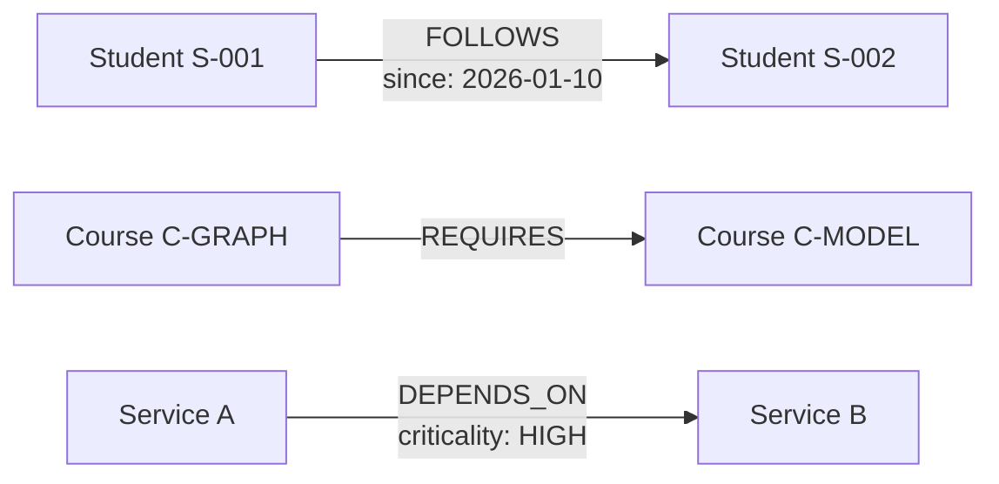
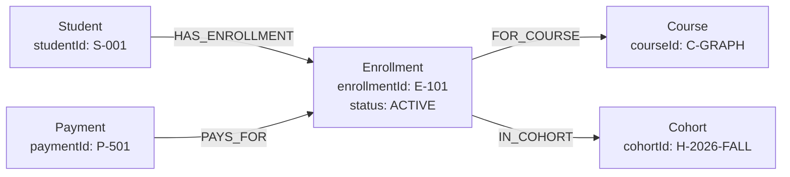
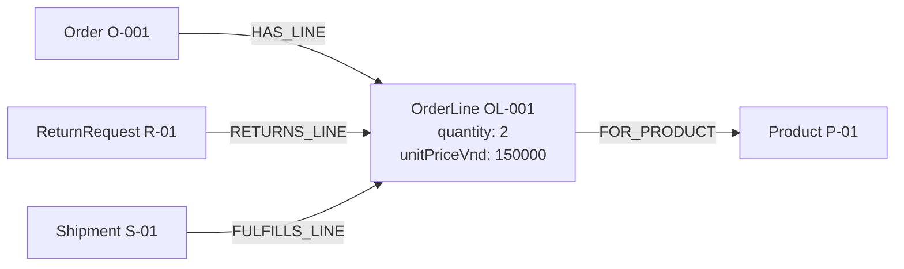

# Choosing Between Entity Vertices, Direct Edges, or Intermediate Vertices

When translating business requirements into a **property graph model**, the hard question is usually not "how many vertices should I draw?", but rather **what truly has an independent identity, what is merely an association, and when does that association need to be modeled as its own object?** For the same statement "a student enrolls in a course," you could create an `ENROLLED_IN` edge from student to course, or create an `Enrollment` vertex connected to the student, course, cohort, payment, and processing history. Both can be right, yet they serve different requirements.

This lesson is part of the **Graph Modeling** chapter of **DATABASE_DATA_MODELING**. The goal of the module is to turn business requirements into data models with clear entities, relationships, constraints, keys, indexes, and physical schemas, and then compare relational, document, graph, and analytical approaches to pick a structure that is easy to verify and evolve. Therefore, the "vertex, edge, or intermediate vertex" decision will be reasoned from **domain semantics and business queries**, not from syntax preferences or attractive diagrams.

After this lesson, you will be able to:

- Distinguish **entities**, **binary relationships**, **events/transactions**, and **multi-party relationships**.
- Choose whether a piece of data should be a **vertex property**, an **edge property**, or an **intermediate vertex** based on identity, multiplicity, and lifecycle.
- Spot situations where multiple direct edges lose business context.
- Design an example with diagrams and Cypher, and compare it with junction tables in a relational database.
- Define constraints, verification queries, and the trade-offs you must accept when introducing intermediate vertices.

## 1. Three Modeling Options

Suppose a system manages students and courses:

| Option | Representation | When to Use? |
| --- | --- | --- |
| **Entity vertex** | `(:Student {studentId, name})` | The student has their own identifier, properties, and lifecycle; many workflows need to reference that person. |
| **Direct edge** | `(Student)-[:ENROLLED_IN {enrolledAt, status}]->(Course)` | Enrollment is primarily a relationship **between exactly two objects**, with a few values attached to that link. |
| **Intermediate vertex** | `(Student)-[:HAS_ENROLLMENT]->(Enrollment)-[:FOR_COURSE]->(Course)` | Each enrollment becomes an **independent business record**, with its own identifier, multiple participating parties, status, or history. |

There is no rule saying "a relationship with properties must become a vertex" or "a many-to-many relationship must become an intermediate vertex." Property graphs allow **edges to carry properties**, and many engines allow multiple edges between the same two vertices. Creating an extra vertex should only come from capabilities the business needs, such as referencing the enrollment event itself, managing multiple enrollments for the same pair, or linking the enrollment event to payments and cohorts.

A useful starting question: **if you remove the two objects at the ends, is the information in the middle still something the business needs to identify, trace, or manage on its own?** This is a heuristic, not a sole test; an enrollment depends on a student and a course yet still has its own `enrollmentId` and lifecycle.

## 2. When Should a Concept Be an Entity Vertex?

A vertex (*node/vertex*) typically represents an entity that can be identified and queried independently. Check four characteristics:

1. **Identity:** does the object have a stable business key (`studentId`, `courseId`, `orderId`) rather than just a display value?
2. **Lifecycle:** is the object created, transitioned through states, deactivated, or deleted under its own rules?
3. **Connectivity:** do many other objects need to link to it, or do you want to query from it to explore relationships?
4. **Constraints and permissions:** are there ownership, security, uniqueness, or auditing rules specific to that object?

For example, a `Course` needs a vertex because it has an independent `courseId`, many learners participate in it, it teaches `Skill`s, has prerequisites, and has a publication status. `Student.name` is usually just a **property** on the `Student` vertex; creating separate vertices for every person's name does not help business workflows and introduces ambiguity when names collide.

### 2.1. Shared Values Are Not Necessarily Entities

Two courses sharing `level = 'BEGINNER'` do not necessarily need a `Level` vertex. If the level is just one of a few fixed values for filtering, a `level` property fits well. However, if levels have their own identifier, description, ordering, standard version, or multiple attached rules, `(:Level)` and a `HAS_LEVEL` edge may make more sense.

Similarly, a shipping address can be a **property snapshot** on an order when the goal is purely to record the exact details at purchase time. If you need to identify a normalized location to find orders sharing an address, manage addresses, or connect to delivery zones, an `Address` vertex model is an option. Many systems even need **both a transaction-time snapshot and a reference to the canonical address**, because canonical address details can change.

### 2.2. Business Keys Differ from Internal IDs

Do not rely solely on engine-assigned vertex IDs if objects must be synchronized across systems. Define `studentId`, `courseId`, `orderId`, or a reliable natural key and consider the corresponding unique constraint. A label like `:Course` only classifies vertices; it does not automatically ensure `courseId` uniqueness. Property existence enforcement, property typing, and multiplicity constraints depend on the specific database engine.

## 3. When Should a Relationship Be a Direct Edge?

An **edge** (*relationship/edge*) is the natural choice when a relationship can be clearly expressed as a verb from **one source vertex to one target vertex**, without needing an independent linking entity.

Examples:



`FOLLOWS.since`, `DEPENDS_ON.criticality`, or `REQUIRES.mandatory` are **properties of that exact link**. By themselves, they do not force you to create `Follow`, `Dependency`, or `Prerequisite` vertices.

### 3.1. Conditions Favoring a Direct Edge

A direct edge is usually enough when:

- The relationship has clear **binary** semantics: `A REQUIRES B`, `A FOLLOWS B`, `A DEPENDS_ON B`.
- Queries mainly ask "is there a link?", "who connects to whom?", or filter by a few edge properties.
- No third object needs to participate **in that exact relationship instance**.
- Other workflows do not need to reference a specific relationship instance directly.
- Multiplicity and update rules can be described cleanly: one valid edge per pair, or multiple edges distinguished by an identifier/attribute.

In a simple learning system, if each student only has **one current enrollment status** per course and queries only filter by status, the following edge can make sense:

```text
(:Student {studentId: 'S-001'})
  -[:ENROLLED_IN {
      enrolledAt: '2026-08-10',
      status: 'ACTIVE'
    }]->
(:Course {courseId: 'C-GRAPH'})
```

The `enrolledAt` timestamp should not be placed on `Student` or `Course`: each student enrolls in different courses at different times. This is a textbook example of **a property tied to a relationship**, even though the relationship remains represented as an edge.

### 3.2. Edge Direction Determines Meaning

With `(Course A)-[:REQUIRES]->(Course B)`, it means **A requires B**. If you flip the arrow while keeping the edge type name, you invert the business fact. Symmetric relationships such as "two people are friends" may still be stored with directed edges in a given system; when doing so, standardize the storage convention and bidirectional query pattern.

### 3.3. Multiple Edges Between the Same Two Vertices Can Be Valid

In some property graph engines, you can store two `ENROLLED_IN` edges between the same `Student` and `Course`, each carrying a different `term`. That is **not automatically an error**. However, if each enrollment round also involves payments, appeals, and state history, simply adding more property-bearing edges makes managing a specific instance harder. That is when to consider an intermediate vertex.

## 4. When Should a Relationship Be Promoted to an Intermediate Vertex?

An **intermediate vertex** (*association node*, *relationship node*, or *reification*) turns a relationship into an object that can be linked and managed like other entities. Do not confuse it with a meaningless "dummy vertex": if you decide to create an intermediate vertex, you must be able to explain **which business unit it represents**.

### 4.1. Five Key Signals

| Signal | Example | Why an Intermediate Vertex Helps |
| --- | --- | --- |
| **Has its own identity** | Enrollment `E-2026-041` can be looked up by code | Identifies a specific enrollment instance for editing, reconciliation, and customer support. |
| **Multiple parties participate in the same event** | A student enrolls in a course **within a specific cohort** and under a **discount package** | An `Enrollment` vertex binds all roles into one exact enrollment instance. |
| **Other objects link to the relationship itself** | Invoices, payments, certificates, refund requests belong to an enrollment instance | Most mainstream property graphs do not allow directly connecting an edge to another edge. |
| **Multiple instances between the same pair** | A student enrolls in the same course across two terms | Each instance has its own ID, timestamp, status, and history. |
| **Has its own lifecycle, workflow, or audit trail** | `REQUESTED -> APPROVED -> PAID -> CANCELLED` | Must track each state transition and process it independently. |

**Note:** an edge with timestamps, status, or multiple properties **can still be the right design**. What matters is whether the application needs to **reference, link, and govern the relationship as an independent entity**.

### 4.2. Example: An Enrollment Instance as a Business Object

Expanded requirement: "Each time a student enrolls in a course belonging to **a specific cohort**; the enrollment instance has its own ID, tuition is locked at enrollment time, it can be paid in multiple installments, and it can be canceled. A student can re-enroll in the same course in a later term."

Intermediate vertex model:



Enrollment `E-101` becomes **an identifiable linking node**. If the student returns next term, the system creates `E-102` pointing to the same `Student` and `Course`, but with a different `Cohort`, tuition, or status. A payment `P-501` knows precisely which enrollment instance it belongs to.

The edges `HAS_ENROLLMENT`, `FOR_COURSE`, `IN_COHORT`, and `PAYS_FOR` must be interpreted with their specific roles. For instance, `Payment -[:PAYS_FOR]-> Enrollment` is different from paying for **a course in general**; if a payment attaches directly via `Payment -> Course`, you lose information about which student and which enrollment term was paid for.

### 4.3. A Ternary Relationship Cannot Be Arbitrarily Split into Binary Edges

Suppose student `S-001` enrolls in course `C-GRAPH` in cohort `H1`, and also enrolls in course `C-SQL` in cohort `H2`. If you only record:

```text
Student S-001  --ENROLLED_IN--> Course C-GRAPH
Student S-001  --ENROLLED_IN--> Course C-SQL
Student S-001  --JOINS-------> Cohort H1
Student S-001  --JOINS-------> Cohort H2
```

you **cannot tell** which course enrollment cohort `H1` belongs to. Combining edges arbitrarily could fabricate a `C-GRAPH/H2` pair that never happened. This flaw is called **loss of co-occurrence**: independent binary relationships fail to constrain components to belong to **the same event**.

The `Enrollment` vertex groups the exact `(Student, Course, Cohort)` tuple for **each enrollment**. In a very simple problem, you could put `cohortId` as a property on the `ENROLLED_IN` edge and filter by it; however, if `Cohort` is a vertex with its own schedule, instructor, and location, or if you need to attach payments, an intermediate vertex is usually clearer and easier to extend.

### 4.4. Events with Their Own History and Provenance

An enrollment may carry `requestedAt`, `approvedAt`, `cancelledAt`, `status`, and cancellation reason. Storing only the current `status` on `Enrollment` is insufficient if the system must **reconstruct who approved it, when, and from which status to which status**. In that case you may also need `EnrollmentEvent` vertices, or an independent audit log, with each record linked to the same `Enrollment`.

**An intermediate vertex does not automatically create immutable history.** It simply provides the unit around which history is organized. Update rules, integrity, and event logging still have to be designed.

## 5. Side-by-Side Design: Direct Edge vs. Intermediate Vertex

For the same statement "a student enrolls in a course," let's examine two concrete versions.

### 5.1. Version A: `ENROLLED_IN` Edge

Assume at most one current enrollment exists between each student–course pair, and no other object needs to reference the enrollment instance.

```cypher
// Neo4j Cypher example. Run on an empty test database.
CREATE (s:Student {studentId: 'S-001', fullName: 'An'}),
       (c:Course {courseId: 'C-GRAPH', title: 'Graph Modeling'}),
       (s)-[:ENROLLED_IN {
         enrolledAt: date('2026-08-10'),
         status: 'ACTIVE'
       }]->(c);
```

Find the courses a student is currently enrolled in:

```cypher
MATCH (s:Student {studentId: $studentId})
      -[r:ENROLLED_IN]->(c:Course)
WHERE r.status = 'ACTIVE'
RETURN c.courseId AS courseId,
       c.title AS courseTitle,
       r.enrolledAt AS enrolledAt;
```

**Strengths:** short path (`Student -> Course`), fewer elements, direct queries. **Limitations:** when you need to attach `Payment`, `Cohort`, or `RefundRequest` to **a specific enrollment instance**, the model lacks an entity to join those roles, unless you change the structure or rely on property-based link keys.

### 5.2. Version B: `Enrollment` Vertex

Assume a student can enroll in a course multiple times, and each instance has its own ID, cohort, and payments.

```cypher
// Standalone example; run in a different test database from version A.
CREATE (s:Student {studentId: 'S-001', fullName: 'An'}),
       (c:Course {courseId: 'C-GRAPH', title: 'Graph Modeling'}),
       (h:Cohort {cohortId: 'H-2026-FALL', term: '2026-FALL'}),
       (e:Enrollment {
         enrollmentId: 'E-101',
         enrolledAt: date('2026-08-10'),
         tuitionVnd: 1200000,
         status: 'ACTIVE'
       }),
       (s)-[:HAS_ENROLLMENT]->(e),
       (e)-[:FOR_COURSE]->(c),
       (e)-[:IN_COHORT]->(h);
```

Retrieve the list of **enrollments**, preserving cohort info and each instance's ID:

```cypher
MATCH (s:Student {studentId: $studentId})
      -[:HAS_ENROLLMENT]->(e:Enrollment)
      -[:FOR_COURSE]->(c:Course)
OPTIONAL MATCH (e)-[:IN_COHORT]->(h:Cohort)
RETURN e.enrollmentId AS enrollmentId,
       c.courseId AS courseId,
       h.cohortId AS cohortId,
       e.status AS status,
       e.tuitionVnd AS tuitionVnd
ORDER BY enrollmentId;
```

For payment-related queries, you can add `(p:Payment)-[:PAYS_FOR]->(e:Enrollment)` to know **precisely which enrollment** the money applies to. Traversal hops increase, but every step carries an explicit business role.

### 5.3. Compare Based on Requirements, Not Line Count

| Criterion | Direct Edge `ENROLLED_IN` | Intermediate Vertex `Enrollment` |
| --- | --- | --- |
| Identifying an enrollment | Usually relies on vertex pair and edge properties; depends on product's edge-ID management | Has business `enrollmentId`, convenient for referencing outside the graph |
| Multiple rounds between the same pair | Multiple edges possible where supported, but each round must be distinguished | Each round is an independent vertex |
| Enrollment date, status properties | Placed directly on edge, concise | Placed on the enrollment vertex |
| Linking to term, invoice, refund | Hard to connect **to the edge itself** in many property graphs | All parties point to the `Enrollment` vertex |
| Path simplicity | Fewer hops | More vertices/edges and constraint conditions |
| Auditing and multi-stage lifecycle | Needs auxiliary mechanisms/identifiers | Provides a hub to attach history, though auditing still needs design |
| Consistent updateability | Fewer moving parts if domain is simple | Must ensure edges to `Enrollment` are not missing, duplicated, or misassigned |

Having an intermediate vertex **does not automatically improve performance**. It increases stored elements, traversal hops, and write operations; in return, it can clarify business data, reduce ambiguity, and support queries that are awkward to express with direct edges.

## 6. Second Example: `OrderItem` Between Order and Product

Order `O-001` contains product `P-01` with quantity 2 and unit price at purchase time 150,000 VND. There are two ways to model it.

**Option A — direct edge:**

```text
(Order O-001)-[:CONTAINS {quantity: 2, unitPriceVnd: 150000}]->(Product P-01)
```

This makes sense when each order has only one line per product, individual lines never need to be referenced, and there are no separate line-level workflows.

**Option B — order line vertex:**



If the same product can appear as **two distinct lines** due to promotions, different purchase-time prices, or split fulfillment; or if returns, exchanges, partial deliveries, and discounts attach to **a specific line**, `OrderLine` should have its own `orderLineId`. You must also store **unit price and product details at purchase time** on the order line or an appropriate snapshot. Referencing only `Product`'s current price can cause historical order reports to mutate whenever the price list changes.

This is a classic example: in relational databases, `order_items` is sometimes called a "junction table" between `orders` and `products`, yet semantically it is usually a **line-item entity** with its own identity and transaction details. When moving to a graph, do not force it into an edge if external processes still need to reference individual lines.

## 7. Decision Table: Vertex, Property, Edge, or Intermediate Vertex?

The sequence below helps produce an initial design you can defend.

| Sequential Question | If "Yes" | If "No" |
| --- | --- | --- |
| 1. Does the concept have an independent identity/lifecycle and get referenced across workflows? | Consider an **entity vertex** | Consider a property or relationship |
| 2. Is it merely a value describing another object or relationship? | **Property** on the right vertex or edge | Continue |
| 3. Does it describe a clear link between exactly two vertices? | Can be a **direct edge**, including a property-bearing edge | Must model a multi-party event/relationship |
| 4. Do other parties need to link to **this exact relationship instance**? | Consider an **intermediate vertex** | A direct edge may still suffice |
| 5. Does the relationship occur multiple times between the same pair, each with its own ID and workflow? | Consider an **intermediate / event vertex** | No need to create a vertex solely because it is many-to-many |
| 6. Does the intermediate vertex clarify business questions with acceptable operational cost? | Choose the intermediate model and design constraints | Keep the model simple and document its limits |

### Quick Application Examples

| Business Statement | Usually Reasonable Choice | When to Change the Choice? |
| --- | --- | --- |
| User follows another user since date X | `FOLLOWS {since}` edge | When each follow/unfollow action has its own ID, evidence, or moderation workflow |
| Course A requires course B | `REQUIRES` edge | When the **prerequisite rule** has versions, compound conditions, approvers, and independent history |
| Device has name, type, stable identifier | `Device` vertex | If it is just a descriptive string never needing links or separate lookup, it can be a property |
| Student has a display name | `Student.displayName` property | If the "name/alias" object has its own identity or required relationships |
| Student enrolls in a course, one current status | `ENROLLED_IN` edge with properties | When multiple rounds, multiple parties, or workflow history must be tracked separately |
| Order contains multiple product lines with separate returns and shipments | `OrderLine` vertex | If only a simple item list is needed, a property-bearing edge may suffice |
| Employee holds a role on a project from date A to B | `ASSIGNED_TO {role, from, to}` edge in simple cases | When each assignment has approvals, budgets, history, and tasks attached to it |

This is a **discussion guide for modeling**, not a mechanical formula. A relationship type may start as a direct edge and later be promoted to an entity as the domain grows; it may also remain an edge if all real queries only need the two endpoints and a few properties.

## 8. Designing Keys, Multiplicity, and Integrity

Choosing an intermediate vertex introduces constraints that must be documented explicitly. For `Enrollment`:

- **Identity:** `Student.studentId`, `Course.courseId`, `Cohort.cohortId`, and `Enrollment.enrollmentId` are unique within their respective object types.
- **Multiplicity:** one `Enrollment` belongs to exactly one `Student`, one `Course`, and per current requirements exactly one `Cohort`. One `Student` can have many `Enrollment`s.
- **Valid duplicates:** multiple `Enrollment`s may share the same `(Student, Course)` pair across terms, but two records must never share the same `enrollmentId`.
- **Status:** `status` belongs to a valid set, and state transitions follow the workflow.
- **Existence and consistency:** creating an enrollment must create its required edges, or the transaction must not be considered complete.
- **Deletion:** deleting a `Course` that still has enrollments requires a clear policy: block deletion, archive, deactivate, or migrate references according to workflow.

In **Neo4j Cypher**, you can start with unique constraints:

```cypher
CREATE CONSTRAINT enrollment_id_unique IF NOT EXISTS
FOR (e:Enrollment) REQUIRE e.enrollmentId IS UNIQUE;

CREATE CONSTRAINT student_id_unique IF NOT EXISTS
FOR (s:Student) REQUIRE s.studentId IS UNIQUE;

CREATE CONSTRAINT course_id_unique IF NOT EXISTS
FOR (c:Course) REQUIRE c.courseId IS UNIQUE;
```

These constraints illustrate **uniqueness when the property exists**. Depending on product/version, another constraint may be needed to require the property's presence. **A unique constraint on IDs does not automatically guarantee** that every `Enrollment` has exactly one `FOR_COURSE` edge or no mislinked student; multiplicity constraints usually must be enforced in the write layer, transactions, and consistency checks.

### 8.1. Creating Consistent Data When Using Intermediate Vertices

The following example assumes `Student`, `Course`, and `Cohort` already exist with the passed IDs; the application executes the whole statement in one transaction and handles the case where an endpoint is not found.

```cypher
MATCH (s:Student {studentId: $studentId})
MATCH (c:Course {courseId: $courseId})
MATCH (h:Cohort {cohortId: $cohortId})
CREATE (e:Enrollment {
  enrollmentId: $enrollmentId,
  enrolledAt: date(),
  status: 'REQUESTED'
})
CREATE (s)-[:HAS_ENROLLMENT]->(e)
CREATE (e)-[:FOR_COURSE]->(c)
CREATE (e)-[:IN_COHORT]->(h)
RETURN e.enrollmentId AS enrollmentId;
```

If any of the `MATCH` clauses finds no vertex, the query will not create `Enrollment`; the application must distinguish that from a successful creation. On retries, `CREATE` can trigger a duplicate-key error; clearly define **idempotency** by `enrollmentId` and only use `MERGE` once you understand unique keys and update rules. Never accidentally create a new `Course` or `Student` just because an incoming enrollment event carries an unfamiliar ID.

### 8.2. Do Not Duplicate the Same Fact Without Reason

Suppose you store both `(Student)-[:ENROLLED_IN]->(Course)` and `(Student)-[:HAS_ENROLLMENT]->(Enrollment)-[:FOR_COURSE]->(Course)` for the same concept. A cancellation might update only the direct edge and miss the `Enrollment` vertex. The two representations will contradict each other without strict governance. You may keep a direct edge as a **derived relationship** to speed up queries, but you must designate the source of truth, sync timing, and drift detection.

## 9. Impact on Queries, Indexes, and Performance

A modeling choice is only good when it serves the most important queries the system must answer.

### 9.1. Query Starting Points

With a direct edge, queries start from `Student.studentId` and traverse one edge to `Course`. With an intermediate vertex, queries start from `Student.studentId`, step to `Enrollment`, and then to `Course` or `Cohort`. When looking up a single enrollment by `enrollmentId` for customer support or refunds, making `Enrollment` a vertex allows **direct key lookup of that object** before traversing to related parties.

If the application frequently searches for "all enrollments pending approval today," the `Enrollment` vertex with `status` and `enrolledAt` can serve as the query entry point; consider indexes based on **frequently used filters** and actual statistics. Some engines support property indexes on edges, while others have different capabilities; do not assume identical indexing benefits across all graph databases.

### 9.2. Overhead Added by Extra Vertices

Replacing one `ENROLLED_IN` edge with **one vertex and two or more edges** increases stored elements, traversal hops, and write operations. If millions of users follow one another and you only ask "who follows whom?", turning every `FOLLOWS` link into its own vertex can create unnecessary overhead. Conversely, if the business attaches a dozen object types to every enrollment, adding an `Enrollment` vertex can lower semantic and integrity complexity even though queries traverse more hops.

### 9.3. Test Against Concrete Workloads

Do not compare only vertex counts, edge counts, or Cypher line counts. Compare:

| Real Query | What to Measure / Verify |
| --- | --- |
| List active courses for a student | Latency, number of expanded elements, cache hit ratio, and accuracy |
| Look up an enrollment by `enrollmentId` | Single-event lookup, path to student/course/cohort |
| Find unpaid enrollments by status and term | Filters, indexes, data distribution by status and time |
| Reconcile enrollments and payments | No missing/orphaned links, no inflated counts from multiple payment rows |
| Sync data from primary transactional system | Lag, duplicate event handling, recoverability, and consistency |

In queries joining multiple `Payment` edges per `Enrollment`, a combined `MATCH` can return **multiple rows for the same enrollment**. When aggregating, choose the right grain, use `DISTINCT` where appropriate, or group by `enrollmentId` instead of accidentally counting payments as enrollments.

## 10. Relationship to Relational and Document Models

### 10.1. A Relational Junction Table Does Not Always Map to a Graph Edge

A simple table:

```sql
CREATE TABLE course_prerequisites (
    course_id VARCHAR(32) NOT NULL,
    prerequisite_course_id VARCHAR(32) NOT NULL,
    PRIMARY KEY (course_id, prerequisite_course_id),
    FOREIGN KEY (course_id) REFERENCES courses(course_id),
    FOREIGN KEY (prerequisite_course_id) REFERENCES courses(course_id),
    CHECK (course_id <> prerequisite_course_id)
);
```

maps quite naturally to `(Course)-[:REQUIRES]->(Course)`. The table has two foreign keys and primarily answers a **binary link**. However, the `CHECK` rule on two IDs only prevents direct self-dependency; preventing longer cycles requires additional logic or graph checks.

Another table:

```sql
CREATE TABLE enrollments (
    enrollment_id VARCHAR(32) PRIMARY KEY,
    student_id VARCHAR(32) NOT NULL REFERENCES students(student_id),
    course_id VARCHAR(32) NOT NULL REFERENCES courses(course_id),
    cohort_id VARCHAR(32) NOT NULL REFERENCES cohorts(cohort_id),
    enrolled_at TIMESTAMP NOT NULL,
    status VARCHAR(24) NOT NULL
);
```

is not just a table "joining two foreign keys": it has its **own enrollment ID**, connects **three entity types**, and has its own status. Mapping it to an `Enrollment` vertex with role-specific edges is usually much more natural. If each student is allowed to re-enroll in the same course multiple times, **do not put** `UNIQUE(student_id, course_id)` without additional qualifiers like term or an active-enrollment uniqueness rule.

### 10.2. Document Models Can Embed Relationships Inside One Object

In a `Student` document, you might have an `enrollments` array containing `courseId`, `cohortId`, `enrolledAt`, and `status`. This works well if the application usually loads a student's full list and updates within the document boundary. However, when an enrollment must be referenced by multiple systems or linked to many other objects, you must manage IDs, consistency, and cross-document updates. At that point you might pick a standalone `Enrollment` document, a relational model, or a graph vertex depending on the workload.

### 10.3. Analytical Warehouses View Events Differently

An analytical warehouse might use a `fact_enrollment` table at the **per-enrollment** grain, with keys to student, course, cohort, date, and amount. That grain is close in meaning to the `Enrollment` vertex, yet the goal is aggregating cohorts, conversion rates, revenue, and dimensional slicing; graphs focus on **connections and paths**. The same business event can have different physical representations for different purposes.

## 11. Common Mistakes

1. **Creating a vertex for every verb.** `Student FOLLOWS Student` only needs an edge if follow actions do not have an independent identity. "Every relationship must be a vertex" creates unnecessary structure.
2. **Forcing every associative entity into an edge.** `OrderLine` with returns, shipments, and its own line ID remains an important business entity, even though it sits between `Order` and `Product`.
3. **Splitting multi-party relationships into pairs and losing context.** Separate edges from `Student` to `Course` and `Cohort` cannot prove which course was taken in which cohort on each enrollment.
4. **Confusing object properties with relationship properties.** `enrolledAt` does not belong to `Course` itself; `priceAtPurchase` is not `Product`'s current price.
5. **Overwriting distinct occurrences.** If re-enrolling in the same course creates a new round, mutating the old edge or vertex destroys history and reconciliation.
6. **Using labels/edge types to encode variable data.** `:ENROLLED_2026_FALL` bloats the relationship type list; term info should usually be a property or an edge to a `Cohort` vertex.
7. **Skipping constraints after changing the model.** An `Enrollment` vertex is not automatically guaranteed to have exactly one student, one course, or one cohort. Write rules and data checks are still required.
8. **Storing two redundant representations without sync.** An `Enrollment` vertex and a shortcut `ENROLLED_IN` edge can contradict each other without a single source of truth.
9. **Designing from diagrams instead of queries.** A diagram full of neat vertices is not necessarily fast, easy to maintain, or faithful to the workflow.

## 12. Practice Exercises and Suggested Solutions

### Exercise 1 — Dependency Relationships

A service management system needs to represent "Service A depends on Service B," with `criticality = HIGH`, and query which services are affected when B fails. Each dependency link has no separate ID and attaches to no other event.

**Question:** choose an edge or an intermediate vertex? Which direction makes sense?

**Suggested solution:** use `(Service A)-[:DEPENDS_ON {criticality: 'HIGH'}]->(Service B)`. When B fails, traverse **in reverse** along `DEPENDS_ON` to find services that directly and indirectly depend on B. Cycles and query bounds must be handled per requirements. If later each dependency agreement has versions, approvers, and event chains, a separate `DependencyAgreement` vertex can be introduced.

### Exercise 2 — Medical Appointment Booking

A patient books an appointment with a doctor at a clinic, with `appointmentId`, appointment time, status, payment method, ability to change doctors, and cancellation log. The appointment must be referenceable from notifications, invoices, and post-visit reviews.

**Question:** can we simply connect `Patient -> Doctor` with a `VISITS` edge?

**Suggested solution:** use an `Appointment` vertex because **each appointment** is an event with its own identity, timestamp, multiple parties, and lifecycle. You can model `(Patient)-[:BOOKED]->(Appointment)-[:WITH_DOCTOR]->(Doctor)`, and connect `Appointment` to `Clinic` and `Invoice` as required. Properties like `scheduledAt` and `status` belong on `Appointment`; critical change history may need separate event records.

### Exercise 3 — Line-Level Promotions

An order has two lines with the same `productId` because one line uses a promo code and one line is at regular price. The customer can return just one specific line. Choose between `Order-[:CONTAINS {quantity, price}]->Product` and `Order -> OrderLine -> Product`.

**Suggested solution:** use `OrderLine` with `orderLineId`, `quantity`, `unitPriceAtPurchase`, `discountApplied`, and connect `ReturnRequest` to the exact `OrderLine`. If you need to keep two distinct lines yet store only one aggregated edge per `(Order, Product)` pair, promo and return details get merged incorrectly. An engine allowing multiple direct edges can still store separate lines, but requires stable IDs and per-edge referencing; when multiple objects attach to it, an `OrderLine` vertex usually expresses it more clearly.

### Exercise 4 — Auditing an Incomplete Design

An analysis team creates `Enrollment` with `enrollmentId`, but only connects `(Student)-[:HAS_ENROLLMENT]->(Enrollment)` and stores `courseTitle` on `Enrollment` instead of linking to the existing `Course` vertex.

**Question:** what problems can this model cause?

**Suggested solution:** course titles can collide or change; without a relationship to `Course`, it is hard to query enrollments starting from a course and hard to enforce valid reference IDs. Add an `(Enrollment)-[:FOR_COURSE]->(Course)` edge to a course with a stable `courseId`; if the title at enrollment time must be preserved for auditing, keep a separate `courseTitleAtEnrollment` snapshot property with its own explicit semantics.

## Conclusion

Choose a **vertex** for entities with an identity and lifecycle to manage; choose a **direct edge** to express a clear binary relationship, even when the edge carries properties; and choose an **intermediate vertex** when a **relationship instance** needs its own identity, links multiple parties, is referenced by other objects, or has its own workflow and history. No representation is inherently best by default: the right model preserves business semantics, supports required queries, and carries acceptable constraints and operational cost.
