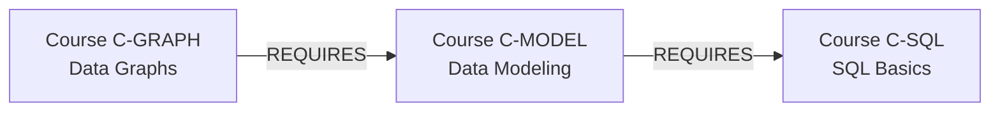
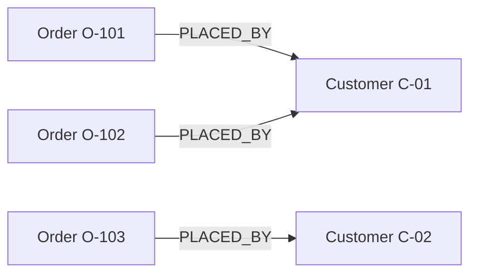
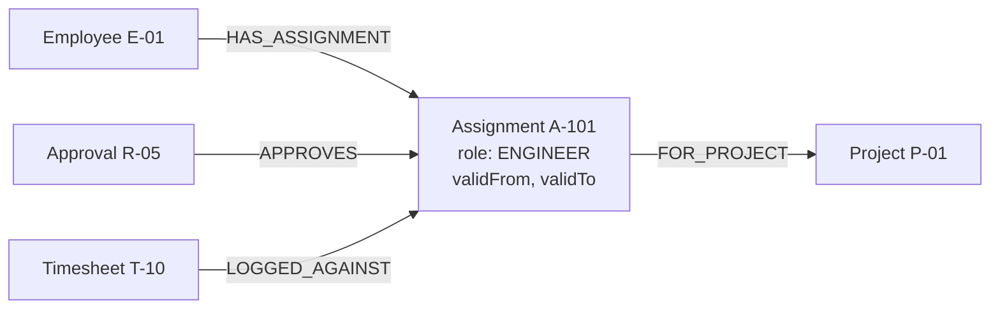

# Edge Direction, Multiplicity, and Relationships with Properties or Effective Time

In a graph model, expressing "A is connected to B" is only the first step. For the data to answer business questions accurately, you must also specify **who is the source and who is the target; how many links each object is allowed to have; which details belong to the link itself; and from when until when the link is valid**. Missing any of these decisions, the very same diagram can produce contradictory query results.

This lesson belongs to the **Graph Modeling** chapter of **DATABASE_DATA_MODELING**. The goal of the module is to train how to turn business requirements into clear entities, relationships, constraints, keys, indexes, and physical schemas; then compare relational, document, graph, and analytical models to choose a structure that is fit for purpose, verifiable, and evolvable. Here, we focus on **edge semantics in a property graph** and how to translate those semantics into design rules, queries, and data validation.

After this lesson, you will be able to:

- Determine edge direction from a business statement and distinguish **storage direction** from **relationship semantics**.
- Specify multiplicity, optionality/mandatory rules, and cases with multiple edges between the same two vertices.
- Place properties accurately on edges while recognizing when an event vertex or intermediate vertex is needed.
- Design relationships with **effective time**, run point-in-time queries, and handle historical changes.
- Express constraints in the logical schema, implement them via appropriate constraints/transactions, and test with boundary cases.

## 1. An Edge Is a Structured Business Statement

Consider three requirements:

1. "The course Data Graphs **requires** the course Data Modeling."
2. "Order O-101 was **placed by** customer C-01."
3. "Employee E-01 is **assigned to** project P-01 starting 2026-01-01, in an engineer role at 50% allocation."

All three can be represented as edges, yet they have different characteristics:

| Relationship | Suggested Direction | Multiplicity to Consider | Data on the Edge |
| --- | --- | --- | --- |
| Course requires course | `(Course)-[:REQUIRES]->(Course)` | One course can require many courses; one course can be a prerequisite for many others | `mandatory`, `validFrom` if the curriculum is versioned |
| Order placed by customer | `(Order)-[:PLACED_BY]->(Customer)` | Each order has exactly one customer by assumption; one customer can place many orders | Usually just the edge; transaction context lives primarily on `Order` |
| Employee assigned to project | `(Employee)-[:ASSIGNED_TO]->(Project)` | Many employees per project, one employee across many projects; possibly multiple **assignment periods** between the same pair | `role`, `allocationPct`, `validFrom`, `validTo` |

In a directed property graph, the general pattern is:

```text
(sourceVertex)-[:EDGE_TYPE {property: value}]->(targetVertex)
```

Vertex labels and edge types express **stable domain concepts**. Properties express **values of an object or a relationship instance**. Do not use edge type names like `ASSIGNED_TO_P01_IN_2026` to encode project and year data; the project should have its own identifier, and the effective interval belongs in the data.

## 2. Edge Direction: Choose by Semantics, Not Diagram Layout

### 2.1. Active-Voice Sentences for a Readable Convention

A directed edge is a statement from source to target. For prerequisite relationships:



The convention is **advanced course `REQUIRES` prerequisite course**. Therefore:

- To find *courses that C-GRAPH needs to take first*, traverse **in the direction of** `REQUIRES`.
- To find *courses that will be affected when C-MODEL changes*, traverse **against the direction of** `REQUIRES`.
- To find all indirect prerequisites, you can traverse **multiple consecutive edges** in the same direction, provided cycle guards and appropriate query bounds are applied.

Neo4j Cypher syntax example:

```cypher
// Direct prerequisites of a course
MATCH (course:Course {courseId: $courseId})
      -[:REQUIRES]->(prerequisite:Course)
RETURN prerequisite.courseId AS prerequisiteId;
```

```cypher
// Courses directly depending on a given course
MATCH (dependent:Course)-[:REQUIRES]->
      (changed:Course {courseId: $courseId})
RETURN dependent.courseId AS dependentId;
```

Flipping arrows on a diagram without updating the convention inverts the meaning of all dependent queries. Therefore, model documentation should always read an edge as **a complete sentence**, such as "A requires B," "order is placed by customer," or "employee is assigned to project."

### 2.2. Storage Direction Does Not Automatically Mean a One-Way Relationship

The relationship "user A follows B" is **asymmetric**: A following B does not make B follow A. By contrast, "A and B are friends" may be defined as **symmetric** in the domain, even when the database engine stores directed edges.

For symmetric relationships, the design team must adopt one consistent convention:

- **One edge representing an unordered pair:** you can canonicalize the order of the two IDs on write and query without direction.
- **Two directed edges:** use when the product genuinely distinguishes two independent decisions, e.g., A accepts friendship with B and B accepts friendship with A. If the two edges merely mirror a single fact, you must have a mechanism to keep them consistent.

In Cypher, the arrowless pattern below matches `FRIEND_WITH` edges **regardless of stored direction**:

```cypher
MATCH (p:Person {personId: $personId})
      -[:FRIEND_WITH]-(friend:Person)
RETURN DISTINCT friend.personId AS friendId;
```

An undirected query **does not make every relationship symmetric in domain meaning**. It simply tells the engine to match either stored direction.

A common mistake is storing both `(A)-[:OWNS]->(B)` and `(B)-[:OWNED_BY]->(A)` "to make lookups easier," even though they state the same fact. This creates extra synchronization burden when A stops owning B. Only store redundant derived relationships once a source of truth is defined and real workload evidence justifies the benefit.

### 2.3. Self-Loops and Cycles May Be Valid or Invalid

Property graphs generally permit an edge pointing back to the same vertex (*self-loop*), such as `(Course)-[:REQUIRES]->(Course)`. However, for prerequisites, that is a business error. A cycle `A REQUIRES B`, `B REQUIRES C`, `C REQUIRES A` is also typically invalid even without a self-loop.

Conversely, transit networks have one-way routes returning to the origin; social networks have follower cycles; service dependency graphs may contain cycles that need to be **detected and handled**, rather than blindly deleted.

Separate two layers of rules:

1. **Structural:** which edge types, directions, and cycles can the database engine store?
2. **Business:** does a specific relationship type allow self-loops, cycles, or bidirectional links?

Do not assume declaring the `REQUIRES` edge type automatically prevents cycles. That behavior must be checked on write or enforced by a dedicated verification workflow.

## 3. Multiplicity: How Many Edges May Each Vertex Have?

**Multiplicity (cardinality)** describes the valid number of links a vertex may have in a given edge-endpoint role. It differs from the current vertex count in the database: the fact that every order today happens to have one customer does not prove the schema enforces it.

Common notations:

| Notation | Meaning |
| --- | --- |
| `0..1` | Zero or at most one link |
| `1` | Must have exactly one link |
| `0..*` | Zero or many links |
| `1..*` | Must have at least one link |

### 3.1. Reading Multiplicity at Each Endpoint

Suppose the model is:



If policy requires every order to belong to **exactly one** customer:

- For **each `Order`**, the number of outgoing `PLACED_BY` edges must be **1**.
- For **each `Customer`**, the number of incoming `PLACED_BY` edges can be **0..***.

This is a **one-to-many** relationship viewed from customer to order, even though the arrow is stored from *order -> customer*. "One-to-many" does not require drawing the arrow from the "one" side to the "many" side.

Other relationships:

| Edge Type | Edges From One Source Vertex | Edges To One Target Vertex | Business Assumption |
| --- | --- | --- | --- |
| `(Order)-[:PLACED_BY]->(Customer)` | One `Order`: `1` | One `Customer`: `0..*` | An order must have one customer; a customer may not have placed any order yet |
| `(Employee)-[:ASSIGNED_TO]->(Project)` | One employee: `0..*` | One project: `0..*` | Can join multiple projects, and one project has multiple people |
| `(Course)-[:REQUIRES]->(Course)` | One course: `0..*` | One course: `0..*` | A course can have many prerequisites and be a prerequisite for many other courses |
| `(Invoice)-[:BILLS]->(Order)` | One invoice: `1` | One order: domain-dependent, e.g., `0..*` | Multiple billing installments may exist; must be defined upfront |

Multiplicity is always tied to a **specific scope and rule**. "Each employee has only one manager" may hold **at a single point in time**, yet not hold across multi-year history. "Each order has only one payment" can be false if customers pay in installments. Always state whether the rule applies currently, per version, per organization, or over time.

### 3.2. Mandatory Is Different from Unique

These two statements are not the same:

- "An order has **at most one** customer": `0..1`, may be absent.
- "An order has **exactly one** customer": `1`, both **required to exist** and **forbidden from having two**.

Likewise, a unique constraint on `Order.orderId` does not ensure each `Order` has exactly one `PLACED_BY` edge. It only enforces the vertex ID rule if the database engine supports that constraint. Controlling edge counts, required vertices, and endpoint roles usually requires transactions, application logic, or consistency-check jobs.

### 3.3. Multiple Edges Between the Same Pair of Vertices

Many property graphs permit multiple edges of the same type between the same two vertices (*parallel edges*). For instance, an employee joins a project across two phases:

```text
(Employee E-01)
  -[:ASSIGNED_TO {role: 'ENGINEER', validFrom: 2026-01-01, validTo: 2026-07-01}]->
(Project P-01)

(Employee E-01)
  -[:ASSIGNED_TO {role: 'TECH_LEAD', validFrom: 2026-07-01, validTo: ...}]->
(Project P-01)
```

These two edges represent **two valid phases**, not duplicate data under the stated domain definition. However, if the team only intends to store one current assignment per pair, having two active edges would be a bug.

You must precisely define the **logical key of a relationship instance**, for example:

- One unique current relationship per `(employeeId, projectId)`.
- One unique assignment period per `(employeeId, projectId, role, validFrom)`.
- Or a dedicated `assignmentId` per round if independent management and referencing are needed.

Choose the key based on event semantics, not solely from the two endpoint vertices.

## 4. Edge Properties: Data Belonging to the Link Itself

Property graph edges can carry data such as start date, role, allocation percentage, evidence source, or priority.

```text
(:Employee {employeeId: 'E-01'})
  -[:ASSIGNED_TO {
      role: 'ENGINEER',
      allocationPct: 50,
      validFrom: 2026-01-01,
      validTo: 2026-07-01
    }]->
(:Project {projectId: 'P-01'})
```

The `role` and `allocationPct` properties describe **what E-01 did on P-01 during that phase**, not that E-01 is permanently an engineer or that project P-01 always has 50% allocation. Placing them on `Employee` or `Project` would lose data when an employee works on multiple projects in different roles.

### 4.1. How to Determine the "Grain" of a Property

Finish this sentence: "This value belongs to **which object or which relationship instance**?"

| Property | Where It Usually Belongs | Reason |
| --- | --- | --- |
| `Employee.employeeId`, `Employee.displayName` | `Employee` vertex | Identifies/describes the employee |
| `Project.projectId`, `Project.name` | `Project` vertex | Identifies/describes the project |
| `ASSIGNED_TO.role` | `ASSIGNED_TO` edge | Role of **one employee on one project/phase** |
| `ASSIGNED_TO.allocationPct` | `ASSIGNED_TO` edge | Allocation in one phase, which can differ on other projects |
| `ASSIGNED_TO.validFrom`, `validTo` | `ASSIGNED_TO` edge | Time interval during which the assignment phase is active |
| `Project.budgetVnd` | `Project` vertex, or a versioned structure if history is needed | Budget of the project, which may change across versions |

Properties should not overwrite historical facts if queries need to reconstruct the past. For example, an order's price on the purchase date should not simply be derived from the product's currently active price.

### 4.2. When Edge Properties Are Not Enough

A direct edge fits if the relationship only needs two endpoints and a set of properties. However, consider an **intermediate vertex** `Assignment` if an assignment instance:

- Has its own `assignmentId` used in other systems.
- Involves multiple parties, such as project, budget slot, approver, and contract.
- Is pointed to directly by invoices, timesheets, approvals, or adjustment requests.
- Goes through multiple amendments, approval workflows, and an independent event history.



Effective time **does not automatically require** creating an intermediate vertex: an `ASSIGNED_TO` edge with a date range is a valid model if the domain is simple enough. An intermediate vertex adds storage, edge, and write-operation overhead in exchange for directly referencing and auditing **one exact event**. Do not create both a shortcut `ASSIGNED_TO` edge and an `Assignment` vertex for the same fact without defining which is the primary source of truth and how they synchronize.

## 5. Effective Time: When Is a Relationship True?

For a relationship with a lifecycle, the question "are these two vertices connected?" must add "**as of when?**". A relationship that was true in the past may no longer hold today.

### 5.1. Choose an Interval Convention Before Writing Data

A consistent and convenient convention is **half-open**:

```text
[validFrom, validTo)
```

Meaning **inclusive** of `validFrom` and **exclusive** of `validTo`. A point in time `t` falls inside the interval if:

```text
validFrom <= t AND (validTo is absent OR t < validTo)
```

Example:

```text
Role ENGINEER:  [2026-01-01, 2026-07-01)
Role TECH_LEAD: [2026-07-01, +infinity)

Timestamp 2026-06-30: ENGINEER
Timestamp 2026-07-01: TECH_LEAD
```

The two intervals meet flush on July 1 without **overlapping**. If you use closed endpoints `[start, end]` without extra rules, the transition timestamp would match both intervals simultaneously.

| Rule | Interpretation and Verification |
| --- | --- |
| `validFrom` is required | Every relationship has a business start date |
| `validTo` may be absent | Relationship has no scheduled end date yet; treated as open-ended into the future |
| `validTo > validFrom` when `validTo` is present | Disallow empty intervals or ending before starting |
| Compare at the same precision | Do not mix plain dates with timestamps with hours without defining conversion |
| Explicit overlap rule | Two intervals `[a, b)` and `[c, d)` overlap when `a < d` and `c < b`, with corresponding open-end handling |

In Neo4j, properties cannot store an explicit `null` value as an existing property; setting `null` normally removes the property. Thus, `r.validTo IS NULL` in the Cypher below expresses **no end value present**. If another product distinguishes `null` from a missing property, standardize the mapping.

### 5.2. Distinguish Plain Dates from Timestamps with Time of Day

If assignment policy operates on **calendar workdays**, `date` may suffice. If an access grant is valid from 09:30 to 12:00 in a specific time zone, you need an appropriate `datetime` type and a time-zone convention.

- Absolute instants should be stored with a time zone or in UTC, while retaining the business time zone if local calendar display or calculation is required.
- Never guess whether `2026-07-01` means end-of-day or start-of-day; the `[start, end)` convention must be explicitly documented.
- For local calendar schedules, daylight saving time rules and time-zone offsets can make "add 24 hours" different from "next calendar day."

### 5.3. Historical Edges and Current Edges

In a **multi-edge history** model, after a role change, do not delete the old edge. Close `validTo` on the prior phase and create a new edge whose `validFrom` equals the transition date.

Example:

| Employee | Project | Role | `validFrom` | `validTo` |
| --- | --- | --- | --- | --- |
| E-01 | P-01 | ENGINEER | 2026-01-01 | 2026-07-01 |
| E-01 | P-01 | TECH_LEAD | 2026-07-01 | Absent |
| E-02 | P-01 | DESIGNER | 2026-03-01 | 2026-10-01 |

When asking "Who was on project P-01 in June?", the query must filter on the effective interval; traversing all `ASSIGNED_TO` edges without filtering **mixes current and historical data**.

### 5.4. Valid Time Differs from When the System Learned the Fact

At least two time axes must be distinguished:

| Time Axis | Question | Example |
| --- | --- | --- |
| **Valid time** — business effective time | "When was the relationship actually considered in effect?" | On 07/01 the employee began serving as tech lead |
| **Transaction/record time** — system recording time | "Since when did the system know or record this fact?" | Only on 07/03 did HR enter the decision effective from 07/01 |

If you only store `validFrom` and `validTo`, you can answer "which date was the relationship effective on," but **you cannot reliably reconstruct** "on 07/02 what did the system believe?" when retroactive edits occur. Problems requiring both effective-time history and recording-time history are called **bitemporal modeling**. They typically require immutable versions, change events, or a dedicated history model with dual-axis query rules; merely adding `recordedAt` to an edge and updating that edge in place is not enough to preserve previously recorded versions.

Example: on 08/10, it is discovered that the role change should have been effective from 06/15 instead of 07/01. If you mutate the old record in place, today's query about 06/20 becomes more accurate, but evidence that the system once recorded 07/01 is lost. Depending on audit requirements, you must record **who edited it, when, why, and the prior version**.

## 6. Complete Example: Employee Project Assignments Over Time in Neo4j Cypher

In this section, we use these conventions:

- Directed edge `(Employee)-[:ASSIGNED_TO]->(Project)`.
- One employee can participate in many projects; one project can have many employees.
- Each edge represents **one phase with a specific role and allocation percentage**.
- Two phases for the same person, same project, and same role **must not overlap** if business rules allow only one assignment in that role at a time.
- Dates follow the `[validFrom, validTo)` convention. Missing `validTo` means the phase is still open.

The snippets below use **Neo4j Cypher syntax** as a property graph example; constraints and syntax may differ on other engines. Run the sample data in an empty test database or use a separate ID set.

### 6.1. Creating Meaningful Vertices and Edges

```cypher
CREATE
  (an:Employee {employeeId: 'E-01', displayName: 'An'}),
  (binh:Employee {employeeId: 'E-02', displayName: 'Binh'}),
  (project:Project {projectId: 'P-01', name: 'Learning Portal'}),
  (an)-[:ASSIGNED_TO {
    role: 'ENGINEER',
    allocationPct: 50,
    validFrom: date('2026-01-01'),
    validTo: date('2026-07-01')
  }]->(project),
  (an)-[:ASSIGNED_TO {
    role: 'TECH_LEAD',
    allocationPct: 80,
    validFrom: date('2026-07-01')
  }]->(project),
  (binh)-[:ASSIGNED_TO {
    role: 'DESIGNER',
    allocationPct: 60,
    validFrom: date('2026-03-01'),
    validTo: date('2026-10-01')
  }]->(project);
```

Notice two points: `ASSIGNED_TO` is **the exact same edge type** for both of An's roles; `role` and the interval distinguish each phase. Having two edges between the same An–P-01 pair is intentional under the history model.

### 6.2. Finding Project Participants on a Specific Date

Assume parameters `$projectId = 'P-01'` and `$asOfDate = '2026-06-30'` (ISO date string):

```cypher
MATCH (employee:Employee)-[assignment:ASSIGNED_TO]->
      (project:Project {projectId: $projectId})
WHERE assignment.validFrom <= date($asOfDate)
  AND (
    assignment.validTo IS NULL
    OR date($asOfDate) < assignment.validTo
  )
RETURN employee.employeeId AS employeeId,
       employee.displayName AS employeeName,
       assignment.role AS role,
       assignment.allocationPct AS allocationPct
ORDER BY employeeId, role;
```

On June 30, the result is An as `ENGINEER` and Binh as `DESIGNER`. Changing `$asOfDate` to `2026-07-01`, An shifts to `TECH_LEAD` and is no longer `ENGINEER`. On October 1, Binh's assignment has expired because `validTo` **excludes** October 1.

### 6.3. Finding Active Projects Starting from the Employee

Even though the arrow is stored **employee -> project**, you can still start queries from the project (section 6.2) or from the employee:

```cypher
MATCH (employee:Employee {employeeId: $employeeId})
      -[assignment:ASSIGNED_TO]->(project:Project)
WHERE assignment.validFrom <= date($asOfDate)
  AND (
    assignment.validTo IS NULL
    OR date($asOfDate) < assignment.validTo
  )
RETURN project.projectId AS projectId,
       assignment.role AS role,
       assignment.allocationPct AS allocationPct
ORDER BY projectId, role;
```

Where to start depends on the question and index lookup capability; **there is no need to store a reverse edge** `ASSIGNED_FROM` just to query "who is on a project."

### 6.4. Checking Total Allocation Exceeding 100% on a Date

If a business rule caps an employee's total `allocationPct` across all active assignments at no more than 100%, an anomaly-detection query is:

```cypher
MATCH (employee:Employee)-[assignment:ASSIGNED_TO]->(:Project)
WHERE assignment.validFrom <= date($asOfDate)
  AND (
    assignment.validTo IS NULL
    OR date($asOfDate) < assignment.validTo
  )
WITH employee, sum(assignment.allocationPct) AS totalAllocationPct
WHERE totalAllocationPct > 100
RETURN employee.employeeId AS employeeId,
       totalAllocationPct
ORDER BY totalAllocationPct DESC;
```

This query is only correct if **every active edge represents an additive allocation**. If multiple roles were merely alternative tags for the same allocation block, summing all edges would double-count. Always define **data grain** and aggregation semantics before writing totals.

### 6.5. Rules That Must Be Checked on Write

```text
For every ASSIGNED_TO edge:
1. Source is Employee, target is Project.
2. role belongs to the accepted set of values.
3. 0 <= allocationPct <= 100.
4. validFrom must have a value.
5. validTo is absent or validFrom < validTo.

For each (Employee, Project, role) tuple:
6. No two [validFrom, validTo) intervals may overlap
   if business rules forbid two concurrent assignments in the same role.
```

Rule 6 is a **cross-edge and temporal constraint**. Creating unique constraints on `employeeId` and `projectId` of the two vertices is not enough to enforce it. Even with a pre-write check, two concurrent transactions can both observe "no overlapping interval" and both commit. You must choose an appropriate transaction mechanism, locking, per-pair write serialization, or specialized constraint features supported by the database engine.

## 7. Physical Constraints, Indexes, and Data Model Choice

### 7.1. Identifier Keys Do Not Replace Edge Rules

In Neo4j, you can define unique constraints:

```cypher
CREATE CONSTRAINT employee_id_unique IF NOT EXISTS
FOR (e:Employee) REQUIRE e.employeeId IS UNIQUE;

CREATE CONSTRAINT project_id_unique IF NOT EXISTS
FOR (p:Project) REQUIRE p.projectId IS UNIQUE;
```

These constraints enforce uniqueness of the ID value when the property exists. If the system must **require the ID to be present**, check property-existence constraint support in your product and version. None of these constraints ensure every `ASSIGNED_TO` edge has all required properties, avoids overlapping intervals, or connects valid vertex labels.

In real graph designs, document which constraints are enforced in:

- Database schema/constraints.
- Single atomic transactions writing all required objects and edges.
- Application logic, assignment-control services, or approval workflows.
- Periodic verification jobs to catch legacy data or out-of-band imports.

### 7.2. Indexes Depend on How Queries Start

If most queries look up an employee by `employeeId` and then traverse `ASSIGNED_TO` edges, an index/constraint on `Employee.employeeId` speeds up locating the starting vertex. A query listing all currently active assignments across the entire dataset may need a different strategy, including edge property indexes if supported by the engine, or a table/materialized view serving the current roster.

Do not assume that adding an index on `validFrom` makes every interval query fast. A vertex with millions of edges, open-ended intervals, `validTo` filters, and skewed data distributions can still incur heavy cost. Inspect execution plans, p95/p99 latency, expanded element counts, data size, and update frequency.

### 7.3. Comparing with a Relational Representation

For assignment data, a relational database also represents each phase cleanly:

```sql
CREATE TABLE project_assignments (
    assignment_id VARCHAR(40) PRIMARY KEY,
    employee_id VARCHAR(40) NOT NULL REFERENCES employees(employee_id),
    project_id VARCHAR(40) NOT NULL REFERENCES projects(project_id),
    role VARCHAR(40) NOT NULL,
    allocation_pct INTEGER NOT NULL,
    valid_from DATE NOT NULL,
    valid_to DATE NULL,
    CHECK (allocation_pct BETWEEN 0 AND 100),
    CHECK (valid_to IS NULL OR valid_from < valid_to)
);
```

Point-in-time query uses the exact same semantics:

```sql
SELECT a.employee_id, a.project_id, a.role, a.allocation_pct
FROM project_assignments AS a
WHERE a.project_id = :project_id
  AND a.valid_from <= :as_of_date
  AND (a.valid_to IS NULL OR :as_of_date < a.valid_to);
```

The table has primary key `assignment_id` because an assignment phase is treated as an independent record. You can map this record to an **`Assignment` vertex** if the graph needs direct references to each phase, or to a **property-bearing edge** if queries mainly traverse between `Employee` and `Project`. That is a **logical modeling decision**, not a blind one-to-one conversion from "table" to "vertex."

In SQL engines that support range constraints, specialized exclusion tools can be used; however, a per-row `CHECK` constraint like the one above only inspects that single row and **does not prevent two rows for the same employee–project–role from overlapping**. This mirrors the cross-edge control requirement in a graph.

### 7.4. When Are Document and Analytical Models Better?

A document managing assignment history **per employee** can be convenient when the application always reads/writes that person's entire history. However, querying "who is on project P-01 on date X" or enforcing non-overlap across multiple documents requires appropriate mechanisms. An analytical warehouse can store an `assignment_period` fact table to compute monthly headcount, project duration, and staffing mix; that structure is optimized for aggregations and does not inherently replace transactional models or multi-hop link traversals.

Depending on requirements, a system may keep SQL tables as the source of truth, populate a graph for dependency analysis, and feed an analytical warehouse for KPIs. When doing so, clearly define event synchronization, lag, retroactive updates, and historical reconciliation.

## 8. Test Suite for Validating the Design

A good model needs **boundary examples** that readers can use to verify algorithms and data. For the three edges in section 6:

| Condition | Expected Result Under Convention |
| --- | --- |
| View P-01 on **2025-12-31** | No assignments yet |
| View P-01 on **2026-01-01** | An / ENGINEER |
| View P-01 on **2026-06-30** | An / ENGINEER and Binh / DESIGNER |
| View P-01 on **2026-07-01** | An / TECH_LEAD and Binh / DESIGNER |
| View P-01 on **2026-09-30** | An / TECH_LEAD and Binh / DESIGNER |
| View P-01 on **2026-10-01** | Only An / TECH_LEAD remains |
| Add edge with `validTo = validFrom` | Must reject if empty intervals are forbidden |
| Add overlapping ENGINEER assignment for E-01/P-01 | Must reject if rules forbid two concurrent phases in the same role |
| Add a different role overlapping in time | Check total allocation rules and multi-role policy; do not assume error by default |
| Query without filtering effective dates | May include expired and active phases; must not be labeled "currently participating" |

This scenario set is not yet an automated test suite; it provides **business ground truth** to compare against queries and execution output.

### Pre-Release Design Review Questions

1. Do edge names form a clear sentence with unambiguous subject and object?
2. Do the two directions of an edge carry the same meaning or two distinct meanings?
3. Does each endpoint have multiplicity `0..1`, `1`, `0..*`, or `1..*`? Does that multiplicity apply **across all time** or only **while currently active**?
4. Does a property describe a vertex, a relationship, or **one specific relationship occurrence**?
5. Can multiple edges exist between the same two vertices? If so, what distinguishes them?
6. Do time intervals use `date` or `datetime`, and how are closed/open endpoints defined?
7. Do we need to ask "what was true in the past" or "what did the system know back then"? Those two questions require different history depth.
8. What mechanism enforces uniqueness, existence, property bounds, and non-overlap **under concurrent writes**?
9. Do other objects need to reference an individual relationship instance? If so, consider an event vertex.
10. Where do queries typically start, and how must they filter by time and relationship type?

## 9. Common Mistakes and How to Avoid Them

### Mistake 1: Reading Edge Direction Backwards

`(Service A)-[:DEPENDS_ON]->(Service B)` means **A depends on B**. When B fails, finding affected services requires traversing **in reverse** from B, not following `DEPENDS_ON` forward and concluding B's own dependencies will be affected.

### Mistake 2: Attaching Multiplicity to a Vertex Type Without Specifying Role

Saying "one Customer has many Orders" is incomplete without stating **whether an Order can have multiple Customers** and whether a customer is mandatory. Always write two constraints—one for each endpoint.

### Mistake 3: Treating Vertex Uniqueness as Edge Uniqueness

A `Course.courseId UNIQUE` constraint does not prevent two duplicate `REQUIRES` edges between two courses and does not prevent cycles. Cross-edge rules must be specified and enforced separately.

### Mistake 4: Placing Properties on the Wrong Object

`Employee.role` may make sense for a primary current job title, but it cannot replace `ASSIGNED_TO.role` when an employee holds different roles per project or per phase.

### Mistake 5: Storing Only "Active" State and Deleting Expired Relationships

Deleting an edge when a project finishes destroys historical queries like "who participated last month?". If historical reporting is needed, retain effective intervals or appropriate historical events and design a retention policy.

### Mistake 6: Using Inconsistent Interval Conventions

A prior phase ending on 07/01 and a next phase starting on 07/01 can both match if one query uses `<= validTo` while another uses `< validTo`. Pick one convention and test boundary dates.

### Mistake 7: Confusing Retroactive Edits with What Was Known Earlier

Changing `validFrom` in the past changes the answer to "what is true according to current knowledge." If auditing is required, preserve recording timestamps or version history as well.

### Mistake 8: Overusing Reverse or Derived Edges

Storing both `MANAGES` and `REPORTS_TO` may save a few query steps, yet easily causes contradictions if an update misses one direction. Only maintain derived data with explicit source-of-truth rules.

## 10. Practice Exercises

### Exercise 1 — Determining Direction and Multiplicity

A system has `Team` and `Employee`. Each employee has **exactly one** primary team at any point in time; a team may have zero or many employees. Team transfer history must be retained.

**Task:** choose the edge type, direction, multiplicity, and temporal properties. Explain why the "exactly one" multiplicity should not apply across **all historical edges**.

**Suggested answer:** use `(Employee)-[:PRIMARY_MEMBER_OF {validFrom, validTo}]->(Team)`. On any given date, each Employee must have **exactly one active edge** if policy makes it mandatory; a Team can have `0..*` employees. Across all history, an Employee can have many edges pointing to different Teams. Enforce non-overlapping effective intervals—and no gaps if policy requires continuous assignment.

### Exercise 2 — Relationships with Properties and History

Service A depends on service B with `criticality` changing from `MEDIUM` to `HIGH` effective 2026-08-15. Queries need to know the dependency criticality on August 1 and September 1.

**Task:** choose a representation, describe the two phases, and answer how to traverse direction when B has an outage.

**Suggested answer:** edge `(A)-[:DEPENDS_ON {criticality, validFrom, validTo}]->(B)`; store two phases `[prior start date, 2026-08-15)` and `[2026-08-15, +infinity)`, with values `MEDIUM` then `HIGH`. When B fails, traverse `DEPENDS_ON` edges **incoming to B** to find affected services. Overwriting `criticality` on a single edge without history makes the August 1 query unreliable.

### Exercise 3 — Is an Intermediate Vertex Needed?

An assignment contract has `assignmentId`, terms, budget cap, multiple approvers, service invoices, and renewal history. An employee can hold two different contracts on the same project within the same month.

**Task:** should we keep storing everything on `ASSIGNED_TO` edges or create `Assignment`? State two benefits and one cost.

**Suggested answer:** create an `Assignment` vertex with `assignmentId` and edges to `Employee`, `Project`, `Approval`, and `Invoice`. Benefits: directly references a specific contract/assignment; cleanly represents multiple participating parties and an independent lifecycle. Cost: additional vertices, edges, write transactions, and traversal steps, so it should be measured against real queries.

### Exercise 4 — Checking a Boundary Case

Relationship `R` has `validFrom = 2026-04-01`, `validTo = 2026-04-10`. A query requests relationships active on `2026-04-10`.

**Task:** is the relationship active if the design uses `[validFrom, validTo)`? If a new interval `[2026-04-10, 2026-04-20)` is added, do the two intervals overlap?

**Suggested answer:** April 10 is **not included** in the first interval; the second interval starts on April 10 and **does not overlap** the previous interval. The query condition must be `validFrom <= t` and `t < validTo` when `validTo` is present.

## Summary

In a graph model, **edge direction** expresses who acts upon or depends on whom; **multiplicity** bounds valid relationship counts at each endpoint; **edge properties** describe the link itself; and **effective time** separates current relationships from historical ones. These rules must be stated in domain language, validated with point-in-time queries, and enforced through appropriate constraints, transactions, or validation checks. A graph is a powerful representation for connections, yet data correctness still starts from clear definitions of direction, multiplicity, identity, and time.
