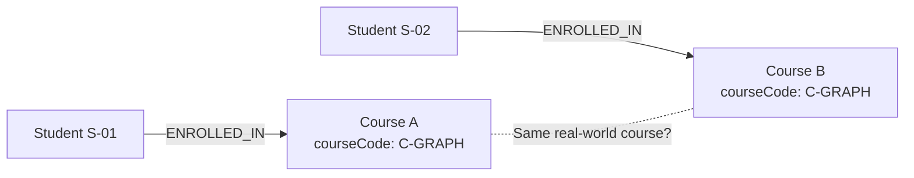
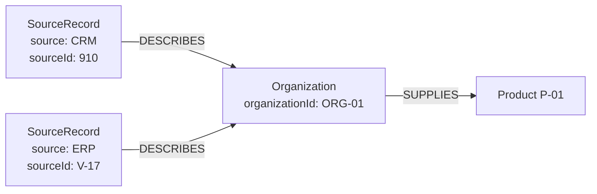

# Identity, Uniqueness Constraints, and Avoiding Duplicate Vertices

In a **property graph** model, two vertices with the same name **do not necessarily** represent the same object; conversely, two vertices bearing different names **may** be duplicate records of the same object. If identity design is unclear, edges attached to duplicate vertices get scattered, causing queries to miss relationships, statistics to overcount, permissions to misfire, or conclusions to be inaccurate.

This lesson belongs to the **Graph Modeling** chapter of **DATABASE_DATA_MODELING**. The goal of the module is to turn business requirements into clear data models—from entities, relationships, and constraints to normalization, keys, indexes, and physical schemas—and then compare relational, document, graph, and analytical models. Therefore, identity is treated as **a verifiable business decision**, which is then implemented via constraints, write operations, and data-cleaning workflows.

After this lesson, you will be able to:

- Distinguish **business identity**, **source-system keys**, and **internal database IDs** of a graph engine.
- Choose single keys, composite keys, and uniqueness scopes by label/entity type, organization, or tenant.
- Use **uniqueness constraints** and appropriate create/update operations to prevent duplicate vertices.
- Recognize cases where `MERGE` still creates duplicates, merges incorrectly, or is unsafe under concurrent writes.
- Build a workflow to detect, verify, and resolve duplicate vertices while preserving edges, history, and data provenance.

## 1. What Problems Do Duplicate Vertices Cause?

Suppose an education platform has a real-world course with code `C-GRAPH`. The course management service creates vertex `A`; another ingestion job creates an additional vertex `B` with the same code:



When querying one course vertex and counting enrollments, the result may show only a subset of learners. When listing all `Course` vertices with code `C-GRAPH`, two results appear. A query walking from `Student S-01` to the course and then to fellow learners can also miss `S-02` because the edges sit on **two different physical vertices**.

There are at least four consequences:

1. **Fragmented connections:** edges belonging to the same object are split across multiple vertices, yielding incomplete graph traversals.
2. **Overcounting:** counts of courses, customers, or devices can inflate erroneously when each copy is counted separately.
3. **Broken business rules:** constraints applied per individual vertex cannot enforce shared integrity for the real-world entity.
4. **Hard lifecycle management:** renaming, retiring, deleting, or updating permissions on one copy does not automatically propagate to the other copy.

**Conversely**, sharing a name does not prove two vertices are duplicates. Two people named "Nguyen An," two stores named "Central Store," or two tenants both using course code `BASIC` can be **legitimately distinct** objects. Preventing duplicate vertices must go hand in hand with **not merging the wrong entities**.

## 2. Three Layers of Identity to Distinguish

### 2.1. Business Identity

**Business identity** answers: "What makes this object the same object over time?" For example:

- A course on a platform: `courseId` remains constant when its title changes.
- An order: `orderId` remains constant when its status transitions from `PENDING` to `PAID`.
- A learner: `studentId` or another stable identifier under governance policy.
- A device: an assigned device identifier with clearly documented confidence limits; never assume a fingerprint is always unique and immutable.

A good business key has a **well-defined uniqueness scope**, sufficient stability, issuance from an authoritative source, and a policy for handling entity merges or splits. A "display name" rarely meets these criteria.

### 2.2. Source-System Identifiers

In data integration, the same object can have multiple IDs across different systems:

| Data Source | Source ID | Real-World Object |
| --- | --- | --- |
| LMS | `courseId = LMS-104` | The "Graph Modeling" course |
| Content CMS | `contentCourseId = CNT-88` | Also the "Graph Modeling" course |
| Commerce system | `productCourseId = SKU-GRAPH` | Commercial product corresponding to that course |

These three IDs **are not automatically equal**, nor do they necessarily belong on one vertex. `Product` may be a different commercial entity from `Course` because one course can have multiple sales packages. Before merging, define **entity types** and the business relationships between them.

If all three sources genuinely describe the same `Course`, the system can assign a **canonical key** `courseId = C-GRAPH` and store mappings from source identifiers to the canonical key. Preserve source lineage and define a procedure to fix mappings if a bad match is discovered.

### 2.3. Internal Database Identifiers

Many graph databases maintain internal vertex/edge IDs for query execution. In Neo4j, `elementId(n)` identifies an element within the engine's context, but **should not be used as a long-term business key** across applications, replicas, and data reloads. A data migration or graph rebuild can change internal IDs.

Use stable keys managed by the domain/application, such as `courseId`, `studentId`, or `tenantId + courseCode`. Internal IDs are useful for **diagnosing two suspected duplicate vertices within the current system**, not as business-level proof that two objects are "the same entity."

### 2.4. Separate the "Object" from the "Records Talking About the Object"

For example, a vendor pipeline delivers two different `SourceRecord` entries for the same company. If requirements need to know "which source said what, and when," keep each source record as a vertex and link them to a verified canonical `Organization`:



The **two source records** are two genuinely distinct data objects; the **referenced organization** is the single shared entity. This model avoids erasing provenance and helps handle cases where two sources report conflicting property values.

## 3. Choosing Identifier Keys for Vertices

### 3.1. Natural Keys vs. System-Issued Keys

| Key Type | Example | Pros | Things to Watch |
| --- | --- | --- | --- |
| **Natural business key** | Registration code issued by an authority or organization | Meaningful in the domain; convenient for reconciliation | Uniqueness scope, changes/revocations, missing or dirty data, privacy |
| **Application-issued key** | `courseId = C-GRAPH`, `orderId = O-101` | Stable, controllable issuance workflow | Must ensure key generation, sync, and collision avoidance across systems |
| **Composite key** | `(tenantId, courseCode)` | Accurately expresses per-tenant uniqueness scope | All read/write operations must supply every component |
| **External-source key** | `(sourceSystem, externalId)` | Pinpoints a record within a declared source | Does not automatically establish canonical identity across multiple sources |
| **Internal graph ID** | `elementId(node)` in Neo4j | Useful for tooling and local diagnostics | Never use as a long-term business key |

**Critical goal:** a key must distinguish objects **precisely within its declared scope**. If two companies share an internal product code `P-01`, a standalone `productCode` key cannot represent global uniqueness across the entire platform.

### 3.2. Multi-Tenant Example: A Single Key Is Not Enough

An education system serves two organizations:

| `tenantId` | `courseCode` | `title` |
| --- | --- | --- |
| `T-RED` | `BASIC` | Introduction to Data |
| `T-BLUE` | `BASIC` | Introductory Databases |
| `T-RED` | `GRAPH` | Graph Modeling |

Code `BASIC` **is allowed to repeat across tenants**. Therefore, in this domain:

```text
CourseIdentity = (tenantId, courseCode)

Valid: one unique Course for (T-RED, BASIC)
Valid: a different Course for (T-BLUE, BASIC)
Invalid: two Courses with the same (T-RED, BASIC)
```

If you only use `courseCode` as a global key, an ingestion job can erroneously merge two tenants' courses. If you only use `title`, data easily collides on names and breaks whenever content editors rename a title.

In subsequent queries, **always pass both components** and validate them before writing.

### 3.3. Normalize Key Values, But Never Arbitrarily

When ingesting from CSV, APIs, or multiple languages, identifiers may arrive with whitespace, differing letter case, or different Unicode encodings. Standardize rules before enforcing uniqueness:

- If codes are **case-insensitive**, normalize `" graph-01 "` and `"GRAPH-01"` to the same canonical key before writing.
- If codes are **case-sensitive**, `"abc"` and `"ABC"` may be two valid distinct codes; never fold them into one value.
- If codes contain Unicode characters, Unicode normalization rules must be specified consistently across systems.
- Never strip diacritics, special characters, leading zeros, or suffixes if they carry business meaning.

Store the **canonical key** for matching, and optionally keep the **raw original value** and provenance to investigate discrepancies. Wrong normalization can collapse two distinct objects into one key and cause **false merges**, which are harder to undo than duplicate vertices.

## 4. Uniqueness Constraints: Protecting Identity at the Storage Layer

A **uniqueness constraint** is a database rule preventing two elements within a defined scope from sharing the same valid key value. It differs from merely creating a query index: **an index speeds up lookups**, whereas **a constraint enforces validity on writes**. In some products, a uniqueness constraint uses a backing index underneath.

The examples below use **Neo4j Cypher**; syntax, scope, licensing requirements, and constraint types may vary by graph database version and product.

### 4.1. Single-Property Uniqueness Constraint

```cypher
CREATE CONSTRAINT student_id_unique IF NOT EXISTS
FOR (s:Student) REQUIRE s.studentId IS UNIQUE;
```

This constraint prevents two vertices labeled `Student` from coexisting with **the same non-null `studentId`**. It does not require every `Student` to have a `studentId` property: keyless vertices can still exist unless an additional property-existence constraint is applied.

Another example:

```cypher
CREATE CONSTRAINT course_id_unique IF NOT EXISTS
FOR (c:Course) REQUIRE c.courseId IS UNIQUE;
```

If a course title changes, the vertex retains its `courseId` and all connected edges. Do not use `title` as a key if titles can change or repeat across independent courses.

### 4.2. Composite Keys in a Multi-Tenant Environment

```cypher
CREATE CONSTRAINT course_tenant_code_unique IF NOT EXISTS
FOR (c:Course)
REQUIRE (c.tenantId, c.courseCode) IS UNIQUE;
```

This constraint prevents two `Course` vertices from having **the same tuple** `(tenantId, courseCode)` when all participating key values are present. This is very different from two separate single-property constraints `tenantId UNIQUE` and `courseCode UNIQUE`; creating two separate constraints would accidentally forbid a tenant from having multiple courses or two tenants from using the same code.

**Note on missing properties:** tuple uniqueness does not automatically mean every element of the key tuple is mandatory. To ensure every `Course` has both `tenantId` and `courseCode`, you need property-existence rules. Some versions/products support existence constraints, node keys, or type constraints; verify your exact documentation and deployment version, and enforce checks in the write API as well.

### 4.3. Uniqueness Scope by Label

A constraint `FOR (c:Course) ...` applies to vertices carrying the `Course` label. It does not automatically prevent a `Product` vertex from using the same code `C-GRAPH`. That can be desirable because they are **two distinct entity types**.

Watch out for vertices with **multiple labels**. If a vertex carries both `Person` and `Employee` labels, it may be subject to constraints defined on both labels. Label design and role-transition rules must be clear to avoid silent conflicts when adding or removing labels.

### 4.4. Clean Existing Data Before Creating Constraints

If legacy data already has two `Course` vertices with the same key, creating a uniqueness constraint will **fail to complete** until the conflict is resolved. Never treat a constraint-creation error as an excuse to quickly delete one vertex: the deleted vertex might hold valid edges that the surviving vertex lacks.

A sound workflow is **inventory -> verify -> merge/remediate -> create constraint -> re-verify**. Put constraints in place before opening concurrent write streams; otherwise, duplicates can keep arriving during remediation.

## 5. How Do `CREATE`, `MATCH`, and `MERGE` Differ?

In Neo4j Cypher, these three clauses serve distinct purposes:

| Syntax | Meaning | Risk for Duplicate Vertices |
| --- | --- | --- |
| `CREATE (c:Course {...})` | Always creates a new vertex matching the pattern | Re-running can create duplicates if no constraint exists |
| `MATCH (c:Course {...})` | Finds existing vertices matching the pattern | May find nothing, or find **multiple vertices** if duplicates already exist |
| `MERGE (c:Course {key: value})` | Finds matching pattern; creates it if absent | Safer for idempotent writes **when the pattern uses the canonical key**, but does not replace constraints, fix old duplicates, or prevent bad merges if the wrong key is chosen |

### 5.1. Why `CREATE` in Ingestion Pipelines Easily Produces Duplicates

Suppose a sync stream receives the same "created course `C-GRAPH`" event twice:

```cypher
CREATE (:Course {courseId: 'C-GRAPH', title: 'Graph Modeling'});
```

Without a uniqueness constraint, running twice creates **two vertices**. With a uniqueness constraint, the second write with the same `courseId` fails on constraint violation, so the application must handle that error and distinguish a duplicate event from conflicting data. A failed operation does not by itself create a proper upsert workflow.

### 5.2. Use Only Identifier Keys in the Main `MERGE` Pattern

A write pattern suited to "each tenant has one Course per courseCode":

```cypher
// $tenantId and $courseCode are normalized and verified non-null.
MERGE (c:Course {
  tenantId: $tenantId,
  courseCode: $courseCode
})
ON CREATE SET
  c.title = $title,
  c.status = 'DRAFT',
  c.createdAt = datetime()
ON MATCH SET
  c.title = $title
RETURN c.tenantId AS tenantId,
       c.courseCode AS courseCode,
       c.title AS title;
```

Meaning:

- `MERGE` finds or creates **the vertex identified by the key tuple** `tenantId, courseCode`.
- `ON CREATE SET` sets values only when **a new vertex** is created.
- `ON MATCH SET` runs when **the vertex already exists** by that key pattern.
- If the course title changes, re-running should not create a new vertex merely because `title` differs.

Do not place mutable attributes into the `MERGE` pattern if they are not part of identity, for example:

```cypher
// Wrong intent if title is not part of the key:
MERGE (c:Course {
  tenantId: $tenantId,
  courseCode: $courseCode,
  title: $title
});
```

Once the title is updated, the old full pattern no longer matches. The statement will **try to create a new vertex**; if a uniqueness constraint exists on the key tuple, the operation fails with a constraint violation. Without a constraint, it creates a duplicate.

### 5.3. Missing Data and `null` Must Be Handled First

Never send missing identifier keys hoping `MERGE` will "guess" the object. In Neo4j, a `MERGE` pattern containing a key property with value `null` is not a valid way to create a vertex. The application should:

1. Validate that `tenantId` and `courseCode` are present, properly typed, and normalized.
2. Reject or route to a verification queue if a key is missing.
3. Run `MERGE` only after obtaining a reliable key.

If a source genuinely does not know the canonical key yet, create a **source record with its own identifier** and link it to the canonical entity later; never substitute a display name as a fallback key and muddy identity.

### 5.4. Do Not `MERGE` an Entire Vertex–Edge Chain When Vertex Identities Are Unclear

Suppose you need to create `(Student)-[:ENROLLED_IN]->(Course)`. An error-prone pattern puts the entire chain into a single `MERGE`, along with mutable properties, without first matching which vertices are pre-existing entities. When the full pattern **does not match**, the engine's semantics may require creating missing parts; that makes identity control, constraint errors, and relationship updates much harder.

A more controllable pattern:

```cypher
// Match only existing entities by validated keys.
MATCH (s:Student {studentId: $studentId})
MATCH (c:Course {tenantId: $tenantId, courseCode: $courseCode})
// Create the relationship only if business rules allow at most one
// active ENROLLED_IN between this Student and Course pair.
MERGE (s)-[r:ENROLLED_IN]->(c)
ON CREATE SET r.enrolledAt = date(), r.status = 'ACTIVE'
RETURN s.studentId AS studentId, c.courseCode AS courseCode;
```

This pattern only fits when **business rules allow at most one relationship of this type between the two vertices**. If each term has its own enrollment round, the model must distinguish by term/`enrollmentId` or use an `Enrollment` vertex so multiple events are not collapsed onto one edge.

### 5.5. `MERGE` Does Not Replace Constraints or Guarantee Concurrency Safety

Two concurrent processes can both check that a vertex/relationship does not yet exist and both create it. Never treat a standalone `MERGE` as a universal duplicate-prevention guarantee. **Uniqueness constraints on vertex keys**, proper transactions, and race-condition error handling must work together.

For **edges**, the extent of identifier/uniqueness constraint support depends on the specific product and version. Constraints on `Student.studentId` and `Course.courseCode` **do not equate** to a constraint that "each `Student, Course` pair has at most one `ENROLLED_IN` edge." If the domain requires that rule under concurrent writes, design safe serialized writes, per-pair locking, an `Enrollment` entity with a unique ID, or an appropriate constraint feature in your engine.

Additionally, `MERGE` **does not clean up pre-existing duplicate vertices**. If two `Course` vertices with the same key already existed before a constraint was added, a `MERGE` query can match multiple records; dirty data must be detected and remediated first.

## 6. Avoiding False Merges: Verify "Same Entity" Before Combining

**Preventing duplicate vertices** does not mean collapsing every record with similar attributes into one vertex.

### 6.1. Hard Keys vs. Matching Signals

| Signal | Safe to Decide Same Entity Immediately? | How to Handle |
| --- | --- | --- |
| Same canonical key issued by the same authoritative source, matching scope | Usually **yes**, per data contract | Use as identifier, add constraint, and govern writes |
| Same `(sourceSystem, externalId)` | Sufficient to identify a **source record** within the declared system | Verify whether that source uses the code for an entity or a transaction |
| Same name and date of birth | **Not sufficient on its own** | Generate a candidate requiring extra attributes and verification policy |
| Same email/phone | **Not sufficient on its own** | Can be shared, recycled, or changed; consider verification and privacy |
| Same shipping address | **Not sufficient on its own** | Households, buildings, or offices can house multiple people |
| Same login device | **Not sufficient on its own** | Shared devices do not imply the same owner |
| Similar name via fuzzy matching | **Not sufficient on its own** | Rank candidates, record confidence score, and review per policy |

Even with seemingly solid keys, check **organizational scope and validity period**. A code might have been recycled, a tenant might have changed ownership, or a source system might export test records. Define a domain-specific set of identity-resolution rules.

### 6.2. Two Opposing Errors

- **False negative (failing to merge when actually the same object):** creates two duplicate vertices; information and edges get split.
- **False positive (merging two different objects):** mixes permissions, history, accounts, orders, or profiles of two separate subjects; usually has more severe impact and is harder to untangle.

Therefore, without sufficient evidence, keep two source records separate and flag a **candidate link** for verification. Never merge users solely on matching email, or merge companies solely on similar normalized names.

### 6.3. Provenance Modeling: Keep Evidence for Merge Decisions

When integrating multiple sources, the model can use:

```text
(:SourceRecord {
  sourceSystem: 'CRM',
  externalId: '910',
  importedAt: <timestamp>
})
  -[:DESCRIBES {method: 'VERIFIED_MAPPING'}]->
(:Organization {organizationId: 'ORG-01'})
```

On real data, replace `<timestamp>` with a valid database timestamp value. `SourceRecord` preserves the data source, version, and original attributes; `Organization` represents the canonical entity. When a mapping is later found to be wrong, you can trace **which source record**, **which merge decision**, and **which edges originated** from that decision.

If only a one-to-one mapping is needed and the source is trustworthy, extra source vertices are not always necessary. A mapping table, identifier property, or separate document structure can also fit. Choose based on audit and query needs.

## 7. Detecting Duplicate Vertices in Existing Data

The queries below are **diagnostic queries**; they do not modify or delete data. Run them in an authorized environment, restrict display of sensitive fields, and mind data volume when scanning all vertices.

### 7.1. Finding `Course` Vertices with Duplicate Composite Keys

```cypher
MATCH (c:Course)
WHERE c.tenantId IS NOT NULL
  AND c.courseCode IS NOT NULL
WITH c.tenantId AS tenantId,
     c.courseCode AS courseCode,
     collect(elementId(c)) AS elementIds,
     count(*) AS nodeCount
WHERE nodeCount > 1
RETURN tenantId, courseCode, nodeCount, elementIds
ORDER BY nodeCount DESC, tenantId, courseCode;
```

If rows are returned, **multiple vertices share the same key tuple at query time**. `elementId` in the output only helps locate the vertices for local investigation; never use it as a canonical key in integration systems.

If the corresponding uniqueness constraint has been created successfully and maintained properly, a valid dataset will not contain such key-collision groups. Before creating constraints on legacy data, diagnostic queries identify cases needing remediation.

### 7.2. Finding Missing Keys

```cypher
MATCH (c:Course)
WHERE c.tenantId IS NULL OR c.courseCode IS NULL
RETURN elementId(c) AS elementId,
       c.tenantId AS tenantId,
       c.courseCode AS courseCode,
       c.title AS title
LIMIT 100;
```

Hundreds of keyless vertices may not violate a **uniqueness constraint**, yet still prevent sync pipelines from identifying which vertex represents an existing entity. Classify staging records, unverified source data, and records that ought to have had keys prior to updating.

### 7.3. Finding Similar Titles Strictly for Investigation

```cypher
MATCH (c:Course)
WHERE c.title IS NOT NULL
WITH toLower(trim(c.title)) AS normalizedTitle,
     collect({
       tenantId: c.tenantId,
       courseCode: c.courseCode,
       title: c.title
     }) AS candidates,
     count(*) AS candidateCount
WHERE candidateCount > 1
RETURN normalizedTitle, candidateCount, candidates
ORDER BY candidateCount DESC
LIMIT 50;
```

This is solely a **candidate-generation step**. Matching titles may legitimately belong to different keys. `toLower(trim(...))` is not a universal normalization solution for every language or code format; if locale-specific and Unicode normalization rules are required, run them in a dedicated, tested step before storing keys.

### 7.4. Distinguishing Duplicate Vertices from Duplicate Edges

Two `Course` vertices with the same key are duplicates at the **vertex level**. However, one properly keyed `Student` and one `Course` might have **two `ENROLLED_IN` edges**, which is a different question:

```cypher
MATCH (s:Student)-[r:ENROLLED_IN]->(c:Course)
WITH s, c, count(r) AS relationshipCount
WHERE relationshipCount > 1
RETURN s.studentId AS studentId,
       c.tenantId AS tenantId,
       c.courseCode AS courseCode,
       relationshipCount
ORDER BY relationshipCount DESC;
```

**Do not automatically delete the discovered edges.** If a learner is allowed to re-enroll across multiple terms, two edges can be valid. You must define the multiplicity and key of **one enrollment instance** before deciding whether it is duplicate data.

## 8. Workflow for Resolving Duplicate Vertices Without Losing Links

Once you verify that two vertices genuinely describe **the same business entity**, resolution is not as simple as deleting one vertex and keeping the other. You must consider edges, properties, history, and external dependencies.

### Step 1 — Close Scope and Stop New Duplicates

Identify vertex types, tenants, data sources, and write paths involved. If writes continue during remediation, put controls in place so newly cleaned records do not immediately get duplicated again.

### Step 2 — Verify Identity Using Evidence

Cross-check canonical keys, source records, and resolution rules. Classify into:

- **Confirmed same entity:** ready to prepare for merge.
- **Insufficient-evidence candidate:** needs verification, do not merge yet.
- **Legitimately distinct entities:** fix identity rules if they are currently colliding.

Never use matching `title` or personal name as sole proof.

### Step 3 — Choose the Surviving Record and Property Strategy

Explicitly specify "which vertex represents the entity" or whether to create a fresh vertex from the canonical key. For each property, define the authoritative source and conflict resolution:

| Data Field | Illustrative Decision Rule |
| --- | --- |
| `courseId` / `tenantId + courseCode` | Follow the verified canonical key |
| `title` | Follow CMS or authoritative editorial source |
| `publishedAt` | Follow the publishing system of record |
| `lastSyncedAt` | Track per source; do not pick an arbitrary value |
| `status` | Follow lifecycle rules and the authoritative status source |

Do not blindly pick the "latest value" for every property: an ingestion timestamp can differ from business effective time.

### Step 4 — Audit Edges on Both Sides

List incoming and outgoing edges on every suspected duplicate vertex. Inspect edge types, directions, edge properties, multiplicity, effective times, and any relationships produced by prior mis-merges.

For example, if `Course A` holds `REQUIRES` edges while `Course B` holds `ENROLLED_IN` edges from students, merging must preserve both relationship groups **if both are valid**. For edges carrying history or multiple transactions, never collapse them automatically just because they share endpoints.

### Step 5 — Execute a Controlled, Reversible Merge

In a test environment, design how links are repointed to the canonical entity, how properties are consolidated per chosen rules, and how resulting edge duplicates (if any) are handled. Require backups or rollback capability, log old-vertex -> canonical-vertex mappings, and batch transactions appropriately for data volume.

This lesson **does not prescribe a single universal delete/merge query for all graphs**, because mechanical scripts can drop edges or violate business rules. Delete commands should only be written after verifying every precondition and recovery plan.

### Step 6 — Post-Merge Reconciliation

Verify that:

- Each business key tuple has only one vertex within its defined scope.
- No valid edges were lost, especially edges with temporal and status properties.
- No disallowed duplicate edges, newly introduced self-loops, or multiplicity violations exist.
- Business queries return expected results before and after migration.
- Applications and sync events have been updated from old IDs to canonical keys.

Finally, create constraints, replay test ingestion, and add monitoring to catch missing keys or constraint violations.

## 9. Validating the Design with Concrete Scenarios

For the `Course(tenantId, courseCode, title)` model, define expected outcomes before implementation:

| Scenario | Correct Behavior |
| --- | --- |
| Write `(T-RED, BASIC)` for the first time | Create exactly one `Course` |
| Replay event with same `(T-RED, BASIC)` and same title | Reuse existing vertex, do not create a second vertex |
| Title of `(T-RED, BASIC)` changes | Update property per rules, keep identity and edges |
| Add `(T-BLUE, BASIC)` | Validly create a new vertex because tenant differs |
| Missing `tenantId` | Reject write into canonical `Course` set or route to keyless-data handling |
| External source sends `courseCode = ' basic '` | Apply code normalization rules before `MERGE`; do not guess |
| Two concurrent threads create `(T-RED, GRAPH)` | Only one valid identity survives; handled via constraint, transaction, and contention error handling |
| Two different vertices share the same title | Do not auto-merge if business keys differ |
| Two source records describe the same verified `Course` | Retain provenance and both point to canonical `Course` |
| Two duplicate `Course` vertices hold different edges | Transfer/reconcile all valid edges before removing the duplicate |
| Two `ENROLLED_IN` edges between the same pair | Check enrollment multiplicity rules before labeling as duplicate |

### Minimum Quality Checklist

1. **Key check:** identifier properties are non-missing and match the uniqueness scope.
2. **Idempotent write check:** sending the same event multiple times does not increase canonical vertex count.
3. **Property update check:** updating a name does not spawn an extra vertex.
4. **Tenant isolation check:** matching keys across two tenants are never mis-merged.
5. **Concurrency check:** a plan exists when two processes simultaneously create the same identity.
6. **Relationship check:** after sync, edges still point to the right objects.
7. **Provenance check:** merge decisions can be traced, corrected, and reconciled.

## 10. Relationship to Relational, Document, and Analytical Models

| Concern | Relational | Document | Property Graph |
| --- | --- | --- | --- |
| Entity identity | `PRIMARY KEY`, `UNIQUE`, foreign keys | `_id`, unique field indexes (engine-dependent) | Vertices with business keys, uniqueness constraints by label/property tuple (engine-dependent) |
| Relationships | Foreign keys or junction tables | ID references / embedded documents | Edges connecting vertices |
| Harm from duplicate entities | Duplicate rows, foreign keys split across multiple records | Duplicate documents, updates scattered across copies | Duplicate vertices cause **paths and neighborhoods to fragment** |
| Idempotent writes | Upsert by key and constraint | Upsert by ID/index | `MERGE` or upsert by key + constraint and contention handling |
| Multi-source ingestion | Mapping tables, staging, master data | Source documents and mappings | Source/provenance vertices or external mappings |
| Statistical analytics | SQL aggregations | Engine aggregation pipelines | Graph traversal or export to warehouse for large-scale stats |

An **analytical warehouse** also needs stable identifiers for dimension tables and linking keys in fact tables; if one customer lands in two dimension rows, cohort, cost, and revenue metrics also split incorrectly. Thus, **master data** and **entity resolution** challenges are not unique to graph technology. What makes graphs especially sensitive is that identity drift directly breaks **paths**, multi-hop queries, and network analysis.

Production systems often use a relational database as the authoritative transactional source and a graph as a derived model for link queries. In that setup, canonical IDs and source mappings must stay aligned; you must handle replayed events, out-of-order events, late updates, and mapping corrections. Enforcing uniqueness in each storage layer alone does not prove both layers agree on the same identity; reconciliation processes are still required.

## 11. Modeling Mistakes to Avoid

1. **Using names as unique keys.** Names collide, contain typos, change, or vary by language. Prefer stable identifiers issued by an authoritative source.
2. **Forgetting tenant/unit scope.** `courseCode = BASIC` can validly exist in multiple tenants. Pick a composite key matching the domain.
3. **Putting mutable attributes inside `MERGE`.** Leads to duplicates or constraint errors whenever titles or statuses change.
4. **Assuming `MERGE` replaces all constraints.** Concurrent writes, legacy data, and complex edge multiplicities still require dedicated controls.
5. **Using internal IDs as integration keys.** Internal IDs have no stability contract across systems or graph rebuilds.
6. **Enforcing uniqueness while allowing missing keys.** Many vertices lacking `courseId` can coexist if presence is not enforced.
7. **Over-normalizing.** Stripping accents, leading zeros, or case inconsistently can wrongly merge two distinct entities.
8. **Merging on weak signals.** Shared name, email, address, or device does not prove the same person/organization.
9. **Deleting duplicate vertices before migrating and reconciling edges.** Destroys relationships and history.
10. **Confusing duplicate vertices with duplicate edges.** Multiple edges can represent multiple valid events; evaluate multiplicity and effective time.
11. **Maintaining two conflicting canonical IDs.** If each system mints its own primary key for the same object, cross-system linking stays fragmented without reliable mapping.
12. **Lacking a path to undo bad merges.** Entity resolution can make mistakes; keep provenance and a dispute-resolution process.

## 12. Practice Exercises and Suggested Answers

### Exercise 1 — Distinguishing Name from Identity

A platform has two companies both named "An Phat." The first has `organizationId = ORG-100`, the second has `organizationId = ORG-200`; each has distinct customers and contracts.

**Question:** should `name` be used as the key to `MERGE` the two companies? What harm would that cause?

**Suggested answer:** no. Two canonical IDs represent two distinct entities per the given data. Use `Organization.organizationId` with an appropriate uniqueness constraint. `name` is a display attribute; merging by name would mix contracts and customer links across two separate businesses.

### Exercise 2 — Per-Tenant Keys

Two tenants `A` and `B` both have course `INTRO`. Tenant `A` renames its course from "Introduction to Data" to "Data Fundamentals."

**Question:** which key should be used to create or update `Course`? What should change when the new title arrives?

**Suggested answer:** use the `(tenantId, courseCode)` tuple as the key. `MERGE` on that key tuple and update `title` on tenant `A`'s existing vertex. Tenant `B`'s `INTRO` is a separate vertex and remains untouched. The uniqueness constraint must apply to the **property pair**, not to `courseCode` alone.

### Exercise 3 — Replayed Sync Events

An event to create `Course C-101` is delivered three times due to queue retries. The service currently uses `CREATE` without a uniqueness constraint.

**Question:** what can happen? Propose an idempotent write approach.

**Suggested answer:** it can create three vertices with the same `courseId`. Add a uniqueness constraint on the key after cleaning legacy data; verify the key is non-missing; `MERGE` or upsert on the stable key; and handle concurrency contention errors. Mutable attributes should be updated only after matching the right identity.

### Exercise 4 — Two Sources Describing the Same Company

CRM has record `sourceSystem = CRM`, `externalId = 300`; ERP has record `sourceSystem = ERP`, `externalId = V-8`. The data team verifies both refer to `Organization ORG-20`.

**Question:** how should you preserve provenance while having only one canonical organization vertex?

**Suggested answer:** create one `Organization {organizationId: 'ORG-20'}`. Keep two separate `SourceRecord` vertices identified by `(sourceSystem, externalId)`, and connect both via `DESCRIBES` edges to the canonical vertex. Alternatively, use an external mapping table outside the graph if workloads do not traverse from source records. Never expect IDs from different sources to match before linking.

### Exercise 5 — Detecting Issues Before Creating Constraints

The dataset contains two `Course` vertices with the same `(T-RED, GRAPH)`. One vertex has a `TEACHES -> Skill S-01` edge; the other has an `ENROLLED_IN` edge from `Student S-01`. You plan to add a uniqueness constraint immediately.

**Question:** what is the risk, and what must be done first?

**Suggested answer:** creating the constraint can fail because existing data already violates uniqueness. First verify the two vertices are truly duplicates, pick the canonical vertex, migrate and verify valid edges, resolve property conflicts, and log mappings from the old vertex. Once data is clean, create the constraint and re-test queries counting learners and finding taught skills.

### Exercise 6 — Duplicate Vertex or Valid Edge?

Student `S-01` enrolls in course `C-JAVA` in term 1, fails, and re-enrolls in term 2. The graph has two `ENROLLED_IN` edges between the same `Student` and `Course`.

**Question:** is this duplicate data?

**Suggested answer:** cannot conclude without rules. If each edge carries `term` and represents a **distinct enrollment round**, two edges are valid. If the business allows only one current enrollment status, a different model or constraint is needed. When each round has its own payments, cohort, and history, consider an `Enrollment` vertex with a unique `enrollmentId`.

## Summary

**Vertex identity must be defined at the business layer**, within a consistent scope such as entity type, organization, or tenant. Uniqueness constraints and key-based writes protect that identity, but do not replace choosing the right key, controlled normalization, concurrency handling, and multi-source verification. When duplicates are found, reconcile **both vertices and their attached edges** before merging. A graph with clear keys, reliable provenance, and verified deduplication rules provides a solid foundation for path queries, relationship constraints, and future data evolution.
