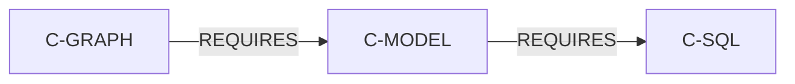
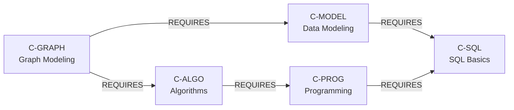
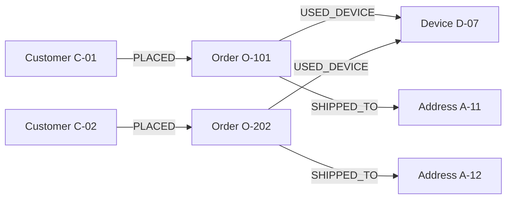
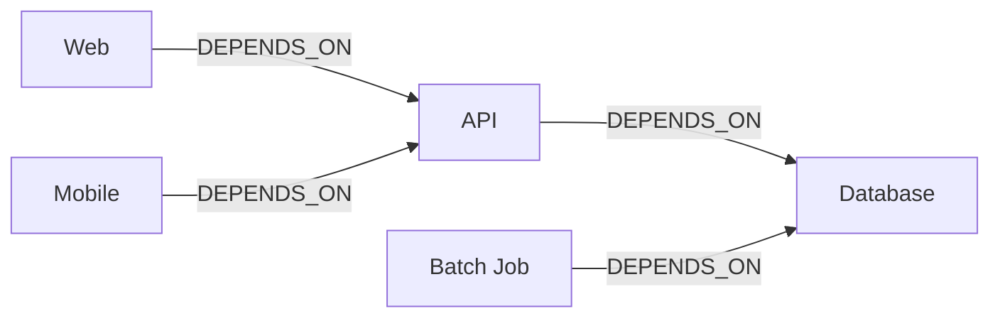

# Paths, Neighborhoods, and Query Patterns That Drive Design

In a **graph model**, storing objects and the edges connecting them is only the beginning. A design's value shows in its ability to answer questions such as: "Starting from this course, what must be learned first?", "Which devices do two accounts share?", "If service B fails, which services may be affected?", or "Is there a valid path from a user to the requested resource?". These questions share a common trait: **the result depends on paths, neighborhoods, and the semantics of link chains**.

This lesson belongs to the **Graph Modeling** chapter of **DATABASE_DATA_MODELING**. The module trains how to translate business requirements into entities, relationships, constraints, keys, indexes, and physical schemas while comparing relational, document, graph, and analytical models to choose an evolvable, verifiable structure. Therefore, rather than drawing a web of links and figuring out how to query it later, we start from **the business query patterns that must run**, and design the data structure to serve them.

After this lesson, you will be able to:

- Distinguish **adjacent vertices (neighbors)**, **hops**, **paths**, **reachability**, and **shortest paths**.
- Translate a business question into a graph traversal pattern with clear direction, edge types, filters, and depth bounds.
- Recognize how neighborhood, multi-hop, common-neighbor, path, and impact-analysis queries influence vertex/edge design.
- Sketch Cypher queries for an illustrative model while understanding that syntax and algorithms depend on the database engine.
- Evaluate query correctness and cost, especially regarding cycles, high-degree vertices, effective time, and path explosion.

## 1. Foundational Concepts: From One Edge to a Path

A **property graph** consists of **vertices** (*vertex/node*), **edges** (*edge/relationship*), and properties on vertices/edges. Edges typically have types, such as `REQUIRES`, `USES_DEVICE`, or `DEPENDS_ON`, and in many property graph systems they are directed.

### 1.1. Neighborhoods and Hop Counts

Given an edge:

```text
(Course C-GRAPH)-[:REQUIRES]->(Course C-MODEL)
```

then `C-MODEL` is a **1-hop outgoing neighbor** (*out-neighbor*) of `C-GRAPH` along edge type `REQUIRES`. Conversely, `C-GRAPH` is a **1-hop incoming neighbor** (*in-neighbor*) of `C-MODEL` along the same edge type.

**One hop** means traversing one edge. "Two hops" means traversing two edges in sequence; it does not strictly mean two objects, because a path includes the start vertex, intermediate vertex, and end vertex.

Example:



Here `C-SQL` is **two hops** away from `C-GRAPH` along `REQUIRES`. If the question asks only for "direct prerequisites," `C-SQL` is not in the result; if it asks for "all direct and indirect prerequisites," it belongs in the result.

### 1.2. Paths, Reachability, and Cycles

| Concept | Meaning | Example in the Course Domain |
| --- | --- | --- |
| **Path** | A contiguous sequence of vertices and edges satisfying traversal criteria | `C-GRAPH -> C-MODEL -> C-SQL` |
| **Length** | Number of edges traversed | The path above has length **2 hops** |
| **Reachability** | Whether at least one valid path exists from A to B | `C-SQL` is reachable from `C-GRAPH` via `REQUIRES` |
| **Neighbor** | Vertex directly connected under the chosen direction/edge type | `C-MODEL` is a direct prerequisite of `C-GRAPH` |
| **Common neighbor** | Vertex connected to multiple starting vertices under a defined pattern | Two learners using the same device |
| **Cycle** | A sequence of edges returning to an already-visited vertex | `A REQUIRES B REQUIRES C REQUIRES A` |
| **Shortest path** | Optimal path under a criterion, usually fewest edges when unweighted | Prerequisite chain from A to B with fewest hops |
| **Connected component** | Set of mutually connected vertices under a chosen definition | A group of accounts indirectly linked via devices |

**Note on terminology:** in graph theory, a *walk* may repeat both vertices and edges; a *trail* does not repeat edges; a *simple path* does not repeat vertices. Query languages and engines differ on whether edges or vertices may repeat within a path pattern. Never assume "using the word `path` automatically forbids cycles." Check your query language's semantics and explicitly specify when the business requires simple paths.

### 1.3. Directed Paths vs. Undirected Paths

Two graphs with **the exact same set of vertices and edges**, but different direction conventions, can produce different business answers.

With `(Service A)-[:DEPENDS_ON]->(Service B)`, the statement "A depends on B" means: if **B has an outage**, A **may be affected**. To find affected services starting from B, the query traverses **against the stored direction** of `DEPENDS_ON`. Walking forward from B instead returns services **that B depends on**.

Some queries genuinely do not care about direction, such as finding accounts connected via a shared-resource link defined as bidirectional. In that case you may query without direction, provided you **define the semantics**; never drop direction just to make a query shorter if doing so alters business meaning.

## 2. Query Patterns Determine What We Must Model

Two systems with the same `Course`, `Learner`, and `Skill` entities should not necessarily store relationships the same way. Examine the frequent questions, starting inputs, outputs, and path rules.

| Query Pattern | Business Question | Technical Characteristics | Modeling Decisions Affected |
| --- | --- | --- | --- |
| **1-hop neighborhood** | Which courses does this course directly require? | Traverse one edge type in one direction | Edge type, direction, starting-point key |
| **Multi-hop / k-hop neighborhood** | All prerequisites within at most 5 levels? | Variable-length traversal; needs bounds | Cycles, depth limit, allowed edge types |
| **Reachability** | Is there a valid permission path from employee to resource? | Needs only a **yes/no** answer | Edge rules, authorization, effective time |
| **Path retrieval for explanation** | Through which groups was access inherited? | Needs the actual **chain** of vertices/edges, not just the target | Provenance properties, direction, and edge types |
| **Shortest path** | Fewest transfers from A to B? | Optimizes hop count or weights | Weight definition, direction, valid edges |
| **Common neighbors / similarity** | Which customers shared a device with customer X? | Compares neighbor sets by pattern | Event data, edge types, deduplication |
| **Impact propagation** | Which services depend directly/indirectly on B? | Reverse dependency traversal | Cycles, filter conditions, and depth |
| **Clusters / connected components** | Which groups of accounts are interlinked? | Large-network inspection, connectivity rules | Which edges count as connection evidence |
| **Relationship statistics** | How many services depend on each service? | Degree counting by direction/type | Multiplicity, duplicate edges, aggregation rules |

For example, if the application only needs to list **direct** prerequisites, a `course_prerequisites` table in SQL or `REQUIRES` edges in a graph are both straightforward. If users routinely look up **all indirect prerequisites**, ask for explanation paths to a course, and detect cycles, the model needs specific attention to multi-hop traversals.

**Having many-to-many relationships is not enough to conclude you must choose a graph database.** It is a structural clue; the decision depends on real queries, traversal depth, transaction requirements, operational cost, and verifiability.

## 3. Running Example: Course Prerequisite Network

Suppose an education platform needs to validate learning paths and recommend courses to complete before starting `C-GRAPH`.

### 3.1. Business Requirements and Conventions

- Each `Course` has a stable, unique `courseId`.
- Edge `(advanced:Course)-[:REQUIRES]->(basic:Course)` means **the advanced course requires completing the basic course first**.
- One course can have multiple prerequisites; one course can be a prerequisite for multiple others.
- The prerequisite network **must be acyclic** under assumed academic policy.
- Queries must distinguish **direct prerequisites**, **indirect prerequisites**, **an explanation path**, and a learner's **incomplete courses**.

Diagram:



There are **two paths** from `C-GRAPH` to `C-SQL`:

1. `C-GRAPH -> C-MODEL -> C-SQL`: **2 hops**.
2. `C-GRAPH -> C-ALGO -> C-PROG -> C-SQL`: **3 hops**.

Yet `C-SQL` is still **one** indirect prerequisite course, not two courses. This is the core difference between **counting paths** and **counting distinct target vertices**.

### 3.2. Logical Model

| Component | Properties and Direction | Rules to Enforce |
| --- | --- | --- |
| `Course` | `courseId`, `title`, `status` | `courseId` unique, valid status |
| `Learner` | `learnerId`, `displayName` | `learnerId` unique |
| `(Course)-[:REQUIRES]->(Course)` | Optionally `mandatory`, `validFrom`, `validTo` | Directed from dependent course to prerequisite course; no self-loops/cycles if forbidden by business |
| `(Learner)-[:COMPLETED]->(Course)` | `completedAt`, `score`, optionally `source` | Define completion criteria and how multiple attempts are stored |
| `(Course)-[:TEACHES]->(Skill)`, if needed | e.g., `proficiency` | Distinct from `REQUIRES`: teaching a skill does not automatically create a prerequisite |

Place `status` and `title` on `Course` because they describe the course. Place `completedAt` on `COMPLETED` because different learners complete the same course at different times. If an exam attempt has its own `attemptId`, grader, and appeal workflow, use an `Attempt` event vertex instead of cramming everything onto `COMPLETED`.

### 3.3. Creating Sample Data with Neo4j Cypher

The example below uses **Neo4j Cypher**; run it on an empty test database or adjust IDs to avoid collisions. Syntax is not automatically compatible with every graph database.

```cypher
CREATE
  (g:Course {courseId: 'C-GRAPH', title: 'Graph Modeling'}),
  (m:Course {courseId: 'C-MODEL', title: 'Data Modeling'}),
  (a:Course {courseId: 'C-ALGO', title: 'Algorithms'}),
  (s:Course {courseId: 'C-SQL', title: 'SQL Basics'}),
  (p:Course {courseId: 'C-PROG', title: 'Programming'}),
  (learner:Learner {learnerId: 'L-001', displayName: 'An'}),
  (g)-[:REQUIRES]->(m),
  (g)-[:REQUIRES]->(a),
  (m)-[:REQUIRES]->(s),
  (a)-[:REQUIRES]->(p),
  (p)-[:REQUIRES]->(s),
  (learner)-[:COMPLETED {
    completedAt: date('2026-09-15')
  }]->(s);
```

For production use, you need key management, duplicate prevention, transactions, and object lifecycles. Using `CREATE` as shown above illustrates structure—**it is not an idempotent, safely repeatable ingestion script**.

## 4. From Business Questions to Query Patterns

### 4.1. One-Hop Neighborhood Query

"Which courses does `C-GRAPH` directly require?"

```cypher
MATCH (target:Course {courseId: 'C-GRAPH'})
      -[:REQUIRES]->(prereq:Course)
RETURN prereq.courseId AS courseId,
       prereq.title AS title
ORDER BY courseId;
```

Result: `C-ALGO` and `C-MODEL`.

The pattern spans **one `REQUIRES` edge**. It does not return `C-PROG` or `C-SQL` because those courses are further away.

"Which courses directly depend on `C-SQL`?" is a **reverse-direction question**:

```cypher
MATCH (dependent:Course)-[:REQUIRES]->
      (changed:Course {courseId: 'C-SQL'})
RETURN dependent.courseId AS dependentCourseId
ORDER BY dependentCourseId;
```

Direct results are `C-MODEL` and `C-PROG`. To find all indirectly affected courses, a multi-hop query is required.

### 4.2. k-Hop Neighborhood Query and Target Deduplication

"Find all prerequisites 1 to 5 hops away from `C-GRAPH`."

```cypher
MATCH (target:Course {courseId: 'C-GRAPH'})
      -[:REQUIRES*1..5]->(prereq:Course)
RETURN DISTINCT prereq.courseId AS prerequisiteId
ORDER BY prerequisiteId;
```

On the sample data, this returns four courses: `C-ALGO`, `C-MODEL`, `C-PROG`, and `C-SQL`. `C-SQL` appears only **once** thanks to `DISTINCT` even though two paths reach it.

**`*1..5` bounds paths to 1–5 edges** in the illustrated Neo4j Cypher syntax. If a curriculum has prerequisite chains deeper than five hops, results will be incomplete. Do not pick 5 arbitrarily when the business asks for "all prerequisites"; determine the valid maximum depth or traversal strategy that satisfies the requirement.

`DISTINCT` only deduplicates target records in the output. It **does not eliminate the cost of traversing multiple paths**, does not prove the graph is acyclic, and does not replace business constraints.

### 4.3. Returning Paths to Explain, Not Just Targets

"Why is `C-SQL` a prerequisite of `C-GRAPH`?"

```cypher
MATCH path =
  (target:Course {courseId: 'C-GRAPH'})
    -[:REQUIRES*1..5]->
  (basic:Course {courseId: 'C-SQL'})
RETURN [n IN nodes(path) | n.courseId] AS courseChain,
       length(path) AS hops
ORDER BY hops;
```

The output can contain two chains:

```text
[C-GRAPH, C-MODEL, C-SQL]           -- 2 hops
[C-GRAPH, C-ALGO, C-PROG, C-SQL]    -- 3 hops
```

A query returning only **targets** cannot answer "why" if learners need to see the prerequisite chain. This affects modeling: edges must carry **meaningful types**, correct direction, and enough properties to explain rule provenance when auditing is required.

**Warning:** in highly branched graphs, the number of paths can vastly exceed the number of target vertices. If only one explanation path or the fewest-hop path is needed, choose an appropriate query strategy rather than fetching **all paths** and discarding extras in application code.

### 4.4. Checking Whether a Path Exists

"Is `C-SQL` a direct or indirect prerequisite of `C-GRAPH`?"

In an application, the requirement may only need a **true/false** answer without returning every path:

```cypher
MATCH (start:Course {courseId: 'C-GRAPH'})
MATCH (finish:Course {courseId: 'C-SQL'})
RETURN EXISTS {
  MATCH (start)-[:REQUIRES*1..5]->(finish)
} AS isPrerequisite;
```

On the sample data, `isPrerequisite = true`. This checks **reachability within at most five hops**; if no path shorter than five hops exists but a longer path does, it returns `false` even though the target is reachable in the full graph. Depth bounds are **part of query semantics** and must be documented explicitly.

If unbounded-depth reachability is truly needed, evaluate data shape, cycles, cost, and engine/algorithm correctness; never drop bounds blindly on large networks.

### 4.5. Finding a Fewest-Hop Path

"From `C-GRAPH` to `C-SQL`, how many steps are in the shortest `REQUIRES` chain?"

```cypher
MATCH (start:Course {courseId: 'C-GRAPH'})
MATCH (finish:Course {courseId: 'C-SQL'})
MATCH path = shortestPath(
  (start)-[:REQUIRES*..8]->(finish)
)
RETURN [n IN nodes(path) | n.courseId] AS courseChain,
       length(path) AS hops;
```

In the sample data, a shortest path has **2 hops** via `C-MODEL`. Here "shortest" means **fewest edges**, not lowest tuition, shortest study hours, or lowest difficulty.

`shortestPath` in the example is Neo4j Cypher syntax. Language versions also offer other shortest-path patterns; syntax and whether a clause returns **one**, **all**, or **some** shortest paths should not be generalized from this example to every product.

### 4.6. Finding Incomplete Prerequisites for a Learner

"Which additional courses must learner `L-001` complete before starting `C-GRAPH`?"

```cypher
MATCH (learner:Learner {learnerId: 'L-001'})
MATCH (target:Course {courseId: 'C-GRAPH'})
      -[:REQUIRES*1..5]->(prereq:Course)
WHERE NOT EXISTS {
  MATCH (learner)-[:COMPLETED]->(prereq)
}
RETURN DISTINCT prereq.courseId AS missingCourseId
ORDER BY missingCourseId;
```

With the sample data, the learner has already completed `C-SQL`, so `C-ALGO`, `C-MODEL`, and `C-PROG` remain.

This query is only valid under the **assumption** that all `REQUIRES` edges in scope are mandatory, one `COMPLETED` edge proves completion, and no waivers or certificate expirations exist. If `mandatory = false`, minimum passing scores, or term validity exist, the model and query must express all of those rules.

## 5. Distinguishing Types of Path Queries

Do not use one traversal pattern for every question because they have **different outputs and costs**.

### 5.1. Finding All Reachable Vertices vs. Enumerating Every Path

In the example diagram, there are **4 target vertices** that are prerequisites of `C-GRAPH`, yet **5 paths ending at prerequisites** when counting each path from start to each target:

- To `C-MODEL`: one path.
- To `C-ALGO`: one path.
- To `C-PROG`: one path.
- To `C-SQL`: two paths.

If only a course list is needed, return a **unique set of targets**, not every path sequence. If you need to explain every way to reach `C-SQL`, return paths and accept multiple rows. Both requirements demand distinct output designs upfront.

### 5.2. Shortest Path by Hop Count vs. Lowest Cost Path

In logistics, suppose there are two routes:

```text
Route 1: A -> B -> D           2 legs, total 160 minutes
Route 2: A -> C -> E -> D       3 legs, total 90 minutes
```

The **fewest-edge path** is Route 1, but the **fastest path** is Route 2. Therefore, define "short" by **edge count, distance, duration, money, risk score**, or combined criteria.

If `travelMinutes` weight sits on `ROUTE_TO` edges, finding the minimum total-minutes path requires a **weighted shortest-path algorithm** such as Dijkstra (when weights are non-negative), or appropriate engine tooling. Hop-based `shortestPath` does not automatically minimize total `travelMinutes`. Never assume core Cypher engines include every graph analytics algorithm out of the box; some systems require dedicated algorithm libraries or pipelines.

### 5.3. One Representative Path vs. All Valid Paths

In authorization, "does the user have access?" usually only needs **at least one valid permission path**. "Why is access granted?" needs one **explanation chain**. "Through how many independent paths is access granted?" requires counting or analyzing paths under specific rules.

Queries fetching **all paths** can grow dramatically even on modest vertex counts. Specify the output contract: `boolean`, single vertex, vertex set, single path, top-K paths, or path statistics. Never collect finer granularity than the business needs.

## 6. Common-Neighbor Queries: Modeling Context to Avoid False Links

Consider investigating linked accounts on an e-commerce platform. The requirement is:

> Starting from customer C-01, find other customers who placed orders on **the same device**, with orders occurring within the inspected 30-day window.

If you only connect `Customer-[:USED_DEVICE]->Device`, you know a customer once used a device, but lose **which order**, **when**, and **in which transaction**.

Context-preserving model:



Here `Order` is an **event vertex** with `orderId` and `placedAt`. It lets you state precisely which device was observed **on which exact order**, rather than broadly asserting "two customers own the same device."

### 6.1. Common-Neighbor Query Across Multiple Edge Types

```cypher
MATCH (origin:Customer {customerId: $customerId})
      -[:PLACED]->(o1:Order)
      -[:USED_DEVICE]->(device:Device)
MATCH (other:Customer)-[:PLACED]->(o2:Order)
      -[:USED_DEVICE]->(device)
WHERE other <> origin
  AND o1.placedAt >= datetime($fromTime)
  AND o2.placedAt >= datetime($fromTime)
RETURN other.customerId AS relatedCustomerId,
       count(DISTINCT device) AS sharedDeviceCount
ORDER BY sharedDeviceCount DESC
LIMIT 20;
```

The query uses a **fixed path pattern** of four hops connecting two customers. It filters time on the **order vertex**, because timestamps belong to the event, and uses `count(DISTINCT device)` to avoid counting one device multiple times across multiple orders.

The output represents **candidates linked via shared devices**, not proof that two accounts belong to the same person or involve fraud. Shared devices can belong to households, retail counters, shared workspaces, or public kiosks.

### 6.2. Counting and Expanding Neighborhoods Requires Defining Evidence

If you also traverse addresses or payment methods, ask:

- Which **edge types** are allowed to participate?
- Must events fall within the same time window?
- Are hop counts or candidate counts bounded?
- How many **independent pieces of evidence** must an indirect link accumulate to raise a flag?
- Must provenance and relationship confidence be recorded?

Using a generic `RELATED_TO` edge for devices, addresses, and payments destroys the ability to distinguish signals, causing queries to cross semantically incompatible links. On the other hand, materializing customer–customer edges for **every pair** sharing a device can cause edge explosion on a device with thousands of uses and creates sync overhead for derived edges whenever source events are corrected.

## 7. Impact Propagation Queries: Choosing Direction to Find the Right Set

In a system dependency model:



The question "If Database fails, which services **may** be affected?" traverses **against `DEPENDS_ON`**. You are not looking for what Database depends on, but rather which services depend on Database directly or indirectly.

```cypher
MATCH (failed:Service {serviceId: $failedServiceId})
      <-[:DEPENDS_ON*1..6]-(affected:Service)
RETURN DISTINCT affected.serviceId AS affectedServiceId
ORDER BY affectedServiceId;
```

Starting from `Database`, with the sample data, you get `API`, `Web`, `Mobile`, and `Batch Job`.

**Important caveat:** "having a dependency path" only establishes **potential impact**, not proof that every service will go down. Redundancy, caching, failover regions, connection states, fault tolerance, and dependency validity can alter actual outcomes. For sharper assessment, you may need properties like `criticality`, `required`, or `validFrom`/`validTo`, alongside domain aggregation rules.

If the network has dependency cycles, queries need safeguards against excessive traversal and rules on whether revisiting the start vertex is permitted. `DISTINCT` in the projection only deduplicates returned target vertices; it does not prevent the engine from exploring multiple paths to the same vertex.

## 8. Query Patterns Drive Vertex, Edge, and Property Design

A modeling choice that helps one query can hurt another. Bring **query-first modeling** into the process of translating business requirements.

### 8.1. Starting from Entry Points

If users typically look up a course by `courseId`, you need a business key and suitable lookup mechanism on `Course.courseId`. In Neo4j you can declare a uniqueness constraint:

```cypher
CREATE CONSTRAINT course_id_unique IF NOT EXISTS
FOR (c:Course) REQUIRE c.courseId IS UNIQUE;
```

A uniqueness constraint may use a backing index depending on the system, though it must be distinguished from **property-existence** rules and constraints on edges. If courses span multiple tenants and `courseCode` is unique only per tenant, use an appropriate **composite key** rather than a global uniqueness constraint on `courseCode`.

Good keys locate the right starting vertex quickly. They **do not** by themselves solve the cost of traversing thousands of edges after the start point is found.

### 8.2. Choose Edges Based on Link Chains Actually Traversed

| Frequent Query | What the Model Should Clarify | If Design Is Lacking |
| --- | --- | --- |
| Find all prerequisites of a course | Directed `Course-[:REQUIRES]->Course` | Unclear whether to go forward or backward; prerequisites get mixed with taught content |
| Find devices used in orders within 30 days | `Order` with `placedAt` connected to `Device` | Loses order context and timestamps |
| Explain permission grant path | `User`, `Group`, `Resource`, and semantic edge types | Cannot explain through which path access was granted |
| Analyze currently active dependencies | Directed `DEPENDS_ON` with effective intervals if needed | Mixes historical and current relationships |
| Optimize transit time | Leg edges with `durationMinutes`, direction, and cost rules | Only finds fewest legs, misses fastest route |
| Investigate individual transaction rounds | `Order` or event vertex with ID, timestamp, and source | Links merge together, obscuring co-occurring factors |

A relationship can be a **property-bearing edge** when only two objects and a few link attributes are involved. If a **relationship occurrence** has an identity, lifecycle, multiple parties, or is referenced by other objects, an event/intermediate vertex may reflect requirements better. There is no rule that every relationship with properties must become a vertex.

### 8.3. Design Constraints Alongside Query Patterns

In the prerequisite problem, you need:

- Unique `courseId`, stable identifier.
- Consistent `REQUIRES` direction.
- No self-requirements; no cycles if disallowed by curriculum.
- Clear semantics per prerequisite edge: mandatory vs. optional, active vs. superseded.
- When a learner completes a course, clear `COMPLETED` criteria so missing-prerequisite queries never mislead.

Constraints on vertex keys **do not automatically guarantee** acyclicity or absence of duplicate `REQUIRES` edges. Write-time checks are needed. For instance, before adding `A REQUIRES B`, check whether a path `B -> ... -> A` exists along `REQUIRES`; if so, adding the edge introduces a cycle. Depth-bounded checks miss cycles longer than the bound. Under concurrent transactions, guard against two transactions simultaneously adding edges that form a cycle unseen by either transaction in isolation.

### 8.4. Effective Time Lives Inside Path Semantics

A `REQUIRES` relationship may apply only to the 2026 curriculum version. In that case, querying "prerequisites of the course in the 2025 curriculum" differs from 2026.

Suppose each edge has:

```text
validFrom: effective start date
validTo: effective end date, if any
```

Choose the **[validFrom, validTo)** interval convention: inclusive start, exclusive end. Queries must ensure **every edge along the path** is valid at timestamp `asOf`, not just the start or end vertex.

An illustrative Cypher query using `relationships(path)` to filter every edge:

```cypher
MATCH path =
  (:Course {courseId: $courseId})
    -[:REQUIRES*1..5]->
  (prereq:Course)
WHERE ALL(r IN relationships(path) WHERE
  r.validFrom <= date($asOfDate)
  AND (r.validTo IS NULL OR date($asOfDate) < r.validTo)
)
RETURN DISTINCT prereq.courseId AS prerequisiteId;
```

This snippet assumes all relevant edges **have a date-typed `validFrom`**. If legacy data lacks `validFrom`, those paths will be excluded; the system needs validation rules for missing data or pre-query normalization. If time-of-day timestamps are used, pick matching temporal types and time zones. Also distinguish *business valid time* from *system record time* if both must be reconstructed.

## 9. Traversal Cost: Why Can Path Counts Explode?

### 9.1. An Estimate to Spot Risk

If each vertex has on average **10 outgoing edges** matching filters, an unpruned traversal without deduplication may explore roughly:

| Depth | Potential Branches at That Layer |
| --- | ---: |
| 1 | 10 |
| 2 | 100 |
| 3 | 1,000 |
| 4 | 10,000 |
| 5 | 100,000 |

This is an **illustration of 10^k growth**, not a performance forecast for any specific database. Vertices may repeat, edges may converge, and filters or traversal semantics may shrink results; conversely, high-degree vertices can make real cost even higher than expected.

**Many paths do not mean many target vertices.** In graphs with converging branches, returning `DISTINCT` targets can still force the engine to process huge numbers of path combinations before deduplicating.

### 9.2. High-Degree Vertices (*Supernodes*)

A kiosk device at a service counter might connect to tens of thousands of orders. If "customers related via device" traverses through this device without filtering, candidates spike and many links have low signal value.

Mitigations include:

- Filtering event timestamps before or during edge expansion.
- Distinguishing public/shared devices from personal devices when business evidence exists.
- Bounding traversal depth and traversable edge types.
- Defining evidence confidence/commonality rather than treating every device equally.
- Using statistical, batch-analytics, or graph-algorithm solutions when workloads truly require network-wide analysis.

Never **arbitrarily delete** edges attached to supernodes just to cut cost; excluding data from a query must be justified by a business rule.

### 9.3. Filters on Vertices, Edges, and Paths

Conditions that typically shrink search space and improve accuracy:

| Filter Type | Example |
| --- | --- |
| Start vertex | `Course.courseId = C-GRAPH` |
| Edge type | Traverse only `REQUIRES`, never `TEACHES` |
| Direction | Forward for prerequisites, reverse for dependent courses |
| Depth | Up to 5 hops if business rules permit |
| Edge property | `mandatory = true`, effective at `asOfDate` |
| Intermediate vertex property | Only services in production environment |
| Target vertex property | Only published courses |
| Path shape | Avoid repeating vertices if domain requires simple paths |
| Output count | Top 20 related customers with meaningful ordering |

Putting `LIMIT 20` at the end of a query does not automatically ensure the engine inspects only 20 paths. For variable-length path queries, inspect execution plans and place filters in the right positions.

### 9.4. Choosing Algorithms by Question Type

| Question | Common Approach | Key Limitation |
| --- | --- | --- |
| Can we reach B from A? | BFS/DFS or dedicated reachability check | Needs cycle handling and edge conditions |
| Fewest-hop path? | BFS with uniform edge cost / hop count | Does not optimize weighted cost |
| Lowest-cost path with non-negative weights? | Dijkstra or equivalent | Weights must be suitable; re-evaluate on updates |
| Path search with geographic heuristic? | A* when a suitable heuristic exists | Heuristic must be admissible to guarantee optimality |
| Partition into connected components? | Connected components / weakly connected components per requirement | Distinguish strongly vs. weakly connected |
| Measure vertex importance? | Degree, PageRank, betweenness, etc., per definition | Never apply a metric without defining business meaning |

Some graph systems provide dedicated algorithm libraries; not every analytical operation exists in basic Cypher. Select **tools, algorithms, and execution strategy** after knowing requirements, data quality, and real scale.

## 10. Comparing Implementations Across Relational, Document, Graph, and Analytical Models

### 10.1. Relational: Recursive Queries Can Still Fit

In SQL, a prerequisite network can be stored in a table:

```sql
CREATE TABLE course_prerequisites (
    course_id VARCHAR(32) NOT NULL REFERENCES courses(course_id),
    prerequisite_course_id VARCHAR(32) NOT NULL
        REFERENCES courses(course_id),
    PRIMARY KEY (course_id, prerequisite_course_id),
    CHECK (course_id <> prerequisite_course_id)
);
```

A **recursive CTE** can traverse multiple levels (example in SQL supporting `WITH RECURSIVE`):

```sql
WITH RECURSIVE prereq(course_id, depth) AS (
    SELECT prerequisite_course_id, 1
    FROM course_prerequisites
    WHERE course_id = :start_course_id

    UNION ALL

    SELECT cp.prerequisite_course_id, p.depth + 1
    FROM prereq AS p
    JOIN course_prerequisites AS cp
      ON cp.course_id = p.course_id
    WHERE p.depth < :max_depth
)
SELECT DISTINCT course_id
FROM prereq;
```

This is an example of **depth-bounded traversal**. If data contains cycles, `UNION ALL` can produce repeated rows on revisits, while `max_depth` keeps iterations finite. Exact syntax and cycle-control features depend on the SQL engine; the query above **does not automatically prevent cycles** or guarantee low cost. To detect or exclude cycles cleanly, track visited paths or use cycle clauses supported by your SQL dialect.

For workloads with clear transactions, foreign-key integrity, and infrequent recursive queries, SQL may suffice. A graph becomes compelling when multi-type traversals, path explanations, multi-hop neighborhoods, or evolving link networks sit at the core of the application. Test on real data and queries rather than assuming "a graph is always faster than a `JOIN`."

### 10.2. Document: Optimized for Aggregate Objects

A course document might embed a `prerequisiteCourseIds` array. When a user opens a course, the application easily fetches **direct** prerequisite IDs. However, traversing across many courses, checking for cycles, finding all reverse dependents, or joining other shared links forces the application to fetch extra documents or rely on engine-specific lookup/aggregation features.

Document models fit when most reads/writes target an **aggregate object**, link counts stay stable, and consistency fits within supported transaction scopes. Storing a nested array of IDs does not by itself turn a document store into an efficient multi-hop graph engine.

### 10.3. Graph: Connections Are the Primary Query Structure

In a property graph, `REQUIRES`, `DEPENDS_ON`, or `USED_DEVICE` edges express directed relationships clearly and often carry their own properties. Queries naturally walk from a vertex across these edges. Still, you must manage identity, multiplicity constraints, duplicates, depth bounds, effective time, access control, and edge-expansion cost.

If authoritative data lives in another transactional system, the graph may be a **derived model**. Define the source of truth, edge sync strategy, acceptable lag, and handling for duplicate or out-of-order events.

### 10.4. Analytical Warehouse: Aggregate Questions Differ from Path Questions

A data warehouse answers "how many learners completed a course each month?", "completion rate by cohort," or "total order-handling cost." Those questions rely heavily on filtering, grouping, summing, and statistics over large datasets. Graphs fit better when outcomes depend on **connection chains**.

Both can coexist: use a graph to identify linked clusters or impact paths, then export canonical IDs to an analytical warehouse for statistical reporting. No single engine has to serve every query pattern optimally.

## 11. Process for Query-Driven, Verifiable Design

### Step 1 — Write a "Query Contract"

Do not stop at a vague requirement like "the system must find related data." Write it down explicitly:

```text
Query name: Find indirect prerequisite courses

Input: courseId, curriculum version/asOfDate
Starting point: one Course vertex by business key
Path: REQUIRES only, directed from course to prerequisite
Depth: per curriculum policy; state if bounded
Filters: exclude expired and optional edges if required
Output: distinct set of courseIds, or explanation path chains
Ordering: by courseId or domain-defined study order
Error policy: missing courseId, cycle detected, incomplete data
Targets: latency, data volume, frequency, and consistency level
```

"A set of distinct courses" differs from "a list of all paths," so **never swap them silently** during optimization.

### Step 2 — Draw a Diagram Matching Exact Paths

Mark the start vertex, intermediate vertices, edge types, and directions. For every timestamp or piece of evidence, specify whether it belongs on an **entity vertex**, an **edge**, or an **event vertex**.

If investigations need to know **which order** used a device, keep the `Order` event or equivalent; unconditionally linking customers straight to devices loses transaction-level filtering.

### Step 3 — Write Reference Test Cases

For the prerequisite example:

| Scenario | Expected Output |
| --- | --- |
| Direct query from `C-GRAPH` | `C-MODEL` and `C-ALGO` |
| Multi-hop query from `C-GRAPH` | 4 distinct prerequisite courses |
| Find paths to `C-SQL` | Two paths, lengths 2 and 3 hops |
| Find **fewest-hop** path to `C-SQL` | One 2-hop path via `C-MODEL` |
| Is `C-SQL` a prerequisite of `C-GRAPH`? | `true` within the full scope of the example |
| Learner `L-001` completed `C-SQL` | Three missing courses assuming all `REQUIRES` are mandatory |
| Course with no prerequisites | Empty list, no dummy edges created |
| Data with unintended cycle | Detected and blocked per write policy |
| Course reachable via two paths | Not counted twice when output is a **vertex set** |
| Queries at different timestamps | Traverse only edges active at the corresponding timestamp |

### Step 4 — Create Indexes, Constraints, and Write Controls

Define keys on each vertex type, appropriate uniqueness constraints, existence rules, edge directions, multiplicities, and cycle checks. Avoid creating duplicate vertices during import; if the same course appears as two vertices, prerequisite branches and completion edges can **split into two disconnected subgraphs**, corrupting every path query.

### Step 5 — Measure on Workloads with Real Characteristics

Evaluate:

- Vertex/edge counts, degree distribution, and supernodes.
- Frequency of 1-hop, multi-hop, shortest-path, or full-network queries.
- Time spans, fraction of active edges, and typical depths.
- Result sizes, potential paths, and expanded vertices/edges.
- p50/p95/p99 latency plus CPU, memory, and cache usage.
- Write cost, sync lag, consistency guarantees, and recoverability.
- Correctness of explanation paths, not just raw query speed.

If data is huge and many questions are batch analytics, consider graph-analytics pipelines or a warehouse instead of unbounded interactive UI traversals.

### Step 6 — Re-Check as the Domain Evolves

Initially you may only need direct prerequisites; later you may need curriculum versions, "complete one of two courses" choices, external certificate waivers, or study-hour totals. Those requirements can outgrow a simple `REQUIRES` edge: prerequisite conditions may need rule groups, versioned rules, or intermediate vertices with appropriate structure. Do not force complex logic into an under-specified edge chain hoping traversal algorithms will infer the rules.

## 12. Common Mistakes in Graph Query Design

1. **Designing for pretty diagrams instead of real read queries.** A dense diagram does not prove a model is useful; you need concrete questions and expected outputs.
2. **Confusing direct with indirect.** A single `REQUIRES` edge only expresses a direct prerequisite; multi-hop queries return indirect prerequisites too.
3. **Ignoring edge direction.** Walking forward along `DEPENDS_ON` from a failed service finds the wrong set of affected services.
4. **Confusing path count with target vertex count.** One course reachable via multiple paths is still one course.
5. **Assuming `DISTINCT` eliminates cost explosions.** It removes duplicate output rows, not necessarily the traversal work done beforehand.
6. **Using shortest path with the wrong metric.** The fewest-edge path is not necessarily the fastest or cheapest path.
7. **Unbounded or unexplained depth limits.** Arbitrary bounds can silently drop valid answers; missing bounds can make traversals prohibitively expensive.
8. **Ignoring cycles and high-degree vertices.** Cycles can revisit vertices; supernodes can fan out into thousands of low-value branches.
9. **Ignoring effective time.** Traversing expired edges corrupts "currently depends on" or "currently authorized" conclusions.
10. **Lumping distinct relationships into `RELATED_TO`.** Queries lose the ability to tell which edges grant permissions, trace dependencies, or link accounts.
11. **Making events direct edges and losing context.** Sharing a device across two separate orders differs from sharing within the same transaction.
12. **Assuming a graph is always faster than SQL.** For short, predictable paths with strong transactional integrity, a relational model can remain simpler, accurate, and fast.

## 13. Practice Exercises and Suggested Answers

### Exercise 1 — Identifying Direct and Multi-Hop Neighbors

Given `A REQUIRES B`, `A REQUIRES C`, `B REQUIRES D`, `C REQUIRES D`, `D REQUIRES E`.

**Questions:** (a) What are A's direct prerequisites? (b) How many distinct prerequisite vertices does A have? (c) How many paths go from A to D, and how many edges are in the shortest path?

**Suggested answers:** (a) B, C. (b) B, C, D, E: **4 vertices**. (c) A->B->D and A->C->D: **2 paths**, each **2 edges** long. Counting paths and counting prerequisite courses must be kept distinct.

### Exercise 2 — Finding Affected Services

Given `Web DEPENDS_ON API`, `Mobile DEPENDS_ON API`, `API DEPENDS_ON Database`, `Job DEPENDS_ON Database`.

**Questions:** when Database fails, find the set of potentially affected services; which direction must be traversed?

**Suggested answers:** traverse **against `DEPENDS_ON`** starting from Database: API and Job at 1 hop, Web and Mobile at 2 hops. The result set is `API`, `Job`, `Web`, `Mobile`. The result shows **potential impact by dependency**, not proof that all services will go offline.

### Exercise 3 — Common Neighbors and Time Windows

Customer C1 has two orders using device D1; customer C2 has three orders using D1 and one order using D2; customer C3 uses only D3.

**Questions:** when finding customers sharing a device with C1, why must you not use `COUNT(*)` over order pairs? What if all of C2's orders on D1 fall outside the requested 30-day window?

**Suggested answers:** `COUNT(*)` could count **6 order pairs** from C1's two orders and C2's three orders, yet the count of **distinct shared devices** is only **1**. Use `COUNT(DISTINCT device)` when measuring shared devices. If C2's orders fall outside the 30-day window, C2 must not be returned by a query requiring both parties to have events in that window.

### Exercise 4 — Choosing Physical Model by Query Pattern

A category management system has a fixed three-level tree and only needs to read direct children. An authorization system has deeply nested, changing groups and must explain permission paths to each resource.

**Questions:** which system has a stronger motivation to evaluate a graph database?

**Suggested answers:** the authorization system requires **reachability and multi-hop explanation paths**, giving it a clearer motivation to evaluate a graph model. A fixed three-level tree can usually be implemented cleanly with a parent–child table in SQL or an appropriate document structure. Still, benchmark performance, transactions, and operability before locking in technology.

### Exercise 5 — Depth Limits and Cycles

A prerequisite graph has a valid path eight edges long. A query uses `REQUIRES*1..5` and returns `false` for "does course X depend on course Y?". Another process plans to add edge `Y REQUIRES X`.

**Questions:** state two risks.

**Suggested answers:** the five-hop limit can produce a **false negative** on an eight-hop path; and adding `Y REQUIRES X` when X already reaches Y creates a prerequisite cycle. Cycle checks must match realistic path depths and ensure consistency under concurrent write transactions.

### Exercise 6 — Shortest Path Not Measured by Hops

There are two routes: direct A->D takes 180 minutes, while A->B->D takes 90 minutes. Choose the algorithm and edge model for "fastest route."

**Suggested answers:** `ROUTE_TO` edges need a duration/cost property; search for the path minimizing **total weight**. With non-negative, time-independent weights, Dijkstra or an equivalent algorithm applies. Picking the 1-hop A->D route via hop-based `shortestPath` **fails the requirement**.

## Summary

**Neighborhoods** show directly connected objects; **paths** represent chains of links; and **query patterns** determine whether the system needs a target set, an explanation path, an optimal path, or network statistics. Data design must start from those questions: keys to locate starting vertices, edge directions and types to preserve semantics, event vertices to retain context, temporal properties to filter validity, constraints to block bad data, and traversal bounds to control cost. Choose graph, relational, document, or analytical warehouses based on **measured workloads and correctness**, not merely because the data has many links.
