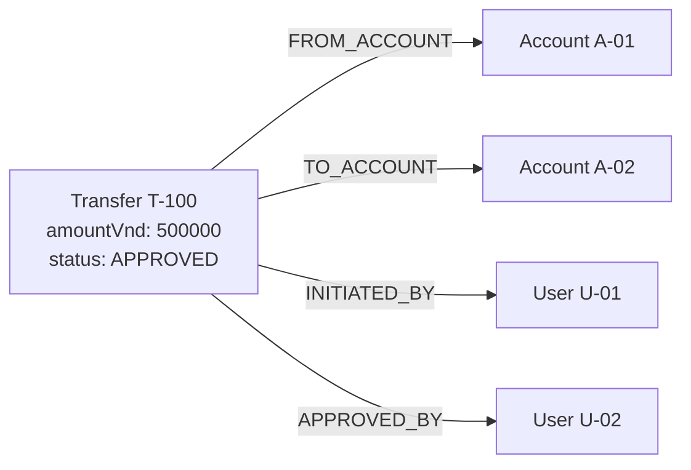
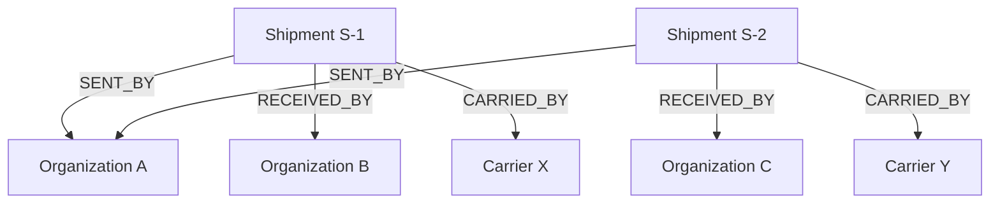
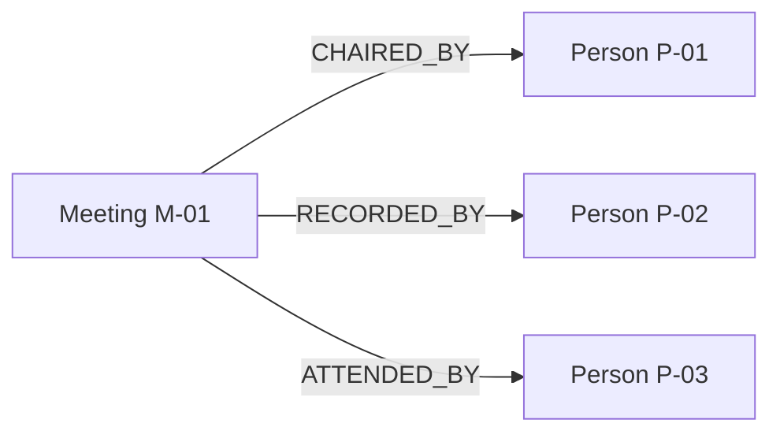
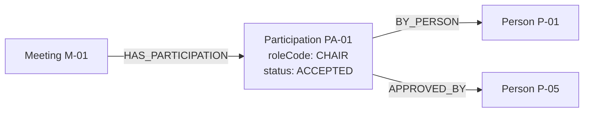
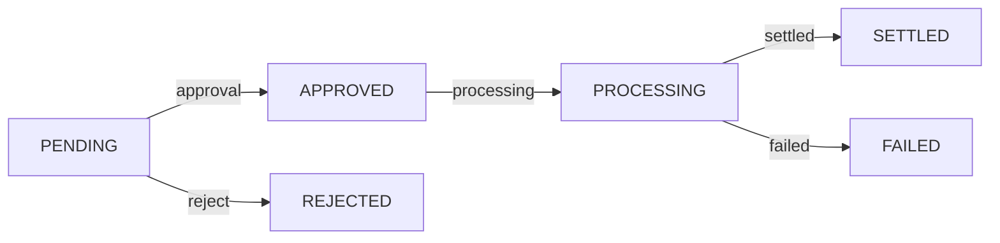

# Multi-Role Relationships and Preserving Endpoint Semantics

In a graph model, an edge connecting two vertices can express "A follows B" or "course A requires course B" very clearly. However, many real-world business processes are not isolated links between exactly two objects. A money transfer simultaneously involves a **source account, destination account, initiator, approver**, and the transfer event itself. A shipment involves a **sender, receiver, carrier, pickup point, and delivery point**. Turning those roles into generic edges or splitting them into unrelated pairs causes the system to lose track of "who participated in **the same event** and in **what role**."

This lesson belongs to the **Graph Modeling** chapter of **DATABASE_DATA_MODELING**, where business requirements are translated into entities, relationships, constraints, keys, indexes, and physical schemas. A design must allow verifying correctness and comparing representations across relational, document, graph, or analytical models. The focus here is **multi-role relationships** (*n-ary relationships*), **endpoint roles**, and preserving business context in a **property graph**.

After this lesson, you will be able to:

- Distinguish binary relationships from events linking three or more objects or roles.
- Clearly identify **which vertices participate**, **which role each plays**, and **which event instance they belong to**.
- Choose among direct edges, event vertices, role-named edges, and dedicated **participation** models.
- Design edge direction, per-role multiplicity, optionality, same-type endpoint relationships, and temporal constraints.
- Write Cypher queries that return the exact tuple of roles and avoid cross-mixing objects from different events.
- Compare graph models with multi-role foreign keys in SQL and nested documents.

## 1. Roles Are Part of Link Semantics

Consider the statement:

> "User U-01 initiates transfer T-100 of 500,000 VND from account A-01 to account A-02. User U-02 approves the transfer."

Components to identify:

| Object | Entity Type | Role in Transfer T-100 |
| --- | --- | --- |
| `T-100` | `Transfer` | Central event |
| `A-01` | `Account` | **Source account** |
| `A-02` | `Account` | **Destination account** |
| `U-01` | `User` | **Initiator** |
| `U-02` | `User` | **Approver** |

Both accounts are vertices labeled `Account`. Both people are `User` vertices. **An object's label alone does not tell you its role in a specific transaction.** You must express roles through **edge type and direction**, or through a participation model carrying a role attribute.

In mainstream property graphs, an edge normally connects **two vertex endpoints**. Thus, multi-party relationships are commonly modeled with an **event vertex** connected to each participating role:



This is a **property graph**: `Transfer` is a vertex with an identity and transaction properties; the edges `FROM_ACCOUNT`, `TO_ACCOUNT`, `INITIATED_BY`, and `APPROVED_BY` express **the specific role of each endpoint**.

**Note:** this model represents transaction metadata; creating vertices and edges by itself **does not move money or perform ledger accounting**. Posting entries, balance checks, settlement, and refunds require separate rules, transactions, and sources of truth.

## 2. Binary Relationships, Multi-Role Relationships, and Independent Events

### 2.1. Binary Relationships Usually Suffice with a Direct Edge

For "course A requires course B," the following representation is clear:

```text
(Course A)-[:REQUIRES]->(Course B)
```

The two ends have different roles through **direction and verb**: A is the *dependent* course, B is the *prerequisite* course. Properties like `mandatory` or `validFrom` can live on the edge. There is no need to create a `Requirement` vertex just because the edge has properties.

### 2.2. Multi-Party Relationships Must Preserve Co-Occurrence

For shipments, suppose we have:

```text
Shipment S-1: sender=A, receiver=B, carrier=X
Shipment S-2: sender=A, receiver=C, carrier=Y
```

If you only record independent edges among A, B, C, X, and Y, you cannot determine **whether carrier X delivered to B or to C**. Combining disconnected binary edges can falsely fabricate two nonexistent tuples: `(A, B, Y)` and `(A, C, X)`.

A `Shipment` vertex groups the participants of **the exact same shipment**:



This diagram does not merely "add a middle vertex." It **preserves the boundary of each relationship tuple**: paths from `S-1` lead to the exact sender, receiver, and carrier of `S-1`.

### 2.3. Distinguishing an Intermediate Entity from a Structural Transformation

In databases that support *hyperedges*, a single relationship can directly link multiple entities. However, **never assume mainstream property graphs support hyperedges as a primitive**. A `Transfer` or `Shipment` vertex is a way of **reifying** a multi-party relationship into binary edges.

The central vertex should carry a **business identifier** such as `transferId` or `shipmentId` when each event has its own lifecycle, timestamp, and rules. Even when an event lacks an external ID, you can still create a logical linking vertex, provided you define **a key distinguishing distinct occurrences** so valid occurrences are not mistakenly merged.

## 3. Designing the Role of Each Endpoint

To make an edge easy to understand and verify, explicitly define **source vertex role**, **target vertex role**, **storage direction**, and **edge type**.

### 3.1. Name Edges After Business Roles

With a central transaction vertex, adopt a convention where all edges go **from the transaction to each participant**:

| Edge Type | Source Vertex | Target Vertex | Business Question |
| --- | --- | --- | --- |
| `FROM_ACCOUNT` | `Transfer` | `Account` | Which source account does the transfer record? |
| `TO_ACCOUNT` | `Transfer` | `Account` | Which receiving account does the transfer record? |
| `INITIATED_BY` | `Transfer` | `User` | Who initiated the transfer? |
| `APPROVED_BY` | `Transfer` | `User` | Who approved the transfer? |

This convention lets every query start at `Transfer` and follow explicit roles. Naming all four links `LINKED_TO` or `RELATED_TO` **destroys role semantics**, even though all four target vertices remain connected.

You do not have to force one arrow direction across every domain. What matters is that **each edge type has one fixed reading** and direction never flips inconsistently between writes and queries.

### 3.2. Same-Type Endpoints Still Need Distinct Roles

Suppose both source and destination are `Account`:

```text
(Transfer T-100)-[:FROM_ACCOUNT]->(Account A-01)
(Transfer T-100)-[:TO_ACCOUNT]->(Account A-02)
```

Never use two `HAS_ACCOUNT` edges and assume "the first edge is source, the second is destination." Property graphs must never depend on display order or physical edge order. When an account participates in many transfers, any implicit ordering breaks down.

If the business permits the same account to play both roles in a special case, state that rule explicitly. Conversely, if **transfers from an account to itself are forbidden**, the system must verify the two roles **do not point to the same vertex**. Edge names do not enforce that check automatically.

### 3.3. The Same Person Can Appear in Two Roles

Both `INITIATED_BY` and `APPROVED_BY` point to `User`. Under an independent-approval policy, **the approver must differ from the initiator**; under another policy, small transactions may auto-approve without an approver vertex.

Thus, a design must explicitly record:

- Which roles are **mandatory**, and which may be absent?
- Can one object hold **multiple roles in the same event**?
- If forbidden, is it forbidden everywhere or only for certain statuses/amount thresholds?
- Can a role be changed, delegated, or reassigned after the event is created?

These answers are **business constraints**—they do not appear automatically just by using two `User` references or different edge types.

### 3.4. Roles Can Vary by Context

A `Person` may be the **organizer** of meeting M-01 and an **attendee** of M-02. A `Person.role = 'ORGANIZER'` property fails if role is **per meeting**. Place the role on the **participation** or represent it with dedicated edges:

```text
(Meeting M-01)-[:ORGANIZED_BY]->(Person P-01)
(Meeting M-02)-[:ATTENDED_BY]->(Person P-01)
```

If roles vary over time or one person holds multiple roles, pick the right **data grain**: "person P's role in meeting M during which period," instead of pinning a static role onto person P.

## 4. Multiplicity and Optionality Are Defined Per Role

For the sample transfer, we can define rules:

| Role | Edges Per `Transfer` | Illustrative Business Rule |
| --- | --- | --- |
| `FROM_ACCOUNT` | **1** | Each transfer has exactly one source account |
| `TO_ACCOUNT` | **1** | Each transfer has exactly one destination account |
| `INITIATED_BY` | **1** | Each transfer has exactly one initiator |
| `APPROVED_BY` | **0..1** | May be absent before approval; if manually approved, at most one approver |
| `HAS_ATTACHMENT` | **0..*** | Zero or more supporting documents, if business requires |

For an `Account`, the number of transfers where it acts as source can be **0..***; the number where it acts as destination is also **0..***. Multiplicity from the central event side and multiplicity from the participant side **are different**.

If a workflow allows **multiple approvers**, you cannot keep `APPROVED_BY 0..1`. Specify clearly: do multiple people approve sequentially or in parallel, in one round or multiple rounds, and does "approved" mean **all**, **majority**, or **any one** approver?

### 4.1. Per-Role Constraints Differ from Identity Constraints

A uniqueness constraint on `Transfer.transferId` prevents duplicate transfer vertices by ID, **not** a `Transfer` having two `TO_ACCOUNT` edges. To guarantee "exactly one destination account," ensure:

1. **Existence:** at least one `TO_ACCOUNT` edge to a valid `Account` vertex.
2. **At most one:** never two `TO_ACCOUNT` edges.
3. **Non-conflict:** destination and source accounts satisfy distinctness rules if required.
4. **Atomic writes:** never leave a "completed" transfer missing its mandatory edges.

Some graph engines offer key or property constraints, yet **never assume every engine supports declarative per-role multiplicity** on edge types. Clarify which rules are enforced by constraints and which by transactions/application logic.

### 4.2. Multiplicity Also Depends on Time and Status

For instance, `APPROVED_BY` may be absent when `status = 'PENDING'`, but must exist when `status = 'APPROVED'` per the illustrative rule. That is a **status-conditional** constraint.

A user might hold approval authority at time T and lose it at T+1. If you need to audit whether an approval was valid at decision time, store the **approval timestamp**, active authority, delegation info, or authoritative evidence. Having an `APPROVED_BY` edge without a timestamp may be insufficient for auditing.

## 5. When to Use Separate Edge Types vs. a `role` Property?

A meeting system has a **chair**, **secretary**, **guests**, and **attendees**. There are at least two modeling approaches.

### 5.1. Approach A: Separate Edge Types for Fixed Roles



Pros: queries and domain documentation read cleanly. When the set of role types is small and stable, edge types like `CHAIRED_BY` and `RECORDED_BY` reflect each role's distinct rules directly.

Cons: if roles are user-configurable with hundreds of values, creating a distinct edge type per value makes the model hard to manage. Never turn each **participant ID** into a different edge type either.

### 5.2. Approach B: A Participation Edge with a Role Property

```text
(Meeting M-01)-[:HAS_PARTICIPANT {
  roleCode: 'CHAIR',
  joinedAt: '2026-11-20T09:00:00+07:00'
}]->(Person P-01)
```

A single `HAS_PARTICIPANT` edge type with a `roleCode` property fits when the role set is **configurable**, queries frequently fetch all participants together, and roles share the same data shape.

In that case you need explicit rules: `roleCode` must come from an allowed catalog, whether a meeting allows at most one `CHAIR`, whether one person can be both `CHAIR` and `NOTE_TAKER`, and whether role changes retain history or overwrite current state.

### 5.3. Approach C: A `Participation` Vertex When Participation Itself Has a Lifecycle



A `Participation` vertex helps when **each role assignment** has its own `participationId`, invitation, RSVP confirmation, substitution, approval rounds, or independent history. Do not introduce an intermediate vertex merely because an edge has a `roleCode` field; extra vertices add elements and traversal hops, so demand a clear business reason.

### 5.4. Comparing the Three Approaches

| Criterion | Separate Edge Types | Edge with `roleCode` | `Participation` Vertex |
| --- | --- | --- | --- |
| Small, stable set of semantic roles | Very well suited | Well suited | Likely overkill |
| User-configurable role catalog | Must manage many edge types | Usually convenient | Fits when per-assignment workflow exists |
| Finding all meeting participants | Must match multiple edge types | Matches one `HAS_PARTICIPANT` type | Traverses participation vertices |
| Participation has an ID and external references | Difficult in many property graphs | Difficult in many property graphs | Convenient |
| Temporal properties on roles | Can live on the edge | Can live on the edge | Can live on participation vertex and events |
| Multiplicity and validity | Enforced per edge type | Enforced per `roleCode` value | Enforced across vertex type and role edges |
| Structural overhead | Fewer elements | Fewer elements | Extra vertices and edges |

Which option to pick depends on **the queries that must be answered** and **the rules that must be enforced**, not on label count or visual simplicity alone.

## 6. Complete Example: Building a Graph for a Multi-Role Transfer

In this example, **each `Transfer` represents a single unique transfer request**, with `transferId`, amount, currency, creation time, and status. An `Account` can participate in many transfers as either source or destination; a `User` can initiate or approve many transfers.

### 6.1. Logical Design

| Component | Key Data | What to Enforce |
| --- | --- | --- |
| `Account` | `accountId`, `status` | Unique `accountId`, valid status |
| `User` | `userId`, `displayName` | Unique `userId`, time-scoped authorization policy |
| `Transfer` | `transferId`, `amountVnd`, `status`, `createdAt` | Unique `transferId`, positive amount, valid state transitions |
| `FROM_ACCOUNT` | `Transfer -> Account` | Exactly one source account |
| `TO_ACCOUNT` | `Transfer -> Account` | Exactly one destination account |
| `INITIATED_BY` | `Transfer -> User` | Exactly one initiator |
| `APPROVED_BY` | `Transfer -> User` | Status-dependent; must follow independent-approval rules if applicable |

Assume in this exercise:

- Unapproved transfers have `status = 'PENDING'` and no `APPROVED_BY` edge yet.
- Manually approved transfers have `status = 'APPROVED'` and exactly one `APPROVED_BY` edge.
- Approver must differ from initiator.
- Source account must differ from destination account.
- Two transfers from A-01 to A-02 with different `transferId`s are **two valid transactions**.

These are only **sample problem assumptions**. Real systems may support auto-approval, multi-tier approval, or special exceptions; adapt the model and constraints to match the actual domain contract.

### 6.2. Sample Data Creation in Cypher

The code uses **Neo4j Cypher** and assumes execution in an empty test database. It illustrates structural modeling and does not perform fund transfers or ledger posting.

```cypher
CREATE
  (source:Account {accountId: 'A-01', status: 'ACTIVE'}),
  (dest:Account {accountId: 'A-02', status: 'ACTIVE'}),
  (initiator:User {userId: 'U-01', displayName: 'An'}),
  (approver:User {userId: 'U-02', displayName: 'Binh'}),
  (t:Transfer {
    transferId: 'T-100',
    amountVnd: 500000,
    status: 'APPROVED',
    createdAt: datetime('2026-11-20T08:00:00+07:00'),
    approvedAt: datetime('2026-11-20T08:02:00+07:00')
  }),
  (t)-[:FROM_ACCOUNT]->(source),
  (t)-[:TO_ACCOUNT]->(dest),
  (t)-[:INITIATED_BY]->(initiator),
  (t)-[:APPROVED_BY]->(approver);
```

Key takeaways:

- `Transfer` has its own ID because **a pair of accounts can transfer multiple times**.
- `FROM_ACCOUNT` and `TO_ACCOUNT` are two **different edge types** even though both point to `Account`.
- `INITIATED_BY` and `APPROVED_BY` distinguish two **business roles** rather than sharing a generic `HAS_USER` type.
- `amountVnd` belongs to the **transfer**, not on `Account` and not on a contextless arrow.
- `createdAt` and `approvedAt` capture distinct milestones; detailed auditing requires provenance and change history as well.

### 6.3. Querying All Roles of a Transfer

```cypher
MATCH (t:Transfer {transferId: $transferId})
      -[:FROM_ACCOUNT]->(source:Account)
MATCH (t)-[:TO_ACCOUNT]->(dest:Account)
MATCH (t)-[:INITIATED_BY]->(initiator:User)
OPTIONAL MATCH (t)-[:APPROVED_BY]->(approver:User)
RETURN t.transferId AS transferId,
       t.amountVnd AS amountVnd,
       t.status AS status,
       source.accountId AS sourceAccountId,
       dest.accountId AS destinationAccountId,
       initiator.userId AS initiatedBy,
       approver.userId AS approvedBy;
```

Sample output:

| transferId | amountVnd | sourceAccountId | destinationAccountId | initiatedBy | approvedBy |
| --- | ---: | --- | --- | --- | --- |
| T-100 | 500000 | A-01 | A-02 | U-01 | U-02 |

`OPTIONAL MATCH` allows unapproved transfers to still appear, with `approvedBy` empty. However, if data is corrupt and a `Transfer` has **two `TO_ACCOUNT` edges**, the query can return **multiple rows for one transfer**. Never use `DISTINCT` to mask a multiplicity bug; inspect the data source and write rules.

### 6.4. Querying by Exact Account Role

"In which transfers did account A-01 act as the **source**?"

```cypher
MATCH (t:Transfer)-[:FROM_ACCOUNT]->
      (account:Account {accountId: $accountId})
MATCH (t)-[:TO_ACCOUNT]->(receiver:Account)
RETURN t.transferId AS transferId,
       receiver.accountId AS receiverAccountId,
       t.amountVnd AS amountVnd,
       t.status AS status
ORDER BY transferId;
```

To find transfers where A-01 was the **destination**, replace `FROM_ACCOUNT` with `TO_ACCOUNT` in the filter. Never write `MATCH (t)-[]->(account)` and treat every transfer touching A-01 as an outgoing transfer; that **mixes source and destination roles**.

### 6.5. Querying Cases Where Initiator and Approver Are the Same Person

Under the problem's assumptions, these two roles must be held by different people. You can detect violations with:

```cypher
MATCH (t:Transfer)-[:INITIATED_BY]->(initiator:User)
MATCH (t)-[:APPROVED_BY]->(approver:User)
WHERE initiator = approver
RETURN t.transferId AS invalidTransferId,
       initiator.userId AS userId;
```

An empty result only proves **no violations of this kind were found in current data**; it does not confirm the approver was authorized, approved at the right time, or that no transfer is missing an approval edge. Those checks need their own rules.

### 6.6. Detecting Missing or Excess Mandatory Edges

To check edge counts per role **without producing a Cartesian product across edge types**, you can use per-transfer `COUNT { ... }` expressions in Neo4j Cypher versions supporting this syntax:

```cypher
MATCH (t:Transfer)
WITH t,
     COUNT { (t)-[:FROM_ACCOUNT]->(:Account) } AS fromCount,
     COUNT { (t)-[:TO_ACCOUNT]->(:Account) } AS toCount,
     COUNT { (t)-[:INITIATED_BY]->(:User) } AS initiatorCount,
     COUNT { (t)-[:APPROVED_BY]->(:User) } AS approverCount
WHERE fromCount <> 1
   OR toCount <> 1
   OR initiatorCount <> 1
   OR approverCount > 1
   OR (t.status = 'APPROVED' AND approverCount <> 1)
RETURN t.transferId AS transferId,
       fromCount, toCount, initiatorCount, approverCount;
```

The output pinpoints **exactly which transfer** has missing or excess roles. This query is a data check and assumes **role edges only point to the right vertex labels**. Any `TO_ACCOUNT` edge pointing to a wrong label must be checked separately; counting total `TO_ACCOUNT` edges regardless of target label can serve as an additional reconciliation check.

If your Neo4j version does not support `COUNT { ... }` expressions as written above, rewrite them using compatible counting subqueries. Do not assume this syntax is universal across all property graphs.

### 6.7. Do Not Rely Only on `MERGE` to Ensure All Roles Are Present

To create a transfer via an API, match all participating vertices by business keys, validate policies, and create the `Transfer` plus required edges inside **one database transaction**. Example:

```cypher
MATCH (source:Account {accountId: $sourceAccountId})
MATCH (dest:Account {accountId: $destinationAccountId})
MATCH (initiator:User {userId: $initiatorUserId})
WHERE source <> dest AND $amountVnd > 0
CREATE (t:Transfer {
  transferId: $transferId,
  amountVnd: $amountVnd,
  status: 'PENDING',
  createdAt: datetime()
})
CREATE (t)-[:FROM_ACCOUNT]->(source)
CREATE (t)-[:TO_ACCOUNT]->(dest)
CREATE (t)-[:INITIATED_BY]->(initiator)
RETURN t.transferId AS transferId;
```

Assume parameters were already type-checked, IDs validated non-missing, accounts verified active, and initiator verified authorized before running. If any `MATCH` finds no vertex, the query creates no `Transfer`; the application must detect that rather than assuming success. With `CREATE`, a **uniqueness constraint** on `transferId` ensures replayed events do not create duplicate transfers. Key conflicts or concurrent updates must follow the API contract; never silently create missing vertices from unverified input.

## 7. Data Constraints and Keys in the Physical Schema

### 7.1. Constraints for Identifiable Vertices

Neo4j Cypher example:

```cypher
CREATE CONSTRAINT transfer_id_unique IF NOT EXISTS
FOR (t:Transfer) REQUIRE t.transferId IS UNIQUE;

CREATE CONSTRAINT account_id_unique IF NOT EXISTS
FOR (a:Account) REQUIRE a.accountId IS UNIQUE;

CREATE CONSTRAINT user_id_unique IF NOT EXISTS
FOR (u:User) REQUIRE u.userId IS UNIQUE;
```

These constraints govern **key values on vertices that carry the corresponding property**. Requiring IDs to exist on every vertex may need existence constraints or additional application rules, depending on engine and version.

They **do not automatically verify**:

- That a `Transfer` has exactly one `FROM_ACCOUNT` and exactly one `TO_ACCOUNT`.
- Whether `FROM_ACCOUNT` and `TO_ACCOUNT` point to the same vertex.
- Whether the approver differs from the initiator and holds approval rights.
- Whether `APPROVED` status is consistent with `APPROVED_BY` and `approvedAt`.

These are **cross-vertex/edge** or **business-rule** constraints requiring validation on writes and periodic data reconciliation.

### 7.2. Status and Temporal Constraints

Sample workflow:



This is **one sample workflow** for transaction metadata. Real systems may have other statuses and transitions. When transitioning to `APPROVED`, the application must record who approved and when per policy. If two-tier approval is added later, do not force `APPROVED_BY 0..1` to remain true—model explicit **approval rounds** or **approval decisions**.

Distinguish:

- **Event timestamps:** `createdAt`, `approvedAt`, `settledAt`.
- **Effective time of authority/role:** from which date to which date a user held approval rights.
- **System recording time:** when decision details were entered or synchronized.

If you must reconstruct "at decision time, was the approver authorized?", checking only current permissions can give the wrong answer. When audit history or retroactive corrections are needed, preserve versions/events and provenance; overwriting a single status property does not retain history.

### 7.3. Constraints When Multiple People Share a Role

A meeting or review dossier can have multiple people participating in the same role. Define multiplicity **per event**: one chair, at most one secretary, many attendees, at least two reviewers, etc.

If a `ReviewRound` lets one person submit multiple feedback items, distinguish the `Reviewer` person from **each review submission** having `reviewId`, `decision`, and `submittedAt`. Counting edges to people differs from counting decisions. A rule that "two independent reviewers approved" requires **two distinct reviewer identities**, not two edges pointing to the same person.

## 8. Static Roles, Dynamic Roles, and Repeated Participation

### 8.1. Static Roles of an Event

`Transfer.FROM_ACCOUNT` and `Transfer.TO_ACCOUNT` normally have clear, fixed roles over the transaction's entire life. If a wrong source account is discovered after recording a transfer, never casually rewire the edge endpoint; you may need to void and re-issue or amend under an audit procedure. Mutating an edge's target destroys the ability to reconstruct the original decision.

### 8.2. Dynamic Roles of People on a Project

An `Employee` might serve as `REVIEWER` from Jan 1 to Jun 1, and then as `LEAD` from Jun 1 onward. When roles have effective time windows, store:

```text
participationId / assignmentId if each assignment has its own ID
roleCode
validFrom
validTo
assignedBy / approvalSource if traceability is required
```

`roleCode` and effective dates can live on an `ASSIGNED_TO` edge when the role is simple link metadata. When approvals, timesheets, budgets, or history attach directly to **each assignment**, an `Assignment` vertex is clearer.

### 8.3. Two Participations in the Same Role Are Not Necessarily Duplicates

Person P-01 may attend meeting M-01 across **two different sessions**. Two `ATTENDED_BY` edges pointing to P-01 might be duplicates if each meeting has only one attendance role; or they might be two valid attendances if each carries a distinct `sessionId`.

Define a **participation key** such as `(meetingId, personId, sessionId, roleCode)` or `participationId`. Never infer uniqueness solely from the vertex pair when the domain allows multiple occurrences.

## 9. Comparison with Relational, Document, and Analytical Data

### 9.1. SQL Represents Roles via Named Foreign Keys

A relational table can represent multi-role transactions very cleanly:

```sql
CREATE TABLE transfers (
    transfer_id VARCHAR(40) PRIMARY KEY,
    source_account_id VARCHAR(40) NOT NULL
        REFERENCES accounts(account_id),
    destination_account_id VARCHAR(40) NOT NULL
        REFERENCES accounts(account_id),
    initiated_by_user_id VARCHAR(40) NOT NULL
        REFERENCES users(user_id),
    approved_by_user_id VARCHAR(40) NULL
        REFERENCES users(user_id),
    amount_vnd BIGINT NOT NULL,
    status VARCHAR(24) NOT NULL,
    created_at TIMESTAMP NOT NULL,
    CHECK (amount_vnd > 0),
    CHECK (source_account_id <> destination_account_id)
);
```

Here **two foreign keys reference `accounts`**, yet carry distinct roles via column names. A `transfers` table stores each **transfer occurrence** along with the foreign keys of participating users/accounts. When mapping to a graph, a `Transfer` vertex with role-typed edges gives an equivalent semantic mapping.

`NOT NULL` on foreign-key columns lets SQL express **mandatory roles**, and `CHECK` expresses same-row conditions. A rule like "the approver must hold active authority at approval time" still requires additional design; foreign keys alone do not enforce it.

If you only kept separate junction tables `account_relations` and `user_relations` without `transfer_id`, SQL would likewise lose the link that "these participants belong to **the same transfer**," just like a graph split into disconnected binary edges without an event vertex.

### 9.2. Document Models Can Store Roles in One Aggregate Record

A transfer document might look like:

```json
{
  "transferId": "T-100",
  "sourceAccountId": "A-01",
  "destinationAccountId": "A-02",
  "initiatedBy": "U-01",
  "approvedBy": "U-02",
  "amountVnd": 500000,
  "status": "APPROVED"
}
```

The document keeps all roles inside **one aggregate object**, fitting well when most reads/writes fetch the entire transfer. However, when traversing networks of accounts and transfers across multiple hops, querying related clusters, or discovering user–account paths, ID references require extra queries or engine-specific mechanisms.

### 9.3. Analytical Warehouses Use Grain to Preserve Role Tuples

A `fact_transfer` table can have **one row per transfer**, with keys to `source_account`, `destination_account`, `initiator`, and `approver` dimensions. This is a clean way to preserve roles in an analytical model.

Even so, "total transfers by month and status" differs from network queries like "which accounts connect indirectly across chains of transfers?". You can use a warehouse for aggregations, a graph for path exploration, and a transactional database for core operations. What matters is shared **canonical IDs**, sync rules, and common reconciliation.

### 9.4. Structural Choice Summary

| Business Focus | Usually Suitable Structure |
| --- | --- |
| Only need A -> B relationship with a few attributes | Direct edge with clear type and direction |
| One multi-party interaction with its own ID | Event/intermediate vertex with role-named edges |
| Each participation has its own status and history | `Participation` or `Assignment` vertex |
| Transactional table with role columns and strong ACID rules | SQL table with clearly named foreign keys; graph may be a derived model |
| Always read/write a complete event as one unit | Document holding role IDs can be appropriate |
| Primarily summing counts/amounts across dimensions | Fact and dimension tables with explicit roles |
| Exploring multi-hop links among users, accounts, events | Graph can be convenient once identity quality and queries are verified |

## 10. Process for Designing Multi-Role Relationships

### Step 1 — Write a Business Sentence for **Each Role**

Do not stop at "a transfer involves four objects." Write:

- `Transfer` **takes funds from** one `Account`.
- `Transfer` **sends funds to** one `Account`.
- `Transfer` **is initiated by** one `User`.
- `Transfer` **is approved by** one `User` when approval is required.

These verbs directly suggest edge types and directions. If a role cannot be stated in a clear sentence, the model risks using an overly generic concept.

### Step 2 — Define the **Data Grain** of the Relationship

Does one `Transfer` vertex represent **a single transfer execution** or a **recurring schedule** spanning many executions? Does one `Shipment` represent a parcel, a truck trip, or a delivery attempt? Does one `Meeting` span multiple sessions or one specific session?

Without defining grain, edges can combine into invalid role tuples. Choose a business ID distinguishing each occurrence, even when two occurrences share the exact same participants.

### Step 3 — Attach Keys, Direction, Edge Types, and Multiplicity

Tabulate roles, minimum/maximum counts per event, and distinctness conditions. Document which roles may repeat, may be absent, or may be held by the same entity. Design constraints and a consistent process to create all mandatory edges together.

### Step 4 — Check Whether History, Status, and Provenance Are Needed

If roles can change or approvals span multiple rounds, record **when**, **who decided**, and **under what authority**. Choose among edge properties, `Participation` vertices, or immutable events depending on audit depth and query patterns.

### Step 5 — Write Queries Anchored at the **Central Event Vertex**

Illustrative verification requirements:

| Requirement | What the Query Must Enforce |
| --- | --- |
| "Where did transfer T-100 move money from and to?" | Same **T-100**, `FROM_ACCOUNT` and `TO_ACCOUNT` edges |
| "Who approved T-100?" | `APPROVED_BY` edge of **that exact T-100** |
| "Which accounts did A-01 send funds to?" | Filter A-01 in the **source** role, take destination in the **same Transfer** |
| "Which transfers lack an initiator?" | `INITIATED_BY` role count equals 0 |
| "How many approvers?" | Count **distinct user identities** or **approval actions** per the defined rule |
| "Who approved at that point in time?" | Decision edge/vertex with timestamp and provenance, cross-checked against active authority |

Never use roleless edges and rely on the query engine's result ordering to guess who is who.

### Step 6 — Validate Against Boundary Cases

Test at least:

1. Two different transfers sharing **the same account pair** are not merged.
2. A transfer missing its destination account is not treated as valid/complete.
3. A transfer with two source accounts is flagged as a violation if rules require one.
4. A transfer with the same initiator and approver is handled according to policy.
5. `PENDING` status does not require an approver prior to decision; `APPROVED` satisfies declared rules.
6. Each transfer preserves its links to participants even when an account or user participates in many other transfers.
7. Aggregate queries do not multiply transfer counts when multiple attachments or approval rounds exist.

## 11. Common Mistakes

1. **Naming every edge `RELATED_TO`.** Fails to distinguish sender, receiver, creator, and approver.
2. **Using object labels instead of roles.** Two `Account` vertices do not reveal which is source and which is destination.
3. **Relying on edge order.** Returned order does not define endpoint semantics.
4. **Splitting a multi-party event into disconnected pairs.** Loses which objects belonged to the same event instance, creating false combinations.
5. **Merging events that share participants.** Two transfers from A to B can be two separate transactions with distinct IDs, amounts, and timestamps.
6. **Putting meeting-specific roles on the `Person` vertex.** Role is participation metadata, not a permanent attribute of the person.
7. **Creating `Participation` vertices for every edge without need.** Increases structural complexity and traversal hops.
8. **Forgetting per-role multiplicity.** Each transfer needs one source and one destination, yet an account can participate in many transfers.
9. **Assuming vertex ID constraints guarantee required edges.** `transferId UNIQUE` does not force a transfer to have its user and account edges.
10. **Using `DISTINCT` to hide row-multiplication bugs.** Two `TO_ACCOUNT` edges are a data defect when only one is allowed; detect and fix at the source.
11. **Ignoring status and effective time.** Someone authorized today was not necessarily authorized at the moment of a historical approval.
12. **Keeping shortcut edges alongside event vertices without a source of truth.** Both representations can drift after edits or replayed events.

## 12. Practice Exercises and Suggested Answers

### Exercise 1 — Sender and Receiver Roles

Given two shipments:

```text
Shipment S-1: sender=A, receiver=B, carrier=X
Shipment S-2: sender=A, receiver=C, carrier=Y
```

**Tasks:** (a) Why should you not just link A to B, C, X, and Y with edges untied to a shipment? (b) Sketch a model that can answer "who carried goods to B?".

**Suggested answers:** create two vertices `Shipment S-1` and `Shipment S-2`. On each vertex, use `SENT_BY`, `RECEIVED_BY`, and `CARRIED_BY`. The question about B traverses through **S-1** to obtain `Carrier X`; no false `B/Y` combination is created.

### Exercise 2 — Same Entity Type, Different Roles

A user enrolls in a course on behalf of their younger sibling. Both payer and learner are `Person`. Each enrollment has its own `enrollmentId`, and may include a promo code and class schedule.

**Tasks:** name the two role edges and explain why you should not use `(Enrollment)-[:HAS_PERSON]->(Person)` twice.

**Suggested answers:** create `Enrollment` with `enrollmentId`, edge `PAID_BY` to the payer, and edge `FOR_LEARNER` to the learner. Both `Person` vertices share the same type yet play different roles; occasionally they may even be the same person, depending on policy. Using `HAS_PERSON` makes queries hard to distinguish and risks reporting the payer as the learner.

### Exercise 3 — Multiple Approval Rounds

A dossier requires **two different approvers** across two tiers. One person may submit multiple decisions when the dossier is revised and re-reviewed.

**Tasks:** why is creating two `APPROVED_BY` edges not necessarily enough? What model fits better?

**Suggested answers:** distinguish the **person** from **each approval decision**. Create an `ApprovalDecision` vertex with `decisionId`, `level`, `status`, and `decidedAt`, linked to `Request` and `User`. Enforcing two-tier approval must verify **two distinct user identities** on the correct dossier version. Two edges pointing to the same person fail the "two people" rule.

### Exercise 4 — Multiplicity and Status

A transfer has four roles: source (1), destination (1), initiator (1), approver (0..1). When `APPROVED`, an approver must be present and distinct from the initiator.

**Tasks:** give three invalid data cases and one valid unapproved case.

**Suggested answers:** invalid if (i) missing `TO_ACCOUNT`, (ii) two `FROM_ACCOUNT` edges, (iii) `status = APPROVED` without `APPROVED_BY` or with approver equal to initiator. Valid unapproved is `status = PENDING` with source, destination, initiator present and no approver.

### Exercise 5 — Choosing How to Store Meeting Roles

An organization has fixed roles `CHAIR` and `SECRETARY`, while letting users define custom roles. Each invitation has its own ID, can be declined, and can be delegated.

**Tasks:** should you use separate edge types, a `roleCode` property, or a `Participation` vertex?

**Suggested answers:** for simple fixed roles, separate edge types read clearly. Configurable roles can use `HAS_PARTICIPANT {roleCode}`. However, **each invitation having its own ID, status, and delegation** is an independent business instance: a `Participation` or `Invitation` vertex fits better. Approaches can be combined if boundaries are clearly defined and out-of-sync duplicate facts are avoided.

### Exercise 6 — Comparing with Relational

A SQL `transfers` table has `source_account_id`, `destination_account_id`, `initiated_by_user_id`, and `approved_by_user_id`. When moving to a property graph, a team plans to merge all relationships into `Transfer-[:LINKED_TO]->Account/User`.

**Tasks:** what problem occurs, and how should it be fixed?

**Suggested answers:** the SQL columns already carry **distinct roles**; collapsing them into one `LINKED_TO` type erases that meaning. Keep `Transfer` as a vertex and create role-specific edge types `FROM_ACCOUNT`, `TO_ACCOUNT`, `INITIATED_BY`, and `APPROVED_BY`; or use a participation edge with a role property when justified. Every query must join **through the same `Transfer`** to retrieve the exact participants of an event.

## Summary

**Multi-role relationships** are not just multiple edges appearing together in a diagram. A design must preserve **which event occurrence each role belongs to**, **which endpoint plays which role**, **allowed counts**, **valid timestamps and statuses**, and **the identity of each participation or event**. Property graphs typically represent multi-party relationships with an **event vertex** and role-named edges; when roles have their own lifecycle, use a `Participation` vertex. Validate the model with concrete queries and boundary cases, then pick the storage engine—graph, relational, document, or analytical—based on business needs and consistency maintainability.
