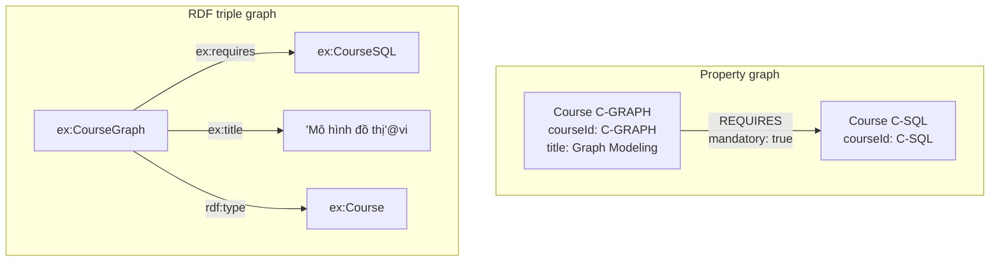
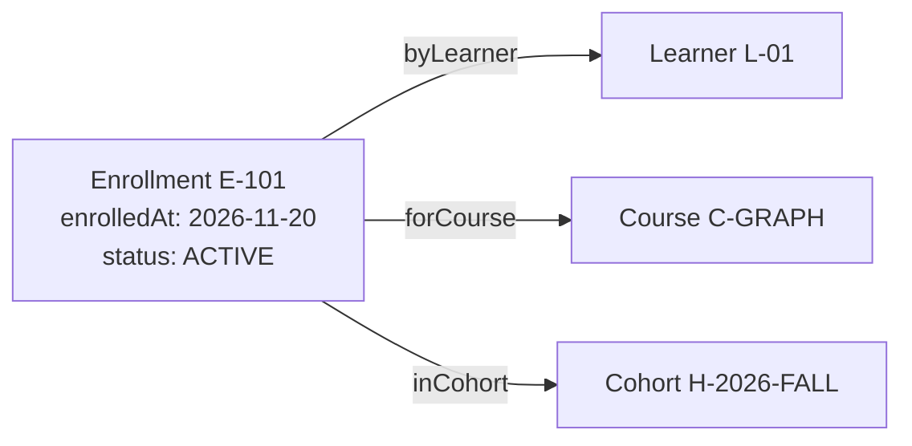

# Distinguishing Property Graphs from the RDF Triple Model

A network of data can be represented in multiple ways. For the statement "the *Graph Modeling* course requires taking *SQL Basics* first," a **property graph** typically represents two `Course` vertices and one `REQUIRES` edge. In **RDF** (*Resource Description Framework*), the same fact is represented as a **triple** consisting of a subject, predicate, and object. On the surface, both have "nodes" and "arrows," yet their identity schemes, property placement, semantic rules, query tools, and extensibility mechanisms differ substantially.

This lesson belongs to the **Graph Modeling** chapter of **DATABASE_DATA_MODELING**. The module trains how to translate business requirements into entities, relationships, constraints, normalization, keys, indexes, and physical schemas—and from there compare relational, document, graph, and analytical models to choose an evolvable, verifiable solution. Here, we compare **property graphs and RDF as two data modeling paradigms** before choosing any specific database engine.

After this lesson, you will be able to:

- Read and explain a property graph in terms of **vertices, edges, labels, and properties**, and an RDF graph in terms of **subject, predicate, and object**.
- Recognize the differences between **vertex labels**, **edge types**, **IRIs**, **literals**, **blank nodes**, and `rdf:type` statements.
- Represent the same business requirement in both property graph and RDF while preserving **identity, roles, and event history**.
- Compare **Cypher** with **SPARQL**, especially for direct queries, multi-hop queries, and entity-type queries.
- Distinguish **semantic inference (reasoning)** (RDFS/OWL) from **constraint validation** (SHACL, constraints, or application logic).
- Choose a model based on queries, cross-system interoperability, data rules, and operability.

## 1. What Questions Do the Two Graph Families Solve?

### 1.1. Property Graph: Objects and Property-Bearing Links

In a **property graph**, you typically have:

- **Vertex (node):** represents an object, such as `Course`, `Learner`, or `Skill`.
- **Edge (relationship):** connects vertices, has a type and usually a direction, such as `REQUIRES` or `COMPLETED`.
- **Label:** categorizes vertices, such as `:Course` and `:Learner`.
- **Property:** key–value pairs on vertices or edges, such as `courseId`, `title`, or `completedAt`.

Example in Cypher-like notation:

```text
(:Course {courseId: "C-GRAPH", title: "Graph Modeling"})
  -[:REQUIRES {mandatory: true}]->
(:Course {courseId: "C-SQL", title: "SQL Basics"})
```

The `mandatory` property sits **on the `REQUIRES` edge** because it describes the prerequisite relationship itself. Property graphs are usually convenient for queries starting from an object and traversing typed edges, such as "walk to all prerequisite courses" or "find neighbors of this account."

This is a **data model**, not the name of a product. Property graph engines may differ in multi-label support, property data types, parallel edges, constraints, query languages, and built-in algorithms.

### 1.2. RDF: Expressing Data as Triples

**RDF** is a W3C-standardized model for describing **resources** and their relationships through statements of the form:

```text
(subject, predicate, object)
```

Conceptual example:

```text
(course C-GRAPH, requires, course C-SQL)
(course C-GRAPH, has title, "Graph Modeling")
(course C-GRAPH, has type, Course)
```

A triple asserts **one statement**. A collection of triples forms an RDF graph: when the object of one triple is a resource, triples link together into paths.

- **Subject:** the resource being described, typically identified by an IRI or a blank node.
- **Predicate:** an IRI denoting the relationship type or attribute; the predicate carries the semantic meaning of the statement.
- **Object:** a resource (IRI or blank node) **or** a literal value such as a string, number, or typed date.

RDF has an ecosystem of related standards: **Turtle** for human-readable serialization, **SPARQL** for querying, **RDFS/OWL** for expressing vocabularies and reasoning, and **SHACL** for validating data shapes/constraints. Using RDF **does not require** using OWL or reasoning; an RDF store can simply store and query explicit triples.

### 1.3. Illustrating the Same Content



The key difference is not merely **diagram style**. In the RDF section, `ex:title` and `rdf:type` are also **predicates forming triples**, rather than property pairs or labels stored via the same mechanism as a property graph.

## 2. RDF Structure: IRIs, Literals, and Blank Nodes

### 2.1. IRI: Identifying Resources and Predicates

An **IRI** (*Internationalized Resource Identifier*) identifies resources and predicates. It can look like a URL, yet **does not require every IRI to be a dereferenceable web page**. In interoperable knowledge systems, you should establish a stable IRI strategy, clear namespaces, and documented public or internal vocabularies.

Examples:

```text
https://example.org/learning/course/C-GRAPH
https://example.org/learning/course/C-SQL
https://example.org/vocab/requires
```

In Turtle, you can declare prefixes to shorten long IRIs:

```turtle
@prefix ex: <https://example.org/learning/> .
@prefix xsd: <http://www.w3.org/2001/XMLSchema#> .

ex:CourseGraph
    a ex:Course ;
    ex:courseId "C-GRAPH" ;
    ex:title "Mô hình đồ thị"@vi ;
    ex:requires ex:CourseSQL .

ex:CourseSQL
    a ex:Course ;
    ex:courseId "C-SQL" ;
    ex:title "SQL cơ bản"@vi ;
    ex:durationMinutes 180 .
```

In Turtle:

- `ex:CourseGraph` is a prefixed shorthand for an IRI using prefix `ex:`.
- `a` is shorthand for `rdf:type`, asserting the resource belongs to class `ex:Course`.
- Semicolon `;` groups multiple statements sharing the same subject; period `.` ends a statement block.
- `"Mô hình đồ thị"@vi` is a string with a **Vietnamese language tag**.
- `180` is an integer literal; `"C-GRAPH"` is a string literal.
- `ex:requires` is the **predicate IRI**; it is not an ad-hoc string used only inside queries.

The names `ex:Course`, `ex:requires`, and `ex:courseId` in the example are **application-defined vocabulary**. Naming them alone does not create prerequisite rules, multiplicity constraints, or inference.

### 2.2. Literals vs. IRIs

The object in RDF can be a **literal** or a **resource**:

```turtle
ex:CourseGraph ex:courseId "C-GRAPH" .
ex:CourseGraph ex:title "Mô hình đồ thị"@vi .
ex:CourseGraph ex:requires ex:CourseSQL .
```

Across these three statements:

- `"C-GRAPH"` is a string value; it does not point to another vertex/resource.
- `"Mô hình đồ thị"@vi` is a language-tagged literal.
- `ex:CourseSQL` is a resource with an IRI; from it, queries can traverse further statements about that course.

If you want to promote a value into an object with identity, use an appropriate IRI or blank node rather than packing everything into literals. For instance, `Skill` can be its own resource if multiple courses teach that skill and skills have their own prerequisite relationships.

### 2.3. Blank Nodes: Resources Without a Global Name

RDF allows **blank nodes** as resources lacking an application-assigned IRI. They are useful for auxiliary structures or objects that do not need a public identifier.

```turtle
ex:CourseGraph ex:hasAudience [
    ex:minimumLevel "INTERMEDIATE" ;
    ex:language "vi"
] .
```

The block inside `[ ... ]` creates a blank node expressing audience metadata. It can still link multiple triples, yet it is **not a durable business identifier for other systems to point to**. Any serialization-local blank node label should never be used as an integration key.

For `Course`, `Learner`, `Order`, or `Enrollment` with clear business identities exchanged across systems, stable IRIs are usually preferable.

### 2.4. RDF Is a Set of Statements, Not an Arbitrary List of Edges

An RDF graph is modeled as a **set of triples**. Two **identical** copies of the same triple do not create two distinct statements under set semantics. Conversely, property graphs can often hold **two distinct parallel edges** between the same two vertices, even of the same type, depending on engine capabilities.

This matters for repeated events: two enrollments by the same learner in the same course may be **two distinct events** with different IDs, terms, and timestamps. You cannot simply write the triple `(Learner, ex:enrolledIn, Course)` twice and expect RDF to tell the two occurrences apart.

## 3. How Does a Property Graph Represent the Equivalent?

With the same course data, Cypher can create vertices and edges:

```cypher
// Neo4j Cypher example, run on an empty test database.
CREATE
  (graph:Course {
    courseId: 'C-GRAPH',
    title: 'Graph Modeling',
    durationMinutes: 240
  }),
  (sql:Course {
    courseId: 'C-SQL',
    title: 'SQL Basics',
    durationMinutes: 180
  }),
  (graph)-[:REQUIRES {mandatory: true}]->(sql);
```

In this notation, `Course` is a **vertex label**. `courseId`, `title`, and `durationMinutes` are **vertex properties**. `REQUIRES` is an **edge type**, and `mandatory` is an **edge property**. The variables `graph` and `sql` exist only inside the statement, not as permanent identifiers stored in the database.

A property graph engine may allow multiple labels on the same vertex, such as `(:Person:Instructor)`. **Labels** are tools for classification, lookup, and model expression; by themselves they do not automatically carry semantics like `rdfs:subClassOf` or OWL inference rules.

When modeling interoperable data, vertices should still carry **stable business IDs** and optionally store canonical IRIs as well. Never treat engine-assigned internal IDs as suitable identifiers for export/import across different databases.

## 4. Four-Component Comparison Table

| Aspect | Property Graph | RDF |
| --- | --- | --- |
| Primary object | Vertices with labels and properties | Resources acting as subjects/objects of triples |
| Identity | Business ID / application key; engine may have internal IDs | Stable IRI or blank node |
| Relationship | Typed edge, usually directed | Triple with an **IRI predicate** |
| Descriptive value | Property on vertex or edge | Triple whose object is a literal |
| Object classification | Vertex label, e.g., `:Course` | `rdf:type ex:Course` |
| Properties of the relationship itself | Usually placed directly on the edge | Requires an extra construct to describe **a specific statement or relationship occurrence** |
| Repeated relationships between the same endpoints | Can have parallel edges depending on engine | Identical triples do not distinguish multiple occurrences; model separate event resources |
| Common queries | Cypher, GQL, or product-specific languages | SPARQL |
| Inference semantics | No single built-in standard inference system by default | RDF/RDFS/OWL provide optional semantic entailment and reasoning |
| Constraint checking | Engine-dependent constraints/transactions/application logic | SHACL or validation tools; OWL does not replace validation |
| Interoperability | Can export/import or build custom naming conventions | IRIs, triples, and standard vocabularies aid publishing/integrating knowledge |
| Query optimization | Depends on workload, engine, and indexes | Depends on workload, store, and index strategy |

**Never conclude one model is "stronger" solely from this table.** A property graph engine can support interoperability, ontologies, or complex algorithms via extensions; an RDF store can handle multi-hop traversals, rules, and analytics. Choose based on requirements and the **actual capabilities** of the deployed product.

## 5. Same Requirement, Two Storage Models and Two Query Styles

### 5.1. Prerequisite Data in RDF

Using triples:

```turtle
@prefix ex: <https://example.org/learning/> .

ex:Graph a ex:Course ;
    ex:courseId "C-GRAPH" ;
    ex:title "Mô hình đồ thị"@vi ;
    ex:requires ex:Model ;
    ex:requires ex:Algorithm .

ex:Model a ex:Course ;
    ex:courseId "C-MODEL" ;
    ex:requires ex:SQL .

ex:Algorithm a ex:Course ;
    ex:courseId "C-ALGO" ;
    ex:requires ex:Programming .

ex:Programming a ex:Course ;
    ex:courseId "C-PROG" ;
    ex:requires ex:SQL .

ex:SQL a ex:Course ;
    ex:courseId "C-SQL" ;
    ex:title "SQL cơ bản"@vi .
```

Here `ex:Graph` has two `ex:requires` relationships. Intermediate and target resources can be traversed further along the same predicate.

### 5.2. SPARQL: Direct Prerequisites

```sparql
PREFIX ex: <https://example.org/learning/>

SELECT ?prerequisite
WHERE {
  ex:Graph ex:requires ?prerequisite .
}
ORDER BY ?prerequisite
```

The result is `ex:Model` and `ex:Algorithm`. In SPARQL, `?prerequisite` is a variable in the triple pattern; the period ends the statement pattern.

### 5.3. SPARQL: Direct and Indirect Prerequisites

SPARQL 1.1 supports **property paths**. The `+` operator after a predicate means traversing **one or more occurrences** of that relationship:

```sparql
PREFIX ex: <https://example.org/learning/>

SELECT DISTINCT ?prerequisite
WHERE {
  ex:Graph ex:requires+ ?prerequisite .
}
ORDER BY ?prerequisite
```

On the sample data, we obtain four resources: `ex:Model`, `ex:Algorithm`, `ex:Programming`, and `ex:SQL`. `ex:SQL` is reachable via **two link chains**, yet in a "target set" requirement it appears only once.

A **property path** like `ex:requires+` matches start–end pairs satisfying the path expression. **It does not mean** SPARQL automatically returns lists of every vertex/edge on every path to explain the route. If the business needs explicit paths, scores, all shortest paths, or specialized algorithms, verify product capabilities and complementary query strategies.

### 5.4. Cypher: Equivalent Query

In a property graph with corresponding `Course` vertices and `REQUIRES` edges, an illustrative Cypher pattern:

```cypher
MATCH (start:Course {courseId: 'C-GRAPH'})
      -[:REQUIRES*1..5]->(prereq:Course)
RETURN DISTINCT prereq.courseId AS prerequisiteId
ORDER BY prerequisiteId;
```

`*1..5` selects paths of length one to five edges in the illustrated Neo4j Cypher syntax. **The five-hop limit is a query choice**, so if a real graph has longer chains, results may be incomplete.

Both patterns express "traverse multiple `requires` links" similarly at the business level, yet they should not be treated as a **one-to-one syntax translation**: SPARQL property paths and Cypher variable-length patterns have different rules regarding result sets, duplicates, paths, cycles, and bounds. Always test results on real data.

### 5.5. Identifier Lookups in Both Models

In a property graph, users can look up by `courseId`:

```cypher
MATCH (c:Course {courseId: $courseId})
RETURN c.courseId AS courseId, c.title AS title;
```

In RDF, if the application already knows the canonical IRI for a course code, it can query **that resource directly**:

```sparql
PREFIX ex: <https://example.org/learning/>

SELECT ?title
WHERE {
  ex:Graph ex:title ?title .
}
```

If only the external code string is known, look it up via the `ex:courseId` literal or map code to IRI at the application layer. A **resource IRI** and a **business code literal** are two distinct concepts, even when a system derives IRIs from stable codes by convention.

## 6. Relationships with Properties: A Crucial Design Difference

Business statement:

> Learner L-01 enrolls in course C-GRAPH on 2026-11-20, status active, in cohort H-2026-FALL.

You could simplify this to an `ENROLLED_IN` edge between two objects. However, when you need to store **term, timestamp, payment, re-enrollments, or approvals**, decide whether **each enrollment** is its own business object or merely an attribute of the learner–course pair.

### 6.1. Property Graph: Property-Bearing Edge

When **each learner–course pair has at most one enrollment** and no other object references that enrollment:

```cypher
MATCH (learner:Learner {learnerId: 'L-01'})
MATCH (course:Course {courseId: 'C-GRAPH'})
CREATE (learner)-[:ENROLLED_IN {
  enrolledAt: date('2026-11-20'),
  status: 'ACTIVE'
}]->(course);
```

`enrolledAt` and `status` belong to the **relationship**. Placing them directly on the edge is natural in a property graph. The `CREATE` snippet only illustrates structure; re-running it can create duplicate edges, so design keys/enrollment rounds and idempotent writes per business rules.

### 6.2. RDF: Creating an Event Resource `Enrollment`

RDF does not have a "property on a triple edge" primitive with the same built-in semantics as a property graph. A stable, interoperable pattern creates an **enrollment resource** linked to both sides:

```turtle
@prefix ex:  <https://example.org/learning/> .
@prefix xsd: <http://www.w3.org/2001/XMLSchema#> .

ex:EnrollmentE101 a ex:Enrollment ;
    ex:enrollmentId "E-101" ;
    ex:byLearner ex:LearnerL01 ;
    ex:forCourse ex:Graph ;
    ex:inCohort ex:CohortFall2026 ;
    ex:enrolledAt "2026-11-20"^^xsd:date ;
    ex:status "ACTIVE" .

ex:LearnerL01 a ex:Learner ;
    ex:learnerId "L-01" .

ex:Graph a ex:Course ;
    ex:courseId "C-GRAPH" .

ex:CohortFall2026 a ex:Cohort ;
    ex:cohortId "H-2026-FALL" .
```

Diagram:



The `Enrollment` vertex has its **own identity**, allowing two enrollments by the same learner in the same course across different terms to be distinguished by `enrollmentId`. Resources such as `Payment` or `Approval` can also link directly to the exact enrollment.

A property graph **can also use an `Enrollment` vertex and similar role edges**. The difference is that a property graph **additionally offers** placing properties directly on the edge when simple enough; RDF normally requires modeling an extra resource or using another metadata mechanism when describing **a specific statement**.

### 6.3. SPARQL: Finding a Person's Enrollments

```sparql
PREFIX ex: <https://example.org/learning/>

SELECT ?enrollment ?course ?enrolledAt ?status
WHERE {
  ?enrollment a ex:Enrollment ;
      ex:byLearner ex:LearnerL01 ;
      ex:forCourse ?course ;
      ex:enrolledAt ?enrolledAt ;
      ex:status ?status .
}
ORDER BY ?enrolledAt
```

The query keeps **the tuple of facts belonging to one enrollment together**. Never split into separate `Learner -> Course` and `Learner -> Cohort` triples and infer arbitrary course/cohort combinations, as that can fabricate combinations that never occurred.

### 6.4. Statement Metadata Differs from Event Metadata

An RDF statement such as:

```turtle
ex:Graph ex:requires ex:SQL .
```

may need metadata about "who issued the rule?", "which source published it?", and "when is the rule valid?". There are **multiple ways to express this**, and they are not equivalent in every situation:

| Technique | What Is It Used For? | Caveat |
| --- | --- | --- |
| **Dedicated rule/event resource** | Model a `RequirementRule` with ID, source, time, status, linked to courses | Clear when rules have lifecycles or multiple parties; adds triples |
| **Traditional RDF reification** | Triples describing the subject/predicate/object of a statement | Describing a statement **does not automatically assert** the original statement as true in the graph |
| **Named graph in an RDF dataset** | Group a set of triples under a graph name, e.g., dataset published by source X | Fits graph-level provenance; does not automatically provide per-triple metadata |
| **RDF-star / equivalent triple-term mechanisms** | Attach metadata to a statement via extended syntax/structure | Support and semantics depend on standard/version/product; verify your tooling |

**Do not confuse "when a statement was published" with "when the real-world event took place."** A system might enter a rule on Nov 25 that took effect on Nov 1; storing only the entry date makes effective-history queries wrong.

## 7. RDF Has Classes and Reasoning; Property Graphs Have Labels Without Built-In Inference

### 7.1. `rdf:type` Differs from Vertex Labels

In RDF, you can write:

```turtle
@prefix ex:   <https://example.org/learning/> .
@prefix rdfs: <http://www.w3.org/2000/01/rdf-schema#> .

ex:Instructor rdfs:subClassOf ex:Person .
ex:Alice a ex:Instructor .
```

Under RDFS semantics, an appropriate reasoner can infer that `ex:Alice` is also an `ex:Person`. This relies on **declared subclass relationships** and inference rules, not because the word "Instructor" resembles "Person."

In a property graph:

```text
(:Instructor {name: "Alice"})
```

having the `Instructor` label **does not automatically mean** the vertex also carries the `Person` label. You can attach both labels `(:Person:Instructor)` or manage type hierarchies in the application, but inference is not implied by label syntax.

### 7.2. RDFS, OWL, and Ontologies

RDF provides the basic statement form. **RDFS** lets you describe classes, properties, subclass/subproperty hierarchies, domains, and ranges. **OWL** expands ontology expressiveness, such as class relationships, identity equivalence, and logical axioms, depending on reasoner configuration.

These capabilities are valuable when:

- Multiple organizations must **share exact data semantics**.
- Taxonomies have **subclass** and **subproperty** hierarchies, or require aligning different vocabularies.
- Queries must include **inferred facts** alongside explicitly asserted triples.
- Data links to external knowledge sources with shared IRIs and ontologies.

For example, when two teams call the same concept "Instructor" and "Teacher," declaring whether they are **equivalent or distinct** is an ontology decision; renaming columns or labels alone does not give a system inference rules.

**Inference is not SQL-style input data validation.** Under open-world OWL semantics, missing data or certain logical conflicts may trigger inferences rather than "rejecting the record" as a transactional application would.

### 7.3. Open World Assumption vs. Closed World Assumption

RDF and OWL are typically interpreted under the **Open World Assumption (OWA)**: if the graph **lacks** the triple `ex:Alice ex:hasCertificate ex:SQLCertificate`, that **does not prove** Alice lacks the certificate; the system might simply not know yet or not have ingested that source.

In operational applications, many rules are checked under a **closed-world** view over controlled data: if the verified database contains no qualifying certificate, the system decides the learner is **not yet eligible to enroll**.

These answer **two different kinds of questions**:

- "What does the knowledge graph currently **assert**, and what can be inferred?"
- "Does the business system have **enough verified evidence** to authorize an action?"

A SPARQL `FILTER NOT EXISTS` query finds data **absent from the queried dataset**, yet **does not turn that absence into global logical negation** under OWA.

Property graphs do not automatically contain the complete real world either. A Cypher query finding no edge does not mean the relationship does not exist in reality. The difference is that RDF/RDFS/OWL have a standardized semantic framework for interpreting statements and inference, whereas transaction authorization still rests on application requirements and verification rules.

## 8. Data Validation: SHACL Differs from OWL and Uniqueness Constraints

A model must answer "is this data **valid** for the system to process?", alongside "what does this data **mean**?".

### 8.1. Constraints in a Property Graph

In Neo4j Cypher, you can add uniqueness constraints on key identifiers:

```cypher
CREATE CONSTRAINT course_id_unique IF NOT EXISTS
FOR (c:Course) REQUIRE c.courseId IS UNIQUE;

CREATE CONSTRAINT enrollment_id_unique IF NOT EXISTS
FOR (e:Enrollment) REQUIRE e.enrollmentId IS UNIQUE;
```

These constraints govern **uniqueness of the ID property when a value is present**; they do not automatically ensure every `Enrollment` has one `Learner`, one `Course`, and an enrollment date. Cross-vertex/edge multiplicity rules may require transactions, application logic, or engine-specific constraint features depending on product and version.

### 8.2. SHACL: Validating RDF Graph Shapes

**SHACL** (*Shapes Constraint Language*) lets you define shapes to **validate a data graph** against structural requirements. For instance, every `Enrollment` resource must have exactly one learner, one course, and one enrollment date:

```turtle
@prefix ex:  <https://example.org/learning/> .
@prefix sh:  <http://www.w3.org/ns/shacl#> .
@prefix xsd: <http://www.w3.org/2001/XMLSchema#> .

ex:EnrollmentShape
    a sh:NodeShape ;
    sh:targetClass ex:Enrollment ;
    sh:property [
        sh:path ex:byLearner ;
        sh:minCount 1 ;
        sh:maxCount 1 ;
        sh:class ex:Learner
    ] ;
    sh:property [
        sh:path ex:forCourse ;
        sh:minCount 1 ;
        sh:maxCount 1 ;
        sh:class ex:Course
    ] ;
    sh:property [
        sh:path ex:enrolledAt ;
        sh:minCount 1 ;
        sh:maxCount 1 ;
        sh:datatype xsd:date
    ] .
```

This shape is a **validation rule** over a selected data graph. It does not by itself enforce that **learner and course resources have globally unique business IDs**, nor does it automatically force an RDF store to reject every invalid write. Define **when validation runs**, how violation reports are handled, how entailment interacts if enabled, and how validation integrates with write pipelines.

### 8.3. Uniqueness in RDF Must Be Specified Explicitly

IRIs identify **resources**: if every source uses the same canonical IRI for a `Course`, statements about it merge cleanly. However, an RDF store can still contain:

```turtle
ex:CourseA ex:courseId "C-GRAPH" .
ex:CourseB ex:courseId "C-GRAPH" .
```

These are **two different IRIs** carrying the exact same `courseId` literal. RDF by itself **does not treat them as the same resource or reject the second triple** for repeating a string value. To enforce uniqueness of business codes, you need an IRI issuance policy, validation (e.g., suitable SPARQL/SHACL checks), and controlled ingestion.

Some ontologies express logical axioms that lead to **inferring identical identity** rather than raising a "unique key violation" error. Therefore, never treat OWL axioms as a direct substitute for uniqueness constraints in a transactional database.

### 8.4. Responsibility Separation Table

| Tool / Mechanism | Primary Question |
| --- | --- |
| Business keys and uniqueness constraints in property graph | Can two vertices with the same key exist under the rules? |
| Transaction logic, multiplicity checks | Does each event have all required role edges? |
| RDF/RDFS/OWL | What do statements mean, and what additional facts follow from declared semantics? |
| SHACL | Does the data graph conform to declared shapes/constraints? |
| Entity resolution workflows | Do two records/IRIs actually describe the same real-world object? |

Good data design usually **combines** these layers rather than expecting one language to solve everything.

## 9. Identity, Interoperability, and Data Provenance

### 9.1. RDF Shines When Integrating Knowledge Across Sources

One organization publishes a skills taxonomy, another publishes courses, and a third issues certificates. If all use **durable IRIs** and a shared or mapped vocabulary, you can link sources without translating every identifier into a local label set.

Example:

```turtle
@prefix ex: <https://example.org/learning/> .
@prefix sk: <https://example.org/skills/> .

ex:Graph ex:teachesSkill sk:GraphModeling .
ex:AdvancedGraphs ex:requiresSkill sk:GraphModeling .
```

`sk:GraphModeling` is a resource referenced across multiple statements. For data to interoperate properly, you still must align **meaning, scope, and IRI governance**. Two different IRIs sharing the label "Graph modeling" **are not automatically the same skill**.

### 9.2. Prefixes Are Not Identity Guarantees

`ex:Graph` is only a shorthand notation. If two datasets both write `ex:Graph` but bind `ex:` to **two different base IRIs**, they **do not point to the same resource**. Conversely, two different prefixes expanding to **the same full IRI** still identify the same resource.

When importing/exporting RDF, inspect full expanded IRIs and versioning/renaming policies rather than comparing only the local name after a prefix.

### 9.3. Named Graphs and Provenance

An **RDF dataset** can contain a default graph and multiple **named graphs**. Named graphs group triples by source, version, or ingestion batch per design. Example in TriG:

```trig
@prefix ex: <https://example.org/learning/> .

ex:Curriculum2026 {
    ex:Graph ex:requires ex:Model .
    ex:Model ex:requires ex:SQL .
}

ex:Curriculum2025 {
    ex:Graph ex:requires ex:SQL .
}
```

Depending on dataset organization, querying a specific graph can use `GRAPH`:

```sparql
PREFIX ex: <https://example.org/learning/>

SELECT ?prerequisite
WHERE {
  GRAPH ex:Curriculum2026 {
    ex:Graph ex:requires ?prerequisite .
  }
}
```

**Named graphs organize statement sets by context**, yet do not prove those statements are trustworthy, do not supply per-triple effective times, and do not solve access control by themselves. Those require metadata conventions, trusted sources, and system policies.

Property graphs can also represent provenance using `sourceId`, timestamps, source vertices, or data partitioning depending on product features. RDF excels at **standardized, exchangeable data formats and semantics**, while actual provenance quality depends on concrete design.

## 10. Path Queries and Performance: Avoid Simplistic Comparisons

### 10.1. Same Graph Shape Does Not Imply Same Execution

In a property graph, typed, property-bearing edges are stored and traversed per the engine's specific architecture. In RDF, triple stores typically optimize matching triples across `S/P/O` positions and permutation indexes; SPARQL joins patterns and evaluates property paths.

Thus **you cannot conclude** every property graph is always faster than RDF on multi-hop queries, or that RDF is always worse for operational workloads. Differences depend on:

- Data size, vertex degree distribution, and edge counts per type.
- Traversal depth, early filtering selectivity, cycles, and distinct path counts.
- Query type: target retrieval, path explanation, optimal path, or aggregation.
- Indexes, statistics, query planner, caching, and hardware.
- Whether reasoning rules are enabled and whether inferences are materialized.
- Update patterns, transactions, access control, sync, and resource limits.

A graph with a popular vertex connected to millions of events remains expensive to traverse regardless of whether the underlying model is RDF or a property graph.

### 10.2. Do Not Compare Only by Triple Count vs. Edge Count

For instance, an `Enrollment` in a property graph might be **one edge carrying multiple properties**. In RDF, a dedicated `Enrollment` resource creates **multiple triples** for roles, date, status, and ID. Comparing "10 million triples" against "2 million edges" without accounting for **the semantics and structure being represented** leads to false conclusions.

When benchmarking, compare side by side on **the exact same business requirement**, same logical data, same granularity, same consistency guarantees, and same expected output. Measure p50/p95/p99 latency, throughput, index footprint, write/update cost, and answer quality.

### 10.3. Distinguishing Operational Queries from Knowledge Queries

| Workload | Primary Requirement | What to Verify When Selecting Technology |
| --- | --- | --- |
| Fraud detection via device/order links | Multi-edge traversal with timestamps, interactive latency | Query plans, supernodes, source data quality, access control |
| Course and grade management | Transactional integrity, keys, multiplicity, reporting | Transactions, upserts, constraints, and SQL integration |
| Cross-organization knowledge | Interoperable IRIs, ontologies, multilingual labels, reasoning | RDF/SPARQL/RDFS/OWL, vocabulary governance, mapping quality |
| Dependency and path exploration | Directed multi-hop paths, explanations, bounds | Query/algorithm expressiveness, cycle guards, performance |
| Large-scale KPI aggregation | High-volume scans and grouping | Data warehouse/analytical engine and export pipelines |

If the focus is structured transactions and a few fixed joins, **relational** may remain the best fit. If loading/writing an aggregate object dominates, **document** can be convenient. Introduce a graph engine only when traversal or semantic requirements deliver clear value over operational and sync costs.

## 11. Converting Between Property Graph and RDF: Where Does Meaning Get Lost?

Converting is not merely renaming `node` to `subject` and `edge` to `predicate`. Explicit mapping decisions are required.

### 11.1. Mapping from Property Graph to RDF

An initial strategy:

| Property Graph | Suggested RDF | Caveat |
| --- | --- | --- |
| `Course` vertex with `courseId` | Course IRI + `rdf:type ex:Course` | Define stable IRIs and uniqueness scope |
| `Course.title` property | Triple `course ex:title "..."@vi` | Pick the right language tag/datatype |
| `Course -[:REQUIRES]-> Course` edge | Triple `course ex:requires otherCourse` | Define predicate meaning and direction |
| `REQUIRES.mandatory` property | Dedicated rule resource or metadata mechanism | No simple 1-to-1 mapping when per-edge metadata is needed |
| Two parallel `ENROLLED_IN` edges | Two `Enrollment` resources with separate IDs | Never collapse two event occurrences into one triple |
| Multi-label vertex `:Person:Instructor` | Multiple `rdf:type` triples or class hierarchy | Class inference exists only if ontology/engine is configured accordingly |

In particular, **edges with their own ID, multiple properties, or multiple occurrences between the same pair** must be mapped so each **relationship occurrence** is preserved, not just the existence of `(source, predicate, target)`.

### 11.2. Mapping from RDF to Property Graph

Not every RDF triple becomes **an edge between two vertices**:

- **Literal** objects: usually map to vertex properties, though you need a policy for multi-valued predicates, datatypes, and language tags.
- **IRI/blank node** objects: can map to edges toward the target resource, depending on predicate role and desired model.
- `rdf:type`: can become a vertex label, or an edge to a type vertex if the ontology itself must be queried as data.
- `rdfs:subClassOf`, `owl:sameAs`, and ontology axioms: decide whether to **store explicitly only** or also **materialize inferences**.
- **Named graphs**: preserve provenance/source sets via properties, source vertices, partitions, or dedicated structures supported by the target engine.

**Common mistake:** flattening every literal into a single property. In RDF, a resource can hold multiple `ex:title` values in different languages; overwriting them into one `title` loses translations. Likewise, a predicate can have multiple objects without being an error; collapsing into a single-valued property in a property graph requires multiplicity checks.

### 11.3. Never Automatically Assume Two IRIs Are One Entity

RDF does not enforce a "unique name assumption" where every distinct IRI must denote a distinct real-world object. Two different IRIs can be declared identical under appropriate ontology semantics, or they may truly differ. To **merge data**, you need entity-resolution evidence and governance rules.

Conversely, in a property graph, two vertices with the same `courseId` literal do not merge automatically either unless write logic or constraints enforce it. Data rules must be designed in both conversion directions.

## 12. Should You Choose Property Graph, RDF, or a Hybrid Architecture?

### 12.1. When Property Graph Is Usually a Strong Candidate

- Queries mostly start from a vertex and traverse **typed, property-bearing edges**.
- Many requirements involve neighborhoods, paths, community detection, usage/order links, or multi-step dependencies.
- The model needs to read and write **property-bearing relationships** directly, without frequent need for cross-system interoperable ontologies.
- The team has experience with the engine, query language, transactions, and appropriate constraint mechanisms.

Example: in a customer–order–device investigation system, data can be modeled with `Customer`, `Order`, and `Device` vertices and `PLACED`, `USED_DEVICE` edges. Multi-hop queries carrying transaction context express naturally in a property graph.

### 12.2. When RDF Is Usually a Strong Candidate

- Multiple organizations need to **exchange and link data** using shared identifiers.
- Data involves ontologies, controlled vocabularies, class/property hierarchies, or requires **semantic reasoning**.
- The project needs standardized knowledge publishing, linked resources, and SPARQL querying.
- The organization wants clean separation between **data graph**, **vocabulary/ontology**, and **shapes validation** layers.

Example: a knowledge network linking skills, certificates, learning materials, and courses across multiple educational institutions, each with its own system. RDF describes resources, types, relationships, and vocabularies via IRIs; a shared ontology supports reasoning or aligned interpretation within design scope.

### 12.3. When to Consider a Hybrid Architecture

A learning platform might combine:

- **Relational** holding authoritative learners, payments, and enrollments with transactions and foreign keys.
- **Property graph** serving learning paths, dependencies, and multi-hop recommendations.
- **RDF/knowledge graph** serving skill taxonomies, ontologies, and partner interoperability.
- **Warehouse** serving completion-rate aggregations, cohorts, and revenue.

A hybrid design requires a **source of truth**, ID/IRI mappings, sync rules, acceptable lag, and handling for retroactive edits. Adding another technology makes sense only when benefits outweigh operational cost and inconsistency risks.

### 12.4. Decision Questionnaire

| Question to Answer | If "Yes", Investigate |
| --- | --- |
| Mostly querying property-bearing, variable-length neighborhoods/paths? | Property graph and engine traversal capabilities; recursive SQL as a baseline |
| Need to link resources across multiple organizations via open standards? | RDF, IRIs, SPARQL, and vocabulary governance |
| Need reasoning over class hierarchies, vocabulary alignment, and ontology rules? | RDFS/OWL with appropriate reasoner configuration |
| Need to verify that one `Enrollment` has exactly one `Course`? | SHACL/transactions/constraints depending on model, not ontology alone |
| Need to store multiple occurrences between the same two objects with separate history? | Event/participation vertices; evaluate metadata techniques per model |
| Only need a few fixed joins and ACID transactions? | Relational may suffice; avoid adding a graph without clear benefit |
| Mostly reading/writing one nested aggregate object? | Document store or appropriate embedding |
| Mostly aggregating large numerical metrics over time? | Analytical/columnar warehouse and fact–dimension models |

## 13. Common Mistakes

1. **Treating RDF as merely a verbose property graph.** Triples, IRIs, literals, ontologies, and RDF semantics behave differently from property-graph edges and properties.
2. **Assuming `:Course` labels are completely equivalent to `rdf:type`.** RDF has standardized reasoning semantics; property-graph labels do not automatically inherit subclass relationships.
3. **Treating a literal as a traversable resource.** `"C-GRAPH"` is a string value; `ex:Graph` is an IRI resource.
4. **Using blank nodes as cross-system keys.** Blank nodes are not durable business identifiers.
5. **Writing the same triple twice expecting two transaction records.** An RDF graph is a set of triples; each event occurrence needs its own identifiable resource.
6. **Attaching metadata to a triple while misunderstanding reification.** Describing a statement and asserting the base statement as true are not identical across all mechanisms.
7. **Believing RDF/OWL rejects missing data by default.** OWA reasoning differs from validation; use SHACL or write-path enforcement when required.
8. **Believing IRIs automatically solve duplicate entities.** Two distinct IRIs can describe the same object; multiple sources still require mapping and identity governance.
9. **Assuming every SPARQL property path returns edge-by-edge chains.** They can match target endpoints without preserving full explanation paths as path objects.
10. **Comparing performance purely by triple count vs. edge count.** Match business detail, queries, data quality, and measurement conditions.
11. **Exporting RDF to property graph and dropping multilingual literals or multi-valued data.** Never force every predicate into a single-valued property.
12. **Picking technology before defining business questions.** Start from requirements, constraints, logical model, and verification queries.

## 14. Practice Exercises and Suggested Answers

### Exercise 1 — Translating from Property Graph to RDF

Given:

```text
(:Course {courseId: "C-GRAPH", title: "Graph Modeling"})
  -[:REQUIRES]->
(:Course {courseId: "C-SQL", title: "SQL Basics"})
```

**Task:** express in minimal RDF/Turtle preserving both resources, types, codes, titles, and the prerequisite relationship.

**Suggested answer:** use two IRIs `ex:Graph` and `ex:SQL`; for each resource declare `rdf:type ex:Course` along with predicates `ex:courseId` and `ex:title`; add `ex:Graph ex:requires ex:SQL`. Use Vietnamese literals with the `@vi` tag if language distinction is needed. Never use the `"C-SQL"` literal as the object of `ex:requires` when you want to traverse to the course resource.

### Exercise 2 — Multi-Step SPARQL Queries

Data:

```text
Graph requires Model
Model requires SQL
Graph requires Algorithm
Algorithm requires SQL
```

**Task:** query direct and indirect prerequisites of Graph. How many times is SQL counted in the **distinct target set**?

**Suggested answer:** use `ex:Graph ex:requires+ ?prereq` with `SELECT DISTINCT ?prereq`. Results include Model, Algorithm, and SQL; SQL is only **one target vertex** even though two path chains reach it. If individual explanation chains are needed, a pure property path query may not satisfy explanation requirements.

### Exercise 3 — Enrollments with Properties

Learner L-01 enrolls in Graph in term 1, cancels, and re-enrolls the next term; each round has its own ID, tuition, and payments.

**Task:** in RDF, should you write the triple `Learner ex:enrolledIn Course` twice? In a property graph, is a property-bearing `ENROLLED_IN` edge enough?

**Suggested answer:** two occurrences cannot be distinguished with two identical triples. RDF should use two `Enrollment` resources with distinct IDs. A property graph **can** use two parallel edges if supported and each round is managed cleanly, yet because payments attach to a specific round, an `Enrollment` vertex is usually clearer. Both models still require identifiers and multiplicity/history rules.

### Exercise 4 — Labels and Class Reasoning

An RDF graph has `Instructor rdfs:subClassOf Person` and `Alice rdf:type Instructor`.

**Task:** what can be inferred when using RDFS reasoning? In a property graph with only `(:Instructor {name:'Alice'})`, what happens?

**Suggested answer:** under appropriate RDFS rules, Alice can be inferred to belong to class `Person`. In a property graph, the `Instructor` label does not automatically produce a `Person` label; you must attach the extra label or define explicit inference logic.

### Exercise 5 — RDF Constraints

An RDF system requires every `Enrollment` to have exactly one `byLearner` and one `forCourse`. The team only adds `rdf:type ex:Enrollment` and assumes missing learners will be rejected automatically.

**Task:** is that reasoning correct, and what tool can be used?

**Suggested answer:** no. An `rdf:type` triple does not automatically enforce multiplicity constraints across RDF stores. Use **SHACL** with `sh:minCount 1` and `sh:maxCount 1` and run validation in the write pipeline. In a property graph, corresponding edge-count checks must also be defined.

### Exercise 6 — Merging Data Across Two Organizations

Two organizations publish a skill labeled `"Graph Modeling"@en` and `"Mô hình đồ thị"@vi`, but use two different IRIs.

**Task:** should you automatically merge the two resources? Suggest a safer approach.

**Suggested answer:** never auto-merge solely on translated labels or similar names. Verify they represent the exact same skill, scope, and proficiency level; keep provenance for each organization. Establish an equivalence mapping using the appropriate relationship type only when evidence and governance policy confirm it.

### Exercise 7 — Choosing a Model by Objective

Two teams build two products: (A) managing a customer–order–device link network for interactive investigations; (B) building an interoperable skills ontology across educational institutions and international credentialing bodies.

**Task:** which candidate model is worth evaluating first for each, and what should be measured before deciding?

**Suggested answer:** Team A has clear motivation to evaluate a **property graph** and benchmark against SQL for temporal neighborhood/path queries; Team B has clear motivation to evaluate **RDF/SPARQL with RDFS/OWL/SHACL** for vocabularies and interoperability. Both must test real queries, identity quality, latency, consistency, security, and operational cost; there is no automatic choice from the problem title alone.

## Summary

A **property graph** models objects as labeled, property-bearing vertices and relationships as typed, often property-bearing edges; this naturally expresses many operational link-traversal problems. **RDF** represents information as `subject–predicate–object` triples identified by IRIs or described by literals, backed by standards for querying, vocabularies, reasoning, and validation. Both models can express the same facts yet differ in **identity, relationship-property structure, multiplicity, semantics, and query patterns**. Choose based on business questions and constraints, interoperability needs, reasoning requirements, real workloads, and your ability to preserve integrity as data evolves.
