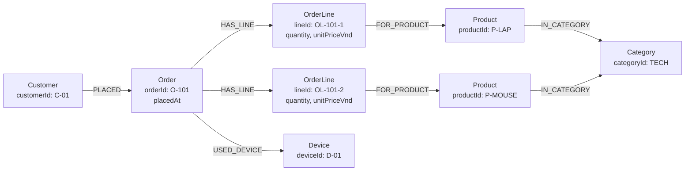
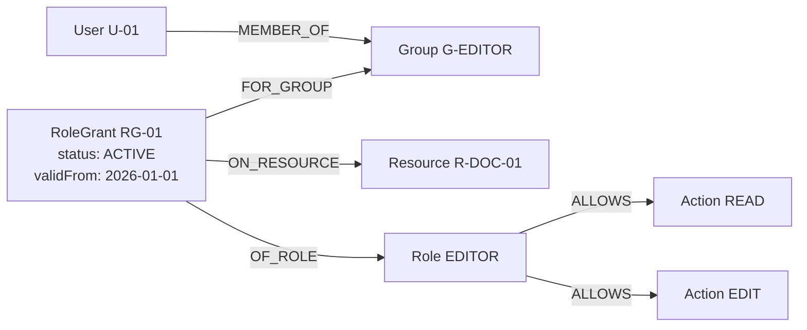

# Modeling Customer, Product, or Access-Control Relationship Networks

Many business requirements go beyond storing individual objects. A store needs to know **which customer bought which product, in which order, and in what context**; a recommendation engine wants to find products frequently bought together; operations wants to understand which devices appear across different transactions. In an authorization system, the central question is **which actions a user can perform on which resource, through which group or role**. These are link-network problems, yet each link type carries distinct semantics and constraints.

This lesson belongs to the **Graph Modeling** chapter of **DATABASE_DATA_MODELING**. The module's goal is to translate business requirements into entities, relationships, constraints, normalization, keys, indexes, and physical schemas while comparing relational, document, graph, and analytical modeling to choose an evolvable, verifiable structure. This lesson walks through **two running examples**: a **customer–product** network and an **access-control** network in a property graph.

After this lesson, you will be able to:

- Identify the right **vertices, edges, edge directions, and data grain** for a customer–order–product network.
- Know when **event vertices** such as `Order`, `OrderLine`, or `RoleGrant` are needed instead of connecting entities directly.
- Design queries for **co-purchases**, **customers sharing devices**, and **resource-scoped access checks**.
- Distinguish **path existence** from **business evidence** or an **authorization decision**.
- Build constraints for identity, multiplicity, effective time, tenants, and consistency control.
- Compare property graphs against SQL, document stores, and analytical warehouses based on workload, verifiability, and cost.

## 1. Start from Questions, Not Diagrams

A graph model is genuinely useful only if it answers important questions. Write each query as a **contract** specifying starting point, traversable edges, filters, time scope, and output meaning.

| Domain | Question to Answer | Relevant Path | Nature of Result |
| --- | --- | --- | --- |
| Commerce | Which products has customer C-01 purchased? | `Customer -> Order -> OrderLine -> Product` | Recorded transactions |
| Commerce | In which orders were two products bought together? | `Product <- OrderLine <- Order -> OrderLine -> Product` | Co-occurrence in one order |
| Operations | Which customers placed orders using a shared device? | `Customer -> Order -> Device <- Order <- Customer` | Link signal, **not** proof of shared identity |
| Catalog | Which products share a category or belong to a subcategory? | `Product -> Category -> ParentCategory` | Category classification |
| Authorization | May user U-01 edit document R-01? | `User -> Group <- RoleGrant -> Resource` and `RoleGrant -> Role -> Action` | Eligible for permission **under a defined policy** |
| Authorization | Where does U-01's permission come from? | Participating edges, grants, roles, and resources | Permission provenance explanation chain |
| Governance | Revoking a role affects which groups/resources? | From grant or role to linked objects | List of potentially impacted items |

This table already shows why "customer **is related to** product" is too vague: a customer can **view**, **add to cart**, **buy**, **review**, or **return** a product. In authorization, "user **is related to** document" also fails to specify whether the user may **read**, **edit**, **share**, or **delete** it.

The foundational principle is that **every edge type must form a clear business sentence**. `PLACED`, `HAS_LINE`, `FOR_PRODUCT`, `MEMBER_OF`, and `ALLOWS` cannot be replaced by a single `RELATED_TO` edge without losing query meaning.

## 2. Example A: Customer–Order–Product Network

### 2.1. Business Requirements

Suppose an online store needs to:

1. Look up each customer's purchase history.
2. Count how many customers bought a product.
3. Find products frequently bought **in the same order**.
4. Find customers who used a shared device **across order placements**.
5. Preserve exact unit price, quantity, and promotions at purchase time, even when catalog prices change.
6. Isolate data if the platform serves multiple tenants/merchants.

To satisfy these, do not merely create a `Customer-[:BOUGHT]->Product` edge storing a purchase count. That shortcut edge loses **which order**, **which date**, **which price**, **which device**, and **which products appeared together in the same order**.

### 2.2. Logical Model with Event Vertices



Each vertex and edge has a well-defined **data grain**:

| Component | Meaning and Typical Properties | Initial Rules |
| --- | --- | --- |
| `Customer` | One customer within a tenant: `tenantId`, `customerId` | Unique composite key per tenant |
| `Order` | One order placement: `tenantId`, `orderId`, `placedAt`, `status` | Each `Order` has exactly one placing customer by assumption |
| `OrderLine` | **One line item**: `lineId`, `quantity`, `unitPriceVnd` | Confirmed orders have at least one line |
| `Product` | One product: `tenantId`, `productId`, `title`, `currentPriceVnd` | Stable code; current price does not replace historical price |
| `Device` | One device or source-observed device ID: `tenantId`, `deviceId` | Strictly a **technical signal**, may be shared or rotate |
| `Category` | Category: `categoryId`, `name` | May be shared across many products |
| `PLACED` | `Customer -> Order` | Distinguishes ordering customer from shipping recipient |
| `HAS_LINE` | `Order -> OrderLine` | Do not merge two separate lines even if for the same product |
| `FOR_PRODUCT` | `OrderLine -> Product` | Each line references one product by assumption |
| `USED_DEVICE` | `Order -> Device` | Binds the device to **that exact transaction** |
| `IN_CATEGORY` | `Product -> Category` | A product can belong to one or more categories per policy |

If the system allows an order to have **multiple co-owners**, the "one order has one customer" rule must change. If bulk items, line-level discounts, or partial returns exist, `OrderLine` is the natural unit to link further to `Shipment`, `ReturnRequest`, or other vertices.

### 2.3. Why Does `OrderLine` Matter?

Suppose an order has two lines for `Product P-MOUSE`: one at regular price and one promotional. If you only use an `Order-[:CONTAINS {quantity}]->Product` edge aggregated per pair, you lose **unit price, promo rule, and the ability to return a specific line**.

An `OrderLine` vertex carries `lineId`, `quantity`, `unitPriceVnd`, and optionally `discountVnd`. It keeps distinct line events separate even when pointing to the same product.

**Price at purchase time** must not be read from `Product.currentPriceVnd`. When current price rises, totals on historical orders **must not change**. Store the locked-in snapshot or amount on the line item; if taxes, currencies, discounts, or refunds apply, document calculation rules explicitly.

### 2.4. Test Data in Neo4j Cypher

The snippets below use **Neo4j Cypher** to illustrate the property graph model; run them in an empty test database. A raw `CREATE` script is not a safely repeatable import pipeline without constraints and write policies.

```cypher
CREATE
  (c1:Customer {tenantId: 'T-01', customerId: 'C-01'}),
  (c2:Customer {tenantId: 'T-01', customerId: 'C-02'}),
  (laptop:Product {
    tenantId: 'T-01', productId: 'P-LAP',
    title: 'Laptop', currentPriceVnd: 13000000
  }),
  (mouse:Product {
    tenantId: 'T-01', productId: 'P-MOUSE',
    title: 'Wireless Mouse', currentPriceVnd: 350000
  }),
  (category:Category {
    tenantId: 'T-01', categoryId: 'TECH', name: 'Tech Devices'
  }),
  (d1:Device {tenantId: 'T-01', deviceId: 'D-SHARED'}),
  (d2:Device {tenantId: 'T-01', deviceId: 'D-OTHER'}),
  (o1:Order {
    tenantId: 'T-01', orderId: 'O-101',
    placedAt: datetime('2026-10-01T09:00:00+07:00'),
    status: 'PAID'
  }),
  (o2:Order {
    tenantId: 'T-01', orderId: 'O-102',
    placedAt: datetime('2026-10-03T11:00:00+07:00'),
    status: 'PAID'
  }),
  (o3:Order {
    tenantId: 'T-01', orderId: 'O-103',
    placedAt: datetime('2026-10-05T15:00:00+07:00'),
    status: 'PAID'
  }),
  (line1:OrderLine {
    tenantId: 'T-01', lineId: 'OL-101-1',
    quantity: 1, unitPriceVnd: 12000000
  }),
  (line2:OrderLine {
    tenantId: 'T-01', lineId: 'OL-101-2',
    quantity: 1, unitPriceVnd: 300000
  }),
  (line3:OrderLine {
    tenantId: 'T-01', lineId: 'OL-102-1',
    quantity: 1, unitPriceVnd: 11800000
  }),
  (line4:OrderLine {
    tenantId: 'T-01', lineId: 'OL-103-1',
    quantity: 2, unitPriceVnd: 320000
  }),
  (c1)-[:PLACED]->(o1),
  (c2)-[:PLACED]->(o2),
  (c2)-[:PLACED]->(o3),
  (o1)-[:HAS_LINE]->(line1),
  (o1)-[:HAS_LINE]->(line2),
  (o2)-[:HAS_LINE]->(line3),
  (o3)-[:HAS_LINE]->(line4),
  (line1)-[:FOR_PRODUCT]->(laptop),
  (line2)-[:FOR_PRODUCT]->(mouse),
  (line3)-[:FOR_PRODUCT]->(laptop),
  (line4)-[:FOR_PRODUCT]->(mouse),
  (o1)-[:USED_DEVICE]->(d1),
  (o2)-[:USED_DEVICE]->(d1),
  (o3)-[:USED_DEVICE]->(d2),
  (laptop)-[:IN_CATEGORY]->(category),
  (mouse)-[:IN_CATEGORY]->(category);
```

In this sample data:

- C-01 placed O-101, buying **laptop and mouse in the same order**.
- C-02 placed O-102 for a laptop and O-103 for a mouse.
- O-101 and O-102 used device `D-SHARED`; O-103 used `D-OTHER`.
- `Product.currentPriceVnd` can differ from `OrderLine.unitPriceVnd` because one is the current price while the other is the locked price.

### 2.5. Querying a Customer's Product History

```cypher
MATCH (customer:Customer {
    tenantId: $tenantId, customerId: $customerId
  })-[:PLACED]->(o:Order)-[:HAS_LINE]->(line:OrderLine)
    -[:FOR_PRODUCT]->(product:Product)
WHERE o.tenantId = $tenantId
  AND line.tenantId = $tenantId
  AND product.tenantId = $tenantId
RETURN o.orderId AS orderId,
       o.placedAt AS placedAt,
       product.productId AS productId,
       line.quantity AS quantity,
       line.unitPriceVnd AS unitPriceVnd
ORDER BY placedAt, orderId, productId;
```

Output has one row **per order line**. If a customer buys the same product across multiple orders, the product appears multiple times, matching a **transaction history** requirement. Never blindly apply `DISTINCT product` if users need every individual purchase.

### 2.6. Querying Distinct Buyers of a Product

```cypher
MATCH (customer:Customer)-[:PLACED]->(o:Order)
      -[:HAS_LINE]->(line:OrderLine)
      -[:FOR_PRODUCT]->(product:Product {
        tenantId: $tenantId, productId: $productId
      })
WHERE customer.tenantId = $tenantId
  AND o.tenantId = $tenantId
  AND line.tenantId = $tenantId
  AND o.status = 'PAID'
RETURN count(DISTINCT customer) AS distinctBuyerCount;
```

With `$tenantId = 'T-01'` and `$productId = 'P-LAP'`, the result is **2 buyers**. `DISTINCT customer` prevents counting one customer multiple times across multiple orders. This is "distinct buyers," **not order count, line count, or total units sold**.

### 2.7. Querying Products Frequently Bought Together

A "bought together" recommendation based on **products appearing in the same order** differs from "two products bought by the same customer at two different times."

```cypher
MATCH (anchor:Product {
    tenantId: $tenantId, productId: $productId
  })<-[:FOR_PRODUCT]-(line1:OrderLine)<-[:HAS_LINE]-
  (o:Order)-[:HAS_LINE]->(line2:OrderLine)
    -[:FOR_PRODUCT]->(other:Product)
WHERE other <> anchor
  AND o.tenantId = $tenantId
  AND other.tenantId = $tenantId
  AND line1.tenantId = $tenantId
  AND line2.tenantId = $tenantId
  AND o.status = 'PAID'
RETURN other.productId AS coPurchasedProductId,
       count(DISTINCT o) AS distinctOrderCount
ORDER BY distinctOrderCount DESC, coPurchasedProductId
LIMIT 10;
```

For `P-LAP`, the sample data suggests `P-MOUSE` because both appear in O-101. Note:

- `count(DISTINCT o)` counts **distinct orders**, avoiding inflation when a product has multiple lines.
- An order with multiple lines of `anchor` and `other` can produce multiple line pairs when matching; deduplication applies at the order grain for this metric.
- A single co-purchase in one order is **not enough** to judge recommendation quality. Real systems need evidence thresholds, exclusion of canceled/returned orders, popularity normalization, and user relevance data.

Never substitute "products in the same category" for "bought together": the two relationships answer different questions.

### 2.8. Querying Customers Linked via Transaction Devices

```cypher
MATCH (origin:Customer {
    tenantId: $tenantId, customerId: $customerId
  })-[:PLACED]->(o1:Order)-[:USED_DEVICE]->(device:Device)
MATCH (other:Customer)-[:PLACED]->(o2:Order)
      -[:USED_DEVICE]->(device)
WHERE other <> origin
  AND other.tenantId = $tenantId
  AND device.tenantId = $tenantId
  AND o1.tenantId = $tenantId
  AND o2.tenantId = $tenantId
  AND o1.placedAt >= datetime($fromTime)
  AND o2.placedAt >= datetime($fromTime)
RETURN other.customerId AS relatedCustomerId,
       count(DISTINCT device) AS sharedDeviceCount
ORDER BY sharedDeviceCount DESC, relatedCustomerId
LIMIT 20;
```

If `$customerId = 'C-01'` and `$fromTime = '2026-10-01T00:00:00+07:00'`, the result includes C-02 with **1 shared device**. The data does not say C-01 and C-02 are the same person; the device could be a public terminal or legitimately shared.

**Always distinguish** "shared a device," "owns the device," and "anomalous behavior": those are three different conclusions. Never automatically turn a link path into an adverse action against a customer. If risk analysis is needed, apply data-usage policies, corroborating evidence, and proper review workflows.

## 3. Lessons from the Customer–Product Network

### 3.1. Edge Types That Are Not Interchangeable

```text
(Customer)-[:VIEWED]->(Product)             // View event, needs timestamp/context
(Customer)-[:ADDED_TO_CART]->(Product)       // Cart action
(Customer)-[:PLACED]->(Order)                // An order placement
(Order)-[:HAS_LINE]->(OrderLine)             // Line belonging to an order
(OrderLine)-[:FOR_PRODUCT]->(Product)        // Product on the line
(Customer)-[:REVIEWED]->(Product)           // Review, needs source and timestamp
```

If `VIEWED`, `BOUGHT`, and `REVIEWED` all become `RELATED_TO`, the system cannot tell interaction depth apart. Never equate **a page view** with **a paid transaction** when recommending products or computing conversion rates.

An interaction occurring **many times** can be multiple edges or an **event vertex** with `eventId`, `occurredAt`, and `source`. If the source system only needs aggregated view counts, an analytical model or document/event table may fit better than creating countless direct edges.

### 3.2. Product Networks Can Have Their Own Relationships

`Product` itself can also form a network:

| Relationship | Meaning | Note |
| --- | --- | --- |
| `(Product)-[:IN_CATEGORY]->(Category)` | Product belongs to category | Can be one or multiple categories |
| `(Category)-[:PARENT_OF]->(Category)` | Category hierarchy | Needs cycle prevention if categories must form a tree/DAG |
| `(Product)-[:COMPATIBLE_WITH]->(Product)` | Two products are compatible | Symmetry may depend on compatibility type |
| `(Product)-[:REPLACES]->(Product)` | Product replaces older version | Relationship direction matters |
| `(Product)-[:BUNDLED_WITH]->(Product)` | Product sold in a bundle | Distinguish commercial bundles from actual co-purchases |

Never infer a `COMPATIBLE_WITH` edge merely because two products were bought together; co-purchase is **behavioral evidence**, whereas technical compatibility requires an authoritative source.

### 3.3. Should You Create a Shortcut Edge `Customer -> Product`?

You can materialize a derived edge such as:

```text
(Customer C-01)-[:PURCHASED_SUMMARY {
  firstPurchasedAt: ...,
  lastPurchasedAt: ...,
  totalQuantity: ...
}]->(Product P-LAP)
```

It lets "has this customer ever bought this product?" run in one hop. However, it is a **summary derived from** `OrderLine` and `Order`, not an independent source of truth. If orders are canceled, items returned, or data arrives late, the shortcut edge must update consistently. Add it only when justified by measured performance needs along with clear sync, idempotency, recovery, and reconciliation rules.

## 4. Example B: Access-Control Network Model

### 4.1. Avoid Overly Simplistic Permission Models

An initial design might be:

```text
(User U-01)-[:CAN_EDIT]->(Resource R-01)
```

It fits trivial cases yet struggles to answer:

- Did the permission come from a **group** or a direct grant?
- Is the user an `EDITOR` of **document R-01** or of **all documents**?
- When does the permission start and expire?
- When removing a user from a group or revoking a grant, which edges must change?
- Are there **deny** rules, tenant isolation, ownership, document sensitivity, or version-dependent permissions?
- How do you explain why a request was allowed?

In particular, placing separate `Group-[:HAS_ROLE]->Role` and `Group-[:CAN_ACCESS]->Resource` edges risks creating a **cross-product scope error**: the system may interpret a role as applying to **every resource connected to the group** even though the grant was only for one specific resource.

### 4.2. Creating `RoleGrant` to Preserve Grant Scope

Suppose a group is granted the `Editor` role **on a specific resource**. The grant event may include:

```text
grantId      = RG-01
groupId      = G-EDITOR
roleCode     = EDITOR
resourceId   = R-DOC-01
status       = ACTIVE
validFrom    = 2026-01-01
validTo      = absent
```

A `RoleGrant` vertex binds **group, role, and resource into one grant instance**, rather than splitting them into contextless pairs.



Here `User` can access the resource along the evaluation path:

```text
User --MEMBER_OF--> Group <--FOR_GROUP-- RoleGrant
RoleGrant --ON_RESOURCE--> Resource
RoleGrant --OF_ROLE--> Role --ALLOWS--> Action
```

Yet the path only identifies **a grant candidate**. To **authorize an action**, you must also verify account status, tenant, effective time, deny policies, resource state, and any other business conditions imposed by the system.

### 4.3. Role, Action, Grant, and Resource Are Not the Same Concept

| Object / Edge | Meaning | Mistake When Conflated |
| --- | --- | --- |
| `User` | Identity of user/actor | Merging two people with the same email/name into one vertex |
| `Group` | Managed set of members | Assuming someone stays in a group forever after removal |
| `Role` | Set of permissions like `Viewer`, `Editor` | Treating a role as system-wide even when granted on one resource |
| `Action` | Specific operation: `READ`, `EDIT`, `DELETE` | Collapsing every action into `ACCESS` |
| `Resource` | Document, folder, project, or protected object | Failing to isolate resources per tenant |
| `RoleGrant` | One grant of a `Role` to a group on a `Resource` | Splitting the three links and mis-assigning cross-resource rights |
| `MEMBER_OF` | User belongs to group | Ignoring membership validity/disabled status |
| `ALLOWS` | Role permits action per role definition | Confusing identically named roles across tenants/versions |

A production system may also have **direct grants** issued straight to users, **nested groups**, or a **resource hierarchy**. All of those require deliberate extension of the model and authorization logic—never automatically walk arbitrary `RELATED_TO` edges.

### 4.4. Distinguishing Permission Queries from Enforcement Mechanisms

Graph data can help **explain** and **compute permission candidates**. However, a real authorization service needs an authoritative **policy decision point** checking the full policy. Relying solely on "is there a path between User and Resource" is unsafe because a path could traverse:

- An expired or revoked grant.
- A group the user no longer belongs to.
- A resource belonging to a different tenant.
- A role lacking the requested action.
- A disabled group or role.
- An edge with the wrong direction or relationship type.

Whenever reporting "`allowed = true`," explicitly state **which conditions were checked** and what remains outside the illustrative scope.

## 5. Test Data for the Access-Control Graph

### 5.1. Vertices, Edges, and Assumptions

Assume a single tenant `T-01`, document `R-DOC-01`, group `G-EDITOR`, role `EDITOR`, and two actions `READ`, `EDIT`. User U-01 belongs to the group; U-02 does not.

Example assumptions:

- One `RoleGrant` represents one grant of one role to one group on one resource.
- `RoleGrant.status = 'ACTIVE'` and the query date falls within `[validFrom, validTo)`.
- `Role` and `Action` are centrally governed values; there are no explicit denies, direct grants, nested groups, or extra conditions in this sample model.
- `User`, `Group`, `Resource`, and `RoleGrant` must all belong to the same tenant when verifying access.
- **Default-deny** rule: finding no valid grant means no permission in the sample model.

### 5.2. Creating Sample Data in Neo4j Cypher

```cypher
CREATE
  (u1:User {
    tenantId: 'T-01', userId: 'U-01', status: 'ACTIVE'
  }),
  (u2:User {
    tenantId: 'T-01', userId: 'U-02', status: 'ACTIVE'
  }),
  (g:Group {
    tenantId: 'T-01', groupId: 'G-EDITOR', status: 'ACTIVE'
  }),
  (r:Resource {
    tenantId: 'T-01', resourceId: 'R-DOC-01',
    type: 'DOCUMENT', status: 'ACTIVE'
  }),
  (role:Role {
    roleCode: 'EDITOR', status: 'ACTIVE'
  }),
  (read:Action {actionCode: 'READ'}),
  (edit:Action {actionCode: 'EDIT'}),
  (grant:RoleGrant {
    tenantId: 'T-01', grantId: 'RG-01',
    status: 'ACTIVE', validFrom: date('2026-01-01')
  }),
  (u1)-[:MEMBER_OF]->(g),
  (grant)-[:FOR_GROUP]->(g),
  (grant)-[:ON_RESOURCE]->(r),
  (grant)-[:OF_ROLE]->(role),
  (role)-[:ALLOWS]->(read),
  (role)-[:ALLOWS]->(edit);
```

In this sample, `Role` and `Action` are **globally governed catalogs**. If each tenant can customize its own `EDITOR` role with different permissions, do not share one `Role {roleCode:'EDITOR'}`—add tenant scope or version to the role's identifier.

### 5.3. Checking Permission for an Exact Resource and Action

```cypher
MATCH (user:User {
    tenantId: $tenantId, userId: $userId, status: 'ACTIVE'
  })-[:MEMBER_OF]->(g:Group {
    tenantId: $tenantId, status: 'ACTIVE'
  })
MATCH (grant:RoleGrant {
    tenantId: $tenantId, status: 'ACTIVE'
  })-[:FOR_GROUP]->(g)
MATCH (grant)-[:ON_RESOURCE]->(resource:Resource {
    tenantId: $tenantId,
    resourceId: $resourceId,
    status: 'ACTIVE'
  })
MATCH (grant)-[:OF_ROLE]->(role:Role {
    status: 'ACTIVE'
  })-[:ALLOWS]->(:Action {actionCode: $actionCode})
WHERE grant.validFrom <= date($asOfDate)
  AND (
    grant.validTo IS NULL
    OR date($asOfDate) < grant.validTo
  )
RETURN count(DISTINCT grant) > 0 AS allowed;
```

With `T-01`, `U-01`, `R-DOC-01`, `EDIT`, and a date in 2026, the query returns `allowed = true` on the sample data. For `U-02`, the query finds no permission path through a group and returns `false` in this model.

**Scope guaranteed by the example:** the query checks active user/group/grant/resource, tenant matching, effective dates on the **grant**, and that the action belongs to the role. It **does not yet check membership effective dates**, resource hierarchies, explicit denies, direct grants, external policies, login state, or context-sensitive conditions. In production, if policy requires any of those checks, this query alone **is not enough for a final authorization decision**.

Additionally, when checking "does the user have permission today?", the timestamp parameter must come from a trusted, standardized clock. Never let clients supply an arbitrary past date when an old grant was valid to claim current access.

### 5.4. Querying Provenance of Permission Grants

```cypher
MATCH (user:User {
    tenantId: $tenantId, userId: $userId
  })-[:MEMBER_OF]->(group:Group {
    tenantId: $tenantId
  })
MATCH (grant:RoleGrant {
    tenantId: $tenantId
  })-[:FOR_GROUP]->(group)
MATCH (grant)-[:ON_RESOURCE]->(resource:Resource {
    tenantId: $tenantId,
    resourceId: $resourceId
  })
MATCH (grant)-[:OF_ROLE]->(role:Role)
RETURN grant.grantId AS grantId,
       group.groupId AS groupId,
       role.roleCode AS roleCode,
       resource.resourceId AS resourceId,
       grant.status AS grantStatus,
       grant.validFrom AS validFrom,
       grant.validTo AS validTo
ORDER BY grantId;
```

This query **explains related grant records** without filtering validity or action, so **never use its output as an allow decision**. It is useful for auditing and debugging because it identifies the exact grant, group, role, and resource involved.

### 5.5. Detecting Grants Missing Any Endpoint Link

You can check for missing or excess edges without creating cross-product row multiplication across `MATCH` clauses:

```cypher
MATCH (grant:RoleGrant {tenantId: $tenantId})
WITH grant,
     COUNT { (grant)-[:FOR_GROUP]->(:Group) } AS groupCount,
     COUNT { (grant)-[:ON_RESOURCE]->(:Resource) } AS resourceCount,
     COUNT { (grant)-[:OF_ROLE]->(:Role) } AS roleCount
WHERE groupCount <> 1
   OR resourceCount <> 1
   OR roleCount <> 1
RETURN grant.grantId AS grantId,
       groupCount, resourceCount, roleCount;
```

`COUNT { ... }` syntax illustrates **Neo4j Cypher versions supporting count subqueries**. Other engines/versions may require an equivalent counting pattern. This query catches missing/excess roles; it **does not enforce constraints on write** and does not catch edges pointing to the wrong tenant, disabled roles, or inconsistent grant statuses.

## 6. Extending Permissions with Nested Groups, Parent–Child Resources, and Deny Rules

### 6.1. Nested Groups

Suppose a subgroup can inherit grants from a parent group:

```text
(Group G-DEV)-[:INHERITS_FROM]->(Group G-ENGINEERING)
```

User `U-01` in `G-DEV` may be evaluated against `G-ENGINEERING`'s grants **if policy genuinely permits inheritance**. Queries must traverse `INHERITS_FROM` strictly in the right direction, within valid bounds, and check group statuses.

An illustrative query finding effective groups:

```cypher
MATCH (u:User {
    tenantId: $tenantId, userId: $userId
  })-[:MEMBER_OF]->(direct:Group {tenantId: $tenantId})
MATCH (direct)-[:INHERITS_FROM*0..5]->(effective:Group)
WHERE effective.tenantId = $tenantId
RETURN DISTINCT effective.groupId AS groupId;
```

`*0..5` allows **zero inheritance hops** (direct group) up to five levels. That is an **illustrated technical bound**, not proof of completeness for deeper organizations. Prevent cycles if groups must form a hierarchy, validate every intermediate group, and update permissions on membership changes.

A query that skips tenant checks on **intermediate** groups could cross a corrupt cross-tenant edge. If tenant isolation is mandatory, ensure the validity of **the entire path** using validated data and/or per-vertex/edge checks along the path.

### 6.2. Parent–Child Resources Do Not Automatically Propagate All Permissions

```text
(Resource Folder-01)-[:CONTAINS]->(Resource Document-01)
```

A folder containing a document does not automatically propagate every folder permission to the document. Some applications support inheritance; others have individually protected resources or *break inheritance* rules. Explicitly specify:

- Which permissions inherit: `READ`, `EDIT`, `SHARE`, or all?
- When a child resource blocks inheritance, how are permissions computed?
- At what time was the parent grant effective?
- Are there tenant, project, or organizational boundaries?

If a query simply traverses `CONTAINS*` and grants `EDIT` by default, the system can grant unauthorized access.

### 6.3. Deny Rules and Policy Precedence

In a minimal allow-only model, "no valid path means deny" is fairly clear. Once a system has **explicit deny** or conflicting policies, precedence must be defined upfront:

| Scenario | Question That Must Be Resolved |
| --- | --- |
| Allow grant from G-EDITOR, deny from G-RESTRICTED | Does deny override allow, or does the more specific policy win? |
| User account locked, role grant still active | Does account lock veto all grants? |
| Document moves to another tenant or owner | How are legacy grants revoked and re-evaluated? |
| Membership expired while grant remains active | Must queries filter **both membership** and grant? |
| Resource under quarantine / extra security lock | Are external non-graph conditions checked? |

**There is no universal conflict-resolution rule across all systems.** Any example returning `allowed` must rest on an agreed, tested policy; "reaching the resource" is only one technical condition.

## 7. Identity, Constraints, and Multi-Tenant Data

### 7.1. Entity Uniqueness

In a multi-tenant platform, `customerId` or `resourceId` may be unique only **within a tenant**. In that case, a single-property uniqueness constraint on `customerId` is too strict (forbidding two tenants from using the same code), while having no constraint allows duplicates inside one tenant.

Neo4j Cypher example:

```cypher
CREATE CONSTRAINT customer_key_unique IF NOT EXISTS
FOR (c:Customer)
REQUIRE (c.tenantId, c.customerId) IS UNIQUE;

CREATE CONSTRAINT product_key_unique IF NOT EXISTS
FOR (p:Product)
REQUIRE (p.tenantId, p.productId) IS UNIQUE;

CREATE CONSTRAINT order_key_unique IF NOT EXISTS
FOR (o:Order)
REQUIRE (o.tenantId, o.orderId) IS UNIQUE;

CREATE CONSTRAINT line_key_unique IF NOT EXISTS
FOR (l:OrderLine)
REQUIRE (l.tenantId, l.lineId) IS UNIQUE;

CREATE CONSTRAINT resource_key_unique IF NOT EXISTS
FOR (r:Resource)
REQUIRE (r.tenantId, r.resourceId) IS UNIQUE;

CREATE CONSTRAINT grant_key_unique IF NOT EXISTS
FOR (g:RoleGrant)
REQUIRE (g.tenantId, g.grantId) IS UNIQUE;
```

These constraints illustrate **uniqueness of a property tuple when key values are present**. Dedicated constraint types may enforce mandatory properties or data types, depending on engine version, product, and deployment edition. Additionally, define constraints for `User`, `Group`, `Category`, and `Device` in their respective identity scopes.

**ID constraints do not prevent edges connecting two different tenants.** Write paths must verify that all participants in an event or grant belong to the same tenant. In multi-tenant graphs, backend read and query permissions must also be enforced—never rely solely on client-supplied filters.

### 7.2. Per-Role Multiplicity

| Role | Example Rule |
| --- | --- |
| `Customer-[:PLACED]->Order` | Each `Order` placed by exactly one `Customer` |
| `Order-[:HAS_LINE]->OrderLine` | An `Order` has one or more lines when finalized |
| `OrderLine-[:FOR_PRODUCT]->Product` | Each `OrderLine` references exactly one `Product` |
| `Order-[:USED_DEVICE]->Device` | Can be 0..1 or many depending on telemetry; must be defined |
| `RoleGrant-[:FOR_GROUP]->Group` | One group per `RoleGrant` |
| `RoleGrant-[:ON_RESOURCE]->Resource` | One resource per `RoleGrant` |
| `RoleGrant-[:OF_ROLE]->Role` | One role per `RoleGrant` |

If a grant needs **multiple beneficiaries or multiple resources**, remodel the grant event/structure rather than silently permitting extra rule-breaking edges. Likewise, never merge two `OrderLine`s of the same product just because they share endpoints; they may have different prices and discounts.

### 7.3. Time and Effective-Validity Rules

A customer using a device on an order on day X does not mean they are **currently using** that device. A grant once issued does not mean it **still grants access today**.

The standard convention is a half-open interval:

```text
[validFrom, validTo)

validFrom <= asOf
AND (validTo is absent OR asOf < validTo)
```

This prevents assigning a transition instant to two phases simultaneously. For time-of-day timestamps, use appropriate temporal types and time zones. If you must answer both "when was the rule effective?" and "when did the system learn that rule?", you may need a bitemporal model or event history; overwriting a grant in place does not preserve audit trails for retroactive edits.

### 7.4. Preventing Duplicate Vertices and Duplicate Edges

Two `Customer` vertices with the same `(tenantId, customerId)` fragment order histories and device links. Two `RoleGrant` vertices with the same `grantId` make permission explanations contradictory. Use canonical business keys, uniqueness constraints, and idempotent write pipelines.

However, **multiple edges between the same pair of vertices are not automatically an error**. Two `Order`s can be placed by the same customer; two `OrderLine`s can point to the same `Product`; two distinct valid grants can assign the same role across different time windows. Define the **event unit** before deduplicating.

## 8. Query-First Modeling: A Verifiable Design Roadmap

### Step 1 — Write a Contract for Each Question

Example:

```text
Query name: Customers sharing a device with C-01

Input: tenantId, customerId, fromTime
Starting point: one Customer by tenant + customerId key
Path: Customer -> Order -> Device <- Order <- Customer
Filters: matching tenant, Order timestamp, valid order types if required
Output: distinct customerIds, count of distinct shared devices
Limit: top 20 by evidence count
Semantics: link signal, not proof of identical identity
Policy: authorized investigative use only, strict access control
```

For authorization, the contract must also specify `actionCode`, `resourceId`, `asOfDate`, allow/deny rules, membership, and direct vs. inherited grants. **Without defining the policy, you cannot verify that an "allowed" algorithm is correct.**

### Step 2 — Pick Objects with Independent Identity

`Order`, `OrderLine`, and `RoleGrant` usually merit vertices when they have IDs, lifecycles, multiple roles, or external references. `Product.title` is a display property and does not need a separate vertex per title string. `Role.code` can identify a `Role`, yet "which role on which resource" must be bound to the proper grant.

### Step 3 — Define Edge Directions and Relationship Types

Read every edge as a sentence:

- "Customer **placed** Order."
- "Order **has line** OrderLine."
- "OrderLine **is for product** Product."
- "User **is member of** Group."
- "RoleGrant **is for group** Group."
- "RoleGrant **is on resource** Resource."
- "Role **allows** Action."

If a business sentence feels awkward, rename the edge before writing queries. Direction governs path shape: `Order-[:USED_DEVICE]->Device` differs from `Device-[:USED_BY]->Order` unless the system maintains one consistent convention.

### Step 4 — Add Keys, Constraints, and Time

Establish stable IDs, tenant scopes, mandatory edge-count checks, and temporal properties such as `placedAt`, `validFrom`, and `validTo`. Specify which rules must be enforced inside transactions and how to detect violating legacy data. Never expect an ID uniqueness constraint to safeguard every traversal path.

### Step 5 — Write Examples with Expected Answers

| Case | Result to Verify |
| --- | --- |
| C-01 buys laptop and mouse in O-101 | Two order lines in the same order |
| C-02 buys laptop in O-102 and mouse in O-103 | Two products purchased, yet **not co-purchased in one order** |
| Count buyers of laptop | **2 distinct buyers** |
| Find products bought together with laptop | Mouse has **1 co-purchase order** in sample data |
| C-01 and C-02 share D-SHARED across two orders | **1 shared device**, does not infer same person |
| U-01 in G-EDITOR with active grant RG-01 | Valid candidate allowing `EDIT` on `R-DOC-01` per sample policy |
| U-02 belongs to no granted group | `false` in sample model, default deny |
| RG-01 expired | Must not count as an active permission |
| Another tenant's grant pointing to T-01 resource | Must be blocked or never used to grant access |
| Two `ON_RESOURCE` edges on one RoleGrant when rule requires one | Must be flagged as invalid data |

### Step 6 — Measure and Tune Against Real Workloads

Evaluate vertex/edge counts, read/write rates, vertex degrees, and multi-hop queries. On a public kiosk `Device`, connected `Order` counts can be huge; on a popular `Role`, grant counts can be huge. An unbounded full-network traversal can be expensive even when starting from an indexed ID vertex.

Measure on representative data: expanded edges, traversed paths, row counts before/after deduplication, p50/p95/p99 latency, write load, cache hit rates, and answer accuracy. **`DISTINCT` at the end does not eliminate the cost of generating intermediate rows.**

## 9. Comparing with Relational, Document, and Analytical Models

### 9.1. SQL Still Expresses Many Business Relationships Cleanly

Example simple relational schema:

```sql
CREATE TABLE customers (
    tenant_id VARCHAR(32) NOT NULL,
    customer_id VARCHAR(40) NOT NULL,
    PRIMARY KEY (tenant_id, customer_id)
);

CREATE TABLE products (
    tenant_id VARCHAR(32) NOT NULL,
    product_id VARCHAR(40) NOT NULL,
    title VARCHAR(200) NOT NULL,
    PRIMARY KEY (tenant_id, product_id)
);

CREATE TABLE orders (
    tenant_id VARCHAR(32) NOT NULL,
    order_id VARCHAR(40) NOT NULL,
    customer_id VARCHAR(40) NOT NULL,
    placed_at TIMESTAMP NOT NULL,
    PRIMARY KEY (tenant_id, order_id),
    FOREIGN KEY (tenant_id, customer_id)
      REFERENCES customers(tenant_id, customer_id)
);

CREATE TABLE order_lines (
    tenant_id VARCHAR(32) NOT NULL,
    line_id VARCHAR(40) NOT NULL,
    order_id VARCHAR(40) NOT NULL,
    product_id VARCHAR(40) NOT NULL,
    quantity INTEGER NOT NULL,
    unit_price_vnd BIGINT NOT NULL,
    PRIMARY KEY (tenant_id, line_id),
    FOREIGN KEY (tenant_id, order_id)
      REFERENCES orders(tenant_id, order_id),
    FOREIGN KEY (tenant_id, product_id)
      REFERENCES products(tenant_id, product_id),
    CHECK (quantity > 0),
    CHECK (unit_price_vnd >= 0)
);
```

Tables and foreign keys preserve the `Customer -> Order -> OrderLine -> Product` context. In SQL, "who bought which product" uses joins; the relationship network **does not have to** live in a graph database to be semantically sound.

Similarly, a relational authorization system can use `group_memberships`, `roles`, `role_permissions`, and `role_grants` tables with `group_id`, `role_id`, and `resource_id` foreign keys to preserve grant scope. A graph helps when **multi-hop path lookup/explanation** is frequent, though access decisions must still enforce full policy.

### 9.2. Document Models Support Aggregate-Centric Reads

An `Order` document can embed line items and purchase-time prices for fast single-order reads. This design makes sense when the system typically loads and updates an entire order as a unit.

However, when finding **all customers sharing a device** or traversing across many orders, products, addresses, and categories, the application needs multiple queries, aggregation pipelines, or dedicated index structures. When cross-document links become central, a graph can express queries more naturally, while increasing sync cost if documents remain the primary source of truth.

### 9.3. Analytical Warehouses Optimize for Aggregate Questions

A data warehouse can have a `fact_order_line` table at **one row per order line**, with `Customer`, `Product`, `Date`, and `Category` dimensions. It excels at computing revenue, purchase rates, customer cohorts, or growth over time.

A graph suits questions about **link paths and impact**; a warehouse suits **scanning and aggregating large volumes**. Both can coexist, provided you align IDs, sources of truth, recording timestamps, and metric definitions.

### 9.4. Choose by Workload Characteristics

| Primary Need | Candidate to Evaluate |
| --- | --- |
| Orders, payments, inventory with strong ACID guarantees | Relational or suitable transactional engine |
| Reading/writing a multi-line order as one object | Document or relational, depending on workload |
| Customer–order–device queries, linked-cluster analysis | Property graph if multi-hop traversal is central |
| Permission paths across groups, roles, and resources | Graph can help explain, paired with policy engine and consistency controls |
| Monthly revenue, order, and cohort reporting | Analytical warehouse |
| Sharing knowledge/ontologies across organizations | Consider RDF/SPARQL when semantic interoperability is required |

Never migrate systems merely because "the data has relationships." Compare query results, accuracy, ingestion/update cost, access control, recoverability, and operations.

## 10. Data Quality and Security Risks

### 10.1. Graphs Return **Structurally Valid** Paths, Not Automatically Business-Valid Ones

A `USED_DEVICE` edge may come from an unreliable fingerprint. A `MEMBER_OF` edge may lag behind a user's removal from a group. An `ALLOWS` edge may linger after a policy change. Therefore, require **provenance, effective dates, update workflows, and data checks**.

### 10.2. Authorization Needs Default-Deny and Trustworthy Freshness

If a graph is populated **asynchronously** from source events, permission revocations can arrive late. For sensitive actions, final decisions must check data/mechanisms fresh enough for security requirements; never assume a graph cache always reflects instantaneous state.

Protect graph queries and data: users must never be allowed to swap `tenantId`, `userId`, or `resourceId` parameters to inspect out-of-scope data. The backend must verify identity from a trusted session, enforce tenant isolation, and evaluate policies at the service layer, not merely in the UI.

### 10.3. Protect Customer Data and Avoid Over-Inference

Customer–order–device networks can contain sensitive behavioral and relational data. Keep personal attributes out of the graph unless queries need them. Restrict usage purpose, retention, access scope, logs, analytical copies, and deletion/minimization workflows under applicable policy.

**A shared device is not proof of identity**, an indirect link path is not proof of fraud, and a "bought together" recommendation does not prove technical compatibility. Each class of conclusion needs its own evidence criteria.

### 10.4. Shortcut Edges, Materialized Views, and Consistency

Precomputed `CUSTOMER_PURCHASED_PRODUCT` or `USER_CAN_EDIT_RESOURCE` edges can speed up queries, yet also create **derived copies of truth**. Define the source of truth, recomputation strategy after order edits or permission revocations, duplicate-event handling, lag monitoring, and comparison checks against direct evaluation.

In particular, materialized permission edges must never become irrevocable access grants simply because a system forgot to update derived data.

## 11. Practice Exercises and Suggested Answers

### Exercise 1 — Bought Together vs. Bought by the Same Customer?

C-01 buys `P-LAP` and `P-MOUSE` in O-101; C-02 buys `P-LAP` in O-102 and `P-MOUSE` in O-103.

**Questions:** (a) Which customers bought both products? (b) How many orders contain both products? (c) Why are the two questions different?

**Suggested answers:** (a) Both C-01 and C-02 bought both products when looking across all orders per customer. (b) Only O-101 contains both, so there is **1 co-purchase order**. (c) "Same customer" does not mean "same transaction"; you must traverse through `Order` and `OrderLine` at the right grain.

### Exercise 2 — Preserving Historical Price

An order line has purchase price 12 million VND; `Product.currentPriceVnd` increases to 13 million VND.

**Question:** what is the amount in the old order, and where should it be stored?

**Suggested answer:** the old order must retain `unitPriceVnd = 12000000` on `OrderLine` or an appropriate transaction snapshot; never back-calculate from current price. Where quantity and discounts/taxes apply, define rules locking in each line's final value.

### Exercise 3 — Sharing a Device Does Not Mean Same Account

Two customers place two orders from the same public computer. The graph has path `Customer C1 -> Order O1 -> Device D1 <- Order O2 <- Customer C2`.

**Question:** what can be concluded, and what **cannot** be concluded?

**Suggested answer:** there is evidence that two **orders** recorded the same `deviceId` per the data source. You cannot automatically conclude the two customers are the same person, are colluding, or engaged in wrongdoing. Additional data, source quality, time window, and verifiable evaluation criteria are required.

### Exercise 4 — Resource-Scoped Permissions

Group G-EDITOR holds role `EDITOR` on document R-01, but only `VIEWER` on R-02.

**Question:** why should you not only store `Group-[:HAS_ROLE]->Role` and `Group-[:CAN_ACCESS]->Resource`? Propose a scope-preserving model.

**Suggested answer:** disconnected edges can cause `EDITOR` to be applied to R-02. Use two `RoleGrant`s: one linking G-EDITOR, `EDITOR`, and R-01; another linking G-EDITOR, `VIEWER`, and R-02. Each grant has its own ID, status, and effective time, and actions are checked on the exact resource.

### Exercise 5 — Permission Revocation Under Sync Lag

The core service removed U-01 from G-EDITOR, but the graph replica serving explanation queries has not received the update event yet.

**Question:** should the application grant `EDIT` merely because the graph query still finds a valid path in the stale replica?

**Suggested answer:** no. If immediate revocation is required, decisions must consult a **sufficiently fresh** policy source or reliable revocation mechanism per security requirements. The graph can serve explanations, audits, or bounded caching, but stale state must never override current authorization.

### Exercise 6 — Designing Roles for Nested Groups

U-01 belongs to G-A; G-A inherits from G-B; G-B has a read grant on R-01. G-B is disabled after the grant was created.

**Question:** when querying current read access, is matching `MEMBER_OF -> INHERITS_FROM -> RoleGrant` enough?

**Suggested answer:** not enough. Verify G-B is still active, the full inheritance chain and membership are valid, the grant is active, the tenant matches, the role allows `READ` on R-01, and no veto policy applies. A path passing through a disabled group **does not confer valid access**.

### Exercise 7 — Choosing a Storage Engine

A small store needs order CRUD, payments, and monthly revenue reports. Another company continuously analyzes customer–order–device links and needs explanations of multi-hop association paths.

**Question:** which problem has a stronger motivation to use a property graph? Must it completely replace the relational database?

**Suggested answer:** the second company has clearer motivation to evaluate a property graph for link queries. The first store can use relational storage and warehouse/SQL reporting. The second company can still keep relational storage as the transactional source of truth with a graph as a derived model; measure benefits, sync cost, and consistency before deciding.

### Exercise 8 — Testing Multiplicity and Tenant Isolation

A `RoleGrant RG-01` points to two different `Resource`s even though design requires one; a `FOR_GROUP` edge points to a Group from another tenant.

**Question:** what defects exist, and what mechanisms must catch them?

**Suggested answer:** `ON_RESOURCE` multiplicity violation and tenant isolation violation. A uniqueness constraint on `grantId` **does not** prevent either defect. Enforce write transactions, verify endpoint roles and matching tenants, and run periodic data integrity checks.

## Summary

In a **customer–product** network, `Order` and `OrderLine` vertices preserve the context of "who bought what, in which order, at what price"; typed, directed edges distinguish views, purchases, device usage, and product categorization. In an **access-control** network, a `RoleGrant` vertex binds the **group–role–resource** tuple, preventing cross-resource permission leaks caused by splitting multi-role relationships. Yet **a path in a graph does not by itself prove identity, fraud, or authorized access**: combine constraints, effective dates, business policies, and trustworthy data sources. Choose your model from real questions, validate with data, and weigh alongside relational, document, or analytical models based on workload.
