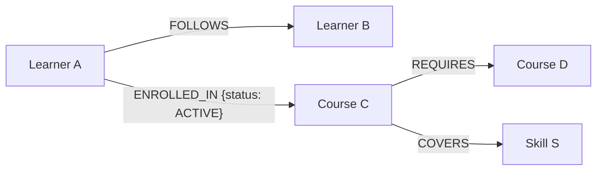
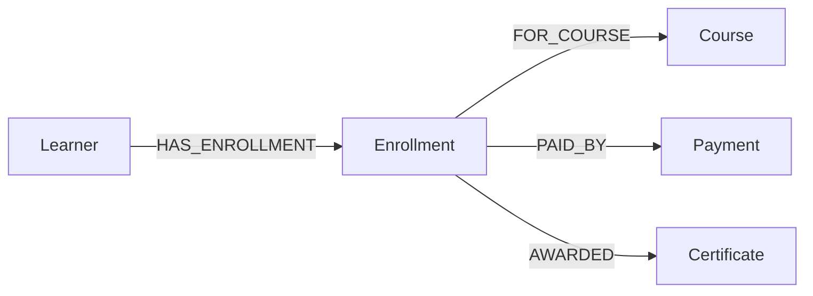
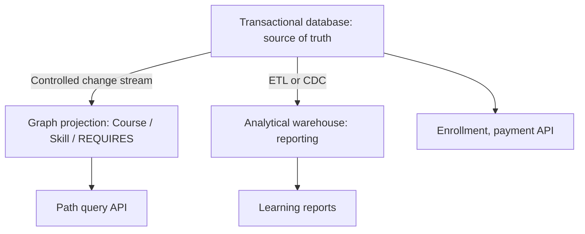

# Comparing Graph Models with Relational Junction Tables by Query Requirements

## 1. The Question Is Not "Is Graph or SQL More Modern?"

A business domain can be represented using both **junction tables in a relational database** and **nodes/edges in a graph database**. For instance, learners follow other learners, enroll in courses, or a course requires completing a foundational course first. Both approaches can express those entities and relationships.

The differences that matter go beyond diagram shapes or query syntax. A designer must answer:

- Do queries mostly ask about **direct relationships**, or do they routinely traverse **multiple consecutive hops**?
- Is the traversal depth fixed, bounded, or variable depending on data?
- Do you need to return **paths**, check connectivity, find shortest paths, or just retrieve lists and statistics?
- Can one node accumulate massive numbers of links? Are there **supernodes**?
- Do relationships have their own properties, statuses, effective timestamps, and constraints?
- How must data be authorized per organization, updated atomically, and aggregated for reporting?

This lesson belongs to the **Graph Modeling** chapter of **DATABASE_DATA_MODELING**. Its scope is translating business requirements into clear data models—defining entities, relationships, constraints, keys, indexes, and physical schemas—while comparing relational, document, graph, and analytical modeling to make grounded, evolvable, verifiable choices.

**Goal after this lesson:** you will be able to model the same data both ways, write equivalent queries, evaluate differences in depth and branching factor, define consistency/security boundaries, and recommend a choice based on workload rather than slogans like "graphs are faster than joins."

## 2. Two Ways to Represent the Same Relationships

### 2.1. Junction Tables in the Relational Model

Suppose a learning platform has learners, courses, and relationships:

- Learner A **follows** learner B.
- Learner A **enrolls in** course C.
- Course C **requires** course D first.
- Course C **covers** a skill S.

In the relational model, each entity usually has its own table, while many-to-many relationships are represented via **junction/association tables**:

```text
learners(tenant_id, learner_id, display_name, ...)
courses(tenant_id, course_id, title, ...)
skills(tenant_id, skill_id, name, ...)

follows(
  tenant_id, follower_id, followee_id, created_at
)

enrollments(
  tenant_id, learner_id, course_id, status, enrolled_at
)

course_prerequisites(
  tenant_id, course_id, required_course_id
)

course_skills(
  tenant_id, course_id, skill_id
)
```

Each row in a junction table represents a **directed or role-bearing relationship**. For instance, `follower_id` and `followee_id` cannot be swapped if `FOLLOWS` is a one-way relationship.

Standout strength: primary keys, foreign keys, unique constraints, data types, and transactions are expressed explicitly in the relational schema. Queries combine them using `JOIN`, `EXISTS`, aggregations, or recursive queries.

### 2.2. Property Graph

In a **property graph model**:

- **Node:** represents an entity, e.g., `Learner`, `Course`, `Skill`.
- **Relationship/edge:** represents a link, e.g., `FOLLOWS`, `ENROLLED_IN`, `REQUIRES`.
- **Properties:** can sit on nodes and edges, such as `status`, `enrolledAt`.
- **Labels/types:** describe node types and edge types; multi-label support and property types depend on the database engine.

One representation:



Equivalent notation:

```text
(:Learner {learnerId: "U-A"})
  -[:FOLLOWS]->
(:Learner {learnerId: "U-B"})

(:Learner {learnerId: "U-A"})
  -[:ENROLLED_IN {status: "ACTIVE"}]->
(:Course {courseId: "C-ADV"})

(:Course {courseId: "C-ADV"})
  -[:REQUIRES]->
(:Course {courseId: "C-BASE"})
```

**Business meaning is identical:** each relationship links entities, with optional direction and properties. A graph does not magically invent new information that a junction table cannot express.

### 2.3. Concept Mapping Table

| Requirement | Relational Model | Property Graph |
| --- | --- | --- |
| Learner | Row in `learners` | `:Learner` node |
| Course | Row in `courses` | `:Course` node |
| Learner follows another learner | Row in `follows` | `:FOLLOWS` edge |
| Learner enrolls in a course | Row in `enrollments` | `:ENROLLED_IN` edge |
| Enrollment status | `status` column on junction table | `status` property on edge |
| No duplicate enrollment constraint | Unique key on the pair | Engine-specific constraint / conditional write mechanism |
| List direct relationships | `JOIN` or query junction table | Traverse one edge |
| Traverse N links | N joins or recursive query | N-edge path pattern |
| Organizational access control | `tenant_id` predicates and constraints | Predicates on nodes, edges, paths, and access control |

Never treat "flexible graph schema" as an excuse to skip identifiers, property types, constraints, and access controls. A graph also needs a **data contract**.

## 3. Design the Junction Table Properly Before Comparing

A fair evaluation requires a **properly modeled and indexed** relational design—never compare a tuned graph against an SQL table missing keys and indexes.

PostgreSQL example with tenant-scoped follow relationships:

```sql
CREATE TABLE learners (
    tenant_id   text NOT NULL,
    learner_id  text NOT NULL,
    display_name text NOT NULL,
    PRIMARY KEY (tenant_id, learner_id)
);

CREATE TABLE follows (
    tenant_id    text NOT NULL,
    follower_id  text NOT NULL,
    followee_id  text NOT NULL,
    created_at   timestamptz NOT NULL DEFAULT now(),
    PRIMARY KEY (tenant_id, follower_id, followee_id),
    FOREIGN KEY (tenant_id, follower_id)
        REFERENCES learners (tenant_id, learner_id),
    FOREIGN KEY (tenant_id, followee_id)
        REFERENCES learners (tenant_id, learner_id),
    CHECK (follower_id <> followee_id)
);

-- Reverse query: who is following learner X?
CREATE INDEX follows_by_followee
    ON follows (tenant_id, followee_id, follower_id);
```

Explanation:

- The composite primary key prevents repeating `(tenant_id, follower_id, followee_id)`.
- Foreign keys enforce references within **the same tenant**.
- The `CHECK` constraint prevents self-follows if forbidden by business rules.
- The primary key serves follower-to-followee queries via its leading prefix.
- The reverse index serves "who follows B" queries.
- Deleting a learner needs an explicit policy: reject, cascade delete, or archive history. Never pick arbitrarily.

This is a PostgreSQL-style SQL illustration; syntax and capabilities of other RDBMS engines may vary. Foreign keys do not automatically create child-side indexes in every engine; inspect your actual physical layout.

### 3.1. Property-Bearing Edge = Property-Bearing Junction Table

Enrollment is more than two IDs:

```sql
CREATE TABLE enrollments (
    tenant_id   text NOT NULL,
    learner_id  text NOT NULL,
    course_id   text NOT NULL,
    status      text NOT NULL,
    enrolled_at timestamptz NOT NULL DEFAULT now(),
    PRIMARY KEY (tenant_id, learner_id, course_id),
    CHECK (status IN ('ACTIVE', 'COMPLETED', 'CANCELLED'))
);
```

In a graph, the same facts can sit on an edge:

```cypher
(:Learner {learnerId: "U-A"})
  -[:ENROLLED_IN {
      status: "ACTIVE",
      enrolledAt: datetime("2026-11-22T08:00:00Z")
    }]->
(:Course {courseId: "C-ADV"})
```

When a relationship accumulates multi-round history, expirations, certificates, or separate payments, it may need its **own identity**. In relational design, use an enrollments table with `enrollment_id`; in a graph, consider an `Enrollment` node instead of a single edge once enrollment lifecycles and associations grow complex.

**Not every two-endpoint relationship should stay a simple edge forever.** Define lifecycle, uniqueness, and queries targeting the relationship itself.

## 4. One-Hop Queries: Both `JOIN` and Edge Traversal Are Strong Candidates

### 4.1. Problem

"Fetch the people learner U-A is following within organization ORG-07."

**SQL:**

```sql
SELECT l.learner_id, l.display_name
FROM follows AS f
JOIN learners AS l
  ON l.tenant_id = f.tenant_id
 AND l.learner_id = f.followee_id
WHERE f.tenant_id = 'ORG-07'
  AND f.follower_id = 'U-A';
```

**Cypher (Neo4j illustration):**

```cypher
MATCH (a:Learner {tenantId: 'ORG-07', learnerId: 'U-A'})
      -[:FOLLOWS]->(b:Learner)
WHERE b.tenantId = 'ORG-07'
RETURN b.learnerId AS learnerId, b.displayName AS displayName;
```

Both queries can be fast when:

- The SQL engine has indexes on `tenant_id, follower_id` and join keys.
- The graph engine locates the start node via index/constraint and traverses a reasonable edge count.
- Output is properly bounded and relevant data sits in hot memory/cache.
- Concurrency and caching are accounted for in benchmarks.

**Conclusion:** for direct relationships, there is no basis to claim graphs are universally superior. A well-designed junction table performs very well.

### 4.2. Counting Followed Users

"How many people is U-A following?"

**SQL:**

```sql
SELECT count(*) AS following_count
FROM follows
WHERE tenant_id = 'ORG-07'
  AND follower_id = 'U-A';
```

**Cypher:**

```cypher
MATCH (:Learner {tenantId: 'ORG-07', learnerId: 'U-A'})
      -[:FOLLOWS]->(b:Learner)
WHERE b.tenantId = 'ORG-07'
RETURN count(b) AS followingCount;
```

Distinguish counting **edges** from counting **distinct targets**. If duplicate edges exist, `count(b)` counts multiples; counting unique people requires `count(DISTINCT b)`. Better yet, enforce the invariant forbidding duplicate relationships when required by business rules.

If a node has millions of edges and count queries run at high QPS, both systems may need precomputation, caching, or derived counters with reconciliation.

## 5. Two-Hop Queries: Fixed Joins or Path Patterns?

### 5.1. Problem

"Find people followed by someone U-A follows"—often called **friends-of-friends**, though `FOLLOWS` is **directed** and must not be assumed symmetric.

**SQL with two junction-table joins:**

```sql
SELECT DISTINCT f2.followee_id AS suggested_learner_id
FROM follows AS f1
JOIN follows AS f2
  ON f2.tenant_id = f1.tenant_id
 AND f2.follower_id = f1.followee_id
WHERE f1.tenant_id = 'ORG-07'
  AND f1.follower_id = 'U-A'
  AND f2.followee_id <> 'U-A';
```

**Cypher with a two-edge pattern:**

```cypher
MATCH (a:Learner {tenantId: 'ORG-07', learnerId: 'U-A'})
      -[:FOLLOWS]->(:Learner)
      -[:FOLLOWS]->(candidate:Learner)
WHERE candidate.tenantId = 'ORG-07'
  AND candidate.learnerId <> 'U-A'
RETURN DISTINCT candidate.learnerId AS suggestedLearnerId;
```

Both queries find **targets at exactly two hops**. Neither excludes people U-A already follows directly. If the business wants to recommend **people not yet followed**, add a negation condition.

**SQL:**

```sql
SELECT DISTINCT f2.followee_id AS suggested_learner_id
FROM follows AS f1
JOIN follows AS f2
  ON f2.tenant_id = f1.tenant_id
 AND f2.follower_id = f1.followee_id
WHERE f1.tenant_id = 'ORG-07'
  AND f1.follower_id = 'U-A'
  AND f2.followee_id <> 'U-A'
  AND NOT EXISTS (
      SELECT 1
      FROM follows AS direct
      WHERE direct.tenant_id = f1.tenant_id
        AND direct.follower_id = 'U-A'
        AND direct.followee_id = f2.followee_id
  );
```

**Cypher:**

```cypher
MATCH (a:Learner {tenantId: 'ORG-07', learnerId: 'U-A'})
      -[:FOLLOWS]->(:Learner)
      -[:FOLLOWS]->(candidate:Learner)
WHERE candidate.tenantId = 'ORG-07'
  AND candidate <> a
  AND NOT EXISTS {
    MATCH (a)-[:FOLLOWS]->(candidate)
  }
RETURN DISTINCT candidate.learnerId AS suggestedLearnerId;
```

The Cypher filter only checks `candidate`'s tenant; if unexpected cross-tenant edges exist in data, **the intermediate node still needs tenant/permission checks**. These examples assume the system already prevents `FOLLOWS` edges from crossing tenants. In a real multi-tenant system, validate nodes, edges, and paths at every hop or enforce equivalent partitioning/authorization.

### 5.2. What Changes at Three, Four, or Five Hops?

For fixed depths of two, three, or four hops, SQL can use multiple `JOIN`s and a graph can chain edge patterns. Graph syntax is usually **closer to how paths are phrased**, yet that **does not prove higher performance**.

When depth is variable, SQL typically relies on recursive queries or a **closure table**, whereas graph languages express variable-length patterns natively. Which option fits depends on the frequency and complexity of these queries.

## 6. Multi-Hop Queries with Variable Depth

### 6.1. Course Prerequisite Problem

A course can require completing one or more courses, and each foundational course may have its own prerequisites. The system needs **all prerequisite courses** up to five levels deep.

Directed structure:

```text
C-ADV  --REQUIRES--> C-MID
C-MID  --REQUIRES--> C-BASE
C-ADV  --REQUIRES--> C-MATH
```

This is a relationship graph among courses themselves. If the business forbids `C-A -> C-B -> C-A`, the system must enforce an **acyclic** rule via controlled business logic.

### 6.2. SQL: Recursive Common Table Expression

Junction schema:

```sql
CREATE TABLE course_prerequisites (
    tenant_id          text NOT NULL,
    course_id          text NOT NULL,
    required_course_id text NOT NULL,
    PRIMARY KEY (tenant_id, course_id, required_course_id),
    CHECK (course_id <> required_course_id)
);
```

PostgreSQL query capped at five hops with a visited ID array to prevent cycling along any path:

```sql
WITH RECURSIVE paths AS (
    SELECT
        p.tenant_id,
        p.course_id AS root_course_id,
        p.required_course_id AS current_course_id,
        1 AS depth,
        ARRAY[p.course_id, p.required_course_id] AS visited
    FROM course_prerequisites AS p
    WHERE p.tenant_id = 'ORG-07'
      AND p.course_id = 'C-ADV'

    UNION ALL

    SELECT
        x.tenant_id,
        x.root_course_id,
        p.required_course_id,
        x.depth + 1,
        x.visited || p.required_course_id
    FROM paths AS x
    JOIN course_prerequisites AS p
      ON p.tenant_id = x.tenant_id
     AND p.course_id = x.current_course_id
    WHERE x.depth < 5
      AND NOT p.required_course_id = ANY(x.visited)
)
SELECT DISTINCT current_course_id
FROM paths;
```

**What this query accomplishes:**

- Follows `course_id -> required_course_id` edges.
- Stops at five hops to protect query budget.
- Avoids revisiting a node within **the same path** using `visited`.
- Returns a distinct list of prerequisite courses, not full paths or shortest paths.

**What it does not solve:**

- It does not prove source data is cycle-free; the query merely avoids infinite loops while traversing.
- If multiple paths reach a course, it may still expand all of them prior to `DISTINCT`.
- Depth five is an **assumed design bound**, not a guarantee of covering all real prerequisites.
- Tenant checks, referential validation, and access control still belong in the data and application.

To display the paths too, you can return `visited`, though path counts can grow rapidly. If you only need **reachability (yes/no)**, consider existence queries or specialized structures instead of enumerating every path.

### 6.3. Cypher: Variable-Length Path Pattern

Cypher example with depth from one to five edges:

```cypher
MATCH path =
  (start:Course {tenantId: 'ORG-07', courseId: 'C-ADV'})
  -[:REQUIRES*1..5]->
  (required:Course)
WHERE all(node IN nodes(path)
          WHERE node.tenantId = 'ORG-07')
RETURN DISTINCT required.courseId AS requiredCourseId;
```

`*1..5` expresses a **bounded variable-length** `REQUIRES` relationship. `all(...)` checks tenant membership across every node on the path.

Add further checks if edges can carry `tenantId` or custom authorization applies: **checking only nodes does not replace edge and user-permission checks**. If mixed data or cross-tenant edges exist, enforce appropriate predicates.

Cypher makes path expressions concise, yet does not automatically make enumerating all paths cheap. Some graph engines enforce no-repeated-edge or no-repeated-node rules per match; details depend on language and version. To forbid cycles in **source data**, you still need write-time validation, not just `MATCH` syntax.

### 6.4. At Large Depths, Result Explosion Risk

Suppose each course connects to 8 others on average. Before deduplication and constraints, **potential paths** after `k` hops grow roughly as:

```text
Paths at depth k ≈ 8^k

k = 1   ->          8
k = 2   ->         64
k = 3   ->        512
k = 4   ->      4,096
k = 5   ->     32,768
k = 6   ->    262,144
```

These numbers are an **illustrative model**, not a benchmark. Real data may have converging targets, cycles, selective filters, or heavily skewed degree distributions. Yet the takeaway stands: **graphs are not immune to combinatorial complexity**.

If a query only needs to know whether one course depends on another, an existence check is cheaper than enumerating all paths. When multiple routes and path explanations are needed, enforce depth caps, result limits, timeouts, and test on high-degree nodes.

## 7. Finding Paths and Shortest Paths: Queries Differ from Listing Targets

### 7.1. Different Questions Need Different Algorithms

- **Reachability:** Is there any path from A to B?
- **Unweighted shortest path:** What is the fewest-hop path from A to B?
- **K-shortest paths:** What are the top best paths under a specified ranking?
- **Weighted shortest path:** Which path has the **lowest total weight**, such as duration, cost, or risk?
- **All paths:** Enumerate every qualifying path within a bounded scope.

"Shortest path" is meaningful only once you define the **metric**. Fewest edges does not mean shortest total time or lowest cost.

### 7.2. In SQL

Recursive CTEs can check reachability or find paths within bounded depth. For large weighted shortest-path problems, dedicated algorithms or alternative computation models fit better; never write a naive recursive CTE assuming it implements an optimal weighted shortest-path algorithm.

A system may store a **closure table** to speed up reachability queries:

```text
course_reachability
  tenant_id
  ancestor_course_id
  prerequisite_course_id
  min_depth
```

Once all reachable pairs are pre-stored, dependency checks are simple lookups. The trade-off is updating the closure table whenever edges change, handling multiple paths and deletions, and maintaining consistency. It is **derived data** needing an authoritative source and a rebuild procedure.

### 7.3. In a Graph

Graph languages/extensions can provide built-in shortest-path operations or path algorithms. Classic Cypher example for fewest-edge shortest path with depth bound:

```cypher
MATCH (a:Course {tenantId: 'ORG-07', courseId: 'C-ADV'}),
      (b:Course {tenantId: 'ORG-07', courseId: 'C-BASE'})
MATCH path = shortestPath((a)-[:REQUIRES*..5]->(b))
RETURN [n IN nodes(path) | n.courseId] AS coursePath,
       length(path) AS hops;
```

**This illustrates Cypher syntax in versions supporting `shortestPath`.** Shortest-path syntax and capabilities vary across graph versions and engines. Check your product's official documentation for path filtering and tie-breaking semantics when multiple shortest paths exist.

The example minimizes **edge count**, not weights. If every intermediate node/edge must belong to the tenant and be visible to the user, those constraints must be enforced **during path search** via appropriate mechanisms, not only at the endpoints. If a forbidden edge sits in the middle, finding a "global" shortest path first and checking permissions afterwards can miss the valid **shortest authorized path**.

### 7.4. Deciding by Path Query Pattern

| Query Type | Relational with Junction Table | Property Graph |
| --- | --- | --- |
| Direct relationship A -> B | `JOIN`/`EXISTS`, very well suited | 1-hop traversal, very well suited |
| Fixed two or three hops | Multiple joins, usually clear | Multi-edge pattern, usually clear |
| Variable depth with upper bound | Recursive CTE, closure table | Variable-length path pattern |
| Very frequent reachability checks | Recursion or derived closure table | Graph traversal with predicates and bounds |
| Finding and explaining paths | Must carry path state in CTE/algorithm | Path is a native query construct |
| Weighted/complex path optimization | Specialized algorithm or model | Check supported algorithms/extensions |
| Enumerating all paths in high-branching graphs | Can be very expensive | Can also be very expensive |

**The key difference lies in expressive convenience and execution behavior on a specific workload, not "SQL is incapable of multi-hop queries."**

## 8. Branching Factor, Supernodes, and Filters

### 8.1. High-Degree Nodes

In a learner network, most people follow a few dozen peers, while a prominent account may have millions of followers. In a product graph, a popular tag can connect to hundreds of thousands of products.

A node with a huge number of edges is called a **supernode** or hub. Traversing through a hub without selective filters produces massive intermediate expansion and output volume.

Example:

```text
U-A -> U-HUB -> 100,000 learners
```

Even a two-hop query can generate huge candidate sets. Graph engines do not magically erase this cost; SQL cannot avoid it either if the requirement demands touching every link.

### 8.2. Selectivity of the Starting Point

Compare:

- "Find connections of **one specific person** within up to three hops."
- "Find all pairs of people connected within up to three hops across the whole system."

The first query has a selective **anchor**, making traversal easy to bound. The second can generate an enormous result set.

In a graph, indexes on starting-node labels/identifiers locate the anchor; subsequent edge traversal depends on how the engine stores adjacency and filters. In SQL, indexes on source/target columns of the junction table accelerate joins and recursive steps.

### 8.3. Never Compare on Averages Alone

When sizing data, gather:

- In-degree and out-degree distributions per node: median, p95, p99, and max.
- Typical maximum traversal depth.
- Share of queries starting at or passing through hubs.
- Fraction pruned by property and authorization filters.
- Duplicate paths converging on the same target.
- Concurrency and target latency.

A benchmark on a uniform graph where every node has 10 edges does not represent a production system with a few nodes holding millions of edges.

## 9. Constraints and Consistency: Graphs Do Not Automatically Enforce Business Rules

### 9.1. Deduplicated Edges

"A follows B at most once" is straightforward with a `follows` table having a composite primary key.

In a property graph, commands to find or create relationships must respect engine semantics and guarantees. Cypher example:

```cypher
MATCH (a:Learner {tenantId: 'ORG-07', learnerId: 'U-A'}),
      (b:Learner {tenantId: 'ORG-07', learnerId: 'U-B'})
MERGE (a)-[:FOLLOWS]->(b);
```

`MERGE` expresses match-or-create on a relationship pattern. However, under concurrent writes, **never assume every graph engine protects endpoint-pair uniqueness the exact same way a SQL primary/unique constraint does**. Inspect the product's constraint capabilities, transactions, locking, and race behavior; you may need an ID-bearing relationship entity or extra write guards.

### 9.2. Forbidding Prerequisite Cycles

Course C-A requiring C-B while C-B requires C-A creates a cycle. Both representations can store this if unchecked.

- In SQL, foreign keys and `CHECK(course_id <> required_course_id)` only block direct self-loops, **not longer cycles**.
- In a graph, creating a `REQUIRES` edge does not prove the graph remains a DAG.
- Checking "before adding A->B, can B reach A?" must execute under sufficient consistency/isolation. Two concurrent transactions adding edges can both pass separate isolated checks.

Therefore, design an **authoritative write path**, appropriate isolation level, or serialization mechanism to uphold the invariant.

### 9.3. Deleting Nodes and Relationships

If a course is deleted, related `REQUIRES` and `ENROLLED_IN` relationships must follow policy:

- Block deletion if active dependencies remain?
- Cascade-delete obsolete relationships?
- Keep enrollment history snapshots and merely archive the course?
- Update downstream reports and derived graphs?

Relational databases can declare foreign-key policies; in graphs, node/edge deletion mechanics vary by engine. **Never run bulk-delete commands just to bypass constraint errors** without understanding business impact.

## 10. Indexes and Query Optimization: Comparing the Exact Same Work

### 10.1. Physical Structures in SQL

For link queries, indexes are typically needed on:

- Relationship source key for **forward** traversal.
- Target key for **reverse** traversal.
- Filter and ordering columns such as `tenant_id, status, created_at`.
- Primary/unique keys to protect identity and uniqueness.

Example:

```sql
-- Supports traversing from course to prerequisite courses.
CREATE INDEX prerequisites_by_course
    ON course_prerequisites (tenant_id, course_id, required_course_id);

-- Supports reverse traversal: which courses require C-BASE?
CREATE INDEX prerequisites_by_required
    ON course_prerequisites (tenant_id, required_course_id, course_id);
```

If the primary key already provides an equivalent access path to the first index, avoid redundant indexing. Inspect the **actual schema and query plans** before adding indexes.

### 10.2. Access Structures in a Graph

In a property graph, indexes/constraints typically help **locate nodes or relationships by properties**, for example:

```cypher
// Neo4j-style Cypher example; exact syntax support depends on version.
CREATE CONSTRAINT course_tenant_id IF NOT EXISTS
FOR (c:Course)
REQUIRE (c.tenantId, c.courseId) IS UNIQUE;
```

Once `C-ADV` is located, traversing `REQUIRES` depends on the graph engine and adjacency storage. Some engines optimize neighborhood access; that does not mean deep traversals or hub traversals are always fast.

For both models, **measure the access path all the way from anchor to result set**, not just index counts.

### 10.3. Execution Plans and Metrics

In PostgreSQL, commonly inspect:

```sql
EXPLAIN (ANALYZE, BUFFERS)
SELECT f.followee_id
FROM follows AS f
WHERE f.tenant_id = 'ORG-07'
  AND f.follower_id = 'U-A';
```

Check index usage, estimated vs. actual rows, join loops, buffer I/O, and execution time. `EXPLAIN ANALYZE` executes the statement against the live environment; use carefully with mutating statements and production benchmarking.

In a graph engine, check `PROFILE`/`EXPLAIN` or equivalent to inspect:

- How the starting node is found.
- How many edges/nodes are expanded.
- Intermediate and final row counts.
- Filters, deduplication, sorting, and memory usage.
- Timing, I/O, and query cost metrics reported by the tool.

Never compare by "SQL has 4 JOINs while Cypher has 4 arrows." Cost depends on data and execution plans, not query character length.

## 11. Decision Matrix by Query Requirements

The matrix below serves as an **initial heuristic**, not an absolute rule:

| Dominant Requirement | Relational Junction Table | Property Graph | Notes |
| --- | --- | --- | --- |
| Look up direct A -> B links | Very well suited | Very well suited | Measure with indexes and query plans |
| Paginated list of an entity's links | Very well suited | Well suited | Both need stable ordering and limits |
| Multi-attribute table filtering and aggregate reports | Usually convenient | Feasible | SQL excels in BI tooling and tabular queries |
| Fixed 2–3 hop connections, static structure | Well suited | Well suited | Well-tuned JOINs can be plenty fast |
| Frequent variable-length path searches | Needs recursive CTE / closure table | Core strength of graph expression | Must measure branching factor and hot nodes |
| Explaining a connection route | Can build via CTE / algorithm | Path is a natural query entity | Never assume graph is automatically faster |
| Complex network algorithms (centrality, communities) | Usually needs external pipeline/tools | May offer algorithm libraries | Verify algorithm availability, scale, and licensing |
| Multi-table ACID writes with strict FKs | Typically strong | Depends on graph DB | Verify isolation and constraints |
| Frequently evolving links among diverse node types | May require many tables | Often visually intuitive | Still requires schema governance and ownership |
| Periodic reporting over billions of events | Relational/warehouse per load | Graph not inherently better | Analytical model can be separated |
| Simple operations preferred, team skilled in SQL | Practical advantage | Added tech must prove value | Account for staffing and operational cost |

**Provisional takeaway:** if the workload is mostly CRUD, 1–2 hop lookups, and structured reporting, starting with relational junction tables is a solid baseline to test. When **variable-length paths, network interactions, and multi-layer links** are frequent and central, a property graph merits serious benchmarking.

## 12. Multi-Tenant Systems and Traversal Security

In a multi-organization platform, checking authorization only on the **starting node** is usually insufficient.

Suppose a corrupt edge connects a learner in ORG-07 to a learner in ORG-12. The query:

```cypher
MATCH (a:Learner {tenantId: 'ORG-07', learnerId: 'U-A'})
      -[:FOLLOWS*1..3]->
      (candidate:Learner)
RETURN DISTINCT candidate;
```

can cross out-of-scope nodes/edges if the database contains those links and the query leaves the path unconstrained. Protect at every layer:

1. **On write:** forbid creating relationships that violate tenant and permission rules.
2. **In stored data:** constrain identities, endpoints, relationship types, and scopes.
3. **On query:** enforce access checks on **every entity and edge along the path**, not only the endpoints.
4. **At result delivery:** never leak the existence of restricted nodes via error messages, path lengths, or counts when forbidden by policy.
5. **In operations:** enforce partitioning, access control, and logging accordingly.

In SQL, apply `tenant_id` predicates on every `JOIN` step and composite foreign keys where available. In a graph, use product-appropriate constraints, query predicates, and authorization hooks. Even if isolating tenants in separate databases/partitions, verify the actual architecture end to end.

**Never treat illustrative query snippets as a complete security policy.** Authorization belongs to domain and security design, not just a `WHERE` clause.

## 13. Model Relationships as Nodes or Edges? Some Tough Calls

### 13.1. When a Relationship Has an Independent Business Role

For instance, enrollment has:

- An enrollment ID used for billing.
- Status transition history.
- Approval requests.
- Expiration dates and certificates.
- Multiple re-enrollments in the same course across terms.

Storing only:

```text
(Learner)-[:ENROLLED_IN {status, enrolledAt}]->(Course)
```

may suffice for simple current status, yet struggles to express distinct **Enrollment** entities and links to Payment/Certificate once lifecycles grow complex.

You can choose:



In SQL, `enrollments` is an entity table with `enrollment_id`, referenced by transaction tables. In a graph, `Enrollment` is a node whose edges express the relationships of that exact enrollment round.

**Rule of thumb:** choose an edge for a simple association; choose a node/association entity when the relationship itself has an identity, lifecycle, and complex connections.

### 13.2. Edges with Temporal Properties

A relationship may be valid only during an interval:

```text
(Learner)-[:MEMBER_OF {
    validFrom: ...,
    validTo: ...
}]->(Organization)
```

In SQL, the memberships table has matching timestamp columns. Both need rules preventing overlapping intervals if required by business logic, handling current state, and supporting "as of time T" queries.

Never store only current state if you later need to prove who held access in the past. Conversely, expired edges must be excluded from current authorization queries unless explicitly permitted.

### 13.3. Undirected Relationships

"Friends" may be symmetric, whereas "follows," "requires," and "manages" are directed. Define this from domain semantics.

In SQL, store pairs in canonical ID order or two rows under strict rules. In a property graph, a physically directed edge can be queried without direction, yet doing so **does not automatically create business symmetry** or update consistency.

## 14. When to Use a Hybrid Model?

A system does not have to pick **only** SQL or **only** a graph.

For example, a learning platform has:

- Enrollments, payments, invoices, and strict foreign keys.
- Course prerequisites and skill networks needing multi-hop traversal.
- Monthly learning analytics over millions of events.

A possible architecture:



Here the graph can act as a **derived read projection**, not the primary write store for every fact. Specify:

- Where authority lives to create/edit/delete relationships.
- How changes propagate: events, outbox, or CDC as appropriate.
- How duplicates, late arrivals, and out-of-order events are handled.
- Acceptable sync lag for the graph projection.
- Canonical keys used to reconcile SQL and graph.
- How to rebuild the graph when models or schemas change.
- Deletion and access-control policies enforced across both stores.

**Trade-off:** graph queries may become cleaner while operational cost grows due to maintaining an extra datastore, sync pipeline, and observability. Build a hybrid architecture only when query benefits clearly justify that cost.

## 15. Case Study: Learning Paths and Skill Maps

### 15.1. Business Context

A platform has roughly 50,000 courses, 12,000 skills, and many learners. Each course can have:

- Direct prerequisite courses.
- Taught skills.
- Learners currently enrolled or completed.
- Suggested ordering toward advanced levels.

Users want to:

1. Open course details and **direct** prerequisites.
2. Find all courses needed before an advanced course, up to four levels deep.
3. Explain **a short learning path** from foundations to a target course.
4. Recommend courses teaching skills the learner does not yet have.
5. Report monthly enrollments, completions, and revenue.

These numbers are **exercise assumptions**, not measurements from a real system.

### 15.2. Breaking Down Each Query Shape

| Query | Access Pattern | Characteristics | Candidates Worth Testing |
| --- | --- | --- | --- |
| Q1 | Course -> required course | One hop | SQL join or graph |
| Q2 | Course -> REQUIRES repeated up to 4 | Variable depth, capped | SQL recursive CTE and graph benchmark |
| Q3 | Path between two Courses | Path search with explanation | Graph or suitable algorithm/CTE |
| Q4 | Learner -> Skill -> Course | Combines multiple relationship types and filters | Graph worth testing, SQL still viable |
| Q5 | Enrollment/payment -> month | Large tabular aggregation | SQL/warehouse usually fits |
| Enroll | Learner–Course, status, payment | Transactional constraints | Transactional source with strict constraints |
| Edit prereqs | Add/remove REQUIRES | Must forbid cycles | Single authoritative source, contention-safe transaction/check |

Never use one Q3 benchmark to conclude every feature must move to a graph; Q5 and enrollment transactions have completely different profiles.

### 15.3. A Starting Relational Schema

```text
courses(tenant_id, course_id, title, status, ...)
skills(tenant_id, skill_id, name, ...)
course_prerequisites(tenant_id, course_id, required_course_id)
course_skills(tenant_id, course_id, skill_id)
learner_skills(tenant_id, learner_id, skill_id, proficiency)
enrollments(tenant_id, learner_id, course_id, status, ...)
```

Minimum indexes to evaluate:

- `course_prerequisites(tenant_id, course_id, required_course_id)`.
- `course_prerequisites(tenant_id, required_course_id, course_id)` for reverse traversal.
- `course_skills(tenant_id, skill_id, course_id)` for skill-driven queries.
- `learner_skills(tenant_id, learner_id, skill_id)` for learner skill lookups.
- Timestamp/status indexes for reporting and listings.

Unique/FK keys depend on lifecycle rules. If completions span multiple terms, you cannot slap a rigid unique constraint on every enrollment without reviewing historical needs.

### 15.4. A Candidate Graph Model

```text
(:Learner {tenantId, learnerId, ...})
(:Course  {tenantId, courseId, title, ...})
(:Skill   {tenantId, skillId, ...})

(:Course)-[:REQUIRES]->(:Course)
(:Course)-[:COVERS]->(:Skill)
(:Learner)-[:HAS_SKILL {proficiency}]->(:Skill)
(:Learner)-[:ENROLLED_IN {status}]->(:Course)
```

Q4 can be expressed via skill links:

```cypher
MATCH (u:Learner {tenantId: 'ORG-07', learnerId: 'U-A'})
MATCH (c:Course {tenantId: 'ORG-07'})
      -[:COVERS]->
      (s:Skill {tenantId: 'ORG-07'})
WHERE NOT EXISTS {
  MATCH (u)-[:HAS_SKILL]->(s)
}
RETURN c.courseId AS courseId, count(DISTINCT s) AS missingSkills
ORDER BY missingSkills DESC
LIMIT 20;
```

This is a **directional illustration**: it ranks courses by missing skills in the catalog without yet checking course visibility, prerequisites, proficiency levels, priority skills, or popularity. On large graphs, matching all courses can be costly; use tighter anchors and filters per learner/need.

If skill edges can cross tenants or carry separate permissions, enforce constraints along the entire path.

### 15.5. Reasonable Architecture Choices

**Early stage:** if Q1, enrollments, and reporting dominate while Q2/Q3 are relatively infrequent with shallow depth caps, PostgreSQL with recursive CTEs can suffice—avoid adding a graph database.

**Growth stage:** if Q2/Q3/Q4 become core business features requiring complex path expressions and multi-type multi-layer traversals, and SQL p99 misses targets even after proper tuning, prototype a graph on representative data.

**Decision stage:** adopt a graph only if measurements show overall gains in queries, feature velocity, and operations outweigh sync cost, security complexity, data duplication, and operational staffing.

No single answer is universally right without concrete workloads and SLAs.

## 16. How to Benchmark Both Models Fairly

### 16.1. Same Data and Same Outputs

To compare SQL and graph:

1. Use the exact same entity sets, relationships, directions, and properties.
2. Ensure identical handling of duplicates, effective timestamps, tenants, and statuses.
3. Verify both queries genuinely return **the same business result**.
4. Provide proper indexes/constraints on both systems.
5. Use datasets with realistic degree distributions: median, p95, p99, and supernodes.
6. Test identical depth bounds, timeouts, result limits, and pagination strategies.

A graph query returning all paths cannot be fairly compared against SQL returning only distinct target nodes. Conversely, SQL `COUNT(*)` cannot be compared against a graph fetching full node properties when only a count is needed.

### 16.2. Minimum Test Suite

| Test Case | Question to Answer |
| --- | --- |
| 1-hop relationship lookup | Which system achieves better latency when sources have 10, 100, and 100,000 edges? |
| 2-hop with deduplication | What is the cost of expansion and `DISTINCT`? |
| 1–4 hops, low-degree source | As depth grows, how do query plans change? |
| 1–4 hops, hub source | Does result count or memory explode? |
| Reachability A->B | Does execution stop early once target is found? |
| Bounded shortest path | Are results accurate under the exact same "shortest" definition? |
| Bulk relationship updates | What are index/constraint costs and write contention? |
| Deleting a high-degree node | What is the impact on latency, consistency, and permissions? |
| Pagination and tenant filtering | Are results complete/accurate without leaking out-of-scope links? |
| Aggregate reporting | At what resource cost do tabular queries meet SLA? |

### 16.3. Metrics to Record

- **Latency:** p50, p95, p99 for each query shape.
- **Throughput:** queries/sec under realistic concurrent load.
- **I/O and memory:** buffer hit/miss, bytes read, traversal memory footprint.
- **Intermediate work:** rows examined, edges expanded, paths generated, distinct targets.
- **Write load:** edge insert/delete latency, index updates, conflicts/retries.
- **Storage footprint:** data, indexes/adjacency, replicas, and backups.
- **Operational cost:** administration, monitoring, debugging, recovery, and team training.
- **Correctness:** outputs, authorization, cycle prevention, and idempotency.

A single p99 measured on a tiny graph with a permanently warm cache is insufficient. Test large datasets, varied cache states, and mixed read–write workloads.

### 16.4. Benchmarks Must Never Hide Architecture Costs

If SQL needs a pre-updated closure table for fast queries, include **the cost of maintaining the closure table**. If a graph relies on a projection fed from SQL, include **sync lag and operating two stores**. If a graph relies on precomputed algorithms, include the corresponding materialization cost.

Compare **whole architectures** rather than a single pre-staged query execution.

## 17. Common Misconceptions

**Misconception 1: "Every JOIN slows queries exponentially."**  
No such rule exists. Query planners, indexes, selectivity, cardinality, and join strategies determine cost. SQL optimizes many link queries very effectively.

**Misconception 2: "Graphs are always fast for multi-hop traversals."**  
Path counts can explode in branching graphs; supernodes and all-path enumeration can make graph queries very expensive.

**Misconception 3: "SQL cannot do recursive queries."**  
Many RDBMS engines support recursive CTEs; closure tables or specialized algorithms are also options. Evaluate syntax, cost, and limits of your actual engine.

**Misconception 4: "Every relationship in SQL needs a JOIN, whereas graphs need no indexes."**  
Graphs still usually need indexes/constraints to locate starting nodes; high-degree queries still need anchor optimization and filters.

**Misconception 5: "Property graphs automatically enforce every valid edge."**  
You must still design identifiers, edge types, deduplication, lifecycles, authorization, cycle prevention, and transactions. Not every graph engine supports the same constraint set.

**Misconception 6: "Putting status on the edge is always best."**  
When a relationship itself has an identity, history, and links to other entities, an association entity / dedicated node may be needed.

**Misconception 7: "`FOLLOWS` relationships are bidirectional."**  
`FOLLOWS` is normally directed. Distinguish one-way, symmetric, and undirected relationships per domain semantics.

**Misconception 8: "If only the final node is returned and it belongs to the tenant, the whole path is safe."**  
Intermediate hops may cross tenants or restricted data. Authorization must cover the full traversal path and side-channels.

**Misconception 9: "Graphs are best for every kind of report."**  
Large tabular/OLAP reports differ fundamentally from path traversal; warehouses or SQL are usually strong baselines to compare.

**Misconception 10: "Moving everything to a graph makes the system simpler."**  
It can raise transactional, sync, data-replication, and operational costs. Migrate only when real query requirements drive the choice.

## 18. Practice Exercise: Employee and Project Relationship Network

An enterprise has:

- 20,000 employees across multiple units.
- 4,000 projects; each employee can participate in multiple projects.
- Employees collaborate through shared projects.
- Each project participation has a role and effective dates.
- Profile pages need a list of active projects.
- Risk analysis needs indirect contacts within up to four hops.
- Management needs monthly work-hour reports by project.
- Project data is access-controlled; links must never leak through confidential projects.

**Task:** design junction tables or a property graph for each question.

### 18.1. Suggested Design

Relational tables:

```text
employees(employee_id, org_id, ...)
projects(project_id, org_id, visibility, ...)
memberships(
  membership_id, employee_id, project_id,
  role, valid_from, valid_to, ...
)
work_logs(employee_id, project_id, hours, occurred_at, ...)
```

Property graph:

```text
(:Employee)-[:MEMBER_OF {role, validFrom, validTo}]->(:Project)
```

If a membership links to multiple contracts, payments, or approvals, consider promoting it to a `Membership` node or separate entity.

### 18.2. Choosing by Query Shape

- **Employee's project list:** properly indexed `memberships` table is a strong candidate; 1-hop graph traversal also works well.
- **Colleagues sharing a project in two hops:** two joins or `Employee->Project<-Employee` are both clear.
- **Indirect contacts up to four hops:** graph is worth testing; SQL recursive CTEs can also solve it, especially with bounded depth.
- **Monthly work hours:** `work_logs` table with SQL/warehouse fits aggregations naturally.
- **Confidential project authorization:** must apply to intermediate projects, not just start/end employees; both SQL and graph require proper enforcement.
- **Project deletion / role changes:** define history retention, effective-time rules, and update ownership.

### 18.3. Self-Check Questions

1. If 90% of employees have 2–3 projects while one project has 15,000 people, what happens when querying "colleagues via shared projects"?
2. If an employee joins the same project across multiple separate phases, is the `(employee_id, project_id)` key still sufficient?
3. If a query needs the shortest contact path **through public projects only**, where must visibility filters be placed?
4. If only 1% of traffic uses graph traversal, should you introduce a dedicated graph database?
5. When using a graph projection fed from SQL, how does the system know which source version results reflect?
6. Under what circumstances would you use a `Membership` node instead of a `MEMBER_OF` edge?
7. For work hours, which indexes would you pick and why won't adding a graph automatically improve those reports?
8. To prevent leaking restricted info via path counts or "connected" booleans, what must the authorization layer check?

A strong solution **states assumptions**, lists workloads, protects invariants, and explains measurements to collect—never merely drawing two corresponding diagrams.

## 19. Project Decision Workflow

Use this workflow whenever a team proposes "migrating junction tables to a graph":

1. **Describe the domain facts:** entities, relationship types, directions, properties, lifecycles, access rules.
2. **Document invariants:** identifiers, uniqueness, FK/endpoint rules, cycle bans, effective time.
3. **Catalog query shapes:** 1-hop, fixed N-hop, variable depth, paths, shortest paths, property filters, aggregations.
4. **Measure data scale:** node counts, edge counts, degree distribution, p95/p99, hub nodes, write rates.
5. **Sketch both models:** junction tables and property graph, with minimal keys/indexes/constraints.
6. **Write equivalent queries:** verify identical semantics, especially regarding duplicates, direction, and authorization.
7. **Design consistency:** authoritative source, transactions, idempotency, deletes, and relationship mutations.
8. **Inspect plans and benchmark:** same dataset, depth, concurrency, SLA, and filters.
9. **Calculate total cost:** operations, backups, monitoring, sync pipelines, team skills, and evolvability.
10. **Record a verifiable decision:** why chosen, known limits, metrics, and triggers to re-evaluate.

A short **Architecture Decision Record** might read:

```text
Decision: Keep the course_prerequisites table in PostgreSQL for Phase 1.

Rationale:
  - Direct Q1 lookups and reporting queries dominate traffic.
  - Multi-hop Q2 queries are capped at depth 4 and infrequent.
  - Recursive CTE meets SLA on representative test data and load.
  - Ops team already runs SQL monitoring, backups, and migrations.

Re-evaluation triggers:
  - Path queries become a high-frequency core feature.
  - p99 exceeds target even after reasonable SQL optimization.
  - Filtering across diverse node/edge types grows too complex.
  - A graph POC shows gains exceeding sync and operational costs.

Note: these lines are an example decision, not real benchmark results.
```

## 20. Pre-Finalization Verification Checklist

- [ ] Clearly described nodes/entities, edges/relationships, directions, and properties.
- [ ] Defined stable IDs, reference keys, and tenant scopes.
- [ ] Distinguished simple relationships from **linking entities with independent lifecycles**.
- [ ] Documented query shapes with frequency, depth, and result counts.
- [ ] Avoided assuming multi-hop queries automatically require a graph.
- [ ] Prepared equivalent SQL JOIN/recursive CTE and graph path queries for core workloads.
- [ ] Added depth/timeout/result bounds on path queries.
- [ ] Measured branching factor and supernode impact.
- [ ] Designed source/target indexes in SQL and anchor indexes in the graph.
- [ ] Did not confuse edge uniqueness with merely calling `MERGE`.
- [ ] Established strategies for cycle prevention, deletions, and concurrent updates.
- [ ] Enforced authorization across **the entire traversal path**, not only returned nodes.
- [ ] Distinguished hop-based shortest paths from weighted shortest-path problems.
- [ ] Benchmarked on identical data, identical outputs, and identical SLAs.
- [ ] Accounted for aggregation, storage, index, write, and operational costs.
- [ ] If using an SQL->graph projection, defined a sync and reconciliation contract.
- [ ] Established clear criteria to adopt, keep, or revisit the architecture.

**Key takeaway:** **Both junction tables and property graphs can express relationships; query requirements determine which representation pays off.** For direct links, fixed depths, and tabular reporting, a well-designed relational database typically performs very effectively. When variable-length paths, multi-type connections, and network traversals become core workloads, a property graph is a compelling candidate to benchmark. Base solid decisions on **query semantics, constraints, branching factor, measured performance, and operational cost**, not on counting arrows or JOINs in a statement.
