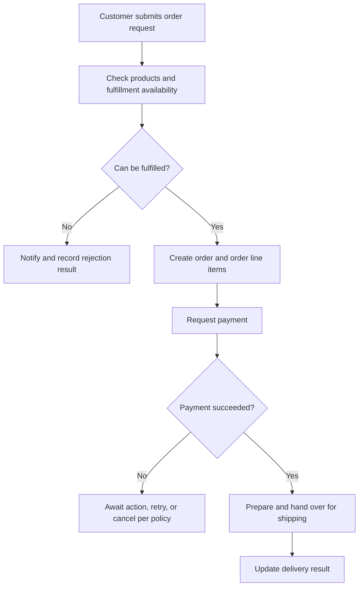
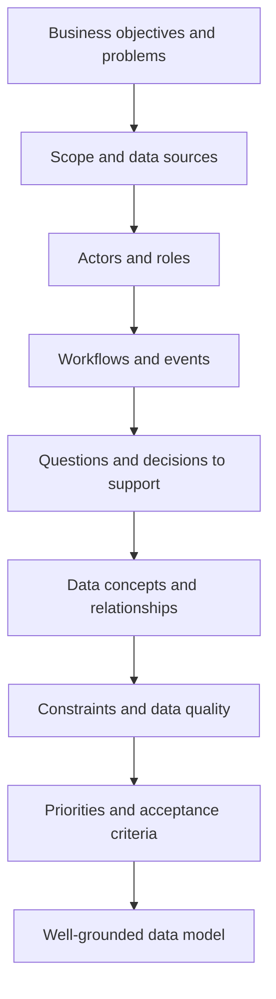

# Defining System Objectives, Target Users, and Questions to Answer

Requirements analysis is the step of identifying who the system needs to support, what problems it solves, and what information it must store and provide so users can complete their work. For a data modeling problem, this step determines the quality of every subsequent step: identifying entities, attributes, relationships, constraints, data history, and storage organization.

A model with many tables or collections can still be wrong if it fails to answer business questions. Conversely, when objectives, roles, and questions are clear, the development team can explain why a piece of data needs to exist, who creates it, who uses it, how it changes, and what conditions must always remain true.

## 1. Expected Outcomes After Requirements Analysis

Before sketching a schema, there must be sufficient information to answer the following questions:

- **Objectives:** What business outcome does the system produce? What current problem needs to be solved? By what criteria can the outcome be measured?
- **Scope:** Which business processes and data is the system responsible for? Which parts belong to external systems or fall out of scope?
- **Target users:** Who interacts directly, who operates, who administers, who views reports, and which external systems exchange data?
- **Workflows:** Through what steps do these actors perform their work? Which events start, modify, or end a workflow?
- **Business questions:** What do users need to look up, record, compare, aggregate, or verify?
- **Data requirements:** Which concepts, attributes, relationships, states, and timestamps are needed to answer those questions?
- **Quality constraints:** How accurate, consistent, secure, and available must the data be, and for how long must it be retained?

The output should be a traceable set of documentation: system objectives and scope, actor list, workflow descriptions, question catalog, business glossary, data requirements, constraints, and acceptance criteria. This serves as the foundation for building the conceptual model and logical model.

## 2. Distinguishing Objectives, Functions, Actors, and Questions

These concepts are related but cannot substitute for one another.

| Concept | Meaning | Example in an e-commerce / sales system |
|---|---|---|
| Business objective | The outcome the organization wants to achieve | Reduce order processing time and reduce inventory discrepancies |
| System objective | The capability the system must provide to support the business objective | Record orders, track payments, and update inventory |
| Function / workflow | The work performed by the system and users | Create order, confirm payment, pack, and deliver |
| Actor | A person or system interacting with the system in a specific role | Customer, warehouse staff, payment gateway |
| Business question | Information needed to take action or make a decision | Which orders have been paid but not yet delivered? |
| Data requirement | Data and rules needed to answer the question | Order, payment transaction, delivery status, and update timestamp |

For example, "customer management" is an overly broad functional description. It is necessary to clarify what information identifies a customer, by what criteria staff can search, whether a customer can have multiple addresses, which contact details are allowed to change, and whether order history must be preserved when a customer updates their profile.

Do not start by asking "what tables do we need to create?". Start with "what do users need to accomplish?" and "what do they need to know to accomplish it?".

## 3. Defining System Objectives and Boundaries

### 3.1. Describing the Current Problem

Document how work currently takes place before proposing a solution. A useful problem description clearly states:

1. Who is experiencing difficulties?
2. Which task is slow, error-prone, or hard to control?
3. What are the causes related to current workflows, information, or tools?
4. What are the measurable consequences?
5. What will improve if the new system operates properly?

Avoid generic statements like "need to manage data better." Make it concrete: "warehouse staff must cross-reference three different spreadsheets to determine sellable stock, causing order confirmation to take an average of 20 minutes." This description identifies the user, the data, and the outcome to improve.

### 3.2. Writing Verifiable Objectives

A good objective describes the desired behavior or outcome, the beneficiary, and the measure of success. You can use the structure:

> For **[target actor]**, the system needs to support **[capability]** to achieve **[measurable outcome]** within **[conditions or timeframe]**.

Example: "For warehouse staff, the system must display sellable stock quantity per product to reduce order fulfillment confirmation time to under two minutes."

Metrics need consistent definitions. When does "order processing time" start, at which step does it end, and are canceled orders included? Without an agreed calculation method, the data may be complete yet reports still yield incorrect results.

### 3.3. Defining Boundaries and Data Sources

Draw the system boundary to understand which data is created and managed internally, which data is received from outside, and which data is only sent outbound.

| Question | What needs to be determined |
|---|---|
| Which business processes is the system responsible for? | In-scope functions and excluded functions |
| Where is the data created? | Users, internal services, devices, or external systems |
| Which source is the source of truth? | The system with authority to decide the official value of each data type |
| How is data exchanged? | API, events, import files, periodic synchronization, or manual entry |
| Who is responsible for fixing incorrect data? | Data owner and discrepancy handling workflow |

For instance, a sales system may store the transaction ID and payment status received from a payment gateway, but does not independently decide whether the bank transaction has been settled. It is essential to distinguish data owned by the system from data replicated for lookup. Without identifying the source of truth, two systems could update the same information under conflicting rules.

## 4. Identifying Target Users and Roles

### 4.1. Categorizing Actors

An actor is a person or system interacting with the system in a specific role. One person can hold multiple roles; multiple people can share the same role. Therefore, do not equate a business actor with a login account or a single user record.

| Actor Group | Purpose of Interaction | Example |
|---|---|---|
| Primary users | Perform core business operations | Customer creates and tracks orders |
| Operations staff | Handle internal workflow steps | Warehouse staff confirm and pack goods |
| Administrators | Configure, manage permissions, and maintain catalogs | Administrator sets up roles and policies |
| Managers / analysts | Monitor results and make decisions | Manager reviews revenue and on-time delivery rate |
| External systems | Automated data exchange | Payment gateway, shipping carrier |
| Auditors / support | Inspect or investigate incidents | Support staff look up change history |

The payer, recipient, order placer, and account owner may be different people. When the business makes this distinction, the data model must preserve each relevant role rather than collapsing all of them into a single "customer" field.

### 4.2. Profiling Actors

For each actor, record:

- Role and responsibilities in the business process.
- Goals when using the system.
- Actions permitted to perform.
- Data needed to view, create, update, confirm, or delete.
- Permitted data access scope, such as own data, a single branch, or the entire organization.
- Usage frequency and context: online, in the warehouse, by shift, via API, or in batch.
- Risks if data is missing, incorrect, or accessed without authorization.

Example role matrix:

| Actor | Read | Create / Update | Approve / Confirm | Scope |
|---|---|---|---|---|
| Customer | Own profile and orders | Address, order request | Confirm order placement | Own account |
| Warehouse staff | Assigned orders, inventory | Goods issue slip and packing info | Confirm goods picked | Assigned warehouse |
| Manager | Reports and operational history | Certain authorized configurations | Approve exceptions | Branch or entire system |
| Payment gateway | Payment requests to process | Transaction results via integration | Confirm status per protocol | Transactions sent to the gateway |

This matrix helps uncover authorization and traceability requirements early on. For example, if staff may only view orders belonging to their warehouse, the system needs to know which warehouse an order is assigned to and whether assignment history must be retained.

### 4.3. Distinguishing Actors and Stakeholders

Stakeholders can influence requirements without directly operating the system. Executive leadership, legal, finance, or security teams may be stakeholders. They provide objectives, regulations, and constraints; direct users provide day-to-day workflows and questions. Requirements must be gathered from both groups to avoid a model tailored only to the current UI while neglecting governance or audit needs.

## 5. Exploring Workflows and Data Lifecycles

A list of actors is not enough to understand the data. You need to understand how they coordinate through workflows and events.

For each workflow, describe:

1. **Start condition:** Who initiates it? Which event or request triggers the workflow?
2. **Preconditions:** What data or state must exist before execution?
3. **Main steps:** Who executes each step and what data does the system read or write?
4. **Branches and exceptions:** What happens when stock is insufficient, payment fails, the user cancels, or an integration is interrupted?
5. **Outcome:** What data, state changes, or events does the workflow produce?
6. **End condition:** When is the work considered complete? Can it be reopened or reversed?

Example order processing workflow:



The diagram above is only the high-level flow. During real analysis, branches such as partial payment, payment retry, split shipments, failed delivery, or refunds must be clarified.

### 5.1. Distinguishing Current State and Event History

Current state answers "what condition is the entity in right now?". Event history answers "how did the entity change, when, and by whom?". These two needs are different.

For example, the field `status = 'SHIPPED'` indicates the order has been dispatched. However, when you need to know who confirmed packing, when the order was handed over, how many times delivery status changed, or why delivery failed, storing only the final state is insufficient. In that case, consider storing events or history records containing timestamp, actor, and reason.

Not every change needs to be stored indefinitely. Ask the business whether auditing, dispute resolution, point-in-time calculations, or state recovery are needed, and then define an appropriate history retention policy.

## 6. Building a Business Question Catalog

This is the step that bridges workflow descriptions to concrete data needs. Each question should represent a real action or decision.

### 6.1. Common Question Categories

| Category | Sample Question | Data Implications |
|---|---|---|
| Identity lookup | Who is this customer? What is the order code? | Stable identifiers, search rules, and deduplication |
| Status lookup | Which step is the order at? Is the product still sellable? | States, state transition rules, and most recent update data |
| Relationship | Which customer owns this order? Which products are in it? | Relationships between entities, multiplicity, and cardinality |
| History | Who changed the address? What was the price at order time? | Temporal data, snapshots, or change history |
| Transaction | Which payment belongs to the order? Which warehouse shipped it? | Transactions, reference keys, uniqueness, and integrity constraints |
| Reporting | What is revenue by day and by branch? | Metric definitions, data granularity, analytical dimensions, and time basis |
| Forecasting / analytics | Which products are at risk of stockout? | Historical data, observation timestamps, quality, and completeness |
| Auditing | Who viewed or modified sensitive data? | Actor identity, timestamp, action, and access logs |

### 6.2. Writing Sufficiently Specific Questions

A question like "what is this month's revenue?" is not specific enough to design data and reports. You must determine:

- Is revenue calculated based on created orders, collected cash, or delivered goods?
- Should it use order date, payment date, or accounting recognition date?
- How are canceled orders, refunds, discounts, and taxes handled?
- Which timezone and currency does the report use?
- Does it need to be broken down by product, branch, staff member, or sales channel?
- Must the data be updated immediately, or can it lag by a few minutes or hours?
- Who is permitted to view the report, and must it be restricted by branch?

For lookup questions, you also need to clarify search criteria, sorting, pagination, result limits, and response time requirements. This information affects indexes, query structure, and choices in data organization.

### 6.3. Documenting Questions Using a Template

| Field | Content to Record |
|---|---|
| Question ID | Stable ID for traceability, e.g., `Q-ORDER-01` |
| Questioner / actor | Role that needs the answer |
| Question | Clear statement of what needs to be known or what decision needs to be made |
| Timeframe / scope | Time range, organization, branch, or applicable target |
| Result granularity | What one row represents; whether aggregation or a detailed list is needed |
| Filters / sorting | Filtering criteria, ordering, and pagination method |
| Data freshness | Real-time, near real-time, or batch |
| Access permissions | Which roles may view the data |
| Frequency / priority | Usage frequency and business importance |
| Correctness criteria | Examples or rules to verify an accurate answer |

Defining "what one result row represents" is especially important. One row might represent an order, a product within an order, a payment transaction, or a daily summary. Without defining granularity (grain), the development team can easily double-count figures or design relationships incorrectly.

## 7. From Questions to Data Requirements

Once the question catalog is ready, identify the minimum data required to answer each question. There is no need to immediately decide table names, collections, or storage technologies.

### 7.1. Identifying Data Concepts

Read through the questions and workflows to find concept groups:

- **Entities with distinct identities:** customer, product, order, warehouse, employee.
- **Transactions or events:** order placement, payment, refund, goods issue, delivery.
- **Reference catalogs:** product category, currency, payment method, region.
- **Descriptive values:** quantity, unit price, address, timestamp, status.
- **Relationships:** customer places order, order contains line items, payment transaction belongs to order.

Not every noun in the requirements is an entity. "Color" might be an attribute, a reference catalog, or a separate entity depending on the business: does the system merely store the color name, or must it manage color codes, suppliers, images, and inventory per variant?

### 7.2. Clarifying Identity and Relationships

For each concept, ask:

- How is an entity uniquely identified?
- Is the identifier generated by the system or provided externally?
- Can two records describe the same entity? What are the merge rules?
- How many other entities can one entity be linked to?
- Is the relationship mandatory or optional on each side?
- Does the relationship have its own attributes or its own lifecycle?

For example, an order has many line items, and a product can appear in many orders. This relationship usually requires an intermediate concept—an order line item—because each line has a quantity, unit price at purchase time, discount, and its own details. Simply storing a list of product IDs on the order cannot fully represent the attributes of that purchase.

### 7.3. Distinguishing Current Data and Historical Data

Descriptive information can change over time, whereas transactions that have already occurred must preserve the exact context at the time they took place.

For instance, a product's current list price may change. Past orders must still retain the unit price, quantity, and discount applied at purchase time. Therefore, line item data must store the transaction value at order time rather than merely referencing the product's current price.

Similarly, the shipping address of a confirmed order may need to be stored as a snapshot at order time, even if the customer updates their profile address later. Ask the business which values must reflect the present and which values must be preserved historically.

### 7.4. Linking Questions to Data

Example for a sales system:

| Question | Data concepts potentially needed | Points to verify |
|---|---|---|
| Which orders has a customer placed? | Customer, order | In what capacity can a customer place an order? Are guest checkouts allowed? |
| What does an order contain? | Order, line item, product | Where are quantity, price, and discount at purchase time stored? |
| Has the order been paid? | Order, payment transaction | Are multiple payments, partial payments, or refunds supported? |
| Where are the goods? | Order, shipment, shipping event | Can an order be delivered in multiple packages? Is status history stored? |
| What is the sellable inventory? | Product, warehouse, inventory, reservation, inventory transaction | By what rules are on-hand stock and sellable stock calculated? |
| What is daily revenue? | Line item, payment, refund, timestamp | What are the revenue definition and recognition date? |

One question may require data from multiple concepts. Conversely, one concept can serve multiple questions. This is the basis for discovering core entities and relationships without creating arbitrary duplicate data.

## 8. Gathering Constraints and Data Quality Requirements

Functional requirements state what the system must do; quality constraints state the conditions under which it must do so. These constraints directly impact keys, indexes, transactions, history storage, and data model selection.

| Constraint Group | Questions to Clarify | Example |
|---|---|---|
| Accuracy and integrity | Which values are mandatory? Which rules must never be violated? | Order quantity must be greater than 0; transaction ID must not duplicate |
| Transactional consistency | Which changes must succeed or fail together? | Creating an order and reserving inventory need consistent processing rules |
| Concurrency | What happens when multiple users update the same data? | Two staff members cannot sell the last remaining unit of inventory |
| History and auditing | Do we need to know who did what, when, and why? | Store order status transition history |
| Security and privacy | Which data is sensitive? Who may view or edit it? | Only authorized roles may view personal information |
| Performance | How fast must critical queries respond? | Order lookup typically completes within one second under expected load |
| Scale | What are the expected counts of users, transactions, and volume? | Daily order count and annual growth rate |
| Availability and recovery | How long can the system be down? How much data loss is tolerable? | Define RPO and RTO targets for order data |
| Retention and deletion | How long must data be kept? When may it be anonymized or deleted? | Transaction record retention policy and personal data deletion requests |
| Integration | Can external data arrive late, duplicated, or out of order? | Payment webhooks delivered multiple times |

In particular, distinguish between "hide from UI," "soft delete," "anonymize," and "hard delete." Each approach affects reporting, reference keys, auditing, and retention obligations differently.

Do not invent performance or scale numbers yourself. Record the source of each assumption, who confirmed it, and how it is measured. If metrics are unavailable, mark them as assumptions to verify so guesswork does not turn into formal requirements.

## 9. Prioritizing Requirements and Defining Acceptance Criteria

Not all questions are equally important. They can be categorized by necessity:

- **Must have:** Without it, core workflows cannot function or regulations would be violated.
- **Should have:** Improves efficiency or reduces risk, but can be implemented later.
- **Could have:** Useful, but not yet needed for the current scope.

When prioritizing, weigh business impact, usage frequency, risk, implementation cost, and dependencies between requirements. Do not prioritize solely by how many users asked for something; an infrequently used audit requirement may still be mandatory.

Each critical requirement needs testable acceptance criteria. Example:

**Requirement:** The system must preserve the selling price at the time the customer placed the order.

**Acceptance criteria:**

1. When creating an order, the system records the unit price and discount applied to each line item.
2. When a product's list price changes, previously created orders still display the exact price at the time of placement.
3. Order value reports use the recorded transaction values, rather than recalculating using the current price.
4. The applied unit price can be traced back to the corresponding pricing rule or promotion if required by the business.

These criteria help verify both the data to be stored and system behavior. They also clarify why referencing only the product ID is insufficient.

### 9.1. Traceability from Objectives to Model

Each requirement should have an ID and link to the corresponding question, actor, workflow, data, and test. Example:

| Objective | Actor / workflow | Question | Related data | Verification |
|---|---|---|---|---|
| Reduce order confirmation time | Warehouse staff / confirm order | Can the order be fulfilled? | Product, warehouse, inventory, reservation | Two concurrent requests do not oversell available stock |
| Resolve complaints quickly | Support / look up order | Who changed the status and when? | Order, status history, actor | Sequence of changes can be queried chronologically |
| Accurate revenue reporting | Manager / aggregate revenue | How is daily revenue calculated? | Line item, payment, refund, timestamp | Results match verification dataset and metric definitions |

Traceability exposes two problems: data stored that serves no objective, or an important question lacking the necessary data to answer it.

## 10. Comprehensive Example: Requirements Analysis for an Online Store

Suppose a store wants to deploy a system to accept orders, manage inventory, and track payments and deliveries.

### 10.1. Objectives and Scope

- Reduce the time needed to confirm order fulfillment availability.
- Track payment and delivery statuses for every order.
- Provide consistent revenue figures to management.
- Store the history necessary for handling complaints.

System scope covers managing orders, line items, integrated transaction information, inventory, and delivery status. The payment gateway and shipping carrier are external systems; the store system receives results and stores the information needed for operations.

### 10.2. Actors and Needs

| Actor | Main Tasks | Information Needed |
|---|---|---|
| Customer | Place and track orders | Price, quantity, payment and delivery statuses |
| Warehouse staff | Confirm and prepare goods | Sellable quantity, warehouse location, assigned orders |
| Support staff | Handle inquiries and complaints | Order details, change history, transactions, and shipping info |
| Manager | Monitor operations | Revenue, canceled orders, delivery success rate, and inventory |
| Payment gateway | Process transactions | Reference ID, amount, result, and transaction timestamp |
| Shipping carrier | Receive and update packages | Tracking number, recipient, status, and delivery events |

### 10.3. Questions to Answer

1. Can a customer have multiple orders? Can unregistered guests place orders?
2. Can an order contain multiple products or be delivered in multiple packages?
3. Must the price and shipping address be preserved as of order placement time?
4. Can an order have multiple payments, partial payments, or refunds?
5. How is available inventory calculated after subtracting reserved quantities?
6. Are order status and delivery status independent?
7. Is revenue reporting based on order placement time or payment collection time? In which period are refunds deducted?
8. When a complaint occurs, which actions and events must be traced?

### 10.4. Implications for the Data Model

- Customers, orders, and line items must be separated because they have distinct lifecycles and attributes.
- Line items must store quantity and transaction value at order placement time.
- Payments and refunds must be treated as transactions with their own identifiers, timestamps, and statuses; a single `paid` flag cannot suffice if the business supports multiple transactions.
- Inventory must clarify on-hand stock, reserved quantity, and sellable quantity; concurrent update rules must be defined.
- Shipping may involve multiple packages or multiple updates; the corresponding relationships and event history must be defined.
- Reporting must clearly define granularity, time basis, and handling of cancellations and refunds before deciding how to aggregate.

These conclusions are not yet a physical schema. They are clarified requirements enabling the design team to compare relational, document, graph, or analytical models regarding integrity, query patterns, relationships, scale, and data evolution.

## 11. Reusable Requirements Capture Template

The following template can be used during interviews or workshops with users:

```yaml
system:
  name: "System name"
  business_problem: "Current problem and impact"
  business_objectives:
    - id: OBJ-01
      description: "Desired outcome"
      measure: "Metric and measurement method"
  scope:
    included: ["In-scope business processes"]
    excluded: ["Out-of-scope business processes"]
  data_sources:
    - name: "Data source"
      ownership: "Primary responsible system"
      exchange: "API, event, file, or manual operation"

actors:
  - id: ACT-01
    role: "Role"
    goals: ["Goals of the role"]
    permissions: ["Permitted data and actions"]
    data_scope: "Scope of accessible records"

workflows:
  - id: WF-01
    name: "Workflow name"
    trigger: "Start condition"
    main_steps: ["Execution steps"]
    exceptions: ["Exception branches"]
    outcome: "Data or state produced"

questions:
  - id: Q-01
    actor: ACT-01
    objective: OBJ-01
    question: "Question to answer"
    grain: "What one result row represents"
    filters: ["Filters to support"]
    time_basis: "Applicable time basis"
    freshness: "Data freshness requirement"
    priority: "MUST | SHOULD | COULD"
    acceptance: "How to verify the answer"

constraints:
  integrity: ["Integrity rules"]
  security: ["Access and data protection rules"]
  history: ["History storage requirements"]
  performance: ["Evidence-based performance targets"]
  retention: ["Retention period and rules"]
```

The template above is a discussion framework, not a mandatory schema for a database or configuration file. Fields can be added to suit the business, but stable identifiers should be kept for traceability between requirements, design, and testing.

## 12. Common Mistakes in Data Requirements Analysis

| Mistake | Consequence | Remedy |
|---|---|---|
| Starting from UI or screen lists | Missing business questions that do not appear on current screens | Interview around objectives, roles, workflows, and decisions |
| Overly generic objectives | Unclear which data is necessary and what success looks like | Write outcomes with clear metrics and conditions |
| Interviewing only primary users | Missing operations, integration, security, and auditing | Gather requirements across diverse roles and stakeholders |
| Storing only the final state | Unable to explain history and reasons for changes | Identify traceability, history, and timestamp requirements |
| Failing to define metrics | Reports yield conflicting numbers for the same concept | Align on formulas, time bases, and exception handling |
| Not identifying the source of truth | Data gets overwritten or diverges across systems | Explicitly record data owners and synchronization rules |
| Ignoring concurrent data access | Duplicate transactions or oversold inventory occur | Analyze contention scenarios and integrity requirements |
| Choosing technology too early | Model gets constrained by tool limits before understanding the business | Complete requirements and query patterns before choosing storage |
| Not recording assumptions | Unverified assumptions turn into wrong requirements | Flag assumptions, owners to verify, and verification plans |

## 13. Checklist Before Moving to Model Design

- [ ] Business objectives and system objectives are clearly stated with measurement criteria.
- [ ] Scope, exclusions, and integration boundaries have been defined.
- [ ] Actors, roles, permissions, and data scopes have been recorded.
- [ ] Main workflows, trigger events, and exception branches have been described.
- [ ] The question catalog covers necessary lookups, transactions, relationships, history, and reports.
- [ ] Result granularity, filters, time bases, and freshness requirements are clear.
- [ ] Data concepts, identities, relationships, and lifecycles have been identified.
- [ ] Snapshot, history, and auditing storage needs have been determined.
- [ ] Integrity, security, concurrency, performance, scale, and retention constraints have been recorded.
- [ ] Critical requirements have priorities, acceptance criteria, and traceability links.
- [ ] Open assumptions and questions have owners assigned for verification.



Once the questions above have answers or are clearly logged as assumptions to verify, the development team can begin building the conceptual model. Every entity, attribute, relationship, and constraint can then be traced back to a specific objective, actor, or business question.
