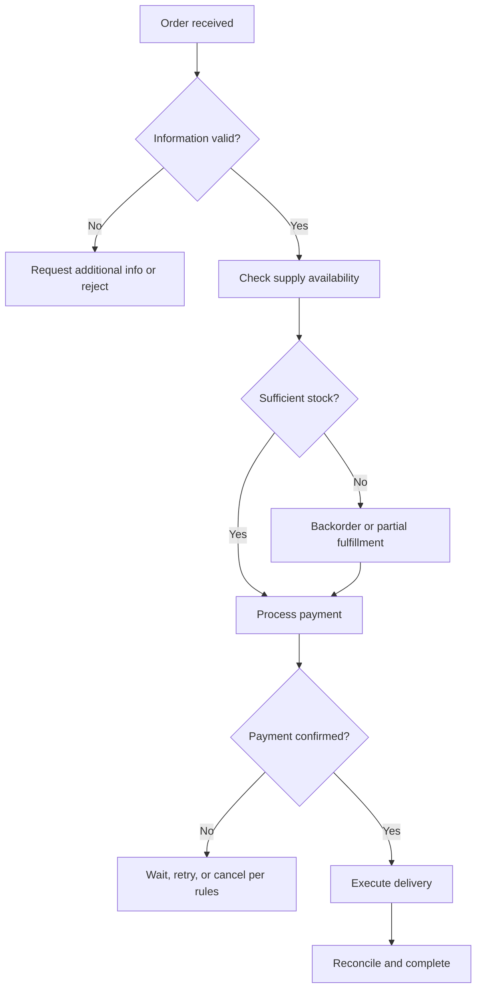

# Gathering Business Workflows, Sample Data, and Exception Cases

In the **Requirements Analysis** chapter, gathering business workflows, sample data, and exception cases helps the designer understand how data is created, modified, used, and terminated in real operations. This is the foundation for translating business requirements into a data model with appropriate entities, relationships, attributes, and constraints.

A good data model starts from evidence of how the organization operates. Column names in a spreadsheet, a current UI screen, or a few sample records only reflect part of the story. You must investigate who creates the data, which events cause it to change, which rules determine the outcome, which cases make the workflow deviate from the normal path, and what the system must store to explain history.

After this lesson, learners will be able to:

- Define workflow scope, actors, trigger events, states, and endpoints.
- Interview, observe, and cross-check documentation to record verifiable business flows.
- Collect a representative sample dataset, identifying data quality and limitations.
- Compile a list of exception cases, triggering conditions, expected outcomes, and recovery procedures.
- Convert collected evidence into traceable data requirements confirmed with the business side.

## 1. Three Types of Evidence to Collect

These three types of evidence complement each other, but cannot replace one another.

| Evidence Type | Answers the Question | Example |
|---|---|---|
| Business workflows | Who does what, when, under what conditions, and producing what outcome? | Customer places order, staff confirms, warehouse ships partially, accounting refunds. |
| Sample data | What do actual data shapes, values, missingness, and variations look like? | Orders with registered customers, guest orders, multiple items, addresses missing apartment numbers. |
| Exception cases | What happens when normal conditions no longer hold? | Payment succeeds but the system has not received confirmation; order is canceled after partial delivery. |

For example, an order form shows a `customerId` field, which does not prove every order belongs to a registered account. The sales workflow may allow guest checkout. Sample data may confirm that customer details are stored directly on the order. An exception case such as a customer requesting account deletion after a purchase also raises questions about retaining vouchers and transaction history. Only by combining all three sources does the designer have sufficient grounds to determine data semantics and lifecycle.

## 2. Defining Scope and Business Language

Before interviewing or pulling data, clearly define the workflow under investigation and its boundaries. A workflow may start from a customer request, from an event sent by another system, or from a staff action. Endpoints must also be defined: completing the business operation, handing off to another workflow, or merely recording an intermediate state.

For each workflow, record at minimum:

1. **Objective:** Which organizational or customer need does this activity address?
2. **Actors:** Which users, departments, internal systems, or partners participate?
3. **Trigger event:** What causes the workflow to start or resume?
4. **Inputs and outputs:** What information is read, created, updated, or forwarded?
5. **Decisions:** Which conditions cause the workflow to branch?
6. **States:** Which states can the business entity be in, and when does it transition?
7. **System boundaries:** Which data belongs to the system being designed, and which is only referenced from other systems?

Align on terminology before modeling. Two departments might use "customer," "buyer," "recipient," or "payer" to refer to different roles. Conversely, two different names sometimes refer to the same concept. Create a glossary containing term name, definition, examples, owner/confirmer, and synonyms. Never conclude two concepts are identical just because they are currently stored in the same column.

Questions that help lock down scope:

- Which event is considered a new business transaction?
- Who has permission to create, edit, approve, cancel, or view the data?
- When the workflow completes, what data must remain for lookup or reconciliation?
- Are any actions performed outside the system, such as by phone or in spreadsheets?
- Does the workflow vary by branch, customer type, region, or sales channel?
- Which system is the authoritative source for each type of information?

## 3. Investigating Workflows Through Real Events

### 3.1. Combining Multiple Methods

Do not rely on a single interview or published procedure manual. Cross-check multiple sources to uncover discrepancies between the documented workflow and how work actually happens.

| Method | How to Perform | Points to Watch |
|---|---|---|
| Role-based interviews | Speak separately with executors, approvers, managers, and downstream recipients. | Ask about a concrete transaction; avoid asking only about the ideal flow. |
| Job shadowing / observation | Follow a transaction from start to handover. | Record manual steps, off-system communication, and rework. |
| Walkthrough of a sample record | Ask users to explain every field, state, and document of a processed case. | Verify business meaning, creation source, and update timing. |
| Document review | Cross-check forms, guidelines, contracts, reports, and internal policies. | Note version, effective date, and document owner. |
| Log or report analysis | Observe event frequencies, state transitions, and common errors. | Check how logging is implemented; do not treat missing log data as proof an event never happened. |

### 3.2. Tracing a Transaction End-to-End

Pick a real transaction or a business-validated scenario. Ask the executor to walk through it chronologically. For each step, record the actor, timestamp, input data, action, decision conditions, outcome, and where evidence is stored.

Example of an order processing workflow:

| Step | Event or Action | Data to Observe | Questions to Confirm |
|---|---|---|---|
| 1 | Customer submits order | Buyer, items, quantity, address, placement time | Are guest customers allowed to place orders? |
| 2 | System receives order | Order code, sales channel, initial status | Is the order code assigned at draft creation or confirmation? |
| 3 | Check and reserve stock | Product, inventory, reserved quantity | Is partial reservation allowed? How long is stock held? |
| 4 | Process payment | Method, amount, transaction ID, status | Can one order have multiple payments or multiple payment methods? |
| 5 | Prepare and deliver goods | Warehouse, package, shipped quantity, carrier | Can an order ship from multiple warehouses or in multiple shipments? |
| 6 | Complete or handle post-sale | Delivered successfully, canceled, returned/exchanged, refunded | When is an order considered complete? What history must be kept? |

The table above is only an example to guide discovery, not a universal standard workflow applicable to every organization. Sequence, status names, and rules must be confirmed with the business owner.

### 3.3. Recording States and State Transitions

A state describes the current condition of a business entity at a point in time. State transitions must be tied to an event or action with clear conditions. Do not merely list states; ask who is permitted to transition, preconditions before transitioning, required data, and resulting side effects.

For example, `PAID` might only be assigned after receiving a valid payment confirmation. If a customer clicks the pay button twice, the system must determine whether it is a retried payment attempt or two separate transactions. If goods have already shipped, a cancellation request may need to transition into a return or refund workflow rather than reverting the order to its initial state.



When a workflow has multiple branches, explicitly document the condition for each branch. Avoid vague descriptions like "handle manually if needed"; ask who decides, based on what information, where the outcome is recorded, and who is responsible for continuing.

### 3.4. Distinguishing Business Rules from Current Operations

An operation currently present in software is not necessarily a business rule. For example, a current screen requiring a phone number might be a limitation of legacy software, whereas the business allows customers to buy using only an email address. Record separately:

- **Business rule:** What the organization requires or commits to complying with.
- **Current practice:** Operations, forms, or limitations of the system currently in use.
- **Pain points or desired changes:** Areas causing errors, manual effort, or no longer fitting needs.

This distinction prevents copying legacy constraints verbatim into the new data model.

## 4. Collecting Representative Sample Data

### 4.1. Sampling by Scenario, Not Just Volume

A large dataset containing only normal transactions can hide critical requirements. Sample across multiple dimensions: transaction type, role, channel, time period, status, size, and outcome. Include common cases, boundary cases, and rare but high-impact cases.

| Sample Group | Examples to Look For | Purpose |
|---|---|---|
| Happy / common flow | Orders with one customer, one item, and successful payment | Understand typical structure and sequence. |
| Boundary values | Minimum/maximum quantity, orders with many lines, zero value if allowed by business | Determine limits and data types. |
| Missing data | Missing customer ID, missing secondary address, no delivery date yet | Distinguish optional data from omitted/erroneous data. |
| Duplicates | Resubmitted requests, two profiles with identical information | Understand identification and deduplication rules. |
| Inconsistencies | Non-existent reference IDs, total amount mismatching line items | Find validation rules and reliable data sources. |
| Temporal differences | Old transactions, open transactions, data after policy updates | Understand history and time-effective validity. |
| Multi-party or multi-step | One order with multiple recipients, warehouses, or payment attempts | Identify one-to-many relationships and potentially needed intermediate entities. |
| Handled exceptions | Canceled orders, partial refunds, failed deliveries | Cross-check described handling against actual data. |

Do not infer frequency or importance solely from the number of provided samples. Ask the data owner about sampling timeframe, system scope, applied filters, and transaction groups not represented.

### 4.2. Profiling Each Data Field

For each field, collect the following attributes:

- Business name and definition; avoid recording only technical column names.
- Value type and format, e.g., code, text, monetary amount, datetime, or status.
- Mandatory or optional; if missing, is it validly absent, not yet generated, or a data entry error?
- Validation rules, value domain, length, precision, and unit of measure.
- Uniqueness: globally unique, unique within a scope, or allowed to duplicate?
- Creation source, owner, and systems permitted to update it.
- Effective timing and handling when the value changes.
- Reference relationships to other entities and handling when the referenced entity no longer exists.

For instance, a field named `price` is not clear enough to design. You need to know whether it is list price, selling price at order time, discounted price, pre-tax price, or tax-inclusive price; what the currency is; what the rounding rules are; and whether past transactions are recalculated when the price list changes.

### 4.3. Checking Data Quality and Distribution

When granted access to data, perform data profiling at an appropriate level. Useful checks include:

| Check | Question | Signs Requiring Investigation |
|---|---|---|
| Completeness | Which fields are frequently left blank? | Missingness rates differing by channel or time period. |
| Value domain | What are the minimum, maximum, and common values? | Negative numbers, future dates, or out-of-catalog codes. |
| Formatting | Are there multiple representations for the same meaning? | Dates in mixed formats, phone numbers with spaces, or mixed-case codes. |
| Uniqueness | Are business keys duplicated? | One code appearing multiple times or one entity having multiple codes. |
| Referential integrity | Do foreign links point to existing records? | Orphaned records or references pointing to the wrong system. |
| Consistency | Do related fields agree with one another? | Total amount not equaling sum of details, delivery date earlier than order date. |
| Distribution | Which groups hold most values, and does it shift over time? | One category dominating nearly the whole sample or sudden anomalies. |

Aggregate queries can be used to count rows, null values, distinct values, and duplicates. Illustrative example:

```sql
-- Count total orders and orders without a customer ID.
SELECT
    COUNT(*) AS total_orders,
    SUM(CASE WHEN customer_id IS NULL THEN 1 ELSE 0 END) AS guest_or_missing_customer
FROM orders;

-- Find order codes that appear more than once.
SELECT order_code, COUNT(*) AS occurrences
FROM orders
GROUP BY order_code
HAVING COUNT(*) > 1;
```

Table and column names in the example are illustrative only. Valid guest checkouts must be distinguished from missing data caused by errors. A `NULL` value might mean "unknown," "not applicable," "not yet occurred," or "not provided"; these meanings should not be conflated if they lead to different business rules.

### 4.4. Protecting Data During Discovery

Collect only the fields genuinely needed to answer discovery questions. For personal data, payment details, or sensitive business data, use anonymized, pseudonymized, or synthetic data according to organizational policy. Replace real identifiers with stable pseudonyms when tracking relationships across multiple records. Never put passwords, tokens, credentials, or raw customer data into training materials, examples, or source code repositories.

Record the source, extraction timestamp, scope, filters, provider, and transformation steps applied to the sample. An anonymized sample can still reveal identity when combining rare attributes; evaluate re-identification/linkage risk, not just masking names and phone numbers.

### 4.5. Example of a Sample Record

The JSON snippet below is simulated data illustrating how to inspect an order record. It intentionally represents a guest order and a partial delivery to prompt discovery questions.

```json
{
  "orderCode": "ORD-DEMO-00421",
  "customerId": null,
  "buyerContact": "buyer@example.invalid",
  "placedAt": "2026-11-21T09:15:00+07:00",
  "currency": "VND",
  "items": [
    {
      "productCode": "SKU-DEMO-TEE",
      "quantity": 2,
      "unitPrice": 125000
    }
  ],
  "payment": {
    "status": "CAPTURED",
    "amount": 250000,
    "transactionRef": "PAY-DEMO-8821"
  },
  "fulfillment": {
    "status": "PARTIALLY_SHIPPED",
    "shippedQuantity": 1
  }
}
```

From a single record like this, do not rush to finalize the schema structure. Ask questions:

- Does a null `customerId` mean a guest checkout or an unsynced customer profile?
- Does the contact information belong to the buyer, recipient, or payer?
- Is `unitPrice` the price locked at order placement time?
- Can an order have multiple payments, multiple refund transactions, or multiple shipments?
- Is `shippedQuantity` a cumulative quantity or the quantity of a single shipment?
- If part of the order is canceled, how are the collectible and refundable amounts calculated?

A single record only illustrates one slice. Related samples and business explanations are needed to confirm meaning.

## 5. Finding and Describing Exception Cases

### 5.1. Using "What If This Happens?" Questions

After understanding the normal flow, walk through each step and ask what could cause that step to fail, repeat, be delayed, or alter the result. Do not ask only about technical errors. Valid but infrequent scenarios such as partial delivery, recipient changes, or split payments can also reshape the data model.

Exceptions can be grouped as follows:

| Group | Prompting Questions | Example |
|---|---|---|
| Input | What if data is missing, malformed, or refers to an unknown entity? | Product code does not exist, incomplete address. |
| Business rules | What if a condition is unmet or only partially met? | Out of stock, credit limit exceeded, ineligible for promotion. |
| State and lifecycle | What if a request arrives too late or the entity already transitioned? | Canceling an order after handover to the carrier. |
| Timing | What if an event arrives late, out of order, or past its effective date? | Payment confirmation arrives after the order expired. |
| Duplicates and concurrency | What if two identical requests arrive or two users update simultaneously? | Retried payment callback; two staff editing a record at once. |
| External systems | What if a partner fails to respond or returns an ambiguous result? | Payment gateway times out even though the charge may have succeeded. |
| Recovery and reconciliation | Who detects discrepancies, how are they corrected, and what audit trail is kept? | Statement amount differs from order amount. |
| History and change | When policies or catalogs change, how is historical data interpreted? | Address renamed, tax rate or price list changed. |

### 5.2. Writing Exceptions as Testable Scenarios

Each exception should include:

1. **Scenario ID and name:** Stable identifier for discussion and testing.
2. **Preconditions:** State and data when the scenario begins.
3. **Trigger event:** Action or message causing the scenario.
4. **Decision rules:** Business rules used for handling.
5. **Expected outcome:** Post-handling state, figures, and notifications.
6. **Data to retain:** Original information, change history, reason, and actor.
7. **Recovery procedure:** Retry, manual handling, reconciliation, rollback, or escalation.
8. **Approver / confirmer:** Authorized person accepting the handling approach.

Example of a payment gateway timeout:

| Component | Description |
|---|---|
| Preconditions | Order is awaiting payment; the system has sent a request to the payment gateway. |
| Event | The system receives no response before the timeout threshold. |
| Unknown condition | The payment gateway may have charged the customer, but the response was lost. |
| Safe outcome to confirm | Do not create a second charge merely by resending the request; check transaction status by reference ID. |
| Data to retain | Request ID, partner transaction ID if available, send timestamp, retry count, response, and reconciliation result. |
| Business questions | How long before retrying is allowed? Who handles transactions with unclear outcomes? When does the order auto-expire? |

This example shows that a "retry" action can create duplicate data if request attempts are not separated from actual payment transactions. Idempotency rules must be confirmed at the business and integration levels before deciding storage design.

### 5.3. Distinguishing Current State and History

If only the latest state is stored, the system may fail to answer who changed the data, when, why, and what the previous state was. Identify traceability requirements:

- Is it necessary to store every state transition or only key milestones?
- Must before-and-after values be stored on edits?
- Can business time (when the event occurred) differ from system recording time?
- Must the actor, update source, and reason be stored?
- Can historical data be edited or deleted? Who has permission and under what process?

For example, an order may currently be in `PARTIALLY_SHIPPED` status, yet you need to know when each package left the warehouse, in what quantity, and which carrier accepted it. Current state and delivery history answer two different questions. Whether a history table, an event log, or another structure is needed is a downstream design decision; the task of discovery is to clarify history storage and query requirements.

## 6. Translating Discovery Findings into Data Requirements

After gathering evidence, express findings as small, unambiguous, verifiable requirements. Each requirement should indicate its evidence source, confirmer, and open status.

| ID | Finding or Rule | Data Implications to Clarify | Evidence to Keep |
|---|---|---|---|
| REQ-01 | Guest customers are allowed to place orders. | Is the relationship between order and customer profile optional? Where is buyer info stored? | Sales team interview and anonymized sample orders. |
| REQ-02 | An order can be shipped in multiple deliveries. | How should each shipment, quantity, and individual status be represented? | Delivery records and warehouse reconciliation. |
| REQ-03 | Selling price is locked at order confirmation. | Must transaction price be kept independent of current list price? | Sales policy and historical orders. |
| REQ-04 | Payment gateway may resend notifications. | Which key identifies duplicate notifications vs. the original transaction? | Integration docs and secret-scrubbed logs. |

From the requirements, identify these modeling questions:

- **Entities:** Which objects with independent lifecycles or identities must the organization manage? E.g., order, order line item, payment transaction, shipment.
- **Relationships:** How many other objects does one object link to? Are relationships mandatory, optional, or time-varying?
- **Attributes:** Does each value describe an object or an event? Are there units, value domains, or normalization rules?
- **Identifiers:** Which codes are business keys and which are system-generated? Are keys stable across synchronization?
- **Constraints:** Which conditions must hold at all times, within a state, or at transaction time?
- **History:** Must current values, versions, events, or both be stored to satisfy queries and audits?
- **Data sources:** Which system has authority to create or update each attribute? How should sync conflicts be resolved?

For instance, the rule "price is locked upon order confirmation" indicates that price on the order carries historical meaning distinct from the product's current price. The rule "one order ships in multiple deliveries" indicates a need to investigate a shipment entity and its relationship to order line items. These conclusions guide the model, yet quantities, allocations, cancellations, and refunds still need confirmation before locking the schema.

### 6.1. Using a Traceability Matrix

A traceability matrix links requirements to confirmers, sample data, exception scenarios, and design decisions. It helps the team spot unsubstantiated requirements or ungrounded design choices.

| Requirement | Source / Confirmer | Related Sample | Related Exception | Status |
|---|---|---|---|---|
| REQ-01 | Sales department | Guest order | Customer requests info update post-purchase | Needs confirmation |
| REQ-02 | Warehouse & logistics | Multi-shipment order | One shipment fails delivery | Confirmed |
| REQ-03 | Pricing manager | Orders before and after price change | Open order while price list changes | Needs confirmation |

Do not mark "confirmed" merely because one interviewee agreed. For rules affecting money, access rights, reporting, or retention obligations, identify the properly authorized person and store supporting evidence.

### 6.2. Recording Ambiguities Instead of Assuming

When information conflicts, record both interpretations, the observed scenario, the impact of choosing wrong, and who must decide. For example, sales says an order can be canceled anytime, whereas warehouse says it cannot be canceled after packing. Both sides may be referring to different business milestones. You must pinpoint the responsibility handover milestone and the workflow after that milestone.

An open question item should have an owner and a due date. If design must proceed before an answer arrives, clearly document the assumption, applicable scope, and how to adapt if the assumption proves wrong. Never turn temporary assumptions into long-term data constraints.

## 7. Comprehensive Example: Investigating an Order with Partial Delivery and Refund

Suppose an organization sells via website and physical stores. An order can contain multiple products, be paid online or in-store, and ship from multiple warehouses. The goal of discovery is to understand the data needed when an order is only partially delivered and the customer requests a refund for the remainder.

### 7.1. Observed Workflow

1. Customer creates an order with two products.
2. System confirms the order and records selling prices at confirmation time.
3. Customer pays for the entire order.
4. Warehouse A ships the first product; the second product is out of stock at the selected warehouse.
5. Staff transfer the unshipped portion to Warehouse B or cancel it per customer choice.
6. If canceled, the payments team refunds the corresponding amount and records the result.

### 7.2. Questions to Clarify

- Does an order have one overall status, or does each line item also have its own status?
- Can one order line item be split across multiple shipments?
- When transferring warehouses, does the system preserve history of planned vs. actual warehouse?
- How is the refund amount calculated relative to purchase price, post-discount, and tax?
- How are shipping fees and promotions allocated when only part of an order is canceled?
- If a refund request is submitted twice, how are duplicate refunds prevented?
- If the refund fails while the item portion is already canceled, who handles it and what data requires reconciliation?
- Should revenue reports reflect sale time, delivery time, or refund time?

### 7.3. Potential Data Entities to Investigate

| Entity | Information to Verify | Relationships to Clarify |
|---|---|---|
| Order | Buyer, sales channel, timestamp, currency, total amount, and status | Has many line items, payments, and shipments. |
| Order line item | Product, ordered quantity, locked price, discount, and tax | May be partially delivered or canceled. |
| Payment transaction | Method, amount, reference code, and result | One order may have multiple transactions or attempts. |
| Shipment | Warehouse, carrier, timestamp, and status | May contain multiple lines or a partial quantity of a line item. |
| Refund transaction | Amount, reason, timestamp, partner reference, and result | May link to the order, payment transaction, or canceled items. |

These are candidates for investigation, not mandatory conclusions to create one table per item. If the organization does not manage an entity independently or has no separate query need, representation may differ. Business rules, scale, queries, and constraints must be confirmed before choosing a relational, document, or other structure.

### 7.4. Exception Scenarios to Verify

| Scenario | Condition | Outcome Business Needs to Confirm |
|---|---|---|
| Partial delivery | Only part of the quantity is available | Order and line items accurately reflect shipped quantity, remaining quantity, and next status. |
| Cancel unshipped portion | Customer agrees to cancel remaining quantity | Store reason, canceled quantity, and refund calculation method. |
| Duplicate refund notification | Partner resends the same notification | One business result is not recorded or paid out twice. |
| Delayed refund | Order marked canceled but partner has not finalized | Pending status and reconciliation details exist for follow-up. |
| Price change post-order | Price list changes before delivery completes | Locked price on the old order remains explainable and reconciles accurately. |

Through this example, we see that an apparently simple workflow often contains multiple sub-lifecycles. Gathering these scenarios ensures the data model reflects reality and supports traceability when discrepancies arise.

## 8. Discovery Deliverables to Hand Over

At the end of discovery, the team should have documentation sufficient for designers and testers to share the same understanding. Depending on project scale, these deliverables may live in documents, requirements management tools, or a business data catalog.

| Deliverable | Minimum Contents |
|---|---|
| Workflow map | Scope, actors, events, processing steps, decision branches, states, and endpoints. |
| Business glossary | Concept name, definition, examples, synonyms, and confirmer. |
| Sample data catalog | Source, timestamp, scope, anonymization method, selection criteria, and sample limitations. |
| Data field profiles | Meaning, type, domain, requiredness, uniqueness, source, and temporal rules. |
| Exception catalog | Conditions, events, expected outcomes, data to retain, and recovery steps. |
| Business rules list | Rule ID, description, applicability conditions, owner, and verification examples. |
| Traceability matrix | Links across requirements, confirmation sources, sample data, exceptions, and model decisions. |
| Open questions list | Unclear items, impact, owner, due date, and temporary assumptions if any. |

A requirement capture template can follow this structure:

```text
Requirement ID:
Name:
Rule description:
Applicable scope:
Preconditions:
Trigger event:
Expected outcome:
Input/output data:
Exception cases:
Evidence source:
Confirmer:
Confirmation status:
Related model decisions:
```

## 9. Common Mistakes and Remedies

| Mistake | Consequence | Remedy |
|---|---|---|
| Interviewing only managers | Missing actual operations and exceptions handled by frontline staff. | Speak across roles and observe concrete transactions. |
| Investigating only the happy path | Model cannot represent cancellations, refunds, retries, or in-progress states. | Walk each step asking about errors, delays, retries, and changes. |
| Treating sample data as the full specification | Rare cases or unencountered rules are overlooked. | Document sample scope; combine with interviews and business policies. |
| Treating all null values as having one meaning | Hard to distinguish optional, unknown, not-yet-occurred, and data errors. | Define the semantics of each type of missing data. |
| Copying legacy system structures | Carrying over technical limitations that no longer fit. | Separate business rules from current implementation details. |
| Ignoring time and history | Unable to explain historical transactions after price, address, or status changes. | Identify effective times, recording times, and traceability needs. |
| Making unilateral calls on conflicting sources | Data constraints may contradict real workflows. | Log ambiguities, decision makers, and controlled assumptions. |
| Over-collecting sensitive data | Increases data exposure risk and makes documentation hard to manage. | Limit purpose, anonymize, and retain only necessary samples. |

## 10. Checklist Before Moving to Design

- [ ] Scope, start events, endpoints, and related systems are clear.
- [ ] Primary roles and their responsibilities have been confirmed.
- [ ] Common workflows are described chronologically with inputs and outputs.
- [ ] Decision branches and state transition conditions are explicitly documented.
- [ ] Business terminology is aligned and has assigned owners.
- [ ] Sample data covers common, boundary, missing, duplicate, and exception scenarios.
- [ ] Source, timestamp, scope, and anonymization method for sample data are recorded.
- [ ] Semantics of null values, identifiers, timestamps, and units are clarified.
- [ ] Duplicate, concurrent, late-arriving, and failed-integration cases have been investigated.
- [ ] History, reconciliation, traceability, and recovery requirements have been confirmed.
- [ ] Critical rules have accountable confirmers and supporting evidence.
- [ ] Open questions, conflicts, and assumptions are logged for resolution before locking the model.

Move to the design phase only when the team has enough evidence to explain why every data entity, relationship, and constraint is needed. If a requirement remains ambiguous, keep it in a pending-confirmation state and clearly mark its impact on the model.

## 11. Practice Exercise

An online store allows customers to place multiple products in a single order. Customers can pay via a payment gateway or cash on delivery. Warehouses can ship an order in multiple packages. Customers may request cancellation of part of an order before that part is shipped. Product prices can change daily.

Complete the following tasks:

1. Define the workflow scope from the moment the customer submits an order until delivery completion or cancellation handling.
2. List actors, events, input data, output data, and workflow decisions.
3. Propose at least six sample records to collect, including guest customers, multi-package orders, failed payments, and partial cancellations.
4. Write field profiles for `orderCode`, `productCode`, `quantity`, `unitPrice`, `placedAt`, and `paymentStatus`.
5. Describe at least five exception cases with preconditions, events, expected outcomes, and data to retain.
6. Build a traceability matrix for the rules on locked pricing, multi-package shipping, and partial cancellation.
7. Document questions requiring confirmation from the business owner before designing the schema.

**Self-assessment criteria:** covers both normal and exception flows; distinguishes current data from historical data; does not assume every order has a customer profile; states sources and limitations of sample data; every critical rule has evidence or a designated confirmer. The exercise is complete when another team member can read the documentation and interpret the exact same workflow without guessing missing conditions.

## Conclusion

Gathering business workflows tells you which events cause data to appear and change. Sample data reveals actual values, variations, and quality issues. Exception cases expose constraints often overlooked in the normal flow. When these three sources are linked by requirements, evidence, and confirmers, the team can build a data model that accurately reflects operations, explains history, and adapts better when workflows evolve.
