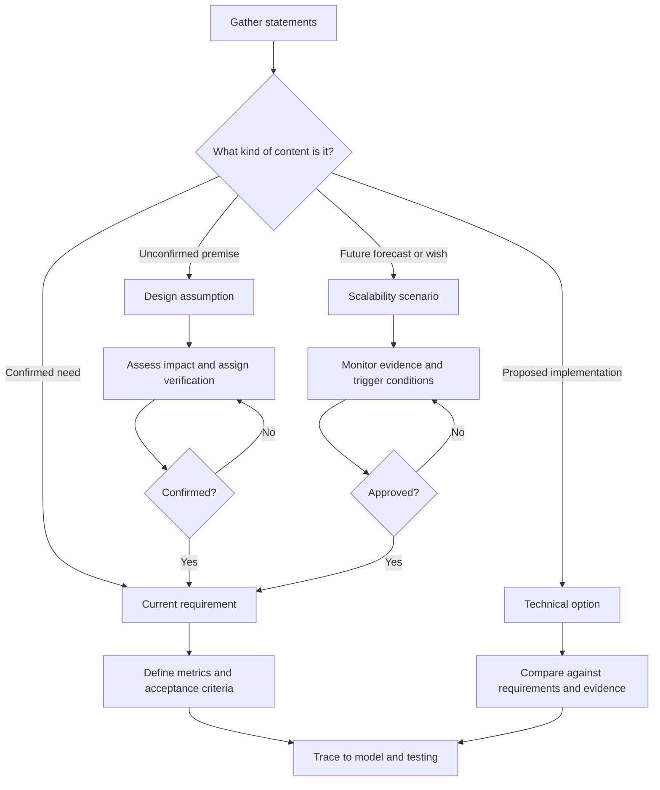

# Distinguishing Current Requirements, Design Assumptions, and Unconfirmed Scalability Needs

In a data project, statements made during interviews, technical ideas from the engineering team, and predictions about future scale frequently appear side by side. Without distinguishing them, the team may turn an unverified remark into a mandatory requirement, over-engineer for current needs, or overlook truly critical operational limits.

Requirements analysis must explicitly record the certainty level and origin of every statement. **Current requirements** describe what users or the organization have confirmed the system must fulfill. **Design assumptions** are premises the team temporarily accepts to continue analysis or build options, which still require verification. **Unconfirmed scalability needs** are future desires or forecasts regarding load, volume, and growth that lack sufficient evidence to become technical commitments.

These three categories of information can relate to each other yet carry different evidence statuses and handling rules. Clear classification ensures the data model both meets current operational work and preserves the ability to evolve when new evidence arrives.

## 1. Why Distinguish Levels of Certainty?

A statement like "the system needs to support millions of orders" can carry multiple meanings. The user might mean total orders stored over many years, orders generated per month, orders processed concurrently, or simply imagining a large scale to avoid replacing the system early. Each interpretation leads to different storage, indexing, partitioning, and operational requirements.

Similarly, "later we might sell in multiple countries" is not enough to conclude that version one must support multiple currencies, multiple languages, regional tax rules, and multi-region data residency. It might be a business direction, an assumption to verify, or an approved requirement. The team must ask explicitly before building it into the design.

Misclassification commonly causes four consequences:

- **Scope bloat:** Capabilities that were merely ideas get implemented immediately, slowing down core functionality.
- **Over-engineering:** Adding abstraction layers, distributed storage, or scaling mechanisms when neither load nor operational requirements justify them.
- **Under-engineering:** Skipping current requirements around history, consistency, security, or integration by mistaking them for deferrable technical choices.
- **Lack of verifiability:** The team does not know who confirmed a number, which assumptions still hold, or what conditions force a design review.

The goal of classification is to make decisions traceable and adjustable. It does not aim to eliminate all assumptions or forecasts; assumptions and forecasts remain necessary when information is incomplete.

## 2. Three Core Information Categories

### 2.1. Current Requirements

A current requirement is a need confirmed by an authorized person or reliable business source within the scope of the version or phase under analysis. A requirement should describe what the system must do or the quality attribute it must achieve, reasonably independent of implementation details.

Examples:

- Warehouse staff need to look up orders assigned to their warehouse.
- When an order is confirmed, the system must preserve the unit price at purchase time.
- Every payment transaction from an external gateway must be identified by the provider's reference code.
- Users may only view data within their granted permission scope.
- End-of-day reports must use the agreed business timezone.

Even a confirmed requirement still needs detailing. "Fast lookup" is not yet a testable criterion until query type, expected load, measurement environment, and acceptable latency thresholds are defined. "Store history" must also specify change types, retention period, access permissions, and expired-data handling.

Current requirements should include an identifier, confirming person or document, applicable scope, priority, acceptance criteria, and links to related business questions.

### 2.2. Design Assumptions

A design assumption is something not yet fully confirmed that the team temporarily uses as a premise for analysis, estimation, or comparing options. Assumptions can relate to business rules, data, integration, load, or operations.

Examples:

- Tentatively assume each order belongs to a single retail store.
- Tentatively assume customer codes from the legacy system do not change during data migration.
- Tentatively assume payment webhooks may be redelivered and require idempotent duplicate handling.
- Tentatively assume users look up orders primarily by order code and date range.
- Tentatively assume the system can use a single relational database for initial transactions.

The assumptions above differ in nature. Some are business assumptions needing business-owner confirmation; some are technical assumptions needing experimentation; some are temporary choices revisable after evaluation. Explicitly record the assumption type and verification method rather than lumping every uncertainty into a single generic list.

A good assumption has narrow scope, a rationale, an owner responsible for verification, and review conditions. Do not write "the system will be small scale" without defining how small, based on what data, and who confirmed it.

### 2.3. Unconfirmed Scalability Needs

These are projections, wishes, or growth scenarios not yet approved as requirements for the current phase. They may involve user counts, transaction counts, storage volume, query speed, organization counts, geographic regions, or business complexity.

Examples:

- Might expand into multiple countries over the next two years.
- Might grow from one branch to hundreds of branches.
- Might store billions of historical events.
- Might need near-real-time analytics across all transactions.
- Might integrate additional sales channels and payment providers.

These possibilities should be tracked in a future scenarios list along with available evidence, confidence level, impact if realized, and signals to monitor. They do not automatically become immediate implementation requirements.

If a future capability is approved by leadership or the business owner with clear timelines and criteria, it can become a requirement for a defined phase. At that point, update scope, priority, and acceptance criteria accordingly.

## 3. Distinguishing Requirements from Technical Solutions

Requirements describe the desired outcome. Technical solutions describe how the system will achieve that outcome. The two are often mixed when users or engineers propose a specific technology before aligning on the problem.

| Statement | Initial Classification | Questions to Clarify |
|---|---|---|
| Staff need to find orders by order code during business hours | Functional requirement | Who may search? Do we also need to search by other criteria? |
| Must use MongoDB | Technology constraint or design proposal | Who requires it? What are the rationale, criteria, and approval authority? |
| Data must survive server restarts | Data durability requirement | What is the maximum tolerable data loss? |
| Use Kafka to process all events | Architecture proposal | Which throughput, ordering, or service-decoupling requirements justify this choice? |
| Support 10 million users | Unclear scale forecast | Is that registered accounts, active users, or concurrent users? |
| Reports must finish before 8:00 AM every morning | Operational requirement | Which period's data, freshness, and cutoff time apply? |

If the organization has a policy mandating a specific platform, that can be a current constraint. Record the policy source and applicable scope. If it is merely a team member's suggestion, it remains an option to evaluate.

For example, the requirement "look up an order within one second under expected load" can be met in multiple ways: optimizing relational queries, adding indexes, caching, read replicas, or reorganizing data structures. Never turn one option into a requirement without proving it is a mandatory constraint.

## 4. How to Classify a Statement During Discovery

When hearing a statement, clarify six points:

1. **Who stated or confirmed it?** End user, business owner, architect, vendor, or another stakeholder?
2. **What is being described?** Business outcome, target quality, policy constraint, technical solution, or future forecast?
3. **When does it apply?** Current release, next phase, or an undated future vision?
4. **What evidence supports it?** Active workflows, measured metrics, contracts, policies, experiments, or just opinion?
5. **What is the impact if wrong?** Effects on data, cost, security, schedule, performance, or operability?
6. **Who verifies it and when?** Is there an owner, due date, or trigger event for re-evaluation?

One statement may need to be split into multiple items. For example, "we need a distributed database because next year we'll have millions of users" contains at least three items: an unquantified performance or availability requirement, an ambiguously defined user forecast, and a proposed solution. Recording each separately allows the team to verify them independently.

### 4.1. Helpful Prompting Questions

| When You Hear | Ask |
|---|---|
| "It must always be fast" | Which queries? What latency threshold? At which percentile and load? |
| "There is a huge amount of data" | How many records today, daily growth rate, and retention duration? |
| "There will be many users" | How many accounts, how many active users, how many concurrent sessions? |
| "Data must be consistent" | Which cases require immediate consistency? Which accept eventual delay? |
| "Later we'll need multi-region" | Multi-region for latency reduction, higher availability, legal compliance, or disaster recovery? |
| "Must support all kinds of reports" | Who uses them, which questions matter, desired freshness, and response time? |
| "Just keep all history" | History of which data types, retention period, access rights, and storage cost? |

Do not fill in answers from personal experience. When the interviewee does not know, record "unconfirmed" and assign the task of gathering evidence.

## 5. Recording Evidence, Confidence, and Accountability

Every important statement should be stored alongside its source and evidence. A remark from an operations user may accurately reflect daily pain points, yet not necessarily suffice to determine system-wide scale. A current dashboard may show actual traffic, yet not prove two-year growth plans.

### 5.1. Types of Evidence

| Evidence Type | Examples | Things to Check |
|---|---|---|
| Policies or contracts | Retention policies, integration agreements | Version, scope, effective date, and owner |
| Workflow observation | Interviews, job shadowing, workshops | Roles, context, and exception cases |
| Operational data | Logs, metrics, load reports, storage usage | Timeframe, representativeness, and measurement quality |
| Historical data | Order growth, active users | Seasonality, campaigns, and business changes |
| Experiments | Benchmarks, prototypes, load tests | Environment, data, configuration, and repeatability |
| Business plans | Market expansion or branch targets | Approval level, timeline, and resources |
| Expert opinion | Architect or vendor assessment | Assumptions, benefits, risks, and verifiability |

### 5.2. Assessing Confidence

You can use a simple descriptive scale:

- **Confirmed:** Backed by an authorized source and evidence fitting the requirement scope.
- **Grounded:** Supported by data or observation, though remaining limitations must be noted.
- **Tentative assumption:** Unconfirmed; currently used to continue analysis.
- **Unsubstantiated:** Merely an idea or prediction, lacking sufficient basis to commit.
- **Conflicting:** Different sources provide inconsistent information requiring arbitration.

Confidence is not a decorative label. It must drive decisions: which items enter the baseline, which need experimentation, which require confirmation from authority, and which should only be monitored.

### 5.3. Recording Conflicts

When two parties provide conflicting numbers, do not pick whichever number feels convenient. Record each statement, source, timestamp, scope, and consequence. For example, sales forecasts 20,000 orders per day during campaigns, whereas current logs show only 2,000 orders per day. Both figures can be accurate because one is planned peak campaign load and the other is current average load.

The accountable owner must confirm the definition and when each figure applies. While awaiting confirmation, models and estimates should explicitly reflect multiple scenarios rather than pretending only one certain value exists.

## 6. Quantifying Scalability

"Scalable" is far too broad to serve directly as a requirement. It must be translated into observable, testable dimensions.

### 6.1. Distinguishing Load Metrics

| Metric | Meaning | Sample Questions |
|---|---|---|
| Total accounts | Number of registered identities | How many accounts exist? |
| Active users | Users genuinely active within a time window | How many users are active daily or monthly? |
| Concurrent users | Sessions or actors operating simultaneously | How many sessions run during peak hours? |
| Transaction rate | Operations or events per unit of time | What are average and peak requests per second? |
| Data volume | Stored data and growth rate | How many records and bytes are added daily? |
| Retention length | How long data must remain available | How long must transaction data and logs be kept? |
| Query size | Number of records or data span read | Does a report scan one day, one month, or multiple years? |
| Background load | Tasks running without direct user requests | How many aggregation, import, or sync jobs run concurrently? |

Concurrency cannot be deduced solely from total accounts. Storage volume cannot be deduced from transaction count without knowing record size, relationship count, indexes, replicas, and retention duration.

### 6.2. Describing Load Scenarios

A useful scenario specifies:

- **Measured subject:** Users, orders, events, queries, or storage volume.
- **Normal level:** Average or typical value over a defined period.
- **Peak level:** Highest value within a specific time window and how often it occurs.
- **Sustained duration:** Whether peak lasts seconds, minutes, or hours.
- **Growth:** Monthly, quarterly, or annual rate of change.
- **Acceptable latency:** Permitted response time or synchronization lag.
- **Read/write ratio:** Proportion of each operation type.
- **Retention tier:** How long data stays online, moves to cold storage, or is deleted.

Example of a scenario needing confirmation:

| Metric | Illustrative Value | Status |
|---|---:|---|
| Average daily orders | 8,000 | Measured during observation window |
| Peak daily orders | 25,000 | Recorded during a campaign |
| Peak order creation rate | 40 requests/sec | Needs log cross-check and load testing |
| Concurrent users | 1,500 | Estimated from login sessions, unconfirmed |
| Online order retention | 5 years | Business policy awaiting approval |

The numbers above only illustrate presentation format. Never use them as commitments for another project without corresponding measurements and confirmers.

### 6.3. Rough Capacity Estimation

Capacity estimation helps catch unrealistic assumptions, but must clearly state what is included and what is excluded.

A simple estimation formula for newly generated data:

\[
V_{raw} = N_{day} \times S_{avg} \times D
\]

Where:

- (N_{day}): average number of records generated per day.
- (S_{avg}): average size of one record in the considered storage representation.
- (D): retention duration in days.
- (V_{raw}): estimated raw data volume.

For example, with 10,000 records per day, an average size of 2 KB, and 365 days of retention, raw volume is roughly 7.3 GB in decimal calculation. Actual storage can be higher due to indexes, metadata, replicas, logs, historical data, and DBMS overhead.

This is only an initial estimate. Measure real sizes from representative data and separately account for indexes, replicas, snapshots, attachments, and seasonal growth.

### 6.4. Turning Forecasts into Re-evaluation Thresholds

You do not necessarily need to deploy architecture for every distant scenario right away. Define trigger signals for re-evaluation, such as:

- Sustained write rate exceeding tested thresholds over a period of time.
- 95th or 99th percentile response time exceeding target.
- Storage volume or growth rate approaching agreed operational limits.
- Backup or restore windows exceeding allowed timeframes.
- A reporting query starting to impact online transactions.
- The business opening new branches, countries, or transaction types.

Thresholds must derive from requirements and system measurements. When a threshold is reached, the team reopens the design decision, evaluates options, and tests under representative load.

## 7. Impact of Uncertainty on the Data Model

Requirement certainty must be reflected in modeling decisions. Do not add structures merely to cover every imagined possibility, yet do not omit characteristics that are hard to retrofit after data has accumulated.

### 7.1. Characteristics Hard to Change Later

Some decisions carry high migration cost or affect data correctness:

- How an entity is identified and ensuring identifiers remain stable.
- Data ownership relationships across organizations, customers, branches, and transactions.
- Rules for preserving history and point-in-time values at occurrence.
- Semantics of states and state transitions.
- Integrity rules, uniqueness, and concurrent transaction handling.
- Access rights and sensitive data boundaries.
- Units of measure, currencies, timezones, and time representation.

If these items are current requirements or legal constraints, resolve them early. They are typically much harder to change than adding an index or tuning a query.

### 7.2. Capabilities That Can Be Deferred

Some capabilities can be added when clearer evidence arrives:

- Specialized indexes for an infrequently run report.
- Data partitioning once real volume and load reach thresholds.
- Summary tables or data warehouses once analytical needs are confirmed.
- Caching for repeated read queries once benefits and consistency policies are measured.
- Splitting services or databases when independent load, ownership, or operational needs emerge.

Deferral must have a rationale and re-evaluation conditions. If a deferred capability later becomes mandatory, the team must evaluate migration cost and update the plan.

### 7.3. Preserving Evolvability Through Clear Boundaries

Several principles make models easier to evolve without deploying every technology upfront:

- Use stable identifiers and avoid letting internal keys depend on mutable data.
- Clearly define the owner and source of truth for each data type.
- Preserve business history when traceability or state reconstruction is required.
- Separate transactional data from regenerable aggregated results.
- Define integration contracts and handling for duplicate, late, or out-of-order events.
- Record timestamps under a consistent convention and specify the business timezone.
- Monitor critical queries to gather evidence before adding indexes or changing structures.

These principles do not force a specific storage technology. They preserve semantics and verifiability when deployment structures change.

## 8. Managing Assumptions and Future Scenarios

### 8.1. Assumption Register

An assumption register should be an updatable document where each entry includes:

| Field | Purpose |
|---|---|
| ID | Stable identifier, e.g., `ASM-ORDER-01` |
| Statement | What is tentatively assumed, written clearly and verifiably |
| Type | Business, data, integration, load, operational, or technical |
| Rationale | Why this assumption is needed to continue work |
| Source / evidence | Supporting data, document, or discussion |
| Confidence | Confirmed, grounded, tentative assumption, unsubstantiated, or conflicting |
| Impact if wrong | Scope, data, cost, security, performance, or schedule |
| Verification owner | Responsible role or individual |
| Verification due date | Date or project milestone by which it must be completed |
| Trigger condition | Event forcing re-evaluation |
| Status | Open, verifying, confirmed, invalidated, or superseded |

Assumptions with high impact and low confidence should be prioritized for verification. A low-impact assumption can be monitored until a later phase if verification cost right now is high.

### 8.2. Scalability Scenario List

Future scenarios should clearly record:

- Description of the possibility or potential change.
- Probability or confidence level if supported by evidence.
- Expected timeframe.
- Early observable signals.
- Data and business components likely affected.
- Cost of not preparing vs. cost of preparing prematurely.
- Conditions for promoting the scenario into the requirements baseline.

Do not assign fabricated percentages when data is lacking. Qualitative levels like low, medium, and high can be used alongside explanations and the assessor's name.

### 8.3. Closure or Transition Rules

An assumption can be resolved in one of several ways:

- **Confirm:** Supported by evidence and accepted by an authority; promote to a formal requirement or constraint if appropriate.
- **Invalidate:** Evidence proves the assumption false; update affected designs.
- **Supersede:** Replaced by a more accurate assumption; keep a link to the old entry to preserve history.
- **Defer verification:** Decision not needed immediately; record rationale, owner, and re-evaluation conditions.
- **Convert to risk:** Uncertainty could cause harm if realized; requires a mitigation or response plan.

Never delete traces of an invalidated assumption if it previously influenced design decisions. This history helps explain why an option was selected or revised.

## 9. Comprehensive Example: Online Sales System

Suppose a store wants to replace its spreadsheet-based order intake workflow with an online system. During a workshop, the team receives the following statements:

1. "Staff need to view orders that are paid but not yet delivered."
2. "We should use a distributed database so it scales easily."
3. "Next year we might open 50 branches."
4. "Every order must preserve the price at the time the customer placed it."
5. "There will probably be around one million customers."
6. "If the payment gateway sends the same notification multiple times, the system must not record duplicate payments."

### 9.1. Initial Classification

| Statement | Classification | Handling Approach |
|---|---|---|
| View paid but undelivered orders | Current functional requirement | Define payment definition, delivery status, and lookup permissions |
| Should use a distributed database | Design proposal | Evaluate against load, consistency, latency, and current operational capability |
| Might open 50 branches | Unconfirmed scalability scenario | Ask about plan, timeline, approval level, and branch permission model |
| Preserve price at placement time | Current data requirement | Store transaction value on line items and test when list price changes |
| Around one million customers | Unclear scale forecast | Clarify total accounts vs. active users, forecast source, and timeline to reach it |
| Do not record duplicate payments on webhook retry | Current integrity requirement | Define idempotency key, unique reference code, and duplicate-event handling |

### 9.2. Follow-Up Questions

For order lookup, ask whether staff search by order code, customer, time, branch, or status. Is sorting by update timestamp and pagination required? Are results restricted by branch or assigned staff member?

For the one-million-customer forecast, ask how soon that number of registered accounts is expected, how many monthly active users there will be, and how many concurrent sessions occur during campaigns. Collect current figures, growth rates, and business forecasts to construct normal, peak, and long-term growth scenarios.

For the 50-branch plan, determine whether branches have separate data or share customers and products, whether users can work across multiple branches, and whether reports aggregate system-wide or restrict by region. These are business and data-ownership questions; they must be answered before choosing partitioning or database separation strategies.

### 9.3. Phased Decisions

Phase one can prioritize a transactional model serving orders, line items, payments, deliveries, and access scopes of existing branches. The team logs expansion forecasts as monitored scenarios, measures actual load, and sets re-evaluation thresholds.

If opening 50 branches is approved before design completes, the team must update current requirements: add data ownership rules, authorization, identifiers, and multi-branch reporting. If not yet approved, unconfirmed assumptions should not enter current release commitments.

Database choice should be based on query patterns, integrity requirements, measured load, operational capability, and evidence-backed growth plans. Large scale by itself does not prove a system needs a distributed architecture from day one.

## 10. Linking Certainty Levels to Model Decisions

A traceability table helps the designer know which data is confirmed and which decisions still depend on assumptions.

| ID | Item | Evidence Status | Model Implication | Next Step |
|---|---|---|---|---|
| REQ-01 | Order preserves price at purchase time | Confirmed | Line item stores transaction price | Design and test |
| REQ-02 | Duplicate webhooks do not create duplicate payments | Confirmed | External transaction ID and unique constraint | Define deduplication key |
| ASM-01 | Each order belongs to one store | Tentative assumption | May require order-to-store relationship | Business owner verifies |
| ASM-02 | Source customer code is stable | Grounded | Affects identity keys during migration | Cross-check source data |
| FUT-01 | Open 50 branches | Unapproved | Could affect ownership scope and reporting | Monitor business plan |
| FUT-02 | One million accounts | Unclear forecast | Needs capacity and load estimation | Gather metrics and scenarios |

Not every item requires its own table. A requirement may lead to an attribute, key, constraint, index, access policy, or operational procedure. Model implications should be documented at the appropriate level and linked to concrete decisions.

## 11. Criteria for Promoting an Assumption to a Requirement

Before promoting an assumption or future scenario to a requirement, check:

1. Has an accountable business or technical owner confirmed it?
2. Are the scope and applicable phase clear?
3. Is there supporting evidence, policy, or an approved decision?
4. Does the statement have a clear definition and acceptance criteria?
5. Have impacts on data, integration, security, operations, and cost been evaluated?
6. Have priority and implementation resources been approved?
7. Have dependent assumptions been checked?

If necessary conditions are not yet met, keep it in assumption or scenario status. When new information arrives, update status and trace affected decisions.

## 12. Reusable Capture Template

The template below keeps requirements, assumptions, and future scenarios in a single catalog while clearly distinguishing their statuses:

```yaml
items:
  - id: REQ-ORDER-01
    kind: requirement
    statement: "Order preserves price at placement time"
    scope: "Current release"
    source: "Sales business owner"
    evidence: "Approved order confirmation workflow"
    confidence: confirmed
    priority: must
    acceptance:
      - "Order price does not change when product list price changes"
    owner: "Product Owner"

  - id: ASM-DATA-01
    kind: assumption
    statement: "Customer code from legacy system does not change"
    scope: "Data migration"
    reason: "Using source code to reconcile historical orders"
    evidence: "Pending confirmation from legacy system owner"
    confidence: tentative
    impact_if_wrong: "Requires remapping keys and references"
    verification_owner: "Data Owner"
    due: "Before finalizing migration plan"
    status: open

  - id: FUT-SCALE-01
    kind: future_scenario
    statement: "Might expand to 50 branches"
    time_horizon: "Unconfirmed"
    evidence: "Workshop idea"
    confidence: unverified
    affected_areas:
      - "Authorization and data scope"
      - "Multi-branch reporting"
    trigger: "Expansion plan approved"
    status: monitor
```

This is a requirements management template, not a mandatory database schema. Field names and status sets can be tailored to project workflows, provided the ability to distinguish confirmed requirements from unapproved assumptions and scenarios is retained.

## 13. Common Mistakes

| Mistake | Consequence | Remedy |
|---|---|---|
| Recording one person's opinion as a formal requirement | Wrong scope or stakeholder conflict | Record source, role, and authorized confirmer |
| Putting future forecasts straight into the baseline | Over-engineering and higher cost | Manage as scenarios; set trigger conditions |
| Using total accounts to infer concurrency | Wrong resource estimation | Gather active users, concurrent sessions, and transaction rate |
| Writing "fast," "big," or "many" without quantification | Cannot design or accept/verify | Define metrics, measurement scope, and test load |
| Confusing technology with requirements | Missing better-fitting options | Separate desired outcome from proposed solution |
| Not logging dependent assumptions | Wrong decisions propagate across the design | Record impact, verification owner, and due date |
| Not updating when assumptions change | Documentation and model contradict each other | Maintain history, status, and decision traceability |
| Preparing for every distant possibility | Adds complexity before delivering value | Prioritize hard-to-change traits; defer add-on parts |

## 14. Checklist Before Locking Requirements and Model

- [ ] Every current requirement has a source, confirmer, scope, and acceptance criteria.
- [ ] Statements of business outcomes are separated from technical solutions.
- [ ] Assumptions record rationale, confidence, impact if wrong, and verification owner.
- [ ] Future scenarios are separated from approved scope.
- [ ] User, transaction, and volume figures have definitions, timeframes, and data sources.
- [ ] Normal load, peak load, sustained duration, and read/write ratio have been considered.
- [ ] Retention duration, history, and growth rate are backed by evidence.
- [ ] Metrics to measure and architecture re-evaluation triggers have been recorded.
- [ ] Hard-to-change modeling decisions have been reviewed with data owners.
- [ ] Requirements, assumptions, scenarios, and design decisions have traceability links.
- [ ] Conflicts and unresolved questions have owners and deadlines.



A good data model starts from evidence-backed requirements and explicitly highlights remaining uncertainties. When the team knows what is confirmed, what is merely an assumption, and which possibilities to watch, they can properly prioritize critical constraints, pick a fit-for-purpose solution for the current phase, and evolve under control when evidence or real needs change.
