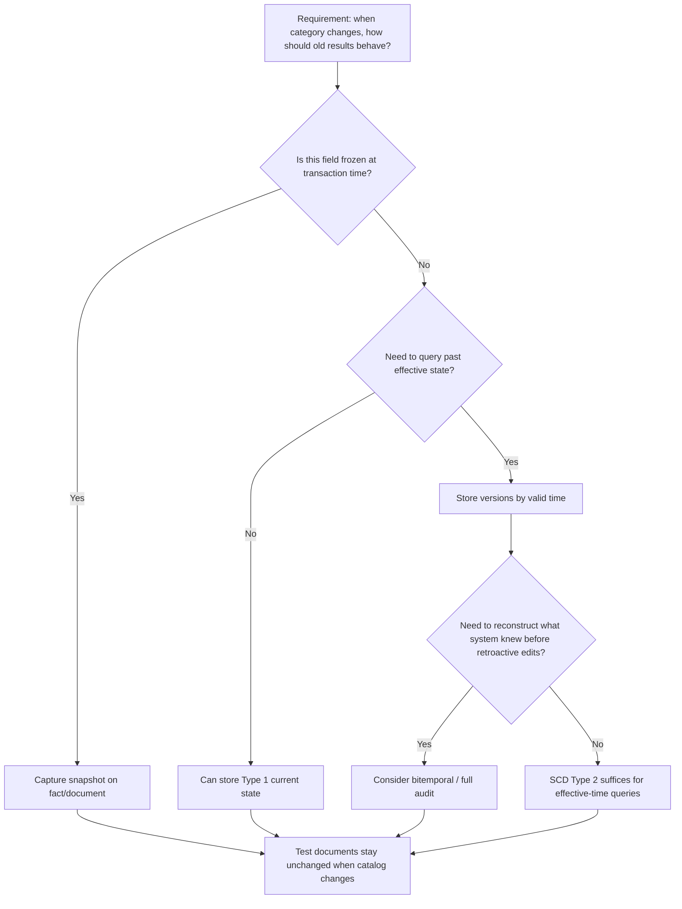

# Preserving Semantics When Categories or Reference Data Change

## 1. The Problem: Foreign Keys Stay Valid While History Loses Meaning

In the `DATABASE_DATA_MODELING` module, turning business requirements into a clean data model does not stop at keys, constraints, normalization, or indexes. Data must also **preserve its meaning as the business world changes**. In the **Time and History** chapter, a key question is: *if a category or referenced attribute changes today, should last month's transactions change how they display, calculate, or classify?*

Suppose:

1. On March 15, 2026, product `SKU-01` belongs to category **Home Appliances** and sells for **800,000 VND**.
2. On July 1, 2026, the company moves the product to category **Smart Devices**, changes its display name, and updates its list price.
3. In August 2026, accounting runs the March revenue report.

If `order_line` stores only `product_id` and reports always join to the **current** `product`/`category` tables, March revenue gets reassigned to the new category; the new product name and new list price may also appear on old documents. Foreign keys remain valid in SQL, yet **historical semantics** no longer match the reporting question.

Three types of questions must be distinguished:

- **Current:** “Which category does this product belong to *now*?”
- **Business effective:** “On March 15, which category was the product *governed to belong to*?”
- **Point-in-time knowledge:** “On March 15, which classification did the system *know and use then*, even if a retroactive correction was later discovered?”

Those three questions can yield three different answers. A trustworthy design never forces them into one `category_id` column and reinterprets it ad hoc.

### Learning Outcomes

Learners should be able to:

1. Identify which attributes represent **stable identity**, which change over time, and which must be **frozen at transaction time**.
2. Distinguish **valid time**, **recorded/system time**, and event occurrence time.
3. Compare current-state overwrites (SCD Type 1), versioned history (SCD Type 2), transaction snapshots, and **bitemporal** models.
4. Design `[from, to)` interval versions, *as-of join* queries, non-overlap checks, and handling for missing versions or retroactive edits.
5. Recognize limitations of standard `PRIMARY KEY`, `FOREIGN KEY`, and `UNIQUE` constraints when rules depend on time.
6. Test historical reports, category edits, late-arriving transactions, concurrency, and legacy data migrations.

## 2. Write a Semantic Contract Before Choosing Tables and Columns

Not all changes require retaining history at the same granularity.

| Attribute / Information | Business Question to Ask | Typically Appropriate Storage |
|---|---|---|
| `product_id`, `category_id` | Does it represent the same entity across time? | Stable surrogate ID, never reused |
| `sku`, `category_code` | Can codes change, transfer ownership, or be reused? | Immutability/alias policy or code history table |
| Category name | Is it merely a display tweak or a change in definition? | Overwrite if history unneeded; version if *as-of* needed |
| Product-to-category membership | Does the link have effective start/end timestamps? | Interval-based relationship history table |
| List price | Do we query which price applied at a given instant? | Effective-dated price table plus price-selection rules |
| Actual sale price, discount, currency | Must invoices keep the exact agreed figures? | Immutable snapshot on the transaction line |
| Buyer name/address on documents | Must documents show current info or info at issuance? | Necessary snapshot, governed by retention and privacy laws |
| Reporting group, org hierarchy | Do reports keep classification at close or restate under new structure? | Snapshot, versions, or both reporting modes |
| Retroactive typo corrections | Need both corrected truth and what the system once believed? | Bitemporal model or sufficiently rich audit log |

In particular, **a category is not always just a label**. Renaming “Household Goods” to “Family Devices” might relabel the same identity; splitting one category into two or merging multiple categories is a structural taxonomy change that must never be assumed to be a simple `UPDATE name`.

### Lock Down Three Independent Decisions

1. **Identity:** which code/ID represents the same product or category across renames and reorganizations?
2. **Time axis:** do historical queries use event occurrence time, effective valid time, or system knowledge time?
3. **Amendment policy:** when old reference data is fixed, may published reports change, or must prior versions be exactly reproducible?

Without answering these three questions, a schema with full `FOREIGN KEY` constraints and indexes can still return wrong business answers.

## 3. Types of Time That Must Not Be Mixed

| Concept | Meaning | Example |
|---|---|---|
| **Event time** | When the real-world action actually occurred | Customer confirmed order at 09:10 |
| **Valid time** | Interval during which information is considered true in business rules | New classification applies starting July 1 |
| **Recorded/system time** | When the system recorded or learned an assertion | Change effective July 1 entered on July 12 |
| **Ingestion time** | When a pipeline received the data | March 15 event synced on March 18 |
| **Transaction/commit time** | When the DB transaction actually committed | Not necessarily equal to ID creation time or `CURRENT_TIMESTAMP` |
| **Reporting/as-of time** | Point in time used to assemble the answer | “Revenue by classification effective March 31” |

In PostgreSQL, `CURRENT_TIMESTAMP` generally reflects **transaction start time**, not default proof of actual commit time. If a system requires true commit time or strict total ordering, design and verify an explicit mechanism rather than assuming a timestamp column solves it automatically.

### A Retroactive Correction Example

| System Recording Date | Assertion Recorded | Business Validity |
|---|---|---|
| Jan 1 | Category A named “Home Appliances” | From Jan 1 |
| Jul 12 | New name/group actually started Jul 1 | From Jul 1 |
| Aug 20 | Audit discovers true effective date was Jun 15 | From Jun 15 |

If you store only **one** `valid_from/valid_to` axis and overwrite retroactively, you can answer current effective state, yet **cannot deduce that before Aug 20 the system thought the effective date was Jul 1**. Answering both requires storing assertion history by recording time (*bitemporal*) or an audit trail rich enough to reconstruct it.

## 4. Effective Intervals: Using `[start, end)` and Boundary Rules

A category version has an effective interval:

\[
[valid\_from,\ valid\_to)
\]

Meaning the version is effective at instant \(t\) when:

\[
valid\_from \le t < valid\_to
\]

For the latest version with no known end date yet, `valid_to` can be *open-ended* per DBMS support rather than inventing a fake sentinel like `9999-12-31` when range types handle unbounded upper limits.

Example:

```text
Category #101

2026-01-01                  2026-07-01
    |----------------------------|-------------------------->
    [Name A, "Home" group)       [Name B, "Smart" group)

At Jun 30 23:59:59: version A.
At exact Jul 1 00:00: version B.
```

Keep these principles in mind:

- **Non-overlapping** when the model dictates each category has at most one valid version at any instant.
- **Gapless** is a **separate** requirement. Two disjoint versions can still leave multi-day gaps; exclusion/unique constraints do not guarantee every instant has a version.
- **Time zones:** store instants as `TIMESTAMPTZ` or equivalent semantics; map business calendar boundaries from the source market's time zone to exact instants.
- **Effective time is not when the user clicked Save.** Future effective dates or retroactive edits are permitted per authorized workflows.
- **Never arbitrarily alter classification keys on old transaction rows** merely to match today's active category.

## 5. Four History Strategies and Their Guarantees

| Strategy | Stored Data | Answers | Limitations |
|---|---|---|---|
| **Overwrite / SCD Type 1** | Current value only | What attribute does the entity have right now? | Loses prior values unless separate audit/backup exists |
| **SCD Type 2** | Multiple versions with effective intervals or current flag | Which attribute was effective at time X? | If retroactive edits overwrite rows, cannot rebuild “what the system once knew” |
| **Transaction snapshot** | Key values frozen alongside the fact | Which name, price, and group did the invoice/order use when booked? | Duplicates data intentionally; must designate which fields hold legal/authoritative weight |
| **Bitemporal** | Both effective time and assertion/recording history | What is deemed true for day X, and what did the system know on day Y? | More complex DDL, queries, amendments, maintenance, and testing |

**A table with `updated_at` is not automatically SCD Type 2**, and an SCD Type 2 table is **not automatically bitemporal**. Change-audit logs can aid tracing, yet accurately reconstructing every state requires controlling ordering, payloads, completeness, and retention.

### 5.1. When Overwriting Is Acceptable

Fixing a typo in a description never used in documents or historical reports may need only an `UPDATE`. Still, confirm no historical consumer relies on that field: a value considered “display-only” today may already appear on emailed invoices, partner feeds, or audit exports.

### 5.2. When Versioning Is Needed

Product taxonomies, tax policies, price books, org hierarchies, or contract statuses have clear effective intervals and usually require *as-of* history. When reclassifying items, do not overwrite a single record if historical reports must classify by past cutoffs.

### 5.3. When Snapshotting Is Mandatory

Finalized `unit_price`, `currency_code`, item names printed on invoices, and billing inputs usually must be persisted on the fact/document. Never recalculate past transaction prices from the **current** price table. A snapshot is **deliberate duplication** protecting document semantics—distinct from careless data duplication lacking sync rules.



## 6. Separating Stable Identity from Names, Codes, and Versions

A product or category needs stable identity across attribute changes:

- `category_id` is the technical identifier of **one category entity**.
- `category_code` is a tenant-scoped business code, which may require immutability, renaming, or alias policies.
- `category_label_period` holds display names and reporting groups per effective interval.
- `product_category_period` holds **relationship history** (product → category), separate from category name history.

Why separate relationship history from attribute history? A product can move from category A to B on June 1, while category A only renames itself on July 1. Those two events have independent histories. Embedding `category_name` on the product row and updating it blurs “changed relationship” with “renamed the same category.”

**Never reuse keys arbitrarily:** if category #101 is deleted and a **different-meaning** category is created as #101, historical references will be misinterpreted. Where business codes can be reused, never use raw codes as historical identity; track versioned/scoped sources or a stable surrogate ID.

### Critical Distinction: Renaming, Merging, and Splitting Categories

| Change | Typically Appropriate Interpretation |
|---|---|
| Fixing a typo in category name | Edit in place or version depending on reconstruction needs |
| Marketing rename with unchanged essence | Keep `category_id`; version name if historical reports depend on it |
| Moving product from A to B | Version the product–category relationship |
| Merging A and B into C | May require **new identity C**, transition mapping, and effective date |
| Splitting A into B and C | Past records cannot be inferred as B vs. C from A alone; requires allocation/restatement rules |
| Renaming code A01 to A99 | Alias/validity policy; does not necessarily change ID |

These are **business decisions**, never derivable from SQL key types alone.

## 7. PostgreSQL 16 Schema: Identity, Versions, and Relationship History

The example below illustrates a relational model with valid-time history. Assumptions:

1. A category belongs to one tenant, has a stable ID, and is never reused for a different concept.
2. At any instant, a category has **at most one** name/reporting-group version.
3. At any instant, a product belongs to **at most one** category. If the business allows multiple concurrent categories, adjust the model and constraints.
4. Time is stored as exact instants in `TIMESTAMPTZ`; effective intervals use `TSTZRANGE` with `[)` bounds.
5. Uses PostgreSQL 16 features and the `btree_gist` extension; do not copy DDL verbatim to every DBMS.

```sql
CREATE EXTENSION IF NOT EXISTS btree_gist;

CREATE TABLE tenant (
    tenant_id BIGINT GENERATED ALWAYS AS IDENTITY PRIMARY KEY,
    tenant_name TEXT NOT NULL
);

CREATE TABLE category (
    category_id BIGINT GENERATED ALWAYS AS IDENTITY PRIMARY KEY,
    tenant_id BIGINT NOT NULL REFERENCES tenant (tenant_id),
    category_code VARCHAR(40) NOT NULL,
    CONSTRAINT uq_category_tenant_code UNIQUE (tenant_id, category_code),
    CONSTRAINT uq_category_tenant_id UNIQUE (tenant_id, category_id)
);

CREATE TABLE product (
    product_id BIGINT GENERATED ALWAYS AS IDENTITY PRIMARY KEY,
    tenant_id BIGINT NOT NULL REFERENCES tenant (tenant_id),
    sku VARCHAR(64) NOT NULL,
    current_display_name TEXT NOT NULL,
    CONSTRAINT uq_product_tenant_sku UNIQUE (tenant_id, sku),
    CONSTRAINT uq_product_tenant_id UNIQUE (tenant_id, product_id)
);

CREATE TABLE category_label_period (
    category_version_id BIGINT GENERATED ALWAYS AS IDENTITY PRIMARY KEY,
    tenant_id BIGINT NOT NULL,
    category_id BIGINT NOT NULL,
    valid_during TSTZRANGE NOT NULL,
    display_name TEXT NOT NULL,
    reporting_group VARCHAR(60) NOT NULL,
    CONSTRAINT fk_label_category_same_tenant
        FOREIGN KEY (tenant_id, category_id)
        REFERENCES category (tenant_id, category_id),
    CONSTRAINT ck_label_period_valid
        CHECK (
            NOT isempty(valid_during)
            AND NOT lower_inf(valid_during)
            AND lower_inc(valid_during)
            AND NOT upper_inc(valid_during)
        ),
    CONSTRAINT ex_label_no_overlap
        EXCLUDE USING GIST (
            tenant_id WITH =,
            category_id WITH =,
            valid_during WITH &&
        )
);

CREATE TABLE product_category_period (
    assignment_id BIGINT GENERATED ALWAYS AS IDENTITY PRIMARY KEY,
    tenant_id BIGINT NOT NULL,
    product_id BIGINT NOT NULL,
    category_id BIGINT NOT NULL,
    valid_during TSTZRANGE NOT NULL,
    CONSTRAINT fk_assignment_product_same_tenant
        FOREIGN KEY (tenant_id, product_id)
        REFERENCES product (tenant_id, product_id),
    CONSTRAINT fk_assignment_category_same_tenant
        FOREIGN KEY (tenant_id, category_id)
        REFERENCES category (tenant_id, category_id),
    CONSTRAINT ck_assignment_period_valid
        CHECK (
            NOT isempty(valid_during)
            AND NOT lower_inf(valid_during)
            AND lower_inc(valid_during)
            AND NOT upper_inc(valid_during)
        ),
    CONSTRAINT ex_product_one_category_at_a_time
        EXCLUDE USING GIST (
            tenant_id WITH =,
            product_id WITH =,
            valid_during WITH &&
        )
);
```

**Reading each mechanism by invariant:**

- `category_id`/`product_id` are stable identities; `category_code`/`sku` enforce tenant-level current uniqueness. If codes can change or be reused, add code history/aliases instead of assuming current-state unique constraints answer historical queries.
- Composite FKs (`tenant_id`, `category_id`) and (`tenant_id`, `product_id`) prevent **cross-tenant references**, yet **do not** verify “the right version active at `sold_at`.”
- `ex_label_no_overlap` and `ex_product_one_category_at_a_time` block intersecting intervals for the same identity, even under concurrent writes.
- `CHECK` constraints enforce non-empty, finite-start, half-open `[)` ranges. SQL `NULL` ranges are rejected by `NOT NULL`; `tstzrange(from, NULL, '[)')` creates an **unbounded upper** range, not a SQL NULL column.
- **No “every instant has a version” constraint** exists in this DDL. `[Jan 1, Mar 1)` and `[Mar 5, ∞)` do not overlap, yet leave a four-day gap. Gap detection is a separate concern requiring write discipline and testing.
- `display_name` and `reporting_group` are time-varying values. Never store them directly on `category` as a competing second source of truth when history is mandatory.

### 7.1. Sample Version Data

Assume `category_id = 101` and `product_id = 1001` already exist in `tenant_id = 42`. In production, IDs come from insert returning values or migration mappings; the statements below **only run once those parent rows exist**:

```sql
-- Name/group versions for category #101.
INSERT INTO category_label_period (
    tenant_id, category_id, valid_during, display_name, reporting_group
)
VALUES
(
    42, 101,
    tstzrange('2026-01-01 00:00:00+00'::timestamptz,
              '2026-07-01 00:00:00+00'::timestamptz, '[)'),
    'Home Appliances', 'Home'
),
(
    42, 101,
    tstzrange('2026-07-01 00:00:00+00'::timestamptz,
              NULL, '[)'),
    'Family Devices', 'Smart Devices'
);

-- Relationship: product #1001 belongs to category #101 starting Jan 1.
INSERT INTO product_category_period (
    tenant_id, product_id, category_id, valid_during
)
VALUES (
    42, 1001, 101,
    tstzrange('2026-01-01 00:00:00+00'::timestamptz,
              NULL, '[)')
);
```

Point to confirm with domain owners: this example changes only the name/reporting group of **the same category #101**. If moving a product to a **different category**, close the `product_category_period` version and start a new assignment. Never conflate the two changes, because they carry different meanings.

## 8. As-Of Join: Reading the Exact State at a Point in Time

To retrieve the category name and reporting group effective for a product at a specific instant, join across **both histories**:

```sql
-- Lookup as of 2026-03-15 UTC for product #1001, tenant #42.
WITH context AS (
    SELECT
        42::bigint AS tenant_id,
        1001::bigint AS product_id,
        '2026-03-15 12:00:00+00'::timestamptz AS as_of
)
SELECT
    p.product_id,
    p.sku,
    a.category_id,
    cv.category_version_id,
    cv.display_name AS category_name_as_of,
    cv.reporting_group AS reporting_group_as_of
FROM context AS x
JOIN product AS p
  ON p.tenant_id = x.tenant_id
 AND p.product_id = x.product_id
JOIN product_category_period AS a
  ON a.tenant_id = p.tenant_id
 AND a.product_id = p.product_id
 AND a.valid_during @> x.as_of
JOIN category_label_period AS cv
  ON cv.tenant_id = a.tenant_id
 AND cv.category_id = a.category_id
 AND cv.valid_during @> x.as_of;
```

`@>` is the containment operator: whether the `TSTZRANGE` contains the `as_of` instant. With the sample data, March 15 returns “Home Appliances”; shifting `as_of` to August returns category #101's new name and reporting group.

**Two edge cases to handle in application queries:**

1. **Zero rows:** the product/category may not have existed yet, history may have a gap, or data may not have synced yet. When classification is mandatory, never silently fall back to the **current** category name and treat it as valid.
2. **Multiple rows:** DDL exclusion prevents overlaps per table, yet you must still audit legacy data, rows loaded before constraints were enabled, and migration scripts. Before constraints exist, overlapping versions cause joins to duplicate transaction rows and inflate revenue.

### Historical Queries Always Need an Explicit Time Reference

`WHERE valid_from <= CURRENT_TIMESTAMP` fails for “March report” because `CURRENT_TIMESTAMP` is report execution time, not the historical instant of interest. For fact rows, use the explicitly defined `sold_at`/`booked_at` timestamp:

```sql
-- Common pattern: classify each event by that event's timestamp.
SELECT
    s.sale_line_id,
    s.sold_at,
    cv.reporting_group
FROM sale_line AS s
JOIN product_category_period AS a
  ON a.tenant_id = s.tenant_id
 AND a.product_id = s.product_id
 AND a.valid_during @> s.sold_at
JOIN category_label_period AS cv
  ON cv.tenant_id = a.tenant_id
 AND cv.category_id = a.category_id
 AND cv.valid_during @> s.sold_at;
```

This query applies **after creating `sale_line` in section 9**. Crucially, if effective intervals are amended retroactively, current *as-of join* results can change. It expresses **“per currently accepted effective history,”** not necessarily “the exact report published prior to the edit.”

## 9. Transaction-Time Snapshots: Protecting Finalized Documents and Classifications

An order or invoice often must reproduce the exact values agreed upon when the transaction closed. Persist a snapshot of meaningful fields at transaction time, even alongside foreign keys to parent entities.

```sql
CREATE TABLE sale_line (
    sale_line_id BIGINT GENERATED ALWAYS AS IDENTITY PRIMARY KEY,
    tenant_id BIGINT NOT NULL,
    product_id BIGINT NOT NULL,
    sold_at TIMESTAMPTZ NOT NULL,
    quantity INTEGER NOT NULL,
    unit_price NUMERIC(14, 2) NOT NULL,
    currency_code VARCHAR(3) NOT NULL,

    -- Snapshot frozen when business accepts the transaction:
    sku_at_sale VARCHAR(64) NOT NULL,
    product_name_at_sale TEXT NOT NULL,
    category_id_at_sale BIGINT NOT NULL,
    category_name_at_sale TEXT NOT NULL,
    reporting_group_at_sale VARCHAR(60) NOT NULL,

    CONSTRAINT fk_sale_product_same_tenant
        FOREIGN KEY (tenant_id, product_id)
        REFERENCES product (tenant_id, product_id),
    CONSTRAINT fk_sale_category_same_tenant
        FOREIGN KEY (tenant_id, category_id_at_sale)
        REFERENCES category (tenant_id, category_id),
    CONSTRAINT ck_sale_qty_positive CHECK (quantity > 0),
    CONSTRAINT ck_sale_price_nonnegative
        CHECK (unit_price >= 0 AND unit_price <> 'NaN'::numeric),
    CONSTRAINT ck_sale_currency_format
        CHECK (currency_code ~ '^[A-Z]{3}$')
);
```

**Why store both IDs and snapshots?**

- `product_id` and `category_id_at_sale` trace stable identity, link to current metadata, and support internal joins.
- `sku_at_sale`/`product_name_at_sale` preserve item details as sold even if SKUs or names change later.
- `category_name_at_sale`/`reporting_group_at_sale` reproduce **the exact classification finalized** on the document/as-booked report.
- `unit_price` and `currency_code` are transactional facts. Never replace finalized sale prices with current price tables when viewing old invoices.

Snapshotting here is a **business invariant requiring enforcement**, not automatically “immutable” merely because columns end in `_at_sale`. A DBMS still allows `UPDATE` on those columns if a role has privileges. Restrict write paths, use adjustment entries or document revisions, audit edits, and enforce governance to prevent silent mutations.

### 9.1. Capturing the Snapshot in One Consistent Read

The example below reads name/group values **effective at `sold_at`** and copies them into the sale line. Sale prices and quantities are **provided/accepted transaction values**, never guessed from the live product catalog.

```sql
-- Illustrative: tenant 42, product 1001 already exist in sample data.
WITH input AS (
    SELECT
        42::bigint AS tenant_id,
        1001::bigint AS product_id,
        '2026-03-15 12:00:00+00'::timestamptz AS sold_at,
        2::integer AS quantity,
        800000.00::numeric(14,2) AS unit_price,
        'VND'::varchar(3) AS currency_code
)
INSERT INTO sale_line (
    tenant_id, product_id, sold_at, quantity, unit_price, currency_code,
    sku_at_sale, product_name_at_sale, category_id_at_sale,
    category_name_at_sale, reporting_group_at_sale
)
SELECT
    i.tenant_id, p.product_id, i.sold_at, i.quantity, i.unit_price,
    i.currency_code,
    p.sku, p.current_display_name, a.category_id,
    cv.display_name, cv.reporting_group
FROM input AS i
JOIN product AS p
  ON p.tenant_id = i.tenant_id
 AND p.product_id = i.product_id
JOIN product_category_period AS a
  ON a.tenant_id = p.tenant_id
 AND a.product_id = p.product_id
 AND a.valid_during @> i.sold_at
JOIN category_label_period AS cv
  ON cv.tenant_id = a.tenant_id
 AND cv.category_id = a.category_id
 AND cv.valid_during @> i.sold_at
RETURNING sale_line_id, sku_at_sale, category_name_at_sale,
          reporting_group_at_sale, unit_price;
```

In PostgreSQL, a single `INSERT ... SELECT` runs under one consistent statement-level snapshot. However, this is not yet a **complete checkout workflow**: you must establish the authoritative sale timestamp, handle concurrent category edits, verify exactly one inserted row (`RETURNING`/row count), validate stock/payment, and manage transaction status.

**Warning:** `current_display_name` on `product` is the **current** name. If a late March 15 transaction arrives in August after the product was renamed, copying `product_name_at_sale` from `current_display_name` **fails to recover the March name**. Systems with late entries requiring “as-of product name” must version product names or accept the snapshot captured by the originating transaction source—never let an example query pass off “current name” as “historical name.”

## 10. Two Ways to Run Historical Reports Must Be Named Explicitly

For the exact same March dataset, at least three valid outputs exist depending on the contract:

| Reporting Mode | Classification Source | Appropriate When |
|---|---|---|
| **As booked** | `sale_line.reporting_group_at_sale` | Matching issued documents, closed figures, audits |
| **Restated as-of (currently accepted effective history)** | Join category version at `sale_line.sold_at` | Historical analysis after retroactive policy/effective-date fixes |
| **Current category structure** | Map old categories to current groups per policy | Comparing product performance under today's taxonomy |

Example **as-booked** report:

```sql
SELECT
    reporting_group_at_sale,
    SUM(quantity * unit_price) AS gross_amount
FROM sale_line
WHERE tenant_id = 42
  AND sold_at >= '2026-03-01 00:00:00+00'::timestamptz
  AND sold_at <  '2026-04-01 00:00:00+00'::timestamptz
GROUP BY reporting_group_at_sale
ORDER BY reporting_group_at_sale;
```

Example **restated by current effective history**:

```sql
SELECT
    cv.reporting_group,
    SUM(s.quantity * s.unit_price) AS gross_amount
FROM sale_line AS s
JOIN product_category_period AS a
  ON a.tenant_id = s.tenant_id
 AND a.product_id = s.product_id
 AND a.valid_during @> s.sold_at
JOIN category_label_period AS cv
  ON cv.tenant_id = a.tenant_id
 AND cv.category_id = a.category_id
 AND cv.valid_during @> s.sold_at
WHERE s.tenant_id = 42
  AND s.sold_at >= '2026-03-01 00:00:00+00'::timestamptz
  AND s.sold_at <  '2026-04-01 00:00:00+00'::timestamptz
GROUP BY cv.reporting_group
ORDER BY cv.reporting_group;
```

These two queries can produce **different** group totals when retroactive corrections occur. That is not necessarily a bug—they answer two different questions. Always publish the mode name and reproducibility rule; never emit a “March revenue” report without stating how items were classified.

**Never run an `INNER JOIN` against gapped history and treat the shrunken revenue total as accurate.** When no version matches, `sale_line` rows silently vanish from the join. In tests and reconciliation, use `LEFT JOIN` to count unmapped facts, then either block publication or bucket them as “unclassified” per approved policy—never silently drop rows from totals.

## 11. Retroactive Correction Rules: Accurate by Validity vs. Reproducible by Prior Knowledge

Suppose on August 20 it is discovered that “Smart Devices” actually took effect on **June 15**, not July 1. Two requirements emerge:

1. *Restated* analytics must assign post–June 15 revenue to the new group.
2. Reports published in July must remain reproducible as issued, when the system still believed July 1.

Simply editing `valid_during` in `category_label_period` back to June 15 satisfies requirement 1 yet **erases the pre-edit assertion state** unless backed by a strong audit. The `reporting_group_at_sale` snapshot helps reproduce transaction-level booked values, yet is not a complete log of every report or query the system previously produced.

### 11.1. Two Axes of a Bitemporal Model

An assertion record can hold:

- `valid_during`: interval during which information **is deemed true in the business world**.
- `recorded_during`: interval during which **the system treated this assertion as current**.

Conceptual example:

| Group Name | `valid_during` | `recorded_during` |
|---|---|---|
| Home | `[Jan 1, Jul 1)` | `[Jul 12, Aug 20)` |
| Smart Devices | `[Jul 1, ∞)` | `[Jul 12, Aug 20)` |
| Home | `[Jan 1, Jun 15)` | `[Aug 20, ∞)` |
| Smart Devices | `[Jun 15, ∞)` | `[Aug 20, ∞)` |

The intervals above are **illustrative**: the full state is shown starting Jul 12; if earlier history existed, corresponding assertions must also remain so prior recording eras are not lost.

Conceptual bitemporal query:

```sql
-- PSEUDOCODE: category_assertion table is not part of section 7 DDL.
-- "Information valid at @business_time known by system at @known_time".
SELECT *
FROM category_assertion
WHERE category_id = :category_id
  AND valid_during @> :business_time
  AND recorded_during @> :known_time;
```

**Technical note:** PostgreSQL 16 does not automatically give you a complete bitemporal system merely by adding two range columns. To guarantee all edits preserve history, design triggers/procedures or controlled append/close protocols; source timestamps from an authoritative clock; handle concurrency; and constrain against conflicting assertions at the same (`business_time`, `known_time`) coordinate. Never treat `CURRENT_TIMESTAMP` as default commit time.

### 11.2. Choosing Just Enough Mechanism

Bitemporal modeling carries high cost: more rows, two-axis indexes, complex queries, and correction governance. If you only need finalized invoices never to change, **transaction snapshots + solid audits** may suffice. If you need restated reports by current effective classification without reconstructing prior system beliefs, **SCD Type 2** may suffice. Implement both axes only when business questions truly demand them.

## 12. Adding and Updating Versions Under Concurrent Load

An exclusion constraint stops overlapping versions, yet does not solve the full editing workflow. For instance, renaming category #101 from July 1 when `[Jan 1, ∞)` is open requires:

1. **Closing the old interval** at exact boundary July 1.
2. **Inserting the new interval** starting July 1.
3. **Running inside one transaction**, blocking concurrent writers from inserting competing versions.
4. **Confirming** exactly one old version was updated; never ignore a zero-row update.
5. **Enforcing authorization for retroactive edits** and recording decision/approver metadata.

PostgreSQL illustration, **applicable only when category #101 has exactly one currently open version and no future-dated versions**:

```sql
BEGIN;

-- Lock the same category row as coordination point for all writers
-- following this protocol.
SELECT category_id
FROM category
WHERE tenant_id = 42 AND category_id = 101
FOR UPDATE;

UPDATE category_label_period
SET valid_during = tstzrange(
    lower(valid_during),
    '2026-07-01 00:00:00+00'::timestamptz,
    '[)'
)
WHERE tenant_id = 42
  AND category_id = 101
  AND upper_inf(valid_during)
  AND lower(valid_during) <
      '2026-07-01 00:00:00+00'::timestamptz;

-- Application/procedure must verify UPDATE affected exactly 1 row;
-- otherwise, ROLLBACK instead of inserting blindly.

INSERT INTO category_label_period (
    tenant_id, category_id, valid_during, display_name, reporting_group
)
VALUES (
    42, 101,
    tstzrange('2026-07-01 00:00:00+00'::timestamptz, NULL, '[)'),
    'Family Devices', 'Smart Devices'
);

COMMIT;
```

**Treat this strictly as an illustrative scenario**—do not re-run it against section 7's data which already contains a July version, as it will conflict or find no open row to close. Production code must handle future-dated versions, multi-interval retroactive splits, gaps, and audits.

Coordinating via `SELECT ... FOR UPDATE` on the category row is safe only when **every version-modifying write path** obeys the protocol. Exclusion constraints remain the DB safeguard against overlaps, yet do not prevent gaps or unintended writes into existing gaps.

## 13. Temporal Integrity Constraints: Limits of Standard Foreign Keys

The constraint:

```sql
FOREIGN KEY (tenant_id, category_id)
REFERENCES category(tenant_id, category_id)
```

answers: “Does this category exist in this tenant?” It **does not** answer:

> “Did this category have a valid version at `sold_at`, and did the product actually belong to that category at `sold_at`?”

Enforcing time-dependent integrity requires:

- Querying the version/assignment with `valid_during @> event_time` when closing a transaction.
- Non-overlap constraints across versions.
- Gap detection and explicit rules when no version exists.
- Transactions, locks, or triggers when version edits and fact writes run concurrently.
- Retroactive adjustment policies: update analytical mappings, keep transaction snapshots, or issue separate adjustments?

**A foreign key to `category_version_id`** on a fact preserves a link to **one exact version row**, yet an FK alone **still fails to prove** `sold_at` lies inside that row's effective interval. If version rows can be edited or deleted, reference semantics can still drift. Pair it with immutability policies, assertion versioning, transactional rules, and temporal tests.

### Uniqueness Scope on History Records

Never put `UNIQUE (category_id)` on a version table, because each category needs many versions. `UNIQUE (category_id, valid_from)` (in two-column designs) prevents only identical start instants—**not overlapping intervals**. PostgreSQL uses range exclusion constraints for non-overlap; other DBMSs require locked transactions or equivalent concurrency-safe checks.

## 14. When Categories Are Deleted, Renamed, Merged, or Reused

These operations are especially hazardous because they alter **the meaning of referenced keys**.

### 14.1. Soft Delete and Expiration

Instead of physically deleting a category referenced by historical facts, set `retired_at` or close its effective interval and block use in new transactions. Yet “soft delete” does not automatically enforce “disallow after retirement date”—APIs, triggers, or relationship history tables must validate effective dates.

An `ON DELETE CASCADE` FK from facts/documents to `category` can wipe out history if a category is accidentally deleted. Use `RESTRICT`/`NO ACTION` or an appropriate retention strategy. Personal data in snapshots must also comply with retention, privacy laws, and access controls: “keep history forever” is never the default answer.

### 14.2. Code Renames and Aliases

If `category_code = 'HOME'` changes to `'LIVING'` while `category_id` stays unchanged, maintain an effective-dated alias table:

| category_id | external_code | valid_from | valid_to |
|---:|---|---|---|
| 101 | `HOME` | 2026-01-01 | 2026-07-01 |
| 101 | `LIVING` | 2026-07-01 | unbounded |

If codes can be reassigned to different categories, scope uniqueness by **source/tenant/time** and block overlapping validity. Never resolve historical events carrying only old codes by looking up today's live code mapping.

### 14.3. Merging or Splitting Categories

Suppose categories A and B merge into C. If historical reports must roll up under C, create a mapping table `old_category_id → new_reporting_category_id` with effective dates and **allocation policies**. When splitting A into B and C, the mapping is not one-to-one; it usually requires product attributes, approved rules, or split ratios. Never dump all of A's historical revenue into B merely because B inherited a name/code resembling A.

Mapping tables should track source, rule version, and effective dates across multiple reorganizations. Reports must state whether they use **classification at time of sale** or **current restated classification**.

## 15. Prices, Taxes, Exchange Rates, and Effective Reference Data

These datasets typically carry stricter requirements than category names:

| Data | Risk When Joining Current Value | Principle |
|---|---|---|
| List price | Repricing old orders at today's rate | Store finalized transaction price; version price books if explaining price at order time |
| Tax rate | Applying current tax to historical invoices | Store applied tax rate/basis and tax-determination timing rules |
| Exchange rate | Reporting original amounts at today's FX rate | Store original amount, currency, rate/source, and policy timing |
| Shipping address | Customer changes address after delivery | Snapshot delivery address at close while protecting personal data |
| Partner legal name/type | Partner renames or merges | Track legal identity, document snapshots, and relationship versions as needed |
| Contract status | Contract expires or renews | Store effective intervals, renewal events, and execution-time checks |

**Never use `created_at` of a reference record as `valid_from` if the business permits retroactive or future effective dates.** Those two timestamps mean different things. In financial transactions, defining “at order placement,” “at payment,” “at invoicing,” or “at shipment” can yield different prices and taxes—an explicit business rule that must be signed off.

## 16. Indexing, Performance, and Analytical History Models

*As-of* queries can be expensive because every fact searches for the version containing an instant. In PostgreSQL, `EXCLUDE USING GIST (... valid_during WITH &&)` creates a GiST index for overlap checks; it can assist some range queries, yet does not guarantee optimal performance for every historical join.

At large scale, consider:

- **Indexing by identity key and range:** inspect `EXPLAIN` to confirm GiST or an appropriate access path is used for `valid_during @> sold_at`.
- **Filtering facts before joining:** monthly reports should filter `sold_at` and `tenant_id` tightly using justified indexes or partitions.
- **Version cardinality:** a category with thousands of micro-versions joins very differently from one with a few versions per year.
- **Snapshot columns:** *as-booked* reports group directly on `reporting_group_at_sale` without expensive temporal joins.
- **Analytical warehouses:** use facts/dimensions, surrogate keys per dimension version (SCD Type 2), defined *grain*, and **retroactive restatement policies**.
- **Closed reports:** persist result snapshots, run timestamps, and classification criteria whenever exact reproducibility is required.

Example query measurement:

```sql
EXPLAIN (ANALYZE, BUFFERS)
SELECT
    s.sale_line_id,
    cv.reporting_group
FROM sale_line AS s
JOIN product_category_period AS a
  ON a.tenant_id = s.tenant_id
 AND a.product_id = s.product_id
 AND a.valid_during @> s.sold_at
JOIN category_label_period AS cv
  ON cv.tenant_id = a.tenant_id
 AND cv.category_id = a.category_id
 AND cv.valid_during @> s.sold_at
WHERE s.tenant_id = 42
  AND s.sold_at >= '2026-03-01 00:00:00+00'::timestamptz
  AND s.sold_at <  '2026-04-01 00:00:00+00'::timestamptz;
```

`EXPLAIN (ANALYZE, BUFFERS)` executes the query; run it only in controlled environments. Examine actual vs. estimated rows, scan types, buffers, loops, timings, and especially **post-join fact row count**. Never accept a “fast” plan that silently drops facts in gapped history or multiplies facts due to dirty version intervals.

### SCD Type 2 in Analytical Warehouses

A dimension can look like:

```text
dim_category
  category_sk        -- surrogate key FOR dimension VERSION
  category_id        -- stable business identity
  valid_from
  valid_to
  category_name
  reporting_group
  is_current
```

Facts can store `category_sk` resolved at business time per contract. When a category receives a new version, insert a new dimension row with a new `category_sk` instead of overwriting old rows. `is_current` speeds up current-state lookups, yet **never replaces** effective intervals and overlap checks. Some analytical engines do not enforce PK/FK like OLTP; pipelines must validate uniqueness and fact–dimension mapping.

## 17. Testing Boundary Cases and Proving Historical Accuracy

| Case | Data / Operation | Expectation |
|---|---|---|
| 1 | Two intersecting versions for same category | Rejected by exclusion constraint |
| 2 | Version A ends exactly when B starts | Both valid under `[)` bounds |
| 3 | Two versions separated by one day | Disjoint, yet **a gap exists** that must be detected |
| 4 | At exact boundary `2026-07-01 00:00 UTC` | Only the new version is effective |
| 5 | Transaction row lacks assignment at `sold_at` | Must not silently fall back to current category |
| 6 | Product moves categories while category renames independently | *As-of join* resolves both relationship and attribute axes accurately |
| 7 | Product and category belong to different tenants | Composite FK blocks cross-tenant linking |
| 8 | Category renamed after invoice issued | Old document snapshot stays unchanged |
| 9 | *As-booked* vs. *restated* report after retroactive edit | Groups may differ; both must be clearly named and defined |
| 10 | Late event ingested after product name changed | Must not copy current name as old event's name |
| 11 | Two jobs add effective versions concurrently | No overlaps; controlled locking or constraint-retry handling |
| 12 | Direct UPDATE to `_at_sale` columns | Blocked by immutability policy or routed through adjustment entries |
| 13 | Deleting a category referenced by facts | Must not erase history outside approved retention policy |
| 14 | Merging two categories into one | Source-to-target map and reporting rules defined; never blindly merge IDs |
| 15 | Monthly query when some facts lack versions | Unmapped facts reconciled; revenue total never drops silently |
| 16 | Retroactive edit after report approval | Old report remains reproducible or system limitation is explicitly documented |

### Detecting Overlapping or Gapped History Intervals

PostgreSQL can use `LAG` to compare consecutive bounds, useful when auditing legacy data prior to enabling constraints:

```sql
WITH ordered_periods AS (
    SELECT
        tenant_id, category_id, category_version_id,
        lower(valid_during) AS valid_from,
        upper(valid_during) AS valid_to,
        LAG(upper(valid_during)) OVER (
            PARTITION BY tenant_id, category_id
            ORDER BY lower(valid_during), category_version_id
        ) AS previous_to
    FROM category_label_period
)
SELECT
    tenant_id, category_id, category_version_id,
    previous_to, valid_from,
    CASE
        WHEN previous_to < valid_from THEN 'GAP'
        WHEN previous_to > valid_from THEN 'OVERLAP'
        ELSE 'CONTIGUOUS'
    END AS finding
FROM ordered_periods
WHERE previous_to IS NOT NULL
  AND previous_to <> valid_from;
```

This query is an **audit helper** for normalized `[)` intervals—not a constraint. For unbounded ranges, handle PostgreSQL's `upper()` returning SQL `NULL` separately if checking anomalies (such as another version following an unbounded interval). Moreover, this does not prove a version existed prior to business start or after required end dates; coverage checks must compare against business-required horizons.

### Reconciling Row Counts and Totals Before/After As-Of Joins

```sql
-- March facts missing both assignment and category version.
SELECT
    COUNT(*) AS fact_missing_temporal_mapping,
    COALESCE(SUM(s.quantity * s.unit_price), 0) AS amount_missing_mapping
FROM sale_line AS s
LEFT JOIN product_category_period AS a
  ON a.tenant_id = s.tenant_id
 AND a.product_id = s.product_id
 AND a.valid_during @> s.sold_at
LEFT JOIN category_label_period AS cv
  ON cv.tenant_id = a.tenant_id
 AND cv.category_id = a.category_id
 AND cv.valid_during @> s.sold_at
WHERE s.tenant_id = 42
  AND s.sold_at >= '2026-03-01 00:00:00+00'::timestamptz
  AND s.sold_at <  '2026-04-01 00:00:00+00'::timestamptz
  AND cv.category_version_id IS NULL;
```

When data guarantees at most one assignment and one version per fact, this counts unmapped facts. In legacy tables lacking non-overlap constraints, **one fact can fan out into multiple rows**; verify match multiplicity per `sale_line_id` before trusting totals. The goal is proving zero dropped or double-counted facts, not merely “the join ran.”

## 18. Migrating from Current-State Categories to Historical Models

Suppose an old system had only `product.category_id` and `category.name` with no version tables. Creating SCD Type 2 today cannot automatically recover past changes that were overwritten.

A verifiable migration plan:

1. **Survey sources and historical questions:** from what date must reports be reconstructed; do change logs, document snapshots, backups, or partner feeds exist?
2. **Classify confidence levels:** which values are proven by source evidence, which are inferred, and which windows are genuinely unknown.
3. **Lock down the temporal contract:** event time, valid time, recorded time, time zones, bounds, and retroactive edit rules.
4. **Create identities and versions:** keep IDs stable, design interval tables and non-overlap constraints.
5. **Evidence-based backfill:** set start bounds based on proof; never project today's values across all past time and label them “historically accurate.”
6. **Cut over write paths:** all category/name edits update history transactionally; block lingering app branches updating current-only columns.
7. **Cut over read paths:** current queries read active versions, historical queries run *as-of joins*, and documents read snapshots or closed sources.
8. **Reconcile:** verify version coverage, zero overlaps, zero missing mappings, tenant isolation, and pre/post fact counts and totals.
9. **Rehearse rollback:** if cutover fails, can you roll back without losing changes accepted during the transition?
10. **Operations:** define retroactive edit rights, audits, retention, change-approval schedules, and late-arriving record handling.

**Lost information cannot be recovered by DDL changes alone.** When legacy history was overwritten with no reliable logs, backups, or snapshots, record the gap explicitly and publish formal reporting limits predating the historical model's launch.

## 19. Differences Across Relational DBMS, Document, Graph, and Analytical Stores

| Paradigm | Reference History Storage | What to Verify |
|---|---|---|
| PostgreSQL relational | Version tables, `TSTZRANGE`, GiST exclusion, FKs, and snapshots | FKs alone do not enforce point-in-time validity; extensions/triggers/transactions per invariant |
| MySQL / InnoDB | `valid_from`/`valid_to`, unique/FKs, and locked transactions | Do not copy `TSTZRANGE`/`EXCLUDE` syntax; build overlap and concurrency safeguards explicitly |
| SQL Server | Version tables, built-in temporal tables, rules-based constraints | **System-versioned temporal** reflects DBMS row history, not automatically retroactive business valid time |
| Document databases | Current documents, version documents, events, and snapshots | Uniqueness, atomicity, multi-document transactions, and as-of queries vary by DBMS |
| Graph databases | Versioned nodes/edges or validity properties on relationships | Point-in-time traversal, avoiding stale edges read as current, degree growth, and performance |
| Analytical warehouses | SCD Type 2 dimensions, facts with version surrogate keys or snapshots | Grain, backfills, late-arriving data, mapping checks; PK/FK may be unenforced metadata |

A **system-versioned table** captures row state at DBMS system timestamps per product mechanics; it does not automatically answer “when did a tax policy take effect retroactively?” if business valid time differs from storage time. Similarly, storing edit history in documents does not automatically provide relational joins or PostgreSQL-grade exclusion constraints.

Choose models based on **questions to reproduce and integrity guarantees**, not merely a “temporal” feature checkbox.

## 20. Practice Exercise: Product Classification and Post-Reorganization Reporting

**Context:** a multi-tenant marketplace has 25 million order lines and reports revenue by category and business unit. Events:

1. 2026-01-01: `SKU-A` belongs to category `C-OLD`, reporting group `Home`.
2. 2026-04-01: category name changes from “Home Appliances” to “Family,” though the business states it remains the same identity.
3. 2026-07-01: `SKU-A` moves to category `C-SMART`, group `Smart Devices`.
4. 2026-08-20: audit discovers the category transfer actually took effect **2026-06-15**.
5. 10,000 orders occurred in June but were ingested into the system in September.
6. The June report was published on July 5 and must be reproducible as issued.

**Tasks:**

1. Identify **category/product identity** vs. name changes vs. relationship changes; may category codes be reused?
2. Build `[valid_from, valid_to)` version tables for category names and product–category relationships **before** and **after** the retroactive correction.
3. Design how to answer three questions: “current classification,” “classification effective June 20 per corrected data,” and “which classification the July 5 published report actually used.”
4. In `sale_line`, specify which fields need immutable snapshots, which can keep FKs, and when product names need versioning.
5. Define mechanisms preventing two concurrent effective versions and detecting gaps when business rules require a category at every instant.
6. Propose handling for the 10,000 late-arriving orders: authoritative timestamp source, effective classification, missing-version error handling, and reconciliation.
7. Compare costs between SCD Type 2 + snapshots vs. full bitemporal modeling. When does the first suffice, and when are both time axes mandatory?
8. Design test queries detecting facts dropped by `INNER JOIN`, duplicated facts, and revenue totals silently shifting groups.

### History Model Handover Checklist

- [ ] Every changing attribute is classified: current-only, valid-time, recorded-time, or transaction snapshot.
- [ ] Identity keys are never reused; code changes, renames, and relationship changes carry separate semantics.
- [ ] Effective intervals use consistent bounds and clear time zones; zero overlaps and explicit gap policy.
- [ ] FKs protect entity references; point-in-time validity is enforced separately.
- [ ] Document prices, taxes, FX rates, names, and groups are frozen at the business-defined instant.
- [ ] Reports distinguish *as booked*, *restated as-of*, and current-taxonomy views.
- [ ] Late-arriving transactions and retroactive edits never silently mutate closed documents or published reports.
- [ ] Concurrency tests, boundary tests, late-ingestion tests, total reconciliations, and rollback plans are scheduled.
- [ ] Unrecoverable historical gaps are explicitly disclosed.

**Preserving accurate history is not just “saving old records”—it is preserving the meaning each record held at a specific point in time under defined business rules.** Stable keys tell us which entity we mean; versions and effective intervals tell us what held true when; snapshots protect finalized facts; and when needed, recording time lets us reconstruct what the system knew prior to retroactive corrections.
