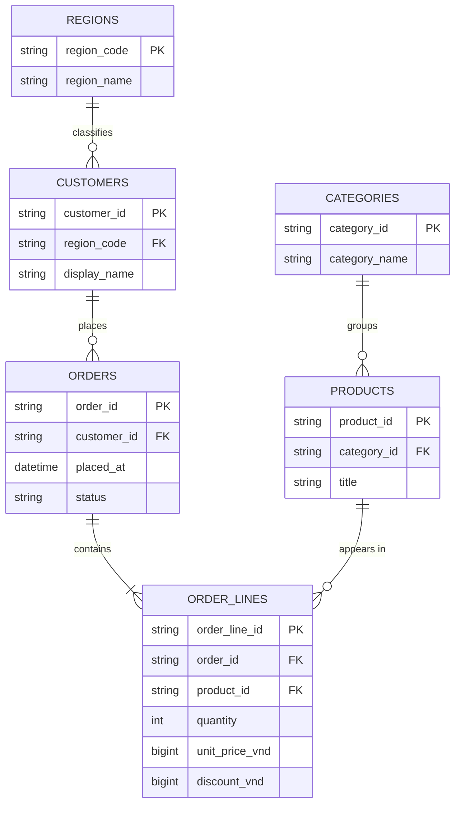
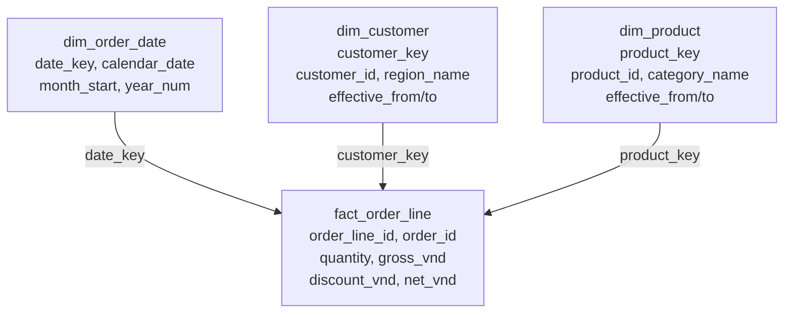
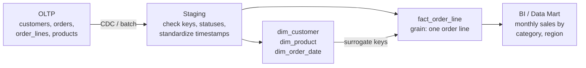
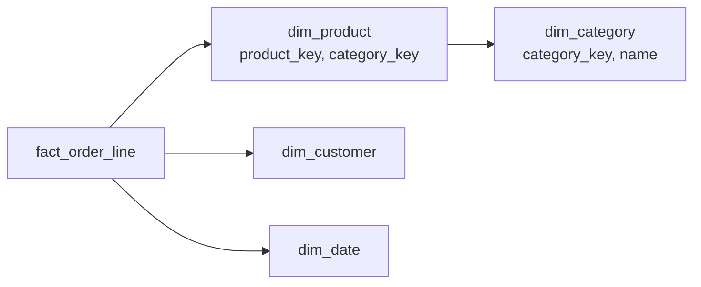

# Dimensional Modeling vs. Normalized Relational Modeling

A sales system can store **orders, customers, products, prices, and payment statuses** very accurately in a normalized relational database. Yet when executives ask, "What is the merchandise sales of paid orders by month, product group, and customer region?", the query must join multiple tables, handle historical changes, and standardize metric calculations. A **dimensional model** reorganizes that same data into a **fact table** at a defined grain and **dimension tables** built for analysis.

This is not a contest over "which model is right". Normalized relational models usually prioritize **data integrity and transactional updates**, while dimensional models prioritize **metric consistency and filtering, grouping, and aggregation across multiple dimensions**. Both can coexist and both can be right because they serve two different sets of questions.

This lesson sits in the **Analytical Modeling** chapter of the **DATABASE_DATA_MODELING** module. The module's goal is to turn business requirements into entities, relationships, constraints, keys, indexes, and physical structures, comparing relational, document, graph, and analytical models to choose verifiable, scalable solutions. Here, we contrast **normalized relational modeling** with **dimensional modeling**, starting from a single problem, a single dataset, and queries with verifiable answers.

After this lesson, you will be able to:

- Explain the goals of **relational normalization** and **dimensional modeling**, without confusing a dimensional model with a rule-free database.
- Define the **grain** of a fact before selecting dimensions, keys, and measures.
- Design a **star schema** for sales by date, product, and customer; distinguish facts, dimensions, surrogate keys, and degenerate dimensions.
- Transform data from a normalized relational schema into a star schema without multiplying rows, losing historical prices, or corrupting KPI definitions.
- Know when **Slowly Changing Dimensions (SCD)** are needed, especially Type 1 and Type 2.
- Compare query costs, updates, data integrity, history, and operational needs across models.
- Specify the quality checks required before analytical reports can be trusted.

## 1. Defining the Problem and Fixing Metric Definitions

A retail company needs to capture the following activities:

1. Customers place orders containing one or more order lines.
2. Each line records **product, quantity, unit price at purchase time, and discount**.
3. Each product belongs to a category; each customer belongs to a service region.
4. Each order has an order date and payment status.
5. Reports must aggregate by **order month, product category, customer region, and tenant**.
6. A customer's region or a product's category can change over time, and historical reports must have an explicit interpretation rule.

Before creating tables, define **the currency and the metric**. In this example:

> **Net merchandise sales of orders currently recorded as paid**, attributed to **order placement date**, equals the sum of `quantity × unit_price_at_purchase − line_discount` across qualifying lines. The example uses VND only and excludes taxes, shipping fees, returns, or accounting adjustments.

This metric is **not automatically equivalent to recognized accounting revenue**: order date differs from payment date; paid orders may later be refunded; revenue recognition follows different policies. If a report serves finance, you must define which metric is calculated, which statuses are finalized, and how adjustments are handled.

### 1.1. Running Dataset

Suppose there are two customers, two products, and two paid orders in tenant `T-01`:

| Order Line | Order | Order Date | Customer | Region at Order | Product | Qty | Unit Price VND | Discount VND | Net Value VND |
| --- | --- | --- | --- | --- | --- | ---: | ---: | ---: | ---: |
| OL-1 | O-101 | 2026-10-01 | C-01 | North | P-LAP | 1 | 12,000,000 | 0 | 12,000,000 |
| OL-2 | O-101 | 2026-10-01 | C-01 | North | P-MOUSE | 2 | 300,000 | 0 | 600,000 |
| OL-3 | O-102 | 2026-10-03 | C-02 | South | P-MOUSE | 1 | 320,000 | 20,000 | 300,000 |

Results to verify:

- **Total lines:** 3.
- **Distinct orders:** 2 (`O-101` and `O-102`).
- **Distinct customers:** 2.
- **Total product units:** 4.
- **Total net merchandise sales:** **12,900,000 VND**.
- By date: Oct 01 is **12,600,000 VND**, Oct 03 is **300,000 VND**.

These numbers act as our **oracle** for queries across both models. If a report returns 3 orders or 13,200,000 VND, we must diagnose the cause before evaluating performance.

## 2. What Does Normalized Relational Modeling Protect?

**Relational normalization** organizes data into relations (tables) with appropriate data dependencies and keys to reduce unnecessary redundancy and **insert, update, and delete anomalies**.

In many OLTP (*Online Transaction Processing*) systems, teams aim for normal forms like **3NF** or **BCNF**, though the target normal form must follow functional dependencies and concrete requirements. Do not label every multi-table schema "3NF" without verifying its functional dependencies.

### 2.1. Example of an Update Anomaly

If `customer_name` and `region_name` are stored redundantly on **every order line**:

- A customer changing their name could force updates across thousands of transaction rows.
- One row might hold the new name while another retains the old name without any history policy.
- It becomes hard to distinguish the **current name** from the **name at order time**.

A normalized transactional schema typically creates a `customers` table keyed by `customer_id`, referenced by `orders`. Products, categories, orders, and order lines likewise have distinct roles and keys.

The goal is not "split into as many tables as possible", but **store each fact under clear ownership and update rules**.

### 2.2. Sample Relational Schema



This simplified diagram omits `tenant_id` on every key. In a multi-tenant system, primary and foreign keys must include tenant scope or an equivalent globally unique identifier strategy; never join orders and customers across two tenants merely because local codes collide.

### 2.3. Illustrative OLTP Schema SQL

Example using PostgreSQL-compatible SQL syntax. To stay focused on modeling, the example uses VND only and omits full payment, refund, and authorization policies.

```sql
CREATE TABLE regions (
    region_code VARCHAR(20) PRIMARY KEY,
    region_name VARCHAR(100) NOT NULL
);

CREATE TABLE categories (
    category_id VARCHAR(40) PRIMARY KEY,
    category_name VARCHAR(150) NOT NULL
);

CREATE TABLE customers (
    tenant_id VARCHAR(32) NOT NULL,
    customer_id VARCHAR(40) NOT NULL,
    display_name VARCHAR(150) NOT NULL,
    region_code VARCHAR(20) NOT NULL REFERENCES regions(region_code),
    PRIMARY KEY (tenant_id, customer_id)
);

CREATE TABLE products (
    tenant_id VARCHAR(32) NOT NULL,
    product_id VARCHAR(40) NOT NULL,
    title VARCHAR(200) NOT NULL,
    category_id VARCHAR(40) NOT NULL REFERENCES categories(category_id),
    current_price_vnd BIGINT NOT NULL,
    PRIMARY KEY (tenant_id, product_id),
    CHECK (current_price_vnd >= 0)
);

CREATE TABLE orders (
    tenant_id VARCHAR(32) NOT NULL,
    order_id VARCHAR(40) NOT NULL,
    customer_id VARCHAR(40) NOT NULL,
    placed_at TIMESTAMPTZ NOT NULL,
    status VARCHAR(30) NOT NULL,
    PRIMARY KEY (tenant_id, order_id),
    FOREIGN KEY (tenant_id, customer_id)
        REFERENCES customers(tenant_id, customer_id)
);

CREATE TABLE order_lines (
    tenant_id VARCHAR(32) NOT NULL,
    order_line_id VARCHAR(40) NOT NULL,
    order_id VARCHAR(40) NOT NULL,
    product_id VARCHAR(40) NOT NULL,
    quantity INTEGER NOT NULL,
    unit_price_vnd BIGINT NOT NULL,
    discount_vnd BIGINT NOT NULL DEFAULT 0,
    PRIMARY KEY (tenant_id, order_line_id),
    FOREIGN KEY (tenant_id, order_id)
        REFERENCES orders(tenant_id, order_id),
    FOREIGN KEY (tenant_id, product_id)
        REFERENCES products(tenant_id, product_id),
    CHECK (quantity > 0),
    CHECK (unit_price_vnd >= 0),
    CHECK (discount_vnd >= 0),
    CHECK (discount_vnd <= quantity * unit_price_vnd)
);
```

Foreign keys preserve relationships, yet this example omits state-transition constraints, allowed `status` checks, or a rule that "a confirmed order must have at least one line". Production schemas also require concurrency, transaction, and access-control policies.

**Key point:** `order_lines.unit_price_vnd` records the **transaction price**; `products.current_price_vnd` records the **current price**. Using current price to recalculate past orders corrupts historical figures.

### 2.4. Analytical Query on Normalized Tables

To aggregate sales by month and category:

```sql
SELECT
    DATE_TRUNC('month', o.placed_at AT TIME ZONE 'Asia/Ho_Chi_Minh')
        AS order_month,
    c.category_name,
    SUM(ol.quantity * ol.unit_price_vnd - ol.discount_vnd)
        AS net_merchandise_vnd,
    COUNT(DISTINCT o.order_id) AS distinct_orders
FROM orders AS o
JOIN order_lines AS ol
  ON ol.tenant_id = o.tenant_id
 AND ol.order_id = o.order_id
JOIN products AS p
  ON p.tenant_id = ol.tenant_id
 AND p.product_id = ol.product_id
JOIN categories AS c
  ON c.category_id = p.category_id
WHERE o.tenant_id = :tenant_id
  AND o.status = 'PAID'
GROUP BY 1, 2
ORDER BY order_month, c.category_name;
```

This query can be **accurate and efficient** given suitable data volume, indexes, and execution plans. The limitation is not that SQL lacks analytical power. Challenges emerge when:

- Dozens of metrics exist with **slightly different definitions** across teams.
- Every report must traverse multi-level table joins.
- Reports must reconstruct **customer region and category at transaction time**, whereas normalized tables store only current attributes.
- High concurrency of aggregate queries and long historical horizons strain operations.
- Teams need a stable **semantic layer** published to BI tools without forcing every consumer to understand the entire transactional schema.

Note: the query above relies on the **current** `products.category_id`. If a product moved categories, the default query **reclassifies historical sales**. That may fit an "as-is current category" report, yet is wrong for a "category at purchase time" report. This issue must be solved with **historical semantics**, not simply adding more indexes.

## 3. Dimensional Modeling Prioritizes Analytical Questions

**Dimensional modeling** organizes data so users can view a business event across **analytical dimensions** such as time, customer, product, region, and sales channel. The two core building blocks are:

- **Fact table:** rows recording events, periodic states, or accumulating states at a defined **grain**, holding dimension keys and **measures**.
- **Dimension table:** context for filtering, grouping, describing, and classifying facts, such as product name, product line, region, and day/month/quarter.

In a **star schema**, the fact table sits at the center and references dimension tables directly. Dimensions commonly place many descriptive attributes **within the same table**, even if they could be normalized further.

### 3.1. Corresponding Star Schema



Analytical datasets are not limited to three dimensions. You can add `dim_channel`, `dim_promotion`, `dim_currency`, `dim_store`, `dim_salesperson`, or `dim_tenant` when queries genuinely require them. **Do not add a dimension merely because a column has distinct values**; verify its stability, filtering utility, history needs, and semantics.

### 3.2. Grain Must Be Defined Before Keys and Measures

A standard grain statement for our example:

> **Each row in `fact_order_line` represents exactly one source order line `(tenant_id, order_line_id)` belonging to a qualifying revenue-eligible order**, linked to the order date, product version, and customer version effective at order placement time.

From this grain:

- A three-line order produces **three fact rows**, not one.
- `quantity` is the **order line's** quantity, not the order count.
- `order_id` repeats across multiple fact rows because multiple lines belong to one order.
- Each fact row must point to **one customer version**, **one product version**, and **one date** per the defined rules.
- Never join uncontrolled 1-to-many dimensions and treat the multiplied rows as new events.

If you choose **one row per order**, line-level product measures no longer share the same grain. If you choose **one row per payment transaction**, amounts may span multiple orders or partial settlements. Therefore, grain is the **first business decision**, not an afterthought of picking primary keys.

### 3.3. Measures and Additivity

| Measure | Grain | Additivity | Notes |
| --- | --- | --- | --- |
| `quantity` | One order line | **Additive** across compatible dimensions | Do not sum across duplicated transaction rows |
| `gross_amount_vnd` | One line = `quantity × unit_price` | **Additive** | Sum only within VND and valid scope |
| `discount_amount_vnd` | One line | **Additive** | Distinguish line discounts from unallocated order-level discounts |
| `net_merchandise_vnd` | `gross − discount` | **Additive** | Not synonymous with profit or accounting revenue |
| `order_count` | Not a line-level column | **Requires `COUNT(DISTINCT order_id)`** | `COUNT(*)` counts lines, not orders |
| `average_unit_price` | Ratio/computed | **Non-additive** | Never `SUM` or unweighted-average averages across differing weights |
| `inventory_balance` in daily snapshot | Point-in-time balance | **Semi-additive** | Additive across products/warehouses, never across days |

The terms additive, semi-additive, and non-additive describe **aggregation validity**, not merely a column's numeric type. Conversion rates require numerators and denominators over the same scope; you cannot sum two independent percentages and call it the combined rate.

## 4. Designing Dimensions, Keys, and Facts in a Star Schema

### 4.1. Surrogate Keys and Business Keys Serve Different Roles

In OLTP, `customer_id = C-01` identifies the customer in the business domain. In dimensional modeling, `dim_customer.customer_key` can be a **surrogate key**—issued by the warehouse—so the fact points to the **exact version of the customer's attributes**.

Example:

| customer_key | tenant_id | customer_id | region_name | effective_from | effective_to | is_current |
| ---: | --- | --- | --- | --- | --- | --- |
| 101 | T-01 | C-01 | North | 2026-01-01 | 2026-11-01 | false |
| 102 | T-01 | C-01 | South | 2026-11-01 | None | true |
| 201 | T-01 | C-02 | South | 2026-01-01 | None | true |

This is an example of **SCD Type 2**: one customer has **two dimension rows across two effective intervals**, while remaining **one business customer**. Facts from Oct 01 point to `customer_key = 101`, and do not flip to `102` when the customer moves regions in November.

- `customer_id`: stable business key within the tenant.
- `customer_key`: surrogate key for **one dimension version**.
- `effective_from` and `effective_to`: version validity window (half-open interval convention).
- `is_current`: convenience flag for current version lookups, which must stay consistent with effective intervals.

Never export `customer_key` to external systems as a business identifier; it may change if the warehouse is rebuilt or key strategies change.

### 4.2. Date Dimensions Usually Have a Dedicated Structure

Example:

| date_key | calendar_date | month_start | year_num | month_num | quarter_num |
| ---: | --- | --- | ---: | ---: | ---: |
| 20261001 | 2026-10-01 | 2026-10-01 | 2026 | 10 | 4 |
| 20261003 | 2026-10-03 | 2026-10-01 | 2026 | 10 | 4 |

A `YYYYMMDD` integer `date_key` is a common **date key convention**, not mandatory for every dimension. Date dimensions can include ISO weeks, fiscal calendars, public holidays, or business periods—attributes requiring explicit local/organizational definitions. When an event has **order date, payment date, and ship date**, the same `dim_date` table can serve **multiple roles (role-playing date)** via `order_date_key`, `paid_date_key`, and `shipped_date_key`.

If hour/minute granularity and timezones matter, store event timestamps or an appropriate time-of-day dimension rather than dates alone.

### 4.3. Product Dimensions Usually Carry Categories for Fast Grouping

A product dimension might contain:

```text
product_key      -- surrogate key of the product version
tenant_id
product_id       -- business key within tenant
product_name
category_id
category_name
brand_name
effective_from
effective_to
is_current
```

In OLTP, `category_name` may reside in `categories` while `products` holds only `category_id`. In a star schema, `category_name` is usually placed directly inside `dim_product` so BI tools can search, filter, and group easily.

This is **intentional denormalization**. It repeats category strings across multiple dimension rows in exchange for fewer category joins and an intuitive analytical context. That does not mean the warehouse tolerates uncontrolled conflicting category values: pipelines must enforce rules deriving valid values from sources and timestamps.

### 4.4. Degenerate Dimension: Order ID Inside the Fact

`order_id` and `order_line_id` can sit directly on `fact_order_line` for filtering and tracing back to source transactions without needing a dedicated dimension table containing only IDs. This pattern is called a **degenerate dimension**—a transaction identifier lacking descriptive attributes worthy of its own dimension table.

Avoid creating `dim_order` solely to store `order_id` if it adds no value, though an order dimension is not forbidden when order-level metadata or event attributes justify it. Above all, avoid copying **order total** onto every `fact_order_line` row and summing it across products—it will be multiplied by line count.

## 5. Sample SQL for the Dimensional Model

The SQL below uses PostgreSQL-like syntax to illustrate keys and columns; a columnar data warehouse may enforce primary/foreign keys differently or treat them purely as metadata backed by ETL quality checks. Never assume every constraint declared here is **enforced** like OLTP across every analytical engine.

### 5.1. Dimensions

```sql
CREATE TABLE dim_order_date (
    date_key INTEGER PRIMARY KEY,
    calendar_date DATE NOT NULL UNIQUE,
    month_start DATE NOT NULL,
    year_num SMALLINT NOT NULL,
    month_num SMALLINT NOT NULL,
    quarter_num SMALLINT NOT NULL
);

CREATE TABLE dim_customer (
    customer_key BIGINT PRIMARY KEY,
    tenant_id VARCHAR(32) NOT NULL,
    customer_id VARCHAR(40) NOT NULL,
    customer_name VARCHAR(150) NOT NULL,
    region_name VARCHAR(100) NOT NULL,
    effective_from DATE NOT NULL,
    effective_to DATE NULL,
    is_current BOOLEAN NOT NULL,
    UNIQUE (tenant_id, customer_id, effective_from),
    CHECK (effective_to IS NULL OR effective_to > effective_from)
);

CREATE TABLE dim_product (
    product_key BIGINT PRIMARY KEY,
    tenant_id VARCHAR(32) NOT NULL,
    product_id VARCHAR(40) NOT NULL,
    product_name VARCHAR(200) NOT NULL,
    category_id VARCHAR(40) NOT NULL,
    category_name VARCHAR(150) NOT NULL,
    effective_from DATE NOT NULL,
    effective_to DATE NULL,
    is_current BOOLEAN NOT NULL,
    UNIQUE (tenant_id, product_id, effective_from),
    CHECK (effective_to IS NULL OR effective_to > effective_from)
);
```

**Important:** `UNIQUE (tenant_id, customer_id, effective_from)` only prevents two versions with **the same start date**; it **does not block overlapping historical intervals**. You need an additional mechanism (such as an engine-appropriate interval exclusion constraint or pipeline/transactional checks) to guarantee each business key has **at most one version at any point in time**. Likewise, `is_current` is merely a flag that must be maintained accurately—not proof that only one current row exists.

### 5.2. Fact at Order-Line Grain

```sql
CREATE TABLE fact_order_line (
    tenant_id VARCHAR(32) NOT NULL,
    order_line_id VARCHAR(40) NOT NULL,
    order_id VARCHAR(40) NOT NULL,
    order_date_key INTEGER NOT NULL,
    customer_key BIGINT NOT NULL,
    product_key BIGINT NOT NULL,
    quantity INTEGER NOT NULL,
    gross_amount_vnd BIGINT NOT NULL,
    discount_amount_vnd BIGINT NOT NULL,
    net_merchandise_vnd BIGINT NOT NULL,
    PRIMARY KEY (tenant_id, order_line_id),
    FOREIGN KEY (order_date_key) REFERENCES dim_order_date(date_key),
    FOREIGN KEY (customer_key) REFERENCES dim_customer(customer_key),
    FOREIGN KEY (product_key) REFERENCES dim_product(product_key),
    CHECK (quantity > 0),
    CHECK (gross_amount_vnd >= 0),
    CHECK (discount_amount_vnd >= 0),
    CHECK (discount_amount_vnd <= gross_amount_vnd),
    CHECK (net_merchandise_vnd =
           gross_amount_vnd - discount_amount_vnd)
);
```

In this example model, `PRIMARY KEY (tenant_id, order_line_id)` works because **each qualifying sales line is represented by one fact row**. If the design stores multiple snapshot versions, refund/adjustment transactions, or status events for the same order line, the grain and fact key **must change** accordingly; you cannot force multiple events into one key and lose history.

Placing `tenant_id` on both fact and dimensions supports tenant-partitioned queries. However, a foreign key referencing only `customer_key` **does not verify** that `fact.tenant_id` matches `dim_customer.tenant_id`. Pipelines or composite constraints must prevent a fact row from pointing to another tenant's dimension row.

### 5.3. KPI Query on the Star Schema

```sql
SELECT
    d.month_start,
    p.category_name,
    SUM(f.net_merchandise_vnd) AS net_merchandise_vnd,
    SUM(f.quantity) AS units_sold,
    COUNT(DISTINCT f.order_id) AS distinct_orders
FROM fact_order_line AS f
JOIN dim_order_date AS d
  ON d.date_key = f.order_date_key
JOIN dim_product AS p
  ON p.product_key = f.product_key
WHERE f.tenant_id = :tenant_id
  AND p.tenant_id = f.tenant_id
GROUP BY d.month_start, p.category_name
ORDER BY d.month_start, p.category_name;
```

How this differs from OLTP SQL: **the fact is already prepared at order-line grain**, `net_merchandise_vnd` has an agreed definition, and category lives directly in `dim_product`. BI queries avoid reconstructing the full `orders → order_lines → products → categories` chain just to get sales by category.

Even so, `COUNT(DISTINCT order_id)` grouped by category requires careful interpretation: if an order contains multiple categories, that order is **counted once in each category**, so **summing per-category order counts** can exceed **total storewide orders**. That is not a SQL bug; it is a **measure that is non-additive across the category dimension**.

### 5.4. Illustrative Fact Data

Assuming both products belonged to category `TECH` at purchase time, dimensions and facts hold internal keys as follows:

| order_line_id | order_id | order_date_key | customer_key | product_key | quantity | gross_amount_vnd | discount_amount_vnd | net_merchandise_vnd |
| --- | --- | ---: | ---: | ---: | ---: | ---: | ---: | ---: |
| OL-1 | O-101 | 20261001 | 101 | 501 | 1 | 12,000,000 | 0 | 12,000,000 |
| OL-2 | O-101 | 20261001 | 101 | 502 | 2 | 600,000 | 0 | 600,000 |
| OL-3 | O-102 | 20261003 | 201 | 502 | 1 | 320,000 | 20,000 | 300,000 |

Expected results at this grain:

```text
COUNT(*)                              = 3 order lines
COUNT(DISTINCT order_id)             = 2 orders
SUM(quantity)                         = 4 units
SUM(gross_amount_vnd)                = 12,920,000 VND
SUM(discount_amount_vnd)             = 20,000 VND
SUM(net_merchandise_vnd)             = 12,900,000 VND
```

If a query returns **3 orders** from `COUNT(*)`, or **12,920,000 VND** by summing gross without subtracting discount, the error lies in **measure selection**, not the star schema itself.

## 6. Transforming from Normalized to Dimensional Model

Fact and dimension tables are normally populated from source systems via **ETL/ELT** (*Extract–Transform–Load* / *Extract–Load–Transform*). The pipeline does more than copy columns; it enforces **event selection rules, dimension version assignment, and numerical integrity**.



### 6.1. Source-to-Target Mapping Rules

| From OLTP | To Dimensional Model | Transformation or Check |
| --- | --- | --- |
| `orders.order_id` | `fact_order_line.order_id` | Retain transaction ID for lineage; line repetition is expected |
| `order_lines.order_line_id` | `fact_order_line.order_line_id` | Grain key; prevents duplicate writes |
| `orders.placed_at` | `order_date_key` | Convert using the chosen **business timezone** |
| `orders.customer_id` | `customer_key` | Resolve **customer version effective on order date** |
| `order_lines.product_id` | `product_key` | Resolve **product version effective on order date** |
| `order_lines.quantity` | `quantity` | Verify positive value and consistent units |
| `unit_price_vnd × quantity` | `gross_amount_vnd` | Compute from transaction price, never current catalog price |
| `order_lines.discount_vnd` | `discount_amount_vnd` | Avoid double-subtracting; standardize order-level discounts |
| `gross − discount` | `net_merchandise_vnd` | Reconcile totals post-transformation |
| `orders.status` | Fact filter condition | Define explicitly when an order qualifies |

If the source only provides `product_id` with no record of which category the product belonged to **at purchase time**, historical reconstruction cannot infer it accurately from the current category table. You need **snapshots, history tables, CDC, or an explicit policy accepting reclassification**. That is a source data availability and quality issue.

### 6.2. Historical Lookup by Order Date

Suppose `dim_customer` uses SCD Type 2. For `C-01`'s order on `2026-10-01`, find the dimension row satisfying:

```text
tenant_id = 'T-01'
customer_id = 'C-01'
effective_from <= 2026-10-01
effective_to is null or 2026-10-01 < effective_to
```

The match must be `customer_key = 101` (North region). If the customer switches to South after Nov 01, October facts **do not automatically change** to `customer_key = 102`.

With **late-arriving data**, the time a row is **ingested** by the warehouse can differ from when the business event **occurred**. Use the timestamp dictated by history rules (e.g., order date in the business timezone), never blindly picking whichever dimension version happens to be "current today".

### 6.3. Illustrative Fact Load SQL

The snippet below is **one illustrative transformation step**, not a complete pipeline. It assumes dimensions are already populated without overlapping history intervals and the warehouse uses PostgreSQL-compatible SQL. Production pipelines require transactions/upserts, error policies, and idempotency.

```sql
SELECT
    o.tenant_id,
    ol.order_line_id,
    o.order_id,
    CAST(TO_CHAR(
        (o.placed_at AT TIME ZONE 'Asia/Ho_Chi_Minh')::DATE,
        'YYYYMMDD'
    ) AS INTEGER) AS order_date_key,
    dc.customer_key,
    dp.product_key,
    ol.quantity,
    ol.quantity * ol.unit_price_vnd AS gross_amount_vnd,
    ol.discount_vnd AS discount_amount_vnd,
    ol.quantity * ol.unit_price_vnd - ol.discount_vnd
        AS net_merchandise_vnd
FROM orders AS o
JOIN order_lines AS ol
  ON ol.tenant_id = o.tenant_id
 AND ol.order_id = o.order_id
JOIN dim_customer AS dc
  ON dc.tenant_id = o.tenant_id
 AND dc.customer_id = o.customer_id
 AND dc.effective_from <=
     (o.placed_at AT TIME ZONE 'Asia/Ho_Chi_Minh')::DATE
 AND (
     dc.effective_to IS NULL
     OR (o.placed_at AT TIME ZONE 'Asia/Ho_Chi_Minh')::DATE
        < dc.effective_to
 )
JOIN dim_product AS dp
  ON dp.tenant_id = ol.tenant_id
 AND dp.product_id = ol.product_id
 AND dp.effective_from <=
     (o.placed_at AT TIME ZONE 'Asia/Ho_Chi_Minh')::DATE
 AND (
     dp.effective_to IS NULL
     OR (o.placed_at AT TIME ZONE 'Asia/Ho_Chi_Minh')::DATE
        < dp.effective_to
 )
WHERE o.status = 'PAID';
```

Verify row counts after each `JOIN`. If a customer has **two overlapping dimension versions**, one source row matches two dimension rows and **doubles the fact**. If no matching dimension is found, an inner join **silently drops the fact**. Both cases must be caught and handled; never let them turn into a plausible-looking report with wrong revenue.

## 7. Slowly Changing Dimensions: Current vs. Historical

**Slowly Changing Dimensions (SCD)** are techniques for managing dimension attributes that change over time. "Slowly" is simply the traditional name—it does not imply changes are rare or processed slowly.

### 7.1. Type 1 — Overwrite Old Values

Example: fixing a typo in a product name:

```text
dim_product.product_name
"Wireles Mouse" → "Wireless Mouse"
```

With **SCD Type 1**, the dimension retains one version and overwrites the attribute. Re-reading old reports displays the corrected name. This fits **error corrections** or attributes where reports only ever need the current value.

Never use Type 1 when the business must reconstruct **historical region/category at past transaction times**. Overwriting erases the old value from the dimension unless history is preserved elsewhere.

### 7.2. Type 2 — Store Versions Across Time Intervals

Suppose customer `C-01` moves from North to South on `2026-11-01`:

```text
customer_key 101:
  customer_id = C-01
  region = North
  valid = [2026-01-01, 2026-11-01)

customer_key 102:
  customer_id = C-01
  region = South
  valid = [2026-11-01, +infinity)
```

The warehouse closes the old version and inserts a new version. Oct 01 facts still point to **101**, while Nov 05 facts point to **102**, keeping "region at purchase time" reports stable.

For the effective interval `[effective_from, effective_to)`:

- **Inclusive** of `effective_from`.
- **Exclusive** of `effective_to`.
- Two versions of the same business key must never overlap.
- If `effective_to` is null, the version is open-ended into the future per convention.
- Handle multiple changes within a single day if hour/minute precision is needed; `DATE` granularity alone is insufficient in such domains.

### 7.3. "As-Was" and "As-Is" Are Two Different Questions

For `C-01` changing regions after October:

- **As-was:** October sales remain attributed to **North**, because that was the region when the order was placed.
- **As-is:** October sales are analyzed under **the customer's current region**, namely South.

Both can be valid questions, yet **they must never share the same KPI title and mix interpretations**.

As-was typically relies on `fact.customer_key` pointing to the Type 2 version at event time. As-is may trace from the historical version's business key to the **currently active dimension version**; specify the join clearly and verify each customer has at most one current version.

### 7.4. Effective Time Differs from System Knowledge Time

Suppose on Nov 05, the system learns that `C-01` actually moved regions on **Oct 15**. If reports must reflect accurate effective dates, the dimension handles a **retroactive change** and facts from Oct 15 onward may need **surrogate key reassignment**.

However, if you must answer "what region did the report run on Oct 20 show at that time?", a single effective-time axis is insufficient. You may need **record/transaction time** (when the system learned the fact), published report snapshots, or a **bitemporal** model.

SCD Type 2 alone does not guarantee every audit question can be replayed; clarify both business-history and audit-history requirements.

### 7.5. Late-Arriving Data Scenarios

- **Late-arriving fact:** an October order arrives at the warehouse in November; assign date and dimension versions by **event time**, not ingestion date.
- **Late-arriving dimension:** a fact arrives before its matching dimension record is created; use an **inferred member/unknown surrogate key** per policy and backfill later, or stage the fact in a holding queue. Document reconciliation so no data is lost.
- **Late-arriving correction:** discounts or order statuses are amended; update current facts, record reversal/adjustment entries, or version according to the published grain—never silently sum both old and new versions.

## 8. Different Fact Types Lead to Different Designs

A **fact table** is not limited to order tables. Three major patterns exist:

| Fact Type | Example Grain | Typical Questions | Notes |
| --- | --- | --- | --- |
| **Transaction fact** | One order line, one payment, one click event | Events that occurred, transaction cashflows | Identify events by ID, handle adjustments and deduplication |
| **Periodic snapshot fact** | One product–warehouse–day | End-of-day stock, balances, periodic metrics | Balances **cannot be summed across days** like sales |
| **Accumulating snapshot fact** | One order or case moving through a workflow | Created → paid → shipped, cycle times between milestones | The same row **is updated** as milestones progress |

### 8.1. Why Not Put Every Measure into One Fact?

If `fact_order_line` is at **order-line** grain and you place `order_total_vnd` (the entire order's total) on every line, running `SUM(order_total_vnd)` triples a three-line order. To analyze order-level amounts, use an **order-grain fact** or aggregate from line facts under a controlled definition.

Likewise, end-of-day inventory snapshots cannot be summed across 30 days to report "month-end stock". Instead, pick the **period-end snapshot**, a defined time-weighted average, or another requested metric.

### 8.2. Multiple Facts Can Share Dimensions

A model can include:

```text
fact_order_line        -- one order line
fact_payment           -- one payment attempt/transaction
fact_inventory_daily   -- one product/warehouse/day
fact_order_fulfillment -- one order/delivery lifecycle
```

These facts can share `dim_product`, `dim_customer`, `dim_date`, or `dim_store` when those dimensions have **aligned definitions and keys**. They are called **conformed dimensions** when their meanings and conventions remain consistent across business processes.

Never join two facts directly solely on `customer_key` and sum measures: if a customer has 10 sales lines and 5 payment rows, joining produces **50 rows** and multiplies amounts. Aggregate **each fact to a compatible grain** first, or apply drill-across across conformed dimensions.

## 9. Issues That Corrupt Reports Even When SQL Succeeds

### 9.1. Fan-Out: Join Row Multiplication

Suppose a product belongs to **two categories** in the source data. If `dim_product` joins to a `product_categories` table containing two rows for that product, every sales-line fact appears twice in category reports.

Example:

```text
Fact line OL-1: sales 12,000,000 VND
Categories: TECH and PROMOTION

JOIN to both categories:
  TECH       12,000,000
  PROMOTION  12,000,000
Sum across result: 24,000,000  <-- doubled
```

If the business genuinely wants to attribute one amount across two categories, define the allocation policy:

- **Primary category:** each product has one primary category for sales KPIs.
- **Bridge table:** connects product versions to multiple categories with rule-based **`allocation_weight`** (e.g., 0.5 and 0.5).
- **Multiple attribution:** allows full sales to appear under each category, while **forbidding summing categories to get a company total**.

No single answer fits every business; explicitly name the metric and allocation rule.

### 9.2. Counting Lines vs. Counting Orders

With our three-line, two-order dataset:

```sql
SELECT
    COUNT(*) AS line_count,
    COUNT(DISTINCT order_id) AS distinct_order_count,
    SUM(quantity) AS unit_count,
    SUM(net_merchandise_vnd) AS net_merchandise_vnd
FROM fact_order_line
WHERE tenant_id = 'T-01';
```

The results are **3**, **2**, **4**, and **12,900,000**. A dashboard using `COUNT(*)` labeled "Order Count" is wrong even when source data is spotless.

### 9.3. Do Not Sum Different Currencies

Our example uses VND only. When real systems involve VND, USD, and EUR:

- **Never sum** amounts across different currencies into a single revenue total.
- Store `currency_code`, exchange rate source, and conversion timestamp if converting.
- Distinguish **original transaction currency** from **converted reporting currency**.
- Define rounding, decimal precision, and rate-lookup timestamps.

A fact can store both native and reporting-currency measures, provided definitions and lineage are clear. Using `BIGINT` for VND in this lesson suits **integer VND values**; currencies with fractional subunits require appropriate numeric types and scales, avoiding floating-point rounding errors.

### 9.4. Timezones and "Sale Date"

An order logged at 23:45 UTC falls on **the next day** in Vietnam. If reporting by business day in `Asia/Ho_Chi_Minh`, `order_date_key` must be computed in that timezone. Also retain the raw `placed_at` with timezone or UTC convention for reprocessing if needed.

If an industry defines its business day from 04:00 today to 03:59 tomorrow, **business date** differs from calendar date; `DATE(timestamp)` alone is wrong. Define and validate the exact day boundary.

### 9.5. Cancellations, Returns, and Adjustments

An order `PAID` yesterday may be partially refunded today. The model must decide:

- Is `fact_order_line` a mutable current snapshot that **updates amounts**?
- Are returns stored separately in `fact_refund` with their own keys, timestamps, and aggregation rules?
- Are **reversal/adjustment entries** appended for an immutable ledger history?
- Do stakeholders want "paid orders by order date", "cash collected by payment date", or "net revenue after returns"?

Never let each dashboard invent its own convention. Establish a **metric contract** and aligned event/grain tables.

## 10. Star Schema, Snowflake Schema, and Normalization Can Coexist

### 10.1. Where Does Star Differ from Snowflake?

**Star schema:** `fact_order_line` joins directly to `dim_product` containing `category_name`.

**Snowflake schema:** `dim_product` joins onward to `dim_category`, `dim_brand`, or other further-normalized dimensions.



Snowflaking can reduce category text duplication and ease governance of certain hierarchies, at the cost of extra joins and semantic-layer complexity. Star schemas are usually easier for BI users, while snowflakes fit large dimensions, complex hierarchies, or strict governance requirements. **Dimensional modeling does not force every dimension to be completely denormalized.**

### 10.2. Do Not Confuse 3NF with a Specific Physical Layout

Normalization is a **logical principle based on data dependencies**. A DBMS can store normalized relational tables in row-store, column-store, or other storage formats. Likewise, a star schema can run on a traditional SQL database or a columnar analytical warehouse.

Query speed depends on physical execution: scans, joins, partitioning, clustering, materialized views, indexes, data distribution, caching, and query concurrency. **A star schema is not automatically faster than every normalized schema on every query.**

### 10.3. Choosing a Model Is Choosing Where Complexity Lives

- In **normalized OLTP**, multi-entity updates benefit from keys, foreign keys, and transactions; analytical queries may require heavy joins/logic.
- In a **dimensional warehouse**, transformation, history, fact loading, conformed dimensions, and data quality logic live inside the **pipeline**, yielding simpler, consistent BI queries in return.
- In **document stores**, modeling favors reading/writing single aggregate objects; cross-document analytics still requires aggregation/pipelines.
- In **graph stores**, modeling excels when core questions involve paths/neighborhoods; fact–dimension tables remain better suited for large-scale additive KPI aggregations.

Do not pick a technology based on box or arrow counts in a diagram.

## 11. Data Quality and Testing the Dimensional Model

A star schema can look clean yet still return wrong reports if **grain, history, or keys** go untested.

### 11.1. Required Invariants

| Invariant | Verification |
| --- | --- |
| No duplicate facts at grain | Each `(tenant_id, order_line_id)` has at most one fact row in the declared model |
| No dropped facts | Eligible source row count matches loaded fact count, minus documented exclusions |
| Key coverage | Every fact points to exactly one customer and one product dimension version |
| No cross-tenant leaks | Fact and linked dimensions share the same `tenant_id` |
| Non-overlapping SCDs | For each business key, two Type 2 intervals never overlap |
| Valid current flag | Each business key has at most one row marked current |
| Valid measure math | `net = gross − discount`, `gross = quantity × unit price`, and valid discounts |
| Monetary reconciliation | Fact totals equal source transaction totals over identical scope and cutoff |
| Consistent timezones | Dimension date keys match the designated timezone and business calendar |
| Idempotent loads | Re-running the same batch/CDC does not inflate row counts or monetary totals |
| Security isolation | Tenant isolation and BI permissions never leak out-of-scope data |

### 11.2. Query to Detect Duplicate Facts

```sql
SELECT tenant_id, order_line_id, COUNT(*) AS row_count
FROM fact_order_line
GROUP BY tenant_id, order_line_id
HAVING COUNT(*) > 1;
```

If the engine **enforces** the primary key, duplicate keys are rejected on write; if the warehouse treats keys as metadata only, this check remains essential in the pipeline. Distinguish "no duplicates found" from "data is completely accurate": facts can still be missing, carry wrong measures, or point to wrong dimensions without duplicate keys.

### 11.3. Query to Detect Missing Dimensions

```sql
SELECT f.tenant_id, f.order_line_id,
       f.customer_key, f.product_key
FROM fact_order_line AS f
LEFT JOIN dim_customer AS c
  ON c.customer_key = f.customer_key
LEFT JOIN dim_product AS p
  ON p.product_key = f.product_key
WHERE c.customer_key IS NULL
   OR p.product_key IS NULL
   OR c.tenant_id <> f.tenant_id
   OR p.tenant_id <> f.tenant_id;
```

A fact with an unmatched dimension key must be handled explicitly—never silently dropped via an inner join in reports. If using an **unknown dimension member** with a sentinel key, monitor the share of facts hitting unknown to catch upstream data degradation.

### 11.4. Testing Grain Logic with Edge Cases

- An order has **two lines for the same product** under two different pricing promos: must yield **two fact rows** when grain is order line.
- A customer moves regions after placing an order: historical facts continue pointing to the order-date region version under as-was rules.
- A product belongs to two categories: sales metrics must not double if the KPI requires unique allocation.
- A source transaction is replayed: the pipeline must upsert/deduplicate by event key.
- An order line has an unallocated order-level discount: never subtract the entire order discount on every line.
- A customer places orders in two tenants: tenant `T-01` reports must never expose or aggregate `T-02` orders.

Tests should verify **amounts, line counts, order counts, distinct customers, and attribute history**—not just row counts.

## 12. Real-World Operations: Where Is the Source of Truth?

### 12.1. Typical Reference Architecture

```text
Application / API
      |
      v
Normalized OLTP
      |
      | CDC, domain events, or controlled batch
      v
Staging / Landing
      |
      v
Standardize timestamps, keys, statuses,
manage dimension history, and run quality checks
      |
      +--> Dimension tables
      |
      +--> Fact tables
      |
      v
Semantic layer / BI / Reporting
```

In this architecture, OLTP is typically the **authoritative** transactional source for orders, payments, and entity changes. The warehouse is the **analytical model**. When the warehouse ingests asynchronously, set explicit expectations for latency and reporting **watermarks**.

### 12.2. Commonly Overlooked Requirements

1. **Out-of-order arrivals:** order lines arrive before orders, or facts arrive before dimension versions.
2. **Duplicate deliveries:** retries require idempotency keys.
3. **Retroactive edits:** decide whether to update facts, rebuild partitions, or emit adjustments.
4. **Schema evolution:** upstream attribute additions or type changes require controlled testing.
5. **Metric versioning:** changing the definition of "paid sales" can alter every report.
6. **Backfills:** reloading months of history must preserve keys, dimension versions, and avoid miscalculations.
7. **Deletions or restricted data:** security, retention, access-control, and compliance rules apply across every data store.
8. **Lineage:** any figure on a dashboard must trace back to fact rows, source records, load timestamps, and calculation rules.

A dimensional model alone does not solve these issues; reliability stems primarily from **data contracts and verifiable pipelines**.

## 13. When to Choose Normalized vs. Dimensional Modeling?

| Scenario | Preferred Design Approach | Rationale |
| --- | --- | --- |
| Create, edit, cancel orders; update stock, control payments | **Normalized relational/OLTP** or suitable transactional model | Needs keys, transactions, and strict mutation invariants |
| Multi-dimensional sales dashboards, deep history | **Dimensional/star** in an analytical store | Facts–dimensions keep KPIs consistent and slicing intuitive |
| A few small SQL reports, low data volume | **OLTP with well-scoped queries/views** | Avoids premature warehouse overhead |
| Analyzing both historical and current attributes | **Dimensions with SCD strategy** | Separates as-was vs. as-is so past reports never shift silently |
| Counting end-of-day stock balances by product/warehouse | **Periodic snapshot fact** | Grain and semi-additivity differ from transaction sales |
| Measuring order cycle time across workflow states | **Accumulating snapshot** or event facts per need | Captures milestones and lifecycle durations |
| Multi-hop investigations across accounts–devices–orders | **Graph** may fit well | Focuses on link chains rather than aggregate measures |
| Reading/writing a whole aggregate document | **Document** may fit well | Optimizes whole-object access patterns |
| High-scale transactions plus heavy analytics | **Combined architecture with source of truth and sync** | Distinct structures serve distinct workloads |

The answer is usually **"both, at different layers"**, rather than replacing every normalized transactional table with a star schema. Add a dimensional layer only when query volume, history needs, semantic governance, and workload justify the data and operational cost.

## 14. Common Misconceptions

1. **"Star tables are unnormalized, so they are untrustworthy."** False: denormalizing dimensions is a deliberate design choice; quality comes from sources, grain, keys, and reconciliation.
2. **"Normalized OLTP cannot run reports."** False: SQL can JOIN, GROUP BY, and use CTEs; the real issues are workload contention, metric consistency, and history.
3. **"Every fact row is an order."** False when the chosen grain is **order line**.
4. **"Summing per-category order counts equals total company orders."** Not necessarily: one order spanning multiple categories appears in multiple groups.
5. **"Dimensions are just lookup lists."** Dimensions also carry descriptive context, hierarchies, and historical versions.
6. **"Surrogate keys permanently replace business keys."** False: keep business keys for source mapping and reconciliation.
7. **"Type 2 automatically handles all history."** False: you still need non-overlapping intervals, retroactive handling, and potentially transaction-time tracking.
8. **"When a customer changes region, all old facts must be updated."** Only true for as-is reporting; for as-was reporting, old facts keep their historical version.
9. **"With foreign keys, ETL cannot multiply revenue."** False: joining to overlapping dimension versions or multi-valued bridges still causes fan-out prior to loading.
10. **"Warehouses enforce constraints identically to OLTP."** Engine-dependent; many analytical systems skip enforcing declared keys/FKs, requiring pipeline checks.
11. **"Paid orders always equal accounting revenue."** False: recognition timing, returns, taxes, fees, and accounting policies must be defined.
12. **"Dimensional models are always faster."** False: benchmark against actual workloads, engines, data sizes, and indexing/partitioning.
13. **"Dimensional modeling is just renaming tables."** False: it requires defining grain, measures, dimensions, history, and KPI contracts.
14. **"Putting order totals on every fact line makes math faster."** It invites multiplying amounts whenever summing across lines.
15. **"SCD Type 1 and Type 2 differ only by column count."** False: they carry **fundamentally different historical reporting semantics**.

## 15. Practice Exercises and Solution Hints

### Exercise 1 — Choosing Grain

Order `O-201` has three order lines and two payments. Reports need sales by product, per-line discounts, and order date.

**Question:** Which fact grain should you choose? What difficulties arise if choosing "one row per payment"?

**Hint:** Choose **one source order line** for `fact_order_line`. Choosing one row per payment creates allocation issues because a single payment covers multiple lines, losing per-line unit price and discount semantics. The two payments can live in a separate **`fact_payment`** table at payment grain.

### Exercise 2 — Counting Orders

Dataset has `OL-1` and `OL-2` belonging to `O-101`, and `OL-3` belonging to `O-102`.

**Question:** How do `COUNT(*)` and `COUNT(DISTINCT order_id)` differ on `fact_order_line`?

**Hint:** `COUNT(*) = 3` is the **order line** count; `COUNT(DISTINCT order_id) = 2` is the **order** count. If an order contains products from multiple categories, per-category order counts likewise cannot be summed to obtain the company-wide total.

### Exercise 3 — Accurate Monetary Math

`OL-1`: 1 × 12 million, no discount. `OL-2`: 2 × 300 thousand, no discount. `OL-3`: 1 × 320 thousand, 20 thousand discount.

**Question:** What are gross, discount, net, and total quantity?

**Hint:** Gross **12,920,000 VND**, discount **20,000 VND**, net **12,900,000 VND**, and quantity **4**. Never substitute product `currentPrice` for `unitPriceAtPurchase`.

### Exercise 4 — Type 1 or Type 2?

Customer `C-01` switches regions from North to South on `2026-11-01`. Executives want both "sales by region **at time of sale**" and "sales of customers grouped by **current region**".

**Question:** Is a Type 1 dimension alone sufficient?

**Hint:** Not unless history is stored elsewhere. Use **Type 2** for region to support as-was, keeping old facts linked to the North version. As-is reports can trace the business key to the customer's current version. Clearly label both metrics and handle retroactive edits.

### Exercise 5 — Fan-Out from Many-to-Many Categories

A product belongs to two categories and one fact line has 100,000 VND in sales. After joining to categories, two rows appear with 100,000 each.

**Question:** Is a total of 200,000 valid? What are the options?

**Hint:** If the company total must be **100,000**, 200,000 is a double-counting bug. You can pick a primary category, use a validated weighted bridge (e.g., 0.5 + 0.5), or accept **multiple attribution** reporting while forbidding summing categories into one grand total.

### Exercise 6 — Late-Arriving Dimension

A fact for `O-301` arrives before customer `C-09`'s record. The pipeline uses an inner join to `dim_customer` and drops unmatched rows.

**Question:** What is the consequence, and what is a safer alternative?

**Hint:** Reports **silently lose revenue** with no warning. Use staging/quarantine, late-arriving dimension handling, or a governed unknown member; once the dimension arrives, backfill keys and reconcile fact counts and monetary totals. Never drop records silently.

### Exercise 7 — Separating Two Facts of Different Grains

The system stores `fact_order_line` and `fact_payment`; an order has two lines and two payments. The BI team joins both facts directly on `order_id` and runs `SUM(payment_amount)`.

**Question:** What happens?

**Hint:** It produces **2 × 2 = 4 rows** for one order; each payment repeats across two order lines, inflating the sum. Aggregate each fact to a shared grain (e.g., order totals) before combining, or use a documented allocation model.

### Exercise 8 — Selecting the Model

An application needs instant order and inventory updates, plus a 3-year historical dashboard by product, region, and marketing campaign. It also needs multi-hop link analysis between customers and devices.

**Question:** Should you replace the entire OLTP database with a star schema?

**Hint:** Usually **no**. Keep the transactional system upholding OLTP constraints; build a dimensional model for historical reporting and a semantic layer; consider a graph model for multi-hop link queries if they deliver measurable value. Ensure a clear source of truth, standardized IDs, synchronization, and security across layers.

## Summary

**Normalized relational modeling** structures entities and data dependencies for consistent transactional updates, anomaly prevention, and rule-based key/relationship enforcement. **Dimensional modeling** starts from **grain**, organizing facts and dimensions so metrics compute consistently across dates, customers, products, regions, and other perspectives. Dimensional modeling is not merely "flattening tables for speed": it requires surrogate keys, dimension history strategies, measure definitions, source reconciliation, fan-out controls, and late-update policies. The right decision is rarely OLTP **or** OLAP—it is placing **each structure in the right layer, for the right query, with the right verification rules**.
