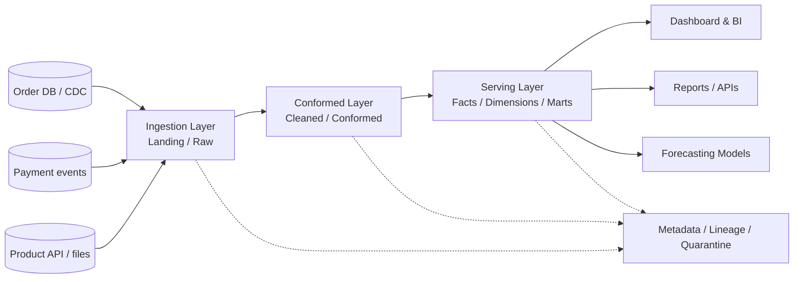
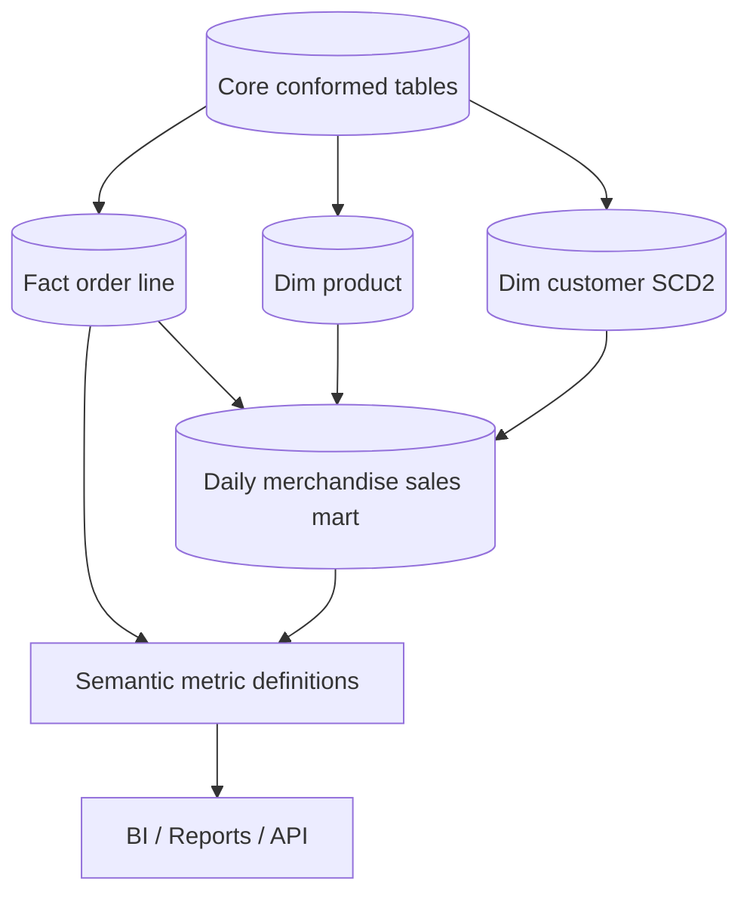

# Roles of Ingestion, Conformed Data, and Serving Layers

## Learning Objectives

After this lesson, you will be able to:

- Distinguish the **ingestion layer** (*ingestion/landing*), the **conformed data layer** (*cleaned/conformed/curated*), and the **analytical serving layer** (*serving/data mart*).
- Explain why these three layers are separated by **responsibilities and data contracts**, not merely by three folders or three table prefixes.
- Design the end-to-end flow of data from transactional systems, files, APIs, or event streams into facts, dimensions, summary tables, and dashboards.
- Define **grain**, business keys, data types, cleansing rules, lineage, duplicate handling, and late-arriving data policies.
- Distinguish **data type/semantic conformance** from **relational normalization (1NF/2NF/3NF)** and from **statistical feature scaling**.
- Choose how to handle CDC, snapshots, events, deletions, change history, backfills, and incremental updates at each layer.
- Define quality test suites, security policies, data ownership, and SLAs by layer.
- Build a verifiable metric-serving model that prevents errors from join multiplication, semantically invalid aggregations, or unversioned KPI shifts.

In the **DATABASE_DATA_MODELING** module, the goal is to translate business requirements into appropriate entities, relationships, constraints, keys, indexes, and physical schemas. In **analytical modeling**, we must also turn operational data into reusable datasets and trustworthy metrics. That requires clear boundaries across **ingestion**, **conformance**, and **serving**, rather than letting every dashboard interpret raw sources independently.

---

## 1. Why Layer an Analytical Model?

An operational database is well designed for questions like "what is the current status of order `ord_908`?". Business teams ask different questions: "what is net merchandise sales by day, shop, and category?" or "do first-time buyers tend to return within 30 days?".

Source data can arrive from many systems:

- Order service with `orders` and `order_items`.
- Payment service emitting successful, failed, or refunded transactions.
- Catalog service managing SKUs and categories.
- User service managing profiles, customer tiers, regions, and permissions.
- Partner-supplied CSV files with differing column names and measurement units.
- Activity event streams that may deliver duplicates or arrive late.

If every dashboard queries those raw sources directly, each team may independently decide what "completed order" means, how to convert timezones, whether refunds count, or how to skip malformed records. Consequently, **the same KPI name yields multiple conflicting values** with no way to explain the discrepancies.

A layered architecture divides the work into three responsibilities:



The names **Bronze – Silver – Gold** are often used as shorthand for these three layers in lakehouse architectures. They are **a common convention, not a mandatory standard**: organizations may use staging/core/marts, raw/refined/curated, or other naming. What matters is **defining responsibilities, guarantees, and verifiability** at every layer.

### 1.1. Quick Comparison Table

| Perspective | Ingestion / Raw | Conformed / Cleaned | Serving / Marts |
| --- | --- | --- | --- |
| Primary question | "What did the source send, when, and from where?" | "What is the unified, valid meaning of the data?" | "Which metrics/queries are consumers asking?" |
| Organization style | Close to source, enriched with ingest metadata | Canonical entities and events, clear grain and keys | Facts/dimensions, subject-area tables, aggregates |
| Transformations | Minimal, just enough for safe ingestion | Parsing, type casting, dedup, mapping, validation, history | Grain-aligned joins, metric formulas, aggregation, read tuning |
| Quality focus | Input contract checks, error capture | Type, uniqueness, referential, and invariant checks | KPI reconciliation, slice accuracy, and SLAs |
| Reproducibility | Retain payloads/offsets/versions per policy | Rebuild from raw and transformation rules | Rebuild from conformed data and metric versions |
| Primary consumers | Data engineering, pipeline operations | Data engineering, analytics engineering, data teams | Analysts, BI, product, executives, ML |
| Security | Strictly restricted, may contain raw PII | Mask/minimize sensitivity per policy | Role-, purpose-, and tenant-scoped access |

Not every field must pass through **exactly one table in each layer**. There may be many raw datasets, many core tables, and many data marts. Layer boundaries exist to **isolate types of change**, not to create redundant copies.

## 2. Concrete Scenario: Multi-Shop Sales Reporting

Suppose a commerce platform needs to provide:

- Daily **net merchandise value** reports by shop and category.
- Lists of completed orders for inspection and auditing.
- Monthly new vs. returning customer analysis.
- Visibility into delayed sources, updated orders, or late-arriving refunds.
- The ability to recompute an entire month when reporting rules evolve.

Illustrative transactional sources:

| Source System | Table / Stream | Contents | Change Characteristics |
| --- | --- | --- | --- |
| Order service | `orders` via CDC | `orderId, shopId, customerId, status, createdAt, completedAt` | Updated when order status transitions |
| Order service | `order_items` via CDC | `orderId, lineId, sku, qty, unitPriceMinor, discountMinor` | Finalized/adjusted per rules |
| Payment service | `payment_events` | Payments and refunds with event IDs | At-least-once, may arrive late |
| Catalog service | `products` snapshot/CDC | SKU, category, brand | Category may change over time |
| Customer service | `customers` CDC | Customer ID, segment, region | Carries change history and PII |

An example order:

```json
{
  "shopId": "shop_17",
  "orderId": "ord_908",
  "customerId": "user_42",
  "status": "COMPLETED",
  "completedAt": "2026-11-22T02:30:00Z",
  "currency": "VND",
  "items": [
    {
      "lineId": "line_1",
      "sku": "A17",
      "quantity": 2,
      "unitPriceMinor": 95000,
      "discountMinor": 10000
    },
    {
      "lineId": "line_2",
      "sku": "B03",
      "quantity": 1,
      "unitPriceMinor": 29000,
      "discountMinor": 9000
    }
  ]
}
```

Here `unitPriceMinor` and `discountMinor` represent **the smallest currency unit under the system's VND contract**, not floating-point numbers. Gross merchandise total before discounts equals `2 × 95,000 + 29,000 = 219,000`; line-level discounts equal `10,000 + 9,000 = 19,000`; net merchandise value after discounts **before refunds** is **200,000 VND**.

In this lesson, the illustrative metric is **net merchandise sales** per our stated rules—**not recognized accounting revenue**. Revenue recognition timing, VAT, shipping fees, exchanges/returns, and exchange rates must follow formal accounting and business contracts.

### 2.1. Record Grains from the Start

| Dataset | Expected Grain | Identifying Key |
| --- | --- | --- |
| Order CDC events | One **source mutation** on an order | `sourceEventId` or `(source, partition, offset)` per contract |
| Current order state | One **order** within one shop | `(shopId, orderId)` |
| Order item lines | One **line item** belonging to an order | `(shopId, orderId, lineId)` |
| Refund events | One **refund event** with stable ID | `refundEventId` |
| Line-level sales fact | One **order line qualifying for reporting** | `(shopId, orderId, lineId)` or versioned fact per model |
| Daily–shop–category summary | One combination of **local date, shop, category, currency, definition version** | Composite grouping key above |

**Grain** answers "which single real-world unit does each row represent?". Without defining grain, joins and `SUM`s easily count one order multiple times.

## 3. Ingestion Layer: Faithfully Capturing Source Data

The ingestion layer (*ingestion/landing/raw*) brings source data into the analytical platform **with traceability and replayability**, not to turn it directly into final KPIs.

### 3.1. What Can Inputs Look Like?

| Input Type | Ingestion Method | Typical Risks |
| --- | --- | --- |
| Partner batch CSV/Parquet | Scheduled file pickup, manifest/checksum, schema check | Missing files, duplicate files, renamed columns, or encoding drift |
| Database snapshots | Read consistent snapshot at a fixed cutoff | Difficult to align with ongoing concurrent mutations |
| Transaction-log CDC | Read INSERT/UPDATE/DELETE with log positions | Replays, out-of-order processing if mishandled, schema changes |
| Event streams | Consume by topic/partition/offset | Duplicate delivery, late arrival, rebalancing, data loss if retention is too short |
| Paginated APIs | Rate-limited polling with cursors and checkpoints | Pagination drift, expired tokens, source mutating mid-crawl |

When designing pipelines, distinguish **"received once"** from **"applied exactly once to the target model"**. Systems operating under at-least-once delivery may redeliver records; correctness comes from **idempotency**, checkpoints, and safe replay logic—not an assumption that "duplicate events will never occur".

### 3.2. Minimum Traceability on a Raw Record

Example CDC message stored in raw:

```json
{
  "sourceSystem": "orders-db",
  "sourceEntity": "orders",
  "operation": "UPDATE",
  "sourceRecordKey": {"shopId": "shop_17", "orderId": "ord_908"},
  "sourcePosition": "db-log-position-000891",
  "sourceEventId": "orders-db:000891",
  "sourceCommittedAt": "2026-11-22T02:30:01Z",
  "ingestedAt": "2026-11-22T02:30:03Z",
  "schemaId": "orders.v3",
  "payload": {
    "status": "COMPLETED",
    "completedAt": "2026-11-22T02:30:00Z"
  }
}
```

This is an **illustrative contract**, not a universal CDC format across all tools. In practice, know whether an event carries the **full post-change state** or only a **delta**. If only changed fields arrive, the pipeline needs prior state or snapshot access to reconstruct complete records.

Useful fields in raw:

- **Source:** system name, entity/topic, tenant, schema/contract version.
- **Identifiers:** record key, message ID, business event ID if present.
- **Position:** partition/offset, log sequence number, or file+row number for checkpointing, replay, and ordering per source guarantees.
- **Timestamps:** business event time, source commit time, target ingest time; never conflate them.
- **Operation:** INSERT, UPDATE, DELETE, snapshot, or domain event.
- **Payload:** data exactly as received, or a storage representation that losslessly reproduces the original payload per policy.
- **Processing state:** batch/run ID, checksum, parse errors, and lineage metadata.

Not every source provides all fields above. If reliable event IDs or total ordering are absent, **document the limitation explicitly** instead of generating a synthetic ID and claiming strict deduplication.

### 3.3. Preserve Fidelity, Resist Premature "Fixing"

Raw should preserve proof of what the source sent:

```text
Raw:
  {"order_id": "ord_908", "paid": "Y", "amount": "219000", "time": "22/11/2026 09:30"}

Avoid silently transforming into:
  {"orderId": "ord_908", "isPaid": true, "amount": 219000, "timestamp": "...Z"}
  and discarding the original string before date format or "paid" semantics are confirmed.
```

You may compress, encrypt, partition, or attach metadata during ingestion, provided raw retention rules preserve **traceability and rebuild capability**. If data contains secrets or PII, "keep raw intact" does not mean infinite retention or open analyst access: raw must enforce access control, encryption, retention limits, and deletion workflows.

### 3.4. Completeness in Batch and Streaming

A 100,000-row batch file is considered completely ingested only when criteria hold:

- File matches expected name/manifest and size/checksum.
- File read completes and checkpoints commit in a consistent state.
- Total rows reconcile into **valid, quarantined, and policy-excluded** counts.
- Rerunning after a mid-job crash does not duplicate business records.

Similarly, in streaming, checkpoints/offsets should commit only after recoverable data is durably persisted per design. **Acking before commit** risks data loss; **acking after commit** allows redelivery while enabling safe idempotent processing.

## 4. Conformed Layer: Turning Source Data into Reusable Meaning

The conformed layer (*cleaned, conformed, refined, canonical*) does more than "lowercase strings" or "drop bad rows". It transforms heterogeneous inputs into **standardized entities, events, and units of measure** shared across teams.

Example:

```text
Order Source A: amount = "219000", currency = "VND", status = "DONE"
Order Source B: total_cents = 219000, currency = "VND", state = "FULFILLED"
Payment Source: status = "SUCCESS", amount = 219000

Conformed Layer:
  order_id, shop_id, order_status,
  amount_minor, currency,
  completed_at_utc, source_system, source_version
```

You cannot assume `DONE` and `FULFILLED` both mean "paid" or "delivered" merely because their names sound alike. **Status mappings** must be confirmed by business owners. Payment records differ semantically from order records; never merge them into one generic field if doing so blurs meaning.

### 4.1. Three Meanings of "Normalization / Standardization" to Distinguish

| Term | Meaning | Relevance Here |
| --- | --- | --- |
| **Conformance / canonicalization** | Aligning names, types, status codes, units, timezones, keys, and rules across sources | **Core focus** of the conformed layer |
| **Relational normalization (1NF–3NF)** | Decomposing tables by functional dependencies to curb update anomalies | Useful inside core, though **not every conformed table must be 3NF** |
| **Statistical normalization** | Rescaling features such as z-score or min-max scaling | A feature-engineering step, unrelated to building a conformed layer |

A core model may use normalized relational tables, Data Vault, event tables, or other conformed structures. What decides fitness is **accuracy, grain, ownership, and reusability**, not the architecture label.

### 4.2. Canonical Schema Contract

A `core_order` table might specify:

| Field | Logical Type | Rules |
| --- | --- | --- |
| `shop_id` | Non-null internal ID | Explicit tenant/shop scope |
| `order_id` | Non-null internal ID | Unique within `shop_id` |
| `customer_id` | Stable ID | Verified source match; never use email as primary key |
| `order_status` | Enum | Versioned mapping; never infer from payments if semantics differ |
| `created_at_utc` | Instant | Parsed using source timezone, stored in UTC |
| `completed_at_utc` | Optional instant | Populated only when business completion criteria hold |
| `currency_code` | Currency code | Standardized ISO code within supported scope |
| `source_sequence` | Comparable version/position within source scope | Guards against out-of-order updates |
| `last_ingested_at` | Instant | For monitoring, never replaces business timestamps |

For `core_order_item`:

```text
grain        = one order line within one order
business_key = (shop_id, order_id, line_id)

quantity         = positive integer per contract
unit_price_minor = integer in smallest currency unit
discount_minor   = integer >= 0 and <= gross_line_minor
gross_line_minor = quantity * unit_price_minor
```

Constraints on amounts, discounts, shipping, and taxes apply only when confirmed by source contracts. Never assume an `amount` field shares identical semantics across every upstream system.

### 4.3. Cleansing Pipelines with Error Classification

A pipeline should never run a blanket "`WHERE everything_is_valid`" filter that silently drops invalid records.

| Error Class | Example | Typical Handling |
| --- | --- | --- |
| Decode/syntax failure | Malformed JSON, wrong encoding | Quarantine while preserving metadata and source reference for remediation |
| Missing identifying key | Missing `orderId` | Block from core or route through an approved enrichment flow |
| Invalid data type | `quantity = "many"` | Quarantine or apply documented type mapping |
| Out-of-domain value | `status = "UNKNOWN_X"` | Map to a governed unknown state or block per policy |
| Missing reference | SKU not yet in catalog | Log error / link to unknown member, retry late dimension if applicable |
| Duplicate record | Same CDC event redelivered | Deduplicate using reliable source identifiers |
| Out-of-order arrival | Version 8 arrives before version 7 | Apply only newer versions within defined ordering guarantees |
| Upstream deletion | CDC `DELETE` | Update status/tombstone and propagate downstream per policy |

**Quarantine** must never be a "permanent trash bin". Assign an error owner, retention window, fix-and-replay workflow, error metrics by source, and publish-gating thresholds for the serving layer.

## 5. Deduplication and Safe Rerun (Idempotency)

Pipelines rerun due to retries, restarts, backfills, or manual operator triggers. The goal is not "read each record only once", but **"reprocessing produces the exact same valid outcome"** per contract.

### 5.1. Distinguish Event IDs from Business Keys

There are three identifier roles:

1. **Message/event ID:** identifies a single emitted source change; prevents applying the same message twice.
2. **Business key:** `(shopId, orderId)` identifies one order across multiple versions.
3. **Source ordering token:** LSN/sequence/version tells which change is newer **within the guaranteed ordering scope**.

Example:

```text
event_id=evt_7,  orderId=ord_908, version=7, status=PAID
event_id=evt_8,  orderId=ord_908, version=8, status=COMPLETED
event_id=evt_8,  orderId=ord_908, version=8, status=COMPLETED  # retry
event_id=evt_7,  orderId=ord_908, version=7, status=PAID       # late delivery
```

The raw layer may retain traces of all deliveries if operational auditing needs delivery visibility; `core_orders_current` must reflect **version 8** and never regress to `evt_7`. Naively deduplicating by `orderId` and keeping whichever arrived "last" loses valid state or picks stale versions.

### 5.2. Pseudocode for Source-Version-Aware Core Updates

```text
applyChange(event):
    validateSourceContract(event)
    key = (event.shopId, event.orderId)

    old = core_orders.get(key)

    if old exists and event.sourceVersion <= old.sourceVersion:
        return NO_OP

    # The version check and write must be atomic or
    # sequenced reliably by the target engine.
    core_orders.conditionalUpsert(
        key,
        event.afterState,
        expectedOlderThan=event.sourceVersion
    )
```

This pseudocode illustrates the **invariant to protect**. Reading `old` then blindly executing an unconditional `UPSERT` creates race conditions under concurrent workers. If the target engine lacks conditional writes, use serialized processing, transactions, or reconciliation.

When CDC sends `DELETE`, do not merely delete the row and forget its version: replaying an older `UPDATE` could resurrect deleted data. Maintain an application **deletion fence/tombstone** or version history to block unintended resurrection.

## 6. Conformed Data Is Not Necessarily Just Current State

Distinguish at least two forms of conformed datasets:

- **Current state:** each order appears once with its latest version.
- **Change history:** each event or effective interval represents state at a given point in time.

The question "what status is this order in right now?" uses current state. The question "what status was this order in at 18:00 yesterday?" requires history or snapshots/as-of queries—it cannot be answered from a single mutable current row.

### 6.1. Which Timestamp Is Being Used?

| Timestamp Field | Meaning | Used For |
| --- | --- | --- |
| `createdAt` | Order initialized | New-order funnel analysis |
| `completedAt` | Order reached completed state | Metrics by completion date |
| `paidAt` | Payment succeeded per source definition | Payment analytics |
| `eventOccurredAt` | Event occurred | Event facts, timelines |
| `sourceCommittedAt` | Transaction committed at source | CDC ordering/freshness where guaranteed |
| `ingestedAt` | Platform received record | Monitoring ingestion lag |
| `processedAt` | Core/serving finished rules | Pipeline observability, never replaces business time |

If a dashboard reports by **completion date** while transformations group by **ingestion date**, delayed orders land on the wrong day. Every metric must publish its **business timestamp** and timezone.

### 6.2. Late-Arriving Data and Watermarks

An event occurring on Nov 21 may be ingested on Nov 23. Depending on the engine, streaming pipelines use **watermarks** to determine when windows can close or accept late updates.

Never assume a watermark means "events arriving past the cutoff vanish identically in every engine"; different tools handle late events, retractions, and output modes differently. Your design must specify:

- Typical and maximum source latency.
- Which historical windows remain open for restatement after publication.
- Whether prior-day summary tables can be updated.
- When a refund arrives 30 days later, whether it adjusts the refund date or the original sale date.
- How backfills revising published numbers are audited and versioned.

**Metric accuracy** matters more than prematurely freezing a day without handling offsetting transactions.

## 7. Aligning Keys, Categories, and Units Across Sources

In cross-system analytics, entity keys may differ across sources:

```text
Order system:  customer_id = "user_42"
CRM:           contact_id = "c-0199"
Loyalty:       member_no  = "L-778"

These may refer to the same person, yet cannot be joined by raw ID string
without a governed and verified mapping table.
```

The conformed layer needs an **identity resolution** policy:

- Use durable business keys with explicit uniqueness scope.
- Maintain source-to-canonical ID mapping tables with evidence and effective timestamps.
- Never merge two individuals solely on matching email/phone unless business policy authorizes it.
- Define handling when accounts merge, split, or mappings change.
- Protect PII; never proliferate sensitive identifiers merely for join convenience.

### 7.1. Conformed Dimensions

For example, `dim_product` carries SKU, brand, category, and effective versions; sales, inventory, and product-view facts all reference one shared classification definition.

A **conformed dimension** makes reports comparable across teams. If every dashboard maps SKUs to categories independently, the same SKU can show up under "Home Goods" on Report A and "Lifestyle" on Report B when upstream sources change.

However, categories evolve over time. Distinguish:

- **Current classification:** "Historical sales viewed under today's product categories."
- **Point-in-time classification:** "Sales by the category effective when the order completed."

Because these are two different questions, support them with **two explicit join paths** or clearly named metrics.

### 7.2. SCD Type 1 and Type 2

In dimensional modeling:

- **Type 1:** overwrites old attributes; suits typo fixes where history is unnecessary.
- **Type 2:** preserves multiple dimension versions with effective intervals, supporting *as-of* analysis.

Example:

| customer_sk | customer_id | segment | valid_from | valid_to |
| --- | --- | --- | --- | --- |
| 101 | `user_42` | STANDARD | 2026-01-01 | 2026-11-15 |
| 205 | `user_42` | VIP | 2026-11-15 | null (currently active) |

The half-open interval rule **`[valid_from, valid_to)`** (inclusive start, exclusive end) prevents two versions from overlapping at boundaries. An order completed on Nov 10 resolves to `customer_sk = 101`; an order completed on Nov 22 resolves to `customer_sk = 205`.

If an update is logged on Nov 20 but takes effect retroactively from Nov 15, decide whether to **retroactively restate** affected facts or report based on information known at run time. Queries asking both "when was it effective?" and "when did the system know?" require adding **system time**.

## 8. Serving Layer: Designed from Analytical Questions

The serving layer (*serving/semantic/data marts*) reshapes conformed data for end users: facts, dimensions, summary tables, subject-area marts, semantic metrics, or contracted feature sets.

How it differs from the conformed layer:

- **Core** prioritizes unified meaning, reusability, and preserving appropriate detail.
- **Serving** prioritizes **answering concrete queries** quickly and consistently, with explicit metric names and access controls.

A typical architecture:



**Serving does not have to be pre-aggregated.** A line-level fact optimized with partitioning and indexes for BI is also serving data. A summary table is simply one kind of read model built for repeated aggregate queries.

### 8.1. Facts and Dimensions

| Model Type | Grain / Role | Example |
| --- | --- | --- |
| **Transaction fact** | One event/transaction at fixed detail level | `fact_order_line` |
| **Periodic snapshot fact** | State at a recurring cutoff | End-of-day inventory by warehouse/SKU |
| **Accumulating snapshot** | Tracks workflow milestones | Order created → packed → shipped → completed |
| **Dimension** | Descriptive context for facts | Product, customer, shop, date |
| **Aggregate mart** | Pre-grouped by selected dimensions | Net merchandise sales by day–shop–category–currency |

Never use one fact table to represent both every status transition event and the order's final state without an explicit grain. If an order has five status events, joining directly to order lines multiplies each line fivefold.

### 8.2. Boundary Between 3NF and Star Schema

A core model may separate `orders`, `order_items`, `products`, and `customers` by functional dependency to reduce redundancy and boost reuse. In serving, a **star schema** typically places measures in facts and descriptive attributes in dimensions for controlled BI joins.

This is not an opposition of "3NF right, star wrong" or vice versa. Each layout serves **different constraints and read paths**. Serving schemas may contain intentional denormalization while maintaining rigorous metric definitions and lineage.

## 9. End-to-End Example: From Raw to Core and Sales Mart

Let us state an **illustrative metric contract**:

> **Net merchandise sales (NMS)** is the sum of `quantity × unit_price_minor − discount_minor − refund_allocated_minor` across lines of `COMPLETED` orders, excluding taxes and shipping fees, grouped by **local date of `completedAt` in `Asia/Ho_Chi_Minh`**, shop, category effective at completion date, and currency. Refunds follow the separate adjustment policy below.

This is strictly **one reporting definition**. Do not label it accounting revenue. Accounting revenue requires checking recognition conditions, performance obligations, taxes, returns, and applicable accounting standards.

### 9.1. Raw

The upstream stream delivers an order mutation:

```json
{
  "sourceEventId": "orders:891",
  "sourcePosition": 891,
  "op": "UPDATE",
  "shopId": "shop_17",
  "orderId": "ord_908",
  "after": {
    "status": "COMPLETED",
    "completedAt": "2026-11-22T02:30:00Z"
  },
  "ingestedAt": "2026-11-22T02:30:03Z"
}
```

A separate snapshot or CDC feed for `order_items` supplies the line items. Raw retains source keys, log positions, and metadata to prove data provenance and replay after mapping fixes.

### 9.2. Core

After parsing, deduplication, and mapping:

```text
core_orders_current
  (shop_17, ord_908, user_42, COMPLETED,
   completed_at_utc=2026-11-22 02:30:00Z, currency=VND, version=8)

core_order_items
  (shop_17, ord_908, line_1, A17, qty=2,
   unit_price_minor=95000, discount_minor=10000)
  (shop_17, ord_908, line_2, B03, qty=1,
   unit_price_minor=29000, discount_minor=9000)
```

Each line carries a stable identifier, monetary values use smallest integer currency units, and timestamps standardize to UTC. `core_orders_current` holds one current state per order key; *as-of* analysis requires adding effective history.

### 9.3. Fact

Line-level fact:

| shop_id | order_id | line_id | completed_day_local | sku | currency | gross_minor | discount_minor | refund_allocated_minor | nms_minor |
| --- | --- | --- | --- | --- | --- | ---: | ---: | ---: | ---: |
| shop_17 | ord_908 | line_1 | 2026-11-22 | A17 | VND | 190000 | 10000 | 0 | 180000 |
| shop_17 | ord_908 | line_2 | 2026-11-22 | B03 | VND | 29000 | 9000 | 0 | 20000 |

Total `nms_minor` = **200,000 VND**. This fact assumes the **`COMPLETED` condition is applied properly** and no rows multiply from joining payment/refund events. When multiple refund events exist, first **aggregate allocated refund amounts to the exact order-line key** before joining—never join a 1:n relation directly onto the fact and blindly `SUM`.

### 9.4. Illustrative SQL for Fact Transformation

This is conceptual SQL illustrating **grain and calculation**. Timezone conversion functions, date types, incremental merge syntax, and SQL keywords vary by warehouse; adapt to your target engine in implementation.

```sql
-- Item grain is (shop_id, order_id, line_id).
-- core_refunds_by_line is pre-aggregated to at most 1 row per line.
WITH completed_lines AS (
    SELECT
        o.shop_id,
        o.order_id,
        i.line_id,
        i.sku,
        o.currency_code,
        o.completed_at_utc,
        i.quantity * i.unit_price_minor AS gross_minor,
        i.discount_minor,
        COALESCE(r.refund_minor, 0) AS refund_allocated_minor
    FROM core_orders_current AS o
    JOIN core_order_items AS i
      ON i.shop_id = o.shop_id
     AND i.order_id = o.order_id
    LEFT JOIN core_refunds_by_line AS r
      ON r.shop_id = i.shop_id
     AND r.order_id = i.order_id
     AND r.line_id = i.line_id
    WHERE o.order_status = 'COMPLETED'
)
SELECT
    shop_id,
    order_id,
    line_id,
    sku,
    currency_code,
    completed_at_utc,
    gross_minor,
    discount_minor,
    refund_allocated_minor,
    gross_minor - discount_minor - refund_allocated_minor
        AS nms_minor
FROM completed_lines;
```

Test suites must enforce that `core_refunds_by_line` is **unique on `(shop_id, order_id, line_id)`**. If one line has three refund events, that table must sum/resolve refund states per business rules first, leaving at most one row to join.

**Note on negative values:** a refund months later can drive `nms_minor` downward, and some systems record credits or adjustments. If the metric forbids negative line values, define allocation, reconciliation, and anomaly rules—never clamp negatives to 0 silently, as that breaks overall totals.

### 9.5. Daily–Shop–Category Aggregation

After mapping SKUs to the product dimension at **`completedAt` time** and converting timestamps to the defined local date:

```sql
SELECT
    completed_day_local,
    shop_id,
    category_id_at_completion,
    currency_code,
    COUNT(DISTINCT order_id) AS distinct_orders,
    SUM(gross_minor) AS gross_minor,
    SUM(discount_minor) AS discount_minor,
    SUM(refund_allocated_minor) AS refund_minor,
    SUM(nms_minor) AS nms_minor
FROM fact_order_line
GROUP BY
    completed_day_local,
    shop_id,
    category_id_at_completion,
    currency_code;
```

**Critical warning on `COUNT(DISTINCT order_id)`:** an order containing lines in two categories counts as **one order in each category**. Summing `distinct_orders` across categories can exceed true total orders. Therefore, per-category "order count" has a different definition from "storewide order count"; never sum distinct counts across overlapping dimensions.

If you need exact order counts per shop/day, use an **order-grain fact** or separate aggregate at `(day, shop, currency)` grain; line-level monetary amounts remain additive across categories provided no double-counting occurs.

## 10. Avoiding Join Bugs That Corrupt KPIs

### 10.1. Row Multiplication from Joining Multiple 1:n Relations

An order has two order lines and three payment events. Joining directly:

```sql
SELECT
    o.order_id,
    SUM(i.quantity * i.unit_price_minor) AS wrong_gross
FROM core_orders_current AS o
JOIN core_order_items AS i
  ON i.shop_id = o.shop_id AND i.order_id = o.order_id
JOIN core_payment_events AS p
  ON p.shop_id = o.shop_id AND p.order_id = o.order_id
WHERE o.order_status = 'COMPLETED'
GROUP BY o.order_id;
```

The intermediate row count becomes `2 × 3 = 6`, counting every order line three times unless appropriately constrained or grouped.

The right fix depends on the question:

- Need line-item totals: **do not join `payment_events`** if unnecessary.
- Need a "successfully paid" filter: consider `EXISTS`/semi-join against authoritative payment state.
- Need payment amounts: aggregate payments/refunds to **order grain** or **line grain** before joining.
- Need payment transaction counts: build a dedicated payment-transaction fact at its own grain.

Rule: **every join must prove its cardinality and output grain**. Never patch fan-out with `SUM(DISTINCT amount)`: two valid lines with identical monetary amounts will be undercounted.

### 10.2. Summing Across Multiple Currencies

Never sum directly:

```text
1,000,000 VND + 100 USD = 1,000,100 "currency"
```

Marts should **keep `currency_code` in the grain**, or apply a defined FX policy specifying rate source, rate timestamp, conversion direction, rounding, missing-rate handling, and whether both native and converted amounts are retained.

### 10.3. Changing Dimension References

If SKU `A17` moves from "Accessories" to "Home Goods", historical reports must specify whether they use the **current** category or the category **at time of sale**. Never silently rewrite every historical report merely because current dimension metadata changed.

## 11. Serving Must Define Metrics, Not Just Name Columns

A dashboard tile labeled "Revenue" backed by a column named `amount` invites disputes when teams interpret it differently.

Minimum **metric contract**:

| Attribute | Example |
| --- | --- |
| `metric_id` | `net_merchandise_sales_minor_v1` |
| Display name | Net Merchandise Value (Product Definition) |
| Source grain | One completed order line |
| Qualification | `order_status = COMPLETED` per mapping v3 |
| Formula | `qty × unitPriceMinor − allocatedDiscountMinor − allocatedRefundMinor` |
| Time | Local date of `completedAt` in `Asia/Ho_Chi_Minh` |
| Dimensions | Shop, date, effective category, currency |
| Exclusions | Taxes, shipping fees; other charges per contract |
| Late refunds | Restates original completion date in this metric version |
| Expected freshness | E.g., updated within 15 minutes of source commit, barring declared incidents |
| Owners | Product/Finance and Data jointly own semantics and implementation |
| Verification | Reconcile order lines/refunds, grain tests, and sample dates |

"15 minutes" is purely an **illustrative SLA**, not a guarantee of any specific tool. When late refunds arrive, historical mart dates may restate: reports should expose calculation timestamp/version so users understand why figures updated.

### 11.1. Semantic Layer and Physical Tables

A **semantic layer** defines shared metrics and dimensions across tables so dashboards do not duplicate formulas. However, a semantic layer cannot replace:

- Conformance and quality rules in core.
- Enforced grain in facts.
- Proper time windows and currency boundaries.
- Tenant/group row-level authorization.
- Update/backfill visibility and metric definition versioning.

The semantic layer **centralizes expression**, while accurate numbers still require all three layers to fulfill their responsibilities.

## 12. ELT, ETL, and Transformation Boundaries

Two broad strategies exist:

- **ETL:** extract → transform → load into target; certain checks and transformations run before data lands in the warehouse.
- **ELT:** extract → load → transform; keep raw on the platform, then conform and serve using warehouse compute or processing engines.

Neither "ETL lacks raw" nor "ELT is always better" is true. The choice depends on data sensitivity, compute capacity, speed, operational cost, network bandwidth, and storage policies.

### 12.1. Which Transformations Belong Where?

| Task | Preferred Layer | Rationale |
| --- | --- | --- |
| Connection auth, protocol decoding, checksums | Ingestion | Guarantees complete and secure receipt |
| Tag source, offset, `schemaId`, ingest time | Ingestion | Supports tracing and replay |
| Parse canonical types, validate enums | Conformed | Keeps shared logic centralized |
| Map business keys, units, timezones | Conformed | Prevents each mart from reinventing mappings |
| Deduplicate + apply CDC in proper order | Conformed | Produces trustworthy state/contracts |
| Map SCD dimension versions | Conformed or fact-prep step | Requires effective history |
| Define KPIs and business filters | Serving / semantic | Tied to reporting questions |
| Aggregate by day/shop/category | Serving | Optimizes repeated queries |
| Mask PII, enforce access controls | **All layers**, as needed | Prevents sensitive data leaks via alternate paths |

Sensitive data protection may occur at the ingestion edge if policy forbids storing raw PII; even then, retain sufficient metadata for valid lineage. Layering is never an excuse to skip security at any stage.

## 13. Batch, Streaming, Incremental, and Backfills

Serving datasets can refresh via hourly batch, micro-batch, streaming, or hybrids. The core requirement is **correctness across repeated runs**.

### 13.1. Full Refresh vs. Incremental

| Update Style | Mechanism | When Suitable | Risks |
| --- | --- | --- | --- |
| Full refresh | Recompute entire target table from conformed source | Small data, infrequent changes, simplicity | High compute cost; downtime/staleness if table swap is non-atomic |
| Incremental append | Insert new facts only | Truly immutable events with stable IDs | Duplicate events; past edits/deletes missed |
| Incremental upsert | Overwrite rows by business key/version | Current state, late corrections | Must protect ordering/versions and concurrent locking |
| Recompute affected partitions | Rebuild only impacted dates/groups | Aggregates receiving late-arriving data | Must track affected partitions and publish atomically |
| Streaming projection | Process events and update marts near real time | Short freshness SLAs | Duplicates, out-of-order events, checkpoints, and retractions |

A refund event for a Nov 10 order arriving on Nov 22 alters the Nov 10 mart. If a pipeline only "scans today's data", it **cannot fix the past**. Track **affected business dates** and recompute or apply idempotent deltas per contract.

### 13.2. Controlled Backfill Plan

Suppose you fix a status mapping or discount formula for the past three months:

1. Confirm the **data contract version** and affected date ranges/tenants.
2. Preserve raw/core inputs or reliable snapshots, recording source checkpoints.
3. Build into a staging/parallel mart version to prevent dashboards from reading half-computed state.
4. Backfill partition-by-partition with idempotent jobs; never blindly add on retries.
5. Catch up on live changes arriving while the backfill runs.
6. Reconcile row counts, monetary totals by currency, missing/extra keys, and business samples.
7. Cut over traffic/semantic layer on schedule; record run ID, logic version, and publish timestamp.
8. Monitor post-release; retain rollback capability if discrepancies surface.

Do not verify merely by matching total row counts: two datasets can both hold one million rows yet differ in IDs, statuses, or amounts. Reconcile across **grain and key measures**.

### 13.3. Upstream Schema Evolution

When an upstream source renames `order_total` to `total_minor` or alters timestamp types:

- Raw records the schema version and detects the change.
- Conformed decoders/mappings support both old and new versions during transition.
- Test fixtures cover every actively supported version.
- Serving preserves a stable metric contract when business meaning is unchanged.
- If meaning changes, publish a new metric version and comparison guidance.

Renaming a column does not necessarily change a KPI; a **semantic change** cannot be hidden merely by keeping the same column name.

## 14. Lineage: Tracing a Dashboard Cell Back to Raw Data

When a manager asks "why is shop 17's sales on Nov 22 equal to 200,000?", answer with a lineage chain:

```text
Dashboard cell:
  shop_17, 2026-11-22, VND, NMS = 200000

  -> mart_daily_merchandise_sales
     metric_version = nms_v1, build_run = run_120

  -> fact_order_line
     (ord_908, line_1) = 180000
     (ord_908, line_2) = 20000

  -> core_order_items + core_orders_current
     ord_908 status COMPLETED, completedAt 02:30Z
     unit prices, qty, discount, refund allocation

  -> raw CDC events/snapshots + source positions
     orders event, order_items snapshot/CDC
```

**Lineage** covers both data flow and **transformation logic**:

- Source system, keys, and raw positions/versions.
- Job/model version and runtime parameters.
- Metric formulas, enum mappings, timezone, categories/SCD.
- Quality check rules and quarantined rows.
- Timestamp when data was published to serving.

For sensitive data, lineage should log access-controlled metadata and references rather than copying personal payloads into unprotected audit logs.

### 14.1. Data Ownership Model

| Layer | Typical Owner | Example Questions Answered |
| --- | --- | --- |
| Source & ingestion | Source owner + data platform | Which events committed? Did the pipeline drop any? |
| Conformed | Data/analytics engineering + domain owner | Which mapping is right? Are keys/types/grain valid? |
| Serving | Analytics engineer + metric owner | How is the KPI calculated, on which date, and is it comparable across reports? |
| Governance | Security, privacy, governance | Who can view which fields? Where are they stored/deleted, and for how long? |

Clear ownership ensures bugs are fixed at the **right layer**: a timestamp parsing bug belongs in core, not patched with ad-hoc offsets inside every dashboard.

## 15. Data Quality by Layer

A strong pipeline catches errors **as close to their origin as practical**, paired with end-to-end verification.

### 15.1. Raw Layer

- Files/messages decode cleanly and reconcile against manifests/offsets.
- No source batches or partitions are silently skipped without alerts.
- Source schema and lineage metadata are captured.
- Quarantine tracks counts and supports reprocessing.
- Raw read access is restricted; no tokens or PII leak into logs.

### 15.2. Conformed Layer

| Test | Example |
| --- | --- |
| `NOT NULL` | `shop_id, order_id, line_id` never null where required |
| `UNIQUE` | Each `(shop_id, order_id, line_id)` has one current row |
| Allowed values | `order_status` belongs to the defined enum/mapping |
| Domain constraints | `quantity > 0`, `discount_minor >= 0` |
| Logical referential integrity | Every item links to a valid order within latency SLA |
| Monotonic versions | Older events never overwrite newer versions of the same business key |
| SCD no overlap | No two dimension versions overlap in effective intervals |
| Currency/time | No cross-currency sums; timestamps parsed in proper timezone |
| Privacy contract | Sensitive fields processed appropriately before shared access |

In warehouses that do not enforce all constraints automatically, implement these as **scheduled pipeline tests** with logged outcomes and assigned owners.

### 15.3. Serving Layer

- Validate fact row counts at grain and verify no join multiplication.
- Reconcile `gross − discount − refund = NMS` across test suites.
- Verify totals by shop/day/currency match facts and settled upstream sources.
- Verify distinct counts are never summed across non-additive dimensions.
- Test late-arriving data and refunds updating the proper dates per metric contract.
- Verify displayed data obeys tenant isolation and permissions.
- Monitor freshness, query latency, scan/partition costs, and unexpected empty outputs.

### 15.4. Illustrative Quality Monitoring Table

| Operational Metric | Meaning | Action on Failure |
| --- | --- | --- |
| `raw_ingest_lag_seconds` | Source commit → raw receipt | Check source connector and backlog |
| `raw_bad_record_rate` | Share of records failing decode/contract | Quarantine, notify source owner |
| `core_duplicate_business_keys` | Duplicate keys at current grain | Block publish or fix deduplication logic |
| `core_missing_reference_rate` | Facts missing dimensions beyond SLA | Investigate arrival lag or mappings |
| `core_version_regression_count` | Older record overwrote newer state | Halt updates, fix ordering/concurrency |
| `serving_metric_reconciliation_delta` | Drift vs. authoritative source | Identify impacted partitions, backfill |
| `serving_freshness_minutes` | Data lag in serving tables | Flag stale data / page per SLA |
| `serving_query_p95_ms` | BI/API query latency | Inspect partitions, indexes, aggregates |

Thresholds must reflect SLAs and source behavior. Never advertise a pipeline as "real-time" without defining measurement points and the percentage of records meeting the target.

## 16. Security, Privacy, and Retention Across Layers

Layering creates multiple representations of data; securing only the source database while leaving raw, core, and serving open unintentionally widens access.

| Risk | Design Mitigation |
| --- | --- |
| Raw holds emails, addresses, tokens | Restrict permissions, encrypt, redact unnecessary secrets, keep payloads out of logs |
| Core unifies cross-system IDs | Govern identity mappings and purpose-based access; audit queries |
| Serving holds multi-tenant data | Row-level access policies or trusted tenant-scoped query paths |
| Dimensions hold sensitive attributes | Isolate sensitive fields; avoid copying them into every mart |
| Data requiring deletion | Locate source and all copies, apply deletion events/fences, and reconcile |
| Keeping raw forever "just to replay" | Policy-bound retention, valid rebuild alternatives, or documented limits |
| Backups/restores resurrecting deleted data | Replay deletion/version logs upon restore before serving |

**Retention and replay are a deliberate design trade-off**: if raw retains only 7 days, you cannot assume a one-year backfill solely from raw. If raw keeps long history, manage storage cost, security, permissions, and erasure obligations.

### 16.1. Upstream Deletions Must Propagate Properly

A CDC `DELETE` may require:

1. Marking or deleting the entity in core per business rules.
2. Deleting or masking associated data in facts/marts when policy demands.
3. Blocking replayed older events from resurrecting deleted records.
4. Updating downstream indexes, caches, exports, and analytics.
5. Retaining compliant audit proof without re-storing deleted PII.

Never assume TTL in one layer cascades automatically to another, or that a `DELETE` in one warehouse covers backups and downstream consumers.

## 17. Example Physical Layout Across the Three Layers

Suppose an architecture uses object storage for raw and a warehouse/lakehouse for core + serving. One layout:

```text
raw/
  source=orders_db/
    entity=orders/
      ingest_date=2026-11-22/
        batch_or_files...

core/
  orders_current
  orders_history
  order_items_current
  refunds_by_line
  customers_scd2
  products_scd2

serving/
  fact_order_line
  dim_customer
  dim_product
  mart_daily_merchandise_sales
  mart_customer_retention
```

These paths are **organizational examples**, not mandatory filenames. Grain, physical partitioning, clustering, and indexes must be tuned separately:

| Layer | Candidate Keys / Partitions | Purpose |
| --- | --- | --- |
| Raw | `source, entity, ingest_date, batchId` | Append/replay efficiency and source lineage |
| Core orders current | `(shopId, orderId)`, optional index on update time | Current-state upserts |
| Core order items | `(shopId, orderId, lineId)` | Order-line grain |
| Core SCD2 | Natural key + effective interval, surrogate key | As-of joins and overlap checks |
| Serving fact order line | Partition by business date, cluster/index by shop/SKU per workload | Line-grain BI queries |
| Serving daily mart | `(localDay, shopId, categoryId, currency)` | Repeated aggregate queries |

**Do not force one partitioning scheme across all three layers.** Partitioning by `ingest_date` helps raw ingestion/replay, yet does not make `completed_day` reports fast. Core may partition by business key/updated timestamp, while serving aligns with dashboard filters. Physical choices depend on workload, size distribution, skew, cost, and engine specifics.

### 17.1. Which Layer Should Hold Which Answers?

| Question | Primary Answering Layer |
| --- | --- |
| "What raw timestamp string did the source send?" | Raw |
| "What is the validated timestamp under standard rules?" | Conformed core |
| "How was that day's amount computed by timezone and formula?" | Serving + semantic contract |
| "Why did the system receive duplicate events?" | Raw metadata / source logs |
| "What version is the current order on?" | Core current |
| "What were November shop sales by category?" | Serving mart |
| "Was the customer classified as VIP when the order completed?" | Core SCD + serving fact / as-of join |
| "Can we recompute last month after fixing a mapping?" | Raw/core lineage + backfill pipeline |

## 18. Common Mistakes

| Mistake | Consequence | Fix |
| --- | --- | --- |
| Creating `raw_orders` and overwriting invalid values without provenance | Cannot reproduce or debug source errors | Preserve original payload/lineage per policy; clean in an explicit step |
| Deduplicating by `orderId` while ignoring versions | Drops valid updates | Separate business key, event ID, and source ordering |
| Using `ingestedAt` as sale date | Late events shift into wrong business days | Define business time and timezone |
| Letting every mart map statuses and currencies independently | Inconsistent dashboards | Centralize versioned conformed mappings in core |
| Core stores only current rows | Cannot answer as-of queries or audit changes | Add history/SCD where business needs require |
| Joining order items directly to payment events then summing | Multiplies values by payment event count | Preserve grain; aggregate or semi-join first |
| Using `SUM(DISTINCT amount)` to prevent multiplication | Undercounts distinct lines with equal amounts | Fix join cardinality, never patch formulas |
| Summing USD and VND in the same `SUM` | Unitless nonsense numbers | Keep currency in grain or apply FX contracts |
| Using SCD Type 1 for category-at-sale reporting | Past reports shift unintentionally when categories change | SCD2/as-of joins or explicit current-category metric |
| Append-only marts for mutable data | Corrections and refunds never reflect | Incremental upsert or recompute affected partitions |
| Backfilling while dashboards query half-built tables | Transiently wrong figures | Staging/versioning, reconciliation, atomic swaps if supported |
| Setting raw TTL shorter than backfill horizon | Cannot rebuild historical data | Align retention with recovery requirements |
| Giving every analyst raw access for debugging | PII/secret exposure | Enforce RBAC, masked datasets, and auditing |
| Checking only that dashboard grand totals match | Line-level errors hidden by offsetting differences | Reconcile by grain, keys, versions, and samples |
| Assuming Gold must always be aggregated | Loses detail needed for drill-down | Allow contracted line-grain serving facts |

## 19. Implementation Workflow from Analytical Requirements to Three Layers

Use this workflow for a new metric:

1. **Confirm business objective.** Which KPI, which decision does it inform, and who owns it?
2. **Define the metric contract.** Grain, filters, formula, business date, timezone, currency, return handling, and version.
3. **Map upstream sources.** Which systems hold the data, IDs, schemas, CDC/snapshots, timestamps, and replay capabilities?
4. **Design landing/raw.** Payloads/metadata, checkpoints, quarantine, security, and retention.
5. **Design core.** Canonical entities/events, unique keys, mappings, history, and late-event rules.
6. **Design serving.** Facts/dimensions/marts, partitions/indexes aligned with filters and drill-down paths.
7. **Write per-layer tests.** Grain integrity, zero duplicates, domain constraints, non-overlapping SCDs, reconciliation, freshness.
8. **Build incremental + backfill.** Idempotency, versioning, affected partitions, publish/rollback plan.
9. **Set permissions and SLAs.** Access scope, purpose, latency, incident handling, historical restatement rules.
10. **Benchmark against real workloads.** Query latency, scanned bytes, cost, cardinality, skew, rebuild duration, and data quality.
11. **Document lineage and runbooks.** Explain results, detect drift, and reproduce any reporting period.
12. **Review when sources or KPIs change.** Compare versions, notify consumers, and migrate cleanly.

## 20. Applied Exercises

### Exercise A — One Field Name, Three Meanings

Source A sends `created_at` as UTC order creation time; Source B sends `created_at` as file ingestion time; Source C sends a local date with no timezone offset.

**Question:** What should raw record? Which timestamp fields should core define? Which timestamp should a daily new-orders mart use?

**Hint:** Raw preserves the original string/value and source metadata; core separates `order_created_at_utc`, `source_received_at`, and `ingested_at` after validated parsing; the mart selects the business timestamp, timezone, and day boundary specified by the metric contract. Never merge differing meanings into one generic `created_at`.

### Exercise B — Out-of-Order CDC

Core receives:

```text
order ord_908, version 9, status=REFUNDED
order ord_908, version 8, status=COMPLETED
order ord_908, version 9, status=REFUNDED (retry)
```

**Question:** How should raw and core behave differently? Is using `ingestedAt` alone to pick the latest record valid?

**Hint:** Raw logs traces of all three deliveries as appropriate; core applies only the highest version per business key via race-safe logic and never regresses to version 8. Arrival order does not mirror source commit order.

### Exercise C — Joins Multiplying Sales

An order has 2 order lines and 3 payment events. An analyst joins `orders -> order_items -> payment_events` and sums line item value.

**Question:** Why does the sum inflate? Provide two grain-preserving fixes.

**Hint:** A `1:n × 1:n` join yields 6 intermediate rows; omit the payment join if unused by the metric or use `EXISTS`; if payment amounts are needed, pre-aggregate payments to order/line grain before joining. Never patch with `SUM(DISTINCT amount)`.

### Exercise D — Category Changing Over Time

SKU `A17` moves from "Supplies" to "Home Goods" on Nov 15. An order sold on Nov 10 enters the analytical warehouse on Nov 22.

**Question:** Use current dimension or SCD Type 2? When joining, which timestamp applies?

**Hint:** If the KPI reports category at sale time, join the dimension version effective at the fact's business timestamp—not the ingestion date. If reporting by current category, name the metric clearly to reflect current classification.

### Exercise E — Late-Arriving Refunds

An order completes on Nov 10; initial payment and facts are correct. A refund for `line_1` is recorded on Nov 22.

**Question:** If the KPI "NMS by completion date" must restate Nov 10, what must the incremental pipeline do?

**Hint:** Ingest the refund event, map to `(orderId, lineId)`, update refund allocation in core, identify impacted completion-date partitions, recompute or apply an idempotent delta, reconcile, and republish. If the business instead wants refunds reported on processing date, that is a **different metric**.

### Exercise F — Securing Data Across Three Layers

Raw contains emails and phone numbers; core holds customer mappings and figures; serving only needs order counts by region.

**Question:** Which fields should be copied, who should access raw, and where must deletion requests take effect?

**Hint:** Minimize PII, use internal IDs and aggregated groupings wherever possible, enforce purpose-based access, inventory raw/core/mart/cache/export/backup locations, and build a deletion workflow that prevents old event replays from restoring erased data.

### Exercise G — Do You Always Need Three Physical Systems?

A small project has one daily CSV file and one basic sales report. Someone proposes creating dozens of Bronze, Silver, and Gold tables immediately.

**Question:** Are three separate storage systems mandatory? Which layering principles still matter?

**Hint:** No. Everything can live in one warehouse with clean staging/core/mart schemas or a suitably simple pipeline. What remains non-negotiable are source contracts, conformance rules, metric definitions, lineage, tests, and safe reruns.

## Knowledge Summary

The three layers in analytical modeling answer **three distinct questions**:

- **Ingestion (raw):** How did source data arrive, is there full lineage, and is it stored safely for replay?
- **Conformed (core):** Do records share unified identifiers, types, units, semantics, history, and constraints for cross-team reuse?
- **Serving (mart):** Which specific business questions are answered by which facts, dimensions, aggregates, and metric definitions, under what freshness and access controls?

The real value of layering lies not in Bronze–Silver–Gold labels, but in **clear separation of responsibilities and verifiability**. Raw provides provenance, core establishes shared meaning, and serving delivers stable metrics and queries. As data evolves, pipelines must handle versioning, duplicates, late arrivals, deletions, and backfills without sacrificing explainability.

Before finalizing an architecture, ask yourself: **"When a figure on a dashboard is challenged, can I trace it back to source records, formulas, and rule versions; fix one layer without rewriting every dashboard; and reliably rebuild accurate results after an incident?"**
