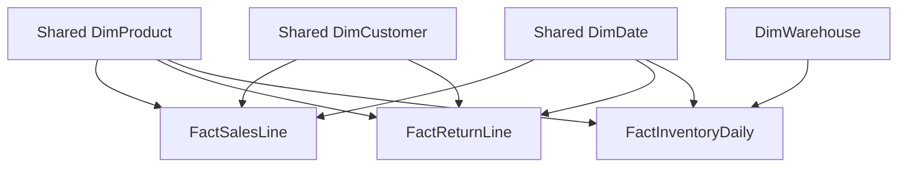

# Conformed Dimensions and Consistent Definitions Across Processes

An enterprise may report **revenue** from its sales system, **return value** from its post-sales system, and **inventory** from its warehouse management system. All three processes talk about "product", "date", and sometimes "store". Yet if sales treats a product as a SKU variant, returns uses a product model code, and warehouse uses a carton code, joining figures across columns that merely share a name can yield wrong answers even when the SQL runs without error.

In **analytical/dimensional modeling**, a **conformed dimension** is a dimension with unified identity, grain, attributes, and interpretation so that **multiple business processes can be analyzed under the same frame of reference**. It can be shared as a single physical table or distributed as semantically compatible implementations; what matters is **verified consistency**, not whether tables share identical names or integer keys.

This lesson belongs to the **DATABASE_DATA_MODELING** module, focusing on turning business requirements into appropriate entities, relationships, keys, indexes, physical schemas, and storage choices. We will build a **bus matrix** across multiple processes, define conformed dimensions, implement SQL examples, handle **Slowly Changing Dimensions (SCD)**, execute safe **drill-across** queries between facts, and design reconciliation checks when upstream system definitions diverge.

## 1. Why Are Conformed Dimensions Needed?

Suppose a company asks:

> In October, by product group, how much did each group sell, how much was returned, and what was month-end inventory?

Three data sources exist:

| Process | Typical Raw Data | Typical Questions Answered |
|---|---|---|
| **Sales** | Orders, order lines, sale time, SKU, revenue | Sold value and quantity by date/group |
| **Returns** | Return slips, return lines, original order, reason, refund amount | Returned value and quantity by date/group |
| **Inventory** | Stock quantity by SKU, warehouse, and snapshot timestamp | Ending stock, stock trends, fulfillment readiness |

If each team defines "Phones" independently:

- Sales uses `category = 'PHONE'` for phones and accessories.
- Returns uses `category = 'MOBILE'` for phones only, excluding accessories.
- Inventory calls it "Handheld Devices" and a SKU may represent a **box of 10 units**.

Then a report claiming "1,000 sold, 100 returned, 300 in stock" **cannot be reconciled meaningfully** until you confirm that 1,000, 100, and 300 refer to the exact same object set and unit of measure.

Conformed dimensions solve **the entity set and analytical axes**: a unified definition of product, category, date, and organizational unit across processes. However, they **do not automatically define measures**. "Gross revenue", "net revenue", "returned quantity", and "end-of-day stock" still require their own formulas, timestamps, and additivity rules.

### Three Layers of Consistency

1. **Identity:** one canonical code must refer to the same entity/version; distinct codes must never merge arbitrarily.
2. **Dimension semantics:** attributes, hierarchies, standardization rules, and effective intervals must align.
3. **Fact semantics:** each process keeps its own grain, sign convention, unit of measure, and recognition timestamp, even when sharing dimensions.

Satisfying (1) alone is insufficient. For example, if `product_id` matches across systems, yet sales records the product group at sale time while returns records the current group, group-level reports still break whenever a product is reclassified.

## 2. Distinguishing Dimensions, Facts, Grain, and Conformance

A **fact** records a measurable event, transaction, or state snapshot. A **dimension** provides context to filter, group, and interpret facts.



In this diagram:

- `DimProduct` defines a **sellable/stockable product variant**, shared by all three facts.
- `DimDate` defines calendar dates under one enterprise calendar; each fact uses dates in **its own role**: sale date, return date, or snapshot date.
- `DimCustomer` is shared between sales and returns if customer identity is genuinely compatible. Inventory may **have no customer dimension**.
- `DimWarehouse` belongs solely to inventory; never force every fact to carry every dimension.

### "Conformed" Does Not Mean "Used by Every Process"

A conformed dimension may appear in only **a subset** of processes. `DimCustomer` shared across Sales and Returns is still conformed even if irrelevant to Inventory.

Conversely, avoid building a shared "`DimStatus`" table across every process merely because all source tables have a `status` column. Order `CONFIRMED`, refund `APPROVED`, and inventory `AVAILABLE` carry **different business meanings**. Keep separate status tables, or construct a higher-level canonical classification with an explicit contract if cross-process comparison is genuinely needed.

### Two Levels of Conformance

- **Shared physical table/key conformed dimension:** facts reference one `dim_product` table with identical `product_sk` and attributes.
- **Distributed conformed dimension:** data marts hold copies or subsets (*shrunken dimensions*) sharing canonical codes, definitions, hierarchies, and member generation rules. A subset may retain fewer columns, yet shared attributes must hold identical meanings and values for any valid version.

If two independent data marts generate `product_sk = 42` for **two different products**, 42 is not a conformed key. Either map through canonical identity or distribute surrogate keys under a unified contract.

## 3. Start with a Bus Matrix Instead of Joining Facts Arbitrarily

An **enterprise data warehouse bus matrix** lists **business processes as rows** and **potentially shared dimensions as columns**. It defines conformance scope before designing physical tables.

| Process / Fact Grain | Date | Product | Customer | Store/Warehouse | Currency |
|---|---|---|---|---|---|
| Sales line — **1 sales line** | Sale date | Yes | Yes | Selling store, if known | Yes |
| Return line — **1 return line** | Return date; optionally original sale date | Yes | Yes, if identified | Return branch, if known | Yes |
| End-of-day stock — **1 SKU × warehouse × day** | Stock cutoff date | Yes | Not applicable | Warehouse | Not necessarily monetary |
| Payment — **1 payment transaction** | Payment date | May lack direct product | Yes or no per source | Optional | Yes |

"Store" and "warehouse" are **not automatically the same type of location**. You can use one `DimLocation` with explicit typing if locations share a canonical entity; if stores and warehouses have distinct identities and relationships, keep two separate dimensions plus a mapping structure for regional roll-ups when needed.

Columns in a bus matrix indicate **semantic shareability**, not an order to place an FK in every cell. Marking "not applicable" is far better than stuffing `customer_sk = 0` onto inventory snapshots and misleading users into thinking warehouses have customers.

### Write a One-Sentence Grain Before Every Fact

| Fact | Exact Grain | Typical Business Key / Identifier |
|---|---|---|
| `fact_sales_line` | One sales line of an order in a tenant | `tenant_id + source_system + source_sale_line_id` |
| `fact_return_line` | One recorded return line | `tenant_id + source_system + source_return_line_id` |
| `fact_inventory_daily` | End-of-day stock of one canonical product in one warehouse | `tenant_id + warehouse_id + product_bk + date_key` |

**Heterogeneous grains:** you cannot join `fact_sales_line` directly to `fact_return_line` on `product_sk` and sum money as though each side had one row. A product with 20 sales lines and 5 return lines produces **100 joined rows** when joined on product, multiplying amounts.

Before examining dimensions, specify what each fact row represents, which units can be summed, and under what conditions.

## 4. Defining a Data Contract for Each Conformed Dimension

A conformed dimension requires a **data contract**, not just a column list.

| Contract Component | Example for `DimProduct` | Questions to Confirm |
|---|---|---|
| **Grain** | One sellable and stockable SKU variant | Does a 10-unit carton share the same grain as a single unit? |
| **Business identity** | `(tenant_id, canonical_product_id)` | Which system issues identity; are IDs ever reused? |
| **Surrogate identity** | Versioned SCD `product_sk` | Can this key be shared across marts? |
| **Canonical attributes** | SKU, name, brand, product group | Is "product group" retail merchandising or accounting? |
| **Hierarchy** | Department → group → subgroup | Single parent or multi-parent? Does tree history exist? |
| **Standardization rules** | Trim/canonical code/mapping | Are SKUs case-sensitive or zero-padded? |
| **Effective window** | `[valid_from, valid_to)` | Group at sale date or current group? |
| **Unknown/late members** | Governed "unidentified" key | Can distinct unknowns ever be collapsed into one product? |
| **Authoritative source** | Product master / MDM | Who arbitrates conflicting upstream sources? |
| **Owner and quality** | Product data steward | Who approves definition edits, and what checks run? |

Contracts for `DimCustomer`, `DimDate`, and `DimOrganization` need the same rigor. "Customer" must clarify whether it means **retail account**, **individual person**, or **legal entity**; never treat matching emails as sole proof that two profiles are the same person. "Date" must define timezone, fiscal calendar, week start day, and how UTC events map to business dates.

### Never Cram Differing-Grain Sources into One Dimension by Losing Information

Suppose warehouse uses `case_sku` (a carton of 10 items) while sales uses `each_sku` (a single item). These two codes are not necessarily **the same `DimProduct` member**. You need packaging unit mappings, time-effective conversion factors, and conversion events—perhaps keeping `DimPackage` or a bridge explaining `case_sku → each_sku × 10`. Scaling stock quantities **requires explicit unit-of-measure rules** before comparing against units sold.

If a SKU code is reused for a different product over time, a natural key based solely on SKU is no longer stable. Maintain a canonical product identifier and mapping history; never equate "same SKU string" with "same product" by default.

## 5. Identity Standardization Across Multiple Sources

Real systems often carry multiple codes:

| Source | Source Code | Real Entity | Canonical Code |
|---|---|---|---|
| POS | `SKU-0007` | Black 128GB phone variant | `PRD-100` |
| ERP | `ITEM-782` | Same phone variant | `PRD-100` |
| WMS | `W-552` | Same variant at individual-unit level | `PRD-100` |
| WMS | `CASE-552` | Carton containing 10 of those units | **Do not merge directly**; needs pack mapping |

Do not crown the POS code as canonical ID merely because sales has the highest volume. Confirm who holds **authority over identity** and how product merges/splits are handled. A source mapping table might contain:

```text
ProductIdentityMap
  tenant_id
  source_system
  source_product_id
  canonical_product_id
  effective_from
  effective_to
  status
  match_method
  approved_by
```

When `source_product_id` can be reused, the mapping itself must be **time-effective** without unintended overlaps. Fact rows resolve via **source + source code + timestamp** to select the right canonical identity.

Heuristics like "matching names = same product" or "matching emails = same customer" risk false merges. Without sufficient evidence, route records to a **reconciliation staging area** or an unknown member with clear lineage rather than minting a wrong conformed key.

### Surrogate Keys Differ from Business Keys

- `canonical_product_id`: canonical business identifier, stable across sources (if governed by MDM policy).
- `product_sk`: technical key for **one dimension row version**; when SCD Type 2 tracks attribute history, one product can have multiple `product_sk` values.
- `source_product_id`: identifier assigned by an upstream system, often non-unique enterprise-wide.

A report by **current canonical product** can group by `canonical_product_id`. A report by **product group at sale time** groups by attributes of the `product_sk` referenced by the fact. Both interpretations are valid in their respective contexts, yet must never be mixed silently in one report.

## 6. Slowly Changing Dimensions and Defining "At Time T"

Suppose product `PRD-100` belonged to "Phones" before October, and moved to "Mobile Devices" starting Oct 01. At least two reporting requirements exist:

- **By classification at transaction time:** September revenue remains under "Phones".
- **By current classification:** All revenue, including September, rolls up into "Mobile Devices".

These are two distinct business perspectives. No single `category_name` column can represent both once an attribute changes.

### 6.1. SCD Type 1, Type 2, and Type 0

| Policy | Behavior | Suitable When |
|---|---|---|
| **Type 1** | Overwrites attribute in current dimension row | Fixing typos; historical values need not be retained |
| **Type 2** | Adds new version with new `product_sk` and effective interval | Must group facts by classification valid at event time |
| **Type 0** | Keeps attribute immutable after creation | Original values must stay fixed, e.g., initial creation date |

Policies can be mixed **per attribute**. Fixing display-name typos can use Type 1, while category reassignments follow Type 2. However, if a Type 1 update overwrites a column across **all Type 2 versions**, historical reports see the updated value—which may either be intentional or an unexpected discrepancy requiring approval.

### 6.2. Half-Open Effective Intervals

Use `[valid_from, valid_to)`: inclusive start, exclusive end. A version with `valid_to = NULL` remains open-ended indefinitely in this example.

```text
PRD-100 / product_sk=501 / category=PHONE
  valid_from: 2026-01-01 00:00 UTC
  valid_to:   2026-10-01 00:00 UTC

PRD-100 / product_sk=888 / category=MOBILE
  valid_from: 2026-10-01 00:00 UTC
  valid_to:   NULL
```

A transaction at 23:59 on Sep 30 UTC maps to `501`. A transaction at 00:00 on Oct 01 UTC maps to `888`. If categories take effect by **Vietnam business date** rather than UTC, convert effective timestamps accurately before loading; never assume storage timestamps match business cutoffs.

### 6.3. Rule for Resolving Facts to Exactly One Version

For every event, look up:

\[
(\text{tenant},\ \text{canonical product},\ \text{event time})
\rightarrow \text{exactly one product\_sk}.
\]

If **0 versions** match, dimension data is missing or late. If **2 versions** match, SCD intervals overlap—a defect to resolve. Never silently apply `LIMIT 1` to hide ambiguous mappings.

## 7. Illustrative SQL Schema for Conformed Dimensions

The example below uses **PostgreSQL 15+** and intentionally separates the analytical layer from the transactional source. Facts store data at defined grains; the source OLTP is not required to share this schema.

### 7.1. Date Dimension and Type 2 Product Dimension

```sql
CREATE TABLE dim_date (
    date_key INTEGER PRIMARY KEY,       -- e.g. 20261005
    calendar_date DATE NOT NULL UNIQUE,
    calendar_year INTEGER NOT NULL,
    calendar_month INTEGER NOT NULL,
    month_key INTEGER NOT NULL,         -- e.g. 202610
    CONSTRAINT ck_date_month CHECK (calendar_month BETWEEN 1 AND 12)
);

CREATE TABLE dim_product (
    product_sk BIGINT GENERATED ALWAYS AS IDENTITY PRIMARY KEY,
    tenant_id BIGINT NOT NULL,
    canonical_product_id TEXT NOT NULL,
    sku TEXT NOT NULL,
    product_name TEXT NOT NULL,
    category_code TEXT NOT NULL,
    category_name TEXT NOT NULL,
    valid_from TIMESTAMPTZ NOT NULL,
    valid_to TIMESTAMPTZ,
    is_current BOOLEAN NOT NULL,

    CONSTRAINT uq_product_version
        UNIQUE (tenant_id, canonical_product_id, valid_from),
    CONSTRAINT uq_product_tenant_sk
        UNIQUE (tenant_id, product_sk),
    CONSTRAINT ck_product_bk
        CHECK (btrim(canonical_product_id) <> ''),
    CONSTRAINT ck_product_name
        CHECK (btrim(product_name) <> ''),
    CONSTRAINT ck_product_interval
        CHECK (valid_to IS NULL OR valid_to > valid_from),
    CONSTRAINT ck_product_current
        CHECK (is_current = (valid_to IS NULL))
);

CREATE UNIQUE INDEX uq_current_product_per_tenant
    ON dim_product (tenant_id, canonical_product_id)
    WHERE is_current = TRUE;

CREATE INDEX ix_product_asof
    ON dim_product (tenant_id, canonical_product_id, valid_from);
```

**What these constraints protect:**

- `product_sk` is unique per version; `(tenant_id, canonical_product_id, valid_from)` has no duplicates.
- Each canonical product has **at most one** `is_current=TRUE` row via the partial unique index.
- `valid_to` exceeds `valid_from` when present.
- `is_current` aligns with whether the effective interval has an open end.

**What remains unprotected:** two **closed** versions having overlapping intervals; temporal gaps; ensuring a canonical code has at least one version. Standard FKs and `UNIQUE` constraints do not fully solve interval integrity.

PostgreSQL can add an **exclusion constraint** if extensions/operator classes and deployment policies permit:

```sql
-- PostgreSQL option: enforce non-overlapping effective intervals.
-- Requires extension privileges and evaluating GiST index overhead.
CREATE EXTENSION IF NOT EXISTS btree_gist;

ALTER TABLE dim_product
ADD CONSTRAINT ex_product_versions_no_overlap
EXCLUDE USING gist (
    tenant_id WITH =,
    canonical_product_id WITH =,
    tstzrange(valid_from, valid_to, '[)') WITH &&
);
```

`tstzrange(valid_from, NULL, '[)')` has an unbounded upper limit, fitting the current version. This constraint blocks **overlapping intervals** per tenant/product; it **does not** require intervals to be contiguous. Before adding it to large tables, benchmark index overhead and clean up invalid legacy intervals.

### 7.2. Account-Level Conformed Customer Dimension

```sql
CREATE TABLE dim_customer (
    customer_sk BIGINT GENERATED ALWAYS AS IDENTITY PRIMARY KEY,
    tenant_id BIGINT NOT NULL,
    canonical_customer_id TEXT NOT NULL,
    customer_segment TEXT NOT NULL,
    display_name TEXT NOT NULL,

    CONSTRAINT uq_customer_tenant_bk
        UNIQUE (tenant_id, canonical_customer_id),
    CONSTRAINT uq_customer_tenant_sk
        UNIQUE (tenant_id, customer_sk),
    CONSTRAINT ck_customer_identity
        CHECK (btrim(canonical_customer_id) <> ''),
    CONSTRAINT ck_customer_segment
        CHECK (btrim(customer_segment) <> ''),
    CONSTRAINT ck_customer_name
        CHECK (btrim(display_name) <> '')
);
```

In this example `DimCustomer` is **Type 1**, storing no segment history. Consequently, historical revenue reports by `customer_segment` reflect **the current segment**. If the business needs segment **at time of purchase**, convert that attribute to SCD Type 2 or store a valid snapshot; never claim a report preserves history when backed only by a Type 1 table.

`canonical_customer_id` must be governed by a controlled identity resolution process, never guessed from matching emails/phones. Anonymous POS transactions may require a per-tenant unknown/special member, explicitly documented as **unidentified customer**—not implying all anonymous buyers are one single person.

### 7.3. Three Facts with Different Grains

```sql
CREATE TABLE fact_sales_line (
    sales_line_sk BIGINT GENERATED ALWAYS AS IDENTITY PRIMARY KEY,
    tenant_id BIGINT NOT NULL,
    source_sale_line_id TEXT NOT NULL,
    sale_date_key INTEGER NOT NULL REFERENCES dim_date(date_key),
    product_sk BIGINT NOT NULL,
    customer_sk BIGINT NOT NULL,
    currency_code CHAR(3) NOT NULL,
    quantity NUMERIC(18, 3) NOT NULL,
    gross_amount_minor NUMERIC(20, 0) NOT NULL,
    discount_amount_minor NUMERIC(20, 0) NOT NULL,
    net_sales_amount_minor NUMERIC(20, 0) NOT NULL,

    CONSTRAINT uq_sale_source
        UNIQUE (tenant_id, source_sale_line_id),
    CONSTRAINT uq_sale_tenant_sk
        UNIQUE (tenant_id, sales_line_sk),
    CONSTRAINT fk_sale_product
        FOREIGN KEY (tenant_id, product_sk)
        REFERENCES dim_product (tenant_id, product_sk),
    CONSTRAINT fk_sale_customer
        FOREIGN KEY (tenant_id, customer_sk)
        REFERENCES dim_customer (tenant_id, customer_sk),
    CONSTRAINT ck_sale_qty CHECK (quantity > 0),
    CONSTRAINT ck_sale_gross CHECK (gross_amount_minor >= 0),
    CONSTRAINT ck_sale_discount CHECK (
        discount_amount_minor >= 0
        AND discount_amount_minor <= gross_amount_minor
    ),
    CONSTRAINT ck_sale_net CHECK (
        net_sales_amount_minor = gross_amount_minor - discount_amount_minor
    )
);

CREATE TABLE fact_return_line (
    return_line_sk BIGINT GENERATED ALWAYS AS IDENTITY PRIMARY KEY,
    tenant_id BIGINT NOT NULL,
    source_return_line_id TEXT NOT NULL,
    return_date_key INTEGER NOT NULL REFERENCES dim_date(date_key),
    original_sales_line_sk BIGINT NOT NULL,
    product_sk BIGINT NOT NULL,
    customer_sk BIGINT NOT NULL,
    currency_code CHAR(3) NOT NULL,
    returned_quantity NUMERIC(18, 3) NOT NULL,
    refund_amount_minor NUMERIC(20, 0) NOT NULL,

    CONSTRAINT uq_return_source
        UNIQUE (tenant_id, source_return_line_id),
    CONSTRAINT fk_return_original_sale
        FOREIGN KEY (tenant_id, original_sales_line_sk)
        REFERENCES fact_sales_line (tenant_id, sales_line_sk),
    CONSTRAINT fk_return_product
        FOREIGN KEY (tenant_id, product_sk)
        REFERENCES dim_product (tenant_id, product_sk),
    CONSTRAINT fk_return_customer
        FOREIGN KEY (tenant_id, customer_sk)
        REFERENCES dim_customer (tenant_id, customer_sk),
    CONSTRAINT ck_return_qty CHECK (returned_quantity > 0),
    CONSTRAINT ck_return_amount CHECK (refund_amount_minor >= 0)
);

CREATE TABLE fact_inventory_daily (
    tenant_id BIGINT NOT NULL,
    snapshot_date_key INTEGER NOT NULL REFERENCES dim_date(date_key),
    warehouse_id TEXT NOT NULL,
    product_sk BIGINT NOT NULL,
    on_hand_units NUMERIC(18, 3) NOT NULL,

    CONSTRAINT pk_inventory_daily
        PRIMARY KEY (
            tenant_id, snapshot_date_key, warehouse_id, product_sk
        ),
    CONSTRAINT fk_inventory_product
        FOREIGN KEY (tenant_id, product_sk)
        REFERENCES dim_product (tenant_id, product_sk),
    CONSTRAINT ck_warehouse_id CHECK (btrim(warehouse_id) <> '')
);
```

**Illustrative formula assumptions:** sales has `net_sales_amount_minor = gross - discount`, excluding taxes/shipping. Returns store **non-negative** refund amounts; when computing net differences, **subtract** refunds rather than storing negative amounts and subtracting again.

**Return source assumptions:** each return line links to an original sales line. For partial returns, multiple `fact_return_line` rows may reference one `original_sales_line_sk`. These FKs **do not yet verify** that `product_sk`, `customer_sk`, and `currency_code` on the return match the original sales line; that requires ETL contracts, tests, or additional constraints. If the business permits returns without an original sales receipt, choose a different grain and mapping mechanism instead of inventing fake original IDs.

**Inventory assumptions:** each day has exactly one **end-of-day** snapshot per tenant/warehouse/product. `on_hand_units` omits `CHECK >= 0` because some systems allow temporary negative stock during reconciliation; if negative stock is forbidden, add an explicit invariant. A snapshot represents **point-in-time state**, not daily receipts or shipments.

### Composite Keys Protect Tenant Scope, Not All Semantic Rules

Composite FKs `(tenant_id, product_sk)` and `(tenant_id, customer_sk)` ensure every fact points to dimensions within its own tenant. Still, they **do not prove** a fact points to the **SCD version valid at event time**. A Sep 01 sales line could reference a product version effective Oct 01 without triggering an FK error. That is why temporal key resolution and dedicated assertions are required.

In other analytical engines, FKs may serve merely as **optimizer metadata** without engine enforcement. There, pipelines and data tests must uphold invariants that OLTP typically delegates to the database.

## 8. ETL/ELT: Resolving Dimension Versions at Event Time

Suppose Sales sends:

```text
tenant_id = 42
source_sale_line_id = POS-2026-001
source_product_id = SKU-0007
occurred_at = 2026-09-30T14:30:00Z
quantity = 2
```

Before writing the fact:

1. Map `(tenant_id, source_system, source_product_id, occurred_at)` to `canonical_product_id` via the canonical identity map.
2. Look up `DimProduct` for the same tenant and canonical code where event time falls within the effective interval.
3. Require **exactly one** `product_sk`; never accept 0 or more than 1 without logging an error.
4. Resolve customer per `DimCustomer` definition and approved unknown policy.
5. Convert `occurred_at` to **business date** using the chosen timezone/calendar to determine `sale_date_key`.
6. Normalize units of measure, currency, tax/discount rules, and amount sign per fact contract.
7. Upsert by **unique source key** with late/correction handling; never duplicate a sales line on retry.

### Query to Look Up the Product Version

```sql
-- Canonical product_id was already resolved in the source mapping step.
SELECT p.product_sk
FROM dim_product AS p
WHERE p.tenant_id = 42
  AND p.canonical_product_id = 'PRD-100'
  AND p.valid_from <= TIMESTAMPTZ '2026-09-30 14:30:00+00'
  AND (
      p.valid_to IS NULL
      OR TIMESTAMPTZ '2026-09-30 14:30:00+00' < p.valid_to
  );
```

The `[valid_from, valid_to)` predicate matches the SCD contract. For every input row, ETL **must assert the returned row count**. Using `LIMIT 1` to "avoid errors" when two intervals overlap merely conceals broken upstream data.

### Late-Arriving Events and Late-Arriving Dimensions

**Late-arriving fact:** a Sep 15 sales line reaches the warehouse on Oct 05. Even if the product version changed on Oct 01, the fact must resolve as of **Sep 15**, not load date.

**Late-arriving dimension:** a fact arrives before its canonical product metadata. Either hold the fact in staging until resolved, or use an **inferred member** with explicit ID/version and backfill later. Never pick a similarly named product as a placeholder.

**Retroactive SCD edits:** if the source reports a change effective Sep 15 after the Oct 01 version was already loaded, inserting the new version **splits the interval** and can leave previously loaded facts pointing to the wrong `product_sk`. Run a process to detect affected facts, reassign surrogate keys, or honor published restatement policies. Updating a dimension never automatically updates historical FKs inside facts.

## 9. Returns: Return Date or Sale Date, Old Group or New Group?

Returns quickly expose inconsistencies across processes. A product sold on Sep 29 belonged to `PHONE`; the customer returns it on Oct 08 after the product moved to `MOBILE`.

At least four decisions exist:

| Axis | Option | Meaning |
|---|---|---|
| **Return measurement date** | Return date | Refund value recognized in October |
| **Return measurement date** | Original sale date | Adjusts business performance of September's sales cohort |
| **Product group** | Group at original sale date | Returns map to the same classification as the original sale |
| **Product group** | Group at return date | Returns map to the classification active when returned |

These options **cannot be swapped** without changing results. Pick according to the reporting question and record it in the contract. One fact table does not have to serve every angle alone; storing sufficient date roles and linking to the original sales line allows deriving multiple reporting views.

In this lesson we **define `fact_return_line.product_sk` to equal the original sales line's `product_sk`**, classifying returns by **group at sale time**, while `return_date_key` remains **actual return date**. This convention lets sales and returns reconcile under **the same historical product classification** without forcing returns back into the sale month.

**Know the convention's boundary:** reporting "returns by group active at return date" requires additionally resolving the product dimension at return date or adding a separate role column. Never take the old query and simply relabel the group in the UI without verifying temporal logic.

### Constraints Beyond What This Example's FKs Enforce

When a return references `original_sales_line_sk`, ETL should verify:

- The return carries the same `product_sk` as the original sales line per the policy above.
- The return belongs to the same tenant as the original sales line.
- The return belongs to an authorized customer or refund account.
- Refund currency and amount rules align with the original sale (accounting for fees, coupons, or adjustments).
- Summed returned quantity across multiple partial returns does not exceed sold quantity if policy forbids it.
- Cancelled/status-changed returns are excluded or adjusted properly in the fact.

Schema FKs protect **existence and tenant alignment** of the original line, but do not verify aggregate totals or cross-column equality. Those rules require ETL/source validation and traceable tests.

## 10. Drill-Across: Comparing Processes Without Multiplying Rows

**Drill-across** aggregates each fact independently to **the same grouping keys and dimension rules**, then joins those aggregated results on that key set.

Example reporting request:

> By month and product group at time of sale, what are net sales and returns occurring within the month?

Under our contract, sales and returns both use `DimProduct` with the `category_code` of the version attached to each fact. Both join `dim_date.month_key`, representing **sale month** and **return month** respectively. We **never join the two raw facts**.

### 10.1. Safe Drill-Across Query Example

```sql
WITH sales_by_month AS (
    SELECT
        s.tenant_id,
        d.month_key,
        p.category_code,
        s.currency_code,
        SUM(s.net_sales_amount_minor) AS sales_minor
    FROM fact_sales_line AS s
    JOIN dim_date AS d ON d.date_key = s.sale_date_key
    JOIN dim_product AS p
      ON p.tenant_id = s.tenant_id AND p.product_sk = s.product_sk
    WHERE s.tenant_id = 42
      AND s.currency_code = 'VND'
    GROUP BY
        s.tenant_id, d.month_key, p.category_code, s.currency_code
),
returns_by_month AS (
    SELECT
        r.tenant_id,
        d.month_key,
        p.category_code,
        r.currency_code,
        SUM(r.refund_amount_minor) AS returns_minor
    FROM fact_return_line AS r
    JOIN dim_date AS d ON d.date_key = r.return_date_key
    JOIN dim_product AS p
      ON p.tenant_id = r.tenant_id AND p.product_sk = r.product_sk
    WHERE r.tenant_id = 42
      AND r.currency_code = 'VND'
    GROUP BY
        r.tenant_id, d.month_key, p.category_code, r.currency_code
)
SELECT
    COALESCE(s.tenant_id, r.tenant_id) AS tenant_id,
    COALESCE(s.month_key, r.month_key) AS month_key,
    COALESCE(s.category_code, r.category_code) AS category_code,
    COALESCE(s.currency_code, r.currency_code) AS currency_code,
    COALESCE(s.sales_minor, 0) AS sales_minor,
    COALESCE(r.returns_minor, 0) AS returns_minor,
    COALESCE(s.sales_minor, 0)
        - COALESCE(r.returns_minor, 0) AS net_activity_minor
FROM sales_by_month AS s
FULL OUTER JOIN returns_by_month AS r
  ON s.tenant_id = r.tenant_id
 AND s.month_key = r.month_key
 AND s.category_code = r.category_code
 AND s.currency_code = r.currency_code
ORDER BY month_key, category_code;
```

**Why does this query prevent fan-out?** Each CTE has **at most one row** per `(tenant, month, category, currency)`. They join on **that exact grouping key tuple**, avoiding any Cartesian product between sales lines and return lines.

**Why is `FULL OUTER JOIN` required?** A category may have sales with zero returns, or returns in a month with zero new sales. An `INNER JOIN` would drop one-sided groups.

**Why group by `currency_code`?** 100,000 VND minor units and 100,000 USD minor units **are not the same unit**. This example filters to VND; multi-currency reports must group by currency or convert under agreed FX rates, dates, and rounding rules.

**Why call it `net_activity_minor`?** It subtracts refunds **occurring in the month** from sales in the month—not necessarily "accounting net revenue" for that month. October returns may originate from September sales. For **restatement by original sale period**, link returns to `sale_date` under a dedicated accounting contract.

### 10.2. Anti-Pattern: Joining Raw Facts on Product

```sql
-- Wrong if used to sum sales and returns:
SELECT
    s.product_sk,
    SUM(s.net_sales_amount_minor),
    SUM(r.refund_amount_minor)
FROM fact_sales_line AS s
JOIN fact_return_line AS r
  ON r.tenant_id = s.tenant_id
 AND r.product_sk = s.product_sk
GROUP BY s.product_sk;
```

If one `product_sk` has 4 sales lines and 3 return lines, joining yields **12 rows**. Each sales line repeats 3 times and each return line repeats 4 times. Both `SUM`s are wrong.

`DISTINCT` is not a general fix: two distinct transactions can have identical amounts and get wrongly collapsed by `SUM(DISTINCT amount)`. Always **aggregate each fact to reporting grain before joining** or join on explicit event-level lineage.

### 10.3. When Two Facts Share Only a Subset of Dimensions

Inventory lacks a customer dimension, so you cannot drill across inventory by customer without an explicit **allocation rule** or real business relationship. Drill across Sales and Inventory only on shared conformed dimensions like `date_key` and `product`/`warehouse`, or roll up to product group/day. Never replicate entire stock balances onto every customer and call it inventory by customer.

## 11. Additive, Semi-Additive, and Non-Additive Measures

Conformed dimensions establish **shared comparison axes**, yet facts retain distinct additivity rules.

| Measure | Source Grain | Additive Across Products? | Additive Across Dates? | Notes |
|---|---|---|---|---|
| `net_sales_amount_minor` | Sales line | Yes, within same currency/policy | Yes, across event windows | Net of discount per formula |
| `refund_amount_minor` | Return line | Yes, within same currency | Yes, by return date | Requires valid return rules |
| Sold `quantity` | Sales line | Yes if units match | Yes | Must standardize each/carton/kg |
| `on_hand_units` | Daily stock snapshot | Yes if units match | **Must not sum across days** as period stock | Semi-additive across time |
| `inventory_coverage_days` | Derived metric | Not directly | Not directly | Ratio; compute from proper base measures |

For instance, month-end inventory is **the snapshot on the last valid day of the month**, not `SUM(on_hand_units)` over 31 days. Fetching the latest snapshot requires a missing-data policy: "no snapshot" is different from "stock = 0".

If stock snapshots use 24:00 local end-of-day while Sales uses UTC calendar days, the two date axes can skew. Align `DimDate` and the definition of **business day** before plotting metrics side by side.

### Illustrative Month-End Inventory Query

```sql
-- Example for tenant 42, month 202610, assuming daily snapshots.
WITH last_day AS (
    SELECT MAX(date_key) AS date_key
    FROM dim_date
    WHERE month_key = 202610
)
SELECT
    p.category_code,
    SUM(i.on_hand_units) AS ending_on_hand_units
FROM fact_inventory_daily AS i
JOIN last_day AS ld
  ON ld.date_key = i.snapshot_date_key
JOIN dim_product AS p
  ON p.tenant_id = i.tenant_id
 AND p.product_sk = i.product_sk
WHERE i.tenant_id = 42
GROUP BY p.category_code
ORDER BY p.category_code;
```

This picks the **calendar last day**. If snapshots are missing on that day, affected SKUs/warehouses drop out and totals no longer represent true month-end stock. In production, verify **snapshot completeness per tenant/warehouse/SKU**, then decide whether to wait for data, fall back to the latest available date per key (with an explicit staleness policy), or flag incomplete status.

Additionally, if `on_hand_units` spans incompatible units across SKUs (pieces, kg, cartons), you cannot sum a single `ending_on_hand_units` by category without first converting to a common unit of measure. Conformed dimensions do not replace a **unit-of-measure (UOM)** framework.

## 12. Conformed Hierarchies: Product Groups, Regions, and Organizations

Conformed dimensions are more than an ID key. Many dashboards require the same **hierarchy tree**:

```text
Consumer Goods
  └── Electronics
        ├── Phones
        └── Computers
```

Processes must agree on which group "Phones" belongs to, during which timeframe, and which code applies when groups split or merge.

### Matching Category Codes Are Insufficient When Hierarchies Differ

Sales may use a **merchandising hierarchy**, while Finance uses a **financial reporting hierarchy**. One product can legitimately be classified differently for two valid purposes. Never force both into one ambiguous `category_code` column. Define separate hierarchies, or one dimension with clearly named hierarchy columns and versioned mappings.

If a product belongs to **multiple categories simultaneously**, the relationship is no longer single-valued at that point in time. Joining facts through a product–category bridge multiplies amounts. Choose one rule:

- **Primary group:** designate one primary category for non-multiplying reports.
- **Allocation:** weighted bridge where weights sum to 1 per product/timestamp when allocating money.
- **Multi-tag reporting:** allow a fact to appear in multiple groups while **forbidding summing group totals into a grand total**; state this explicitly.

### Historical Hierarchy Changes

If the "Phones" node moves under another parent group, reporting "by current tree" differs from reporting "by tree at sale date". With product SCD Type 2, parent attributes can live directly on product versions; for deep, volatile trees, use time-effective hierarchy/bridge tables. Never infer historical trees from a category's current `parent_id`.

## 13. Role-Playing Dimensions: One Date Dimension, Multiple Meanings

One `DimDate` can serve **multiple roles**:

- `sale_date_key`: date the sale occurred.
- `return_date_key`: date the return was recorded.
- `original_sale_date_key`: sale date of the returned item.
- `snapshot_date_key`: stock cutoff date.
- `payment_date_key`: payment date.

This is a **role-playing dimension**: one shared date/calendar definition table, where separate FKs carry **distinct meanings**. Never collapse them into one generic `date_key` across all tables and treat all "same-day" events as equivalent.

Example:

```sql
SELECT d.month_key AS return_month,
       SUM(r.refund_amount_minor) AS refunded_minor
FROM fact_return_line AS r
JOIN dim_date AS d
  ON d.date_key = r.return_date_key
WHERE r.tenant_id = 42
  AND r.currency_code = 'VND'
GROUP BY d.month_key;
```

This returns **refunds by return month**. To get "returns from sales made in a given sale month", traverse `r.original_sales_line_sk` to `fact_sales_line.sale_date_key` or store explicit date roles and test them. You cannot change semantics simply by renaming the alias `return_month` to `sales_month`.

### Fiscal Calendars and Timezones

`DimDate` can carry Gregorian year-month, ISO weeks, and 4-4-5 fiscal periods. Processes must share **the same fiscal calendar rules** when comparing. If business units operate on differing fiscal calendars, period keys must include organization/calendar scope or use a dedicated calendar dimension; never claim `month_key=202610` represents the same fiscal period when policies differ.

## 14. Governing Consistent Definitions Across Teams

It is hard to keep conformed dimensions intact if every team edits category codes, customer scope, or formulas without notice.

### Business Glossary and Data Contracts

Every dimension should document at minimum:

| Contract Field | Example Content |
|---|---|
| Official name | `ConformedProduct` |
| Meaning | Sellable and stockable item variant at **one canonical unit** |
| Grain | `tenant_id + canonical_product_id + SCD effective version` |
| Identity key | `canonical_product_id` governed by Product Master |
| Conformance rules | POS/ERP/WMS sources must pass through approved mapping tables |
| Attribute history | `category_code` Type 2; display name per separate policy |
| Unknown policy | Never merge missing source records arbitrarily; preserve lineage and staging queue |
| SLA | Ingestion latency, publish cutoff, and late-event handling |
| Reconciliation | Key counts, uniqueness, effective intervals, coverage, and attribute values |
| Owners | Product Data Steward and Data Platform Team |
| Change management | Contract versioning, approvers, migration schedule, downstream mart notifications |

A **semantic layer** can define centralized "Net Sales" metrics and "Product Category (as sold)" axes for all dashboards. Yet placing a semantic layer atop mis-mapped data **cannot fix** a fact pointing to the wrong `product_sk`.

### Change Management

When a new product group appears, the workflow should include:

1. Confirm definition and code, avoiding semantic collisions.
2. Assess impact on hierarchies and downstream reports.
3. Choose Type 1 vs. Type 2, effective date, and historical arbitration rules.
4. Update source mappings, glossary, and tests.
5. Ensure pipelines and consumers remain compatible before updating published data.
6. Rebuild/restate impacted facts if policy requires.
7. Publish the new contract version and reconcile results across processes.

Never let each team manually edit `category_name` inside a data mart and hope dashboards "eventually align" after the next ETL run.

## 15. Reconciling Conformance Across Multiple Processes

**Reconciliation** here goes beyond matching row counts. It verifies identities, temporal alignment, and dimension resolution completeness.

| Check Group | Invariant / Condition | Symptom of Failure |
|---|---|---|
| **Identity** | One source code + timestamp maps to at most one valid canonical ID | Overlapping mappings / wrong merges |
| **SCD uniqueness** | One tenant + product + timestamp has at most one version | Two effective intervals overlap |
| **Coverage** | Every required fact has a dimension member or governed unknown | Orphan facts / missing keys |
| **Tenant** | Facts never point to dimensions from another tenant | Cross-tenant leak / mis-mapping |
| **Granularity** | Sales in individual SKU units, inventory in standardized units | Quantities off by factors of 10, 12, 1000 |
| **Definition** | Identical `category_code` carries identical meaning and approved hierarchy | POS and WMS share code for different item sets |
| **Temporal** | SCD key matches the chosen business timestamp | September fact linked to October version |
| **Role/date** | Sale, return, and snapshot dates keep separate definitions | Monthly revenue mixed by refund date |
| **Measures** | Amount signs, currency, tax/discount rules enforced | Refunds subtracted twice |
| **Completeness** | Snapshots cover all warehouses/SKUs at cutoff | Missing warehouse rows treated as 0 |
| **Lineage** | Facts trace back to source records and rule versions | Unexplainable dashboard numbers |

### Checking Facts Pointing to Wrong Product Versions

```sql
SELECT
    s.tenant_id,
    s.source_sale_line_id,
    s.product_sk,
    p.canonical_product_id,
    d.calendar_date,
    p.valid_from,
    p.valid_to
FROM fact_sales_line AS s
JOIN dim_product AS p
  ON p.product_sk = s.product_sk
JOIN dim_date AS d
  ON d.date_key = s.sale_date_key
WHERE NOT (
    p.tenant_id = s.tenant_id
    AND p.valid_from <= (d.calendar_date::TIMESTAMP AT TIME ZONE 'UTC')
    AND (
        p.valid_to IS NULL
        OR (d.calendar_date::TIMESTAMP AT TIME ZONE 'UTC') < p.valid_to
    )
);
```

**Crucial limitation of this illustrative query:** the sample fact stores only **sale date**, whereas SCD validity uses **timestamps**. A transaction at 18:00 on a reclassification day may have a different version than at 00:00. The query above checks **start-of-day UTC**, which does not prove exact transaction-timestamp alignment. In an exact implementation, retain `occurred_at`/`sale_occurred_at` on the fact or queryable staging table and compare directly against `[valid_from,valid_to)`. Business timezone must also be specified.

If the fact already converted `sale_date_key` to local date while SCD uses UTC, checking against 00:00 UTC introduces further drift. Therefore, temporal conformance tests should inspect **raw event timestamps or sufficiently granular effective cutoffs**, not truncated dates alone.

### Comparing Mapping Coverage Across Sources

A useful operational metric:

\[
\text{dimension\_resolution\_rate} =
\frac{\text{facts mapped to exactly one member}}
{\text{total facts required to map}}.
\]

Never report "99.9% mapped" and ignore the remaining 0.1%. Break down unmapped records by source, tenant, time, monetary value, and error reason—missing a handful of high-value facts can distort executive reports. Separate **unresolved** records from **deliberately unknown** (by policy) to measure data quality accurately.

### Verify Business Outcomes, Not Just Dimension Keys

Reconcile monthly total sales before and after applying canonical `product_sk` against the sales source under identical currency and status filters. Reassigning a category merely changes a grouping axis, so total tenant revenue **must never increase**; if it rises, suspect fan-out or duplicate fact loading. Conversely, matching grand totals does not prove every product group is right—offsetting shifts between two groups can mask errors.

## 16. Common Exceptions and Discrepancies

| Scenario | What Not to Do | Recommended Handling |
|---|---|---|
| POS has `SKU-7`, WMS has `W-7` | Match because both contain 7 | Use verified identity mappings |
| One SKU equals a 10-unit carton | Add directly to single-unit sales quantities | Design time-effective UOM conversions |
| Product moves from group A to B | Overwrite all history silently | Lock down Type 1/2 policy and as-was/as-is views |
| Two SCD versions overlap | Pick one arbitrarily via `ORDER BY valid_from DESC LIMIT 1` | Block/reconcile overlaps and fix upstream |
| Late-arriving fact | Assign current `product_sk` | Look up by event time |
| Return belongs to last month's sale | Treat return and sale dates as identical | Distinguish return-date vs. sale-date roles |
| Two facts share `product_sk` | Join raw facts directly and sum | Aggregate independently, then drill across |
| Inventory missing cutoff day | Treat missing data as 0 | Monitor snapshot completeness |
| Sales has customer, inventory does not | Multiply stock across every customer | Drill across only on truly shared dimensions |
| Two semantically different "statuses" | Force into one `DimStatus` | Keep separate meanings or define an explicit mapping |
| Report across multiple categories per product | Sum category labels as grand total | Primary rule, weighted bridge, or non-additive label |
| Different currencies | Sum minor units directly | Group by currency or apply governed FX conversion |
| Customers share an email | Merge into one customer | Governed identity/MDM approval |
| Dimension edited directly inside mart | Mart copy drifts from conformed definition | Change-management workflow and sync tests |

These exceptions must be codified in **data contracts and automated tests**, not passed around informally by word of mouth among BI teams.

## 17. Evaluating Storage Options: Relational, Document, Graph, and Analytical

### Relational

Dimensions and facts typically live in a **star schema** or **fact constellation**. One shared `dim_product` is referenced by multiple fact tables via surrogate keys; FKs, unique constraints, and indexes enforce structure. Depending on the data warehouse, FKs may be informational only, leaving ETL test suites responsible for referential checks.

### Document

An order document may embed product metadata at purchase time for fast reads. That is a **meaningful transaction snapshot**, not necessarily a substitute for today's conformed dimension. For cross-process reporting, build pipelines mapping upstream codes to **canonical identities**; otherwise collections sharing the name `product` can still carry incompatible definitions.

### Graph

Graphs naturally represent `SOURCE_SKU → CANONICAL_PRODUCT`, `PRODUCT → CATEGORY`, and historical mapping lineages. This helps when multiple systems create intricate networks, yet you still must enforce uniqueness, non-overlapping validity, and metric definitions. A graph does not magically turn two identically named nodes into one trustworthy identity.

### Analytics

Conformed dimensions underpin **drill-across**, shared semantic models, and multi-process dashboards. Still, you must safeguard fact grain, date roles, measure additivity, and history. Sharing dimension tables neither merges facts into one table nor makes measures across processes automatically additive.

## 18. Step-by-Step Implementation Process

### Step 1 — Inventory Processes and Reporting Questions

List sales, returns, inventory, fulfillment, and the exact cross-process comparisons needed. Define "sold", "returned", and "on hand" with explicit timestamps and statuses.

### Step 2 — Finalize Grain for Each Fact

One sales line, one return line, one SKU–warehouse–day. When orders span multiple lines, never attach order-level revenue onto lines and sum without an allocation rule.

### Step 3 — Build the Bus Matrix and Identify Truly Shared Dimensions

Mark Date, Product, Customer, Location, and Currency across processes. Never force non-applicable dimensions; document role-playing dates and hierarchies where needed.

### Step 4 — Author Conformed Dimension Contracts

Lock down business identity, grain, attributes, canonical mapping, SCD policy, valid-time rules, unknown handling, ownership, and SLAs. Distinguish canonical IDs from versioned surrogate keys.

### Step 5 — Build Mapping and Dimension Pipelines Before Facts

Load canonical metadata, reconcile source codes, and block overlaps. Resolve late-arriving facts by event time; never silently default to current members.

### Step 6 — Build Facts and Apply Tests

Verify unique source keys, same-tenant FKs, amount formulas, currency, units, statuses, and timestamps. For returns, specify linkage to original sales and classification rules.

### Step 7 — Build Drill-Across Queries

Aggregate each fact to **the same dimension and time granularity**, then join the grouped sets; inspect unmatched one-sided rows and verify zero fan-out.

### Step 8 — Publish Semantic Layer and Govern Changes

Define "Net Sales", "Refunds", "Ending Inventory", and historical vs. current perspectives. Every mapping, hierarchy, or metric change requires versioning, ownership, impact analysis, testing, and backfill/restatement plans.

### Step 9 — Reconcile and Monitor Continuously

Track resolution rate, unknown rate, overlaps, late-fact lag, source monetary totals, snapshot completeness, and group-level drift. Re-test whenever onboarding new sources or changing product codes.

## 19. Practical Exercise: Consolidating Retail Chain Data

A retail chain operates three systems:

- POS records sales lines by `pos_sku` in UTC; sales value is net of coupons **before** shipping fees.
- WMS records end-of-day inventory by `warehouse_item_code` in **cartons**, with a `units_per_case` field varying by product/supplier.
- Returns logs return slips by `erp_item_code` linking to original sales lines when receipts exist; occasionally no receipt exists.
- Product Master maintains `canonical_product_id`, name, brand, and product group; product groups can change on effective dates.
- Management wants a dashboard showing sales revenue, returns, and month-end inventory by **product group, tenant, and month**, supporting both **group at sale time** and **current group**.

Tasks:

1. Write the **grain** for all three facts and distinguish between number of sales transactions, units sold, carton count, and ending inventory.
2. Draw the **bus matrix**; show where Product, Date, Customer, Warehouse, and Currency apply, and clarify date roles.
3. Author the `DimProduct` contract: grain, business key, three-source mapping, UOM, hierarchy, Type 2 rules, unknown handling, and owner.
4. Design the `source_system + source_product_id + effective_period → canonical_product_id` mapping table. Explain how to prevent overlapping mapping intervals.
5. Design `product_sk` resolution for late-arriving sales lines, receipt-less return lines, and inventory snapshots. State where records must be quarantined if information is insufficient.
6. Write safe **drill-across** SQL or pseudocode for sales and returns without joining raw facts on product. Choose return date vs. original sale date for refunds and justify it.
7. Propose a month-end stock calculation that **never sums across days**, handles missing snapshots, and normalizes cartons → individual units.
8. Design reports "by group at transaction time" vs. "by current group" sharing the same `canonical_product_id` under different grouping policies.
9. Write at least 10 test cases covering: duplicate source codes, group changes, late events, returns before/after group changes, carton codes, missing snapshots, mixed currencies, SCD overlaps, join fan-out, and unidentified customers.
10. Propose governance for the glossary/semantic layer, mapping edit permissions, versioning, backfills, and alerts when resolution rate drops.

**Success criteria:** processes share **accurate identities and dimension definitions**, never conflate event grains, never sum inventory across time, never multiply revenue via N:M joins, and clearly explain the **historical policy** behind every figure.

## 20. Summary

- A **conformed dimension** maintains consistent identity, attributes, and hierarchies across multiple processes; matching column names or surrogate integer values alone **is not enough**.
- A **bus matrix** maps processes to shared dimensions, while every fact keeps its own grain and measures.
- Accurate cross-process reporting requires standardizing **business identity, canonical mapping, units of measure, calendars, statuses, and SCD policies**.
- **Type 2** preserves point-in-time historical classifications; **Type 1** overwrites with current values. Clearly state "as-was" vs. "as-is" views.
- Returns can be measured by return date or original sale date, and grouped by sale-time or return-time classification; follow the contract rather than guessing.
- **Drill-across:** aggregate each fact separately to the same grouping level, then combine results. Never join raw facts on dimensions when cardinality causes fan-out.
- **Inventory snapshots are semi-additive over time:** pick the period-end cutoff, never sum stock across multiple days.
- Conformance requires **continuous testing and governance**: handling unknowns, late facts, overlapping mappings, hierarchy shifts, unit conversions, metric versions, and lineage.
