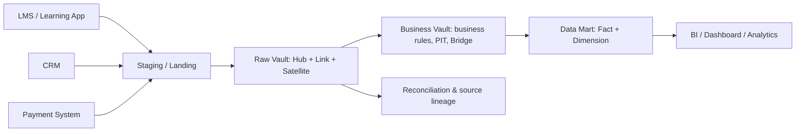
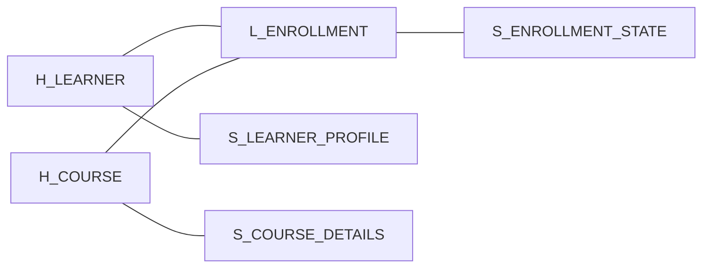
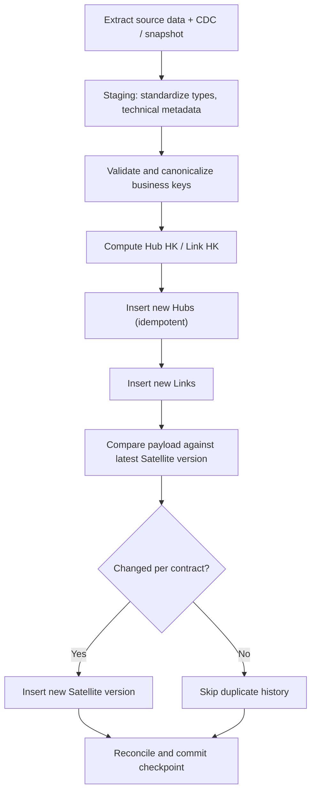
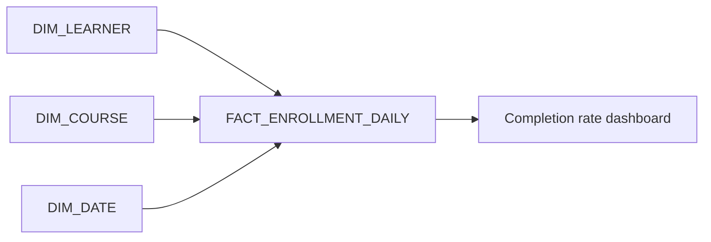

# Data Vault Overview with Hubs, Links, and Satellites

## 1. What Problem Does Data Vault Solve?

An analytical data platform commonly ingests data from multiple systems: a learning registration app, CRM, payments, a course management system, and event streams. Upstream sources evolve constantly: adding fields, changing structures, redefining statuses, amending history, or delivering records late. Meanwhile, reports must consistently answer questions such as:

- On Nov 01, which learners were enrolled in which courses?
- Which source system supplied the course details, and when did the warehouse record them?
- When a source replays a record or renames labels, is historical lineage still traceable?
- How do we onboard a new CRM source without redesigning the entire analytical warehouse?

**Data Vault** is a data modeling methodology for integrated, historical data warehouses, particularly suited to multi-source environments with strict auditability and lineage needs. Its three foundational structural components are:

- **Hub:** manages stable business identities (**business keys**).
- **Link:** manages relationships or associations between business identities.
- **Satellite:** stores descriptive attributes, statuses, and historical changes over time for a Hub or Link.

The essence of Data Vault is **separating identity, relationships, and changing attributes** so data can load incrementally, preserve source lineage, and scale structurally without accidentally losing history.

This lesson belongs to the **Analytical Modeling** chapter of the **DATABASE_DATA_MODELING** scope. Its goal is to turn business requirements into clear data models—from entities, relationships, and constraints to keys, indexes, and physical schemas—while comparing relational, document, graph, and analytical models to choose evolvable, verifiable designs.

**After this lesson, you will be able to:**

1. Explain what Data Vault is, which architectural layer it serves, and what it should not be used for.
2. Identify business keys to design Hubs, relationships to design Links, and attribute groupings to build Satellites.
3. Distinguish `load_dts`, source effective timestamps, data versions, and lineage (`record_source`).
4. Explain hash keys, `hashdiff`, incremental loading, late-arriving data handling, and deduplication.
5. Sketch a Raw Vault, Business Vault, PIT/Bridge tables, and a star-schema data mart.
6. Read SQL examples, write "state known at time T" queries, and recognize their limitations.
7. Evaluate when Data Vault is worth adopting compared to a direct star schema, normalized relational model, or document store.

## 2. The Big Picture: Where Does Data Vault Fit in an Analytical Architecture?

Data Vault typically sits **between upstream data sources and the reporting consumption layer**, rather than serving directly as the schema queried by dashboards.



Each layer carries a distinct role:

| Layer | Role | Questions Addressed |
| --- | --- | --- |
| **Landing/Staging** | Ingest source data and technical metadata | Which records arrived, from where, in which batch, and did anything change? |
| **Raw Vault** | Integrate identities, relationships, and descriptive history; preserve lineage | What did the source provide, and when did the warehouse learn it? |
| **Business Vault** | Apply business rules, derivations, conformance, and read-support structures | How are "valid enrollment" and "completion" defined? |
| **Information Mart** | Deliver facts/dimensions or user-facing read models | What is the completion rate by month and instructor? |
| **BI/Analytics** | Visualization, exploration, reporting | Which metrics do users need, at what latency and cost? |

This is a reference architecture, not a mandate that every project deploy every layer or separate technologies. **Data Vault 2.0** encompasses modeling, architecture, and delivery methodology; Hubs/Links/Satellites form the **modeling foundation**, not the entire methodology.

### 2.1. Data Vault Does Not Replace Every Other Model

- **Relational OLTP:** fits transactions, concurrent mutations, and operational business invariants.
- **Document model:** fits nested read/write aggregates within document size and query boundaries.
- **Graph model:** fits multi-hop relationship traversals, paths, and network connectivity.
- **Star schema:** fits BI analytical queries over facts and dimensions.
- **Data Vault:** fits **multi-source integration requiring full history, lineage, and structural extensibility**.

A platform can use **OLTP as the operational source**, **Data Vault for historical integration**, and **star schemas to serve dashboards**. Having multiple models does not imply uncontrolled competing truths: define authoritative sources, transformation rules, and reconciliation checks.

## 3. Three Core Concepts: Business Key, Load Time, and Record Source

Before creating Hubs, Links, or Satellites, define these three concepts precisely.

### 3.1. Business Key: Business Identity, Not Display Name

A **business key (BK)** is a value or combination of values that uniquely identifies a business entity within a defined scope.

Examples:

- Learner code issued by the LMS: `learner_code`.
- Course code issued by the course catalog: `course_code`.
- Payment reference issued by the payment gateway: `payment_reference`.
- An enrollment relationship between a learner and a course, when business rules confirm each pair has only one active relationship.

A business key **must be placed in its proper uniqueness scope**. If two organizations both have a learner `U-100`, `learner_code = U-100` alone is insufficient; you may need:

```text
Learner business key = (tenant_id, learner_code)

Example:
(ORG-07, U-100) ≠ (ORG-12, U-100)
```

**Never assume** email, learner name, or course title is a stable business key: they can collide, change, or be erased for privacy compliance. Inspect upstream ID issuance policies and handle code changes, code reuse, merges, and splits.

### 3.2. Load Timestamp: When the Warehouse Recorded the Record

In our examples, `load_dts` is the timestamp when data **was loaded into the Data Vault** under the chosen convention. It tracks data ingestion history.

Do not conflate:

- `source_created_at`: when the record was created in the source system.
- `source_effective_at`: when a change takes business effect.
- `source_updated_at`: when the source last updated the record.
- `load_dts`: when the warehouse ingested/loaded a version per pipeline design.
- `report_as_of`: the point in time a report aims to reconstruct.

These values routinely differ due to batching, queues, network retries, CDC lag, and late arrivals.

### 3.3. Record Source: Provenance of the Record

`record_source` identifies the upstream system or ingestion feed responsible for supplying the record, for example:

```text
LMS.ENROLLMENTS
LMS.COURSES
CRM.LEARNERS
PAYMENT.TRANSACTIONS
```

This metadata supports:

- Tracing records back to upstream sources.
- Explaining conflicts when multiple sources supply differing attributes.
- Reconciling row counts and detecting missing deliveries.
- Supporting audits and migrations.

`record_source` definitions must be **stable and granular enough** to distinguish feeds. You may also include `batch_id`, `source_record_id`, `ingested_at`, or checksums when required. `record_source` does not by itself prove one source is more authoritative than another.

## 4. Hub: Storing Business Identities

A **Hub** represents one class of business identity. It typically contains:

- The Hub's technical key, e.g., `learner_hk`.
- The business key per source/domain contract.
- `load_dts`.
- `record_source`.

Example Learner Hub:

```text
H_LEARNER
+------------------------------------------------------------------+
| learner_hk | tenant_id | learner_bk | load_dts | record_source     |
+------------------------------------------------------------------+
| HK-001     | ORG-07    | U-100      | 01/11    | LMS.LEARNERS      |
| HK-002     | ORG-07    | U-101      | 01/11    | LMS.LEARNERS      |
| HK-003     | ORG-12    | U-100      | 02/11    | CRM.LEARNERS      |
+------------------------------------------------------------------+
```

Codes like `HK-001` in this diagram are **shorthand labels**, not actual SHA-256 hashes. Two learners `U-100` in different tenants receive distinct identities because the BK is composite.

### 4.1. Hubs Should Not Hold Descriptive Attributes or Volatile State

Avoid storing:

```text
H_LEARNER(learner_hk, learner_bk, display_name, email,
          city, membership_status, last_login, ...)
```

when those descriptive fields change over time. Placing them in the Hub forces identity rows to mutate constantly or loses attribute history.

Instead:

```text
H_LEARNER(learner_hk, tenant_id, learner_bk, load_dts, record_source)

S_LEARNER_PROFILE(
  learner_hk, load_dts, record_source,
  hashdiff, display_name, city, ...
)
```

**Rule:** Hubs answer **"which business entity is this?"**; Satellites answer **"how did sources describe this entity across loads?"**.

### 4.2. Choosing the Right Hub Grain

Each Hub represents one specific business entity type. Cramming `course_id`, `learner_id`, and `enrollment_id` into one "generic entity hub" obscures grain and cross-source relationships.

For example, suppose an enrollment carries its own `enrollment_id`, has a payment/refund lifecycle, and is referenced by external systems. Then **Enrollment** can be its own Hub, while relationships connecting Enrollment, Learner, and Course live in a Link.

Conversely, if the business only tracks one active **learner–course pair** with no independent enrollment ID, a direct Link between those two Hubs suffices.

**Only merge BKs from multiple sources into one Hub after verifying they represent the exact same entity.** Matching string formats alone does not prove shared identity.

## 5. Link: Representing Relationships Between Identities

A **Link** stores an association among two or more Hubs, typically containing:

- The Link's technical key, e.g., `enrollment_hk`.
- Hub keys of participating entities.
- `load_dts`.
- `record_source`.

Example enrollment relationship:

```text
H_LEARNER (learner_hk)
        |
        | 1
        | 
        | N
L_ENROLLMENT (enrollment_hk, learner_hk, course_hk, load_dts, record_source)
        | N
        |
        | 1
H_COURSE (course_hk)
```

A basic Link answers **"has this relationship been observed?"**. It normally avoids long lists of descriptive attributes like `status`, `payment_state`, or `completed_at`; those belong in a **Satellite attached to the Link**.

### 5.1. Links Are Not Only for Many-to-Many Relationships

Links can represent:

- A learner enrolling in a course.
- An order belonging to a customer.
- A payment applied to an order.
- An employee belonging to an organizational unit.
- A product assigned to a category.
- A multi-role association across more than two Hubs.

What matters is the **relationship grain**. If each `(learner_hk, course_hk)` pair has at most one persistent association, the Link key can derive from that pair.

However, if a learner can **enroll multiple times** in the same course across different terms, a model keyed solely on learner–course **cannot distinguish separate enrollments**. Options include:

1. Create an Enrollment Hub keyed by unique `enrollment_bk` per enrollment, linked to Learner and Course.
2. Or design a transactional Link incorporating the enrollment identifier into its grain.

Never patch this by adding `load_dts` into the Link's hash key—that makes the relationship's identity change on every load.

### 5.2. Links Can Connect More Than Two Hubs

For instance, a class assignment involving class, instructor, and course:

```text
L_CLASS_ASSIGNMENT(
  assignment_hk,
  class_hk,
  teacher_hk,
  course_hk,
  load_dts,
  record_source
)
```

Even so, multi-way Links must express **one meaningful business relationship**, never an arbitrary bundle of entities thrown together per batch just to reduce table count.

### 5.3. Should a Link Be Deleted When a Relationship Ends?

In a historical Raw Vault, a Link's existence signifies **the source once observed the relationship**. When a learner cancels an enrollment, you do not delete the Link row merely to reflect current state; status changes belong in a Satellite or effectivity structure.

Separate two questions:

- **Did the association ever exist?** The Link answers this.
- **Is the association active at time T?** Requires temporal status/effectivity tracking.

Physical deletion may still be mandated by retention or privacy laws; handle that through dedicated governance workflows rather than conflating it with technical history tracking.

## 6. Satellite: Storing Descriptions and Change History

A **Satellite** attaches to a Hub or Link to store groups of attributes that change over time. Common columns include:

- Parent key: `course_hk` or `enrollment_hk`.
- `load_dts` of the Satellite version.
- `record_source`.
- `hashdiff` (design choice) to detect payload changes.
- Descriptive fields.
- Source timestamp or effectivity metadata when provided by the source.

Example Course Satellite:

```text
S_COURSE_DETAILS
+--------------------------------------------------------------------------------+
| course_hk | load_dts   | record_source | title            | source_status        |
+--------------------------------------------------------------------------------+
| HK-C1     | 01/11 09h  | LMS.COURSES   | Intro to SQL     | DRAFT                |
| HK-C1     | 05/11 10h  | LMS.COURSES   | Intro to SQL     | PUBLISHED            |
| HK-C1     | 09/11 08h  | LMS.COURSES   | SQL Fundamentals | PUBLISHED            |
+--------------------------------------------------------------------------------+
```

The same `course_hk` accumulates three historical rows while the Course Hub retains a single identity. The Satellite lets you query what the system **knew about that description at different points in time**.

### 6.1. Group Satellite Attributes by Change Rate and Source

When attributes change at vastly different rates, split Satellites:

```text
S_COURSE_DESCRIPTION:
  title, summary, category, ...

S_COURSE_PUBLICATION:
  source_status, source_published_at, ...

S_COURSE_PRICING:
  currency, amount_minor, ...
```

Splitting reduces redundant historical copies and isolates authoritative sources, though too many Satellites complicate queries, ETL, and maintenance.

When grouping attributes, consider:

- **Source:** same upstream system or different systems?
- **Change cadence:** mutate together or independently?
- **Semantics:** belong to the same descriptive concept?
- **Sensitivity:** require separate security or retention rules?
- **Grain:** what does each version capture?

There is no rule saying "one Satellite per column"; aim for just enough separation to preserve meaningful history and independent loading.

### 6.2. Multi-Active Satellites and Multi-Valued Data

A source may allow a learner to have multiple active phone numbers simultaneously, or a product to carry multiple valid codes. When multiple values are **simultaneously valid** for the same parent at the same point in time, a single-valued Satellite does not suffice.

A **multi-active Satellite** adds a sub-key distinguishing elements, such as `contact_type` or a stable contact ID. Define:

- Which key distinguishes each concurrent value?
- Are multiple `HOME` entries or duplicate types allowed?
- When one value is removed, how does the source signal deletion?
- Does the source supply enough detail to reconstruct the full active set at any point in time?

Do not use a multi-active Satellite merely because a JSON payload contains an array; verify the grain and simultaneous validity of elements.

### 6.3. Satellites Attached to Links

Example status history of an enrollment relationship:

```text
S_ENROLLMENT_STATE(
  enrollment_hk,
  load_dts,
  record_source,
  hashdiff,
  source_status,
  source_effective_at
)
```

Statuses like `ACTIVE`, `COMPLETED`, or `CANCELLED` do not require a new Link when the **relationship identity** itself has not changed. Descriptive status history lives in the Satellite. When multiple distinct enrollments must be tracked separately, adjust the grain as shown in section 5.1.

## 7. End-to-End Example: Learning Platform with Hubs, Links, and Satellites

Suppose the LMS emits:

```text
LMS learners:
  tenant_id, learner_code, full_name, city, updated_at

LMS courses:
  tenant_id, course_code, title, status, updated_at

LMS enrollments:
  tenant_id, learner_code, course_code,
  enrollment_status, status_effective_at, updated_at
```

Analytical objectives:

- Count enrolled learners per course.
- Reconstruct enrollment status as known by the warehouse at a given point in time.
- Trace status values back to the source system.
- Onboard CRM and payment data later without baking descriptive attributes into identity keys.

### 7.1. Model Sketch



Interpretation:

| Component | Grain | Key Fields |
| --- | --- | --- |
| `H_LEARNER` | One learner by BK within tenant | `learner_hk`, `tenant_id`, `learner_bk`, `load_dts`, `record_source` |
| `H_COURSE` | One course by BK within tenant | `course_hk`, `tenant_id`, `course_bk`, `load_dts`, `record_source` |
| `L_ENROLLMENT` | One learner–course association assuming one relation per pair | `enrollment_hk`, `learner_hk`, `course_hk`, metadata |
| `S_LEARNER_PROFILE` | One ingested version of learner profile | name, city, hashdiff, timestamps |
| `S_COURSE_DETAILS` | One ingested version of course metadata | title, raw status, hashdiff |
| `S_ENROLLMENT_STATE` | One version of relationship state | raw status, `source_effective_at`, hashdiff |

**Key assumption:** one learner–course pair represents one relationship with status history, not multiple independent enrollments. If learners re-enroll across terms and each term is a separate transaction, update the grain accordingly.

### 7.2. Illustrative Input Data

| Source Date | Learner | Course | Source Status |
| --- | --- | --- | --- |
| 01/11 | `U-100` | `C-SQL` | `ACTIVE` |
| 05/11 | `U-100` | `C-SQL` | `COMPLETED` |
| 07/11 | `U-101` | `C-SQL` | `ACTIVE` |
| 10/11 | `U-100` | `C-DATA` | `ACTIVE` |

`H_LEARNER` records two identities within the tenant; `H_COURSE` records two identities; `L_ENROLLMENT` records three pair associations. The Enrollment Satellite logs status versions whenever source values change. If `U-100/C-SQL/ACTIVE` is resent with an identical payload, **never insert a duplicate descriptive history row** merely because a new batch ran—unless the source contract explicitly models identical repeated events as distinct transactions.

### 7.3. Why Keep Descriptive Values Out of Hubs?

If course `C-SQL` changes its title from "Intro to SQL" to "SQL Fundamentals", `H_COURSE` retains the exact same identity. The Satellite appends a new descriptive version. Links connecting learners to the course never have to rewrite foreign keys when titles change.

This is the benefit of separating **identity** from **descriptive history**.

## 8. Hash Keys and Business Keys: Using Them Properly

Many Data Vault 2.0 implementations use **hash keys** so technical keys can be computed deterministically and independently from business keys. Hash keys are not mandatory in every Data Vault flavor, yet they are widely used to enable parallel loading and consistent linking.

Conceptual example:

```text
Learner BK        = (ORG-07, U-100)
Canonical BK      = "LEARNER|ORG-07|U-100"  (assumes escaping rules)
Learner HK        = SHA-256(Canonical BK)

Course BK         = (ORG-07, C-SQL)
Canonical BK      = "COURSE|ORG-07|C-SQL"
Course HK         = SHA-256(Canonical BK)

Enrollment HK     = SHA-256("ENROLLMENT|" + Learner HK + "|" + Course HK)
```

**Warning:** these strings are illustrative only. If a BK can contain the `|` delimiter, define strict escaping, length-prefixing, or structured encoding. Otherwise, two distinct composite keys could serialize into the exact same pre-hash string.

### 8.1. Canonicalization Contract Before Hashing

Hash generators must agree on:

1. Which fields form the BK and their exact ordering.
2. Scope prefixes such as `tenant_id` or source namespace.
3. Data types, character encoding, and Unicode normalization.
4. Whether whitespace trimming or case folding applies—**only when business rules permit**.
5. Handling of `null`, missing fields, and empty strings.
6. Distinguishing component roles inside Links.
7. Hash algorithm, output encoding, and rule version.
8. Reconciliation when sources mutate BKs.

Never blindly run `UPPER(TRIM(business_key))` if business codes are **case-sensitive** or whitespace is significant. Conversely, if codes are case-insensitive, enforce the identical normalization rule across every pipeline.

### 8.2. Why Do Satellites Commonly Include `hashdiff`?

**`hashdiff`** is a hash of descriptive attributes used to detect payload changes. Example:

```text
hashdiff = SHA-256(
  canonical(title, status, source_updated_at_if_part_of_payload)
)
```

Fields included in `hashdiff` must reflect **change semantics**. Rarely include `load_dts` inside `hashdiff`: doing so makes every batch generate a brand-new `hashdiff` even when the payload is unchanged, defeating change detection.

In a Satellite tracking title and status, `hashdiff` can cover `title` and `status`, while source timestamps and load metadata sit outside. If a source's effective timestamp is itself a business fact that must be historized, include it in the tracked change payload based on the Satellite's grain.

**`hashdiff` does not replace source validation**: if two distinct payloads ever collided to the same hash, change detection would miss an update. With strong hashes like SHA-256, accidental collisions are astronomically unlikely, though no finite hash is collision-free across all inputs. Critical systems still need disciplined canonicalization and reconciliation.

### 8.3. Hash Keys Are Not Security Encryption

Hashing business keys creates deterministic technical IDs—it **does not make sensitive data safe**. If a BK is a phone number or email from a guessable domain, unsalted hashes are vulnerable to dictionary attacks. Protect access and personal data per privacy policy; never treat hash keys as license to publish sensitive records openly.

### 8.4. What If a Business Key Changes?

If a source system reassigns a new code to the same learner, hashes computed from old vs. new codes will differ. Determine:

- Is it truly the same business person?
- Does the source offer a more durable identifier or mapping table?
- Was there an account merge or split event?
- Do we need a business mapping or governed same-as Link in the Business Vault?

Never silently overwrite the business key on a Hub already referenced by historical Satellites and Links; preserve lineage and governed merge rules.

## 9. SQL Example: Minimal Physical Schema

Below is an **illustrative PostgreSQL schema**, not a mandatory DDL template for every Data Vault. Hash keys appear as 64-character hex strings for readability; real implementations may choose `bytea` or binary types and should benchmark performance.

```sql
-- Grain: one learner per (tenant_id, learner_bk).
CREATE TABLE hub_learner (
    learner_hk    char(64) PRIMARY KEY,
    tenant_id     text NOT NULL,
    learner_bk    text NOT NULL,
    load_dts      timestamptz NOT NULL,
    record_source text NOT NULL,
    UNIQUE (tenant_id, learner_bk)
);

-- Grain: one course per (tenant_id, course_bk).
CREATE TABLE hub_course (
    course_hk     char(64) PRIMARY KEY,
    tenant_id     text NOT NULL,
    course_bk     text NOT NULL,
    load_dts      timestamptz NOT NULL,
    record_source text NOT NULL,
    UNIQUE (tenant_id, course_bk)
);

-- Grain: one learner-course relationship.
CREATE TABLE link_enrollment (
    enrollment_hk char(64) PRIMARY KEY,
    learner_hk    char(64) NOT NULL REFERENCES hub_learner(learner_hk),
    course_hk     char(64) NOT NULL REFERENCES hub_course(course_hk),
    load_dts      timestamptz NOT NULL,
    record_source text NOT NULL,
    UNIQUE (learner_hk, course_hk)
);

-- Course descriptive versions.
CREATE TABLE sat_course_details (
    course_hk      char(64) NOT NULL REFERENCES hub_course(course_hk),
    load_dts       timestamptz NOT NULL,
    record_source  text NOT NULL,
    hashdiff       char(64) NOT NULL,
    title_raw      text,
    status_raw     text,
    source_updated_at timestamptz,
    PRIMARY KEY (course_hk, load_dts)
);

-- Enrollment relationship state versions.
CREATE TABLE sat_enrollment_state (
    enrollment_hk     char(64) NOT NULL
                      REFERENCES link_enrollment(enrollment_hk),
    load_dts          timestamptz NOT NULL,
    record_source     text NOT NULL,
    hashdiff          char(64) NOT NULL,
    status_raw        text,
    source_effective_at timestamptz,
    PRIMARY KEY (enrollment_hk, load_dts)
);

CREATE INDEX sat_course_details_lookup
    ON sat_course_details (course_hk, load_dts DESC);

CREATE INDEX sat_enrollment_state_lookup
    ON sat_enrollment_state (enrollment_hk, load_dts DESC);
```

### 9.1. Assumptions Enforced by This DDL

- Each learner–course pair has **one Link relationship** per the declared grain.
- Each Satellite parent has at most **one version per `load_dts`**. If two independent updates load within the same timestamp precision, or multiple record sources write into the same Satellite, this primary key **is insufficient**.
- 64-character hash keys represent SHA-256 hex strings; every pipeline must share an identical hash generator.
- `UNIQUE (tenant_id, business_key)` on both Hubs assumes stable, canonicalized BKs.
- Foreign keys here express structure; some large analytical platforms omit physical FK enforcement due to load/distribution costs, requiring equivalent pipeline integrity checks.
- This illustrative DDL **does not yet enforce** that learner and course share the same `tenant_id` inside `link_enrollment`. If cross-tenant enrollments are forbidden, validate in the loader and/or design composite FKs; hash-key FKs alone are insufficient.

**Designing for production:** you may need `batch_id`, `load_sequence`, or `record_source` in Satellite version keys per grain and concurrency rules, or split Satellites by source. Never copy a composite key blindly from an online snippet.

### 9.2. Generating Hashes in PostgreSQL

Using `pgcrypto` (requires extension installation privileges), one approach is:

```sql
-- Illustrates hashing. Input strings must be canonicalized beforehand.
-- SELECT encode(digest('LEARNER|ORG-07|U-100', 'sha256'), 'hex');
```

That commented call is purely an expression example—it does not automatically guarantee escaping, Unicode normalization, null checks, or unambiguous field separation. Maintain **one shared hashing contract** verified by test vectors across all pipelines instead of ad-hoc string concatenation in individual jobs.

### 9.3. Learner Profile Omitted from DDL

To keep the DDL concise, `sat_learner_profile` is omitted above; it follows the same pattern as `sat_course_details` keyed by `learner_hk`. Section 7's full conceptual model includes it.

## 10. Loading Data Incrementally into Hubs, Links, and Satellites

Avoid pipelines that simply "reload the whole table" every night. Data Vault is built for **incremental loading, history preservation, and lineage**.

### 10.1. Typical Load Flow



Exact execution order depends on parallel loading capabilities and late-parent handling. Data Vault 2.0 often loads Hubs, Links, and Satellites in parallel once hash keys are precomputed, while still honoring dependency and referential rules.

### 10.2. Loading Hubs: Insert New Identities Only

Staging input:

```text
(ORG-07, U-100)  first seen in batch 001
(ORG-07, U-100)  seen again in batch 002
(ORG-07, U-101)  first seen in batch 002
```

Expected outcome:

- `H_LEARNER` holds only one row for `(ORG-07, U-100)`.
- Batch 002 does not recreate the existing identity.
- `(ORG-07, U-101)` is inserted as a new identity.
- New source deliveries and batch runs are tracked in staging/lineage metadata per design.

Deduplication must rely on canonical BKs and unique keys, not merely "this batch differs from the last batch".

### 10.3. Loading Links: Insert New Relationship Combinations Only

Once learner `U-100` and course `C-SQL` exist, re-observing their relationship in later batches does not create new Links.

When a source sends a cancellation status, **do not delete the Link**; record the status transition in the Satellite.

If two sources describe a relationship differently, verify whether they describe **the same relationship** or two relationships of different grains. Matching learner and course alone does not prove two independent enrollment transactions are identical.

### 10.4. Loading Satellites: Insert Only When Payload Changes

Suppose:

| `load_dts` | `status_raw` | `hashdiff` (illustrative) | Action |
| --- | --- | --- | --- |
| 01/11 09:00 | ACTIVE | H-A | Insert initial version |
| 02/11 09:00 | ACTIVE | H-A | Skip unchanged descriptive state |
| 05/11 10:00 | COMPLETED | H-C | Insert new version |
| 06/11 10:00 | COMPLETED | H-C | Skip unchanged descriptive state |

Symbols `H-A` and `H-C` are shorthand; production uses `hashdiff` over the canonical payload contract. Also determine whether snapshot feeds signal **deletions** or **ended relationships**; "absent from today's batch" does not automatically mean deleted.

### 10.5. Late-Arriving and Out-of-Order Data

If a record has `source_effective_at = 03/11` but reaches the warehouse on `09/11`, `load_dts` still records when the warehouse ingested it—never rewrite `load_dts` to `03/11`.

The two time axes serve different purposes:

- **"What did the warehouse know on 05/11?"** relies on load timestamp history.
- **"What was effective in the business on 05/11?"** must evaluate source effective timestamps and late-arrival rules.

A query using `MAX(load_dts)` does not automatically answer the second question. When bitemporal or business-effective history is required, add explicit modeling and rules for retroactive edits, revisions, and source precedence.

### 10.6. Protecting History When Sources Resend Full Snapshots

Some sources dump the entire table nightly without CDC. If a loader inserts into a Satellite purely by ingestion timestamp, history bloats with identical copies. Use:

- Business keys to verify entity existence.
- `hashdiff` to detect descriptive payload changes.
- Load timestamp to record when a new version arrived.
- Batch/checkpoints to support safe retries.
- Dedicated rules for **deletions, effectivity, and snapshot completeness**.

Ensure jobs are **idempotent**: replaying the same batch never duplicates Hubs/Links or fabricates bogus history.

## 11. "As-Of" Queries: Two Different Questions

### 11.1. As-Known-At: Latest Version Recorded by the Warehouse Before Time T

Suppose we want enrollment status based on what the Data Vault **had loaded up to** a cutoff timestamp.

PostgreSQL SQL example using `LATERAL`:

```sql
-- :as_of is a timestamptz parameter supplied by the caller.
SELECT
    h_learner.tenant_id,
    h_learner.learner_bk,
    h_course.course_bk,
    s.status_raw,
    s.load_dts AS state_loaded_at,
    s.source_effective_at
FROM link_enrollment AS l
JOIN hub_learner AS h_learner
  ON h_learner.learner_hk = l.learner_hk
JOIN hub_course AS h_course
  ON h_course.course_hk = l.course_hk
LEFT JOIN LATERAL (
    SELECT x.status_raw, x.load_dts, x.source_effective_at
    FROM sat_enrollment_state AS x
    WHERE x.enrollment_hk = l.enrollment_hk
      AND x.load_dts <= :as_of
    ORDER BY x.load_dts DESC
    LIMIT 1
) AS s ON true
WHERE l.load_dts <= :as_of
  AND h_learner.tenant_id = 'ORG-07'
  AND h_course.tenant_id = 'ORG-07';
```

This query returns the **most recently loaded status version** per relationship as of `:as_of`. It **does not** automatically filter out `CANCELLED`, `COMPLETED`, or Links missing Satellites; apply explicit business rules separately.

Assumption: each `enrollment_hk` has at most one state per `load_dts` per the sample primary key. When a Satellite accepts multiple sources or multiple versions sharing a timestamp, define deterministic tie-breaking and a matching key design.

### 11.2. Business-Valid-At: State Effective on Date T

Suppose `COMPLETED` effective Nov 05 is ingested on Nov 06, and later the source sends a correction effective Nov 04 that arrives on Nov 10.

A report asking "as of Nov 07, what did the warehouse know?" differs from "given all corrections known today, what was effectively true on Nov 07?".

Querying **business-valid-at** requires clarifying:

- Does the source supply explicit effective start/end timestamps or only `updated_at`?
- Does a new status replace the old status or represent an additive event?
- Are late events ordered by `source_effective_at`, sequence number, revision, or another business rule?
- Can historical records be corrected or voided?
- Can multiple statuses be simultaneously valid at a point in time?

Simply swapping `load_dts` for `source_effective_at` in SQL does not guarantee correct results. You need a **Business Vault** or an explicit effective-time model with conflict-resolution contracts.

### 11.3. Counting `ACTIVE` Enrollments As-Known-At

Using the latest known state per relationship, then filtering:

```sql
WITH latest_state AS (
    SELECT
        l.enrollment_hk,
        l.course_hk,
        s.status_raw
    FROM link_enrollment AS l
    LEFT JOIN LATERAL (
        SELECT x.status_raw
        FROM sat_enrollment_state AS x
        WHERE x.enrollment_hk = l.enrollment_hk
          AND x.load_dts <= :as_of
        ORDER BY x.load_dts DESC
        LIMIT 1
    ) AS s ON true
    WHERE l.load_dts <= :as_of
)
SELECT
    hc.tenant_id,
    hc.course_bk,
    count(*) AS active_enrollments
FROM latest_state AS ls
JOIN hub_course AS hc
  ON hc.course_hk = ls.course_hk
WHERE hc.tenant_id = 'ORG-07'
  AND ls.status_raw = 'ACTIVE'
GROUP BY hc.tenant_id, hc.course_bk;
```

This example assumes **LMS status** already has one consistent meaning from one source. In reality, `ACTIVE` across two sources may mean different things; analytical reports need conformance rules in the Business Vault first.

One more nuance: this query omits `h_course.load_dts <= :as_of`, assuming Hubs always load prior to Links in normal ingestion. If out-of-order arrivals or placeholders are permitted, add rules to reconstruct complete snapshots and validate temporal integrity.

## 12. Business Vault: Where Business Rules Are Applied

**Raw Vault** focuses on capturing source facts, lineage, and history under technical ingestion rules. **Business Vault** adds derived rules and conformed structures for meaningful analytics.

Examples:

- Standardizing differing enrollment statuses from LMS and CRM into unified `ACTIVE`, `COMPLETED`, `CANCELLED` states.
- Selecting the winning survivorship record when multiple sources describe the same learner.
- Computing effective validity intervals of relationships or statuses.
- Computing "active learner in the month" eligibility rules.
- Building query-acceleration history structures like PIT and Bridge tables.
- Generating derived datasets feeding dimensions or facts.

**Never turn Raw Vault into a cleaned-only layer that discards raw source details needed for auditing.** Technical standardizations required for safe loading belong in Raw Vault, while **subjective business interpretations** belong explicitly and versioned inside the derived Business Vault layer.

### 12.1. Example of Divergent Rules Between Two Sources

LMS emits `enrollment_status = COMPLETED`. CRM emits `lifecycle_stage = Alumni`.

You cannot equate them by default. A learner may finish a course before CRM updates their lifecycle stage; conversely, Alumni might denote a broader community tier.

An approved mapping might state:

```text
Source: LMS.ENROLLMENTS
COMPLETED   -> completion_state = COMPLETED
ACTIVE      -> completion_state = IN_PROGRESS
CANCELLED   -> completion_state = CANCELLED

Source: CRM.LEARNERS
Alumni      -> profile_segment = ALUMNI

Do not use profile_segment to infer completion_state
unless a verified business rule states so.
```

Both source records and derived interpretations need lineage and rule versioning so results can be rebuilt whenever definitions change.

## 13. PIT and Bridge: Accelerating Complex Queries

### 13.1. PIT (Point-in-Time)

When a Hub has multiple Satellites changing at different cadences, querying "all attributes of a learner on date T" requires finding the latest version **of each Satellite**.

Example:

```text
H_LEARNER
  |
  +-- S_LEARNER_PROFILE
  +-- S_LEARNER_ADDRESS
  +-- S_LEARNER_SEGMENT
```

A **PIT table** stores keys/pointers to the Satellite versions active at a chosen set of snapshot timestamps:

```text
PIT_LEARNER_DAILY
  snapshot_date
  learner_hk
  profile_load_dts
  address_load_dts
  segment_load_dts
```

This avoids recomputing `MAX(load_dts <= T)` across multiple Satellites on every read.

**Trade-off:** A PIT table is a **derived structure** that must be populated, rebuilt, and reconciled. Explicitly specify whether it tracks load time or business-effective time; it does not automatically solve bitemporal history.

### 13.2. Bridge

A **Bridge table** precomputes multi-hop relationship paths and combinations needed by reporting—such as courses linked across multiple Links:

```text
BR_LEARNER_COURSE_CONTEXT
  learner_hk
  course_hk
  enrollment_hk
  snapshot_date
  ...
```

This sketch merely conveys the idea; real Bridge tables vary in keys and columns by query pattern. Bridges cut down join hops for complex reports, at the cost of maintaining and reconciling derived data.

**Do not assume every Data Vault project needs PIT and Bridge tables on day one.** Introduce them when real query shapes, performance benchmarks, or consumption needs justify them.

## 14. From Data Vault to Star Schema: Serving Reports

Hubs, Links, and Satellites optimize historical storage and schema evolution, whereas BI tools typically expect tables with explicit reporting grains:

- **Dimensions:** describing learners, courses, and time.
- **Facts:** recording enrollments, completions, payments, and learning sessions.

Example star schema:



A hypothetical fact:

```text
FACT_ENROLLMENT_DAILY
  date_key
  learner_key
  course_key
  is_active
  is_completed
  enrollment_count
```

**Fact grain must be stated explicitly**, such as "one learner–course–day", not merely "a table storing enrollments". If the underlying Link represents a timeless learner–course pair, a daily fact must fetch effective status per day from the Satellite/Business Vault.

### 14.1. Are Raw Vault and SCD Type 2 Dimensions the Same?

Both store attribute history, yet serve distinct purposes:

- **Raw Vault Satellites:** record source payload history with provenance, usually keyed by load timestamp and attached to Hubs/Links.
- **Type 2 Dimensions:** build analytical dimension versions governed by business rules and effective dates, typically using surrogate keys and `[valid_from, valid_to)` intervals.

Never equate a Satellite's `load_dts` with an SCD Type 2 `effective_from`. With late arrivals or retroactive source corrections, those two timelines can diverge significantly.

### 14.2. A Concrete Analytical Question

"In November, what is the course completion rate by age group?"

The query requires:

1. Learner and course identities.
2. Definition of completion, completion timestamp, and eligible enrollment criteria.
3. Reference date and source data used to compute age group.
4. Fact grain and counting rules that avoid double-counting across multiple enrollments.
5. Privacy, aggregation, and personal-data exposure rules.

Hubs/Links/Satellites store and trace raw inputs; **Business Vault plus data marts** interpret and deliver meaningful metrics. Creating three table types alone does not answer a report accurately.

## 15. Multi-Source Integration: Merging Identities Is Not Just Matching Codes

### 15.1. Same Key, Different Entity

Suppose LMS has `learner_code = U-100` and CRM has `customer_code = U-100`. Identical strings do not prove they are the same person.

Verify:

- Do both systems share **one authoritative ID generator**?
- Do codes share the same tenant/organization scope?
- Does a verified mapping table confirm equivalence across systems?
- Can two people merge accounts or one person split into two profiles?

Without proof, give each source its **own BK namespace** or separate identity records, then link them via governed equivalence relationships.

### 15.2. Same-As Links and Business Vault

When two identities are verified to represent the same business entity, a **same-as Link** or lineage-backed mapping table supports consolidation.

Still clarify:

- Who holds authority to approve a same-as link?
- From what date does the equivalence take effect?
- What happens if a mapping is later revoked?
- Can an old code ever be reassigned to someone else?
- Should historical reports restate under the new mapping or preserve prior attribution?

Never delete original Hubs just to merge entities; source history may need retention per governance and audit rules.

### 15.3. Conflicting Attributes Across Sources

LMS lists city as `Da Nang`; CRM lists `Ha Noi`. Raw Vault keeps both facts tagged with their `record_source`. Yet a report asking for "current official city" needs rules:

- Which source is authoritative for that attribute?
- Do effective timestamps or confidence scores arbitrate?
- Are non-winning values kept for lineage while excluded from current state?
- Can you audit and explain why one source won?

These are **business rules**, not problems solved by hash keys alone.

## 16. Quality Controls, Lineage, and Operations

Data Vault preserves extensive history, yet **does not automatically guarantee source data is accurate, complete, or duplicate-free**. Measure quality at every stage.

### 16.1. Component-Level Test Matrix

| Component | Minimum Checks | Risk if Skipped |
| --- | --- | --- |
| Staging | Duplicates, missing BKs, type errors, source timestamps, checkpoints | Phantom identities or dropped records |
| Hub | One HK per canonical BK, proper tenant scope | Merging two people or splitting one person across Hubs |
| Link | Valid participating Hub HKs, correct grain and roles | Wrong or duplicate relationships |
| Satellite | Payload diffing, load versions, source, ordering | Lost history or bloated identical rows |
| Business Vault | Status mappings, survivorship precedence, effective dates | Reports misinterpreting sources |
| PIT/Bridge | Sync with sources and snapshot cutoffs | Returning stale or mismatched records |
| Data mart | Fact grain, metric definitions, double-count checks | Broken KPIs and failed reconciliations |

### 16.2. Operational Metrics to Monitor

- Total records received/loaded per batch and `record_source`.
- Missing/invalid BK counts and quarantined record counts.
- New Hubs, new Links, new Satellite versions, and unchanged-payload skips.
- HK/BK mismatches caused by divergent hashing rules.
- Links missing valid Hubs per contract.
- Late-arriving data, out-of-order events, and end-to-end processing lag.
- Count discrepancies across Source, Raw Vault, Business Vault, and marts.
- Rebuild duration for PIT/Bridge/marts when transformation logic changes.
- Storage cost, history growth rate, and checkpoint recovery readiness.

Alert thresholds must reflect real SLAs and volumes; no universal threshold fits every data warehouse.

### 16.3. Useful Lineage Metadata

Consider attaching metadata:

```text
batch_id
source_record_id
record_source
source_extracted_at
load_dts
pipeline_run_id
payload_checksum
schema_version
```

You need not place every column on every Hub/Link/Satellite; select per architecture and audit needs. Always maintain a path tracing any dashboard number back through facts, business rules, Satellites, Links/Hubs, and raw source records.

## 17. Trade-Offs and Limitations of Data Vault

### 17.1. Table Count and Complexity

A seemingly simple domain can expand into numerous Hub, Link, and Satellite tables. This aids extensibility and lineage, yet increases:

- Number of models and load jobs to maintain.
- Strictness required around BK and HK canonicalization.
- Join complexity when building reports.
- Operational, documentation, and onboarding overhead.
- Risk of subtle bugs if grain or temporal rules slip.

For a small system with one stable source and a handful of KPIs, building a star schema directly can be simpler.

### 17.2. Querying Raw Vault Directly for BI Is Rarely Convenient

Fetching a list of learners, courses, and latest statuses requires joining Hubs–Links–Satellites and filtering latest versions by time. Across many Satellites, query cost and complexity climb rapidly.

Hence Data Vault is commonly paired with **Business Vault, PIT/Bridge tables, or dimensional marts**. Evaluate total cost across **the entire pipeline**, not Raw Vault ingestion cost alone.

### 17.3. Abundant History Does Not Equal True Bitemporal Accuracy

Logging every source change at warehouse ingestion time cannot reconstruct business history accurately when:

- Sources send full snapshots with no deletion signals.
- Data arrives late or is retroactively amended.
- Source-effective timestamps are absent.
- One record represents multiple concurrent states.
- Sources operate on differing timezones/clocks.

Explicitly model both time axes and reconciliation rules whenever reports demand bitemporal precision.

### 17.4. Unsuitable as a Default Transactional (OLTP) Model

Data Vault optimizes historical integration and lineage. It is not the default choice for:

- Low-latency shopping cart and checkout transactions.
- Real-time inventory reservation checks.
- Multi-hop path queries needing specialized graph algorithms.
- APIs reading/writing single nested JSON aggregates for operational apps.

Keep Data Vault in its **analytical integration role** when justified; never replace an entire OLTP database with Hubs/Links/Satellites merely because history is required.

## 18. Comparing Data Vault with 3NF, Star Schema, and Document Models

| Criterion | 3NF / Normalized Relational | Data Vault | Star Schema | Document Model |
| --- | --- | --- | --- | --- |
| Primary focus | Reduce redundancy, enforce constraints and relations | Separate BK, links, source history, and lineage | Optimize fact–dimension analytics | Co-locate data by read/write unit |
| Core building blocks | Entity and junction tables | Hub, Link, Satellite | Fact and Dimension | Documents, nested objects/arrays |
| History | Added via temporal/audit tables | Core modeling objective | SCD/snapshots per reporting needs | Requires explicit versioning/event design |
| Onboarding new sources | Requires mapping and schema changes depending on design | Extensible via new Satellites/Links cleanly | Usually requires conforming metrics/dimensions | Suits certain shapes; multi-source still needs rules |
| BI querying | Often requires many joins | Usually needs marts/PIT/Bridge | Typically most convenient for dashboards | Depends on indexes, aggregation, and scale |
| OLTP transactions | Typically a strength | Not primary purpose | Not primary purpose | Depends on DB and document boundaries |
| Implementation cost | Moderate for single systems | Can be high due to many tables and pipelines | Effective once analytical definitions stabilize | Advantageous when documents match workload |

No single model is "always best". Choose based on source count, schema volatility, lineage needs, historical depth, load SLAs, query concurrency, and team operational capacity.

## 19. Practice Exercise: Integrating LMS, CRM, and Payments

### 19.1. Scenario

An online learning platform operates three systems:

- **LMS:** `learner_code`, `course_code`, `enrollment_status`, `status_effective_at`.
- **CRM:** `crm_contact_id`, `email`, `city`, `customer_segment`.
- **Payment:** `payment_id`, `order_id`, `amount_minor`, `currency`, `paid_at`, `payment_status`.

Analytical requirements:

1. Inspect a learner's enrollment status history.
2. Count learners completing courses per month.
3. Count successful payments per course.
4. Trace which source record produced any value on a dashboard.
5. Never mistakenly merge learners across sources solely on matching name or email.
6. Support late-arriving payment records and transaction status updates.

### 19.2. Candidate Model Sketch

One approach:

```text
H_LEARNER       (BK: tenant + learner_code from LMS)
H_CRM_CONTACT   (BK: CRM namespace + crm_contact_id)
H_COURSE        (BK: tenant + course_code)
H_PAYMENT       (BK: payment namespace + payment_id)
H_ORDER         (BK: order namespace + order_id)

L_ENROLLMENT    (H_LEARNER ↔ H_COURSE)
L_PAYMENT_ORDER (H_PAYMENT ↔ H_ORDER)
L_ORDER_COURSE  (H_ORDER ↔ H_COURSE)      -- only if source supplies this link
L_LEARNER_CRM   (H_LEARNER ↔ H_CRM_CONTACT) -- only when mapping is verified

S_ENROLLMENT_STATE  -> status/effectivity from LMS
S_CRM_PROFILE       -> email, city, segment from CRM
S_PAYMENT_STATE     -> amount, currency, status, paid_at from Payment
```

**Important note:** the Payment data in the prompt contains only `order_id`, not which course `order_id` purchased. Never invent `L_ORDER_COURSE` without an authoritative source confirming that relationship. The sketch notes that Link **exists only if an authoritative source supplies it**.

Likewise, `L_LEARNER_CRM` must not be inferred solely from matching emails without an identity verification rule.

### 19.3. Decisions to Defend

| Question | Required Reasoning |
| --- | --- |
| Is `learner_code` globally unique across the platform? | If not, add tenant/namespace to the BK |
| Does a refunded payment create a new Payment Hub? | Depends on transaction identity; either a new Satellite state or an independent refund transaction |
| What if one order buys multiple courses? | `L_ORDER_COURSE` can have multiple lines; need item/order grain to attribute revenue per course |
| Can course revenue come directly from Payment `amount_minor`? | Not automatically; need line allocation, refund, tax, and status rules |
| Does a late `paid_at` alter `load_dts`? | Never conflate the two timestamps |
| When CRM and LMS disagree on learner city, which wins? | Preserve both in Raw Vault; apply survivorship rules in Business Vault |
| When rerunning the same batch, do Hub/Link/Satellite counts rise? | Only when new BKs, links, or changed payloads arrive per contract |
| How do you reconcile completion rate? | Define source, status mapping, timestamps, and fact grain |

### 19.4. Self-Check Questions

1. If a learner retakes the same course across three terms, which Hub/Link must change to distinguish each attempt?
2. If CRM changes `crm_contact_id` after merging accounts, should you overwrite old hash keys?
3. If `COMPLETED` is loaded on day 10 with `source_effective_at` day 07, do an as-known-at report for day 08 and a business-valid-at report for day 08 match?
4. If one Satellite ingests three conflicting sources, does `MAX(load_dts)` return the "official status"?
5. If BI filters millions of learners by name and completion date, should it query Raw Vault directly or use a mart/PIT?
6. If a source BK is `NULL`, should you hash the literal string `"NULL"` and collapse all such records into one learner?
7. Which tests prove that batch reruns do not alter row counts?
8. When a source requests personal data erasure, what rules govern historical retention in Raw Vault?

**Deliverable criteria:** state the grain of every Hub/Link/Satellite, business keys and scopes, load metadata, historization approach, late-arrival handling, authoritative sources, and the path from Raw Vault to reporting metrics.

## 20. Common Modeling Mistakes

**Mistake 1: Putting name, email, or status inside a Hub.**  
Hubs should hold business identity; changing descriptive attributes belong in Satellites. If email truly is the BK, enforce strict stability/change and privacy policies.

**Mistake 2: Picking a business key without verifying uniqueness scope.**  
`U-100` in two tenants may be two different people. Define composite BKs and authoritative sources.

**Mistake 3: Creating a new Link on every data load.**  
Relationships at the same grain get duplicated per batch. Links represent relationship identity; status history belongs in Satellites.

**Mistake 4: Appending full unchanged payloads to Satellites every night.**  
Unchanged snapshots bloat history. Use `hashdiff`/payload comparison per contract while handling events that carry distinct meaning.

**Mistake 5: Treating `load_dts` as business effective time.**  
Late-arriving data corrupts historical reports. Separate ingestion time from effective time, using bitemporal logic if needed.

**Mistake 6: Treating hash keys as the source of truth for identity.**  
Hashes are merely technical keys derived from chosen BKs. If a BK mutates or maps wrongly, hashing does not fix semantics.

**Mistake 7: Writing multiple sources into one Satellite and picking the latest row.**  
Different sources carry different authority; the most recently loaded row is not necessarily the official truth. Separate sources or apply Business Vault survivorship rules.

**Mistake 8: Failing to distinguish repeated enrollments from one relationship changing status.**  
If the grain is learner–course while the business tracks multiple independent enrollments, records collapse improperly.

**Mistake 9: Assuming having a Raw Vault means dashboards are ready.**  
KPIs need definitions, read models, and grain validation. Data marts usually make BI querying clean and reliable.

**Mistake 10: Hashing without consistent input canonicalization.**  
The same BK hashes to different HKs across two pipelines, breaking joins. Maintain a shared contract and test vectors.

**Mistake 11: Lacking deletion/termination rules.**  
Absence from a snapshot does not always imply deletion; deleting Links from Raw Vault erases history.

**Mistake 12: Missing reconciliation and rebuild capability.**  
Parallel loads, late arrivals, and multi-source feeds invite drift; maintain operational checks and reproducible rebuild paths for derived structures.

## 21. Step-by-Step Data Vault Implementation Process

A practical workflow:

1. **Survey sources:** tables, APIs, events, timestamp formats, keys, latency, snapshot/CDC behavior, and deletion policies.
2. **Define business keys:** uniqueness domains, stability, namespaces, and null/invalid handling.
3. **Design Hubs:** each required stable business identity with clear grain.
4. **Design Links:** source-verified relationships, Hub roles, and grain uniqueness.
5. **Design Satellites:** descriptive attribute groups, source separation, change history, multi-active/effectivity where appropriate.
6. **Define metadata:** load timestamp, record source, batch ID, hashing/historization rules, and checkpoints.
7. **Build staging pipelines:** technical validation, BK canonicalization, null/error handling, deduplication.
8. **Load Raw Vault:** Hubs/Links/Satellites in validated order or parallel pattern; guarantee idempotency.
9. **Reconcile:** BK counts, link counts, version counts, orphan links, latency, and source history.
10. **Define Business Vault:** mappings, source precedence, official statuses, effective intervals.
11. **Build PIT/Bridge tables when justified:** reduce as-of join and complex traversal costs.
12. **Build data marts:** define fact/dimension grains, metrics, SCDs, and reporting timestamps.
13. **Benchmark:** measure load throughput, storage growth, p95/p99 mart latency, and rebuild times.
14. **Operate:** monitor errors, upstream schema drift, rule updates, and access/erasure policies.
15. **Re-evaluate:** does Data Vault continue delivering more value than its governance overhead?

### Design Review Checklist

- [ ] Every Hub has a **stable business key** and explicit uniqueness scope.
- [ ] Every Link has accurate grain and role definitions; reloads never duplicate Links.
- [ ] Satellites hold descriptive/status attributes with source- and time-tracked history.
- [ ] `load_dts` is strictly separated from event time and business-effective time.
- [ ] Every record source, batch, and hash rule is documented and tested.
- [ ] Canonical hashing rules distinguish nulls, types, field order, and delimiters.
- [ ] BKs across sources never merge without an authoritative identity mapping.
- [ ] Multi-active and multi-transaction records have dedicated grains where needed.
- [ ] Rerunning a batch produces zero duplicate Hubs/Links/Satellites per contract.
- [ ] Snapshot/CDC sources have explicit deletion and late-arrival rules.
- [ ] Satellite keys handle multiple updates for the same parent arriving at the same timestamp.
- [ ] Raw Vault, Business Vault, and data marts stay distinct; subjective business rules stay out of raw records.
- [ ] As-known-at and business-valid-at queries are defined separately.
- [ ] PIT/Bridge tables exist for proven query paths with documented rebuild rules.
- [ ] Facts/dimensions have explicit grains and prevent double-counting.
- [ ] Privacy, RBAC, and retention policies apply across history and derived copies.
- [ ] Tests cover late data, missing BKs, BK changes, duplicates, conflicting sources, and history corrections.
- [ ] Monitoring tracks throughput, storage growth, query latency, and operations.

**Key takeaway:** Data Vault is not merely three table types. **Hubs hold identity, Links hold relationships, and Satellites hold descriptions and history**, yet the model succeeds only when business keys, grain, load timestamps, record sources, and change rules are cleanly defined. Raw Vault integrates and traces; Business Vault interprets business logic; data marts serve BI cleanly. Whether Data Vault fits must be proven by real multi-source, history, lineage, and cost requirements.
