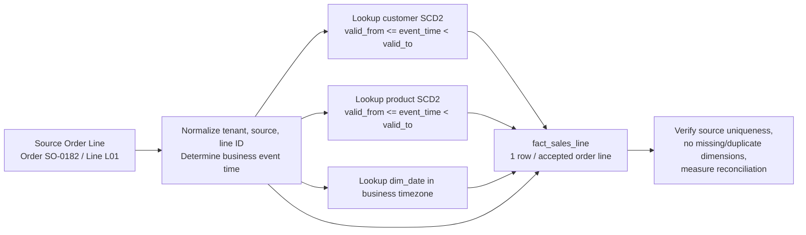

# Dimension Keys, Timestamps, and Transaction Identities in Fact Tables

## 1. Why Do Three Key Groups Determine Fact Table Reliability?

In the `DATABASE_DATA_MODELING` module, learners practice turning business requirements into verifiable data models: from entities, relationships, constraints, normalization, keys, and indexes to relational, document, graph, and analytical implementations. In the **Fact Tables** chapter, the focus shifts beyond "what primary key does the table have?" to **what each fact row represents**, **which dimensions it belongs to**, and **at what timestamp it occurred**.

Consider a marketplace with sales facts:

- A customer purchases product A on March 15, when the customer is in the **Silver** segment and the product is in the **Home Appliances** category.
- On July 1, the customer moves to the **Gold** segment; the product is reclassified into **Smart Devices**.
- In August, Finance reruns March revenue by the customer segment and product category **effective at the time of sale**.

If the fact table stores `customer_id` and always joins to the current customer record, the March report gets attributed to Gold. If it stores only the load date without the sale date, late-arriving orders get summed into the wrong month. Without a stable order-line identifier, rerunning the pipeline can double revenue.

These three groups of information therefore play distinct roles:

1. **Dimension keys** (*dimension foreign keys*): specify **which version** of the customer, product, store, or business status the fact row belongs to.
2. **Timestamps** (*event/business time, date/time keys, load time*): specify which business period the event belongs to, which dimension version was effective, and when the data was observed/ingested.
3. **Transaction identity** (*transaction identity, source event/line identity*): specify **which exact source transaction/line/event** the fact row represents, for traceability, deduplication, and adjustments.

Omitting any of the three can yield a table whose SQL runs very fast yet aggregates incorrectly or cannot reconcile with the source.

### Learning Objectives

After this lesson, you will be able to:

- Define the **grain** of a fact and choose fact keys, dimension keys, and date keys matching that grain.
- Distinguish a dimension's business key from a **dimension version surrogate key** when using SCD Type 2.
- Identify event time, business date, recorded time, load time, and role-playing date keys.
- Select source identities sufficient for idempotent reloads and distinguish new transactions, update events, refunds, and snapshot facts.
- Map dimension keys at event time via **as-of lookups**, handle late-arriving dimensions, and detect unmatched records.
- Write verifiable DDL, loading flows, and test/reconciliation suites in PostgreSQL 16; understand trade-offs when moving to other analytical warehouses.

## 2. Grain Comes Before Every Key

**Grain** is a complete statement describing **what one fact row represents**. It determines which keys can be unique, which measures are additive, and which dimensions apply.

Three examples with different grains:

| Fact Type | Declared Grain | Reasonable Identity | Common Mistakes |
|---|---|---|---|
| Sales transaction fact | One **accepted order line** from the source system | (`source_system`, `order_ref`, `line_ref`), plus tenant if IDs are tenant-scoped | Confusing orders with order lines; one order can have multiple products |
| Payment event fact | One **payment status event** emitted by the source | (`source_system`, `payment_event_id`) or with version/sequence | Making `payment_id` unique when one payment has multiple events |
| Inventory periodic snapshot | Balance of **one product at one warehouse at business day close** | (`snapshot_date_key`, `warehouse_key`, `product_key`), per scope | Summing multi-day balances like units sold |
| Order process accumulating snapshot | One **order** across multiple processing milestones | Stable order identity; multiple date roles | Treating each status change as a new order |
| Factless fact | Presence/absence of an event or relationship, e.g., class attendance | (`student_key`, `class_key`, `session_date_key`) if matching grain | Inventing fake measures or double-counting attendances |

**No single key template fits all fact tables.** Before designing, write a sentence like:

> Each row of `fact_sales_line` represents one accepted sales line, unique by tenant, source system, source order reference, and source line reference; subsequent valid adjustments are recorded under separate rules.

From this sentence it follows that:

- An order with three lines → **three fact rows**.
- Re-syncing the same line → **must not create a fourth row**.
- A post-acceptance transaction change must follow **snapshot update, adjustment entry, or revision event** rules, never silently inserting another row at the same grain.
- A physical primary key `fact_line_sk` may be used inside the warehouse, yet **it does not replace the source uniqueness constraint**.

### Grain vs. Dimensions

An event can reference many dimensions: sale date, customer, product, store, channel, promotion. That does not make the grain "one customer/day"; the grain remains **one sales line**. When joining a one-to-many dimension outside the grain, control row multiplication before summing measures.

## 3. Three Identity Layers: Source, Fact, and Dimension Version

In star schema design, at least three key layers can appear simultaneously:

| Layer | Example | Meaning | Can It Replace Another Layer? |
|---|---|---|---|
| **Source business/natural key** | `(tenant_id, source_system, customer_ref)` | The customer as identified by the source system | Does not by itself identify the customer's SCD2 version |
| **Dimension surrogate key** | `customer_sk = 10204` | **One version row** in `dim_customer` | Not a transaction ID, and not stable across rebuilds without mapping |
| **Fact surrogate key** | `fact_line_sk = 890001` | Internal identifier of **one fact row** | Does not prove the fact was ingested once from the source |
| **Degenerate dimension / transaction reference** | `source_order_ref = 'SO-2027-0182'` | Order code for tracing and grouping lines; no separate dimension attributes | Not a dimension key and not unique at line grain without `line_ref` |
| **Date key** | `sold_date_key = 20270315` | Calendar date represented by the date dimension | Does not capture hour/minute/second or load timestamp |

Never join a fact directly to the current `customer` record and assume historical segments will be accurate. With SCD Type 2, one customer has multiple **version rows**, each with its own `customer_sk` and effective interval.

### Example: Customer Segment Change

| `customer_sk` | `customer_ref` | `segment` | `valid_from` | `valid_to` |
|---:|---|---|---|---|
| 1001 | `CUS-08` | Silver | 2027-01-01 | 2027-07-01 |
| 2088 | `CUS-08` | Gold | 2027-07-01 | Unbounded |

A sales line on 2027-03-15 needs `customer_sk = 1001` if policy requires the segment **effective at the time of sale**. An order on 2027-07-10 uses `customer_sk = 2088`.

If both rows only store `customer_ref = 'CUS-08'` and join to the current version, March history gets labeled Gold. If joined to both versions without a time predicate, one row turns into **two rows** and doubles revenue.

## 4. SCD Type 2 and Dimension Keys at Event Time

**Slowly Changing Dimension Type 2** stores each change requiring history as a new version row. A typical model includes:

- Version-specific surrogate key: `customer_sk`.
- Stable business identity within a namespace: (`tenant_id`, `source_system`, `customer_ref`).
- Attributes at that version: `segment`, `region`, `customer_tier`, etc.
- Effective interval: `[valid_from, valid_to)`.
- Optional batch ID, change source, recorded time, and audit metadata.

For an event at timestamp \(t\), the rule to find the valid version is typically:

\[
\mathrm{valid\_from}\le t<\mathrm{valid\_to}
\]

and the latest record may use an unbounded upper end. The start boundary is **inclusive** and the end boundary is **exclusive**, so an event at exactly July 1 00:00 belongs to the new version.

### Correctness Separates into Three Constraints

1. **Identity:** versions sharing (`tenant_id`, `source_system`, `customer_ref`) represent the same source customer.
2. **No overlapping versions:** no two versions of the same identity are valid at the same instant.
3. **Coverage:** enough versions exist so every fact being loaded finds exactly one version.

A **non-overlap** constraint does not guarantee **no gaps**. If one version ends on March 1 and the next begins on March 5, a fact on March 3 finds no version even though both rows are individually valid.

### Distinguishing SCD2 from Bitemporal

`valid_from/valid_to` states when information was **business-effective**. If on August 20 you discover the segment actually changed on June 15 instead of July 1, a retroactive edit can change past as-of lookups. To answer "what did the system **believe** on July 10," you must also track assertion/recorded time or proper audit/bitemporal structures. **Do not call every table with `updated_at` bitemporal.**

## 5. Timestamps in Facts: At Least Three Distinct Anchors

Facts typically need to distinguish:

| Timestamp | Meaning | When Used |
|---|---|---|
| `occurred_at` / event time | When the event actually happened per source contract | Assigning sale date/hour, resolving effective dimension version |
| `accepted_at` / business recognition time | When the business recognized/locked the transaction | May govern pricing, tax, or revenue recognition depending on rules |
| `loaded_at` / ingestion time | When the pipeline wrote the row to the warehouse | Monitoring latency, SLAs, batch reconciliation |
| `source_recorded_at` | When the source system recorded/registered the event | Tracking source lag, handling late events |
| `corrected_at` / adjustment time | When the system received or booked an adjustment | Separating adjustments from original transaction dates |

There is no universal rule that `created_at` or `loaded_at` is always the revenue reporting date. The business contract must specify whether to use **order placement**, **order confirmation**, **payment**, **invoicing**, or **delivery** depending on the measure and report type.

### Late-Arriving Event Example

An order is accepted at 23:50 on March 31 Vietnam time, but ingested by the pipeline at 01:00 on April 2.

- If revenue is recognized at order acceptance, `sold_date_key` belongs to **March 31**.
- `loaded_at` belongs to **April 2**; use it to measure load latency, not to alter the sale date.
- If the system defines revenue recognition upon successful payment on April 1, use the **payment** date role rather than defaulting to the order lock date.

**Timestamps are not just for sorting**: they define reporting periods and which dimension version applies. A wrong choice can leave monthly row counts matching while skewing segments, dates, or FX rates.

## 6. Date Dimensions, Time Dimensions, and Role-Playing Date Keys

In an analytical data warehouse, `dim_date` typically holds one row per day: `date_key`, `calendar_date`, year, month, quarter, ISO week, and business workdays/holidays. Facts store date FKs for convenient grouping and filtering.

```text
dim_date
date_key | calendar_date | year | month | is_workday
---------+---------------+------+-------+-----------
20270315 | 2027-03-15    | 2027 | 3     | true
20270316 | 2027-03-16    | 2027 | 3     | true
...

fact_sales_line
source_order_ref | source_line_ref | sold_date_key | occurred_at (UTC)
-----------------+-----------------+---------------+-------------------------
SO-0182          | L01             | 20270315      | 2027-03-15 15:30:00+00
```

`date_key = 20270315` is a **common convention**, not a native DBMS date type. When using `YYYYMMDD` integer keys, validate legal dates, generate date dimension rows consistently, and test that `date_key` matches the actual date. Having `FOREIGN KEY(date_key)` alone does not guarantee `date_key` matches `occurred_at` in a specific timezone.

### One Time Dimension Playing Multiple Roles

Orders may need `ordered_date_key`, `paid_date_key`, `shipped_date_key`, and `delivered_date_key`, all referencing the **same `dim_date`** in **different roles** (*role-playing dimension*). Do not collapse these milestones into a single `date_key` because:

- An order can be placed on March 31, paid on April 1, and delivered on April 3.
- Reporting ordered counts differs from reporting paid revenue or on-time delivery.
- For unreached milestones, decide between `NULL` or a special "unknown / not applicable" member; never arbitrarily use 1970-01-01 or 9999-12-31 without a documented contract.

### Should Date Keys and Timestamps Coexist?

Yes. `date_key` makes calendar joins and grouping easy; timestamps preserve exact precision, event ordering, late-arrival checks, and as-of dimension lookups. Even with `sold_date_key`, a fact may still need `occurred_at` and `accepted_at`.

In PostgreSQL, `TIMESTAMPTZ` represents an absolute instant; display depends on session timezone. A business date can be derived via:

```sql
(occurred_at AT TIME ZONE 'Asia/Ho_Chi_Minh')::date
```

If a business has tenants across multiple timezones, timezone must be resolved **per tenant / per transaction**, which may even change over time. Never assume `::date` in an arbitrary session timezone matches reporting calendars.

## 7. Transaction Identity: Degenerate Dimensions and Idempotency

An order code like `SO-2027-0182` usually does not need its own dimension table if it is only used for:

- Drilling through from reports to source documents.
- Grouping multiple lines into the same transaction.
- Reconciliation, investigation, and customer support.
- Detecting already-ingested source lines/events.

Stored directly on the fact table, it is called a **degenerate dimension**. This is not a "bad dimension"; it is an identifying attribute with analytical utility that does not require a standalone dimension table.

An order code alone is **not a unique key for an order-line fact**. You may need a composite key:

```text
(tenant_id, source_system, source_order_ref, source_line_ref)
```

If `source_line_ref` is unstable or the source only exposes a reorderable `line_no`, establish a durable identifier. Using a mutable sequence number as a unique key across syncs causes the warehouse to mistake an existing line for a new one. If the table is truly an **event fact**, you usually need a dedicated `event_id`/`event_sequence` to record multiple events for the same line.

### A Fact Surrogate Key Does Not Replace Idempotency

`fact_line_sk BIGINT GENERATED ... IDENTITY PRIMARY KEY` identifies a row inside the warehouse, yet reloading the same data can still mint new IDs. You need a **unique constraint on source identity**, or a concurrency-safe ledger/idempotency table.

A payload hash is not an ideal source identity: two distinct valid events can share identical payloads, and a single event can vary in non-semantic formatting or fields. If hashes are used to speed up diffing, also verify source keys, versions, and record semantics.

## 8. Relationship Between Dimension Keys and Source Identity



Every source line must pass **two independent checks**:

1. **Right source record:** never ingest the same line twice, never drop a valid line.
2. **Right dimensions at the valid time:** every SCD2 reference must match **exactly one version**, or route into a defined exception workflow.

Storing `customer_sk` and `product_sk` does **not** automatically prove the chosen version was valid at event time: a FK only guarantees the dimension row **exists**. Verifying that the version was effective at `occurred_at` must happen in the pipeline/transaction and be backed by dedicated tests.

## 9. PostgreSQL 16 DDL: Dimensions, Dimension Keys, and Sales-Line Fact

The following implementation uses PostgreSQL 16. Its goal is to illustrate a compact star schema with source uniqueness, SCD2, and tenant-scoped FKs. It is **not** a complete financial, tax, payment, or order-lifecycle system.

Assumptions:

- Each row of `fact_sales_line` is **one accepted sales line**; subsequent edits/refunds have separate adjustment pipelines.
- Source line IDs are stable and unique **within an order**, and order IDs are unique within (`tenant_id`, `source_system`).
- Accepted lines carry an authoritative business timestamp in `occurred_at`; `sold_date_key` uses `Asia/Ho_Chi_Minh` solely for illustration.
- Customers and products have effective-dated versions, and **every event must map to exactly one version**. Unknown members are omitted in this schema; rows missing dimensions route to exception handling before load.
- Line price is the accepted base amount; discounts and taxes are excluded in this example. When present, model dedicated measures rather than blindly computing net = quantity × unit price.

### 9.1. Date Dimension

```sql
CREATE TABLE dim_date (
    date_key INTEGER PRIMARY KEY,
    calendar_date DATE NOT NULL UNIQUE,
    calendar_year INTEGER NOT NULL,
    calendar_month INTEGER NOT NULL,
    CONSTRAINT ck_date_key_matches_calendar
        CHECK (
            date_key =
                EXTRACT(YEAR FROM calendar_date)::INTEGER * 10000
                + EXTRACT(MONTH FROM calendar_date)::INTEGER * 100
                + EXTRACT(DAY FROM calendar_date)::INTEGER
        ),
    CONSTRAINT ck_calendar_month
        CHECK (calendar_month BETWEEN 1 AND 12),
    CONSTRAINT ck_calendar_month_consistent
        CHECK (calendar_month = EXTRACT(MONTH FROM calendar_date)::INTEGER),
    CONSTRAINT ck_calendar_year_consistent
        CHECK (calendar_year = EXTRACT(YEAR FROM calendar_date)::INTEGER)
);
```

During ETL, `dim_date` is pre-populated with needed dates. Check constraints validating `YYYYMMDD`, year, and month prevent mismatched keys. When holidays or fiscal calendars apply, choose an **explicitly versioned/ruled business calendar**; tenant A's holidays may differ from tenant B's.

### 9.2. Two SCD2 Dimensions

```sql
CREATE EXTENSION IF NOT EXISTS btree_gist;

CREATE TABLE dim_customer (
    customer_sk BIGINT GENERATED BY DEFAULT AS IDENTITY PRIMARY KEY,
    tenant_id BIGINT NOT NULL,
    source_system VARCHAR(40) NOT NULL,
    customer_ref VARCHAR(80) NOT NULL,
    customer_name VARCHAR(200) NOT NULL,
    segment_code VARCHAR(40) NOT NULL,
    valid_from TIMESTAMPTZ NOT NULL,
    valid_to TIMESTAMPTZ,

    CONSTRAINT uq_customer_tenant_sk UNIQUE (tenant_id, customer_sk),
    CONSTRAINT uq_customer_version_start
        UNIQUE (tenant_id, source_system, customer_ref, valid_from),
    CONSTRAINT ck_customer_version_interval
        CHECK (valid_to IS NULL OR valid_from < valid_to),
    CONSTRAINT ex_customer_one_version_at_time
        EXCLUDE USING gist (
            tenant_id WITH =,
            source_system WITH =,
            customer_ref WITH =,
            tstzrange(valid_from, valid_to, '[)') WITH &&
        )
);

CREATE TABLE dim_product (
    product_sk BIGINT GENERATED BY DEFAULT AS IDENTITY PRIMARY KEY,
    tenant_id BIGINT NOT NULL,
    source_system VARCHAR(40) NOT NULL,
    product_ref VARCHAR(80) NOT NULL,
    product_name VARCHAR(200) NOT NULL,
    reporting_category VARCHAR(80) NOT NULL,
    valid_from TIMESTAMPTZ NOT NULL,
    valid_to TIMESTAMPTZ,

    CONSTRAINT uq_product_tenant_sk UNIQUE (tenant_id, product_sk),
    CONSTRAINT uq_product_version_start
        UNIQUE (tenant_id, source_system, product_ref, valid_from),
    CONSTRAINT ck_product_version_interval
        CHECK (valid_to IS NULL OR valid_from < valid_to),
    CONSTRAINT ex_product_one_version_at_time
        EXCLUDE USING gist (
            tenant_id WITH =,
            source_system WITH =,
            product_ref WITH =,
            tstzrange(valid_from, valid_to, '[)') WITH &&
        )
);
```

SCD2 rows must not overwrite `segment_code` or `reporting_category` on historical versions already referenced if the contract preserves as-was history. When a change takes effect, close the prior interval and insert the new row inside a concurrency-controlled transaction.

`EXCLUDE USING gist` (with `btree_gist`) prevents **overlapping** intervals for the same identity, yet **does not guarantee coverage**: gaps can still exist on a given date. Nor does the constraint stop an application from selecting the **wrong event version** if it omits the time predicate.

`UNIQUE (tenant_id, customer_sk)` is redundant for uniqueness since `customer_sk` is already the global PK, but it serves as the **composite FK target** preventing one tenant's fact from referencing another tenant's dimension row. It creates a real physical index, so factor its storage and write cost into sizing.

### 9.3. Transaction Fact

```sql
CREATE TABLE fact_sales_line (
    fact_line_sk BIGINT GENERATED ALWAYS AS IDENTITY PRIMARY KEY,
    tenant_id BIGINT NOT NULL,
    source_system VARCHAR(40) NOT NULL,
    source_order_ref VARCHAR(80) NOT NULL,
    source_line_ref VARCHAR(80) NOT NULL,

    -- Business timestamps and warehouse ingestion timestamp.
    occurred_at TIMESTAMPTZ NOT NULL,
    accepted_at TIMESTAMPTZ NOT NULL,
    loaded_at TIMESTAMPTZ NOT NULL DEFAULT clock_timestamp(),
    sold_date_key INTEGER NOT NULL,

    -- Keys pointing to the exact dimension version rows.
    customer_sk BIGINT NOT NULL,
    product_sk BIGINT NOT NULL,

    -- Transaction measures excluding tax/discount in this example.
    quantity NUMERIC(14, 3) NOT NULL,
    unit_price NUMERIC(18, 2) NOT NULL,
    gross_amount NUMERIC(20, 2) NOT NULL,
    currency_code VARCHAR(3) NOT NULL,
    load_batch_id VARCHAR(80) NOT NULL,

    CONSTRAINT uq_fact_source_line
        UNIQUE (tenant_id, source_system, source_order_ref, source_line_ref),
    CONSTRAINT fk_fact_sold_date
        FOREIGN KEY (sold_date_key) REFERENCES dim_date(date_key),
    CONSTRAINT fk_fact_customer_same_tenant
        FOREIGN KEY (tenant_id, customer_sk)
        REFERENCES dim_customer (tenant_id, customer_sk),
    CONSTRAINT fk_fact_product_same_tenant
        FOREIGN KEY (tenant_id, product_sk)
        REFERENCES dim_product (tenant_id, product_sk),
    CONSTRAINT ck_fact_quantity_positive CHECK (quantity > 0),
    CONSTRAINT ck_fact_price_nonnegative
        CHECK (unit_price >= 0 AND unit_price <> 'NaN'::numeric),
    CONSTRAINT ck_fact_amount_nonnegative
        CHECK (gross_amount >= 0 AND gross_amount <> 'NaN'::numeric),
    CONSTRAINT ck_fact_currency_format
        CHECK (currency_code ~ '^[A-Z]{3}$'),
    CONSTRAINT ck_fact_source_order_nonblank
        CHECK (char_length(btrim(source_order_ref)) > 0),
    CONSTRAINT ck_fact_source_line_nonblank
        CHECK (char_length(btrim(source_line_ref)) > 0)
);

-- Supports revenue queries by date and dimension.
CREATE INDEX idx_fact_date_customer
    ON fact_sales_line (sold_date_key, customer_sk);

CREATE INDEX idx_fact_date_product
    ON fact_sales_line (sold_date_key, product_sk);
```

**Analyzing constraint boundaries:**

1. The surrogate PK identifies one fact row; the four-column `UNIQUE` ensures **the same source line is not double-loaded** at the declared grain.
2. Tenant-scoped composite FKs prevent cross-tenant dimension references. However, FKs **do not know** whether `customer_sk` matches `occurred_at`; ingestion logic and tests verify that.
3. `fk_fact_sold_date` only proves the date key exists in `dim_date`. It **does not prove** that key corresponds to `occurred_at` in the business timezone.
4. `gross_amount` and `unit_price` are assumed non-negative. Refunds/adjustments may need a separate fact or event type; never force valid negative entries into a `CHECK` incompatible with their grain.
5. `currency_code` checks **format** only, without a currency master FK or conversion rules. Multi-currency totals must never be summed directly without a defined policy.
6. PostgreSQL `NUMERIC` permits special values like `NaN`; the example explicitly blocks `NaN` on measures. For real financial data, also control rounding and input precision.
7. These indexes serve reads and are not automatically optimal for every workload. As fact volume grows, benchmark against date/tenant predicates and real table statistics.

## 10. Loading Rule: Resolving the Right Dimension Version via As-Of Lookup

Source rows carry natural keys; never assume those are warehouse surrogate keys. A loading step typically:

1. Normalizes (`tenant_id`, `source_system`, `customer_ref`, `product_ref`) by source namespace.
2. Chooses the **authoritative business timestamp** for SCD2 lookup, e.g., `occurred_at`.
3. Joins `dim_customer`/`dim_product` using **effective-interval predicates**.
4. Derives `sold_date_key` in the approved reporting timezone.
5. Verifies **exactly one** match per dimension and date, and checks whether the source key is absent or has an identical payload.
6. Loads the fact transactionally, recording batch ID and reconciling figures.

### 10.1. Version Lookup Query

```sql
-- Assume tenant 42, a source line sold on 2027-03-15.
SELECT
    c.customer_sk,
    c.segment_code,
    p.product_sk,
    p.reporting_category
FROM dim_customer AS c
JOIN dim_product AS p
  ON p.tenant_id = c.tenant_id
WHERE c.tenant_id = 42
  AND c.source_system = 'CRM'
  AND c.customer_ref = 'CUS-08'
  AND c.valid_from <= '2027-03-15 10:00:00+00'::timestamptz
  AND (
      c.valid_to > '2027-03-15 10:00:00+00'::timestamptz
      OR c.valid_to IS NULL
  )
  AND p.source_system = 'ERP'
  AND p.product_ref = 'SKU-A'
  AND p.valid_from <= '2027-03-15 10:00:00+00'::timestamptz
  AND (
      p.valid_to > '2027-03-15 10:00:00+00'::timestamptz
      OR p.valid_to IS NULL
  );
```

This is an *as-of join* across **two dimensions with different source namespaces**. Do not assume the sales order's `source_system` equals the customer or product record's `source_system`; if orders use different reference IDs, introduce a reliable natural-key mapping layer.

PostgreSQL supports `TSTZRANGE` and the containment operator `@>`, enabling a shorter form:

```sql
AND tstzrange(c.valid_from, c.valid_to, '[)') @> :occurred_at
```

`:occurred_at` represents an application bind parameter, **not literal `psql` bind syntax**. Whether using two-column comparisons or ranges, ensure the event timestamp and effective intervals share consistent timezone definitions.

### 10.2. Inserting One Fact Row

The snippet below runs only after `dim_date` and both SCD2 dimensions are populated; it assumes each join returns **exactly one version**. An empty `INSERT ... SELECT` **does not mean success**, and a multi-row join may attempt multiple inserts and collide on `UNIQUE`. The application must assert row count and route anomalies to error handling.

```sql
WITH incoming AS (
    SELECT
        42::bigint AS tenant_id,
        'ORDER_API'::varchar(40) AS source_system,
        'SO-0182'::varchar(80) AS source_order_ref,
        'L01'::varchar(80) AS source_line_ref,
        '2027-03-15 10:00:00+00'::timestamptz AS occurred_at,
        '2027-03-15 10:01:00+00'::timestamptz AS accepted_at,
        'CUS-08'::varchar(80) AS customer_ref,
        'SKU-A'::varchar(80) AS product_ref,
        2.000::numeric(14,3) AS quantity,
        800000.00::numeric(18,2) AS unit_price,
        'VND'::varchar(3) AS currency_code,
        'batch-20270316-01'::varchar(80) AS load_batch_id
)
INSERT INTO fact_sales_line (
    tenant_id, source_system, source_order_ref, source_line_ref,
    occurred_at, accepted_at, sold_date_key, customer_sk, product_sk,
    quantity, unit_price, gross_amount, currency_code, load_batch_id
)
SELECT
    i.tenant_id, i.source_system, i.source_order_ref, i.source_line_ref,
    i.occurred_at, i.accepted_at, d.date_key, c.customer_sk, p.product_sk,
    i.quantity, i.unit_price,
    ROUND(i.quantity * i.unit_price, 2),
    i.currency_code, i.load_batch_id
FROM incoming AS i
JOIN dim_date AS d
  ON d.calendar_date =
     (i.occurred_at AT TIME ZONE 'Asia/Ho_Chi_Minh')::date
JOIN dim_customer AS c
  ON c.tenant_id = i.tenant_id
 AND c.source_system = 'CRM'
 AND c.customer_ref = i.customer_ref
 AND tstzrange(c.valid_from, c.valid_to, '[)') @> i.occurred_at
JOIN dim_product AS p
  ON p.tenant_id = i.tenant_id
 AND p.source_system = 'ERP'
 AND p.product_ref = i.product_ref
 AND tstzrange(p.valid_from, p.valid_to, '[)') @> i.occurred_at
RETURNING fact_line_sk, source_order_ref, source_line_ref,
          customer_sk, product_sk, sold_date_key;
```

This example omits discounts and taxes and is not a universal revenue formula for every order. Revenue recognition, currency, rounding, tax, and refund rules must be explicitly confirmed by the business.

**Concurrency considerations:** dimension versions can change while the pipeline resolves keys. Under standard isolation levels, `INSERT ... SELECT` reads a consistent snapshot, yet **allowing retroactive edits** to versions after facts are created can cause `customer_sk`/`product_sk` in the fact table to drift from the "latest effective history." Define an **as-booked** policy (keep original SKs), **restated** policy (recompute mappings), or bitemporal model if reproducing prior beliefs is needed.

## 11. Late-Arriving Facts and Late-Arriving Dimensions Are Different Problems

### 11.1. Late-Arriving Fact

An order line is sold on March 15 yet arrives in the warehouse on April 10. If reporting by **sale date**, use March 15 and the dimension version effective on March 15. `loaded_at = April 10` only tracks latency.

Never load that row with April's `customer_sk` simply because the customer is now Gold. That is an as-of lookup bug. If source sale timestamps or timezones are unreliable, normalize or quarantine them before aggregating.

### 11.2. Late-Arriving Dimension

A source order references `customer_ref = CUS-99`, but the customer dimension record has not arrived yet. There are three main strategies:

| Strategy | Handling | Trade-offs |
|---|---|---|
| **Hold in staging/quarantine** | Defer loading fact, wait for dimension and retry safely | Reporting latency; requires SLAs and alerts |
| **Unknown member** | Map to an "unknown" dimension row with a real SK | Keeps fact row counts complete, groups under "Unknown"; needs backfill workflow |
| **Inferred member** | Create a minimal dimension row for the known natural key, enrich later | Must handle versioning, missing attributes, FKs, and out-of-order events |

Never hard-code `customer_sk = 0` in a multi-tenant schema whose DDL requires FK (`tenant_id`, `customer_sk`), unless **per-tenant Unknown dimension rows** exist and the FK validly targets them. With a global surrogate PK, a single `customer_sk=0` row cannot belong to every tenant simultaneously; design keys and scopes explicitly.

### 11.3. Updating Dimensions After Facts Are Loaded

When a late dimension arrives, decide:

- Only enrich **attributes** on the inferred member while keeping the same version? If policy permits and history is intact, update in a controlled manner.
- Insert a **retroactively effective version** that alters historical mappings? You may need to update fact `customer_sk` values or maintain a mapping bridge for restated reporting mode.
- Are closed reports allowed to change? If not, retain report snapshots/versions or follow an adjusting-entry policy.

Never silently "update all facts to match the current dimension." That reclassifies history and destroys reproducibility of published numbers.

## 12. CDC, Change Events, and Deduplication

**Change Data Capture (CDC)** frequently emits multiple change records for the **same source row**. If the fact table's grain is **an accepted order line**, then:

- Source `INSERT` creates a new row once acceptance criteria in the contract are met.
- `UPDATE` on an unaccepted order stays in staging, not yet a fact.
- `UPDATE` after acceptance may update a snapshot, emit an adjustment fact, or emit a correction event per policy.
- Source `DELETE` does not automatically mean deleting fact history; it may represent a cancellation/refund recorded via a separate business event.

If the fact's grain is **one event in the CDC log**, the key must include `source_event_id`/`LSN`/sequence or a durable event ID rather than `order_ref + line_ref` alone. Making `order_ref` unique and dropping subsequent events erases change history.

### At-Least-Once Delivery Must Not Become Double Counting

Many queues and pipelines guarantee **at-least-once delivery**: retries can deliver the same event multiple times. A source unique key helps guard against duplicates:

```sql
-- Illustrates immutable fact loading when the source is already normalized.
-- Populate all required columns from the actual pipeline.
INSERT INTO fact_sales_line (
    tenant_id, source_system, source_order_ref, source_line_ref,
    occurred_at, accepted_at, sold_date_key,
    customer_sk, product_sk, quantity, unit_price, gross_amount,
    currency_code, load_batch_id
)
VALUES (
    42, 'ORDER_API', 'SO-0182', 'L01',
    '2027-03-15 10:00:00+00'::timestamptz,
    '2027-03-15 10:01:00+00'::timestamptz,
    20270315, 1001, 2001, 2, 800000, 1600000,
    'VND', 'batch-retry-01'
)
ON CONFLICT (
    tenant_id, source_system, source_order_ref, source_line_ref
)
DO NOTHING;
```

**This illustrates only the DB mechanism, not a script safe to run verbatim.** `customer_sk = 1001`, `product_sk = 2001`, and `sold_date_key = 20270315` must actually exist for that tenant and effective window; if `SO-0182/L01` from Section 10 is already present, `DO NOTHING` inserts nothing.

More importantly, `ON CONFLICT DO NOTHING` **also ignores conflicts with differing payloads**. If a redelivered record shares the same source key yet carries changed amounts or quantities, silently ignoring it hides legitimate edits or source corruption. Compare incoming payloads against existing rows and classify:

1. **Identical retry** → already processed, acknowledge idempotently.
2. **Same ID, different payload** → route to revision/correction workflow or raise a contract error.
3. **New event with new ID** → insert at the event grain if designed for it.

In PostgreSQL, use `IS DISTINCT FROM` to compare nullable columns for differences. Never declare a pipeline idempotent solely by checking row counts.

### Identities Must Be Namespaced

`order_ref = '0001'` can exist across two tenants or two source systems. Unique keys must include every namespace where collisions can happen:

```text
(tenant_id, source_system, source_order_ref, source_line_ref)
```

If a source further scopes IDs by branch/store, include that scope or normalize IDs before loading. Conversely, never shove an extra column into a unique key just to silence duplicate errors if it is not part of true identity: that destroys duplicate detection.

## 13. Measures and Keys: Avoiding Wrong Totals Even When All FKs Are Valid

Facts can hold measures:

- **Additive:** `quantity_sold`, `gross_amount` are usually summable across compatible dimensions, though currency must be respected.
- **Semi-additive:** `inventory_balance` sums across products/warehouses at the **same timestamp**, never summing Day 1 and Day 2 balances to report total stock.
- **Non-additive:** conversion rates, margin percentages, average balances—cannot be directly summed; require numerator/denominator or formula rules.

In a sales-line fact, each measure is recorded once at the order-line grain. A dimension change **must not spawn extra fact rows** just because a customer switched segments. If a report joins to a historical table with two versions without filtering by time/SK, one fact row multiplies in the output:

```sql
-- WRONG for historical reporting: missing time / exact-version condition.
SELECT c.segment_code, SUM(f.gross_amount)
FROM fact_sales_line AS f
JOIN dim_customer AS c
  ON c.tenant_id = f.tenant_id
 -- Never join solely on natural key or version table without as-of qualification.
 AND c.customer_ref = 'CUS-08'
WHERE f.tenant_id = 42
GROUP BY c.segment_code;
```

That flawed query can multiply one fact across multiple versions of `CUS-08` within the same tenant, and even misattribute **other customers' facts** to `CUS-08` because it omits the fact's customer identity join. It is shown intentionally to highlight the failure mode.

Correct query joining on the **stored dimension surrogate key**:

```sql
SELECT
    d.calendar_year,
    d.calendar_month,
    c.segment_code,
    f.currency_code,
    SUM(f.gross_amount) AS gross_amount
FROM fact_sales_line AS f
JOIN dim_date AS d
  ON d.date_key = f.sold_date_key
JOIN dim_customer AS c
  ON c.tenant_id = f.tenant_id
 AND c.customer_sk = f.customer_sk
WHERE f.tenant_id = 42
GROUP BY d.calendar_year, d.calendar_month,
         c.segment_code, f.currency_code
ORDER BY d.calendar_year, d.calendar_month,
         c.segment_code, f.currency_code;
```

Keep `currency_code` in `GROUP BY` so different currencies are never summed directly. If converted totals are needed, build dedicated FX-converted measures or facts with explicit rate sources, effective timestamps, rounding rules, and approval policies.

## 14. Fact Types and Their Distinct Time-Key Patterns

### 14.1. Transaction Fact

Grain is **one transaction/line/event**. Typically has one primary event date/time, optional role-playing dates, and a degenerate transaction ID. For immutable transaction facts, subsequent adjustments are normally modeled as adjustment events or separate facts to preserve history.

### 14.2. Periodic Snapshot Fact

End-of-day inventory example:

```text
fact_inventory_daily
  snapshot_date_key
  warehouse_sk
  product_sk
  on_hand_qty

Grain = one product at one warehouse at the end of one business day.
Unique key = (snapshot_date_key, warehouse_sk, product_sk)
```

`on_hand_qty` is a **point-in-time balance**, not daily inflow/outflow. If snapshots are sparse, define whether absence means 0, missing ingestion, or carry-forward. Never sum daily balances to report "period-end" inventory.

### 14.3. Accumulating Snapshot Fact

One row represents **one process** passing through multiple milestones:

```text
fact_fulfillment_process
  source_order_ref
  ordered_date_key
  paid_date_key
  packed_date_key
  shipped_date_key
  delivered_date_key
  status
  elapsed_hours
```

Rows are typically updated as the workflow progresses—an alternative to immutable transaction facts. An unreached `paid_date_key` does not mean 1970-01-01; follow an agreed `NULL` or unknown-role convention.

### 14.4. Factless Fact

Records class attendance, campaign eligibility, or point-in-time relationships without numeric measures. Each row still requires **grain**, **dimension keys**, **date**, and **event identity or uniqueness rules**. `COUNT(*)` is valid only when events are deduplicated at the declared grain.

## 15. Integrity Testing Goes Beyond Simple FK Checks

SQL constraints enforce declarable invariants, while many fact properties must be verified inside the pipeline.

| Invariant to Prove | DB Mechanism | Additional Testing or Orchestration |
|---|---|---|
| Each source line appears at most once | `UNIQUE` on source identity | Reconcile retries, payload drift, dropped rows |
| All dimension FKs exist | `FOREIGN KEY` | Verify mapping by tenant, source, and time |
| Dimension key is effective at event time | FK is **insufficient** | As-of joins and per-row interval tests |
| At most one version per natural key at an instant | GiST exclusion in PostgreSQL example | Test concurrency, backfills, and other dimensions |
| Each fact resolves to exactly one version | Uniqueness/non-overlap does not ensure coverage | Assert 0 / 1 / >1 match counts before load |
| `sold_date_key` matches business date | FK to `dim_date` is **insufficient** | Compare against timestamp + authoritative timezone |
| No duplicate or dropped facts on join | PK/FK is only part of it | Reconcile row counts and measures pre/post join |
| Source identity stays stable across retries/CDC | `UNIQUE` only blocks duplicate keys | Verify source contract, revision/sequence rules |
| No summing across unconverted currencies | Cannot be enforced via FKs | Test aggregations by currency and FX rules |
| Historical reports do not shift unexpectedly | FKs/SCD2 are insufficient alone | Restatement, snapshot, versioning, and audit policies |

### 15.1. Verifying Dimension Lookups via Count Queries

Each source record must match exactly one version. To catch missing or overlapping dimensions in staging, use:

```sql
-- Illustrates a staging_sale_line table holding source fields.
-- This staging table is not created in Section 9 DDL.
SELECT
    s.tenant_id,
    s.source_system,
    s.source_order_ref,
    s.source_line_ref,
    COUNT(c.customer_sk) AS matching_customer_versions
FROM staging_sale_line AS s
LEFT JOIN dim_customer AS c
  ON c.tenant_id = s.tenant_id
 AND c.source_system = 'CRM'
 AND c.customer_ref = s.customer_ref
 AND tstzrange(c.valid_from, c.valid_to, '[)') @> s.occurred_at
GROUP BY s.tenant_id, s.source_system, s.source_order_ref, s.source_line_ref
HAVING COUNT(c.customer_sk) <> 1;
```

This queries a **hypothetical staging table**. In real pipelines, also verify `dim_product`, `dim_date`, and source line uniqueness. If staging contains duplicate IDs, the `GROUP BY` above can mask or sum match counts; deduplicate or attach a staging row ID before checking so each record's match count is unambiguous.

### 15.2. Verifying Date Keys Match Event Timestamps

```sql
SELECT
    f.fact_line_sk,
    f.sold_date_key,
    d.calendar_date,
    (f.occurred_at AT TIME ZONE 'Asia/Ho_Chi_Minh')::date
        AS expected_local_date
FROM fact_sales_line AS f
JOIN dim_date AS d
  ON d.date_key = f.sold_date_key
WHERE d.calendar_date IS DISTINCT FROM
      (f.occurred_at AT TIME ZONE 'Asia/Ho_Chi_Minh')::date;
```

In multi-timezone environments, replace the fixed timezone with the **authoritative timezone at transaction time**; if policy uses `accepted_at` instead of `occurred_at`, update the check logic accordingly rather than just renaming a column.

### 15.3. Verifying FKs Match As-Of Versions

```sql
SELECT
    f.fact_line_sk, f.tenant_id, f.occurred_at,
    f.customer_sk, c.valid_from, c.valid_to
FROM fact_sales_line AS f
JOIN dim_customer AS c
  ON c.tenant_id = f.tenant_id
 AND c.customer_sk = f.customer_sk
WHERE NOT (
    tstzrange(c.valid_from, c.valid_to, '[)') @> f.occurred_at
);
```

In the example schema, non-empty results mean facts point to versions whose effective intervals no longer contain event time. Causes include loading bugs, retroactive edits, or version-pinning policies differing from stored timestamps. Never blindly update FKs before confirming whether reports follow **as-booked** or **restated** semantics.

### 15.4. Verifying Source Identities and Measures

```sql
-- Should return zero rows; UNIQUE prevents duplicates while enforced.
SELECT
    tenant_id, source_system, source_order_ref, source_line_ref,
    COUNT(*) AS row_count
FROM fact_sales_line
GROUP BY tenant_id, source_system, source_order_ref, source_line_ref
HAVING COUNT(*) > 1;

-- Row counts and gross totals by date, tenant, and currency for reconciliation.
SELECT
    tenant_id, sold_date_key, currency_code,
    COUNT(*) AS fact_rows,
    SUM(gross_amount) AS gross_amount
FROM fact_sales_line
GROUP BY tenant_id, sold_date_key, currency_code
ORDER BY tenant_id, sold_date_key, currency_code;
```

If fact totals look internally consistent yet diverge from the source, align **grains, timezones, acceptance statuses, currencies, refund/adjustment logic, and cutoffs**. Never fudge fact totals to force a match without understanding the root cause.

## 16. "Unknown" Members and 0 / −1 Dimension Keys

Many dimensional models use `Unknown`, `Not applicable`, or `Missing source` rows with conventional surrogate keys like 0 or −1. That is an **operational choice**, not a mandatory law of star schemas.

Separate at least four distinct cases:

| Situation | Meaning | Suggested Handling |
|---|---|---|
| No customer due to anonymous retail sale | **Not applicable** or anonymous buyer | Explicitly defined "Anonymous" dimension member |
| Customer code present, dimension not arrived yet | **Unknown / sync lag** | Quarantine or inferred member, enriched later |
| Customer code invalid in authoritative source | **Data error** | Block and investigate; never mix with anonymous buyers |
| Customer info exists but masked for privacy | **Known identity, restricted access** | Privacy/anonymization policy; do not sever fact lineage |

Dumping everything into `customer_sk = -1` conflates unrelated causes in segment analytics and makes clean backfill difficult. With tenant-scoped composite FKs in our example, special surrogate IDs require **matching per-tenant target rows** or a revised model; a single global Unknown row cannot naturally match every tenant's FK.

A simple, safe starting point here is **holding facts in staging until the right version resolves**, backed by clear SLAs and error tables. Only when near-real-time reporting demands it should you adopt unknown/inferred members with restatement and reconciliation workflows.

## 17. Fact Keys and Indexes Driven by Query Patterns

Fact tables often hold hundreds of millions to billions of rows; index counts must balance read workloads against write throughput.

| Query Pattern | Helpful Key / Index | Trade-off |
|---|---|---|
| Look up one line by source | `UNIQUE(tenant_id, source_system, order_ref, line_ref)` | Wide index maintained on writes; required for idempotency |
| Total revenue by date, customer | `(sold_date_key, customer_sk)` | Accelerates filtering/joins; can be large and overlap other paths |
| Total revenue by date, product | `(sold_date_key, product_sk)` | Useful if date + product filters are frequent |
| Drill-through by source order | Index prefixed with namespace + `source_order_ref` | Four-column unique index may already cover this prefix; avoid redundant indexes |
| Full-year reports scanning most facts | Partitioning, columnar warehouse, or aggregates | B-trees do not replace wide-scan architectures |
| Joining dimension versions across many dates | SK already resides in fact | May need reversed `(customer_sk, sold_date_key)` if queries start from customer |

**Date/month partitioning** reduces scan ranges and simplifies retention in supporting DBMSs, yet can restrict global `UNIQUE` constraints if the unique key omits the partition key, depending on the engine. In PostgreSQL 16, you cannot simply convert `fact_sales_line` to `PARTITION BY RANGE(occurred_at)` while keeping `UNIQUE(tenant_id, source_system, source_order_ref, source_line_ref)` on the parent table: PostgreSQL requires partition keys to be included in partitioned-table unique/PK constraints. If you force `occurred_at` into the unique key just to make DDL compile, a source line replayed with a different timestamp slips through and **breaks idempotency**. You need a global ledger, redesigned partitioning/grain, or an engine with suitable mechanisms.

### Star Schema Query Tuning Must Protect Grain

A dimension having multiple versions is completely normal. Since the fact stores the **surrogate key of one version**, joining directly on `customer_sk` is many-facts-to-one-dimension, preventing row multiplication. Never join directly on natural keys without temporal predicates.

In columnar analytical models, join strategies, sort keys, clustering, and partition pruning often matter far more than putting B-tree indexes on every FK. Some analytical warehouses **do not enforce PK/FK constraints** like PostgreSQL; they treat them as metadata or optimizer hints, leaving correctness to pipelines and reconciliation tests.

## 18. Comparing Relational, Document, Event Log, and Analytical Facts

| Model | How Source Identity Is Carried | How Dimensions/History Are Referenced | What to Watch Out For |
|---|---|---|---|
| **Relational OLTP** | Business PK/FK, transaction IDs | Joins to entities and versioned records per contract | OLTP schemas often reflect current state, not full SCD2 history |
| **OLAP Star Schema** | Degenerate order/event ID + fact SK / unique source key | FKs to dimension surrogate keys, date roles, snapshots | Grain, double counting, late data, retroactive edits |
| **Document** | Document ID plus element/event IDs inside | Embedded attribute snapshots or document/version references | Multi-line documents need stable per-line identity; updated doc ≠ event |
| **Event Log / Stream** | Event ID, stream ID, offset/sequence | Enrichment at event time or processing time; needs version policy | Offsets are partition/stream positions, not always global IDs |
| **Graph** | Node/edge identity and event references | Versioned relationships or validity properties | Traversing current edges can corrupt history if edges mutate |
| **Columnar Warehouse** | Source transaction ID + stable event key | Dimension SKs, fact grain, as-of ETL/ELT | Unenforced unique/FKs; requires input and output data tests |

For example, an order document with a `lines` array may store all figures in one document. When projecting into an order-line fact, ensure **each array element** has a durable identity; array index is not always a stable line ID. When a source emits event logs rather than final order snapshots, specify which events create sales facts and which represent purely technical edits.

## 19. Common Design Mistakes

| Mistake | Consequence | Fix |
|---|---|---|
| Creating a fact before defining grain | Mixes order and line levels; amounts multiply | Write the grain sentence and test multi-line orders |
| Using `customer_ref` as a direct FK to a versioned dimension without time filter | Multi-version customers multiply revenue | Store `customer_sk` resolved via as-of lookup |
| Looking up the **current** dimension for historical orders | Rewrites historical segments/categories | Resolve version at event time; separate restatements |
| Using only `loaded_at` as business date | Late orders land in the wrong period | Keep both event time and load time; derive authoritative business date |
| Making `order_ref` unique in a line-level fact | Only one line per multi-line order loads | Include line ID matching grain |
| Relying solely on `fact_line_sk` for deduplication | Reloads mint new facts and double-count | Enforce unique source identity and idempotency/CDC contracts |
| `ON CONFLICT DO NOTHING` across differing payloads | Masks legitimate edits or source defects | Compare payloads and handle corrections/revisions |
| Assuming an FK to a version SK proves the right date | An FK only confirms the version exists | Test `valid_from <= occurred_at < valid_to` |
| Sharing one global Unknown row across tenants | Violates tenant FK or conflates semantics | Tenant-scoped unknown/inferred members or quarantine |
| Summing `gross_amount` across currencies | Meaningless monetary totals | Group by currency or convert under FX contract |
| Summing inventory balances across days | Violates semi-additive semantics | Take point-in-time balance or valid daily average |
| Partitioning a fact and blindly adding partition key to unique constraint | Same source event with shifted timestamp bypasses dedup | Protect idempotency via appropriate global mechanism |
| Joining SCD2 without version qualification | Facts multiply across rows | Join via version SK or proper as-of predicate |
| Retroactively editing dimensions and silently remapping facts | Published reports shift unexpectedly | Define as-booked/restated policies, audits, and versioned outputs |

## 20. Hands-On Exercise: Multi-Source Sales Fact Table

**Scenario:** A company has 200 million sales lines from `POS`, `WEB`, and `MARKETPLACE`. Each source has its own order numbering rules; POS order IDs can collide across stores, WEB resends events on retries, and MARKETPLACE allows multiple line-quantity edits before order acceptance. Customers switch segments, products change reporting categories, and 3% of facts arrive more than 10 days late.

Analytical requirements:

- Revenue by **sale date**, tenant, customer segment, and product category **effective at the time of sale**.
- **As-booked snapshot** reporting for comparison against last month's finance numbers.
- Traceability to an individual source line to explain variances and prevent duplicate loads.
- Separation of booked orders, payments, refunds, and post-sale adjustments.

### Tasks

1. **Grain:** Write grain statements for a sales transaction fact table and a separate refund fact table. Explain why `order_ref` or `payment_id` alone may fail to uniquely identify every event.
2. **Source Key:** Propose a unique key covering tenant, source, store/branch if needed, order ID, and durable line ID. Specify how to handle a source lacking stable line IDs.
3. **Dimension Keys:** Design `dim_customer` and `dim_product` with SCD2, illustrating a customer moving from Silver to Gold and how two sales lines at different timestamps receive two distinct `customer_sk` values.
4. **Dates / Timestamps:** Choose `occurred_at`, `accepted_at`, `paid_at`, `loaded_at`, date keys, and timezone rules. Construct a test case for a 23:59 local-time transaction and a late-arriving event.
5. **Missing Dimensions:** Compare quarantine, Unknown, and inferred members. Design how to backfill when a customer profile arrives after the fact without mixing cross-tenant data.
6. **Idempotency:** Design tests for sending the same record twice, same ID with differing payloads, two valid update events on the same order line, and concurrent retries across two workers.
7. **Reconciliation:** Write SQL to count source rows pre/post join, detect missing/multiple dimension matches, and compare gross revenue by date/currency.
8. **Scalability:** Propose indexes, partitions, or columnar layouts for top queries; explain why a unique source key must not lose its semantics when partitioning by date.
9. **Retroactive Edits:** The business changes a product's reclassification date from July 1 to June 15. Explain which outputs must remain frozen and which may be restated.

### Fact Table Handoff Checklist

- [ ] Grain is stated in one self-contained sentence specifying one event or one snapshot per row.
- [ ] Source key includes namespace/line or event identifiers sufficient to prevent duplicates at the grain.
- [ ] Fact SK, dimension SK, and natural keys are clearly separated without conflating roles.
- [ ] Every versioned dimension key is resolved at the right business timestamp; zero or multiple matches are explicitly handled.
- [ ] Event time, date roles, timezone, load time, and correction time are clearly defined.
- [ ] Date keys match the authoritative business date, not merely existence in `dim_date`.
- [ ] Policies exist for late-arriving dimensions, late-arriving facts, Unknown/inferred members, and retroactive edits.
- [ ] Measures, currencies, refunds, and additivity rules are documented for each fact.
- [ ] Idempotency, CDC, concurrency, reconciliation, and boundary tests are verified.
- [ ] Schema and indexes serve common queries without compromising unique source identity.

**A trustworthy fact table must simultaneously answer three questions: "which exact event/line is this," "what facts and dimension attributes were true at that moment," and "when did the system record it."** Version-accurate dimension keys protect historical semantics; accurate timestamps protect reporting periods; accurate transaction identities protect against duplication. Only when all three are designed around an explicit grain and verified against the source can analytical results be trusted and reproduced.
