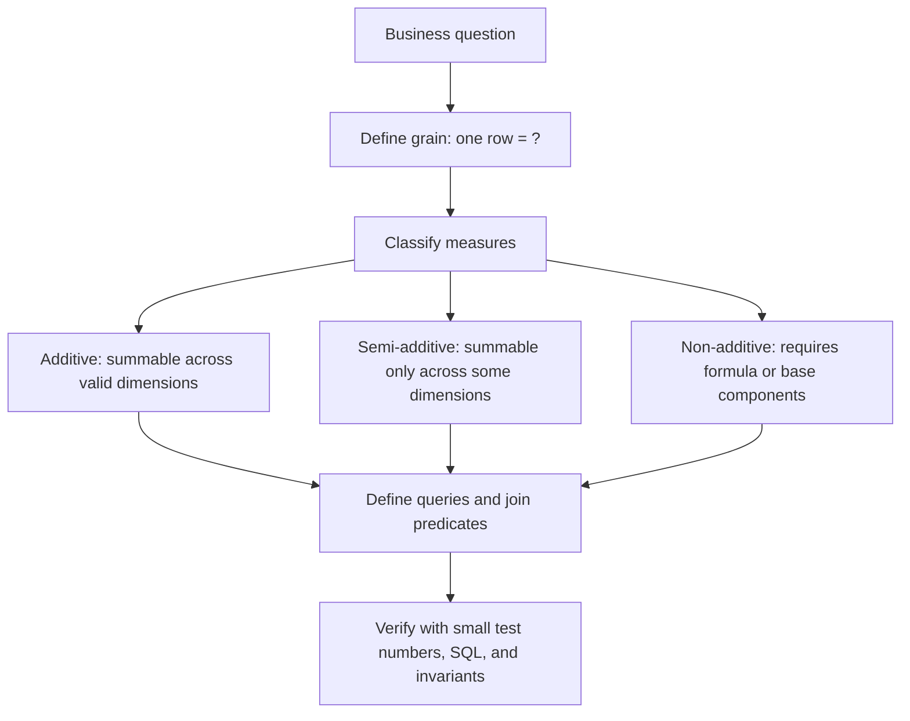

# Storing Balances, Rates, Unit Prices, and Correct Aggregation Rules

Suppose a finance report tracks two accounts, each captured with an **end-of-day closing balance**; a marketing report tracks **conversion rates** by campaign; and a sales report tracks **unit prices** and **revenue**. All three appear as numbers, yet they do not share the same summation rules.

- Summing revenue across **non-overlapping** sales lines yields total revenue.
- Summing the closing balance of the same account over 30 days does **not** yield a "monthly balance."
- Summing or taking a simple unweighted average of conversion rates does **not** yield the conversion rate across all sessions.
- Summing unit prices does **not** yield an average selling price; realized average price usually requires revenue and quantity.

That is the core issue of a **fact table**: it is not enough to store *a numeric measure*; you must know **what one fact row represents**, which dimensions the measure can be aggregated across, and which formula remains valid after filtering, grouping, or rolling up across periods.

This lesson belongs to the **Fact Tables** chapter of the **DATABASE_DATA_MODELING** module. The module builds skills for translating business requirements into entities, relationships, and constraints—from normalization, keys, and indexes to physical schemas—and comparing relational, document, graph, and analytical models so designs can evolve and be verified. We will start from business definitions, classify measures, design fact schemas, write correct queries, and construct tests that catch invalid summation.

## 1. Define the Grain Before Talking About SUM

**Grain** is the exact statement of "what one row in this table corresponds to." Without that statement, it is impossible to tell whether `SUM` adds the same entity, event, or point in time multiple times.

| Fact table | Example grain | Row-identifying key | Measures |
| --- | --- | --- | --- |
| `fact_sales_line` | One line item of a valid sales transaction | `(order_id, line_no)` | `quantity`, `net_revenue`, `list_unit_price` |
| `fact_account_balance_daily` | Closing balance at end of day for one account in one currency | `(account_id, currency_code, snapshot_date)` | `closing_balance` |
| `fact_campaign_daily` | One campaign's performance on one day under a defined attribution policy | `(campaign_id, report_date)` | `sessions`, `converted_sessions` |
| `fact_inventory_daily` | End-of-day inventory for one SKU at one warehouse | `(warehouse_id, sku_id, snapshot_date)` | `on_hand_units` |

Each grain leads to a different aggregation rule:

- Sales transaction lines are **events/flows**: distinct non-overlapping lines can be summed.
- End-of-day balances and inventory are **point-in-time states (stocks)**: you can sum compatible accounts or warehouses **at the same point in time**, but you cannot sum snapshots across time to get an end-of-period state.
- Rates and unit prices can be **derived metrics**: you need to preserve the **base components** so they can be recomputed at any new grouping level.

### Separating Grain from Dimensions

A row in `fact_sales_line` can reference many dimensions: product, customer, store, sale date, currency, promotion. Adding a dimension for analysis **must never arbitrarily multiply event rows**. If a line item carries three tags and you join straight to a tag table, revenue can appear three times. Therefore, the grain must be declared independently of how many dimension tables are joined.



## 2. Three Measure Categories: Additive, Semi-Additive, and Non-Additive

### 2.1. Additive — Summable Across Defined Dimensions

An **additive** measure can be summed across compatible analytical dimensions **when the fact rows represent non-overlapping parts**.

For example, total net revenue from sales lines:

\[
\mathrm{Revenue}(G) = \sum_{i \in G} \mathrm{netRevenue}_i
\]

The key conditions are that all values share the **same unit**, recognition policy, and accounting period, and that the row set contains no duplicates or nested subtotals. Two lines selling the same product in two valid transactions must both be counted; two duplicate records of the **same transaction line** must not.

`quantity` is usually additive when sharing a base unit: 2 units + 3 units = 5 units. However, summing "2 kg of rice + 3 phones" into "5 items" has no physical quantity meaning unless a separate "item unit" is explicitly defined.

### 2.2. Semi-Additive — Summable Only Across Some Dimensions

`closing_balance` and `on_hand_units` are **semi-additive** measures:

- You can sum balances across **independent accounts**, in the same currency and **at the same snapshot timestamp**, if the report is defined as the total balance of those accounts.
- You cannot sum the balance of the same account across **different dates** to obtain an end-of-period balance.
- You can sum inventory of the same SKU across independent warehouses at the same point in time, provided goods are not double-counted and stock states are consistent; you do not sum daily stock levels across days to get month-end inventory.

"Semi-additive" does not mean *blindly sum across every dimension except date*. For example, summing balances across intermediate clearing accounts in the same system may **double-count the same money**; summing receivables with payables or mixing currencies can produce nonsense. Always verify the specific entity set and measurement semantics.

### 2.3. Non-Additive — Never Summed Directly

Measures such as **conversion rate**, **defect percentage**, **gross margin %**, **unit price**, **average price**, and **interest rate** generally cannot be summed in the ordinary sense.

For example:

\[
\mathrm{ConversionRate}
=\frac{\mathrm{ConvertedSessions}}{\mathrm{EligibleSessions}}
\]

To compute a rate across multiple **non-overlapping** groups, sum the numerators and sum the denominators **before dividing**—do not take an unweighted average of subgroup rates.

| Measure | Category | Can SUM over time? | Usually valid aggregation |
| --- | --- | --- | --- |
| Sales-line `net_revenue` | Additive flow | Yes, across non-overlapping lines | `SUM(net_revenue)` per currency/recognition rule |
| Sales-line `quantity` | Additive within a uniform unit | Yes, within valid scope | `SUM(quantity)` |
| End-of-day `closing_balance` | Semi-additive stock | **No** for end-of-period balance | Pick period-end snapshot or compute defined average balance |
| End-of-day `on_hand_units` | Semi-additive stock | **No** for end-of-period inventory | Pick period-end snapshot; can compute time-averaged inventory |
| `conversion_rate` | Non-additive ratio | No | `SUM(converted_sessions)/SUM(sessions)` if denominator is additive |
| `unit_price` | Non-additive price | No | `SUM(revenue)/SUM(quantity)` or defined weighted price |
| `gross_margin_pct` | Non-additive ratio | No | `SUM(gross_profit)/SUM(revenue)` if on the same basis |
| Daily `distinct_customers` | Usually non-additive across days | No if customers appear on multiple days | Count distinct over raw set or use mergeable structures with explicit contracts |

**Note:** Even a seemingly additive measure such as `converted_sessions` is only summable if the same session **is not attributed to multiple groups** in that aggregation. That is a property of the event/attribution model, not of the `BIGINT` data type.

## 3. Balances: Summable Across Entities, Wrong Across Time

Suppose at end of day two accounts exist in VND:

| Snapshot Date | Account A | Account B | Total on That Date |
| --- | ---: | ---: | ---: |
| Nov 20 | 1,000 | 500 | 1,500 |
| Nov 21 | 1,100 | 400 | 1,500 |

To find the total balance **at the end of Nov 21**, sum the accounts on **Nov 21**:

\[
B_{\mathrm{21/11}} = 1100 + 400 = 1500
\]

If you sum all four snapshots, the result 3,000 is **neither** a "two-day balance" nor an end-of-period balance. It is merely the sum of repeated state measurements across two timestamps, which usually has no intended financial meaning.

### 3.1. End-of-Period Balance

For an account `a` and a period ending at `T`:

\[
\mathrm{EndingBalance}(a,T)=B_{a,T}
\]

If a snapshot exists right at timestamp `T`, use that exact snapshot. If not, you need a **business rule**:

- **Strict:** if the period-end snapshot is missing, report missing data.
- **As-of / carry-forward:** select the latest snapshot no later than `T` if it falls within an allowed freshness threshold.
- **Reconstruction:** take an opening balance and add valid movements (flows) up to `T`; this requires a ledger and strict transaction-recognition rules.

Never silently pick "the latest available row" and label it the period-end balance if the report requires an exact cutoff. When using as-of carry-forward, return the actual `snapshot_date` alongside the figure so readers know how stale the data is.

### 3.2. Average Balance Is a Different Metric

If complete **end-of-day** snapshots exist for all 30 days and the metric is defined as "the mean of 30 closing balances," the formula can be:

\[
\mathrm{AverageDailyBalance}
=\frac{\sum_{d=1}^{30} B_d}{30}
\]

This is not "summing balances to get a total"; it is **averaging states over time** with an explicit denominator. If 5 days are missing, `AVG` over 25 snapshots yields only the **average of 25 observed days**, not the 30-day average; you must flag missing data, reconstruct, or apply an approved carry-forward rule.

For irregular snapshots, a **time-weighted average** may be more appropriate:

\[
\overline{B}
= \frac{\sum_i B_i\,\Delta t_i}{\sum_i \Delta t_i}
\]

where `B_i` is the balance treated as effective over interval `\Delta t_i`. Use this formula only when the business definition permits assuming the value holds constant between measurements; never assume an actual bank balance stays unchanged between snapshots.

### 3.3. Balances Do Not Replace Flow Movements

If you start the day with 1,000, deposit 200, and withdraw 100, you end the day with 1,100. A report of "deposits today" reads the **flow +200**, not `closing_balance=1100`. A report of "net change" may take `closing_balance - opening_balance = 100` if there are no other adjustments and both snapshots share compatible definitions; in a ledger system, you must also account for adjusting entries, reversals, cutoff timezones, and effective dates.

Separating **transaction facts** from **periodic snapshot facts** prevents misusing a stock measure as a flow measure.

## 4. Rates: Sum Numerators and Denominators Before Dividing

Suppose two campaigns have eligible sessions and converted sessions as follows:

| Campaign | Converted Sessions | Eligible Sessions | Rate |
| --- | ---: | ---: | ---: |
| A | 9 | 10 | 90% |
| B | 20 | 100 | 20% |

The arithmetic mean of rates A and B is:

\[
\frac{90\% + 20\%}{2} = 55\%
\]

Yet the rate **across all 110 sessions** is:

\[
\mathrm{Rate}_{A \cup B}
= \frac{9+20}{10+100}
= \frac{29}{110}
\approx 26.36\%
\]

The number 55% only answers **"if a campaign is picked uniformly at random, what is the average rate across the two campaigns?"**—not **"what is the conversion probability of a session across all sessions?"**

### 4.1. General Formula

Given non-overlapping groups `i`, numerators `n_i`, and denominators `d_i`:

\[
r_{\mathrm{combined}}
=\frac{\sum_i n_i}{\sum_i d_i}
=\frac{\sum_i d_i r_i}{\sum_i d_i}
\quad (\sum_i d_i>0)
\]

The combined rate is the **denominator-weighted average** of the subgroup rates, provided they share the same denominator definition and each denominator element is counted once. If groups overlap or session definitions differ, the combined formula may be meaningless.

### 4.2. Define Both Numerator and Denominator

Before storing a rate, agree on:

- **What counts as one conversion?** A completed purchase, completed signup, or generating at least one conversion event?
- **What is the denominator?** Sessions, visits, unique users, eligible impressions, or requests?
- **Can one session convert multiple times?** If the numerator is `converted_sessions`, a session can be counted at most once. If the numerator is `orders`, multiple orders can occur in one session; `orders/sessions` is **orders per session**, not necessarily a conversion rate bounded within 0–100%.
- **How is attribution assigned?** Which campaign gets credit when a session touches two campaigns? If credited to both, you cannot simply sum counts to report "unique-session rate across all campaigns."
- **What if the denominator is 0?** With zero sessions, the rate is **undefined**, not automatically 0%.

In a fact table, store `converted_sessions` and `eligible_sessions` as **base measures** at a clear grain, then compute `rate` at query time. You may materialize a rate for display, but never treat it as an additive measure when rolling up.

## 5. Unit Prices: Line Price Differs from Group Average Price

Suppose we have the same item and the same currency:

| Sales Line | Quantity | Realized Unit Price | Revenue |
| --- | ---: | ---: | ---: |
| A | 2 | 100 | 200 |
| B | 8 | 20 | 160 |
| **Total** | **10** | — | **360** |

The unweighted average of the two unit prices is `(100 + 20)/2 = 60`. However, the **realized average selling price per unit** is:

\[
\mathrm{RealizedUnitPrice}
=\frac{\sum_i \mathrm{NetRevenue}_i}
       {\sum_i \mathrm{Quantity}_i}
=\frac{360}{10}=36
\]

This equals the quantity-weighted average when `revenue_i = price_i \times quantity_i` and all rows share the same pricing basis:

\[
\overline{p}
=\frac{\sum_i p_i q_i}{\sum_i q_i}
\]

### 5.1. Distinguishing Different Kinds of "Unit Price"

| Measure Name | Meaning | Rule |
| --- | --- | --- |
| `list_unit_price` | Catalog list price of one unit per price book | Do not SUM; if averaging, define weighting/sampling rules |
| `contract_unit_price` | Agreed price per contract and effective period | Look up by contract, product, and effective timestamp |
| `realized_unit_price` | Actual revenue per unit after selected adjustments | `SUM(net_revenue)/SUM(quantity)` on uniform basis |
| `average_selling_price` | Business KPI commonly called ASP | Must specify revenue, quantity, taxes, promotions, returns, currency |
| `unit_cost` | Cost per unit per accounting policy | Do not SUM; may use COGS/quantity over a period |

Several important notes:

- `0` can be a valid unit price (free gift, 100% promotion); do not conflate it with `NULL` or "missing data."
- If `quantity=0`, the ratio `revenue/quantity` is undefined; handle via data rules or product logic separately.
- Units like "piece," "kg," "liter," and "labor hour" are not inherently summable; normalize units and select homogeneous cohorts.
- The average selling price of one laptop and one kilogram of rice in the same group is usually **not a meaningful KPI**, even though SQL happily returns a number.
- Returns, post-sale rebates, taxes, shipping fees, and currency conversion require **consistent recognition rules**. Never apply the formula to a mix of sales and arbitrarily signed return lines without inspecting the denominator and economic meaning.

## 6. Choosing Fact Types: Transaction, Periodic Snapshot, or Accumulating Snapshot

Three common fact table types differ by grain and row lifecycle.

| Fact Type | Example Grain | Update Behavior | Typical Measures |
| --- | --- | --- | --- |
| **Transaction fact** | One order line, one ledger entry, one conversion event | Primarily appends events/controlled adjustments | `quantity`, `net_revenue`, `movement_amount` |
| **Periodic snapshot fact** | One account × one cutoff date; one SKU × warehouse × date | Captures state periodically | `closing_balance`, `on_hand_units` |
| **Accumulating snapshot fact** | One order/shipment updated as it passes milestones | Updates one row along workflow progress | `created_at`, `packed_at`, `delivered_at`, `days_to_deliver` |

An **accumulating snapshot** holds milestone timestamps on the same row; elapsed days from open to close cannot be summed to get "average duration" without dividing by the valid order count. The system must still distinguish open vs. closed orders and handle missing milestones.

### 6.1. Facts Need Event Identity and Idempotency

Never use "two rows having the same amount" to deduplicate. Two customers can buy the same product at the same price in the same minute as two real transactions. Conversely, a source event `order_id=O1, line_no=2` replayed on retry must not be recorded as two sales lines.

The model should enforce a unique key at the **grain**, storing source identity and version/correction metadata when needed. For snapshots, the key must include the **snapshot date** so two states of the same account on two different days do not overwrite each other.

## 7. Sample Relational Schema: Store Base Components, Not Only KPIs

The following examples use **PostgreSQL**. The goal is to illustrate keys, `CHECK` constraints, `FK`s, and grain; no external schema is assumed.

### 7.1. Minimal Dimensions

```sql
CREATE TABLE dim_account (
    account_id BIGINT NOT NULL,
    currency_code CHAR(3) NOT NULL,
    account_category VARCHAR(32) NOT NULL,
    PRIMARY KEY (account_id, currency_code)
);

CREATE TABLE dim_product (
    product_id BIGINT PRIMARY KEY,
    product_name TEXT NOT NULL,
    unit_code VARCHAR(16) NOT NULL
);

CREATE TABLE dim_campaign (
    campaign_id BIGINT PRIMARY KEY,
    campaign_name TEXT NOT NULL
);
```

Here `dim_account` uses a composite key to illustrate an account with separate currency pockets; in a real system, the account/currency identity might be a surrogate key. The mandatory rule is never merging amounts in two currencies into a unitless number.

### 7.2. End-of-Day Balance Snapshot

```sql
CREATE TABLE fact_account_balance_daily (
    account_id BIGINT NOT NULL,
    currency_code CHAR(3) NOT NULL,
    snapshot_date DATE NOT NULL,
    closing_balance NUMERIC(24, 2) NOT NULL,
    measured_at TIMESTAMPTZ NOT NULL,
    source_version BIGINT NOT NULL DEFAULT 1,

    PRIMARY KEY (account_id, currency_code, snapshot_date),
    FOREIGN KEY (account_id, currency_code)
        REFERENCES dim_account(account_id, currency_code),
    CONSTRAINT ck_balance_version CHECK (source_version > 0)
);
```

Grain: **one closing balance for one account-currency on one date**. `closing_balance` can be negative if the domain permits overdrafts; do not add `CHECK (closing_balance >= 0)` merely because "balances are usually positive." `measured_at` records when measurement/cutoff occurred for reconciliation; `snapshot_date` is the business date, never derived by arbitrarily truncating a server timestamp.

The primary key stops two snapshots of the same grain from existing concurrently, yet **does not guarantee on-time cutoffs, full daily coverage, or closed-book source data**. Those require workflows and quality rules. A correction may update the version under the same key or record separate revision history; never sum revisions as independent snapshots.

### 7.3. Sales-Line Fact

```sql
CREATE TABLE fact_sales_line (
    order_id BIGINT NOT NULL,
    line_no INTEGER NOT NULL CHECK (line_no > 0),
    sold_at TIMESTAMPTZ NOT NULL,
    product_id BIGINT NOT NULL REFERENCES dim_product(product_id),
    currency_code CHAR(3) NOT NULL,
    quantity NUMERIC(20, 3) NOT NULL CHECK (quantity > 0),
    list_unit_price NUMERIC(22, 4) NOT NULL
        CHECK (list_unit_price >= 0),
    net_revenue NUMERIC(24, 2) NOT NULL
        CHECK (net_revenue >= 0),

    PRIMARY KEY (order_id, line_no)
);
```

In this **illustrative** table, only valid sales lines with positive quantity and non-negative revenue are stored; refunds/returns are not represented here and require a separate table or explicit sign/event-type rules if needed. `list_unit_price` is catalog price; `net_revenue` is recognized revenue per problem definition, so realized price `net_revenue/quantity` may differ from `list_unit_price`.

Storing revenue at the line level enables rollups when unit/currency and scope are known; storing unit price alongside is for lookup/explanation only—**never use `SUM(list_unit_price)` as a price KPI**.

### 7.4. Campaign-Daily Conversion Fact

```sql
CREATE TABLE fact_campaign_daily (
    campaign_id BIGINT NOT NULL REFERENCES dim_campaign(campaign_id),
    report_date DATE NOT NULL,
    eligible_sessions BIGINT NOT NULL
        CHECK (eligible_sessions >= 0),
    converted_sessions BIGINT NOT NULL
        CHECK (converted_sessions >= 0),

    PRIMARY KEY (campaign_id, report_date),
    CONSTRAINT ck_converted_within_eligible
        CHECK (converted_sessions <= eligible_sessions)
);
```

Grain: **one campaign × one day under a consistent attribution rule version**. Rows store **base counts**, eliminating any need to store `conversion_rate` as an additive measure. The constraint `converted_sessions <= eligible_sessions` holds only if each converted session is counted at most once. If the business metric differs, rename the column and invariant rather than blindly keeping the constraint over order counts.

The schema also assumes each session is credited to one campaign if reports need to aggregate total sessions across campaigns. If one session belongs to multiple campaigns, summing counts across campaigns double-counts sessions; use explicit attribution, bridge models, or distinct metrics instead.

## 8. SQL for Aggregating Balances: Pick the Point in Time Before SUM

### 8.1. Total Balance on a Specific Cutoff Date

```sql
SELECT
    currency_code,
    SUM(closing_balance) AS total_closing_balance,
    COUNT(*) AS observed_accounts
FROM fact_account_balance_daily
WHERE snapshot_date = DATE '2026-11-21'
GROUP BY currency_code
ORDER BY currency_code;
```

This query sums accounts that have a snapshot on **2026-11-21** per currency. It does **not** prove every account expected to have a snapshot was closed. If you need the total balance of the entire portfolio, compare `observed_accounts` against active accounts on that date and handle missing snapshots.

### 8.2. As-Of Read: "Latest Snapshot No Later Than Day T"

When the business permits carrying forward the latest closing balance to the reporting date:

```sql
WITH ranked AS (
    SELECT
        b.*,
        ROW_NUMBER() OVER (
            PARTITION BY account_id, currency_code
            ORDER BY snapshot_date DESC
        ) AS rn
    FROM fact_account_balance_daily AS b
    WHERE b.snapshot_date <= DATE '2026-11-21'
)
SELECT
    currency_code,
    SUM(closing_balance) AS balance_as_of,
    COUNT(*) AS accounts_with_a_snapshot,
    MIN(snapshot_date) AS oldest_used_snapshot
FROM ranked
WHERE rn = 1
GROUP BY currency_code;
```

`ROW_NUMBER` selects **one latest snapshot per account-currency** before summing. Never run `SUM` across rows from multiple dates. Note that this query:

1. **Omits** accounts that have never had a snapshot: check against the account master list to detect missing accounts.
2. May retain stale snapshots: enforce a freshness rule, such as rejecting data older than 1 day in a daily-close report.
3. Does not automatically handle account openings/closures or group changes over time; dimension effective dating is still required.
4. Relies on controlled cutoff data; same-grain corrections must be resolved prior to querying.

### 8.3. Choosing Between END, AVG, and FLOW

The following three questions require three different calculations:

| Question | Semantically Correct Answer |
| --- | --- |
| "How much money remained on the last day of the month?" | Ending balance as-of cutoff date |
| "What was the average daily balance over the month?" | Average daily balance across day count / missing-data policy |
| "How much money flowed in/out this month?" | `SUM` of **transaction movements** during the month |

A model can include both `fact_account_balance_daily` and `fact_account_movement`; never turn every question into a `SUM(closing_balance)` query.

## 9. SQL for Aggregating Rates and Unit Prices

### 9.1. Period-Wide Conversion Rate

```sql
SELECT
    SUM(converted_sessions) AS converted_sessions,
    SUM(eligible_sessions) AS eligible_sessions,
    100.0 * SUM(converted_sessions)::NUMERIC
        / NULLIF(SUM(eligible_sessions), 0)
        AS conversion_rate_pct
FROM fact_campaign_daily
WHERE report_date >= DATE '2026-11-01'
  AND report_date < DATE '2026-12-01';
```

`NULLIF(SUM(eligible_sessions), 0)` prevents division by zero and yields `NULL` when the denominator is meaningless. `0` conversions out of 100 sessions yields a **valid 0%**; 0 sessions with 0 conversions must be interpreted as **no rate measurement**, never defaulted to 0%.

Do not write:

```sql
-- Incorrect if the goal is the conversion rate across all sessions:
SELECT AVG(
    converted_sessions::NUMERIC
    / NULLIF(eligible_sessions, 0)
)
FROM fact_campaign_daily;
```

`AVG` of daily/campaign rates is merely an unweighted mean across **fact rows with non-zero denominators**, failing to weight by session volume. It may answer a *different* research question, yet cannot replace the overall rate formula.

### 9.2. Realized Average Selling Price for a Single Product

```sql
SELECT
    product_id,
    currency_code,
    SUM(quantity) AS sold_quantity,
    SUM(net_revenue) AS recognized_revenue,
    SUM(net_revenue)
        / NULLIF(SUM(quantity), 0)
        AS realized_unit_price
FROM fact_sales_line
WHERE sold_at >= TIMESTAMPTZ '2026-11-01 00:00:00+00'
  AND sold_at < TIMESTAMPTZ '2026-12-01 00:00:00+00'
GROUP BY product_id, currency_code
ORDER BY product_id, currency_code;
```

Grouping by `product_id` and `currency_code` avoids mixing prices across different items or currencies. If one product has historically sold in multiple `unit_code`s, apply unit conversion rules before computing; `product_id` alone does not guarantee a uniform denominator.

Never use `AVG(list_unit_price)` when lines carry different quantities and the KPI targets price per **unit sold**. For a quantity-weighted list price, use:

```sql
SELECT
    product_id,
    currency_code,
    SUM(list_unit_price * quantity)
        / NULLIF(SUM(quantity), 0)
        AS quantity_weighted_list_price
FROM fact_sales_line
GROUP BY product_id, currency_code;
```

`quantity_weighted_list_price` and `realized_unit_price` can diverge due to promotions, discounts, and revenue recognition rules.

### 9.3. Summing Rates Across Time Is Wrong

If each day has a 10% conversion rate, the seven-day total is **not** 70%. Those are seven rates measured over seven separate cohorts. The weekly rate comes from total conversions over total sessions; it could still be 10% if daily denominators differ while every day's rate happens to be identical. Only sum **base counts**, never division results.

## 10. Test Immediately with Small Numbers

A "back-of-the-envelope" check is very effective for catching bad formulas before running over billions of rows. Self-contained PostgreSQL examples:

```sql
WITH sales(line_id, quantity, unit_price, revenue) AS (
    VALUES
        (1, 2::NUMERIC, 100::NUMERIC, 200::NUMERIC),
        (2, 8::NUMERIC, 20::NUMERIC, 160::NUMERIC)
)
SELECT
    AVG(unit_price) AS unweighted_price,
    SUM(revenue) / NULLIF(SUM(quantity), 0)
        AS realized_unit_price
FROM sales;
-- unweighted_price = 60; realized_unit_price = 36
```

```sql
WITH campaigns(name, converted_sessions, eligible_sessions) AS (
    VALUES
        ('A', 9::NUMERIC, 10::NUMERIC),
        ('B', 20::NUMERIC, 100::NUMERIC)
)
SELECT
    AVG(converted_sessions / eligible_sessions) * 100
        AS unweighted_rate_pct,
    SUM(converted_sessions)
        / NULLIF(SUM(eligible_sessions), 0) * 100
        AS combined_rate_pct
FROM campaigns;
-- unweighted_rate_pct = 55
-- combined_rate_pct ~= 26.3636
```

```sql
WITH balances(account_id, snapshot_date, closing_balance) AS (
    VALUES
        ('A', DATE '2026-11-20', 1000::NUMERIC),
        ('B', DATE '2026-11-20', 500::NUMERIC),
        ('A', DATE '2026-11-21', 1100::NUMERIC),
        ('B', DATE '2026-11-21', 400::NUMERIC)
)
SELECT
    SUM(closing_balance) AS sum_of_all_snapshots,
    SUM(closing_balance) FILTER (
        WHERE snapshot_date = DATE '2026-11-21'
    ) AS ending_balance
FROM balances;
-- sum_of_all_snapshots = 3000 (not the ending balance)
-- ending_balance = 1500
```

These examples provide **numerical proof**. Production data also requires rules for missing rows, duplicates, currencies, cutoff timestamps, and return/correction lines.

## 11. Currencies, Units of Measure, and Exchange Rates

### 11.1. Never Sum Currencies as Raw Numbers

`100 USD + 100 VND` is not `200` of any meaningful unit. If reporting in VND is required, apply the appropriate FX policy **to each monetary line** before aggregating:

\[
\mathrm{RevenueVND}
=\sum_i \mathrm{RevenueOriginal}_i
\times \mathrm{Rate}_{\mathrm{currency}_i \to \mathrm{VND},\,t_i}
\]

Here `t_i` is the timestamp/criterion for choosing the FX rate under **accounting rules** (transaction date, cutoff date, recognition date, approved rate, etc.). Never multiply all historical transactions by a single current rate if reports require transaction-time rates.

A design may store:

- `amount_original` + `currency_original`;
- `fx_rate`, rate source, effective timestamp, and rate version used;
- `amount_reporting` + `currency_reporting` computed under the rounding policy;
- provenance for reconciliation or recomputation upon adjustments.

`fx_rate` is **non-additive**. Summing daily FX rates does not yield a "monthly rate." An "average FX rate" only has meaning when its weights and purpose are defined: transaction-weighted, volume-weighted, time-weighted, or per accounting standard.

### 11.2. Rounding Rules Are Part of the Measure

For money, prefer `NUMERIC/DECIMAL` in SQL and `BigDecimal` in Java rather than binary floating-point types where exact decimal arithmetic is needed. Specify where rounding occurs:

1. Round unit price before multiplying by quantity?
2. Compute line amount and round per line?
3. Sum exact line amounts and round only for display?

These three choices can yield different totals. Systems must standardize policy, scale, tax/promotion ordering, and rule versions rather than letting BI tools guess. `NUMERIC(24,2)` in the sample schema is illustrative and unsuitable for currencies or prices needing more than two decimal places.

### 11.3. Interest Rates Are Not Interest Cash Flows

A loan has principal balance, annual interest rate, and accrual days. `interest_rate` cannot be summed across days to get interest earned. Under **one** simple accrual convention (e.g., ACT/365), an illustrative model is:

\[
\mathrm{InterestAccrued}
=\sum_i \mathrm{Principal}_i
\times \mathrm{AnnualRate}_i
\times \frac{\mathrm{ActualDays}_i}{365}
\]

To apply this accurately, split intervals whenever principal or rate changes, adopt the contract's day-count convention and rounding policy, and handle leap years/compounding as needed. Never treat an illustrative formula as a universal financial rule. Properly computed `interest_accrued` lines can be summed over a period under the relevant accounting basis; `annual_rate` cannot.

## 12. Row-Multiplying Joins: Syntactically Valid SUM, Semantically Wrong

Suppose one sales line has revenue 100 and its product carries **three tags**. Joining the fact directly to `product_tags` produces three intermediate rows:

```text
fact_sales_line (order 17, line 1, revenue 100)
       |
       +-- tag: SALE       -> 100
       +-- tag: FEATURED   -> 100
       +-- tag: WINTER     -> 100

SUM(revenue) after JOIN = 300  (wrong if asking for actual total revenue)
```

Buggy SQL:

```sql
-- product_tags: multiple rows per product_id.
-- DO NOT use to compute overall total revenue:
SELECT SUM(f.net_revenue)
FROM fact_sales_line AS f
JOIN product_tags AS t
  ON t.product_id = f.product_id;
```

The fix depends on the question:

- If asking only for "revenue of products carrying the WINTER tag," use `WHERE EXISTS` to filter the fact **without multiplying rows**.
- If allocating revenue to **each tag**, define an allocation policy (such as tag weights summing to 1 per line) or explicitly document double-counting across tags during drill-across.
- If joining a dimension with **SCD Type 2** history, join the exact version effective at `sold_at`; joining solely on business ID without time conditions can multiply rows across versions.

Example filtering with `EXISTS`:

```sql
SELECT SUM(f.net_revenue) AS revenue
FROM fact_sales_line AS f
WHERE EXISTS (
    SELECT 1
    FROM product_tags AS t
    WHERE t.product_id = f.product_id
      AND t.tag_code = 'WINTER'
);
```

Both examples assume `product_tags(product_id, tag_code)` exists; they illustrate query shape rather than a standalone runnable schema. Never mask row multiplication using `SUM(DISTINCT net_revenue)`: two legitimate sales lines with the same amount of 100 would collapse into one, introducing error in the opposite direction.

### Checking Grain Before and After Joins

```sql
-- Count original fact rows in the same scope.
SELECT COUNT(*) AS original_fact_rows
FROM fact_sales_line;

-- Count rows after join (assuming product_tags exists).
SELECT COUNT(*) AS joined_rows
FROM fact_sales_line AS f
JOIN product_tags AS t
  ON t.product_id = f.product_id;
```

`joined_rows > original_fact_rows` can reflect a valid 1–N relationship, yet using that result to `SUM` original fact measures needs review. Counting distinct grain keys before/after joins alongside original measure totals helps detect dropped or multiplied rows.

## 13. Missing, Zero, Corrections, and Incomplete Snapshots

Fact designs must also distinguish easily confused reporting states:

| State | Example | Proper Handling |
| --- | --- | --- |
| **No fact row** | No balance received on day 21 for account A | Missing snapshot; do not assume 0 |
| **Measure = 0** | Account truly closed at 0; campaign had 0 conversions across 100 sessions | Valid measured value |
| **Measure NULL** | Unmeasured temperature or undetermined price | Explicit unknown/missing policy; `SUM` and `AVG` ignore NULL |
| **Denominator = 0** | 0 eligible sessions | Undefined rate; use `NULLIF` and clear display state |
| **Late-arriving event** | Transaction occurred yesterday, loaded today | Attribute to proper event date; update aggregates/snapshots per policy |
| **Correction** | Line price amended due to refund | Use effective version or adjustment entry per rules; never sum both old and new |
| **Replay/duplicate** | Event `E123` resent on retry | Idempotency by event/grain key; do not multiply revenue |
| **Unclosed / open batch** | End-of-day balance batch still running | Track close status/watermark; reports read only finalized versions by rule |

Crucially, a snapshot table may contain only **active entities** or **entities with activity**. Assuming missing rows equal 0 can severely distort asset and inventory reports. Explicitly document whether a snapshot is **dense** (all in-scope entities every period) or **sparse** (partial), plus how to reconstruct state for absent rows.

### Business Time Differs from Processing Time

A fact may carry:

- `event_time`: when the event occurred;
- `effective_date`: business/accounting period to which the fact belongs;
- `ingested_at`: when the warehouse received the data;
- `snapshot_date`: cutoff anchor for a stock measure;
- `version` or `updated_at`: revision marker.

Never treat `ingested_at` as the sale date or balance date when business requirements specify another timestamp. When reports require "as originally published" alongside "latest corrected," include revision/provenance metadata or versioned tables to guarantee reproducibility.

## 14. Physical Organization and Storage Models

A sound logical schema still requires access paths, indexes, and physical layouts matched to queries:

- **Transaction facts** grow large over time. They can be partitioned by day/month of `sold_at` or business date, with access paths on `order_id` or `product_id` per workload. PostgreSQL partitioned unique constraints impose rules involving the partition key; never apply regular-table PK patterns to partitioned tables without designing global uniqueness.
- **Snapshot facts** often read by `snapshot_date` (all accounts) or by `account_id` across a date range. Indexes/partitions must support both paths if both are frequent; a primary key starting with `account_id` does not automatically optimize queries filtering only on `snapshot_date`.
- **Daily KPI facts** are typically smaller and scanned by period/campaign; add indexes when query patterns justify them.
- **Columnar stores** such as Parquet/ClickHouse/analytical warehouses target wide scans over few columns for aggregation; partition pruning and column pruning reduce cost. They do not replace grain definitions, units, or measure aggregation semantics.
- **Document / wide-column stores** can store keyed operational records; when ingested into a warehouse, measures still require stock/flow/rate classification before calling `SUM`.
- **Graph stores** excel at relationships; if attaching measures to edges, check whether a single event maps to multiple edges before aggregating.

Never choose a physical model solely because data "has many columns" or "needs dashboards." Identify primary queries, latency targets, data volumes, and historical recomputation requirements first; then benchmark with realistic data.

## 15. Testing Additivity with Counter-Example Cases

Do not verify SQL syntax alone. Test **business rules with cases engineered to expose numeric bugs**.

| Test Case | Expected Result |
| --- | --- |
| Two accounts on the same day with 1,100 and 400 VND | End-of-day total = 1,500 VND if accounts are independent |
| Same two accounts with prior-day snapshots of 1,000 and 500 | Do not sum both days into a 3,000 ending balance |
| Account A missing snapshot on exact day T | Report missing or select as-of per policy with freshness info |
| Two campaigns with 9/10 and 20/100 sessions | Combined = 29/110 ≈ 26.36%, not 55% |
| 0 conversions across 100 sessions | Rate = 0% |
| 0 conversions across 0 sessions | Rate undefined, never defaulted to 0% |
| Two lines priced 100×2 and 20×8 | ASP = 36, not 60 |
| Two lines with `net_revenue=100` but distinct grain keys | Total = 200; do not use `SUM(DISTINCT revenue)` |
| One fact row joined to three tags | Total revenue must not be multiplied by 3 |
| SCD2 dimension change | Join to exact version effective at event date |
| 100 USD and 100 VND present | Never `SUM` into "200"; report separately or convert per policy |
| Return or correction on same order line | Per recognition policy, never count both old and new versions |
| Missing snapshot mapped to 0 | Test must catch and reject the invalid interpretation |
| Same query run before/after late-event load | Aggregates update or carry distinct freshness markers |
| Daily rates with uneven denominators | Ratio-of-sums differs from simple AVG; preserve base counts |

### Invariants to Automate

1. **Grain uniqueness:** no two active rows share `(order_id,line_no)`; no two active snapshots share `(account_id,currency,snapshot_date)`.
2. **Snapshot completeness:** expected account/product counts vs. closed rows per period.
3. **Unit consistency:** `SUM` groups share valid currencies and units; never mix incompatible measures.
4. **Numerator/denominator validity:** in the example, `converted_sessions <= eligible_sessions` and counts are non-negative.
5. **Source reconciliation:** `SUM(net_revenue)` reconciles against sales books or ledgers within agreed scopes.
6. **Zero join multiplication:** measure row counts/distinct grain keys before and after any potentially 1–N join.
7. **Reproducibility:** identical snapshot versions and metric policies yield identical outputs, or explainable corrections.

## 16. Practice Exercises

### Exercise A — Account Balance Dashboard

A bank has 200,000 accounts and an end-of-day closing balance snapshot table. A dashboard needs: (1) total system balance at end of day, (2) average daily balance for the month, (3) net cash flow for the month.

Choose the fact table for each need, state its grain, and write the formula. Handle the case where 5% of accounts lack a snapshot on one day; explain when carry-forward is acceptable and when incomplete data must be flagged.

**Hint:** (1) filter snapshot to day T and `SUM` across accounts per currency; (2) time-averaged daily balance with explicit missing-data policy; (3) query a transaction movement fact—never `SUM` snapshots.

### Exercise B — Campaign Conversion KPI

Three days have `1/2`, `10/100`, and `0/0` converted sessions respectively. Compute the period-wide rate using **ratio-of-sums**, compare it against the `AVG` of daily rates, and explain how the `0/0` day affects the denominator.

**Hint:** total converted = 11, total eligible = 102, period-wide rate ≈ 10.78%. The `0/0` day contributes to neither numerator nor denominator; that day's own rate is undefined, not 0%.

### Exercise C — Product Unit Price and Returns

A store sells 2 units at realized price 100, then 8 units at realized price 20, and later a customer returns 1 unit from the 100 batch. Design how to record the return, net revenue policy, and net quantity policy. Compute ASP over net quantity under your chosen definition, then identify the edge case where net quantity equals 0 and ASP loses meaning.

**Hint:** if the return is recorded as -100 revenue and -1 quantity, net revenue = 260, net quantity = 9, ASP ≈ 28.89. That is just one policy; a gross selling price report might exclude returns instead of netting them.

### Exercise D — SCD Type 2 and Row Multiplication

A customer changes region from North to South mid-year. The customer dimension stores two SCD2 versions; the order fact stores purchase timestamp. A query joining only on `customer_id` matches each transaction to both versions.

Write the proper **effective-interval** join predicate (e.g., `valid_from <= sold_at < valid_to`), state the non-overlapping version invariant, and describe how to verify revenue before/after the join.

**Hint:** events must bind to the dimension version effective at business time or use the surrogate key resolved during ingestion. Never use `SUM(DISTINCT revenue)` to patch row multiplication.

### Exercise E — Multi-Currency and Exchange Rates

A sales table contains lines in USD and VND. One report requires VND revenue using transaction-time FX rates, and another restates revenue using month-end closing rates.

Design the FX rate table keyed by currency pair + effective time + source/version, rounding rules, provenance, and formulas for both reports. Explain why you cannot sum `fx_rate` values or apply one current rate to all history.

**Hint:** select one effective rate per line per policy, convert before `SUM`, and retain rate version for reconciliation. An exchange rate is a multiplier, not money.

## 17. Pre-Release Checklist for Fact Tables and KPIs

- [ ] Every fact table has a one-sentence **grain** definition, unique key, and explicit business timestamp.
- [ ] Every measure is classified as **additive, semi-additive, or non-additive** across valid dimensions.
- [ ] **Period-end stock** is separated from **in-period flow**; snapshots are never summed across time to derive a balance.
- [ ] Average balances specify time window, weighting, missing-data policy, and completeness checks.
- [ ] Rates preserve semantically valid numerators and denominators, aggregate via ratio-of-sums, and guard against zero denominators.
- [ ] Unit prices distinguish list/contract/realized prices, quantities, matching products/units, and returns.
- [ ] Currency, unit of measure, scale, FX policy, and rounding are specified prior to summation.
- [ ] `AVG(rate)`, `AVG(unit_price)`, and `SUM(DISTINCT money)` are never used as hacks replacing proper modeling.
- [ ] Joins to dimensions or bridges do not multiply fact rows, or use an explicitly defined allocation mechanism.
- [ ] Snapshots define dense/sparse semantics, as-of rules, late data, corrections, and freshness explicitly.
- [ ] PK/FK/UNIQUE/CHECK constraints support grain and invariants, backed by quality tests for rules constraints alone cannot enforce.
- [ ] Partitions, indexes, and layouts follow operational and analytical query needs without letting storage dictate metric semantics.
- [ ] Small numeric counter-examples exist as benchmarks alongside source reconciliation and regression tests on schema or KPI changes.

**Key takeaway:** A measure does not become additive simply because it sits in a `NUMERIC` column. **Revenue** is an accrued flow, **balances** are point-in-time states, and **rates and unit prices** are derived metrics requiring proper numerators/denominators or weights. Defining grain, non-overlapping scope, units, and rollup rules before writing `SUM` or `AVG` keeps fact tables and KPIs accurate as reports roll up from line items to days, months, customers, or the entire enterprise.
