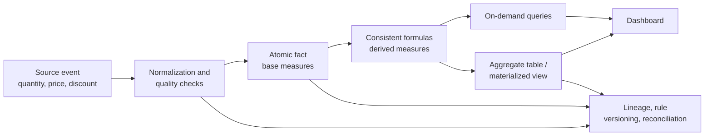
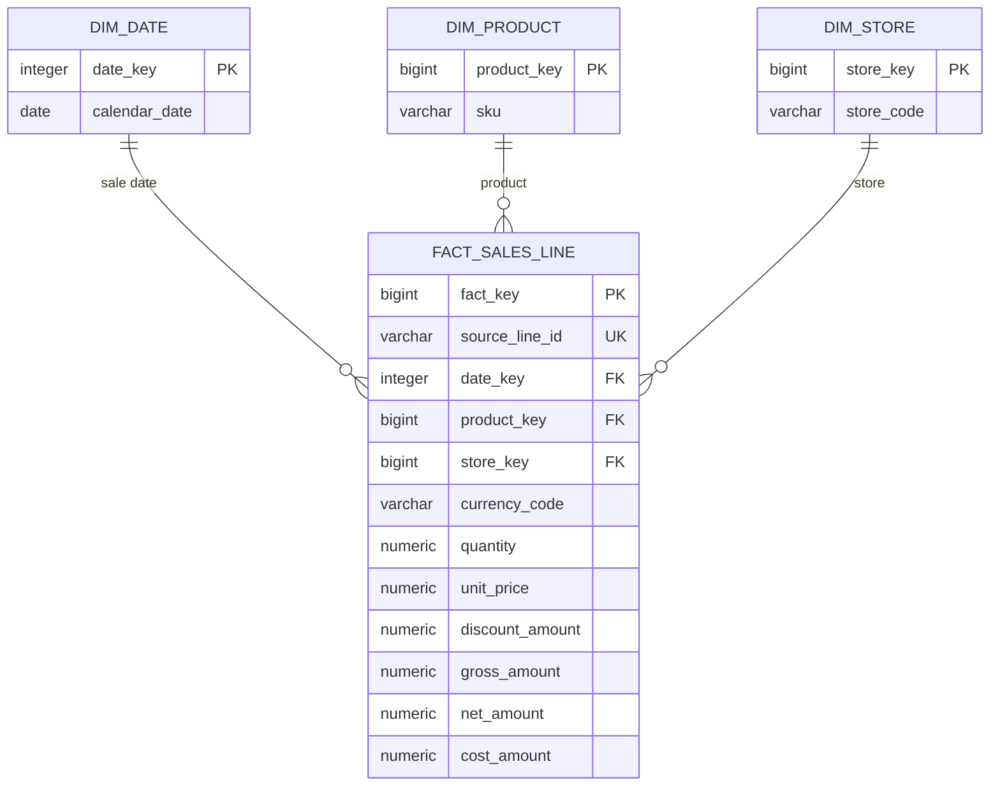

# Base Measures vs. Derived or Precomputed Measures

When designing a *fact table* for an analytical system, a very practical question arises: **should we store the figures captured at the event, compute metrics at query time, or precompute and persist them so reports run faster?** For instance, a sales line has quantity 2, unit price 100,000 VND, and discount 20,000 VND. Gross revenue, net revenue, discount rate, and gross margin can all be derived, yet they do not share the same additivity or storage requirements.

If you store only the net amount, future reports may be unable to explain how that number was formed. If you store every formula and every aggregate, data easily becomes redundant and drifts out of sync when business rules change or late events arrive. If you compute everything at read time, queries scanning billions of rows may miss response-time targets.

This lesson belongs to the **Fact Tables** chapter in the **DATABASE_DATA_MODELING** module. The goal is to translate business measurement requirements into a verifiable **grain** (detail level of one row), base measures, derived measures, precomputed measures, constraints, keys, and aggregate structures. The focus is not "store as much as possible," but choosing where to compute and where to persist so metrics are **semantically sound, accurately aggregatable, traceable, and evolvable**.

## 1. Four Concepts to Keep Separate

| Concept | Question | Sales Example |
|---|---|---|
| **Base measure** (*base/atomic measure*) | Which value is captured at event granularity and reconcilable to the source? | Quantity sold, unit price at sale time, line-allocated discount amount |
| **Derived measure** (*derived/calculated measure*) | Which formula transforms values into another metric? | Gross revenue = quantity × unit price; gross margin = profit / net revenue |
| **Precomputed measure** (*precomputed/materialized measure*) | Which calculation result is physically stored instead of recomputed on every read? | Precalculated `net_amount` on the fact; daily/store revenue totals in an aggregate table |
| **Source of truth** (*source of truth*) | Which dataset and rule version govern discrepancy resolution? | Finalized payment events, invoices, sales logs, published rounding policies |

**"Base" refers to provenance and granularity; "derived" refers to formula relationships; "precomputed" refers to execution and storage.** These are not mutually exclusive categories. A measure can be **both derived and precomputed**, such as `net_amount = gross_amount - discount_amount` persisted directly on the fact row.

Conversely, a `net_amount` emitted by the payment system may be the **authoritative base value** if it incorporates surcharges, taxes, allocation rules, and rounding that cannot be reconstructed from display unit prices. In that case, never arbitrarily treat a simplified warehouse formula as truth.

### Metric Formation Flow



For example, the same **net revenue** metric can be calculated at line level and stored in the fact, then rolled up by day/store in a precomputed table. When explaining numbers, you must know the **formula, grain, timestamp, currency, and change-handling rules**.

## 2. Grain Is the First Decision of a Fact Table

**Grain** is the exact definition of "what each row represents." Without defining grain first, it is very hard to verify whether sums, averages, counts, or allocations are correct.

Three example facts with distinct grains:

| Fact | One Row Represents | Typical Measures |
|---|---|---|
| `fact_sales_line` | One **finalized sales line** from the source system | Quantity, price at sale, discount, revenue, cost |
| `fact_inventory_daily` | End-of-day inventory balance of **one product at one warehouse** | End-of-day on-hand quantity |
| `fact_order_lifecycle` | One order in its **accumulating workflow state** | Time from creation to delivery, wait days, milestone timestamps |

These correspond respectively to *transaction fact*, *periodic snapshot*, and *accumulating snapshot* tables. They differ in grain and update behavior. Never cram all of them into one table simply because the measures relate to orders.

### 2.1. One-Sales-Line Grain

For `fact_sales_line`, establish the convention:

> One row = one recorded sales line from the source system, at transaction time, identified by a `source_line_id` unique within the normalized source scope.

Accompanying dimensions may include sale date, product, store, and currency. The `quantity` and `unit_price` measures must correspond to **that exact line**. If an order has three lines, it generates three rows, not one.

Ask:

- Can a source line ID be updated after sale, or are all adjustments new events?
- Do returns have a separate grain?
- How are order-level discounts allocated down to each line?
- Is quantity in "pieces," "kg," "hours," or mixed units?
- At which timestamp are currency, exchange rate, and recognition period determined?

If those questions remain unanswered, numerically valid calculations can still be business-wrong.

### 2.2. Mixing Grains Causes Double Counting

Suppose order `O-1001` has two lines, and the **entire order's** shipping fee is 30,000 VND. Recording `shipping_fee = 30000` on **every** line and calling `SUM(shipping_fee)` produces 60,000 VND—double the real fee.

Two sounder designs:

1. Keep shipping fees in an **order-grain fact** ("one order"), never summed directly alongside line-grain facts.
2. **Allocate the fee** down to lines under an explicit rule, storing `allocated_shipping_fee`; the sum of allocations must equal the original fee.

Neither choice fits every report. Choose based on analytical need: should product revenue include shipping, and if so, should shipping allocate by value, quantity, weight, or another rule?

## 3. Identifying Base Measures: What Data Was Actually Observed?

Within a finalized sales line, we can define:

| Field | Role | Source and Timing |
|---|---|---|
| `quantity` | Base measure | Quantity sold/finalized on the line |
| `unit_price` | Base or snapshot price | Price applied at sale time, not current catalog price |
| `unit_cost_at_sale` | Snapshot unit cost | Cost under accounting policy at recognition time |
| `discount_amount` | Allocated base measure | Discount attributable to the line after allocation rules |
| `gross_amount` | Derived measure, optionally precomputed | `ROUND(quantity × unit_price, 2)` per example rules |
| `net_amount` | Derived measure, optionally precomputed | `gross_amount - discount_amount` |
| `cost_amount` | Derived measure, optionally precomputed | `ROUND(quantity × unit_cost_at_sale, 2)` |
| `gross_profit` | Derived measure | `net_amount - cost_amount` |
| `gross_margin_rate` | Derived ratio | `gross_profit / net_amount`, when denominator ≠ 0 |

In this example, all money is denominated in the **transaction currency**, rounded appropriately for line-level computation. Net revenue here is defined as **after discounts, before returns/exchanges, excluding tax and shipping**. This is an **exercise definition**, not a universal legal or accounting standard.

### 3.1. "Base" Does Not Mean Manually Entered or Uncalculated

`unit_cost_at_sale` may be traced back from inventory lots and the source system's costing method. It remains a base measure in the analytical fact if **locked as a reconcilable value** on each transaction. Joining only to a *current* cost table causes historical profit reports to shift whenever costs update.

Similarly, a payment gateway may emit a final total as the authoritative figure. When that total differs from a simple formula due to coupon allocation, adjustments, taxes, fees, or rounding, resolve it via **reconciliation rules**—never erase the trail by recomputing all source data with an arbitrary formula.

### 3.2. Do Not Confuse Measures with Dimension Attributes

`status`, `currency_code`, `product_key`, and `date_key` are analytical attributes/keys, not measures merely because they are numeric or coded. For instance, `date_key = 20261122` is a date identifier, not a quantity to sum.

Conversely, `quantity` may not be summable across products with different units. A measure has meaning only alongside its **unit, grain, scope, and aggregation policy**.

## 4. Derived Measures: Formulas Must Match Semantics

At the sales-line grain, set:

```text
gross_amount = round(quantity × unit_price, 2)
net_amount   = gross_amount - discount_amount
cost_amount  = round(quantity × unit_cost_at_sale, 2)
gross_profit = net_amount - cost_amount
```

For a cohort of lines sharing the same currency and recognition policy:

```text
gross_revenue  = SUM(gross_amount)
net_revenue    = SUM(net_amount)
total_cost     = SUM(cost_amount)
total_profit   = SUM(net_amount) - SUM(cost_amount)
discount_rate  = SUM(discount_amount) / SUM(gross_amount)
gross_margin   = total_profit / SUM(net_amount)
net_unit_price = SUM(net_amount) / SUM(quantity)
```

For divisions, define zero-denominator behavior: return `NULL`/undefined rather than defaulting to 0%, because the two meanings differ. Also compute ratios at the **group level** rather than taking an arithmetic mean of per-line ratios.

### 4.1. Complete Three-Line Calculation Example

Currency is one uniform currency; quantity uses uniform product units within this example.

| Line | Order | Quantity | Unit Price | Gross | Discount | Net | Total Cost |
|---|---|---:|---:|---:|---:|---:|---:|
| A | O-1001 | 2 | 100 | 200 | 20 | 180 | 120 |
| B | O-1001 | 1 | 200 | 200 | 0 | 200 | 120 |
| C | O-1002 | 3 | 50 | 150 | 30 | 120 | 90 |
| **Total** | | **6** | | **550** | **50** | **500** | **330** |

From these base and calculated measures:

- **Gross revenue** = 200 + 200 + 150 = **550**.
- **Discount** = 20 + 0 + 30 = **50**.
- **Net revenue** = 550 − 50 = **500**.
- **Gross profit** = 500 − 330 = **170**.
- **Gross margin** = 170 / 500 = **34%**.
- **Discount rate** = 50 / 550 ≈ **9.09%**.
- **Realized net unit price** = 500 / 6 ≈ **83.33**.
- **Average order value** assuming exactly two orders and no other adjustments = 500 / 2 = **250**.

Per-line net prices after discount are 90, 200, and 40. The simple mean of those three numbers is **110**, *not* the realized net unit price (83.33), because the quantities on the three lines differ.

### 4.2. Why You Must Not Take an Average of Averages

Given group A with 2 units sold at 90 net/unit and group B with 1 unit at 200 net/unit:

```text
Wrong:   (90 + 200) / 2 = 145
Correct: (2 × 90 + 1 × 200) / (2 + 1) = 126.67
```

Ratios and averages require the **correct denominator**. To roll up across stores or days, persist or expose **numerator and denominator** (such as `net_amount` and `quantity`), then divide after summing them. Storing only `average_price` in an aggregate table is insufficient to average across groups with unequal weights.

### 4.3. At Which Level Do You Round?

Suppose two lines each have one unit priced at 0.335 in a currency rounded to 2 decimal places. Rounding **per line** turns each line into 0.34, summing to **0.68**. Summing first and rounding `0.335 + 0.335 = 0.670` yields **0.67**.

This is not random SQL noise; it represents **two distinct business rules**. Define rounding level and remainder handling, use appropriate `NUMERIC/DECIMAL` types, and apply the exact same rule during recomputation and reconciliation. Never use `FLOAT` for monetary values requiring exact decimal arithmetic.

## 5. Additivity: Additive, Semi-Additive, and Non-Additive

A measure that is accurate at the row level can still break when summed along an invalid dimension.

| Type | Examples | Valid Aggregation | Common Wrong Aggregation |
|---|---|---|---|
| **Additive** | Line revenue, discount amount, line cost | `SUM` by day, store, product **given same currency and definition** | Summing VND with USD without conversion |
| **Semi-additive** | End-of-day inventory, closing account balance | Sum across warehouses/products at the **same timestamp** if units match | Summing 30 daily closing stocks into "monthly stock" |
| **Non-additive** | Margin %, discount rate, average unit price | Recompute from summed numerators/denominators | `SUM(rate)` or unweighted mean of rates |
| **Distinct count** | Unique purchasing customers | `COUNT(DISTINCT customer_id)` over the queried scope | Summing daily unique customers and calling it monthly unique customers |

Additivity depends on **dimension and context**. For example, `quantity` is additive when all rows share the unit "item," yet summing `5 kg` and `3 boxes` into "8 units" rarely carries analytical meaning.

### 5.1. Inventory as a Semi-Additive Example

On day 20, a warehouse holds 10 units of X; on day 21, 8; on day 22, 7. Summing `10 + 8 + 7 = 25` is **not** period-end inventory. Period-end inventory is **7** from the day-22 snapshot.

You can compute average daily stock via `AVG(stock_on_hand)` if that definition fits, provided you state explicitly it is the **mean of daily snapshots**, not a sum of transaction flows. If a day lacks a snapshot, the average must define a missing-data policy.

### 5.2. Distinct Counts Do Not Distribute Across Overlapping Cohorts

Day 1 has customers A and B; Day 2 has customers A and C. Each day has 2 unique customers. Summing them to 4 gives **customer-days**, whereas unique customers over both days is **3**.

To report monthly unique users, recompute from the underlying identity set, or use an appropriate set-sketch structure while understanding approximation bounds. A standalone `daily_distinct_customers` integer cannot accurately recover `monthly_distinct_customers`.

### 5.3. Aggregate Tables Must Retain Sufficient Calculation Components

For example, `daily_store` should retain:

```text
sum_net_amount
sum_cost_amount
sum_discount_amount
sum_gross_amount
sum_quantity
line_count
```

When displaying gross margin, compute `(SUM(sum_net_amount) - SUM(sum_cost_amount)) / SUM(sum_net_amount)`. Never use `AVG(daily_margin_percent)` when days have different revenue volumes.

## 6. Choosing Where to Compute: Source, Fact, Query, or Aggregate?

A calculation can execute at multiple stages:

| Where Computed | Implementation | Strengths | Limitations |
|---|---|---|---|
| **Source system** | Order/invoice finalizes amounts and emits events | Reflects actual transaction rules | Must pass provenance/formulas for verification |
| **ETL/ELT at fact load** | Compute `gross/net/cost` and write columns | Simple queries; preserves values under rule version | Backfill needed if rules were wrong or data changes |
| **DB generated column** | `GENERATED ... AS (...) STORED` with same-row formula | DB enforces local expression consistency | Unsuitable for dimension joins or volatile functions; engine-specific |
| **View / query** | Evaluate formula at read time | Easy to update definitions; minimal redundancy | Repeated computation over many rows; requires tuning |
| **Materialized view / aggregate table** | Persist `SUM`s by day/store | Fast dashboards; avoids scanning atomic facts | Introduces staleness; requires refresh/update when facts change |

A "derived measure" does not automatically **have** to be stored, nor does a simple formula **never** deserve storage. The choice depends on query frequency, data volume, input immutability, rule volatility, backfill cost, freshness SLAs, and auditability.

### 6.1. When to Persist Results at the Line Level

For finalized transactions, `gross_amount` and `net_amount` are calculated under **sale-time rounding rules**. Persisting resulting amounts on the fact can be beneficial because:

- Reports reproduce **locked figures** rather than recalculating with current prices.
- Values can be compared directly against source invoices/payments.
- `SUM(net_amount)` is simpler and faster than repeating formulas in every report.
- If rules later change, historical data retains values tagged with `metric_rule_version`.

However, preserve base inputs or sufficient lineage references to explain how each result was derived. **Storing a derived result without verifiable inputs** creates reconciliation risk.

### 6.2. When to Compute at Read Time

Gross margin %, discount rate, and average selling price vary by **reporting cohort**. Usually compute them after summing additive components:

```sql
SELECT
    SUM(net_amount) AS net_revenue,
    SUM(cost_amount) AS total_cost,
    ROUND(
        100 * (SUM(net_amount) - SUM(cost_amount))
        / NULLIF(SUM(net_amount), 0),
        2
    ) AS gross_margin_pct
FROM fact_sales_line
WHERE currency_code = 'VND';
```

`NULLIF` guards against division by zero. Returning `NULL` when the denominator is zero means "undefined under this formula"; do not substitute 0 automatically without a metric contract.

## 7. Designing a Star Schema Preserving Base and Precomputed Measures

Suppose a data warehouse has three simple dimensions: date, product, and store. The sales fact keeps one row per finalized line. Warehouse dimension keys are **surrogate keys** enabling joins and dimension history management, distinct from source business codes.



### 7.1. PostgreSQL Example DDL

```sql
CREATE TABLE dim_date (
    date_key INTEGER PRIMARY KEY,
    calendar_date DATE NOT NULL UNIQUE
);

CREATE TABLE dim_product (
    product_key BIGINT PRIMARY KEY,
    sku VARCHAR(64) NOT NULL UNIQUE
);

CREATE TABLE dim_store (
    store_key BIGINT PRIMARY KEY,
    store_code VARCHAR(50) NOT NULL UNIQUE
);

CREATE TABLE fact_sales_line (
    fact_key BIGINT GENERATED ALWAYS AS IDENTITY PRIMARY KEY,
    source_line_id VARCHAR(100) NOT NULL UNIQUE,
    source_order_id VARCHAR(100) NOT NULL,
    date_key INTEGER NOT NULL REFERENCES dim_date(date_key),
    store_key BIGINT NOT NULL REFERENCES dim_store(store_key),
    product_key BIGINT NOT NULL REFERENCES dim_product(product_key),
    currency_code CHAR(3) NOT NULL,
    quantity NUMERIC(18, 3) NOT NULL CHECK (quantity > 0),
    unit_price NUMERIC(19, 4) NOT NULL CHECK (unit_price >= 0),
    unit_cost_at_sale NUMERIC(19, 4) NOT NULL
        CHECK (unit_cost_at_sale >= 0),
    discount_amount NUMERIC(19, 2) NOT NULL
        CHECK (discount_amount >= 0),
    gross_amount NUMERIC(19, 2) NOT NULL,
    net_amount NUMERIC(19, 2) NOT NULL,
    cost_amount NUMERIC(19, 2) NOT NULL,
    metric_rule_version VARCHAR(20) NOT NULL,
    captured_at TIMESTAMPTZ NOT NULL,
    CONSTRAINT ck_discount_within_gross
        CHECK (discount_amount <= gross_amount),
    CONSTRAINT ck_line_gross_formula
        CHECK (gross_amount = ROUND(quantity * unit_price, 2)),
    CONSTRAINT ck_line_net_formula
        CHECK (net_amount = gross_amount - discount_amount),
    CONSTRAINT ck_line_cost_formula
        CHECK (cost_amount = ROUND(quantity * unit_cost_at_sale, 2))
);

CREATE INDEX idx_fact_sales_date_store_currency
    ON fact_sales_line(date_key, store_key, currency_code);

CREATE INDEX idx_fact_sales_product_date
    ON fact_sales_line(product_key, date_key);
```

**Scope assumptions:** `source_line_id` is already normalized to be globally unique across incoming sources; if multiple systems emit colliding IDs, include `source_system` in the natural/unique key. The fact holds **finalized sales lines only**, excluding returns, taxes, shipping fees, and multi-currency conversions. Dimension keys must be populated before loading facts. `metric_rule_version` here shares one formula across rows; if a new version changes definitions, formula constraints must be adapted or versioned accordingly.

In large analytical warehouses, not every columnar engine enforces FKs and `CHECK` constraints like PostgreSQL. The constraints here represent the **model quality contract**; where engines do not enforce them physically, implement checks in pipelines and the semantic layer.

### 7.2. Why Keep Both Input Columns and Precomputed Columns?

To persist locked `gross_amount` while remaining recomputable and reconcilable:

```text
quantity, unit_price, discount_amount, unit_cost_at_sale
                    |
                    v
ROUND(quantity * unit_price, 2)        -> gross_amount
gross_amount - discount_amount         -> net_amount
ROUND(quantity * unit_cost_at_sale, 2) -> cost_amount
```

Precomputed columns in this fact are **intentional redundancy**. That redundancy is safe only with:

1. Defined formulas and rounding levels.
2. Atomic write paths updating all dependent columns together.
3. Checks catching divergence from inputs.
4. Rule versioning indicating which definition produced historical rows.

If `unit_price` updates without recalculating `gross_amount`, the fact becomes inconsistent. Never allow separate processes to mutate subsets of these columns without maintaining consistency.

### 7.3. Fact Identifying Keys and Idempotency

`fact_key` is the warehouse surrogate PK; `source_line_id` is the business key identifying the same source line across pipeline reruns. Their roles differ:

- **Fact PK** supports row identification and joins within the warehouse.
- **Unique source key** prevents duplicate ingestion on retries and supports authoritative source corrections.

If a source can emit **multiple versions** of the same transaction, decide whether the table holds the latest effective state or keeps separate version history. Never equate "received the same source ID" with "payload is guaranteed identical."

## 8. ETL/ELT Pipeline: How to Precompute at Line Grain

Assume staging table `stg_captured_sales` contains `source_line_id`, `source_order_id`, `date_key`, `store_key`, `product_key`, `currency_code`, `quantity`, `unit_price`, `unit_cost_at_sale`, `discount_amount`, and `captured_at`. Staging has already filtered finalized lines, non-null inputs, and allocated discounts.

Example load SQL:

```sql
INSERT INTO fact_sales_line (
    source_line_id, source_order_id, date_key,
    store_key, product_key, currency_code,
    quantity, unit_price, unit_cost_at_sale,
    discount_amount, gross_amount, net_amount,
    cost_amount, metric_rule_version, captured_at
)
SELECT
    s.source_line_id,
    s.source_order_id,
    s.date_key,
    s.store_key,
    s.product_key,
    s.currency_code,
    s.quantity,
    s.unit_price,
    s.unit_cost_at_sale,
    s.discount_amount,
    ROUND(s.quantity * s.unit_price, 2),
    ROUND(s.quantity * s.unit_price, 2) - s.discount_amount,
    ROUND(s.quantity * s.unit_cost_at_sale, 2),
    'v1',
    s.captured_at
FROM stg_captured_sales AS s
WHERE s.is_finalized = TRUE;
```

`stg_captured_sales` is a **hypothetical staging table**, not created in the DDL above. The query illustrates the formulas; production implementations must prevent key collisions on retries, validate inputs, and run inside appropriate transactions/batches.

### 8.1. Idempotency and Upserts

A source can resend the same event on retries. Blindly executing `INSERT` doubles revenue. `UNIQUE(source_line_id)` blocks duplicates, yet the pipeline must still decide how to handle conflicts:

- **Same ID, identical payload:** skip or acknowledge duplicate.
- **Same ID, valid amended payload:** update the row under correction rules and record lineage.
- **Same ID, anomalous conflicting payload:** quarantine for investigation rather than overwriting.

An `INSERT ... ON CONFLICT ... DO UPDATE` implementation must update **all base and precomputed measures atomically**, not `quantity` alone, and mark/refresh dependent aggregates. Writing to the fact table **does not automatically freshen materialized views or cached dashboards**.

### 8.2. When the Source Total Is Authoritative

Suppose the payment gateway finalized `charged_amount = 19.99`, whereas the warehouse formula from unit price and discount gives 20.00. If the business contract states `charged_amount` is authoritative, never force `net_amount = 20.00` merely to satisfy an example `CHECK`.

Instead, **account for the variance**: add a rounding/adjustment component, revise the definition, or store the authoritative value alongside reconciliation calculations. Never treat example constraints as laws governing every invoice.

## 9. Aggregate Tables and Materialized Views: Precomputing at a Different Grain

`fact_sales_line` sits at the sales-line grain. Dashboards frequently ask: "What is store A's net revenue today?" With hundreds of millions of rows, running `SUM` over the atomic fact on every page load can be expensive.

We can introduce an **aggregate table** with grain:

> One row = one day × one store × one currency code.

### 9.1. Illustrative Materialized View

```sql
CREATE MATERIALIZED VIEW mv_sales_daily_store_currency AS
SELECT
    date_key,
    store_key,
    currency_code,
    SUM(quantity) AS units_sold,
    SUM(gross_amount) AS gross_amount,
    SUM(discount_amount) AS discount_amount,
    SUM(net_amount) AS net_amount,
    SUM(cost_amount) AS cost_amount,
    COUNT(*) AS line_count
FROM fact_sales_line
GROUP BY date_key, store_key, currency_code;

CREATE UNIQUE INDEX uq_mv_sales_daily_store_currency
ON mv_sales_daily_store_currency(
    date_key, store_key, currency_code
);
```

This is PostgreSQL syntax. A materialized view stores the **query result** as of creation or refresh; it does not auto-update after every `INSERT`/`UPDATE` on the fact.

To refresh:

```sql
REFRESH MATERIALIZED VIEW
mv_sales_daily_store_currency;
```

PostgreSQL also supports `REFRESH MATERIALIZED VIEW CONCURRENTLY` under specific conditions: the view is already populated, has a qualifying unique index covering rows, and runs outside restricted transaction blocks. It is not an automatic incremental refresh. For large warehouses, replace it with pipeline-maintained partitioned aggregate tables using consistent swap/rebuild steps.

### 9.2. Reading Derived Metrics from Precomputed Measures

```sql
SELECT
    store_key,
    currency_code,
    SUM(net_amount) AS net_revenue,
    SUM(net_amount) - SUM(cost_amount) AS gross_profit,
    ROUND(
        100 * (SUM(net_amount) - SUM(cost_amount))
        / NULLIF(SUM(net_amount), 0),
        2
    ) AS gross_margin_pct,
    ROUND(
        SUM(net_amount) / NULLIF(SUM(units_sold), 0),
        2
    ) AS net_unit_price
FROM mv_sales_daily_store_currency
WHERE date_key BETWEEN :from_date_key AND :to_date_key
GROUP BY store_key, currency_code;
```

The view stores **numerators and denominators** rather than margin % alone. Across multiple days, ratios still compute accurately from sums. Multi-currency reports must still group by `currency_code` or convert via an explicit FX policy; never drop the currency column and blindly sum.

### 9.3. Materialized Views Do Not Replace Atomic Facts

If you retain only `daily net revenue`, you cannot easily:

- Slice by product or customer when those dimensions were dropped from the aggregate grain.
- Trace a specific transaction or explain major spikes.
- Recompute metrics under future formula revisions.
- Process source corrections verifiably.

Aggregate tables are **query-serving replicas**. Atomic facts or the source of truth must be retained per policy so results remain reproducible.

### 9.4. Wrong-Grain Aggregates Cannot Be "Fixed" with GROUP BY

From `mv_sales_daily_store_currency`, you cannot derive revenue by product because `product_key` was excluded from the grain. Nor can you compute monthly unique customers if the view only holds `line_count`. To answer those questions, query the atomic fact or build a different aggregate containing the needed dimensions/components.

Never create an aggregate covering all combinations of 20 dimensions "just in case": combinatorics and write/storage overhead explode quickly. Start from real query workloads.

## 10. Non-Additive Cases: Ratios, Inventory, Unique Customers

### 10.1. Ratios Are Neither Summable Nor Arbitrarily Averaged

Two stores:

| Store | Net revenue | Cost | Gross profit | Margin |
|---|---:|---:|---:|---:|
| A | 100 | 80 | 20 | 20% |
| B | 900 | 540 | 360 | 40% |
| **Combined** | **1,000** | **620** | **380** | **38%** |

Averaging the two percentages to 30% is **wrong**. Combined gross margin must be `(20 + 360) / (100 + 900) = 38%`. If a summary report persists `margin_percent` without `net_amount` and `cost_amount`, it cannot roll up accurately.

### 10.2. End-of-Day Inventory: Summable Across Space at One Instant Only

An illustrative snapshot table:

```sql
CREATE TABLE fact_inventory_daily (
    date_key INTEGER NOT NULL REFERENCES dim_date(date_key),
    store_key BIGINT NOT NULL REFERENCES dim_store(store_key),
    product_key BIGINT NOT NULL REFERENCES dim_product(product_key),
    stock_on_hand NUMERIC(18, 3) NOT NULL,
    PRIMARY KEY (date_key, store_key, product_key)
);
```

For period-end inventory, select the **last valid snapshot in the period** per store/product—never sum `stock_on_hand` across days:

```sql
WITH ranked AS (
    SELECT
        store_key, product_key, stock_on_hand, date_key,
        ROW_NUMBER() OVER (
            PARTITION BY store_key, product_key
            ORDER BY date_key DESC
        ) AS rn
    FROM fact_inventory_daily
    WHERE date_key <= :to_date_key
)
SELECT store_key, SUM(stock_on_hand) AS closing_stock
FROM ranked
WHERE rn = 1
GROUP BY store_key;
```

This picks the latest snapshot **no later than the end date** per store/product. If policy requires a snapshot **on the exact end date** rather than carry-forward, check date presence and missing-data rules. If one product is measured in kg and another in boxes, summing `stock_on_hand` requires unit normalization or proper grouping.

### 10.3. Monthly Unique Customers

If a fact includes `customer_key` at transaction grain, the query:

```sql
SELECT COUNT(DISTINCT customer_key) AS unique_customers
FROM fact_sales_line
WHERE date_key BETWEEN :from_date_key AND :to_date_key;
```

is solely a **conceptual example** assuming `customer_key` was added in a different schema version; Section 7's DDL omits that column, so it cannot run verbatim there. If dashboards frequently need distinct customer counts, design appropriate customer identity data and aggregation strategies rather than summing daily distinct counts.

## 11. Allocating Order-Level Base Measures Down to Fact Lines

An order-level discount of 10.01 VND applies across two lines with pre-discount amounts of 100 and 200. If allocated **proportionally by gross amount**:

```text
Line A: 10.01 × 100 / 300 ≈ 3.3367 -> 3.34
Line B: 10.01 × 200 / 300 ≈ 6.6733 -> 6.67
Total allocated = 3.34 + 6.67 = 10.01
```

In other cases, line-by-line rounding can leave a remainder of a few smallest currency units. Assign the remainder to the final line or use a deterministic remainder-allocation algorithm; then verify:

```text
SUM(line_allocated_discount) = authoritative_order_discount
```

Only then can line-level `discount_amount` sum back to the order-level discount without double counting.

### 11.1. Retain Both Source and Allocated Amounts

For reconciliation reports, consider retaining:

- `order_discount_amount` in an order-grain fact or order-level source table.
- `allocated_discount_amount` at the line grain.
- Allocation method/code (by gross, quantity, weight, remainder ordering).
- Rule version and effective timestamp.

Copying the full `order_discount_amount` onto every line inflates every `SUM` by product.

### 11.2. Discounts, Taxes, and Revenue Must Share Unified Definitions

"Net revenue" in financial reports, operational reports, cash-collection reports, and promotion reports may not match. Taxes, shipping fees, partner-funded vouchers, and returns must be categorized explicitly.

Never resolve naming discrepancies by adding near-duplicate columns like `net_amount2` or `real_revenue` without documented formulas. Publish a metric contract: formula, source data, grain, filters, and owner.

## 12. Currencies, Exchange Rates, and Recognition Timing

A store may sell in both VND and USD. `SUM(net_amount)` is meaningful only across values in the **same currency**, or converted under a consistent policy.

For example, a line contains:

```text
net_amount = 100.00
transaction_currency = USD
fx_rate_to_vnd_at_sale = 25_400.00 VND / USD
reporting_amount_vnd = 2_540_000.00 VND
```

`reporting_amount_vnd` is a **derived measure** that can be precomputed for fast querying. Still, persist or trace:

- Which rate: at order placement, payment, revenue recognition, or end-of-day?
- Rate source, rate type, and policy version.
- Rounding level, decimal precision, and conversion fee handling.
- Adjustment rules when a transaction is later refunded or restated.

A **current** exchange rate cannot silently recompute historical results when reports require as-recorded figures. Conversely, a "revalued at today's rate" report is a distinct metric deserving its own name and logic.

### 12.1. Do Not Sum Measures Across Multiple Units

Wrong:

```sql
-- Semantically invalid across mixed currencies:
SELECT SUM(net_amount) FROM fact_sales_line;
```

Better for revenue by transaction currency:

```sql
SELECT currency_code, SUM(net_amount) AS net_revenue
FROM fact_sales_line
GROUP BY currency_code;
```

To obtain a single VND total, apply defined FX data/logic. Both columns being `NUMERIC` does not make adding two different units valid.

### 12.2. Event Time Differs from Load Time

`date_key` in `fact_sales_line` represents the **sale date under business time policy**; `captured_at` may reflect when the source recorded or the warehouse ingested the event. If a day-20 sale arrives on day 22, day-20 reports can change after dashboards were precomputed.

Specify which timestamp governs dashboards, timezone rules, close cutoffs, and aggregate refresh triggers for late data.

## 13. Returns, Corrections, and Late-Arriving Events

Fact measures can change due to **source redelivery**, **customer returns**, or **metric rule updates**. Do not use the same operation for all three.

### 13.1. Sales and Returns Can Be Separate Events

Section 7's sales fact contains only sold lines with `quantity > 0`. If a customer returns an item, you can:

1. Build a **returns fact** at the "one return line" grain, carrying the original sales line ID for reconciliation.
2. Or use a **commerce event fact** with `event_type`, signed measures, and designed aggregation rules from the start.

Never insert negative return quantities into the example `fact_sales_line` without updating `CHECK(quantity > 0)` and metric definitions. Nor should you delete original sales revenue if the business needs visibility into both gross sales and returns.

Suppose initial net sales were **500**, followed by a **200** refund. A net-after-returns report might yield **300**:

```text
net_after_returns = net_sales - refunded_sales_amount
                  = 500 - 200 = 300
```

However, return recognition may fall in a later period, and refunds may not equal line revenue to the cent due to fees or taxes. Define those rules before combining both facts.

### 13.2. Corrections Differ from Refunds

If the source reports that a finalized sales line carried the wrong price due to an integration bug, that may be a **correction** of the original event. You can update the current row by source key while logging edits in a history table. If the domain mandates an immutable ledger, emit an **offsetting entry** instead of overwriting.

Never pick update vs. append based merely on ETL convenience; base it on historical semantics and auditability requirements.

### 13.3. Late-Arriving Facts and Stale Aggregates

A sale occurring on day 20 that reaches the warehouse on day 22 must land in day 20's `date_key`. If `mv_sales_daily_store_currency` was already built for day 20, dashboards will not reflect it until the view refreshes or the affected aggregate partition recomputes.

Incremental pipelines need the list of **affected dates/stores**, not only the ETL execution date. A correction moving a line from store A to store B must subtract from the old group and add to the new one, or rebuild both groups from the atomic fact.

### 13.4. Why Incremental `+=` Easily Double Counts

Suppose day 20 already summed to net 500. The pipeline retries a line worth 100. If it naively executes:

```text
daily_net_amount = daily_net_amount + incoming_net_amount
```

every retry adds another 100 despite no new transaction. For a correction from 100 to 90, a **-10 delta** must apply exactly once, or the total must be rebuilt from current facts.

Two verifiable strategies:

- **Rebuild affected groups/partitions** from the deduplicated atomic fact after ingestion.
- **Changelog/delta incremental updates** with strict keys, event ordering, and effectively-once or idempotent updates.

A full materialized view refresh can be simpler than complex delta logic when volume and refresh windows allow.

## 14. The Cost of Precomputing

Precomputing speeds up dashboards, yet introduces three ongoing responsibilities.

### 14.1. Data Freshness (*freshness*)

Dashboards must answer "how current is this number?" A report backed by an 08:00 aggregate cannot casually claim to be real-time at 08:05. Track `last_refreshed_at`, source watermarks, acceptable lag, and pipeline status—usually maintained in pipeline or aggregate-table metadata.

### 14.2. Correctness (*correctness*)

An aggregate can run fast and still be wrong due to:

- Duplicate source line ingestion.
- Omitting currency code from `GROUP BY`.
- Unprocessed corrections or late events.
- Summing a ratio like money.
- Mixing data computed under two different formula versions.
- Joining multi-version dimensions without time constraints, multiplying facts.

Correctness must be **periodically reconciled** against atomic facts or authoritative sources.

### 14.3. Operational Cost

Precomputation requires storage, refresh schedules, cache invalidation, backfills, failure retries, and metric version governance. If a metric is rarely queried, computing on demand may be cheaper than maintaining a dedicated aggregate.

Usually start with **accurate atomic facts and clear semantic definitions**, profile real dashboards, and materialize only query groups with clear payoff.

## 15. Reconciliation and Measure Quality Testing

A verifiable fact design specifies tests from line level to aggregate level.

### 15.1. Line-Level Formula Checks

With Section 7's DDL, PostgreSQL enforces formulas via `CHECK`. In warehouses that do not enforce constraints, run validation queries:

```sql
SELECT source_line_id, quantity, unit_price,
       gross_amount, discount_amount, net_amount,
       unit_cost_at_sale, cost_amount
FROM fact_sales_line
WHERE gross_amount <> ROUND(quantity * unit_price, 2)
   OR net_amount <> gross_amount - discount_amount
   OR cost_amount <> ROUND(quantity * unit_cost_at_sale, 2)
   OR discount_amount > gross_amount;
```

Expect **zero rows** when all rows follow the example's `metric_rule_version = 'v1'`. Across multiple versions, test each row against its own version's formula rather than flagging valid legacy data under new rules.

### 15.2. Checking Source Key Duplicates

```sql
SELECT source_line_id, COUNT(*) AS copies
FROM fact_sales_line
GROUP BY source_line_id
HAVING COUNT(*) > 1;
```

In PostgreSQL with `UNIQUE(source_line_id)`, this must return empty. In warehouses where constraints are declarative and unenforced, this test is essential.

### 15.3. Reconciling Aggregates Against Atomic Facts

```sql
WITH expected AS (
    SELECT date_key, store_key, currency_code,
           SUM(net_amount) AS net_amount
    FROM fact_sales_line
    GROUP BY date_key, store_key, currency_code
)
SELECT
    COALESCE(e.date_key, a.date_key) AS date_key,
    COALESCE(e.store_key, a.store_key) AS store_key,
    COALESCE(e.currency_code, a.currency_code) AS currency_code,
    e.net_amount AS expected_net,
    a.net_amount AS aggregated_net
FROM expected e
FULL OUTER JOIN mv_sales_daily_store_currency a
  ON a.date_key = e.date_key
 AND a.store_key = e.store_key
 AND a.currency_code = e.currency_code
WHERE e.net_amount IS DISTINCT FROM a.net_amount;
```

`IS DISTINCT FROM` is PostgreSQL's null-safe comparison operator. The `FULL OUTER JOIN` also catches groups missing from one side. If a view intentionally lags, reconcile only partitions past the completed watermark or log expected transient differences rather than raising false alarms on active batches.

### 15.4. Source Reconciliation by Date and Currency

Beyond internal warehouse checks, compare `SUM(net_amount)` of finalized transactions against the **authoritative sales/invoice source** by date and currency, aligning timezones, statuses, refunds, and rounding. Matching totals alone **do not prove every row is right**: +100 and −100 errors can cancel out. Check keys, row counts, store/product breakdowns, and drill-through samples from dashboard to transaction.

### 15.5. Lineage Metadata Checks

A trustworthy fact typically records metadata such as:

- Source system and event/order/line identifiers.
- Event timestamp, ingestion timestamp, watermark, or batch ID.
- Formula version, FX policy, and rounding policy.
- Historically accurate dimension keys (e.g., SCD Type 2 where applicable).
- Record status: finalized, formally amended, offsetting entry, or canceled.

Not all metadata must sit inside the main fact table; some can live in pipeline, audit, or lineage tables. What matters is having a clear path explaining what data produced every reported figure.

## 16. Performance: Optimize Bottlenecks Without Blind Redundancy

### 16.1. Line-Level Precomputation

Persisting `net_amount` on the fact avoids recalculating `quantity × unit_price − discount` on every report, which can help across huge scans. Yet in columnar warehouses, simple arithmetic can be very cheap; the primary benefit is often **rule stability and easier reconciliation**, not just CPU savings.

When storing multiple derived columns, every load or edit must update all related columns atomically. Measure storage footprint, compression impact, and write latency.

### 16.2. Aggregate-Level Precomputation

Dashboards frequently querying by day/store/currency gain massively from `mv_sales_daily_store_currency` because group counts are orders of magnitude smaller than line counts. Still, ad hoc product or cohort analysis requires atomic facts or differently grained aggregates.

Never create one ultra-wide `agg_everything` table to replace all atomic facts. Ambiguous grain makes data hard to interpret and prone to double counting.

### 16.3. Partitioning and Clustering

At scale, partition by `date_key`/event date or cluster by frequent filter keys. Warehouse engines vary widely in partitioning, sort keys, indexing, and materialized view support.

Design from real queries: whether reports scan by month or by product, whether old partitions need refreshes for late events, and what write/update costs look like. Never treat PostgreSQL index examples as a universal recipe for every OLAP engine.

### 16.4. Decision Criteria: Store vs. Compute

| Scenario | Initial Preference | Rationale |
|---|---|---|
| Locked line formula needing reconciliation | Store both result and inputs on fact | Reproduces transaction and validates formula |
| Ratio metrics across flexible groups | Compute from summed numerators/denominators at query time | Avoids erroneous averaging of ratios |
| High-frequency daily/store dashboard on massive facts | Aggregate table / materialized view | Reduces fact scans while managing freshness |
| Rare analytical queries with shifting dimensions | Compute from fact on demand | Avoids maintaining excessive aggregate combinations |
| End-of-day inventory | Snapshot fact + period-end query | Never summed across time |
| Monthly unique customers | Distinct over identities or set sketches | Daily distinct counts are not summable |
| Multi-currency amounts | Group by currency or store policy-converted values | Never sum mismatched currencies |

## 17. Common Mistakes

**Mistake 1 — "Any calculated measure must never be stored."** Derived measures may be intentionally precomputed on facts or aggregates when formulas and lineage are managed.

**Mistake 2 — "Once we have `net_amount`, we can drop `quantity` and `discount`."** When explaining variances or adding new metrics, missing inputs cripple reconciliation and rule evolution.

**Mistake 3 — "Just store gross, net, margin %, and sum everything."** Money adds within the same currency; percentages do not.

**Mistake 4 — "An average of averages equals the overall average."** Only holds under specific equal-weight conditions. Retain numerators and denominators.

**Mistake 5 — "Summing 30 days of closing inventory gives monthly inventory."** Inventory snapshots are semi-additive across time.

**Mistake 6 — "Monthly unique customers equal the sum of daily unique customers."** Customers returning across multiple days get counted repeatedly.

**Mistake 7 — "A three-line order must repeat the order-level shipping fee three times."** That triples shipping in `SUM`; use an order-grain fact or explicit allocation.

**Mistake 8 — "Storing money as `FLOAT` is accurate enough."** Monetary amounts require decimal types and explicit rounding rules to prevent reconciliation drift.

**Mistake 9 — "Creating a materialized view makes it real-time automatically."** Refresh/invalidation workflows and freshness metadata are still required.

**Mistake 10 — "VND and USD can be summed because both are `NUMERIC`."** Totals are meaningful only when currencies match or follow an approved FX conversion.

**Mistake 11 — "Changing a formula just means editing a view, and old numbers fix themselves."** Materialized aggregates and historical reports may need backfills and version migrations.

**Mistake 12 — "On batch rerun, just add incoming revenue to existing totals."** Retries and corrections cause double counting without source keys and idempotent processing.

**Mistake 13 — "Reconciling grand totals is enough."** Line-level errors can cancel out; check keys, formulas, row counts, and lineage.

**Mistake 14 — "Joining a fact to all dimension versions is fine."** Matching one fact to multiple SCD rows for the same entity multiplies revenue. Use proper dimension keys or effective-interval predicates.

**Mistake 15 — "Late-arriving data belongs to the date the pipeline ran."** Event date and load date differ; reports must follow the metric's defined time anchor.

## 18. Design Process for Measures and Precomputed Tables

**Step 1 — State the business questions.** "Daily/store revenue," "gross margin by product group," "period-end inventory," and "monthly unique customers" carry four distinct aggregation semantics.

**Step 2 — Define each fact's grain.** One sales line, one refund transaction, one stock snapshot, one status transition; never mix grains without an explicit allocation method.

**Step 3 — List base measures, units, and sources.** Every figure gets a definition, currency/unit, capture timestamp, status, and traceable source key.

**Step 4 — Write derived measure formulas.** Specify rounding level, filters, null/zero handling, tax/shipping exclusions, returns, and FX rates.

**Step 5 — Classify additivity.** Additive, semi-additive, non-additive; specify which dimensions sum, which select snapshots, and which ratios require numerators/denominators.

**Step 6 — Choose keys and constraints.** Surrogate PK, unique source key, dimension FKs, and `CHECK` constraints or data tests aligned with formulas.

**Step 7 — Choose where to compute.** Source, ELT, generated column, query view, or materialized aggregate based on workload, freshness, and lineage.

**Step 8 — Design incremental loads and corrections.** Use source keys, deduplication, late-data detection, affected-aggregate tracking, and idempotent rebuild/delta mechanisms.

**Step 9 — Run reconciliation tests.** Line-level, group-level, source-system checks, weighted ratios, currencies, and retry/backfill scenarios.

**Step 10 — Publish the semantic contract.** Document metric name, formula, owner, version, grain, freshness SLA, and lineage path. Profile report costs before tuning physical storage.

### Pre-Dashboard Metric Checklist

| Question | Red Flag |
|---|---|
| What does each fact row represent? | Storing order-level and line-level values together without allocation |
| Which data is the authoritative source? | Cannot explain why net diverges from invoices |
| Do ratios keep numerator and denominator? | Storing only margin % in daily summaries |
| Do rows share uniform units? | Summing multi-currency money, or summing kg with boxes |
| Is rounding level consistent? | Backfills produce different numbers than published reports |
| Are corrections and late events handled? | Historical dashboards never update after source corrections |
| Do precomputed tables state freshness? | Labeled "today" while watermark is still yesterday |
| Are all ingestion paths idempotent? | Retries inflate revenue without new transactions |
| Can aggregates reconcile to atomic facts? | No comparison queries or lineage tracking |
| Are metrics versioned? | Silent formula edits cause two dashboards to report different numbers |

## 19. Hands-On Exercise: Building a Sales Performance Measurement Model

**Scenario:** A retail chain operates stores A and B selling in VND. Each invoice line carries quantity, applied unit price, line discount, cost at sale, and customer ID. Each night the warehouse ingests a batch of finalized transactions; some arrive 2–3 days late. Dashboards ask for daily/store revenue and gross profit, chain-wide discount rate, realized net unit price, monthly unique customers, and month-end inventory.

### Requirements

1. Propose at least two facts with explicit grains: sales and inventory.
2. Classify `quantity`, `unit_price`, `discount_amount`, `net_amount`, `gross_margin_pct`, `stock_on_hand`, and `distinct_customer_count` as base/derived/precomputed and additive/semi-additive/non-additive where applicable.
3. Using lines A/B/C from Section 4, compute gross, net, cost, profit, margin, and realized net unit price. Explain why you do not average the per-line selling prices.
4. Propose the grain and columns for a daily/store/currency dashboard aggregate. Should `gross_margin_pct` be persisted in the aggregate?
5. If store A has 100 customers on day 1 and 120 customers on day 2, are unique customers across both days 220? What data is needed to answer accurately?
6. If a day-20 line with net 200 arrives on day 22, which day's aggregate must refresh?
7. If the source resends the same `source_line_id` on retry, how do you prevent inflating revenue?
8. Why cannot end-of-day stock be summed across days? Write a query selecting the period-end snapshot.
9. If USD is added, how must chain-wide total revenue change?
10. If discount allocation changes from `v1` to `v2`, how should history, backfills, semantic versions, and reconciliation be handled?

### Solution Outline

- Sales fact has grain "one finalized line," with base measures such as `quantity`/`unit_price`/`discount_amount`; `gross/net/cost` are derived measures suitable for precomputing. Inventory fact has grain "one day–one store–one product at end of day."
- `quantity` and line monetary amounts are additive within compatible units/currencies. `stock_on_hand` is semi-additive across time. `gross_margin_pct` is non-additive. Unique customer count is a distinct count, non-summable across overlapping periods. `unit_price` itself is not revenue to `SUM`; multiply by quantity and handle discounts first.
- Three-line example yields **gross 550**, discount **50**, **net 500**, **cost 330**, **profit 170**, **margin 34%**, **realized net price 83.33/unit**.
- Daily/store/currency aggregate should store `SUM(quantity)`, `SUM(gross_amount)`, `SUM(discount_amount)`, `SUM(net_amount)`, `SUM(cost_amount)`, and line count; compute margin at read time from sums.
- Repeat customers can appear across both days; you need the `customer_id`/`customer_key` set alongside unique-customer and time definitions—cannot be derived from 100 and 120.
- Late-arriving lines still belong to **sale date 20** when metrics use event date; the pipeline must refresh/rebuild day 20's aggregate, not only day 22's.
- Enforce unique source keys and idempotent ingestion. For true corrections, update/offset per policy and rebuild or apply deltas exactly once.
- Month-end stock is the last valid snapshot in/at period close, never the `SUM` of daily snapshots; define missing-snapshot and unit rules.
- Separate VND and USD revenue, or convert using an approved FX rate with clear timestamp, rounding, and reporting purpose.
- `v2` must document exact rule changes, whether retroactive, which cohorts to backfill, `v1` lineage preservation, and reconciliation against published figures; never silently mutate dashboards.

### Minimal Verification Test

Insert lines A/B/C from Section 4 in a test environment, compute the daily/store aggregate, and reconcile against direct fact queries. Re-insert a duplicate source key to verify uniqueness/dedup; amend one line and recompute the affected group; move one line to another date to verify both old and new groups; finally, create two inventory snapshots on different dates and demonstrate that summing them does not equal period-end stock.

## 20. Key Takeaways

**Base measures** state what was recorded at the fact grain; **derived measures** express formulas; **precomputed measures** reflect physical persistence at the line or aggregate level. A derived measure may be precomputed, yet redundancy pays off only when formulas, lineage, reconciliation, and refresh pipelines are reliable.

Sound design begins with **grain, authoritative source, measurement units, and additivity**. Revenue is normally additive within consistent currency and definitions; end-of-day inventory does not sum across time; ratios and average prices must recompute from summed numerators and denominators; unique customer counts cannot be blindly summed across days. Whenever adding materialized views or aggregate tables, design explicitly for **freshness, late-arriving data, corrections, retries, formula versions, and backfills**.

A trustworthy fact table not only answers queries quickly—it traces every dashboard figure back to the exact transactions, formulas, and capture timestamps that produced it. That foundation keeps analytical data models accurate, evolvable, and verifiable against business requirements.
