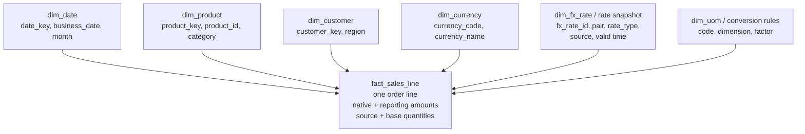
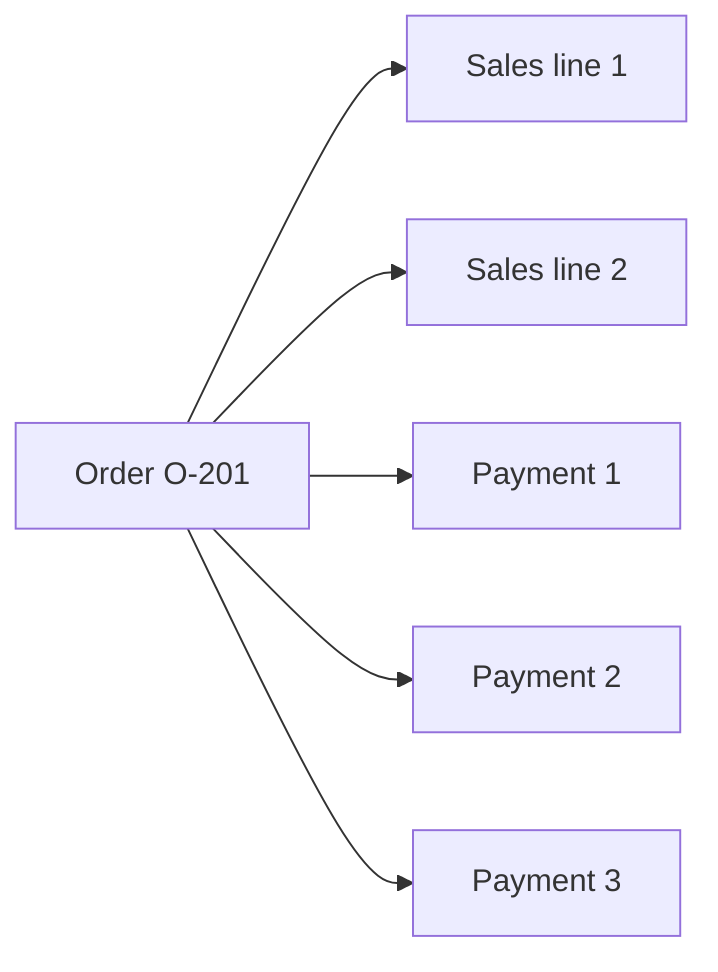
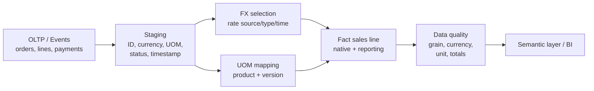

# Facts with Multiple Currencies, Units, or Granularities

A **fact table** may record sales in USD, EUR, and VND; quantities in pieces, kg, boxes, or liters; and simultaneously touch **order lines**, **orders**, **payments**, and **end-of-day inventory**. Dumping everything into `amount` and `quantity` columns and running `SUM` can produce valid SQL whose output **no longer has valid business meaning**.

In the **Fact Tables** chapter of the **DATABASE_DATA_MODELING** course, we must turn business requirements into verifiable **grains, measures, dimensions, keys, constraints, units of measure, and aggregation rules**. We also compare analytical models against transactional relational, document, and graph schemas when choosing structures. This lesson focuses on three issues that frequently appear together:

1. **Multiple currencies:** monetary amounts carry **currency units**, FX rate policies, and conversion timestamps.
2. **Multiple units of measure:** quantities carry **measurement dimensions**, units, conversion factors, and product context.
3. **Multiple grains:** one fact row represents **one order line**, **one order**, **one payment**, or **one daily snapshot**; facts at different grains must never be summed as if they were uniform.

After this lesson, you will be able to declare grain before designing facts, calculate amounts accurately per native currency and reporting currency, normalize units of measure while retaining source figures, avoid measure multiplication when joining tables of different grains, and build reconciliation checks for ETL/ELT pipelines.

## 1. Starting from an Easily Miscomputed Question

Leadership on an e-commerce platform asks:

> "What were net merchandise sales, total quantity sold, and order count for October 2026?"

It sounds simple, yet answering accurately requires clarifying:

- Is **sales** before or after discounts, taxes, and returns? Order date, payment date, or revenue recognition date?
- Which **currencies** exist? If one combined total is needed, which exchange rate, timestamp, and rounding rules apply?
- Is **quantity** in pieces, boxes, kg, or liters? Must it convert to one standard unit, and does summing quantities across products make sense?
- How does **order count** differ from **order-line count** and **payment count**?
- What event does each fact row represent? Can data change after the transaction occurs?
- Is the report computed on **current state** or must it reproduce exactly what the system knew at a past point in time?

A metric contract used in this lesson:

**Net merchandise sales** = `quantity × unit_price_native − line_discount_native`, including only `PAID` orders, **excluding taxes, shipping fees, returns, and accounting adjustments**. The analysis date is **order date** in the business timezone; reporting currency is **VND**; each sales line converts using the **exchange rate selected for that specific transaction**.

This definition applies solely to this learning example. It **does not automatically equal accounting revenue**, collected cash, or cash flow. In real systems, transaction confirmation, refunds, settlements, and accounting recognition rules must be defined separately.

## 2. A Dataset with Three Currencies and Three Ways to Count Quantity

Suppose tenant `T-01` has four order lines across three orders:

| Order Line | Order | Order Date | Product | Source Quantity | Native Unit Price | Native Discount | FX Rate to VND |
| --- | --- | --- | --- | --- | ---: | ---: | ---: |
| OL-1 | O-101 | 2026-10-01 | P-LAP | 2 pcs | 100 USD/pc | 10 USD | 25,000 VND/USD |
| OL-2 | O-101 | 2026-10-01 | P-MOUSE | 1 pc | 25 USD/pc | 0 USD | 25,000 VND/USD |
| OL-3 | O-102 | 2026-10-02 | P-COFFEE | 3 kg | 80 EUR/kg | 15 EUR | 27,000 VND/EUR |
| OL-4 | O-103 | 2026-10-03 | P-PEN | 4 boxes | 150,000 VND/box | 100,000 VND | 1 VND/VND |

All prices, products, and FX rates are **hypothetical example data**, not real market rates.

Line-by-line calculations:

| Line | Native Gross | Native Discount | Native Net | Net in VND |
| --- | ---: | ---: | ---: | ---: |
| OL-1 | 200 USD | 10 USD | 190 USD | 4,750,000 |
| OL-2 | 25 USD | 0 USD | 25 USD | 625,000 |
| OL-3 | 240 EUR | 15 EUR | 225 EUR | 6,075,000 |
| OL-4 | 600,000 VND | 100,000 VND | 500,000 VND | 500,000 |

Reference oracle answers:

- **4 order lines**, **3 distinct orders**.
- **Native sales by currency:** 215 USD; 225 EUR; 500,000 VND. **There is no valid combined sum of "500,440 currency units."**
- **Gross in VND:** 12,705,000; **discount in VND:** 755,000; **net in VND:** **11,950,000**.
- **Source quantities:** 3 pcs, 3 kg, 4 boxes. Do not call `3 + 3 + 4 = 10` "10 products" because the units belong to different types.
- If one **box of P-PEN** by specification at sale time contains **6 pieces**, OL-4 equals **24 pens**; still, you cannot add 3 kg of coffee to piece counts of pens.

This is the **business oracle**: all subsequent transformations and reports must explain why they yield these exact results.

## 3. Grain Is the First Decision of a Fact Table

**Grain** answers: "**What exact thing does one row of the fact represent?**" Write the grain as one sentence before naming columns or keys.

In this example:

> **Each row of `fact_sales_line` represents exactly one source order line `(tenant_id, order_line_id)` of a report-eligible order, with quantity, unit price, discount, and conversions determined for that specific line.**

From this it follows that:

- `order_id` **is allowed to repeat** across lines: O-101 has two lines.
- `order_line_id` must be unique within the tenant if this is a single-row-per-source-line snapshot fact.
- `currency_code` and `order_uom_code` must accurately describe the measures of **that specific line**.
- The fact points to product, customer, and date dimension versions per historical policy.
- A payment, refund, or inventory snapshot **is not a sales line**; each has its own grain.

### 3.1. Do Not Mix Order-Level Measures into a Line-Level Fact

Order O-101 has two lines and a total of 215 USD. If you copy `order_total_native = 215 USD` onto **both lines** and run `SUM(order_total_native)`, the report returns **430 USD** for O-101 alone. The SQL is not wrong; **the measure was placed at the wrong grain**.

Typical solutions:

- Store **line-level** measures in `fact_sales_line`.
- Sum orders by `SUM`ming eligible lines when all amounts have been properly allocated.
- If an order-only measure is needed (e.g., unallocated order fee), create an **order-grain fact** or define an explicit allocation policy.
- When joining two facts at different grains, **aggregate each fact to a common grain first**, never join directly and then sum.

### 3.2. Transaction, Periodic Snapshot, and Accumulating Snapshot Facts

| Fact Pattern | Example Grain | Typical Measures | Summable Across Time? |
| --- | --- | --- | --- |
| **Transaction fact** | One sales line | Quantity, gross, discount, net | Usually yes if units and scope are consistent |
| **Transaction fact** | One payment | Actual paid amount, payment currency | Summable per currency or after policy conversion |
| **Periodic snapshot fact** | One product–warehouse–date | End-of-day stock, stock value | **Never** sum end-of-day stock across days |
| **Accumulating snapshot fact** | One order progressing through steps | Ordered, paid, packed, shipped milestones | Usually updates the same row as progress occurs; measures need explicit semantics |
| **Refund event fact** | One refund occurrence | Refund amount, returned quantity | Sum per rules and reconcile against original lines |

A snapshot fact does not automatically become an event history. To answer "how did the system **record** transactions on 10/10," design an appropriate recording history or snapshot/CDC structure.

## 4. Currency Is Part of the Measure, Not a Decorative Label

The value `100` has meaning only when you know whether it is **100 USD, EUR, or VND**. You cannot directly add two monetary values of different units and slap an arbitrary currency label on the sum.

### 4.1. Preserve Native Amounts and Native Currencies

At minimum, a sales line needs components such as:

```text
native_currency_code      = USD
ordered_quantity          = 2
ordered_uom_code          = PCS
unit_price_native         = 100.00
gross_amount_native       = 200.00
discount_amount_native    = 10.00
net_amount_native         = 190.00
```

That same row may also store amounts **converted under the reporting policy**:

```text
reporting_currency_code   = VND
fx_rate_to_reporting      = 25000
gross_amount_reporting    = 5000000
discount_amount_reporting = 250000
net_amount_reporting      = 4750000
fx_rate_id                = FX-20261001-USD-VND-REPORT
```

The rate ID is illustrative; in practice it links to a rate/version record specifying source, rate type, effective window, and rounding policy. Native values must still be retained for **reconciliation**, handling adjustments, and building transaction-currency reports.

### 4.2. There Is No Single "Right FX Rate" for Every Question

One company may use different FX rates:

| Purpose | Question | Rules to Define |
| --- | --- | --- |
| Operational reporting | Convert native sales to VND for monthly comparisons | Which rate source, date, cutoff, and rounding rule? |
| Payment / settlement | How much VND did the customer/processor actually settle? | Actual transaction settlement rate and applied fees |
| Financial accounting | Which accounting policy governs reporting? | Rate type, recognition date, revaluation, and adjustments |
| Hypothetical analysis | Constant-currency growth comparison? | Benchmark rate for period and constant-currency definition |
| Ad-hoc dashboard conversion | View report in user-selected target currency | As-of rate, source, and reproducibility guarantees |

Never **replace** analytical VND-converted amounts with actual settlement cash received and call both the same metric. One order can have **order currency**, **payment currency**, **refund currency**, **revenue recognition currency**, and **distinct FX rates**. When they are events at different grains, separate the facts.

### 4.3. FX Rates Must State Direction and Multiplication/Division Convention

Explicitly state the currency pair and conversion direction. In our example:

```text
1 USD = 25,000 VND
1 EUR = 27,000 VND
1 VND = 1 VND

net_reporting_vnd = net_native * vnd_per_native_unit
```

If another system stores `USD per VND`, the formula must **invert**. Never name a column generically `fx_rate` without documenting `from_currency`, `to_currency`, and units. For target currencies other than VND, define cross-pair triangulation rules, sources, and timestamps rather than multiplying two mismatched rates blindly.

### 4.4. Choosing the Rate Timestamp: Valid Time vs. Record Time

Suppose O-101 is placed at 09:00 on 01/10 and the system receives that day's rate table at 10:00. Specify:

- Does the rate use **order date**, **payment date**, or **reporting close date**?
- Do we use the **latest approved rate at decision time**?
- If the rate table is retroactively amended on 03/10, are old reports **restated** or kept frozen?
- When asked for "the report the system published on 02/10," must we retain the rate version **known on that date**?

These two axes are commonly called **business valid time** and **system record/knowledge time**. Storing `valid_from` without version/record timestamps may be insufficient to reproduce a historically published report.

### 4.5. At Which Level Do You Convert and Round?

Suppose two small-value lines in one currency must convert to a target currency rounded to **0 decimal places**. Results can differ between:

```text
Method A: ROUND(each converted line) then SUM
Method B: SUM(native amounts) then convert and ROUND once
```

If lines differ in **date, rate, or rate type**, Method B can also apply the **wrong exchange rate**. The company must specify the **conversion granularity and rounding rule**: per line, per order, per payment, or per period.

To reconcile an order, you may need a controlled **rounding variance allocation**. Never mutate native monetary measures just to force reports to tie out. Document precision, scale, rounding mode, and order of operations.

### 4.6. Choosing Numeric Types to Avoid Precision Loss

- Money should generally use **decimal/NUMERIC** with proper precision/scale, or integer minor units when policy permits.
- Avoid `FLOAT/DOUBLE` for auditable monetary calculations whenever possible.
- Never assume every currency has two decimal places or that internal line amounts have no fractional cents.
- Exchange rates require sufficient precision; intermediate products may need higher precision before rounding to reporting amounts.

Later SQL examples use `NUMERIC`; real precision/scale limits must reflect maximum transaction size, currencies, and calculation conventions.

## 5. Units of Measure: Quantities Need Semantic Dimensions

Sales data might contain:

```text
OL-1: 2 PCS  (laptop)
OL-2: 1 PCS  (mouse)
OL-3: 3 KG   (coffee)
OL-4: 4 BOX  (pens, 6 pcs/box)
```

`SUM(quantity) = 10` does not describe any meaningful quantity. `KG` measures mass; `PCS` measures piece count; `BOX` is a **packaging unit** whose specification depends on the product. They do not share a common physical dimension.

### 5.1. Distinguishing Measurement Dimensions from Display Units

Common quantity groups:

| Measurement Dimension | Common Units | Standardizable via Fixed Conversion? |
| --- | --- | --- |
| **Count / pieces** | PCS, EACH | Semantically compatible if counting comparable item types |
| **Mass** | g, kg, ton | Yes, with exact physical factors |
| **Volume** | mL, L, m³ | Yes, with exact factors |
| **Duration** | seconds, minutes, hours | Yes, by unit definition |
| **Length** | mm, cm, m | Yes, by unit definition |
| **Packaging** | box, case, pallet | **Depends on product spec, version, and effective time** |
| **Ratios** | %, percentage points | Never sum like counts or money; use component formulas |

Never assume **1 kg = 1 L** without a **density** valid for that specific item, measurement conditions, and business rules. Converting kilograms to liters is not a same-dimension conversion; it requires product attributes or extra measurements.

### 5.2. Store Both Source Quantity and Normalized Quantity

A fact row can hold:

```text
source_quantity          = 4
source_uom_code          = BOX
base_quantity            = 24
base_uom_code            = PCS
conversion_factor        = 6
conversion_rule_id       = PKG-P-PEN-2026
```

The rule `4 BOX × 6 PCS/BOX = 24 PCS` is valid only for **product P-PEN and the packaging spec in force at transaction time**. If next year the manufacturer switches to 10 pens per box, **historical facts** must never silently recalculate to 40 pieces from the current spec.

Normalized quantities help compute inventory or throughput, yet still constrain valid summation scope. Adding 24 pens + 2 laptops = 26 item pieces **may** make sense if the KPI is "total physical units," yet is misleading if readers mistake it for "boxes" or "weight sold." Order count, line count, and physical piece count are three distinct metrics.

### 5.3. Unit Conversions Depend on Product and Time

A conversion rule table might use:

| product_id | from_uom | to_uom | factor | valid_from | valid_to |
| --- | --- | --- | ---: | --- | --- |
| P-PEN | BOX | PCS | 6 | 2026-01-01 | 2027-01-01 |
| P-PEN | BOX | PCS | 10 | 2027-01-01 | None |
| P-COFFEE | KG | G | 1000 | 2026-01-01 | None |

Note:

- `factor` has a **direction**: `base_quantity = source_quantity × factor`.
- Rule keys should include **product or item category** when units are product-specific packaging.
- Effective intervals `[valid_from, valid_to)` must never overlap for the same conversion key.
- Event records must **snapshot `factor`/`rule_id`**, or provide an immutable link to retrieve the exact factor at processing time.
- Unit conversions may require rounding rules aligned with inventory precision; never silently truncate remainders.

If a unit cannot be converted, mark it **`missing/not convertible`**; never substitute factor `1` just to "keep numbers flowing."

### 5.4. Unit Price Must Match Quantity Unit

In our example:

```text
OL-3: 80 EUR / KG × 3 KG = 240 EUR (gross)
OL-4: 150,000 VND / BOX × 4 BOX = 600,000 VND (gross)
```

If `OL-4` converts quantity to `24 PCS` yet still multiplies by **150,000 VND/BOX**, gross turns into **3,600,000 VND**—a severe bug caused by changing quantity without changing the **unit of the unit price**.

To compute price per piece, normalize the rate too:

```text
unit_price_per_piece = 150,000 VND/BOX ÷ 6 PCS/BOX
                     = 25,000 VND/PCS

24 PCS × 25,000 VND/PCS = 600,000 VND
```

Therefore, facts should store **native quantity and native unit price in the same frame of reference**, creating separate normalized measures when needed. Never redefine `quantity` or `unit_price` mid-stream without changing the data contract.

## 6. Designing Multi-Currency and Multi-Unit Fact Schemas

### 6.1. Reference Star Schema



This is a conceptual diagram. In practice, a fact table may store `currency_code`, `source_uom_code`, and `reporting_currency_code` directly as **degenerate/code attributes** when code sets are small and need no descriptive dimension—still explicitly specifying which measure each unit governs. FX rates can be stored as a **snapshot on the fact**, a foreign key to an **immutable rate table**, or both for reconciliation.

### 6.2. Illustrative SQL Fact Table

PostgreSQL-style example targeting VND reporting currency and assuming `order_line_id` is unique within a tenant. This is a **current-state snapshot fact per eligible sales line**; if you need an event log for multiple adjustments on the same line, change the grain and keys.

```sql
CREATE TABLE fact_sales_line (
    tenant_id VARCHAR(32) NOT NULL,
    order_line_id VARCHAR(40) NOT NULL,
    order_id VARCHAR(40) NOT NULL,
    product_key BIGINT NOT NULL,
    customer_key BIGINT NOT NULL,
    order_date_key INTEGER NOT NULL,

    -- Quantity and price in the original input unit
    source_quantity NUMERIC(24,6) NOT NULL,
    source_uom_code VARCHAR(16) NOT NULL,
    unit_price_native NUMERIC(24,6) NOT NULL,

    -- Quantity normalized per product conversion rule
    base_quantity NUMERIC(24,6),
    base_uom_code VARCHAR(16),
    quantity_conversion_factor NUMERIC(24,10),
    quantity_rule_id VARCHAR(80),

    -- Native currency amounts
    native_currency_code CHAR(3) NOT NULL,
    gross_native NUMERIC(28,6) NOT NULL,
    discount_native NUMERIC(28,6) NOT NULL,
    net_native NUMERIC(28,6) NOT NULL,

    -- Reporting currency amounts (e.g., VND)
    reporting_currency_code CHAR(3) NOT NULL,
    fx_rate_id VARCHAR(100),
    fx_rate_to_reporting NUMERIC(28,12),
    gross_reporting NUMERIC(28,2),
    discount_reporting NUMERIC(28,2),
    net_reporting NUMERIC(28,2),

    -- Ingestion auditability
    source_event_id VARCHAR(100),
    loaded_at TIMESTAMPTZ NOT NULL,

    PRIMARY KEY (tenant_id, order_line_id),
    CHECK (source_quantity > 0),
    CHECK (unit_price_native >= 0),
    CHECK (discount_native >= 0),
    CHECK (gross_native = source_quantity * unit_price_native),
    CHECK (net_native = gross_native - discount_native),
    CHECK (net_native >= 0),
    CHECK (
      (base_quantity IS NULL
       AND base_uom_code IS NULL
       AND quantity_conversion_factor IS NULL)
      OR
      (base_quantity IS NOT NULL
       AND base_uom_code IS NOT NULL
       AND quantity_conversion_factor IS NOT NULL
       AND quantity_conversion_factor > 0)
    ),
    CHECK (fx_rate_to_reporting IS NULL
           OR fx_rate_to_reporting > 0)
);
```

Implementation notes:

1. Constraints above illustrate structure; **some analytical warehouses do not enforce `CHECK`/`FK`/`PRIMARY KEY` like OLTP systems**. Pipelines must still validate them.
2. When `unit_price_native` has many decimal places, `gross_native = quantity × unit_price` holds only under the corresponding **grain-level rounding rule**. Production systems need explicit rounding policies and tolerance checks rather than forcing exact equality in every case.
3. Reporting columns may be absent when an **FX rate is missing**; the fact can still be retained unconverted with a data-quality flag. **Converted total reports must never silently drop rows missing an FX rate.**
4. `fx_rate_id` and `quantity_rule_id` should reference immutable rule/reference tables with integrity guarantees; a bare `VARCHAR` does not verify IDs by itself.
5. Dimension surrogate keys must be verified to belong to the **right tenant and historical version**.

`source_event_id` aids import tracing and lineage; it does **not** replace `(tenant_id, order_line_id)` as the snapshot fact key if the source can emit multiple events for the same line.

### 6.3. FX Rate Table and Versioning Policy

A rate table can be modeled as:

```sql
CREATE TABLE fx_rate_snapshot (
    fx_rate_id VARCHAR(100) PRIMARY KEY,
    from_currency CHAR(3) NOT NULL,
    to_currency CHAR(3) NOT NULL,
    rate_type VARCHAR(32) NOT NULL,
    rate_source VARCHAR(100) NOT NULL,
    valid_from TIMESTAMPTZ NOT NULL,
    valid_to TIMESTAMPTZ,
    recorded_at TIMESTAMPTZ NOT NULL,
    units_of_to_per_one_from NUMERIC(28,12) NOT NULL,
    CHECK (units_of_to_per_one_from > 0),
    CHECK (valid_to IS NULL OR valid_to > valid_from)
);
```

In real data, rates may have retroactive revisions, settlement batches, and approval statuses. `fx_rate_id` identifies a specific **rate version** capable of reproducing results, not merely a currency pair.

Row-level constraints like `valid_to > valid_from` **do not block two overlapping rate records** for the same pair, rate type, and source. Uniqueness of rate lookup must be enforced via interval exclusion constraints if supported, ETL logic, and data quality checks.

### 6.4. Reporting Currency Amounts Are Policy-Governed Derived Measures

If converting **per individual line**:

```sql
SELECT
    tenant_id,
    order_line_id,
    native_currency_code,
    net_native,
    reporting_currency_code,
    fx_rate_to_reporting,
    ROUND(net_native * fx_rate_to_reporting, 0)
        AS expected_net_reporting_vnd
FROM fact_sales_line
WHERE tenant_id = 'T-01'
  AND reporting_currency_code = 'VND'
  AND fx_rate_to_reporting IS NOT NULL;
```

This illustrates rounding to **whole-integer VND**. Use this exact formula only when the contract confirms the rounding stage and rate rule. If policy locks converted totals at the order level, line-rounded values will not automatically match order totals without a rounding-difference allocation mechanism.

## 7. Accurate Queries Across Multiple Currencies

### 7.1. Native-Currency Reports Must Group by Currency

```sql
SELECT
    native_currency_code,
    SUM(gross_native) AS gross_native,
    SUM(discount_native) AS discount_native,
    SUM(net_native) AS net_native
FROM fact_sales_line
WHERE tenant_id = 'T-01'
GROUP BY native_currency_code
ORDER BY native_currency_code;
```

Sample output:

| currency_code | gross_native | discount_native | net_native |
| --- | ---: | ---: | ---: |
| EUR | 240 | 15 | 225 |
| USD | 225 | 10 | 215 |
| VND | 600,000 | 100,000 | 500,000 |

**There is no combined grand-total row across all three currencies.** If a BI tool automatically adds a "Grand total" on `net_native` without conversion, disable that total or reconfigure the metric to prevent misleading output.

### 7.2. Only Reporting-Currency Columns Can Sum Across Native Currencies

```sql
SELECT
    reporting_currency_code,
    SUM(gross_reporting) AS gross_reporting,
    SUM(discount_reporting) AS discount_reporting,
    SUM(net_reporting) AS net_reporting
FROM fact_sales_line
WHERE tenant_id = 'T-01'
  AND reporting_currency_code = 'VND'
  AND net_reporting IS NOT NULL
GROUP BY reporting_currency_code;
```

On the sample data, totals are **12,705,000**, **755,000**, and **11,950,000 VND**.

**Warning:** `net_reporting IS NOT NULL` can **drop rows missing FX rates**. Before publishing KPIs, reconcile **eligible source line counts** against **lines with populated reporting amounts**, and define whether reports may publish with missing FX rates.

Verification query:

```sql
SELECT
    COUNT(*) AS all_fact_rows,
    COUNT(net_reporting) AS converted_rows,
    COUNT(*) - COUNT(net_reporting) AS missing_conversion_rows,
    COUNT(DISTINCT order_id) AS distinct_orders
FROM fact_sales_line
WHERE tenant_id = 'T-01';
```

If `missing_conversion_rows > 0`, `SUM(net_reporting)` is not proven **complete**. Production reports should surface completeness status or halt publication under quality gates.

### 7.3. Do Not Sum Native Amounts First and Multiply by an Arbitrary Rate

The following is **semantically wrong** whenever a group spans multiple currencies or multiple FX rates:

```sql
-- Wrong example: native_currency differs across net_native rows,
-- and even rows in the same currency may use different rates.
SELECT
    SUM(net_native) * MAX(fx_rate_to_reporting) AS wrong_total
FROM fact_sales_line
WHERE tenant_id = 'T-01';
```

Under per-line conversion rules, you must **sum amounts already converted to the target reporting currency**. Only when every row in the **same currency pair and policy** shares the exact same rate can you multiply a native sum—and never assume that holds once dates, payment channels, or rate types vary.

### 7.4. One Customer Can Have Both Native and Reporting Totals

To list purchasing customers:

```sql
SELECT
    customer_key,
    reporting_currency_code,
    SUM(net_reporting) AS net_reporting,
    COUNT(DISTINCT order_id) AS distinct_orders
FROM fact_sales_line
WHERE tenant_id = :tenant_id
  AND reporting_currency_code = 'VND'
GROUP BY customer_key, reporting_currency_code;
```

Monetary totals may be right, yet grouping by `customer_key` requires checking **SCD Type 2**: one business customer can have multiple historical `customer_key` versions. If the KPI asks for **distinct customers**, group/count by the tenant-scoped **business key** or a durable customer identity dimension rather than counting version surrogate keys.

## 8. Accurate Queries Across Multiple Units of Measure

### 8.1. Group by Measurement Dimension and Source Unit

```sql
SELECT
    source_uom_code,
    SUM(source_quantity) AS quantity_in_source_uom
FROM fact_sales_line
WHERE tenant_id = 'T-01'
GROUP BY source_uom_code
ORDER BY source_uom_code;
```

Sample output: `BOX = 4`, `KG = 3`, `PCS = 3`. These are valid sums **within each source unit**.

If a `BOX` code spans multiple products with **different pieces per box**, `SUM(source_quantity)` still tells you only "how many **boxes**," not "how many pieces." Summing boxes can serve warehouse logistics, provided the unit is labeled accurately and no single global conversion factor is assumed across all boxes.

### 8.2. Normalized Quantity Sums Need the Right Scope

```sql
SELECT
    product_key,
    base_uom_code,
    SUM(base_quantity) AS base_quantity
FROM fact_sales_line
WHERE tenant_id = :tenant_id
  AND base_quantity IS NOT NULL
GROUP BY product_key, base_uom_code
ORDER BY product_key, base_uom_code;
```

Grouping by `product_key` and `base_uom_code` keeps summed numbers within a meaningful scope. To compute total weight in kg across all products, first ensure **every included line contributes a mass measure** converted to kg under the same definition; never run `SUM(base_quantity)` across pieces, kg, and liters combined.

### 8.3. Price per Unit: Ratios Must Recompute After Aggregation

Suppose each line has `net_native` and `base_quantity`. Average price per unit is **not** the simple average of `unit_price_native` when quantities or currencies differ.

A valid metric can be:

```text
average_net_price_per_base_unit
  = SUM(net_reporting_vnd) / SUM(base_quantity)
```

Provided that:

- `base_quantity` shares the same unit type, e.g., all kg or all pieces **within a meaningful product scope**.
- `net_reporting_vnd` converts under a uniform currency and policy.
- Zero quantities and missing conversions are handled explicitly.
- Discounts follow clear rules and facts are not multiplied.

In SQL, guard against division by zero:

```sql
SELECT
    product_key,
    base_uom_code,
    SUM(net_reporting) / NULLIF(SUM(base_quantity), 0)
        AS weighted_net_price_per_base_unit_vnd
FROM fact_sales_line
WHERE tenant_id = :tenant_id
  AND reporting_currency_code = 'VND'
  AND net_reporting IS NOT NULL
  AND base_quantity IS NOT NULL
GROUP BY product_key, base_uom_code;
```

This is a **quantity-weighted average net price**, not a catalog list price or single-order unit price. `AVG(unit_price_native)` can be wrong even in a single currency because line quantities differ.

## 9. Multiple Grains: Why Direct Fact-to-Fact Joins Multiply Figures

Suppose an order has **2 order lines** and **3 payments**.

```text
fact_sales_line: 2 rows for O-201
fact_payment:    3 rows for O-201

JOINing both facts on order_id → 2 × 3 = 6 rows
```

Each payment repeats twice in the join result, **doubling** `SUM(payment_amount)`. Each sales line repeats three times, **tripling** `SUM(net_sales)`. This is a many-to-many **fan-out** between two fact sets.



### 9.1. Right Approach: Aggregate Each Fact to a Common Grain

Example SQL:

```sql
WITH sales_by_order AS (
    SELECT
        tenant_id,
        order_id,
        reporting_currency_code,
        SUM(net_reporting) AS sales_vnd
    FROM fact_sales_line
    WHERE reporting_currency_code = 'VND'
    GROUP BY tenant_id, order_id, reporting_currency_code
),
payments_by_order AS (
    SELECT
        tenant_id,
        order_id,
        settlement_currency_code,
        SUM(settlement_amount) AS settlement_total
    FROM fact_payment
    GROUP BY tenant_id, order_id, settlement_currency_code
)
SELECT
    s.tenant_id,
    s.order_id,
    s.sales_vnd,
    p.settlement_currency_code,
    p.settlement_total
FROM sales_by_order AS s
LEFT JOIN payments_by_order AS p
  ON p.tenant_id = s.tenant_id
 AND p.order_id = s.order_id;
```

This is a **pattern template**, assuming a separate `fact_payment` table with `settlement_amount` and its settlement currency. One order can have **multiple settlement currencies**, so `payments_by_order` can still emit multiple rows per `order_id` when grouped by `settlement_currency_code`. To get strictly one row per order, **convert each payment** to reporting currency per settlement policy before aggregating to `(tenant_id, order_id)`, or retain multi-currency rows and **never sum across currencies**.

Key message: **aggregate to a common grain before joining**, and verify each side has **at most one row per join key** at that grain.

### 9.2. Never Join Inventory Facts Directly to Line-Level Sales Facts

An inventory snapshot `(product, warehouse, day)` may show 100 units at end of day. Joining it directly to 20 sales lines of that product on the same day repeats the 100 balance 20 times, turning `SUM(stock_on_hand)` into 2,000—wrong.

To report "units sold today and end-of-day stock":

1. Aggregate sales to **(product, warehouse, day)** if source data genuinely identifies the fulfilling warehouse.
2. Keep the unique inventory snapshot at that exact grain.
3. Join the two **pre-aggregated, uniqueness-verified** sets.
4. Display units sold and end-of-day stock as **two semantically distinct measures**; never sum stock across days.

Never guess or fabricate a warehouse on sales lines if fulfillment warehouse is unknown; wrong warehouse assignments invalidate inventory reconciliation.

### 9.3. Sales Flows Sum Over Time; Balances Do Not

| Measure | Summable Across Products? | Summable Across Time? | Explanation |
| --- | --- | --- | --- |
| Sales-line `net_reporting_vnd` | Yes, if same currency and scope | Usually yes | Transaction flows at distinct times |
| `quantity_kg` | Yes across same-dimension items if KPI fits | Usually yes | Mass sold |
| `quantity_pcs` | Yes when piece count is defined | Usually yes | Items sold |
| `inventory_on_hand_pcs` | Yes across compatible warehouses/products | **Never sum snapshots across days** | Point-in-time stock balance |
| `conversion_rate` | No | No | Ratio derived from numerator/denominator |
| `fx_rate` | No | No | Rate is a multiplier/index, not money |

Saying `net_reporting_vnd` is "additive" holds only **within a defined period, event scope, and currency**. If a fact mixes **originals and adjustments** or refunds, check signs and summation rules. Mixing sales and settlements in one sum can double-count the same economic activity.

## 10. Multi-Currency Events Are Often Separate Facts

A single commercial transaction can generate multiple distinct event types:

- **Order line fact:** purchased quantities and merchandise amounts in **order currency**.
- **Payment fact:** a customer charge, possibly in a different currency than the order.
- **Settlement fact:** funds remitted by the payment processor, carrying fees and settlement FX rates.
- **Refund fact:** a refund event with its own refund currency and rate.
- **Ledger fact:** accounting entries per recognition rules.

Do not force distinct events into one table just because they share `order_id`. Buying for 100 USD, paying in EUR, and settling in VND does not create "three sales" to add together. They are **measurements of different lifecycle stages** that reconcile against one another rather than sum together.

### 10.1. Payment Facts Have Their Own Grain

Sample schema outline:

```text
fact_payment
-----------
payment_id             -- one payment transaction
order_id
occurred_at
charged_currency_code
charged_amount
settlement_currency_code
settlement_amount
settlement_fx_rate_id
fee_currency_code
fee_amount
status
```

`charged_amount`, `settlement_amount`, and `fee_amount` differ not only due to exchange rates, but also due to **processing fees and settlement policies**. If fees are denominated in a third currency, never subtract them directly from settlement before converting to a common currency.

### 10.2. Refund Facts and Sign Conventions

If a 190 USD net sales line later refunds 50 USD, common options include:

- Keep 190 USD in the sales fact and store 50 USD in a separate refund fact; **net-after-refunds** reports combine both per rules.
- Record a **negative adjustment** at a grain with clear event identity and timestamp; aggregations must recognize it as an adjustment, not a new sale.
- Update a current-state sales-line snapshot down to 140 USD if only latest state is needed; insufficient for historical reconstruction without an event log.

No single option fits all systems. Avoid **having both a reduced snapshot and a negative adjustment and subtracting twice**.

### 10.3. FX Rate and Cost Grains Also Require Clarity

Cost of goods may belong to an **inventory lot**, **product unit**, **warehouse dispatch line**, or **period-end allocation**. Joining a daily FX rate table to millions of lines on currency alone without ensuring uniqueness by timestamp and rate type can fan out rows and double all sales.

A rate table supporting multiple sources or rate types per date needs a full lookup key: **currency pair + rate type + rate source + effective interval/version**. Never join solely on date and currency and hope for one row.

## 11. Designing Verifiable ETL/ELT Pipelines

### 11.1. Reference Flow



Every stage has an explicit contract: eligible rows, duplicate-ID handling, FX rate selection, unit conversions, rounding stage, and missing-data state.

### 11.2. Selecting the Exact FX Rate Record

Point-in-time selection must guarantee:

```text
rate.from_currency = fact.native_currency
rate.to_currency   = fact.reporting_currency
rate.rate_type     = policy.rate_type
rate.source        = policy.rate_source
rate.valid_from   <= event_time
event_time < rate.valid_to (if bounded)
```

If **two rate records** match due to overlapping effective intervals, a join doubles the fact row. Never hide that bug with `SELECT DISTINCT`; two differing rates produce two conflicting amounts. Enforce version selection and assert **every fact matches at most/exactly one rate**.

### 11.3. Selecting the Exact Unit Conversion Rule

```text
rule.product_id    = fact.product_id
rule.from_uom      = fact.source_uom_code
rule.to_uom        = product.base_uom
rule.valid_from   <= event_time
event_time < rule.valid_to (if bounded)
```

Universal physical conversions like kg → g can use a shared unit table; packaging conversions like box → piece require **product- and version-specific specs**. Never apply today's 6-pcs/box factor to a transaction from last year when boxes held 10 pieces.

### 11.4. Handling Missing Rates or Conversion Specs

When an FX rate or packaging spec is missing:

- **Retain native amounts/quantities** if trustworthy and permitted to load.
- Flag with `MISSING_FX`, `INVALID_UOM`, `UNKNOWN_PRODUCT_RULE`, or equivalent quality status.
- Never substitute FX rate `1` unless both currencies are genuinely identical **and policy allows**.
- Never default `1 box = 1 piece` or `1 kg = 1 liter`.
- Never silently drop facts via an `INNER JOIN`, understating sales.
- Decide whether reports may publish in **partial** status or must block until resolved.

### 11.5. Idempotency and Late-Arriving Events

Line OL-3 might be resent by the source; an unkeyed `INSERT` doubles EUR sales. Base **idempotency keys** on source event IDs or the defined snapshot fact key.

Late-arriving changes include:

- FX rates published or revised after reports already ran.
- Product packaging specs amended retroactively.
- Refunds arriving in a later reporting period.
- Orders transitioning from `PENDING` to `PAID`, or `PAID` to `REFUNDED`.
- Subsets of data whose event time differs from ingestion time.

Define **watermarks**, cutoffs, calculation versions, and **restatement** policies. An "October" dashboard run on Nov 5 may differ when run on Dec 5 after retroactive fixes; differences must be explainable rather than silently shifting metric definitions.

## 12. Minimum Data Quality Test Suite

### 12.1. Grain and Duplicate Checks

At the one-source-line grain:

```sql
SELECT tenant_id, order_line_id, COUNT(*) AS row_count
FROM fact_sales_line
GROUP BY tenant_id, order_line_id
HAVING COUNT(*) > 1;
```

Non-empty results indicate duplicate grain records. Never treat two distinct adjustment events as the same snapshot row if the true grain changed; revise the fact design rather than deleting rows arbitrarily.

### 12.2. Native-Currency Arithmetic Checks

```sql
SELECT
    tenant_id,
    order_line_id,
    native_currency_code,
    source_quantity,
    unit_price_native,
    gross_native,
    discount_native,
    net_native
FROM fact_sales_line
WHERE gross_native <> source_quantity * unit_price_native
   OR net_native <> gross_native - discount_native
   OR net_native < 0;
```

This query assumes **exact arithmetic per locked rules**. If rounding is permitted, compare using grain-appropriate rounding/tolerances rather than flagging tiny decimal remainders as bugs.

### 12.3. Missing or Mixed Reporting Currency Checks

```sql
SELECT
    native_currency_code,
    reporting_currency_code,
    COUNT(*) AS line_count,
    SUM(CASE WHEN net_reporting IS NULL THEN 1 ELSE 0 END)
        AS missing_reporting_count
FROM fact_sales_line
WHERE tenant_id = :tenant_id
GROUP BY native_currency_code, reporting_currency_code
ORDER BY native_currency_code, reporting_currency_code;
```

If reporting targets VND, rows with a non-VND `reporting_currency_code` cannot enter `SUM(net_reporting)`. Missing reporting amounts require alerts and resolution rules.

### 12.4. Snapshot FX Rate vs. Reporting Amount Checks

```sql
SELECT
    tenant_id, order_line_id,
    net_native, fx_rate_to_reporting, net_reporting
FROM fact_sales_line
WHERE reporting_currency_code = 'VND'
  AND fx_rate_to_reporting IS NOT NULL
  AND net_reporting IS NOT NULL
  AND ABS(
      net_reporting -
      ROUND(net_native * fx_rate_to_reporting, 0)
  ) > 0;
```

This query **illustrates** a **per-line rounding to whole VND** policy. If rounding remainders allocate at the order level, adjust the check to avoid false alarms. Beyond arithmetic, verify `fx_rate_id` and snapshot fields match the approved rate record.

### 12.5. Quantity Conversion Checks

```sql
SELECT
    tenant_id, order_line_id,
    source_quantity, source_uom_code,
    base_quantity, base_uom_code,
    quantity_conversion_factor
FROM fact_sales_line
WHERE base_quantity IS NOT NULL
  AND quantity_conversion_factor IS NOT NULL
  AND ABS(
      base_quantity -
      source_quantity * quantity_conversion_factor
  ) > 0.000001;
```

`0.000001` is an **illustrative tolerance** matching the chosen numeric scale, not a universal standard. Weights, volumes, whole pieces, and pack splits carry different precision rules; validate per measurement dimension policy.

### 12.6. Cross-Layer Reconciliation

| Reconciliation Metric | Expected on Sample Data | Why It Matters |
| --- | --- | --- |
| Fact row count | 4 | No row multiplication or drops when joining FX and UOM |
| Distinct orders | 3 | Do not confuse line grain with order grain |
| Native net USD | 215 USD | Reconcile native currency |
| Native net EUR | 225 EUR | Reconcile native currency |
| Native net VND | 500,000 VND | Reconcile native currency |
| Reporting gross VND | 12,705,000 | Verify gross conversion |
| Reporting discount VND | 755,000 | Verify discount conversion |
| Reporting net VND | 11,950,000 | Verify net = gross − discount |
| Source quantities | 3 PCS, 3 KG, 4 BOX | Avoid summing incompatible dimensions |
| Pen base quantity | 24 PCS | Verify product-specific factor |
| Missing FX / UOM | 0 in sample data | Ensure completeness |

Run checks across the **same tenant, period, source status, and cutoff**. If the source updates mid-ETL, latency can create temporary drift; compare using consistent watermarks and snapshots.

## 13. Relational, Document, Graph, and Analytical Models

Even when focusing on fact tables, sound design depends on source systems and query patterns.

| Concern | Relational / OLTP | Document | Graph | Dimensional / Analytical |
| --- | --- | --- | --- | --- |
| Multi-line orders and payments | `orders`, `order_lines`, `payments` tables with FKs/transactions | Order doc may embed lines | Event vertices and role edges | **Separate-grain facts** for lines, payments, refunds |
| Currencies and units | Native currency/UOM stored on transactions | Stored inside each document/line | Properties on contextual event vertices/edges | Native + reporting measures, rate/conversion lineage |
| Preserving historical prices/units | Transaction snapshots and history | Embedded snapshot inside document | Timestamped event vertices/properties | Facts + conversion versions + historical dimensions |
| Monthly sales queries | SQL `JOIN`/`GROUP BY` | Aggregation pipelines | Can aggregate, though not its main strength | Star schemas, warehouses, semantic layers |
| Customer–device link traversal | `JOIN`/CTEs depending on depth | References and aggregation | Ideal for multi-hop traversals | Export traversal outputs to warehouse if needed |
| Amount and quantity reconciliation | App constraints/transactions | Validation and write guards | Event-model checks | ETL QA, grain, completeness, and reconciliations |

A common architecture keeps **OLTP as the transactional authority** and streams data via CDC/ETL into fact–dimension warehouse tables. Property graphs can run alongside for link analysis. Document stores fit aggregate-oriented operational access. Never treat an asynchronously loaded analytical fact table as the primary operational write authority.

## 14. Mistakes That Easily Corrupt Figures

1. **Summing money across currencies.** `100 USD + 100 EUR` has no single sum without policy-governed conversion.
2. **Using current FX rates to recompute history without a restatement policy.** Past reports shift inexplicably.
3. **Omitting FX rate direction.** `VND per USD` differs from `USD per VND`.
4. **Matching rates by date alone while ignoring source, rate type, and version.** Joins match multiple rates and multiply rows.
5. **Multiplying mixed native totals by an average FX rate.** Wrong whenever rates or currencies vary.
6. **Using `FLOAT` for auditable money.** Introduces binary arithmetic drift and hard-to-trace rounding differences.
7. **Summing kg, boxes, and pieces.** Produces no valid physical quantity.
8. **Hard-coding `1 BOX = N pieces` across all products.** Packaging specs vary by product and version.
9. **Normalizing quantity while keeping source unit price.** Multiplies converted quantities by old-unit prices, inflating sales.
10. **Storing order totals on every sales line and running `SUM`.** Multiplies totals by line count.
11. **Joining line facts directly to payment facts on `order_id`.** Causes many-to-many fan-out.
12. **Summing inventory snapshots across days.** Inventory is semi-additive over time.
13. **Treating `COUNT(*)` as order count.** Line-grain facts count lines, not orders.
14. **Using `DISTINCT` to hide overlapping dimension/rate versions.** Masks broken uniqueness rather than fixing it.
15. **Letting `INNER JOIN` silently drop facts missing rates or dimensions.** Silently understates sales.
16. **Lumping order, payment, settlement, and refund amounts into one measure.** They are distinct events and policies.
17. **Failing to distinguish native and reporting amounts.** Readers see totals with ambiguous currency.
18. **Lacking source event IDs / idempotency.** Retries duplicate rows and inflate KPIs.
19. **Omitting cutoffs, watermarks, and retroactive edit rules.** Makes published dashboards unreproducible.
20. **Believing one wide fact table solves every grain.** Ambiguous grain jeopardizes every aggregation.

## 15. Practice Exercises and Solution Hints

### Exercise 1 — Computing Native and Reporting Amounts

OL-1 has 2 pcs × 100 USD, discount 10 USD, FX rate 25,000 VND/USD. OL-2 has 1 pc × 25 USD, zero discount, same rate.

**Task:** compute net USD and VND for each line, then the total for O-101.

**Hint:** OL-1 net **190 USD = 4,750,000 VND**; OL-2 net **25 USD = 625,000 VND**; O-101 net **215 USD = 5,375,000 VND** under the sample rate policy. This sums **one order in one native currency**; if line rates differ, VND totals must follow per-line conversion rules.

### Exercise 2 — Why Is There No Single "Native Grand Total"?

We have 215 USD, 225 EUR, and 500,000 VND.

**Task:** how do you report a single combined monetary total? What is the VND total under the sample rates?

**Hint:** never add them directly. Convert each amount to VND using locked rates and timestamp rules; total **11,950,000 VND**. If a line lacks a rate, flag missingness or block publication per policy rather than dropping it.

### Exercise 3 — Converting Boxes to Pieces

OL-4 has 4 boxes of pens, 6 pieces per box at sale time, priced at 150,000 VND/box.

**Task:** what are normalized quantity and price per piece? If packaging changes to 10 pieces/box next year, do past facts change?

**Hint:** **24 pieces**, **25,000 VND/piece**. Historical facts retain rule/factor 6 from sale time and never recompute using next year's factor 10. If past records must be fixed due to source error, use a traceable adjustment workflow.

### Exercise 4 — Distinguishing Counts and Quantities

Four lines span three orders; quantities are 2 PCS, 1 PCS, 3 KG, and 4 BOX.

**Task:** state line count, order count, and quantities by unit; can you report "total quantity sold = 10"?

**Hint:** **4 lines**, **3 orders**, **3 PCS**, **3 KG**, **4 BOX**. `10` adds raw numbers without a shared unit; never report it as total quantity sold unless an explicitly defined nominal-count KPI requires it.

### Exercise 5 — Joining Two Facts

An order has 2 sales lines and 3 payments. SQL joins `fact_sales_line` and `fact_payment` directly on `order_id`.

**Task:** how many rows appear? What is the risk when summing amounts?

**Hint:** **6 rows** (2×3); sales-line measures repeat 3 times and payment measures repeat 2 times. Aggregate each fact to the **order grain** before joining; if payments span multiple currencies, aggregate by currency or convert per policy to achieve one row per order.

### Exercise 6 — Versioned FX Rates

Order O-105 is placed on 01/10. The rate table has two USD→VND rows for that date: `REPORTING` from provider X and `SETTLEMENT` from provider Y, with different rates.

**Task:** can you join solely on `currency_code` and `date`? Which attributes select the right rate?

**Hint:** no. Include `from_currency`, `to_currency`, `rate_type`, `rate_source`, effective window, version, or approved precedence rules. Each fact must match **exactly one rate** per policy; missing or multiple matches must be flagged.

### Exercise 7 — Reporting Sales and End-of-Day Inventory

`fact_sales_line` has three sales lines for P-01 today totaling 12 pieces. `fact_inventory_daily` has one end-of-day snapshot showing 100 pieces.

**Task:** why can't you join and sum everything? What should the report show?

**Hint:** direct joining repeats the 100 snapshot three times, reporting 300 in stock. Aggregate sales to **(product, warehouse, date)** if warehouse is known, join to the unique snapshot, and present **12 pieces sold today** and **100 pieces end-of-day stock** as two semantically distinct measures.

### Exercise 8 — Refund After Cutoff

A line sold for 190 USD; next month 50 USD is refunded at a different FX rate than the purchase date.

**Task:** should you directly subtract 50 USD converted at the purchase-date rate from historical sales?

**Hint:** you cannot decide without a metric contract. Refunds are **separate events** with their own amount, currency, timestamp, and policy FX rate. "Net sales after refunds by order date" vs. "refund amount by refund date" allocate differently. Never pick an arbitrary rate or overwrite history without clear requirements.

### Exercise 9 — Avoid Using the Wrong Unit Price

There are 4 BOX of pens, each BOX containing 6 PCS at 150,000 VND/BOX. A pipeline converts quantity to 24 PCS yet multiplies by unit price 150,000.

**Task:** why is 3,600,000 VND wrong, and how do you fix it?

**Hint:** it multiplied **pieces by price per box**. Either keep 4 BOX × 150,000 VND/BOX = **600,000 VND**, or also convert unit price to 25,000 VND/PCS when multiplying by 24 PCS.

### Exercise 10 — Choosing a Data Architecture

A company uses OLTP for orders and payments, needs multi-currency BI, compares return rates across countries, and investigates customer–device link graphs.

**Task:** should everything be stuffed into one fact table or one graph?

**Hint:** not by default. OLTP handles operational transactions and constraints; the warehouse organizes **explicitly grained facts** with FX rates, currencies, UOMs, and dimensions; a graph database can serve customer–device traversals if workloads justify it. Maintain canonical IDs, traceable sync, reconciliations, and privacy controls.

## 16. Summary

**A trustworthy fact table must have explicit grain, units of measure, and measure semantics.** For multiple currencies, retain **native amount + currency**, convert using **rates identified by source, timestamp, type, and version**, and sum only numbers sharing the same reporting unit. For multiple units of measure, retain **source quantity + UOM**, apply directional, product- and time-specific conversion rules, and keep quantities consistent with unit prices. For multiple grains, **separate facts by event**, aggregate each fact to a common grain before joining, and never sum balances or ratios like transactions. Sound design must be proven with reference test cases and checks for completeness, grain duplicates, conversions, fan-out, and report reproducibility—not merely a `SUM` query that happens to return a number.
