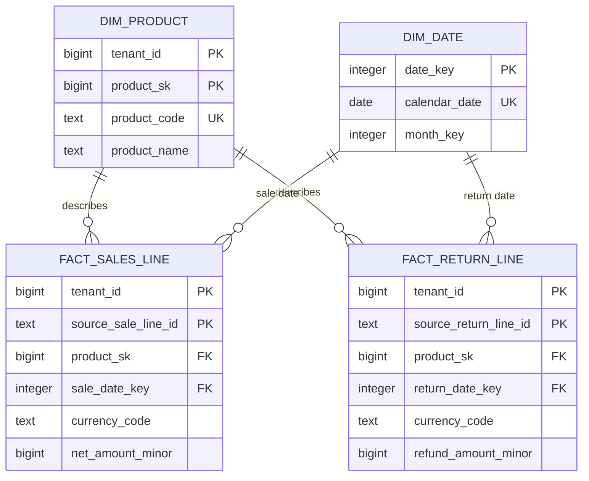

# Detecting Measure Duplication When Joining Multiple Fact Tables

A reporting table can return completely valid SQL results yet report **revenue that is several times higher than reality**. This bug commonly appears when two fact tables (*fact tables*) that each have multiple rows for the same product, order, customer, or date are joined directly together. In the join result, each row from the first table is repeated according to the number of matching rows in the second table, and `SUM` then adds up all those duplicates.

This phenomenon is called **fan-out** or **join-induced measure duplication** (*measure duplication / double counting*). It is not merely a SQL optimization issue: it stems from ignoring **grain** — the exact definition of what event or state a single row represents — and ignoring the *cardinality* between tables.

This lesson belongs to the **Fact Tables** chapter of the **DATABASE_DATA_MODELING** module. The goal is to translate analytical requirements into a data model with clear keys, relationships, constraints, grain, and units of measure; to detect, prove, and resolve fan-out across facts in the relational model, and then apply equivalent principles in document, graph, and analytical warehouses. Examples use **PostgreSQL 15+**, but the reasoning about row counts and measure correctness does not depend on a specific DBMS.

## 1. When Does a Join Duplicate Measures?

Consider the requirement:

> In October, by product, report the sales amount, refund amount, and the difference between the two amounts.

The system has two facts:

- `fact_sales_line`: **one row** corresponds to one sales line; each row has `net_amount_minor`.
- `fact_return_line`: **one row** corresponds to one return/refund line; each row has `refund_amount_minor`.

Both have a key to product. However, **"same product" does not mean "one sales line corresponds to exactly one return line"**. One product can be sold multiple times and returned multiple times.

Suppose during the month:

| `product` | Sales rows | Return rows | Rows after `JOIN` on product |
|---|---:|---:|---:|
| P1 — Phone | 2 | 3 | **6** |
| P2 — Laptop | 1 | 1 | 1 |
| P3 — Shoes | 0 | 1 | 0 with `INNER JOIN` |
| P4 — Tablet | 0 | 0 | 0 with `INNER JOIN` |

For P1, each sales row matches **all three return rows**; each return row matches **both sales rows**. The result is `2 × 3 = 6` pairs, even though the sources contain only 5 independent events.

### The Formula Behind Fan-Out

For a grouping key value \(k\), let:

- \(m_k\): number of rows in fact A with key \(k\).
- \(n_k\): number of rows in fact B with key \(k\).

If joined on **only key \(k\)** using `INNER JOIN`, the number of pairs produced is:

\[
\text{joined\_rows}(k) = m_k \times n_k.
\]

Each measure value of A is repeated \(n_k\) times, and each measure value of B is repeated \(m_k\) times. Without other filter conditions:

\[
\begin{aligned}
\mathrm{SUM\_joined}(A,k) &= n_k \times \mathrm{SUM\_source}(A,k),\\
\mathrm{SUM\_joined}(B,k) &= m_k \times \mathrm{SUM\_source}(B,k).
\end{aligned}
\]

This formula applies to values sharing the same key in the join under consideration, not as a claim that every join multiplies by the same factor. With `LEFT JOIN`, keys without a counterpart behave differently; when adding conditions on date, status, or time window, the number of matching pairs also changes.

**The first question to ask when seeing an unexpectedly high total:** before `SUM`, how many result rows are there compared to how many distinct underlying source events actually exist?

## 2. Start From Grain, Not From the JOIN Statement

A fact only has meaning when you define **what one row is**.

| Table | Grain | Row ID | Appropriate measures |
|---|---|---|---|
| `fact_sales_line` | One recorded sales line | `source_sale_line_id` within tenant | Sold units, net sales amount |
| `fact_return_line` | One recorded return line | `source_return_line_id` within tenant | Returned units, refund amount |
| `fact_payment` | One payment transaction/installment | `payment_id` | Payment amount |
| `fact_inventory_daily` | One SKU × warehouse × snapshot date | Tuple `(tenant,sku,warehouse,date)` | End-of-day on-hand balance |
| `fact_order_accumulating` | One order across its lifecycle | `order_id` | Milestone timestamps, processing duration |

From these grains, we cannot infer a 1:1 relationship between a sale line and a return line from `product_id` alone. Nor can we infer a 1:1 relationship between an order line and a payment from `order_id` alone: an order can have multiple line items and multiple payments.

### A Key at the Parent Entity Level Is Not the Key of a Child Fact

`product_id` may be a unique key of `dim_product`, but it is **not unique** in `fact_sales_line` or `fact_return_line`. Joining two facts on `product_id` just because both reference the dimension creates an **N:M** relationship between event rows.

The same logic occurs when joining:

- Order lines with payments on `order_id`.
- Click events with orders on `customer_id`.
- Sales lines with ad impressions on `product_id` and date.
- End-of-day inventory snapshots with individual shipment transactions on product/warehouse/date.

**A shared dimension (*conformed dimension*) provides a common comparison axis; it does not turn facts of different grains into a 1:1 relationship.**

## 3. Small Test Data That Still Exposes the Bug

To demonstrate fan-out with SQL, use four products P1–P4, two days in October, and sales/return events. All examples use tenant 42 and currency VND to avoid extra noise from currency conversion.

### 3.1. Dimension Tables and Two Fact Tables



In this example, `DimProduct` is an **unversioned** (*Type 1*) dimension to focus on the join bug. When using SCD Type 2, each version has a different `product_sk` and requires history handling as covered later.

```sql
CREATE TABLE dim_product (
    tenant_id BIGINT NOT NULL,
    product_sk BIGINT NOT NULL,
    product_code TEXT NOT NULL,
    product_name TEXT NOT NULL,

    CONSTRAINT pk_dim_product
        PRIMARY KEY (tenant_id, product_sk),
    CONSTRAINT uq_dim_product_code
        UNIQUE (tenant_id, product_code),
    CONSTRAINT ck_dim_product_code
        CHECK (btrim(product_code) <> ''),
    CONSTRAINT ck_dim_product_name
        CHECK (btrim(product_name) <> '')
);

CREATE TABLE dim_date (
    date_key INTEGER PRIMARY KEY,
    calendar_date DATE NOT NULL UNIQUE,
    month_key INTEGER NOT NULL,
    CONSTRAINT ck_dim_date_month
        CHECK (month_key BETWEEN 190001 AND 999912)
);

CREATE TABLE fact_sales_line (
    tenant_id BIGINT NOT NULL,
    source_sale_line_id TEXT NOT NULL,
    product_sk BIGINT NOT NULL,
    sale_date_key INTEGER NOT NULL,
    currency_code CHAR(3) NOT NULL,
    sold_units INTEGER NOT NULL,
    net_amount_minor BIGINT NOT NULL,

    CONSTRAINT pk_fact_sales_line
        PRIMARY KEY (tenant_id, source_sale_line_id),
    CONSTRAINT fk_sales_product
        FOREIGN KEY (tenant_id, product_sk)
        REFERENCES dim_product (tenant_id, product_sk),
    CONSTRAINT fk_sales_date
        FOREIGN KEY (sale_date_key)
        REFERENCES dim_date (date_key),
    CONSTRAINT ck_sales_units CHECK (sold_units > 0),
    CONSTRAINT ck_sales_amount CHECK (net_amount_minor >= 0)
);

CREATE TABLE fact_return_line (
    tenant_id BIGINT NOT NULL,
    source_return_line_id TEXT NOT NULL,
    product_sk BIGINT NOT NULL,
    return_date_key INTEGER NOT NULL,
    currency_code CHAR(3) NOT NULL,
    returned_units INTEGER NOT NULL,
    refund_amount_minor BIGINT NOT NULL,

    CONSTRAINT pk_fact_return_line
        PRIMARY KEY (tenant_id, source_return_line_id),
    CONSTRAINT fk_returns_product
        FOREIGN KEY (tenant_id, product_sk)
        REFERENCES dim_product (tenant_id, product_sk),
    CONSTRAINT fk_returns_date
        FOREIGN KEY (return_date_key)
        REFERENCES dim_date (date_key),
    CONSTRAINT ck_return_units CHECK (returned_units > 0),
    CONSTRAINT ck_return_amount CHECK (refund_amount_minor >= 0)
);
```

**Meaning of the keys:**

- `(tenant_id, source_sale_line_id)` is the identity of **one sales line**, not one product.
- `(tenant_id, source_return_line_id)` is the identity of **one return line**.
- `(tenant_id, product_sk)` is the key of **one product dimension row**; the FK allows many fact rows to reference it.
- The date columns both point to `DimDate`, but `sale_date_key` and `return_date_key` are **two different date roles**.
- `currency_code` is part of the **monetary unit of measure**: never add or subtract amounts in different currencies without a conversion policy.

This DDL protects basic structure, but it does **not** enforce that every refund links to an original sales line. If the business requires sale–return traceability, an explicit relationship and separate rules are needed. Omitting `original_sale_line_id` in this example is intentional to test the **by product/month** reporting question, rather than per-invoice refund reconciliation.

### 3.2. Seed Data That Can Be Reconciled by Hand

```sql
INSERT INTO dim_product
    (tenant_id, product_sk, product_code, product_name)
VALUES
    (42, 101, 'P1', 'Phone'),
    (42, 102, 'P2', 'Laptop'),
    (42, 103, 'P3', 'Shoes'),
    (42, 104, 'P4', 'Tablet');

INSERT INTO dim_date (date_key, calendar_date, month_key)
VALUES
    (20261001, DATE '2026-10-01', 202610),
    (20261002, DATE '2026-10-02', 202610);

INSERT INTO fact_sales_line
    (tenant_id, source_sale_line_id, product_sk,
     sale_date_key, currency_code, sold_units, net_amount_minor)
VALUES
    (42, 'S1', 101, 20261001, 'VND', 1, 10000),
    (42, 'S2', 101, 20261001, 'VND', 2, 20000),
    (42, 'S3', 102, 20261002, 'VND', 1, 30000);

INSERT INTO fact_return_line
    (tenant_id, source_return_line_id, product_sk,
     return_date_key, currency_code, returned_units, refund_amount_minor)
VALUES
    (42, 'R1', 101, 20261002, 'VND', 1, 1000),
    (42, 'R2', 101, 20261002, 'VND', 1, 2000),
    (42, 'R3', 101, 20261002, 'VND', 1, 3000),
    (42, 'R4', 102, 20261002, 'VND', 1, 5000),
    (42, 'R5', 103, 20261002, 'VND', 1, 4000);
```

P3 has a refund but **no sales in October** — possibly because the item was sold in a prior period; that is not corrupt data. P4 has no activity in either fact.

### 3.3. Expected Correct Result

| Product | Sales rows | Sales amount | Return rows | Refund amount | Sales minus refunds |
|---|---:|---:|---:|---:|---:|
| P1 | 2 | 30,000 | 3 | 6,000 | 24,000 |
| P2 | 1 | 30,000 | 1 | 5,000 | 25,000 |
| P3 | 0 | 0 | 1 | 4,000 | -4,000 |
| P4 | 0 | 0 | 0 | 0 | 0 |
| **Total** | **3** | **60,000** | **5** | **15,000** | **45,000** |

The unit for all three monetary columns is the **minor unit per the VND convention used in this lesson**. The "sales minus refunds" calculation represents **monetary activity occurring in October**, not by default net revenue under a specific accounting standard: an October refund may correspond to sales from a previous period.

## 4. The Broken Query: Joining Two Raw Fact Tables on Product

A query that is easy to write when both tables have `product_sk`:

```sql
SELECT
    p.product_code,
    COUNT(*) AS joined_rows,
    SUM(s.net_amount_minor) AS reported_sales_minor,
    SUM(r.refund_amount_minor) AS reported_refunds_minor
FROM fact_sales_line AS s
JOIN fact_return_line AS r
  ON r.tenant_id = s.tenant_id
 AND r.product_sk = s.product_sk
JOIN dim_product AS p
  ON p.tenant_id = s.tenant_id
 AND p.product_sk = s.product_sk
WHERE s.tenant_id = 42
GROUP BY p.product_code
ORDER BY p.product_code;
```

Result on the sample data:

| `product_code` | `joined_rows` | `reported_sales_minor` | `reported_refunds_minor` |
|---|---:|---:|---:|
| P1 | **6** | **90,000** | **12,000** |
| P2 | 1 | 30,000 | 5,000 |

For P1:

- Row `S1 = 10,000` appears three times because it matches R1, R2, R3.
- Row `S2 = 20,000` also appears three times.
- Each refund row R1–R3 appears **twice** because it matches S1, S2.
- Total sales is computed as `3 × (10,000 + 20,000) = 90,000` instead of 30,000.
- Total refunds is computed as `2 × (1,000 + 2,000 + 3,000) = 12,000` instead of 6,000.
- P3 disappears because it has no corresponding sales row in the month.

If you sum the wrong output, **sales is reported as 120,000**, refunds as **17,000**, and the difference becomes **103,000** instead of the true **45,000**. The discrepancy does not come from the addition formula, but from the **row set before aggregation**.

### Why Adding a Date Condition Does Not Guarantee a Fix

If you add `sale_date_key = return_date_key`, a product with multiple sales lines and multiple return lines **on the same day** still produces a conditional Cartesian product. Conversely, a refund occurring after the sale date may be dropped, even though the business still wants it counted in the refund month.

You must agree on the **time role** before joining. Do not add arbitrary date predicates just to make numbers look smaller.

## 5. Visualizing the Multiplication With a Pair Table

For P1:

| Sales line | Sales amount | Matching return line | Refund amount |
|---|---:|---|---:|
| S1 | 10,000 | R1 | 1,000 |
| S1 | 10,000 | R2 | 2,000 |
| S1 | 10,000 | R3 | 3,000 |
| S2 | 20,000 | R1 | 1,000 |
| S2 | 20,000 | R2 | 2,000 |
| S2 | 20,000 | R3 | 3,000 |

`JOIN` returns **matching pairs of rows**. It does not automatically know that "sales amount must only be counted once per S1/S2" and "refund amount must only be counted once per R1/R2/R3".

The sum after the join is a sum over **six pairs**, not a sum over two independent sets of events. To report at the `(tenant, month, product, currency)` grain, you must **bring each fact to that grain first**, and only then combine them.

## 6. The Fundamental Fix: Aggregate Each Fact Before Combining

The standard pattern for cross-process comparison is commonly called **drill-across**:

1. Confirm the shared dimensions and the required reporting grouping level.
2. Filter each fact by the **date and status appropriate to that process**.
3. Aggregate each fact **separately** to the same reporting grain.
4. Combine the **pre-aggregated results**, never the raw independent events.
5. Handle groups present in only one fact and non-additive measures.

### 6.1. Safe Query at the Month × Product × Currency Grain

```sql
WITH sales_by_key AS (
    SELECT
        s.tenant_id,
        d.month_key,
        s.product_sk,
        s.currency_code,
        COUNT(*) AS sales_lines,
        SUM(s.net_amount_minor) AS sales_minor
    FROM fact_sales_line AS s
    JOIN dim_date AS d
      ON d.date_key = s.sale_date_key
    WHERE s.tenant_id = 42
      AND d.month_key = 202610
    GROUP BY
        s.tenant_id, d.month_key, s.product_sk, s.currency_code
),
returns_by_key AS (
    SELECT
        r.tenant_id,
        d.month_key,
        r.product_sk,
        r.currency_code,
        COUNT(*) AS return_lines,
        SUM(r.refund_amount_minor) AS refunds_minor
    FROM fact_return_line AS r
    JOIN dim_date AS d
      ON d.date_key = r.return_date_key
    WHERE r.tenant_id = 42
      AND d.month_key = 202610
    GROUP BY
        r.tenant_id, d.month_key, r.product_sk, r.currency_code
),
combined AS (
    SELECT
        COALESCE(s.tenant_id, r.tenant_id) AS tenant_id,
        COALESCE(s.month_key, r.month_key) AS month_key,
        COALESCE(s.product_sk, r.product_sk) AS product_sk,
        COALESCE(s.currency_code, r.currency_code) AS currency_code,
        COALESCE(s.sales_lines, 0) AS sales_lines,
        COALESCE(s.sales_minor, 0) AS sales_minor,
        COALESCE(r.return_lines, 0) AS return_lines,
        COALESCE(r.refunds_minor, 0) AS refunds_minor
    FROM sales_by_key AS s
    FULL OUTER JOIN returns_by_key AS r
      ON r.tenant_id = s.tenant_id
     AND r.month_key = s.month_key
     AND r.product_sk = s.product_sk
     AND r.currency_code = s.currency_code
)
SELECT
    c.month_key,
    p.product_code,
    c.currency_code,
    c.sales_lines,
    c.sales_minor,
    c.return_lines,
    c.refunds_minor,
    c.sales_minor - c.refunds_minor AS net_activity_minor
FROM combined AS c
JOIN dim_product AS p
  ON p.tenant_id = c.tenant_id
 AND p.product_sk = c.product_sk
ORDER BY c.month_key, p.product_code, c.currency_code;
```

The result contains three products P1, P2, P3 with the exact amounts shown in Section 3.3. P4 **does not appear** because it has no activity in either fact; if the requirement demands showing P4 with zeros, you must **start from the target product/calendar reporting set** and `LEFT JOIN` the aggregated groups onto it, with an explicit policy for missing data.

### 6.2. Why `FULL OUTER JOIN` Makes Sense Here

A product may have only sales in the period, or only refunds in the period. `FULL OUTER JOIN` preserves both cases. `COALESCE(..., 0)` turns the **absence of an event group** into a zero measure by definition.

However, **missing source data because a pipeline has not finished loading** is not the same as "0 transactions". If fact completeness has not been verified, replacing missing data with 0 hides failures. Therefore, production reports need watermarks, period-close controls, or data quality flags.

### 6.3. Mandatory Precondition Before Combining

Each CTE after `GROUP BY` must have **at most one row** per tuple:

\[
(\text{tenant\_id},\ \text{month\_key},\
\text{product\_sk},\ \text{currency\_code}).
\]

If either side still has multiple rows for that grouping key tuple, combining them can still produce fan-out. Verify the grouping key of both sides with a uniqueness test in the pipeline or a count check query before treating the output as safe.

In addition, `product_sk` in this example is the key of a stable **Type 1** dimension. If facts use different `product_sk` versions of the same product under SCD Type 2, combining directly on `product_sk` may split measures that belong together. Decide between the perspective "by classification at event time" versus "by current canonical product" before choosing the grouping key — see Section 12.

## 7. Check for Fan-Out Before Looking at Total Amounts

Do not rely solely on noticing that "the report looks bigger than expected". Check **row counts and event identifiers** immediately after risky joins.

### 7.1. Check How Many Times Each Sales Line Repeats

```sql
SELECT
    s.source_sale_line_id,
    COUNT(*) AS joined_rows
FROM fact_sales_line AS s
LEFT JOIN fact_return_line AS r
  ON r.tenant_id = s.tenant_id
 AND r.product_sk = s.product_sk
WHERE s.tenant_id = 42
GROUP BY s.source_sale_line_id
HAVING COUNT(*) > 1
ORDER BY joined_rows DESC, s.source_sale_line_id;
```

With the sample data, both S1 and S2 have `joined_rows = 3`. This is direct proof that each sales event is being **tripled**. You do not need to wait for `SUM` to know something is wrong.

`COUNT(*)` on a `LEFT JOIN` always yields at least one row per sales line, even when there is no return. That works well for measuring **how many copies of each sales line appear after the join**; however, you must not treat that `COUNT(*)` as "return count", because a sales line with no return still produces a row with `NULL` on the return side.

### 7.2. Compare Row Counts Before and After the Join

```sql
WITH before_join AS (
    SELECT COUNT(*) AS source_rows
    FROM fact_sales_line
    WHERE tenant_id = 42
),
after_join AS (
    SELECT
        COUNT(*) AS joined_rows,
        COUNT(DISTINCT s.source_sale_line_id) AS distinct_sales
    FROM fact_sales_line AS s
    JOIN fact_return_line AS r
      ON r.tenant_id = s.tenant_id
     AND r.product_sk = s.product_sk
    WHERE s.tenant_id = 42
)
SELECT
    b.source_rows,
    a.joined_rows,
    a.distinct_sales
FROM before_join AS b
CROSS JOIN after_join AS a;
```

In the example, `source_rows = 3`, `joined_rows = 7`, and `distinct_sales = 3`. `joined_rows` is 6 for P1 plus 1 for P2; all three sales lines have at least one matching return.

**Caution:** if using `INNER JOIN` and one sales line has no return, `distinct_sales` will **decrease**, while another row may be multiplied. Two errors can cancel out when looking only at total row count. Therefore, check **both multiplicity and dropped groups**, not just `COUNT(*)`.

### 7.3. Find Duplicate Keys in a Set Assumed to Be "One Row per Group"

```sql
-- Pattern for a staging table/CTE already aggregated by
-- tenant_id, month_key, product_sk, currency_code.
SELECT
    tenant_id, month_key, product_sk, currency_code,
    COUNT(*) AS rows_per_key
FROM report_sales_stage
GROUP BY tenant_id, month_key, product_sk, currency_code
HAVING COUNT(*) > 1;
```

`report_sales_stage` is an **illustrative staging table**, not created in the Section 3 DDL. If this query returns rows, the guarantee of "one row per grouping key tuple" does not hold; investigate before joining to another fact.

In an independent check, also verify that any joined dimension has exactly **one row per referenced key**. If a dimension returns two rows for the same business key due to SCD, the fact–dimension join itself can inflate measures.

## 8. Why `SUM(DISTINCT ...)` Is Not a Fix

A common workaround:

```sql
-- NOT a reliable sales total formula:
SUM(DISTINCT s.net_amount_minor)
```

`DISTINCT` here deduplicates **identical monetary values**, not **duplicate copies of the same event**.

For example, suppose two genuine sales lines of the same product both have `net_amount_minor = 10,000`. The true revenue is **20,000**, but `SUM(DISTINCT net_amount_minor)` yields only **10,000**. Conversely, if every sales line happens to have a different amount and gets duplicated by a join, `SUM(DISTINCT ...)` can accidentally return the right number on a small dataset, making the bug harder to catch.

Similarly:

- `SELECT DISTINCT` after a join can drop rows that look identical yet represent **independent transactions**.
- `COUNT(DISTINCT sale_line_id)` can accurately count **distinct sales transactions**, but it does not automatically make `SUM(sale_amount)` in the same query correct.
- `ROW_NUMBER()` to pick one row after a join can be useful when you genuinely want **a single object** under a clear tie-breaking rule. It does not replace a grain decision for two independent measure sources.

**The right approach:** preserve the identity of each event, decide the target aggregation grain, and aggregate at the proper grain before combining.

## 9. Use `EXISTS` When You Only Need to Know Whether a Relationship Exists

Sometimes the question is not "total amounts from two facts" but simply:

> Which products were sold in October and also had at least one return in October?

Here you only need an **existence check**, not every sales line multiplied by every return line:

```sql
SELECT DISTINCT
    s.tenant_id,
    s.product_sk
FROM fact_sales_line AS s
JOIN dim_date AS sale_day
  ON sale_day.date_key = s.sale_date_key
WHERE s.tenant_id = 42
  AND sale_day.month_key = 202610
  AND EXISTS (
      SELECT 1
      FROM fact_return_line AS r
      JOIN dim_date AS return_day
        ON return_day.date_key = r.return_date_key
      WHERE r.tenant_id = s.tenant_id
        AND r.product_sk = s.product_sk
        AND return_day.month_key = 202610
  );
```

The result is P1 and P2, each product once. `EXISTS` checks for a match without emitting a copy of the sales row for **every** return.

However, if the question is "total sales amount of products that have ever been returned", you still must decide the **grouping level** and compute `SUM` over the non-duplicated sales event set, or use an `EXISTS` subquery as a filter and sum the sales rows directly. `DISTINCT` at the top of the query does not always solve the measure side.

## 10. Fan-Out Does Not Come Only From Joining Two Facts on Product

### 10.1. Order Lines × Payments by Order

An order has **3 line items** and **2 payments**:

```text
Order O1
  Lines: L1, L2, L3       (3 rows)
  Payments: PAY1, PAY2   (2 rows)
```

Joining `fact_order_line` with `fact_payment` on `order_id` produces **6 pairs**. If the line-item revenue total is 300,000, it can appear **twice** in `SUM`. If total payments equal 300,000, they can be summed **three times**.

The right way to view totals per order:

```sql
-- Illustrative schema: fact_order_line(order_id,line_amount),
-- fact_payment(order_id,paid_amount).
WITH line_total AS (
    SELECT order_id, SUM(line_amount) AS ordered_amount
    FROM fact_order_line
    GROUP BY order_id
),
payment_total AS (
    SELECT order_id, SUM(paid_amount) AS paid_amount
    FROM fact_payment
    GROUP BY order_id
)
SELECT
    COALESCE(l.order_id, p.order_id) AS order_id,
    COALESCE(l.ordered_amount, 0) AS ordered_amount,
    COALESCE(p.paid_amount, 0) AS paid_amount
FROM line_total AS l
FULL OUTER JOIN payment_total AS p
  ON p.order_id = l.order_id;
```

This SQL snippet uses **illustrative table names**, not the tables from Section 3. In a multi-tenant system, every grouping/join key must include `tenant_id` or an equivalent tenant identifier; do not deploy `GROUP BY order_id` verbatim if `order_id` can collide across tenants.

### 10.2. Event Fact × Snapshot Fact

`fact_inventory_daily` has grain **one SKU × warehouse × period-end day**. `fact_shipments` has grain **one shipment event**. If a SKU has 8 shipments on the same day, joining the snapshot with shipments on `(SKU, warehouse, date)` repeats the end-of-day inventory balance **8 times**.

Inventory balance is **semi-additive**: it can be summed across warehouses/products when units are compatible, but you cannot sum balances across multiple days and call that month-end inventory. Therefore **two issues** must be solved:

1. Do not multiply inventory balances by joining to multiple shipment events.
2. Do not sum inventory balances over time as if they were a flow measure.

Reading month-end inventory typically selects the period-end snapshot (and verifies completeness), while shipped quantity for the month is aggregated from shipment events. Only then are the **two normalized measures** combined, for instance at the SKU–warehouse–month grain.

### 10.3. Clickstream × Conversion

A user has 10 page views and 2 orders on the same day. Joining on `(customer_id, date)` produces 20 pairs. If you want "page views and orders per customer/day", sum each source separately. If you want to **attribute a click to an order**, that is an attribution relationship with rules, lookback windows, priority, and possibly weights — it requires a dedicated model, not a default raw join.

## 11. When Dimensions Also Duplicate Measures

The bug is not limited to fact–fact joins. A single fact can be multiplied when joined to a **dimension that is not unique under the join condition**.

### 11.1. Incorrectly Joining to SCD Type 2

For example, a Type 2 `dim_product` contains:

| `product_sk` | `canonical_product_id` | `category` | `valid_from` | `valid_to` |
|---:|---|---|---|---|
| 501 | PRD-100 | PHONE | 2026-01-01 | 2026-10-01 |
| 888 | PRD-100 | MOBILE | 2026-10-01 | NULL |

If `fact_sales_line` has a sales row on 09/20, joining to the dimension **only on `canonical_product_id`** returns **two** versions, doubling the amount.

Appropriate approaches depending on the contract:

- The fact stores the exact `product_sk` resolved at **transaction time**; join fact–dimension on the unique surrogate key.
- Or join on `canonical_product_id` **plus a temporal predicate** within `[valid_from, valid_to)`, while ensuring validity intervals do not overlap.
- If reporting **current classification**, map to **exactly one** current record (enforced by a unique current constraint), rather than joining to all versions.

**Simply adding `WHERE is_current = TRUE` is not a universal fix:** it can change the question from "by category at sale time" to "by current category", altering historical classification even though it stops multiplying amounts.

### 11.2. Many-to-Many Bridge Table Between Product and Category

A product belongs to two categories A and B. The bridge table has two rows:

| `product_id` | `category` | `allocation_weight` |
|---|---|---:|
| P1 | A | 0.60 |
| P1 | B | 0.40 |

If you join a sales row P1 = 100,000 to the bridge and `SUM(sales_amount)` by category, both A and B receive 100,000; summing them gives **200,000**.

If the business requires **allocation**, you can compute:

\[
allocated\_sales = sales\_amount \times allocation\_weight.
\]

A receives 60,000, B receives 40,000, and the total remains 100,000. However, this is only valid when **the sum of weights across categories for each product/point-in-time equals 1** and there are no duplicate or overlapping mappings. A query checking the weight sum at the applicable grain is mandatory.

If the business wants **unallocated tagging** ("which products' sales relate to category A/B"), each category may show the full 100,000, but you **must not sum across categories** and treat that as company-wide revenue. The two report types have different meanings.

### 11.3. Dimensions With the Same Name Whose Business Keys Mean Different Things

Two systems both have code `P100`, but in one it means "single unit" and in the other "pack of 10 units". Joining on the code string can produce plausible-looking results that are wrong in grain/unit of measure. You need a conformed dimension or an approved source-key mapping table containing `source_system`, tenant, and validity dates when codes can change or be reused.

**A SQL `JOIN` that executes without error does not prove two dimensions share the same business identity.**

## 12. SCD, Event Dates, and Shared Grouping Keys

When comparing Sales with Returns over time, you must decide **in what sense the two processes share "the same product"**.

Suppose product PRD-100 changes category from PHONE to MOBILE on 10/01:

- A sale on 09/30 carries `product_sk = 501`.
- A return on 10/05 may carry `product_sk = 888` if resolved by **return date**.
- If the return references the original sales document, the business may require keeping `product_sk = 501` so it is classified alongside the original sale.

If you combine aggregates by `product_sk`, versions 501 and 888 are treated as **two separate groups**. That is right if the goal is **"by classification version at event time"**, but wrong if the goal is **"by the same canonical product regardless of version"**.

### Two Different Reporting Contracts

| Perspective | Grouping key to consider | Interpretation rule |
|---|---|---|
| **As-was** — by classification at transaction time | `product_sk` at the chosen sale/return time | History follows the event's version |
| **As-is** — by current product/category | `canonical_product_id` and **one** valid current mapping | Past transactions are reclassified to the present |
| **By category at sale time for return matching** | Key/category of the original sale | This month's return is attributed to the original sale's category |

Do not force all three report types into one `category_code` column without temporal qualification. The grouping key must reflect the exact **reporting semantics**.

### Conformance Checks Before Drill-Across

- Do Sales and Returns share the same canonical identity or merely the same display code?
- Do category attributes have compatible version/time policies?
- Do `sale_date_key` and `return_date_key` belong to the same calendar and timezone?
- If one process uses package SKU and the other uses each SKU, has UOM been normalized?
- Are there unknown/late-arriving dimension cases that must be retained instead of dropping facts?
- Do all amounts have explicit currency and compatible tax/discount policies?

These mismatches do not necessarily create **row duplication**; a query can still return the right number of rows while the combined figures are semantically wrong. Therefore, fan-out testing must go hand in hand with definition testing.

## 13. Safe Conditions for Joining Two Facts at Detail Level

**Not every fact-to-fact join is wrong.** Some relationships are genuinely well-defined at the transaction level.

### Case 1: An Enforced One-to-One Relationship

If `fact_payment_header` has **at most one** row per `payment_id`, and `fact_payment_settlement` also has at most one row for the same `payment_id`, and each side is designed with `UNIQUE(payment_id)` within the same tenant scope, a one-to-one join will not multiply rows.

Distinguish three layers of guarantee:

- **Schema guarantee:** unique/PK and FK constraints enforced by the engine.
- **Pipeline guarantee:** assertions checking uniqueness and key coverage when a warehouse does not enforce FKs.
- **Business guarantee:** no status or history allows one payment to have multiple settlements.

### Case 2: Each Return Line References One Original Sale Line

If a return line has `original_sale_line_id`, you can join to **look up attributes of the original sale** such as unit price and product. However, one sale line can still have **multiple partial return lines**, so the sale amount is duplicated when joining from sales to returns.

To report the sale amount and total refunded amount on one sale line:

```sql
-- Illustrative schema variant:
-- returns(original_sale_line_id, refund_amount_minor, ...).
WITH refunds_per_sale AS (
    SELECT
        tenant_id,
        original_sale_line_id,
        SUM(refund_amount_minor) AS total_refund_minor
    FROM returns
    GROUP BY tenant_id, original_sale_line_id
)
SELECT
    s.tenant_id,
    s.source_sale_line_id,
    s.net_amount_minor,
    COALESCE(r.total_refund_minor, 0) AS total_refund_minor
FROM fact_sales_line AS s
LEFT JOIN refunds_per_sale AS r
  ON r.tenant_id = s.tenant_id
 AND r.original_sale_line_id = s.source_sale_line_id;
```

`returns` in this example is a **hypothetical table name from a different model**, not `fact_return_line` created in Section 3. Do not run this verbatim without adding the sale–return link and parent-key checks.

Because `refunds_per_sale` has **only one row per sale line**, the join does not duplicate `s.net_amount_minor`. Even so, returns **without an original sale** must be handled under an explicit policy; do not silently drop them in a sales-driven `LEFT JOIN`.

### Case 3: Joining to Relate Events, Not to Sum Independent Facts

You can join two facts to study event chains, such as linking each refund to its original sale. In that case, **one output row is a relationship pair**, not a revenue line. That can be valid as long as consumers understand the new grain and do not sum measures as if they were at the original grain.

**Rule:** before every fact-to-fact `JOIN`, write down the **resulting post-join grain**. If you cannot describe it in one sentence, do not put `SUM` on the result.

## 14. Independent Measure Reconciliation Against Post-Join Reports

A cross-process report needs **control totals** taken directly from each source fact.

### 14.1. Control Totals From Sales and Returns Tables

```sql
SELECT
    'SALES' AS source_name,
    COUNT(*) AS source_rows,
    SUM(net_amount_minor) AS amount_minor
FROM fact_sales_line
WHERE tenant_id = 42

UNION ALL

SELECT
    'RETURNS' AS source_name,
    COUNT(*) AS source_rows,
    SUM(refund_amount_minor) AS amount_minor
FROM fact_return_line
WHERE tenant_id = 42;
```

The sample data gives:

| Source | Rows | Total amount |
|---|---:|---:|
| SALES | 3 | 60,000 |
| RETURNS | 5 | 15,000 |

These totals are valid control numbers **only insofar as all test data belongs to October and VND**. In production, you must apply the **exact same tenant, date, valid-status, and currency filters** as the report being verified.

If the post-join report total differs from the source total filtered identically, there may be fan-out, wrong filtering, or dropped groups. Even if the totals **match**, that does not prove every group is right: an inflation error in group A can offset a drop error in group B. Reconcile **at the reporting grain**, not only at the grand total.

### 14.2. Checking Amounts, Event Counts, and Key Coverage Together

| Check | Diagnostic question |
|---|---|
| `COUNT(*)` of each fact | How many real events were loaded? |
| `COUNT(DISTINCT source_event_id)` in scope | Were any source events loaded twice? |
| Row multiplicity after join | How many times is a source event repeated? |
| Pre/post `SUM` by grain | Did the amount increase after joining? |
| Anti-join of unmatched groups | Were single-process groups dropped? |
| Dimension unique keys | Did a fact–dimension join emit an event twice? |
| SCD temporal resolution | Does each event match exactly one dimension version? |
| Unit/currency consistency | Are different currencies or UOMs being summed together? |
| Snapshot completeness | Are any period-end state snapshots missing? |

### 14.3. What Does Comparing the Row Multiplication Ratio Tell You?

A rough monitoring metric:

\[
\text{fanout factor}
=\frac{\text{joined rows}}{\text{source rows}}.
\]

When checking a `LEFT JOIN` from an event set A, `fanout factor > 1` shows that some rows of A were multiplied (assuming no filters removed source rows). With `INNER JOIN`, this ratio is **insufficient** because unmatched events are dropped while other events are multiplied; a ratio that happens to equal 1 can still be wrong.

Also record:

- Count of unmatched source events.
- Count of source events with more than one match.
- Maximum occurrences per single event.
- Absolute and per-group amount deltas.
- ETL watermark and rule version when generating the report.

Never rely on a single aggregate ratio to conclude all rows are safe.

## 15. Automated Tests to Prevent Fan-Out Regressions

Write tests at **three layers**: key/grain, post-join data, and business output.

### 15.1. Event Key Uniqueness Check

```sql
-- There must not be two sales rows with the same source ID within a tenant.
SELECT tenant_id, source_sale_line_id, COUNT(*) AS n
FROM fact_sales_line
GROUP BY tenant_id, source_sale_line_id
HAVING COUNT(*) > 1;
```

With the sample DDL, the PK already prevents this in PostgreSQL. In warehouses that only declare constraints without **enforcing** them, this assertion must still run. Run the same check on `source_return_line_id`.

### 15.2. Expected Key Check on the Report

At the `(tenant, month, product, currency)` grain, the aggregated result table must have at most one row per key tuple. If the report must display products with no transactions, define the **canonical key set** (e.g., target month × active product list) and check there are no missing or extra groups violating the contract.

Do not use `COUNT(DISTINCT product_id)` to hide an output that has multiple rows per product when the report contract requires **one row/product/month**.

### 15.3. Total Amount Invariance Check

For the same tenant, month, currency, and status definition:

\[
\sum_{\text{report groups}} sales
=
\sum_{\text{source sales rows}} net\_amount
\]

and:

\[
\sum_{\text{report groups}} refunds
=
\sum_{\text{source return rows}} refund\_amount.
\]

This requires **each source row to belong to exactly one report group** or have a verified weight allocation policy. If a product carries multiple tags and the report intentionally allows it to appear under multiple groups, the sum across groups may not equal the source total; in that case adjust the **aggregation contract**, rather than treating every difference as a bug.

### 15.4. Counterexample Test Suite

| Test case | Expected result |
|---|---|
| One product with 2 sales × 3 returns | Correct result only: sales 30,000, refunds 6,000 |
| Two real sales with the same amount | Neither sale is lost due to `SUM(DISTINCT amount)` |
| A product with sales only | Still appears in the activity report |
| A product with returns only | Still appears, e.g., P3 |
| A product with no activity | Appears with 0 only if the contract requires it |
| Two tenants with the same local `product_sk` | No cross-tenant join |
| Two currencies for the same product | Minor units are not summed before conversion |
| Multiple payments on one order | Order line amounts are not multiplied |
| One sale line with multiple partial returns | Sale amount is counted only once |
| SCD2 dimension with two versions of a business key | Sales are not duplicated by a join missing temporal bounds |
| SCD2 with overlapping intervals | Detected by ETL/assertions, never `LIMIT 1` |
| One SKU in two bridge categories | Amount is not multiplied if contract requires 100% allocation |
| Inventory with 31 snapshots in a month | Not summed into 31× month-end balance |
| Return occurring in the month after the sale | Report applies the right date role and formula |
| Incomplete load in one fact | Pipeline gap is not silently treated as 0 |
| Source retry loads duplicate records | Caught by unique/business keys and reconciliation |
| 1:1 join with valid unique/FK constraints | No unexpected multiplicity |
| Updating current product mapping | Reconciled/restated if it affects historical outputs |

Cases that test constraint failures should run inside separate transactions or savepoints. Join tests must assert **exact values**, not merely that the query runs without error.

## 16. Workflow for Debugging an Inflated-Revenue Report

When a dashboard reports abnormally high revenue, investigate in a repeatable sequence.

### Step 1 — Lock Down the Report Definition

Record tenant, month, timezone, currency, transaction statuses, refund handling, and the expected grain of each row. If users expect sales by **original sale date**, do not compare against a refund query grouped by **return date** without reconciling the difference.

### Step 2 — Compute Control Totals From Each Source Fact

Do not join any facts; compute `COUNT`, `SUM`, and distinct event counts under the same filters. Log the results in the test/incident record with timestamp and watermark for reproducibility.

### Step 3 — Inspect the Grain and Join Columns

For each table, answer: "what is one row?", "what is the row key?", and "is the column set in `ON` unique on either side?". If the `ON` column set is not unique on **both** facts, the default assumption must be **N:M**.

### Step 4 — Measure Multiplicity at Each Step

Run CTEs isolating each join and compare row count, distinct event keys, and max rows per event. Distinguish duplicated source rows from source rows dropped by `INNER JOIN` or by predicates placed in `WHERE` after a `LEFT JOIN`.

### Step 5 — Check Dimension Joins and Temporal Mappings

Check for SCD2 joins on business key missing effective dates, multi-category bridges, duplicate dimension members, or tenant omitted from FKs/joins. Many cases of "bad fact-to-fact join" also hide a **dimensional fan-out** bug.

### Step 6 — Rewrite at the Proper Grain

Aggregate Sales and Returns separately by shared dimensions, date role, and currency; then drill-across. If matching to original transactions is needed, aggregate returns to the sale line before joining.

### Step 7 — Reconcile by Group and Source Key

Compare totals against sources, group counts, key coverage, absolute deltas, and negative/positive groups. Ensure nobody used `SUM(DISTINCT amount)` or dropped return-only groups to "make totals match".

### Step 8 — Codify the Failure in Tests and Documentation

Document the root cause, minimal reproduction dataset, safe SQL, control metrics, and report contract. If a published metric must change, assess dashboard history, downstream consumers, caches, and aggregate tables needing rebuilds.

## 17. Performance: Fix the Grain First, Optimize Second

**Preaggregation** is not only right for measure accuracy, it also usually shrinks join size. Instead of joining 10 million sales lines with 5 million return lines on product/date, the engine can aggregate each side to thousands of groups and then join the groups.

Still, execution plans depend on data and DBMS. Things to measure:

| Decision | Practical measurement question |
|---|---|
| Fact indexes | Are typical filters by tenant, date, or product? |
| Dimension join keys | Is there a suitable unique/index on `tenant_id + product_sk`? |
| Partitioning | Can partitions be pruned by date/tenant without losing late data? |
| Aggregation | Do hash aggregates or sorts spill to disk? |
| Materialized aggregates | Are results fresh enough and rebuildable after backfills? |
| FULL OUTER JOIN | Cost compared to building the canonical key set and `LEFT JOIN`ing both sides |
| SCD Type 2 | Do validity intervals have appropriate indexes and non-overlap constraints? |
| Bridge | Are weighted mappings properly versioned and summing to 100%? |

In PostgreSQL, inspect a query's execution plan with:

```sql
EXPLAIN (ANALYZE, BUFFERS)
SELECT
    tenant_id, product_sk, SUM(net_amount_minor)
FROM fact_sales_line
WHERE tenant_id = 42
GROUP BY tenant_id, product_sk;
```

This measures a **simple aggregate**, not a substitute for benchmarking the full drill-across query by month and currency. Choose indexes and partitions based on actual workloads; excessive indexing increases fact ingestion and maintenance overhead.

**Do not optimize a broken join just because it runs fast.** A small result table from an `INNER JOIN` may simply mean it **dropped** all single-sided groups, not that the query is "efficient".

## 18. Moving to Document, Graph, and Other Analytical Systems

Measure duplication is a property of **relationships between event sets**, not just relational SQL.

### 18.1. Document

An order document may embed `lines` and `payments` as two arrays. If a pipeline `unwind`s both arrays within the same document, 3 lines × 2 payments still becomes **6 rows**. Aggregate each array separately or preserve proper grain when flattening.

For example, a pipeline exporting fact tables from documents must emit **one row per order line** and **one row per payment**; never cross-flatten and merge them into a single fact just because they live inside the same document.

### 18.2. Graph

In a graph, one product has multiple `SOLD_IN` edges and multiple `RETURNED_IN` edges. Pattern matching both edge types in the same query can generate every sale–return combination. Summing revenue over that pattern result multiplies measures just like a relational join.

Aggregate each edge/event set separately by node or chosen business key, then combine the aggregated measures. Graphs excel at path finding and relationships, but they do not automatically fix the grain of summation.

### 18.3. Warehouse/OLAP

Columnar warehouses optimize scans and aggregations, yet they do not automatically know that revenue at the sale-line grain must not be multiplied by return lines. Fact constellations typically rely on conformed dimensions and **drill-across** along shared grouping axes, or a semantic layer with explicitly defined metrics.

A semantic layer can detect or prevent certain fan-out joins if metadata describes cardinality accurately. However, if metadata is wrong or the source fact already contains duplicate loads, dashboards will still be wrong. Data contracts, uniqueness tests, and reconciliation must still be enforced underneath.

## 19. Practical Exercise: Sales, Payments, and Refunds

A multi-tenant platform has:

- `fact_order_line`: one product line sold in an order, with `order_id`, `line_id`, SKU, quantity, and sales amount.
- `fact_payment`: one customer payment against an order, with `payment_id`, `order_id`, timestamp, and collected amount.
- `fact_refund`: one refund event, with `refund_id`, reference to payment or order, timestamp, and refund amount.
- `fact_inventory_daily`: one SKU × warehouse × date with end-of-day inventory balance.
- `dim_product` with Type 2 history; SKUs can change product categories.
- One product can be assigned multiple marketing tags via a bridge table.

Reporting requirement: by **tenant, product category, and month**, display sales amount, collected amount, refund amount, and month-end inventory. Payments can cover **multiple line items**, and an order can be paid partially across multiple installments.

Complete the following:

1. Write the **grain and event key** for each fact; state clearly that `order_id` is not unique in the order-line/payment/refund tables.
2. Draw an ERD or bus matrix identifying conformed dimensions and dimensions that do not apply to certain processes.
3. Create a small dataset containing one order with **3 line items × 2 payments × 2 refunds**. Prove how row counts and measures multiply under a raw join on order.
4. Define the **proper grouping keys** for sales by sale month and refunds by refund month. Specify how to handle returns/refunds appearing in a month with no sales in that same month.
5. Write SQL or pseudocode aggregating each fact separately and performing drill-across. If allocating payment amounts down to products, design an explicit **allocation rule** rather than splitting evenly without business approval.
6. Design the month-end inventory query, avoiding summing daily snapshots and specifying how missing snapshots are detected.
7. Propose grouping options **by classification at sale time** and **by current classification**, handling Type 2 and dimension resolution timestamps.
8. If a product has two marketing tags, propose either a weighted bridge or multi-tag reporting, explaining why tag totals can exceed the overall total.
9. Write a **reconciliation test suite**: key uniqueness, row multiplicity, source–report totals, single-process groups, currency, tenant, late-arriving data, and SCD overlaps.
10. Present a strategy for running tests periodically or after every ETL run, along with alert thresholds when fanout factor or amount delta spikes abnormally.

**Passing criteria:** never join facts of different grains directly to `SUM` measures; know when facts can be joined under verified relationships; distinguish amounts by event time, currency, allocation, and snapshot additivity.

## 20. Summary

- **Fan-out occurs when a join produces multiple rows for the same source event.** Given two facts with \(m\) and \(n\) rows for the same key, a raw join on that key can produce \(m\times n\) pairs.
- **Grain determines joinability and measure additivity.** Sharing `product_id`, `order_id`, or `date_key` does not mean two facts share the same grain.
- **The most reliable approach for cross-process reporting is drill-across:** filter and aggregate each fact separately along shared dimensions, then combine the aggregated results.
- Check for **dropped groups** alongside row multiplication; `INNER JOIN` can discard groups present in only one fact.
- **`SUM(DISTINCT amount)` does not fix grain errors**, because distinct real transactions can share identical amounts.
- SCD Type 2, N:M bridges, and mismatched dimension identities can all cause fan-out or distort report semantics even in a single fact–dimension join.
- Amounts must be compared in the **same currency**, quantities in the same UOM, and inventory snapshots **must not be summed across time** like flow measures.
- Testing must cover **event keys, row multiplicity, control totals, key coverage, temporal mapping, and per-group reconciliation**, not merely whether a query executes.
- When joining facts at detail level is required, prove a 1:1 relationship or pre-aggregate the many-side to the matching key before summing measures.
