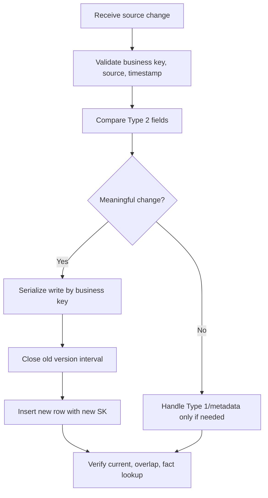
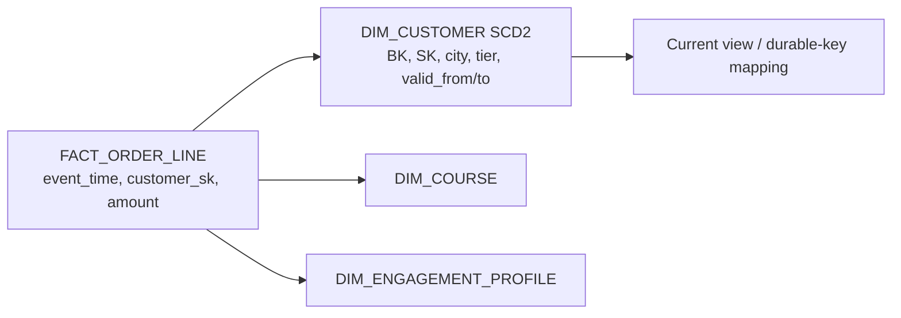

# Choosing History Storage Strategies by Attribute and Analytical Requirement

## 1. Why shouldn't one history strategy be applied to an entire dimension table?

In an analytical data warehouse, **dimension tables** describe the context of events recorded in fact tables: customers, products, instructors, courses, locations, or organizations. When a dimension attribute changes, the system must decide whether historical reports should show the **value that existed when the event occurred** or the **latest value**.

For example, a customer previously lived in Da Nang and has now moved to Hanoi. At the same time, a typo in the customer's display name was just fixed. These two fields must be handled differently:

- `city`: needs history preserved if reporting "revenue by city **when the transaction occurred**."
- `display_name`: may only overwrite the value if the old name was a data-entry typo and there is no need to analyze by name per period.
- `loyalty_tier`: may need both the tier **at purchase time** and the **current** tier.
- `balance_minor`: balance changes are usually **events or periodic snapshots (facts)**, rather than creating a new dimension version on every change.

These strategies are called **Slowly Changing Dimensions (SCD)**. The word "slowly" is a historical label: not every attribute changes slowly. The goal is to **choose the right way to store and interpret changes per attribute, driven by analytical questions**.

This lesson belongs to the **Dimension Tables** chapter within **DATABASE_DATA_MODELING**: practicing how to turn business requirements into clear data models, from entities, relationships, and constraints to keys, indexes, and physical schemas. When evaluating SCDs, we also need to understand the roles of relational, document, graph, and analytical models so designs can evolve and be verified.

**After this lesson, you will be able to:**

1. Distinguish historical reporting by the value **when the event occurred**, by the **current** value, and by what the warehouse **knew at time T**.
2. Choose SCD Type 0, 1, 2, 3, 4, and hybrid approaches for each attribute group.
3. Design business keys, surrogate keys, validity intervals, and fact–dimension relationships.
4. Write Type 2 load workflows with concurrency control, late-arriving data, and history corrections.
5. Avoid duplicating facts when joining versions, and build SQL queries for both historical and current perspectives.
6. Test constraints, figures, and storage/operational costs before locking down a schema.

## 2. Ask analytical users before choosing an SCD

The three questions below sound similar in plain language yet require different models.

| Question | Perspective | Which data must be kept? |
| --- | --- | --- |
| "January revenue by **customer's city at purchase**?" | **As-was** | Attribute accurate at transaction time |
| "All historical revenue to date by **customer's current city**?" | **As-is** | Current dimension value for all old facts |
| "On June 15, where did the report **know** the customer lived?" | **As-known-at** | When the system learned/recorded it and revision history |

The third question is not automatically answered by Type 2 using business valid time. If a change took effect on May 1 yet the warehouse received it on June 20, **valid time** and **system knowledge time** differ.

Before modeling, confirm:

- Did the attribute actually change, or was it merely a **data correction**?
- When re-running last month's report, do users expect results to **stay fixed** or are they allowed to **reclassify**?
- Are both **as-was and as-is** needed, or only one of the two?
- Do source records carry a reliable **effective date** or only a system update timestamp?
- Do old values carry legal/audit significance, or must they be purged under data retention policies?
- Does a field change **yearly**, **weekly**, or **every second**?

**Choose SCD per attribute and reporting contract**, not solely by rate of change.

## 3. Grain, business key, and surrogate key

### 3.1. Grain defines what "one dimension row" means

**Grain** is the meaning of each row:

- Type 1 dimension: typically **one row per current entity**.
- Type 2 dimension: typically **one row per version of an entity within a validity interval**.
- Mini-dimension: can be **one row per combination of attribute bands**, referenced by facts.

Example Type 2 customer dimension with business key `(tenant_id, customer_code)`.

| customer_sk | tenant_id | customer_code | city | valid_from | valid_to |
| ---: | --- | --- | --- | --- | --- |
| 101 | ORG-07 | C-001 | Da Nang | 2026-01-01 | 2026-06-01 |
| 205 | ORG-07 | C-001 | Hanoi | 2026-06-01 | *NULL* |

Both rows belong to **one customer** (same business key) yet have **two different version keys**.

### 3.2. Distinguishing keys

- **Business key (BK):** business identity, such as `(tenant_id, customer_code)`. Must have a clear source and uniqueness scope.
- **Surrogate key (SK):** technical key of **one dimension version row**, e.g., `customer_sk = 205`.
- **Durable key:** stable key across versions, either a normalized BK or an internal mapping key when sources change codes.
- **Fact foreign key:** typically points to the **SK of the version valid** at event time.

If customer `C-001` appears in two tenants, never join solely on `customer_code`. If email or name can change, they are not automatically durable business keys.

### 3.3. Why not join facts solely on BK?

A customer has three Type 2 versions. If each customer fact joins to the dimension on `customer_code` **without a temporal/current filter**, one fact matches **three rows** and triples the monetary amount.

Therefore, explicitly choose one of two paths:

1. Facts store `customer_sk` resolved at event time.
2. Facts store BK and queries apply **non-overlapping validity interval predicates** to select one version.

Path (1) is typically chosen in star schemas to keep analytical join paths simple and stable, though it requires ETL to assign SKs accurately.

## 4. Overview of SCD strategies

Type names are widely used in dimensional modeling; some extended labels vary across books and vendors, especially **Type 4/5/6/7**. On a project, **explicit behavioral definitions matter more than the Type number**.

| Storage approach | Rule | Useful when | Limitations |
| --- | --- | --- | --- |
| **Type 0 – Retain original** | Keep original value | Need original source/channel, initial characteristics | Requires exception-handling correction process if initial data was wrong |
| **Type 1 – Overwrite** | Overwrite old value | Error fixes, only current information needed | Loses attribute history inside the dimension |
| **Type 2 – New row** | Create new version with SK and validity interval | Analysis **"at event time"** | More rows, temporal lookups, late-arriving data handling |
| **Type 3 – Previous value** | Store current and one/few prior values | Comparing two defined checkpoints | History holds only a finite number of checkpoints |
| **Type 4 – Separate history / mini-dimension** | Separate history or rapidly changing attributes | Need to control version count on the main dimension | Additional tables, mappings, and ETL |
| **Type 6 – Hybrid (1+2+3)** | Combine historical versions with current/previous columns | Need both as-was and as-is simultaneously | Redundancy; must keep versions synchronized |
| **Type 7 – Dual perspective (reference)** | Provide both version key and durable key paths | As-was and as-is via two join paths | More complex facts/ETL |

**Type 4** is sometimes used to mean a **separate history table** and sometimes a **mini-dimension**. This lesson covers both and expects projects to document the exact implementation.

Not every field of `dim_customer` has to share the same Type. For instance, `display_name` can be Type 1, `city` Type 2, `first_acquisition_channel` Type 0, while `engagement_band` is split into a mini-dimension.

## 5. Type 0: retaining original values with business significance

**Type 0** suits an attribute where the **first confirmed value** is precisely what users want to analyze:

- First acquisition channel (*first acquisition channel*).
- Initial profile creation date.
- Original registration code governed by non-reuse rules.
- Cohort group at signup time.

Example:

```text
customer_code = C-001
first_acquisition_channel = Organic
```

The customer later returns via an ad. `first_acquisition_channel` remains Organic because it describes the **first touch**, not the **latest channel**.

Do not confuse "Type 0 does not change by business semantics" with "never fix bugs." If the initial channel was entered erroneously, the system needs an **authorized correction workflow**. Whether to retain a correction audit log is a separate governance decision.

If you want to analyze every marketing touchpoint, use a **touchpoint fact/event table**, rather than cramming an entire event sequence into a Type 0 attribute.

## 6. Type 1: fixing or overwriting the current value

**Type 1** updates an attribute **without creating version history solely because that field changed**.

For example, the name `"Ngyn An"` is a typo corrected to `"Nguyen An"`. If the business wants all reports to display the corrected name, Type 1 makes sense.

In a dimension that **also uses Type 2 on other fields**, Type 1 is typically applied across **all versions sharing the business key**:

```sql
-- Fix the name typo across all historical versions of the customer.
-- Does not generate a new customer_sk.
UPDATE dim_customer
SET customer_display_name = 'Nguyen An'
WHERE tenant_id = 'ORG-07'
  AND customer_bk = 'C-001';
```

If you only UPDATE the `is_current = true` row, old facts still see the misspelled name through historical Type 2 rows. That might be chosen deliberately for a different model, yet it **is no longer a consistent Type 1 interpretation** in this example.

### 6.1. Overwrites can alter old reports

If `sales_region` is Type 1 and a customer moves regions, re-running last year's report by region may **reclassify** revenue under the new region. This is *restatement*.

That may be valid for "cumulative revenue of customers currently in a region" yet wrong for "revenue generated in each region." Clarify the question before picking Type 1.

### 6.2. Type 1 does not mean abandoning auditability

Audit logs, CDC, or source history can still exist outside the dimension. Type 1 merely states that **the analytical dimension does not preserve versions of that attribute**. For names or prices locked on contracts/invoices, historical preservation may require an independent **transaction snapshot**.

## 7. Type 2: keeping versions across time intervals

**Type 2** creates a new row whenever an attribute **classified as Type 2** undergoes a meaningful change.

Suppose:

- `city` and `loyalty_tier` are Type 2.
- `customer_display_name` is Type 1.
- `first_acquisition_channel` is Type 0.

| customer_sk | customer_bk | city | loyalty_tier | valid_from | valid_to | is_current |
| ---: | --- | --- | --- | --- | --- | --- |
| 101 | C-001 | Da Nang | BRONZE | 2026-01-01 | 2026-04-01 | false |
| 175 | C-001 | Da Nang | SILVER | 2026-04-01 | 2026-06-01 | false |
| 205 | C-001 | Hanoi | SILVER | 2026-06-01 | NULL | true |

Dates and codes are illustrative examples for study, not real data.

### 7.1. Using half-open intervals

An easily verifiable convention is:

```text
valid_from <= event_time
AND (event_time < valid_to OR valid_to IS NULL)

That is, the interval [valid_from, valid_to).
```

An instant equal to `valid_to` belongs to the next version, preventing one event from matching two versions at a boundary.

Never assume `valid_from` means **warehouse load date**: determine whether it is **business effective time** or another agreed convention.

### 7.2. When should a new row be created?

- BRONZE → SILVER: **yes**, because tier is Type 2.
- Da Nang → Hanoi: **yes**, because city is Type 2.
- Fixing a display name typo: **no**, because name is Type 1.
- Pipeline rerunning with identical payload: **no**, if there is no meaningful Type 2 change.
- Load timestamp `loaded_at` changes: **no**, because technical metadata is not a Type 2 tracked attribute.

A `hashdiff` over Type 2 fields can aid change detection. Define how values, `null`, Unicode, date formats, and field sets are normalized; hashdiff does not on its own solve late-arriving history or flawed source semantics.

### 7.3. SKs must remain stable per version

A transaction fact on March 15 stores `customer_sk = 101`; May 15 stores `175`; July 15 stores `205`. Never alter the SK of an older row just because a new dimension version arrives.

If a historical correction takes effect mid-interval, you may need to **reassign dimension keys on stored facts**. That must be an explicit restatement procedure, not a silent side effect.

## 8. Type 2 table design and physical constraints

The example below uses **PostgreSQL** and a single table combining Type 0/1/2 attributes. On other warehouse engines, date/time types and constraint/index syntax may vary.

```sql
CREATE TABLE dim_customer (
    customer_sk bigint GENERATED ALWAYS AS IDENTITY PRIMARY KEY,
    tenant_id text NOT NULL,
    customer_bk text NOT NULL,

    customer_display_name text NOT NULL, -- Type 1
    first_acquisition_channel text,      -- Type 0
    city text,                           -- Type 2
    loyalty_tier text NOT NULL,          -- Type 2

    valid_from timestamptz NOT NULL,
    valid_to timestamptz,
    is_current boolean NOT NULL,

    source_system text NOT NULL,
    source_revision text,
    loaded_at timestamptz NOT NULL DEFAULT now(),

    CONSTRAINT customer_valid_interval
        CHECK (valid_to IS NULL OR valid_from < valid_to),
    CONSTRAINT customer_current_consistent
        CHECK (is_current = (valid_to IS NULL)),
    CONSTRAINT customer_tier_values
        CHECK (loyalty_tier IN ('BRONZE','SILVER','GOLD')),
    CONSTRAINT customer_bk_version_unique
        UNIQUE (tenant_id, customer_bk, valid_from)
);

-- At most one current version per business key.
CREATE UNIQUE INDEX customer_one_current
    ON dim_customer (tenant_id, customer_bk)
    WHERE is_current;

-- Lookup versions of a business key over time.
CREATE INDEX customer_temporal_lookup
    ON dim_customer (tenant_id, customer_bk, valid_from DESC);
```

### 8.1. Unique current still does not prevent overlapping historical intervals

Two rows:

```text
A: [2026-01-01, 2026-06-01)
B: [2026-04-01, 2026-05-01)
```

are both non-current, yet both are valid on April 15. Temporal fact JOINs will match two rows, causing **double-counted revenue**.

PostgreSQL can use an exclusion constraint when `btree_gist` is available:

```sql
CREATE EXTENSION IF NOT EXISTS btree_gist;

ALTER TABLE dim_customer
ADD CONSTRAINT customer_no_overlapping_versions
EXCLUDE USING gist (
    tenant_id WITH =,
    customer_bk WITH =,
    tstzrange(
        valid_from,
        COALESCE(valid_to, 'infinity'::timestamptz),
        '[)'
    ) WITH &&
);
```

Clean up bad intervals before adding the constraint. Some distributed warehouses do not support this constraint type; enforce it via pipeline checks and reconciliation tests. **Forbidding overlaps** also does not automatically guarantee **no gaps**. Gaps can be valid if there were periods when the entity did not exist, or bugs if the business requires continuous history.

### 8.2. NULL or a far-future end date?

Some systems store `valid_to = NULL`, while others use a far-future sentinel like `9999-12-31`. Both are workable conventions when consistent with data types and tooling. Never mix the two without a unified contract, as queries will easily drop current rows.

### 8.3. What extra metadata should be stored?

Beyond business fields, you may need:

- `source_system` and `source_revision` to identify the source version.
- `loaded_at` to know when the warehouse recorded it.
- `batch_id` or `pipeline_run_id` for retries/reconciliation.
- `change_reason` or `change_type` if reports must distinguish corrections from genuine changes.

Never confuse `loaded_at` with an attribute's effective date.

## 9. Transactional Type 2 load workflow

### 9.1. High-level flow



For data arriving in effective order, you can usually close the current row and insert the new current row in one transaction. For late-arriving data, you must **insert/split within historical intervals**, rather than simply closing current.

### 9.2. In-order SQL update example

Suppose the customer upgrades to GOLD starting 2026-09-01. After validating source revision, authoritative source, and ensuring the event hasn't been processed:

```sql
BEGIN;

-- Lock current row; must verify read result and date condition.
SELECT customer_sk, valid_from, city, loyalty_tier
FROM dim_customer
WHERE tenant_id = 'ORG-07'
  AND customer_bk = 'C-001'
  AND is_current = true
FOR UPDATE;

-- Update only when there is exactly one current row with valid_from
-- earlier than the transition timestamp.
UPDATE dim_customer
SET valid_to = TIMESTAMPTZ '2026-09-01 00:00:00+00',
    is_current = false
WHERE tenant_id = 'ORG-07'
  AND customer_bk = 'C-001'
  AND is_current = true
  AND valid_from < TIMESTAMPTZ '2026-09-01 00:00:00+00';

-- Example: insert only if the UPDATE above affected exactly one row
-- and the new state is confirmed from an authoritative source.
INSERT INTO dim_customer (
    tenant_id, customer_bk,
    customer_display_name, first_acquisition_channel,
    city, loyalty_tier,
    valid_from, valid_to, is_current,
    source_system, source_revision
)
VALUES (
    'ORG-07', 'C-001',
    'Nguyen An', 'Organic', 'Hanoi', 'GOLD',
    TIMESTAMPTZ '2026-09-01 00:00:00+00',
    NULL, true, 'CRM', 'revision-75'
);

COMMIT;
```

**Note:** this SQL snippet **illustrates the sequence of operations**, not a complete production stored procedure. It does not by itself verify `row_count` between UPDATE and INSERT; the application or real procedure must check and roll back if conditions are not met. When no current row exists yet, `FOR UPDATE` locks nothing for a non-existent BK. Add constraints, a per-BK lock point, isolation/retries, or proper write distribution.

### 9.3. Idempotency and concurrent data

If the GOLD event is redelivered, the pipeline must not create another GOLD row at the same or an arbitrary newer timestamp.

Protect with:

- Source IDs or revisions to detect already-processed events.
- Exact comparison of fields classified as Type 2.
- Non-overlapping interval enforcement.
- Safe retries that do not emit duplicate records.
- Coordination when two writers edit the same BK, including from different sources.

**SQL statement atomicity is not synonymous with event idempotency.**

## 10. Facts must point to the right dimension version

Suppose `fact_order_line` has grain **one line item in a confirmed order**, with:

```text
fact_order_line(
  order_line_id,
  tenant_id,
  occurred_at,
  customer_sk,
  course_sk,
  amount_minor
)
```

When loading a fact for May 15, ETL uses BK and event timestamp to resolve SK:

```sql
SELECT d.customer_sk
FROM dim_customer AS d
WHERE d.tenant_id = 'ORG-07'
  AND d.customer_bk = 'C-001'
  AND d.valid_from <= TIMESTAMPTZ '2026-05-15 12:00:00+00'
  AND (
      d.valid_to > TIMESTAMPTZ '2026-05-15 12:00:00+00'
      OR d.valid_to IS NULL
  );
```

By contract, the valid result is **one row**. Zero rows: classify as "late-arriving dimension," gap, or missing data; do not blindly bind to current. Multiple rows: overlap or bad lookup.

### 10.1. As-was analysis

```sql
SELECT
    d.city AS city_when_purchased,
    SUM(f.amount_minor) AS revenue_minor
FROM fact_order_line AS f
JOIN dim_customer AS d
  ON d.customer_sk = f.customer_sk
WHERE f.occurred_at >= TIMESTAMPTZ '2026-01-01 00:00:00+00'
  AND f.occurred_at <  TIMESTAMPTZ '2027-01-01 00:00:00+00'
GROUP BY d.city
ORDER BY revenue_minor DESC;
```

The fact keeps the SK from occurrence time, so when a customer relocates, old revenue does not shift groups automatically.

### 10.2. As-is analysis

To group **all historical facts by current city**:

```sql
SELECT
    current_d.city AS current_city,
    SUM(f.amount_minor) AS lifetime_revenue_minor
FROM fact_order_line AS f
JOIN dim_customer AS historical_d
  ON historical_d.customer_sk = f.customer_sk
JOIN dim_customer AS current_d
  ON current_d.tenant_id = historical_d.tenant_id
 AND current_d.customer_bk = historical_d.customer_bk
 AND current_d.is_current = true
GROUP BY current_d.city
ORDER BY lifetime_revenue_minor DESC;
```

These are **two different questions**, yielding different yet equally valid groupings. If a customer lacks a current row, the INNER JOIN in the as-is query above drops that customer's facts; define reporting rules for unknown/inactive customers.

### 10.3. Type 7 / dual key paths

One option supporting both as-was and as-is stores on the fact:

- The Type 2 version SK.
- A durable key or stable mapping path to the current entity.

This idea is commonly associated with **Type 7**. In return, ETL and keys must stay in sync, especially across merges/splits or tenant transfers. Storing two keys does not by itself resolve business key semantics or access controls.

## 11. Type 3: comparing current with a prior value

**Type 3** typically includes columns:

```text
customer_bk
current_segment
previous_segment
segment_change_at

C-001
PREMIUM
STANDARD
2026-07-01
```

This structure fits if the core question is "how many customers moved from STANDARD to PREMIUM after the re-segmentation campaign?". Yet when a customer subsequently moves PREMIUM → VIP, `previous_segment` becomes PREMIUM and STANDARD history is displaced.

Define **"previous"** explicitly:

- Value immediately before the latest change?
- Value from the prior reporting period?
- Value at campaign launch?
- Value before a named reclassification event?

Type 3 is only appropriate when **the number of historical checkpoints to retain is bounded and known upfront**. If reports need all changes or values at arbitrary timestamps, Type 2 or event history is better.

## 12. Type 4, mini-dimensions, and rapidly changing attributes

### 12.1. Type 4 as a separate history table

One implementation keeps a current table and stores history separately:

```text
dim_product_current:
  product_bk, current_name, current_category

dim_product_history:
  product_bk, effective_from, effective_to, category
```

Current reads become simpler; historical queries require temporal joins. You must define the source of truth, synchronization method, and historical keys. This is **not automatically equivalent to a single Type 2 dimension** since current and history are split into two structures.

### 12.2. Mini-dimensions for rapidly changing attribute groups

For example, a marketing profile updated weekly:

```text
dim_customer:
  customer_sk, customer_bk, city, loyalty_tier

dim_engagement_profile:
  profile_sk, engagement_band, activity_band, risk_band

fact_activity:
  activity_id, customer_sk, profile_sk, occurred_at, ...
```

Placing `engagement_band` into the customer's Type 2 table and updating it weekly can cause `dim_customer` row counts to explode. A mini-dimension separates **banded categorical attributes** with a manageable number of combinations, letting facts point to the band applicable at event time.

However, if each group value has near-infinite cardinality, a mini-dimension can also bloat. Continuous quantities like per-second balances, GPS coordinates, temperatures, or click counts belong in **facts/events/time-series** rather than SCD dimension attributes.

### 12.3. Estimating cost before choosing Type 2

```text
Approximate Type 2 rows =
  number of entities × average versions per entity

200,000 customers × 4 versions       =     800,000 rows
200,000 customers × 1,095 versions   = 219,000,000 rows
```

Numbers are illustrative; real data has skewed change distributions and multiple attributes may change in the same version. Still, if a field changes daily, question whether **SCD2 in the primary dimension is truly warranted**.

## 13. Type 6: combining history and current values

**Type 6** is often described as combining Type 1, 2, and 3. A common variant has:

- A new row when a historical attribute changes (Type 2).
- A field storing the **as-was** value on each version.
- A field storing the **current** value updated across all rows sharing the BK (Type 1).
- Optionally a previous value or comparison checkpoint per Type 3.

Example:

| customer_sk | city_as_was | city_current | valid_from | valid_to |
| ---: | --- | --- | --- | --- |
| 101 | Da Nang | Hanoi | 2026-01-01 | 2026-06-01 |
| 205 | Hanoi | Hanoi | 2026-06-01 | NULL |

A fact report joining on SK can pick `city_as_was` or `city_current`. Yet whenever `city_current` changes, **both old and new rows must be updated**, or an equivalent derived process must run.

**Trade-off:** Type 6 reduces some read-path joins, while increasing write redundancy and the risk of current columns drifting out of sync. With many versions per BK or frequent current updates, Type 7/current views can be easier to maintain.

Never use Type 6 merely because it "includes every Type"; prove both perspectives are queried often enough to justify synchronization costs.

## 14. Per-attribute decision matrix

The choices below are **conditional candidates**, not rigid rules.

| Attribute | If users need... | Suggested storage direction |
| --- | --- | --- |
| `customer.first_acquisition_channel` | First channel | **Type 0** |
| `customer.display_name` | Consistent display spelling fixes | **Type 1** |
| `customer.city` | City at purchase time | **Type 2** |
| `customer.current_city` | All revenue grouped by current city | **Type 1/current view/Type 6/7** |
| `customer.loyalty_tier` | Tier at transaction time | **Type 2** |
| `customer.previous_segment` | Single-step segment transition comparison | **Type 3** |
| `customer.engagement_band` | Weekly activity tier on facts | **Mini-dimension or snapshot fact** |
| `course.category` | Category at enrollment | **Type 2** if history is required |
| `course.title` | Latest canonical title after typo fixes | **Type 1** |
| `certificate.course_name_at_issue` | Name when certificate was issued | **Transaction snapshot** |
| `instructor.department` | Department when teaching | **Type 2** |
| `wallet.balance_minor` | End-of-day balance | **Periodic snapshot fact** |
| `course.view_count` | Hourly/daily views | **Fact/aggregate** |
| `created_at_source` | Original creation timestamp | **Type 0/metadata** |

**One field may need two representations** if reports ask two different questions. For instance, "course name at certificate issuance" is a certificate snapshot, whereas "current display course title" belongs in the current dimension.

### 14.1. Attribute decision contract

```yaml
attribute: customer.loyalty_tier
authoritativeSource: LoyaltyService
meaning: Tier effective under points-accumulation rules
asWasRequired: true
asIsRequired: true
effectiveTime: validated source_effective_at
chosenModel: SCD Type 2 + current view
factTimestamp: order_placed_at
lateArrivalPolicy: Insert/adjust validity interval, evaluate fact restatement
deduplication: Source event id or source revision
```

This document illustrates a modeling decision, **not a live system configuration**. It demonstrates that SCD choices must bind to **source, meaning, time, and query patterns**, rather than a standalone Type label.

## 15. Late-arriving data and historical corrections

### 15.1. Event effective in the past arriving at the warehouse today

The dimension currently holds:

```text
[2026-01-01, 2026-06-01) city = Da Nang
[2026-06-01, NULL)       city = Hanoi
```

On August 20, the source reports retroactively that the customer lived in **Hue from April 1 until the end of May**. The accurate business timeline is:

```text
[2026-01-01, 2026-04-01) city = Da Nang
[2026-04-01, 2026-06-01) city = Hue
[2026-06-01, NULL)       city = Hanoi
```

You cannot handle this by "closing current Hanoi and inserting current Hue," because Hue is a **past state**, not the current state.

You must:

1. Verify the authoritative source and reliable effective timestamps.
2. Identify the affected intervals.
3. Split/adjust intervals so none overlap.
4. Record correction lineage and historical keys.
5. Determine which facts in April 1–June 1 require **SK reassignment** or reinterpretation on query.
6. Verify before/after metrics; announce a restatement if published reports change.

**Editing the dimension alone does not automatically update foreign keys already stored on facts.** If a May 15 fact already references the old Da Nang SK, the restatement policy must govern how that fact is handled.

### 15.2. Facts arriving before dimensions

When a purchase fact arrives before the customer profile, options include:

- Route the fact to a holding/staging queue if SLAs permit.
- Create an **inferred member** with a trusted BK and stable SK, enriching attributes later.
- Assign an **Unknown SK** meaning "undetermined," then reconcile/restate once data arrives.

An Unknown SK must not be interpreted as **all facts missing customers belong to the same single customer**. An inferred member requires a genuine BK so each entity stays individually identified.

### 15.3. Type 2 and bitemporal are different

- **Business-valid time:** when the attribute was effective in the business.
- **System/load time:** when the system knew or ingested the information.

If a customer truly moved on April 1 yet the system only learned about it on August 20, the two time axes diverge. If you must answer "what did the data warehouse **know on May 1**?", business `valid_from/valid_to` alone is insufficient.

When both views are required, the design needs **bitemporal** tracking or system-recorded history able to retrieve superseded versions, rather than merely adding `loaded_at` to the current row and claiming every past known state can be rebuilt.

## 16. When should a fluctuation move to a fact instead of a dimension?

A common mistake is creating Type 2 rows for everything that changes.

- City name or membership tier: **descriptive attribute**, candidate for Type 2.
- Lesson clicks: **event**, belongs in a fact.
- Revenue per transaction: **measure**, belongs in a fact.
- End-of-day balance: **periodic snapshot fact**.
- Vehicle position every second: **time-series/event fact**.
- Lesson publication status: can be Type 2 if analyzing status at enrollment time, or an event log if every transition and actor detail is needed.

Ask: "Does this **describe an entity over a period** or **measure an event/state at each observation**?" If the latter, Type 2 can cause dimension explosion and poor lookup performance.

## 17. Validating Type 2 data

### 17.1. Test scenarios

| Scenario | Expected outcome |
| --- | --- |
| New entity | One new SK row, current, valid interval |
| Type 2 attribute changes | Close old row, open new row, no overlap |
| Only Type 1 field changes | No new Type 2 version created |
| Type 0 changed in source | Handle via correction workflow, do not auto-update |
| Same event redelivered | No duplicate version created |
| Two writers for one BK | Never produce two current rows or overlaps |
| Two changes on same effective timestamp | Clear ordering/resolution rule or quarantine |
| Late past-effective change | Insert/adjust proper interval, evaluate restatement |
| Fact finds no matching version | Unknown/inferred member/wait per policy |
| Source correction | Does not silently corrupt history and published facts |
| Matching BK in another tenant | Never merge entities |
| Multiple Type 2 rows for one BK | Queries never duplicate facts |
| Sensitive data in historical versions | Enforce access controls and retention policies |

### 17.2. Checking current row counts

```sql
SELECT
    tenant_id,
    customer_bk,
    COUNT(*) FILTER (WHERE is_current) AS current_count
FROM dim_customer
GROUP BY tenant_id, customer_bk
HAVING COUNT(*) FILTER (WHERE is_current) <> 1;
```

This query applies when the business requires **every existing BK to have exactly one current row**. Decommissioned entities may be valid exceptions; the contract must define them.

### 17.3. Checking overlapping intervals

In PostgreSQL, if the exclusion constraint from section 8 is in place, the DB blocks most overlap bugs on write. A simple diagnostic query can compare intervals:

```sql
SELECT
    a.tenant_id,
    a.customer_bk,
    a.customer_sk AS left_sk,
    b.customer_sk AS right_sk
FROM dim_customer AS a
JOIN dim_customer AS b
  ON a.tenant_id = b.tenant_id
 AND a.customer_bk = b.customer_bk
 AND a.customer_sk < b.customer_sk
WHERE tstzrange(
        a.valid_from,
        COALESCE(a.valid_to, 'infinity'::timestamptz),
        '[)'
      )
      &&
      tstzrange(
        b.valid_from,
        COALESCE(b.valid_to, 'infinity'::timestamptz),
        '[)'
      );
```

This is a logically thorough pairwise interval check, though it can be very costly on large datasets. Rely on proper constraints/indexes and test on representative data; do not run an unbounded self-join across production during peak traffic.

### 17.4. Checking facts missing dimensions

```sql
SELECT COUNT(*) AS missing_dimension_rows
FROM fact_order_line AS f
LEFT JOIN dim_customer AS d
  ON d.customer_sk = f.customer_sk
WHERE d.customer_sk IS NULL;
```

Checking orphan FKs does not prove the SK is **valid at fact time**. Also verify whether `f.occurred_at` falls inside the corresponding dimension row's validity interval under the chosen analytical rule.

**Operational metrics:** p50/p95/p99 versions per BK, overlap/gap counts, facts failing SK assignment, late-change volume, fact restatement frequency, lookup latency, and dimension/index storage growth.

## 18. Case study: course sales analyzed by tier and location

### 18.1. Requirements

A course-selling platform has:

- Customers with stable codes, belonging to a tenant.
- Names subject to typo fixes.
- City of residence changing over time.
- BRONZE/SILVER/GOLD tiers affecting discount analysis at purchase time.
- Dashboards needing **revenue by tier at purchase** and **lifetime revenue by current tier**.
- A certificate system capturing course title and issue timestamp.
- Marketing profiles with weekly-updated engagement levels.
- Some transactions and customer updates arriving at the warehouse a few days late.

### 18.2. Candidate design

| Data element | Choice | Rationale |
| --- | --- | --- |
| Customer ID and tenant | Stable business key | Invariant across profile changes |
| Customer name | Type 1 | Error fixes, no dimension history needed |
| City of residence | Type 2 | As-was analysis |
| Loyalty tier | Type 2 | Must know tier at purchase |
| Current tier | Current view/Type 6/7 | As-is needed |
| First acquisition channel | Type 0 | Initial attribute by definition |
| Weekly engagement band | Mini-dimension or snapshot fact | Avoid multiplying dim_customer versions |
| Course title at certificate issuance | Snapshot on certificate | Does not follow subsequent renames |
| Locked price and payment amount | Transaction fact/snapshot | Measures, not Type 2 |
| Pipeline load timestamp | Metadata | Does not replace business-valid time |



### 18.3. Two distinct reports

**Tier at purchase:**

```sql
SELECT d.loyalty_tier, SUM(f.amount_minor) AS revenue_minor
FROM fact_order_line AS f
JOIN dim_customer AS d
  ON d.customer_sk = f.customer_sk
GROUP BY d.loyalty_tier;
```

**Current tier across all historical transactions:**

```sql
SELECT c.loyalty_tier, SUM(f.amount_minor) AS revenue_minor
FROM fact_order_line AS f
JOIN dim_customer AS historical_d
  ON historical_d.customer_sk = f.customer_sk
JOIN dim_customer AS c
  ON c.tenant_id = historical_d.tenant_id
 AND c.customer_bk = historical_d.customer_bk
 AND c.is_current = true
GROUP BY c.loyalty_tier;
```

The two queries can return different revenue breakdowns while **both being right by definition**. Never replace the first report with the second merely because current is easier to look up.

### 18.4. Test scenario

- March 15: customer is in Da Nang, BRONZE, buys course A.
- April 1: upgrades to SILVER.
- May 15: buys course B.
- June 1: moves to Hanoi.
- July 15: buys course C.
- August 20: source sends correction: customer was in Hue from May 1 until before June 1.

Question: which city must the May 15 transaction bind to after the correction? If the fact already references the old SK, does the system update it automatically? Can a published report be altered? These decisions must live in the **temporal and restatement policy**.

### 18.5. Self-check questions

1. Why can Type 1 `customer_display_name` and Type 2 `city` coexist in the same dimension?
2. If you only fix the name on the current row, which name will old facts reading historical SKs see?
3. How can joining facts on BK without specifying a version make total revenue wrong?
4. Should per-second balances go into Type 2? If not, what should be used?
5. Can a single `previous_segment` column satisfy a requirement to view 12 tier changes?
6. If a change arrives with an effective date from last month, how must historical intervals and facts be affected?
7. When both as-was and as-is values are required, what trade-offs exist between Type 6 and Type 7?
8. How does an Inferred member differ from an Unknown member?
9. Why is `loaded_at` insufficient to reconstruct complete as-known-at history?
10. What kinds of personal data should not be retained indefinitely across Type 2 versions?

## 19. Selection workflow and checklist

### 19.1. Decision process

1. **List query shapes:** as-was, as-is, prior-period comparison, as-known-at, official documents.
2. **Define grain:** one current entity, one effective version, one fact, or a snapshot?
3. **Choose BK, SK, and scope:** tenant/source, durable identifier, and version key.
4. **Classify each attribute:** semantics, authoritative source, required history, change frequency, sensitivity.
5. **Assign strategy:** Type 0/1/2/3; if rapidly changing consider mini-dimension/fact; if dual perspectives are needed consider Type 6/7 or views.
6. **Define time:** validity source, half-open bounds, current indicator, system load time, and timezone.
7. **Design fact SK assignment:** point-in-time lookup, handling missing or late arrivals.
8. **Place constraints:** unique current, non-overlap, event deduplication checks, and isolation.
9. **Measure and reconcile:** report totals, version counts, history growth, late arrivals, fact restatements.
10. **Document the contract:** who owns SCD rules, conditions for editing history, data sources, and report interpretation.

### 19.2. Pre-approval checklist

- [ ] Every attribute has clear analytical questions and **change semantics**.
- [ ] Type 1 corrections are distinguished from Type 2 business changes.
- [ ] Type 0 has an exception-correction workflow.
- [ ] One Type is not forced onto the entire table when attributes have different needs.
- [ ] BK carries tenant/source scope; SK is stable per version.
- [ ] Type 2 consistently uses half-open intervals `[valid_from, valid_to)`.
- [ ] Current row, overlaps, and gaps are controlled per business rules.
- [ ] Facts point to the point-in-time SK rather than joining all versions.
- [ ] As-was and as-is queries are designed, named, and tested separately.
- [ ] Late-arriving data and history edits have a fact restatement policy.
- [ ] Source time, effective time, and warehouse load time are never conflated.
- [ ] Rapidly changing attributes are re-evaluated as mini-dimensions or facts.
- [ ] Type 3 explicitly defines the previous checkpoint and number of retained states.
- [ ] Type 6/7 has synchronization rules preventing current values from drifting.
- [ ] Concurrency, retries, duplicates, and late historical changes are tested.
- [ ] Historical versions obey access controls and retention/deletion policies.
- [ ] Storage size, p95/p99 version counts, lookup latency, and orphan fact errors are measured.
- [ ] All Type choices are documented in the model spec with rationale.

**Key takeaway:** There is no single history storage strategy right for every attribute. **Type 0 retains original values, Type 1 overwrites, Type 2 creates temporal versions, Type 3 stores bounded comparison checkpoints, Type 4/mini-dimensions separate volatile data, and Type 6/7 support dual historical/current perspectives.** Choices must stem from analytical questions, grain, data sources, effective time, and how facts reference dimensions — then be verified with SQL, constraints, and real data.
