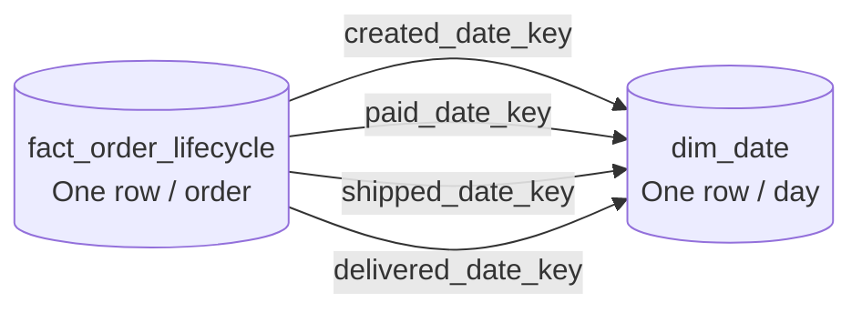

# Date Dimension, Time Dimension, and Role-Playing Dimensions

## Learning Objectives

After this lesson, you will be able to:

- Explain the **date dimension**, **time-of-day dimension**, and **role-playing dimension** in a star schema analytical model.
- Distinguish a **calendar date**, a **local time**, an **instant**, and a **duration**; know when to keep UTC timestamps in the fact table.
- Design the grain, keys, calendar attributes, date range, and special members of a date dimension to support weekly, monthly, quarterly, and fiscal year reporting.
- Create relationships from multiple **business milestones** of a fact table to the **same date dimension** while avoiding role confusion in SQL, the semantic layer, and dashboards.
- Use the same date dimension for **order creation date, payment date, ship date, and delivery date**; calculate processing durations using instants rather than subtracting date keys.
- Handle data that has not occurred yet, is not applicable, or is unknown; handle timezone conversions, late-arriving events, daylight saving time (DST), and organization-specific calendars.
- Evaluate when a time-of-day dimension at minute/second grain is needed, when a timestamp alone suffices, and when region-dependent business calendars are required.
- Verify the model using foreign keys, row counts, boundary dates, join fan-out prevention, calendar tests, and KPI accuracy.

In the **DATABASE_DATA_MODELING** module, translating business requirements into entities, relationships, constraints, keys, indexes, and physical schemas must serve real analytical questions. In the **Dimension Tables** chapter, the date dimension and time dimension are structures that appear in almost every reporting model; however, having multiple date fields in a fact table does not mean duplicating the same calendar table into multiple physical tables. We can let a single dimension **play multiple roles**, with each role representing a clear business relationship.

---

## 1. Four Time Concepts That Must Not Be Equated

Suppose order `ord_908` is created at:

```text
UTC instant:       2026-11-22T18:30:00Z
In Vietnam:        2026-11-23 01:30:00 +07:00
In Los Angeles:    2026-11-22 10:30:00 -08:00
```

**It is the same point in time**, yet the calendar date depends on the timezone. If the Vietnam shop's dashboard aggregates by local business date, this order belongs to **November 23**. If the dashboard aggregates by UTC date, it belongs to **November 22**.

We must separate:

| Concept | Meaning | Example | Impact on the model |
| --- | --- | --- | --- |
| **Instant** | A point on the absolute timeline | `2026-11-22T18:30:00Z` | Store UTC/appropriate timestamp type to compute ordering and latency |
| **Calendar Date (LocalDate)** | A date in a specific calendar and region/context | `2026-11-23` in Vietnam | Join date dimension; aggregate by day/week/month |
| **Time of Day (LocalTime)** | Position on the clock within a day, without a timezone | `01:30:00` | Join time dimension to analyze by shift or time slot |
| **Time Zone (ZoneId)** | Rule set mapping an instant to local date/time, including DST transitions if any | `Asia/Ho_Chi_Minh` | Needed when deriving business date/time from an instant |
| **Duration** | Amount of time between two instants | 90 minutes | Use timestamps/instants; do not subtract `date_key` integers |

A calendar date does not contain enough information to know the **exact point in time**. A local time also does not determine an instant without a date, a timezone, and in some cases offset/DST overlap disambiguation.

**Rule:** when the source provides reliable timestamps, keep the authoritative timestamp/instant in the fact or normalization layer; the date/time dimension is a **way to interpret and group time for analysis**, and should not replace all source timestamps.

## 2. What Is a Date Dimension and What Problem Does It Solve?

A **date dimension** is a table describing **calendar dates** over a chosen range, with **one row per day** in a defined calendar system/context.

Example:

| date_key | full_date | calendar_year | calendar_month | day_of_month | iso_week_year | iso_week_no | weekday_iso | is_weekend |
| ---: | --- | ---: | ---: | ---: | ---: | ---: | ---: | --- |
| 20261122 | 2026-11-22 | 2026 | 11 | 22 | 2026 | 47 | 7 | true |
| 20261123 | 2026-11-23 | 2026 | 11 | 23 | 2026 | 48 | 1 | false |
| 20261124 | 2026-11-24 | 2026 | 11 | 24 | 2026 | 48 | 2 | false |

One row for November 23 can be used to group data by **Monday**, **ISO week 48**, **November**, or **year 2026** without each analyst having to write and maintain separate calendar expressions.

### 2.1. Why Not Just Use the DATE Function in Every Query?

If you only need to count events by UTC date, an expression extracting the date from a timestamp might suffice. However, a date dimension table adds value when:

- A **consistent calendar definition** is needed across multiple facts and dashboards.
- Reporting is required by **ISO week, fiscal year, 4-4-5 period, or business week**.
- You need to **display days with zero transactions** as rows with a 0 count.
- You need to distinguish **business days, weekends, and local holidays**.
- You want year/quarter/month filters with correct, consistent ordering across BI tools.
- You need to join multiple date milestones of a fact table with meaningful role names.
- You want labels and time structures that do not depend on each tool's specific date function syntax.

The benefit lies in the **calendar contract** and reusability, not in how many columns the table has.

### 2.2. Grain of the Date Dimension

Basic grain:

> **One row of `dim_date` = one specific day in the chosen Gregorian calendar.**

This differs from:

- A day **by shop and timezone**: may share the same `full_date` while holidays/shifts vary by shop.
- A **fiscal day by calendar version** if the enterprise operates multiple distinct calendars.
- An **hour** or an **instant**: neither is the grain of `dim_date`.

If the system has only one shared calendar, `dim_date` can act as a **conformed dimension** used across all facts. If there are multiple fiscal calendars or regions, region/calendar-dependent attributes should be separated rather than silently treated as common attributes for every date.

## 3. Recommended Attributes in a Date Dimension

A useful date dimension typically includes these attribute groups:

| Group | Example fields | Purpose |
| --- | --- | --- |
| Identity | `date_key`, `full_date` | Join facts and verify one row per day |
| Standard calendar | `calendar_year`, `calendar_quarter`, `calendar_month`, `day_of_month` | Report by calendar units |
| Week | `iso_week_year`, `iso_week_no`, `weekday_iso` | Report by ISO week and day of week |
| Period start/end | `month_start_date`, `month_end_date`, `is_month_end` | Period filtering/ordering, snapshots |
| Day characteristics | `is_weekend` per a consistent rule | Workday/workhour reporting |
| Labels | `month_name_vi`, `weekday_name_vi` | Display only; do not use labels for sorting |
| Fiscal calendar | `fiscal_year`, `fiscal_period`, `fiscal_week` | Financial reporting when there is **one defined calendar** |
| Custom business calendar | `is_business_day`, `holiday_name` by region | Should be separated if dependent on region and calendar |

Store **numeric codes for sorting** rather than relying on label strings: months ordered 1–12, weekdays 1–7, year-week as a combined sort key. Labels like “Thứ hai” or “Monday” depend on locale, but ordering should not depend on alphabetical order.

### 3.1. ISO Week Does Not Pair with Calendar Year

The ISO week system starts on **Monday**. The first ISO week of the year is the week containing the **first Thursday** of that year. Therefore, the **ISO week-year** can differ from the calendar year at year boundaries.

Example:

```text
Date:            2021-01-01 (Friday)
calendar_year:   2021
iso_week_year:   2020
iso_week_no:     53
```

If a dashboard groups by `calendar_year, iso_week_no` instead of `iso_week_year, iso_week_no`, the beginning and end of the year can be placed into the wrong week or merge unrelated weeks.

For weekly reporting, provide an explicit key or combination:

```text
iso_year_week = "2020-W53"
sort_key      = 202053
```

The number `202053` is only a sort/label key for the **ISO week**, not a calendar date.

### 3.2. Fiscal Calendars May Not Match the Gregorian Calendar

An enterprise may start its fiscal year in April or use a **4-4-5** calendar (4 weeks, 4 weeks, 5 weeks for three consecutive periods). Under a 4-4-5 structure:

- Fiscal periods do not align with Gregorian calendar months.
- Some years require a **53rd week** according to a company-approved rule.
- Period start and end dates depend on the specific calendar and active version.
- Different business units in a corporate group may use different calendars.

Do not assume `fiscal_period = calendar_month` without an official definition from Finance. You need a date-to-fiscal-period mapping table from an authoritative source, validated to have no gaps or overlaps.

### 3.3. Holidays Depend on Region, Not Absolute Date Attributes

September 2 (`02/09`) may be a public holiday under Vietnamese policy, but that does not make it a holiday for every shop globally. Even within one country, business days can vary by region, organization, and shift.

If local calendars are needed, use a bridge table:

```text
bridge_date_business_calendar:
  (date_key, calendar_id, calendar_version)
  -> is_business_day, holiday_code, holiday_name, working_hours
```

This table has a grain of **one day per calendar/version**. That keeps `dim_date` free of endlessly expanding columns like `holiday_vietnam`, `holiday_us`, `holiday_shop_17` and prevents specific attributes from being mistaken as universal across all data.

## 4. Date Dimension Key: Surrogate Key or Meaningful Date Code?

There are two common options.

### 4.1. Numeric Key in YYYYMMDD Format

Example:

```text
date_key   = 20261123
full_date  = DATE '2026-11-23'
```

Pros:

- Easy to read when debugging.
- Can be derived from a normalized date during ETL/ELT.
- Numeric ordering of **valid date keys** in the same calendar system matches chronological order.
- Convenient for partitioning certain fact tables by date in supporting engines.

Cons:

- Not a contiguous integer sequence; `20261130 + 1` is not December 1.
- Cannot represent **not yet occurred**, **not applicable**, or **unknown** states without reserving special keys.
- Using a smart key does not replace FK checks against the date dimension table.
- A date-encoded key becomes awkward if the dimension grain ever changes to date–calendar or date–region.

### 4.2. Meaningless Surrogate Key

For example, `date_sk = 10123` for `full_date=2026-11-23`. This is a surrogate key that does not encode the date. Its advantage is decoupling physical identity from encoding. Its disadvantage is that pipelines require a key lookup, and it is harder to read by eye.

**Design recommendation:** both approaches can be valid. For a shared, stable one-row-per-day date dimension, a `YYYYMMDD` key is often convenient; for architectures with multiple calendar versions or warehouse-wide surrogate key standards, a meaningless key may fit better. More important than the key encoding choice are **grain, uniqueness, calendar coverage, and FKs**.

### 4.3. Do Not Perform Arithmetic Directly on date_key

Wrong:

```sql
-- Wrong: adding 1 does not mean moving to the next day.
SELECT date_key + 1 AS next_day_key
FROM dim_date;
```

Conceptually right:

```sql
-- Conceptual SQL illustration: add days using the DATE type.
SELECT
    d.date_key,
    d.full_date,
    next_day.date_key AS next_day_key
FROM dim_date AS d
LEFT JOIN dim_date AS next_day
  ON next_day.full_date = d.full_date + INTERVAL '1' DAY;
```

Interval addition syntax varies across DBMSs, but the principle is to use **date arithmetic**, never integer addition on the key representation.

## 5. Reference Schema for the Date Dimension

The DDL example uses generic SQL types; certain constraints and types should be adjusted for your target warehouse or BI tool.

```sql
CREATE TABLE dim_date (
    date_key            INTEGER PRIMARY KEY,
    full_date           DATE NOT NULL UNIQUE,

    calendar_year       INTEGER NOT NULL,
    calendar_quarter    SMALLINT NOT NULL,
    calendar_month      SMALLINT NOT NULL,
    day_of_month        SMALLINT NOT NULL,

    weekday_iso         SMALLINT NOT NULL,
    iso_week_year       INTEGER NOT NULL,
    iso_week_no         SMALLINT NOT NULL,

    month_start_date    DATE NOT NULL,
    month_end_date      DATE NOT NULL,
    is_month_end        BOOLEAN NOT NULL,
    is_weekend          BOOLEAN NOT NULL,

    month_name_vi       VARCHAR(30) NOT NULL,
    weekday_name_vi     VARCHAR(30) NOT NULL
);
```

In systems that use negative special keys, a `full_date NOT NULL` constraint makes an “Unknown date” row invalid. There are two design options:

1. Allow `full_date NULL` for special members and other non-applicable attributes; keep `date_key` unique.
2. Use a different structure/contract for unknown states and use nullable FKs in the fact table if downstream tools handle them cleanly.

Choose **a single convention** before implementation. This lesson uses Option 1 in the unknown/pending examples; the DDL above illustrates only the **valid calendar date rows**, excluding special rows. When deploying alongside special rows, relax `NOT NULL` appropriately or handle them via the agreed mechanism.

### 5.1. Populating the Date Dimension

`dim_date` is typically **pre-generated** for a sufficiently wide range, such as 2020–2040, rather than only containing dates where transactions have occurred.

Procedure:

```text
for each calendar day d in [2020-01-01, 2040-12-31]:
    date_key = YYYYMMDD(d)
    calendar_year = year(d)
    calendar_month = month(d)
    day_of_month = day(d)
    weekday_iso = weekday(d)  # Monday=1 ... Sunday=7
    iso_week_year, iso_week_no = isoWeek(d)
    month_start_date = firstDayOfMonth(d)
    month_end_date = lastDayOfMonth(d)
    is_weekend = weekday_iso in {6, 7}  # per the illustrative convention
    writeOneRowFor(d)
```

Compute values using a **reliable calendar library**, not by writing `day_of_year / 7` formulas to guess the week. Generating rows even for days with no transactions allows reports to show “zero-activity days” and prevents gaps in time-series analysis.

### 5.2. Constraints to Verify

- `date_key` is unique.
- `full_date` is unique across real date rows.
- There is **exactly one row per day** in the supported range, including leap days.
- `calendar_quarter = 1..4`, `calendar_month = 1..12`.
- `weekday_iso = 1..7` and `iso_week_no` is valid for the corresponding ISO week-year.
- `month_start_date <= full_date <= month_end_date`.
- Every fact using a real `date_key` finds a matching row.
- There is no row for `2026-02-29` because 2026 is not a leap year; `2024-02-29` exists.

Do not check only row counts: a date set could miss one day and duplicate another while still having the same total row count.

## 6. Time Dimension: Time of Day Differs from Calendar Date

In a star schema, a **time dimension** usually means a **time-of-day dimension**: one row per minute or second on the clock, not one row per instant in history.

Example at **one-second-of-day** grain:

| time_key | hour_24 | minute_no | second_no | time_text | quarter_hour | day_part |
| ---: | ---: | ---: | ---: | --- | ---: | --- |
| 0 | 0 | 0 | 0 | 00:00:00 | 1 | NIGHT |
| 5400 | 1 | 30 | 0 | 01:30:00 | 7 | NIGHT |
| 45296 | 12 | 34 | 56 | 12:34:56 | 51 | AFTERNOON |
| 86399 | 23 | 59 | 59 | 23:59:59 | 96 | NIGHT |

Here:

\[
time\_key = hour \times 3600 + minute \times 60 + second
\]

A standard day has `24 × 60 × 60 = 86,400` **clock time values at second grain**, so valid keys are `0..86399`. This is the number of **seconds since 00:00:00 on the local clock**, not seconds since the UTC epoch.

Note that categorization columns like `day_part` have no universal definition. NIGHT/MORNING/AFTERNOON/EVENING buckets must be confirmed with the business; shifts may vary by store and change by day.

### 6.1. Hour, Minute, or Second Grain?

| Time dimension grain | Clock rows/day | Use when | Trade-off |
| --- | ---: | --- | --- |
| Hourly | 24 | Reporting order counts by hour | Cannot distinguish minutes and seconds |
| Minute | 1,440 | Minute-level charts, operating hour intervals | Loses seconds unless kept in the fact table |
| Second | 86,400 | Second-level time-of-day analysis | More rows, though still small compared to large fact tables |
| Millisecond | 86,400,000 | Very rarely needed as a dimension | Large table; usually better to keep timestamp/epoch in the fact |

If the fact table has millisecond-precision timestamps, you can still join `dim_time` at **minute/second** grain for grouping while retaining the raw timestamp for exact duration calculations. **Do not force every instant precision into dimension row count.**

### 6.2. Reference DDL for the Time-of-Day Dimension

```sql
CREATE TABLE dim_time_of_day (
    time_key       INTEGER PRIMARY KEY,
    hour_24        SMALLINT NOT NULL,
    minute_no      SMALLINT NOT NULL,
    second_no      SMALLINT NOT NULL,
    time_text      VARCHAR(8) NOT NULL,
    quarter_hour   SMALLINT NOT NULL,

    CHECK (hour_24 BETWEEN 0 AND 23),
    CHECK (minute_no BETWEEN 0 AND 59),
    CHECK (second_no BETWEEN 0 AND 59),
    CHECK (time_key BETWEEN 0 AND 86399)
);
```

Add a constraint or test:

```text
time_key == hour_24*3600 + minute_no*60 + second_no
```

`time_key=0` is a **valid midnight**, so to represent “unknown time”, never use `0` as a sentinel. You can reserve `-1` for unknown and `-2` for not applicable per contract, relaxing the CHECK constraints as needed for special rows.

### 6.3. When Is a Time Dimension Not Needed?

If reports only ask for “sales by day” without shift or time-slot analysis, `order_completed_at_utc` and `completed_date_key` may be enough. Adding `dim_time` without a concrete access pattern increases FKs, conversion logic, and testing without delivering value.

When analysis by **local time of day** is required, `dim_time` becomes useful: BI tools can group events from multiple days into a single clock bucket using shared `hour_24` or `day_part` classifications.

## 7. Time Zones and Daylight Saving Time: Date/Time Dimensions Alone Are Not Enough

A very common mistake is taking `DATE(timestamp_utc)`, joining `dim_date`, and calling it the shop's “business date”. That is only correct when the contract uses **UTC** dates or when the warehouse has already converted the timestamp to the right timezone.

### 7.1. Recommended Mapping Rule

Suppose the contract requires analysis by the **shop's effective timezone at the time of the event**.

```text
source:
  orderId = ord_908
  completedAtUtc = 2026-11-22T18:30:00Z
  shopTimeZoneId = Asia/Ho_Chi_Minh

transformation:
  completedLocal = 2026-11-23T01:30:00+07:00
  completed_date_key = 20261123
  completed_time_key = 5400
```

If a shop changes its operating timezone or moves locations, use an **effective-dated shop → timezone mapping** rather than applying the current timezone to recalculate all historical events unintentionally.

Java example illustrating the conversion logic:

```java
import java.time.Instant;
import java.time.LocalDate;
import java.time.LocalTime;
import java.time.ZoneId;
import java.time.ZonedDateTime;

Instant completedAt = Instant.parse("2026-11-22T18:30:00Z");
ZoneId businessZone = ZoneId.of("Asia/Ho_Chi_Minh");

ZonedDateTime local = completedAt.atZone(businessZone);
LocalDate localDate = local.toLocalDate();
LocalTime localTime = local.toLocalTime();

int completedDateKey =
        localDate.getYear() * 10000
        + localDate.getMonthValue() * 100
        + localDate.getDayOfMonth();

int completedTimeKey = localTime.toSecondOfDay();

// completedDateKey = 20261123
// completedTimeKey = 5400
```

This code processes a known UTC instant; that case has a deterministic mapping. If the source only provides a **local timestamp without an offset/zone** around a DST transition, the problem is harder and requires a disambiguation contract.

### 7.2. DST Can Cause Local Times to Repeat or Not Exist

In regions observing DST:

- When **clocks spring forward**, certain local times **do not exist** on the transition day.
- When **clocks fall back**, certain local times occur **twice**, corresponding to two distinct instants/offsets.

Therefore:

```text
(date_key, time_key)  # local date + local time
```

**is not always a unique identifier of an event instant**. During a repeated DST hour, two transactions occurring at different instants can share the same `date_key` and `time_key`.

To distinguish them, the fact table should retain:

- Original UTC timestamp/instant.
- The IANA timezone ID used for interpretation, or a reference to the effective timezone configuration.
- Actual offset if point-in-time auditing is required.
- Stable event/transaction ID.

Do not rely on an unzoned `LocalDateTime` as the sole source for global events. For data marts computing local business days, test DST transition days rather than assuming every local day has exactly 24 elapsed hours.

### 7.3. Holidays and Shifts Can Be Shop-Specific

Converting to a timezone only determines `local_date` and `local_time`. It does not tell you whether the shop is open, whether that day is a holiday, or how long the morning shift lasts. Those factors may require:

```text
shop_calendar_mapping:
  (shop_id, valid_from, valid_to, calendar_id, timezone_id)

bridge_date_calendar:
  (calendar_id, date_key, calendar_version)
  -> holiday_flag, business_day_flag, opening_rule
```

If an evening shift spans midnight, a “sales shift” report may assign a 00:30 transaction to the **previous operating day** per store rules; this operating day can differ from the local calendar date. In that case, you need a **business_date_key** derived from shift rules, not merely from `LocalDate`.

## 8. What Is a Role-Playing Dimension?

A **role-playing dimension** is a **single physical dimension table or shared dimension definition** referenced by a fact table under **multiple semantically distinct roles**.

For example, an order has four milestones:

- **Order creation date** (*order date*).
- **Payment date** (*payment date*).
- **Ship date** (*ship date*).
- **Delivery date** (*delivery date*).

All four are **calendar dates**, so they can use a single `dim_date`. However, they cannot share one generic `date_key` column because each column answers a different question.



In SQL, these four relationships are typically expressed using **four aliases** of the same table. In the BI/semantic layer, you can define **four logical roles**, such as “Created Date”, “Paid Date”, “Shipped Date”, and “Delivered Date”.

### 8.1. No Need for Four Physical Copies of the Date Dimension

A tempting mistake:

```text
dim_order_date
dim_payment_date
dim_ship_date
dim_delivery_date
```

If all four share the exact same Gregorian/ISO logic and date range, four separate physical tables only increase the risk of drift:

- `dim_ship_date` misses `2028-02-29` while another table has it.
- ISO weeks are calculated differently across tables.
- Month names or fiscal calendars are updated inconsistently.

You can create **views or logical aliases** per role in the semantic layer while the underlying data still comes from **one conformed `dim_date`**. If calendar rules genuinely differ by role (for instance, delivery date depends on a national carrier calendar), model that difference in a **calendar mapping/bridge or business rule** instead of silently duplicating dates into four independent tables.

### 8.2. The Same Date Can Play Multiple Roles

An order created and paid on the same day:

```text
created_date_key = 20261123
paid_date_key    = 20261123
```

Having identical keys does not mean the two business events are the same. They remain **two distinct roles**, needing separate column names and metrics.

Conversely, an order created on November 23, paid on November 24, and delivered on November 27 has three different `date_key` values. Never pick one “generic order `date_key`” to stand in for all milestones.

## 9. Designing an Order Lifecycle Fact with Multiple Dates

Define the grain first:

> **`fact_order_lifecycle` has one row per order in a shop.**

This is an **accumulating snapshot fact**: one row is inserted when an order appears and updated as workflow milestones complete. It differs from an event fact whose grain is **one row per status change**.

### 9.1. Reference DDL

The tables below use the `YYYYMMDD` convention for valid date keys and special keys established in `dim_date`. For FKs pointing to special members to work, `dim_date` must use a schema compatible with special rows (do not use the Section 5 DDL verbatim if `full_date` is `NOT NULL`).

```sql
CREATE TABLE fact_order_lifecycle (
    shop_id             VARCHAR(40) NOT NULL,
    order_id            VARCHAR(40) NOT NULL,

    created_date_key    INTEGER NOT NULL,
    paid_date_key       INTEGER NOT NULL,
    shipped_date_key    INTEGER NOT NULL,
    delivered_date_key  INTEGER NOT NULL,

    created_at_utc      TIMESTAMP,
    paid_at_utc         TIMESTAMP,
    shipped_at_utc      TIMESTAMP,
    delivered_at_utc    TIMESTAMP,

    currency_code       CHAR(3) NOT NULL,
    gross_minor         BIGINT NOT NULL,
    status_code         VARCHAR(24) NOT NULL,

    PRIMARY KEY (shop_id, order_id),

    FOREIGN KEY (created_date_key) REFERENCES dim_date(date_key),
    FOREIGN KEY (paid_date_key) REFERENCES dim_date(date_key),
    FOREIGN KEY (shipped_date_key) REFERENCES dim_date(date_key),
    FOREIGN KEY (delivered_date_key) REFERENCES dim_date(date_key)
);
```

**Note:** `TIMESTAMP` with or without timezone and UTC storage semantics vary across DBMSs. In systems that support it, use an appropriate instant/timestamptz type with an explicit UTC convention; do not assume the SQL keyword above behaves identically across all engines.

If you need local time-of-day analysis for each milestone, you can add:

```text
created_time_key
paid_time_key
shipped_time_key
delivered_time_key
```

along with FKs to `dim_time_of_day`, or store time keys only for milestones actually used by dashboards. Not every fact needs to double its time FK columns.

### 9.2. Four Aliases in One Query

Example counting orders by **creation month** and **delivery month**, excluding undelivered orders:

```sql
SELECT
    created.calendar_year  AS created_year,
    created.calendar_month AS created_month,
    delivered.calendar_year  AS delivered_year,
    delivered.calendar_month AS delivered_month,
    COUNT(*) AS order_count
FROM fact_order_lifecycle AS f
JOIN dim_date AS created
  ON created.date_key = f.created_date_key
JOIN dim_date AS delivered
  ON delivered.date_key = f.delivered_date_key
WHERE f.delivered_date_key > 0
GROUP BY
    created.calendar_year,
    created.calendar_month,
    delivered.calendar_year,
    delivered.calendar_month;
```

`created` and `delivered` are **two aliases for the same table** in the SQL query, not two tables with independent contents.

To get only “orders created in November”, filter on the **created date alias**. To get only “orders delivered in November”, filter on the **delivered date alias**. Changing the alias changes the **KPI meaning**, even though the query remains syntactically valid.

### 9.3. Does This Fact Preserve Status History?

Not completely. When an accumulating snapshot updates `status_code`, it usually reflects only the current status and finalized milestones. If you need “what status was the order in at 10:00 yesterday?” or “how many failed delivery attempts occurred?”, you need a **transaction/event fact** or a history source with its own grain.

A model can include both simultaneously:

```text
fact_order_lifecycle
    grain = one row/order, key start/end milestones

fact_order_status_event
    grain = one status transition of an order
    keys  = (shop_id, order_id, event_id)
    attrs = from_status, to_status, occurred_at_utc,
            event_date_key, event_time_key
```

Do not join a 1:n event fact directly to the lifecycle fact and run `COUNT(*)` if you want to count orders: orders with multiple events will multiply rows. Identify the grain and use `COUNT(DISTINCT shop_id, order_id)` with appropriate syntax or query a fact at the right grain.

## 10. Special Members: Unknown, Not Yet Occurred, Not Applicable

In operations, a newly created order **does not yet have a delivery date**. This is different from a system bug losing the delivery date field.

Common states:

| Meaning | Example | How to model |
| --- | --- | --- |
| **Known real date** | Created 2026-11-23 | `created_date_key=20261123` |
| **Unknown** | Known to be delivered, but source lacks timestamp | `delivered_date_key=-1` by convention |
| **Not applicable** | Digital order requiring no physical shipping | `shipped_date_key=-2` |
| **Not yet occurred / pending** | New order not yet delivered | `delivered_date_key=-3` |
| **Expected date** | Promised delivery 2026-11-28 | A separate **expected_delivered_date_key** role; do not overwrite actual date |

The negative numbers are merely **example sentinel codes**, not a mandatory standard. What matters is keeping **distinct meanings** clear instead of using dummy dates like `1900-01-01` that a dashboard might treat as a real date.

### 10.1. Two Ways to Represent Special Members

**Option A: Special rows in `dim_date`**

```text
date_key=-1 -> label="Unknown"
date_key=-2 -> label="Not applicable"
date_key=-3 -> label="Not yet occurred"
```

Pros: FKs remain `NOT NULL` and many BI tools can group/filter these states like regular dimension members. Cons: `full_date` and calendar attributes must allow null/special values, and queries need to exclude them when analyzing real dates.

**Option B: Nullable FK + state column**

```text
delivered_date_key = NULL
delivery_date_state = "PENDING"
```

Pros: `dim_date` contains only real dates, keeping type constraints clean. Cons: inner joins drop rows without a date; the semantic layer must handle NULL/state explicitly.

Do not mix the two approaches arbitrarily across facts, as that makes cross-fact comparisons hard to understand.

### 10.2. Transitioning from Pending to a Real Date

When the order is delivered:

```text
Before:
  delivered_date_key = -3
  delivered_at_utc = NULL

After:
  delivered_date_key = 20261127
  delivered_at_utc = 2026-11-27T05:22:15Z
```

Updates must include rules for late or duplicate events so an older status event never reverts a date key back to PENDING. If an order has multiple “re-delivery” attempts or multiple packages, a one-row-per-order grain may no longer suffice; you will need a **shipment/attempt**-level fact.

### 10.3. Keys for Future Dates

Expected delivery dates are typically in the **future**, yet they are still real calendar dates. The date dimension should be populated far enough into the future to cover forecasting, delivery schedules, and planning needs. If a real `date_key` is missing from the dimension table, that is a **coverage gap** or ETL mapping bug—do not silently assign Unknown when the date is known.

## 11. Role-Playing a Single Date Dimension in the Semantic Layer

Some BI tools allow only one “active” relationship between a fact and a dimension table in a multi-join model, or require explicit role/measure configuration. Therefore, having multiple FKs in DDL alone does not guarantee every dashboard interprets them correctly.

Logical roles can be configured as:

```text
Order Created Date   -> dim_date via created_date_key
Order Paid Date      -> dim_date via paid_date_key
Order Shipped Date   -> dim_date via shipped_date_key
Order Delivered Date -> dim_date via delivered_date_key
```

Each role exposes the same attribute list (`calendar_year`, `month`, `iso_week_year`, ...) but with names **tied to the event**:

- “Order Created Year”.
- “Payment Month”.
- “Shipping Week”.
- “Delivery Date”.

In SQL, aliases are commonly used; in the semantic layer, you can create logical views or dimension roles. If the tool forces separate table objects, they can be **views over the same `dim_date`**, rather than four manually synchronized physical tables.

### 11.1. Metrics Must State Their Time Role Explicitly

| KPI | Correct date role by definition | Easily confused roles |
| --- | --- | --- |
| New orders | Created Date | Paid Date, Delivered Date |
| Orders paid per day | Paid Date | Created Date |
| Shipments dispatched | Shipped Date at shipment grain | Order Created Date |
| Orders delivered | Delivered Date | Paid Date |
| Time from creation → payment | Instant `paidAt - createdAt` | Subtracting `paid_date_key - created_date_key` |
| On-time delivery rate | Expected Delivery Date and Actual Delivery Date + deadline rule | A single generic `date_key` |

A report labeled “November orders” is ambiguous: does it mean **orders created in November**, **paid in November**, or **delivered in November**?

### 11.2. Multiple Date Filters Simultaneously

The query:

> “How many orders were **created in October** but **delivered in November**?”

requires two aliases with two independent predicates:

```sql
SELECT COUNT(*) AS orders_created_oct_delivered_nov
FROM fact_order_lifecycle AS f
JOIN dim_date AS d_created
  ON f.created_date_key = d_created.date_key
JOIN dim_date AS d_delivered
  ON f.delivered_date_key = d_delivered.date_key
WHERE d_created.calendar_year = 2026
  AND d_created.calendar_month = 10
  AND d_delivered.calendar_year = 2026
  AND d_delivered.calendar_month = 11;
```

A chart with a single “Month” filter cannot implicitly apply to both creation date and delivery date. If users want to compare two milestones, labels, relationships, and filters must be explicit.

## 12. Distinguishing Event Date, Snapshot Date, and Dimension Effective Date

In analytical models, different kinds of dates serve different purposes:

1. **Event date:** when a payment or shipment occurred.
2. **Snapshot date:** inventory, account, or pipeline state as of end of day.
3. **Effective date:** when a customer/product dimension version is in effect.
4. **Ingestion date:** when the system received the data, used for pipeline monitoring.
5. **Business/reporting date:** date according to reporting calendar and business rules.

For instance, revenue by completion date requires `completed_date_key`, whereas a data quality dashboard might group by `ingested_date_key`. If an event arrives late past midnight, having two different dates is valid.

### 12.1. Role-Playing Date Differs from SCD Type 2

**Role-playing:** multiple FKs in a fact table point to the **same `dim_date`** with different meanings.

**Slowly Changing Dimension Type 2 (SCD2):** multiple historical rows of the **same entity** (such as a customer) carrying `valid_from` and `valid_to` for point-in-time effective analysis.

Example:

```text
fact_order.completed_date_key -> dim_date
fact_order.customer_sk        -> dim_customer_scd2
```

To select the customer version effective on the completion date, ETL must join on **business time** and the SCD2 validity range, not merely because `dim_date` contains year/month attributes.

A basic date dimension holds fixed calendar attributes; you should not apply SCD2 to each date just to get aliases like “Created Date” and “Delivered Date”. If a fiscal calendar is revised retroactively, that is a matter of **calendar versioning** with its own owner and KPI impact, not a dimension role.

## 13. Designing Time for Latency and SLA KPIs

Example measuring time from order creation to payment:

```text
createdAtUtc = 2026-11-22T18:30:00Z
paidAtUtc    = 2026-11-22T19:05:30Z

elapsed      = 35 minutes 30 seconds
```

Do not compute:

```text
paid_date_key - created_date_key
```

because:

- Creation date and payment date can be the same, even if hours apart.
- Two consecutive calendar dates may be only seconds apart across midnight.
- A `YYYYMMDD` key is not a day count from epoch.
- DST can make two local timestamps appear one hour apart on the clock while actual elapsed duration differs.

Correct definition:

\[
\text{time\_to\_pay\_seconds}
=
\text{Instant(paidAtUTC)}-\text{Instant(createdAtUTC)}
\]

Store this measure in the fact table (or compute it via the engine's timestamp difference function).

If measuring **business days/hours** rather than raw elapsed seconds:

- Use the shop/region business calendar mapping.
- Count only working days/hours under the effective rules.
- If shifts span midnight, define the business-day boundary.
- Explicitly define handling for holidays and closure days.

**The date dimension classifies dates; it does not by itself compute business-hour SLAs for every organization.**

## 14. A Complete ETL Example for Multiple Date Roles

Input from the transactional source:

```json
{
  "shopId": "shop_17",
  "orderId": "ord_908",
  "shopTimeZoneId": "Asia/Ho_Chi_Minh",
  "createdAtUtc": "2026-11-22T18:30:00Z",
  "paidAtUtc": "2026-11-22T19:05:30Z",
  "shippedAtUtc": null,
  "deliveredAtUtc": null,
  "status": "PAID"
}
```

Contract:

- Grain: one row/order.
- Instants are retained in UTC.
- All business dates/times follow the **shop timezone effective at the time of the event**.
- Pending uses key `-3`; do not fabricate a date_key when no real date exists.
- Expected date (if any) is a separate role.

### 14.1. Transforming the Milestones

```text
createdAtUtc:  2026-11-22 18:30:00Z
  -> Asia/Ho_Chi_Minh: 2026-11-23 01:30:00
  -> created_date_key = 20261123
  -> created_time_key = 5400

paidAtUtc:     2026-11-22 19:05:30Z
  -> Asia/Ho_Chi_Minh: 2026-11-23 02:05:30
  -> paid_date_key = 20261123
  -> paid_time_key = 7530

shippedAtUtc:  NULL
  -> shipped_date_key = -3 (PENDING)

deliveredAtUtc: NULL
  -> delivered_date_key = -3 (PENDING)
```

`02:05:30` converted to seconds since midnight: `2×3600 + 5×60 + 30 = 7530`.

### 14.2. Logical Mapping Function

```text
mapInstantToDateTimeKeys(instant, businessZone):
    if instant is null:
        return (PENDING_DATE_KEY, PENDING_TIME_KEY)

    local = toZonedDateTime(instant, businessZone)
    localDate = local.date
    localTime = local.time

    dateKey = YYYYMMDD(localDate)
    timeKey = localTime.hour * 3600
              + localTime.minute * 60
              + localTime.second

    assert exists dim_date[dateKey]
    assert exists dim_time_of_day[timeKey]

    return (dateKey, timeKey)
```

This pseudocode handles milestones where null means **pending**; if a field is not applicable or actually occurred with a missing timestamp, return **NOT_APPLICABLE** or **UNKNOWN** accordingly rather than reusing `PENDING`.

### 14.3. SQL to Populate the Fact

After ETL resolves the keys:

```sql
-- Source data has been normalized and validated for permissions, identifiers,
-- timestamp types, timezone, and status.
INSERT INTO fact_order_lifecycle (
    shop_id, order_id,
    created_date_key, paid_date_key,
    shipped_date_key, delivered_date_key,
    created_at_utc, paid_at_utc,
    shipped_at_utc, delivered_at_utc,
    currency_code, gross_minor, status_code
) VALUES (
    'shop_17', 'ord_908',
    20261123, 20261123,
    -3, -3,
    '2026-11-22 18:30:00',
    '2026-11-22 19:05:30',
    NULL, NULL,
    'VND', 219000, 'PAID'
);
```

When a `SHIPPED` event arrives, the pipeline updates `shipped_at_utc` and `shipped_date_key` according to the source version. In incremental pipelines, you need idempotency and guards preventing older events from overwriting newer ones. The `INSERT` above only illustrates initial fact creation, **not a complete upsert/CDC mechanism**.

### 14.4. Recalculating When Data Changes

If a shop changes its operating timezone or an order's source timestamp is corrected:

1. Determine whether the KPI reports by the timezone **at the time of the event** or the **current** timezone.
2. Retrieve the effective timezone mapping version.
3. Recompute affected date/time keys according to policy.
4. Reconcile facts and marts using those keys.
5. Publish metric changes if a closed period must be restated.

Never patch `date_key` directly by adding or subtracting an offset. Re-derive it from the authoritative instant and timezone rule.

## 15. When to Use One Date Dimension vs. Multiple Calendars

A single shared `dim_date` is a solid choice for a **standard Gregorian/ISO calendar**. However, several requirements call for extensions:

| Scenario | Recommended model | Why |
| --- | --- | --- |
| Multiple facts need month, quarter, ISO week | One conformed `dim_date` | Shared calendar definition |
| Orders have created, paid, delivered dates | One `dim_date` with multiple FKs/aliases | Role-playing avoids calendar duplication |
| Two subsidiaries have different fiscal years | `dim_date` + bridge/calendar mapping by company and version | Same date, different fiscal periods |
| Holidays and opening hours per shop | `dim_date` + business calendar dimension/bridge | Location-dependent, not a global date property |
| Multiple regions with DST | UTC instant + IANA zone + derived local date/time | Local date/time alone cannot identify an instant |
| Shift reporting with a 04:00 cutoff | Business-date logic + shift dimension | Operating day differs from local calendar date |
| Multiple products using 4-4-5 calendars | Fiscal mapping with owner, version, leap-week rule | Avoids guessing calendar rules from Gregorian dates |
| Minute/second-level analysis | `dim_time_of_day` at required grain | Enables grouping by hour/daypart |
| Measuring exact duration | UTC instants + duration measure | Avoids errors across midnight/DST |

### 15.1. One Dimension Can Play Independent Roles Across Facts

Not just order facts; the same `dim_date` can also be used by:

```text
fact_payment:
    initiated_date_key
    settled_date_key

fact_shipment:
    dispatched_date_key
    delivered_date_key

fact_inventory_daily:
    snapshot_date_key

fact_customer_signup:
    registered_date_key
    verified_date_key
```

When dimension roles share the same calendar system, cross-department reports can compare months, weeks, and years consistently. However, **KPI semantics** must still be explicit: “registered”, “verified”, “dispatched”, and “delivered” are not interchangeable.

## 16. Query Design and Performance

A date dimension table of a few thousand or tens of thousands of rows is tiny compared to a multi-billion-row fact table. Even so, **join keys and filter predicates** must align with the warehouse engine.

### 16.1. Date Keys in Facts and Physical Partitioning

If a fact table is partitioned by `business_date`, whether an optimizer pushes a filter on the date dimension across the join down to the fact depends on the engine and statistics. Sometimes you need to filter directly on `fact_date_key` or the date column to trigger partition pruning.

Example requirement:

> “Count orders created in November 2026 for shop 17”.

You can write:

```sql
SELECT COUNT(*) AS created_orders
FROM fact_order_lifecycle AS f
JOIN dim_date AS d_created
  ON f.created_date_key = d_created.date_key
WHERE f.shop_id = 'shop_17'
  AND d_created.full_date >= DATE '2026-11-01'
  AND d_created.full_date <  DATE '2026-12-01';
```

If the warehouse partitions the fact table by `created_date_key`, filtering directly on the key or physical date column can be beneficial depending on the execution plan. **Do not create physical copies of `dim_date` just for query optimization** without measuring execution plans and bytes scanned.

### 16.2. Time Filtering and Interval Inclusivity

A useful convention for timestamps:

\[
[from,\ to)
\]

That is, inclusive of `from`, exclusive of `to`. When filtering November in shop local time, determine the **UTC instants corresponding to local start-of-day November 1 and local start-of-day December 1** for the shop. If the region observes DST, do not use a fixed `24×days` hour count to compute the end boundary.

With pre-normalized dates in the fact table, filtering real date keys or dates over the corresponding range is simpler; still, you must understand which timezone those dates were derived from.

### 16.3. Fan-Out Trap When Using Auxiliary Calendar Tables

If `bridge_date_business_calendar` has multiple rows per `date_key` (one row per region), joining solely on `date_key` multiplies fact rows by the number of calendars. You must join on the **exact `calendar_id`/`version`** for the shop or defined criterion.

Wrong:

```sql
-- Can multiply fact rows if a date belongs to multiple calendars.
SELECT SUM(f.gross_minor)
FROM fact_order_lifecycle AS f
JOIN bridge_date_business_calendar AS c
  ON c.date_key = f.created_date_key;
```

Conceptually right:

```sql
SELECT SUM(f.gross_minor)
FROM fact_order_lifecycle AS f
JOIN shop_calendar_at_event AS sc
  ON sc.shop_id = f.shop_id
 AND sc.event_version_id = f.calendar_mapping_version_id
JOIN bridge_date_business_calendar AS c
  ON c.date_key = f.created_date_key
 AND c.calendar_id = sc.calendar_id
 AND c.calendar_version = sc.calendar_version;
```

This SQL illustrates the join key requirement; do not copy it verbatim if your actual schema lacks `event_version_id`. **Bridge grain and effective scope** must match before summing monetary amounts.

## 17. Mandatory Tests for Date Dimension, Time Dimension, and Role-Playing

A model can execute queries cleanly yet return wrong KPIs due to calendar bugs, wrong timezones, or misapplied date roles. Test every layer.

### 17.1. Date Dimension Test Suite

| Test | Expected result |
| --- | --- |
| Published date range | Every real day has exactly one row, with no gaps |
| 2024-02-29 | Exists because 2024 is a leap year |
| 2026-02-29 | Does not exist |
| 2021-01-01 | `calendar_year=2021` but `iso_week_year=2020, iso_week_no=53` |
| Month boundaries | `month_start_date` and `month_end_date` are accurate |
| Day of week | `weekday_iso` follows 1=Monday convention |
| Date key YYYYMMDD | Joins back to exact `full_date`, no key arithmetic used |
| Vietnamese month names | Labels accurate, sorted by month number |
| Regional holidays | Shop A's holiday flag is not applied to shop B |
| Fiscal calendar | Each date maps to exactly one period per calendar/version as contracted |

### 17.2. Time Dimension Test Suite

| Test | Expected result |
| --- | --- |
| `00:00:00` | `time_key=0` is a valid time, not Unknown |
| `01:30:00` | `time_key=5400` |
| `02:05:30` | `time_key=7530` |
| `23:59:59` | `time_key=86399` |
| Second-grain row count | 86,400 real time rows, plus special members if any |
| Minute grain | 1,440 rows, with an explicit policy for seconds |
| DST repeated hour | Two UTC instants can map to the same local time key while staying distinct instants |
| DST nonexistent hour | Does not fabricate an instant from a contextless local time |

### 17.3. Role-Playing and Fact Test Suite

| Test | Expected result |
| --- | --- |
| Order created and paid same day | Two roles can share the same `date_key` while keeping distinct meanings |
| Undelivered order | PENDING is distinct from UNKNOWN and NOT_APPLICABLE |
| Order delivered after creation month | Queries filtering on created/delivered return the correct distinct months |
| Multiple milestones in fact | All FKs resolve to valid dimension members |
| Joining four `dim_date` aliases | Each order remains one row if each alias has unique keys |
| Status updates at source | Older events do not overwrite newer fact milestones |
| Multi-package delivery | Do not force every shipment into one order lifecycle row if a finer grain is needed |
| Duration calculation | Uses two UTC instants, never subtracts `date_key` or local clock times |
| Shop timezone change | Effective-dated mapping; does not silently rewrite history |
| Dashboard with single “Date” filter | Applied role must be explicit: created, paid, or delivered |
| Fiscal date backfill | Old/new version KPIs reconciled and published |

### 17.4. Quality Metrics Worth Monitoring

- **Unmatched date keys:** count of fact rows whose date FK does not exist in `dim_date`.
- **Unknown/pending/not-applicable rate by role:** anomalies when the Unknown rate spikes for a source.
- **Timezone mapping coverage:** count of fact rows missing an effective timezone resolution.
- **Date key derivation mismatch:** re-deriving from instant + zone does not match the stored `date_key`.
- **Duplicate dimension rows:** more than one row for the same `full_date` within a calendar scope.
- **Calendar mapping overlaps/gaps:** two calendars effective simultaneously or missing fiscal periods.
- **Fact grain duplication:** row count increases after joining role-playing aliases or bridges.
- **Stale milestone lag:** elapsed time between source event and lifecycle fact reflecting the new milestone.
- **KPI reconciliation:** counts of created, paid, and delivered orders by role versus source events.

## 18. Common Design Mistakes

| Mistake | Consequence | Fix |
| --- | --- | --- |
| Treating `DATE(timestamp_utc)` as local date for all shops | Wrong dates across timezones | Select effective business zone, store instant |
| Keeping only local date/time and dropping instant | Cannot accurately compute ordering/duration across DST | Keep UTC instant, timezone, and offset if needed |
| Using one `date_key` for every order milestone | Cannot distinguish created, paid, and delivered orders | Add separate FKs per role |
| Duplicating four identical physical `dim_date` tables | Drift in ISO week/fiscal calculations | Use one conformed date dimension with aliases/views |
| Confusing role-playing with SCD2 | Unnecessarily complex dimension design | Separate role semantics from entity history |
| `paid_date_key - created_date_key` for SLA | `YYYYMMDD` arithmetic is invalid and lacks time precision | Take difference of two instants |
| Using `0` for Unknown time | `00:00:00` is mistaken for missing data | Reserve a sentinel outside valid range |
| Assigning `1900-01-01` to undelivered orders | Dashboards record bogus historical events | Use PENDING/UNKNOWN/NULL with distinct semantics |
| Joining `dim_date` by date while omitting `calendar_id` in bridge | Fact row duplication and inflated sums | Join at full grain, including calendar/version |
| Pairing `calendar_year` with `iso_week_no` | Wrong weekly grouping at year boundaries | Use `iso_week_year` |
| Hardcoding 4-4-5 from Gregorian month formulas | Wrong fiscal periods and 53rd week | Map from an approved calendar table |
| Putting one global `is_holiday` flag on `dim_date` | Wrong business days per shop | Use a regional calendar bridge |
| Overwriting snapshot on every update event without versioning | Late older events erase newer milestones | Use idempotency/versioning/conditional updates |
| Not pre-populating `dim_date` for future dates | Expected dates map to Unknown | Generate date range per planning horizon |
| Checking only row count on `dim_date` | Can miss one day and duplicate another with the same total | Test uniqueness + coverage |
| Defaulting all BI “Date” filters to creation date | Delivery-date KPIs are misinterpreted | Define semantic roles and metric contracts |

## 19. Design Workflow from Requirements to Schema

1. **List business time milestones.** Creation, payment, dispatch, delivery, cancellation, refund, snapshot, expected date.
2. **Classify each milestone.** Event date, reporting date, business date, planned date, ingestion date, or dimension effective date.
3. **Define fact grain.** One order, one shipment, one payment, or one event; never hide 1:n relationships inside a single row.
4. **Define timezones.** Source UTC instant, effective zone, local calendar, and operating day if it differs from local calendar date.
5. **Design `dim_date`.** One-day grain, supported range, keys, ISO/calendar and fiscal attributes.
6. **Identify region/company-dependent calendars.** Add calendar mappings/bridges if a single date maps to multiple period structures.
7. **Decide whether `dim_time` is needed.** Hour/minute/second grain per query patterns; keep instants for duration calculations.
8. **Place each date role in the fact.** `created_date_key`, `paid_date_key`, `delivered_date_key`, etc., with clear FKs/aliases.
9. **Choose null/special member modeling.** Unknown, Not applicable, Pending, expected date, and missing-data rules.
10. **Configure semantic roles.** User-facing names, filters, metric contracts, and active/inactive relationships if required by the BI tool.
11. **Write data tests.** Leap days, ISO years, DST, timezone mapping, FK coverage, join grain, and state transitions.
12. **Measure against real workloads.** Latency, bytes scanned, partition pruning, cardinality, and KPI reconciliation.
13. **Plan for change.** If fiscal calendars, timezones, or event milestones change, establish backfill, versioning, and reconciliation plans.

## 20. Applied Exercises

### Exercise A — One Order, Three Different Months

Order `ord_908` has:

```text
createdAtUtc   = 2026-10-31T20:30:00Z
paidAtUtc      = 2026-11-01T00:10:00Z
deliveredAtUtc = 2026-12-02T02:00:00Z
shop zone      = Asia/Ho_Chi_Minh
```

**Question:** calculate `created_date_key`, `paid_date_key`, and `delivered_date_key` in local date; indicate which KPIs belong to each month.

**Hint:** Vietnam time is 7 hours ahead of UTC: creation date is **November 1**, payment date is also **November 1**, and delivery date is **December 2**. Thus, a single order can be counted in November for creation/payment KPIs and in December for delivery KPIs. Do not infer the date from the UTC month.

### Exercise B — Pending Date vs. Not Applicable Date

A physical order has not been delivered yet; a digital order needs no shipping; another order was delivered, but the source data lost the timestamp.

**Question:** should all three use `delivered_date_key = NULL` or `19000101`? Define how to represent them.

**Hint:** distinguish PENDING, NOT_APPLICABLE, and UNKNOWN using special members or state columns paired with nullable FKs. Every metric must exclude or display these groups according to their exact meaning.

### Exercise C — ISO Week at Year Boundary

An analyst groups orders by `calendar_year=2021, iso_week_no=53`. Some orders occurred on 2021-01-01.

**Question:** why can this grouping be wrong? Which fields should be used?

**Hint:** 2021-01-01 belongs to ISO week **2020-W53**. Pair `iso_week_year` with `iso_week_no` instead of calendar year.

### Exercise D — DST Repeated Hour

Two transactions from a shop in a DST-observing region are recorded with the same `local_date=2026-11-01` and `local_time=01:30:00`, but different `UTC instant` values.

**Question:** is one transaction a duplicate? Can `dim_time_of_day` distinguish these two transactions?

**Hint:** no. A repeated hour can correspond to two instants with different offsets. Date/time dimensions are for calendar/clock grouping; the fact table still needs an event ID, UTC instant, and timezone/offset when needed.

### Exercise E — Payment Date KPI vs. Creation Date KPI

A dashboard uses `fact_order_lifecycle` and `dim_date`, but users drag a single “Month” filter without knowing which key it binds to.

**Question:** how should roles and metrics be designed to prevent a “November paid orders” report from actually counting by creation month?

**Hint:** create separate “Created Date” and “Paid Date” roles in the semantic layer bound to their respective FKs, and name measures and filters explicitly. Test with an order created in October and paid in November.

### Exercise F — Holidays Across Two Countries

On September 2 (`02/09`), the Vietnam shop is closed for a holiday while a shop in another country operates normally. A `dim_date` table has `is_holiday=true` for that date.

**Question:** why cannot this flag be shared across both shops? Propose how to model it.

**Hint:** keep `dim_date` for shared day/week/month attributes; add a region/shop calendar and a bridge `(calendar_id, date_key, calendar_version)` for holidays and business days. Join on full keys to avoid fan-out.

### Exercise G — Business-Hour SLA

A customer places an order on Friday at 17:30, and the shop only operates Monday–Friday 09:00–18:00. The order is delivered on Monday at 10:00.

**Question:** does `delivered_date_key - created_date_key` give the correct processing time? What is needed to compute a “business hours” SLA?

**Hint:** you need both instants and the shop's effective working day/shift rules; compute the intersection of `[createdAt, deliveredAt)` with active working intervals. Date/time dimensions provide calendar context but do not produce working duration by simple subtraction.

### Exercise H — Choosing Grain for Multi-Package Orders

An order has three packages shipped at three different times, and two packages are delivered successfully on two different dates.

**Question:** should all three `shippedAt` values be crammed into a single ship date column in `fact_order_lifecycle`? What fact table should exist?

**Hint:** if package-level analysis is needed, use `fact_shipment` or `fact_delivery_attempt` at one-shipment/one-attempt grain with corresponding date roles. The order-level fact can retain well-defined summary milestones (first package shipped, final package delivered) without replacing shipment detail.

## Summary

The **date dimension** provides a consistent calendar structure at **one-row-per-day** grain, supporting weekly, monthly, quarterly, and defined business-period reporting. The **time dimension** typically represents **time of day** at hour/minute/second grain for time-slot grouping, without replacing UTC instants for duration calculations or distinguishing DST-repeated hours.

**Role-playing dimensions** allow a single `dim_date` to be referenced multiple times by a fact table via keys such as `created_date_key`, `paid_date_key`, and `delivered_date_key`. What matters is not having many dimension tables, but having **multiple clearly named and verified business relationships**. Unknown, not applicable, and not yet occurred dates must also be modeled explicitly.

Before finalizing the schema, ask: **“Which instant and timezone define this date? Is the fact speaking about creation, payment, delivery, or a snapshot? Does the calendar dimension match the right grain and business version? If one date table plays multiple roles, have I made SQL, KPIs, and dashboards distinguish every role clearly?”**
