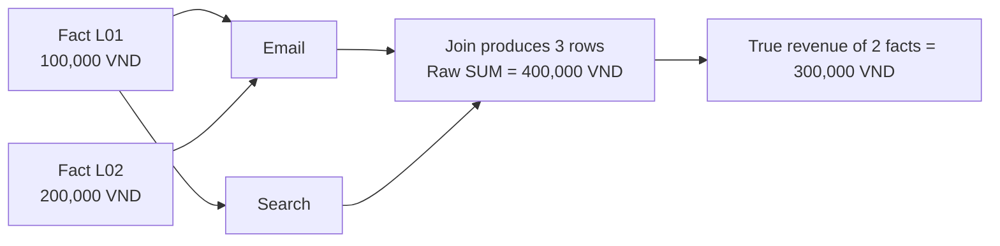

# Multi-Valued Dimensions and Bridge Tables to Preserve Grain

## 1. A single fact can connect to multiple dimension members

In the `DATABASE_DATA_MODELING` module, learners turn business requirements into verifiable data models: identifying entities, relationships, constraints, normalization, keys, indexes, and choosing suitable relational, document, graph, or analytical structures. For the **Dimension Tables** chapter, the challenge is not only describing an attribute, but also preserving the meaning of **one fact table row** when it relates to **multiple members of the same dimension**.

For example, a sales line worth **100,000 VND** was driven by two marketing campaigns: "Email" and "Search." If you put a single `campaign_sk` column on `fact_sales_line`, the sales line can only reference one campaign; if you join the fact to both campaigns through a many-to-many table and sum revenue carelessly, the revenue of **one row** will appear **twice**.

This is the **multi-valued dimension** problem: a fact at a defined grain can carry multiple dimension values, yet the join must never alter the grain's nature or fabricate phantom measures.

After this lesson, you will be able to:

1. Distinguish multi-valued dimensions from dimensions with many attributes, role-playing dimensions, and genuine many-to-many event grains.
2. Define fact and bridge grains, choose primary keys, foreign keys, uniqueness scopes, and membership policies.
3. Spot *fanout* on joins, avoiding row multiplication, double counting, and distorted ratios.
4. Compare **full credit**, **fractional allocation**, and **primary attribution**, basing rules on business semantics rather than arbitrary division.
5. Design **fact-to-dimension bridges** and **dimension group bridges**, understanding the impact of SCD Type 2 and time-bounded relationships.
6. Use PostgreSQL 16 DDL and queries to test data, verify weight sums, catch missing members, and reconcile totals.
7. Evaluate impacts on analytical queries, update latency, indexing, data pipelines, and alternative storage models.

## 2. Start with grain, not with `CREATE TABLE bridge`

**Grain** answers the question: *what single thing does one row in this table represent?*

Suppose `fact_sales_line` has the grain:

> One row is **one accepted sales order line** within a tenant and source system, unique by source order reference and source line reference.

Order `SO-18` has two lines:

| Sales line | Amount | Influencing campaigns |
|---|---:|---|
| `L01` | 100,000 VND | Email, Search |
| `L02` | 200,000 VND | Email |
| **Total of two lines** | **300,000 VND** | Independent of campaign count |

**The fact's grain remains one sales line**, regardless of whether that line connects to 0, 1, or 20 campaigns. Attaching dimension members does not create extra transactions or generate extra sales money.

If you add a `bridge_sales_campaign` table, its grain is:

> One bridge row is **an association between one specific sales line and one specific campaign**, within the corresponding tenant, under an agreed allocation policy.

Thus, the tables have distinct grains:

| Table | One row represents | Meaningful unique key |
|---|---|---|
| `fact_sales_line` | One sales line | (`tenant_id`, `source_system`, `source_order_ref`, `source_line_ref`) |
| `dim_campaign` | One campaign dimension member | Surrogate key `campaign_sk`, namespaced campaign code |
| `bridge_sales_campaign` | One sales line–campaign pair | (`tenant_id`, `fact_line_sk`, `campaign_sk`) |

**Do not shift the fact's grain to sales line–campaign** if the fact's purpose remains recording revenue **once per sales line**. Conversely, if the business genuinely tracks separate **campaign interaction events**, each interaction can be a fact at a different grain, rather than merely a bridge row.

## 3. When is a dimension truly multi-valued?

A dimension is **multi-valued with respect to a fact** when **one fact row relates to multiple members of the same dimension** under a defined rule.

| Example | Fact grain | Multi-valued dimension |
|---|---|---|
| Sales line influenced by multiple campaigns | One sales line | Campaign |
| Insurance claim with multiple diagnoses | One claim | Diagnosis |
| Support ticket handled jointly by multiple agents | One ticket | Agent |
| Event with multiple participants | One event | Participant |
| Product carrying multiple allergen groups at transaction time | One sales line or versioned product | Allergy class / label |

Do not confuse this with other patterns:

- **Multiple different dimensions:** a sales line has one customer, one product, and one store. Those are separate one-to-one/semantic foreign keys, **not** multiple values of the same dimension.
- **Role-playing dimensions:** an order has `billing_customer_sk` and `shipping_customer_sk`, or `ordered_date_key` and `paid_date_key`. The fixed roles are distinct; no bridge table is needed.
- **Outrigger dimensions:** a dimension referencing another dimension (e.g., department belonging to region) does not automatically mean a fact has multiple dimension members.
- **Operational many-to-many tables:** a `student_course` table may be an OLTP junction table. Before calling it a bridge dimension in analytics, define the fact grain and measures.
- **Simple text lists:** a short label array strictly for display may not need a dimension; however, once filtering, normalization, and aggregation by tag are needed, proper associative design becomes essential.

The core condition is not "having many columns" or "having a JSON array," but **a one-fact → many-members-of-one-dimension relationship and what measures mean after joining**.

## 4. Fanout: why joining on valid keys still breaks totals

With the two sales lines from section 2, joining to the bridge table gives:

```text
fact_sales_line                bridge_sales_campaign           dim_campaign
fact_sk | amount               fact_sk | campaign_sk            campaign_sk | name
--------+-------               --------+------------            ------------+-------
101     | 100000              101     | 201                    201         | Email
102     | 200000              101     | 202                    202         | Search
                               102     | 201
```

Join result:

| `fact_line_sk` | `gross_amount` | `campaign` |
|---:|---:|---|
| 101 | 100,000 | Email |
| 101 | 100,000 | Search |
| 102 | 200,000 | Email |

Running `SUM(gross_amount)` over the joined result yields **400,000 VND**, even though actual sales are **300,000 VND**. This is *fanout*: row count after the join exceeds the fact row count due to a one-to-many relationship.



**Never fix this with `SUM(DISTINCT gross_amount)`.** If two distinct sales lines happen to both equal 100,000, `SUM(DISTINCT ...)` drops a valid row. `COUNT(DISTINCT fact_line_sk)` can fix **unique line counts** within a group; it does not replace a proper allocation rule for monetary measures.

Many BI tools auto-generate joins when users drag dimensions onto reports, so fanout bugs can happen even when users write no SQL. The data model must declare cardinalities and **govern which measures are additive across the bridge**.

## 5. Three attribution rules: there is no single default answer

For a sales line influenced by multiple campaigns, three analytical policies are common:

### 5.1. Full credit: every member receives the full value

With L01 = 100,000 and two campaigns, each campaign is credited as having **influenced 100,000 VND in revenue**.

| Campaign | L01 | L02 | *Touched* revenue |
|---|---:|---:|---:|
| Email | 100,000 | 200,000 | 300,000 |
| Search | 100,000 | 0 | 100,000 |
| **Sum across campaigns** | | | **400,000** |

400,000 is **not** total company revenue; it is **revenue touched** under a many-to-many relationship. Full credit fits questions like "how much transaction value did this campaign participate in?" but fails if campaign totals must add up to actual revenue.

### 5.2. Fractional allocation: splitting credit

The business defines weights for each line–campaign pair:

| Line | Campaign | Weight | Allocated revenue |
|---|---|---:|---:|
| L01 | Email | 0.60 | 60,000 |
| L01 | Search | 0.40 | 40,000 |
| L02 | Email | 1.00 | 200,000 |
| **Total** | | | **300,000** |

For every sales line \(f\), if **all money must be fully allocated**:

\[
\sum_{c\in C(f)} w(f,c)=1,\quad 0<w(f,c)\leq1
\]

Revenue attributed to campaign \(c\):

\[
A(c)=\sum_{f:\,c\in C(f)} \operatorname{amount}(f)\times w(f,c)
\]

If no campaign groups are filtered out and every fact is fully allocated, then:

\[
\sum_c A(c)=\sum_f \operatorname{amount}(f)
\]

This is a **reconciliation invariant**, not a lucky coincidence of sample numbers. In real domains, weights may come from last-touch, linear attribution, statistical models, or manual decisions. Simply having an `allocation_weight` column **does not** prove the attribution methodology is sound; record the source, algorithm version, and policy.

### 5.3. Primary attribution: a single primary member

Some systems only need **one primary campaign** for revenue summation while keeping secondary campaigns for interaction analysis. Then:

- `primary_campaign_sk` can live directly on the fact if business rules guarantee a single primary campaign.
- The bridge still stores assisting campaigns when "assisted/participated" reporting is needed.
- Revenue by **primary campaign** must not be mixed with full-credit bridge math, unless reports explicitly separate both metrics and explain them clearly.

If using an `is_primary` flag inside the bridge, a **partial unique index** can enforce "at most one primary per fact," while "must have exactly one" is a separate invariant requiring write-time or test checks.

## 6. Two common bridge patterns

### 6.1. Direct fact-to-dimension bridge

Each association sits directly on the fact:

```text
fact_sales_line (fact_line_sk) --< bridge_sales_campaign >-- dim_campaign
                                      |
                                 allocation_weight
```

**Pros:** explicitly captures member sets and weights **per individual fact**, easy source traceability, links arbitrary numbers of campaigns without altering fact grain.

**Cons:** with billions of facts and multiple members on average, the bridge table can exceed the fact in row count; requires careful indexing and controlled pipelines, especially when links arrive late or get revised.

### 6.2. Group bridge: fact → member group → bridge → dimension

When many facts share **the exact same set of members**, you can introduce a **group** dimension:

```text
fact_claim -- diagnosis_group_sk --> dim_diagnosis_group
                                           |
                                           v
                                    bridge_group_diagnosis
                                           |
                                           v
                                      dim_diagnosis
```

Each group defines a diagnosis set and gets a `group_sk`; many facts point to one immutable group. The bridge lists the members of each group. This reduces set repetition when combinations overlap heavily, though it requires managing group lifecycles and set identity.

| Criterion | Direct bridge | Group bridge |
|---|---|---|
| Per-fact weights/relationships | Very natural | May explode group counts if weights differ per fact |
| Many facts sharing identical member sets | Repeats many bridge rows | Reuses a single group |
| Adding/removing a member on one fact | Edits that fact's links per policy | Typically creates a new group and updates fact FK |
| Preserving history | Locks bridge per recorded fact | Groups must stay immutable or be explicitly versioned |
| Join path | Fact → bridge → dimension | Fact → group → bridge → dimension |
| Fanout risk | Yes | Still yes; groups do not automatically protect measures |

**Never treat the two patterns as unconditionally interchangeable.** One group cannot represent two sets with different weights when weights are part of the analytical contract.

## 7. PostgreSQL 16 example: direct bridge preserving sales-line grain

The standalone example below creates the sales fact and campaign dimension. Numeric keys are specified explicitly **so the test script is repeatable on a clean schema**; in production, surrogate keys are typically database/warehouse-generated and kept stable under ETL contracts.

For simplicity, the example:

- Stores only **non-negative** sales lines, without modeling refunds/taxes/discounts.
- Gives each campaign one current dimension row; SCD Type 2 requirements are analyzed later.
- Omits a separate tenant table in the SQL snippet; `tenant_id` appears on all linked keys.
- Assigns each fact–campaign pair **one positive weight**; **weights summing to 1** are enforced in the pipeline and at group finalization, without a multi-row DDL trigger.

```sql
CREATE TABLE dim_campaign (
    campaign_sk BIGINT PRIMARY KEY,
    tenant_id BIGINT NOT NULL,
    campaign_code VARCHAR(40) NOT NULL,
    campaign_name TEXT NOT NULL,
    CONSTRAINT uq_campaign_tenant_code
        UNIQUE (tenant_id, campaign_code),
    CONSTRAINT uq_campaign_tenant_sk
        UNIQUE (tenant_id, campaign_sk)
);

CREATE TABLE fact_sales_line (
    fact_line_sk BIGINT PRIMARY KEY,
    tenant_id BIGINT NOT NULL,
    source_system VARCHAR(40) NOT NULL,
    source_order_ref VARCHAR(80) NOT NULL,
    source_line_ref VARCHAR(80) NOT NULL,
    sold_at TIMESTAMPTZ NOT NULL,
    gross_amount NUMERIC(14, 2) NOT NULL,
    currency_code VARCHAR(3) NOT NULL,
    CONSTRAINT uq_fact_source_line
        UNIQUE (
            tenant_id, source_system, source_order_ref, source_line_ref
        ),
    CONSTRAINT uq_fact_tenant_sk
        UNIQUE (tenant_id, fact_line_sk),
    CONSTRAINT ck_fact_gross_nonnegative
        CHECK (gross_amount >= 0 AND gross_amount <> 'NaN'::numeric),
    CONSTRAINT ck_fact_currency_format
        CHECK (currency_code ~ '^[A-Z]{3}$')
);

CREATE TABLE bridge_sales_campaign (
    tenant_id BIGINT NOT NULL,
    fact_line_sk BIGINT NOT NULL,
    campaign_sk BIGINT NOT NULL,
    allocation_weight NUMERIC(12, 8) NOT NULL,
    CONSTRAINT pk_bridge_sales_campaign
        PRIMARY KEY (tenant_id, fact_line_sk, campaign_sk),
    CONSTRAINT fk_bridge_fact_same_tenant
        FOREIGN KEY (tenant_id, fact_line_sk)
        REFERENCES fact_sales_line (tenant_id, fact_line_sk),
    CONSTRAINT fk_bridge_campaign_same_tenant
        FOREIGN KEY (tenant_id, campaign_sk)
        REFERENCES dim_campaign (tenant_id, campaign_sk),
    CONSTRAINT ck_bridge_positive_weight
        CHECK (allocation_weight > 0 AND allocation_weight <= 1)
);

-- Supports queries starting from a campaign to locate related facts.
CREATE INDEX idx_bridge_campaign_to_fact
    ON bridge_sales_campaign (tenant_id, campaign_sk, fact_line_sk);
```

**Key takeaways from the DDL:**

1. `pk_bridge_sales_campaign` prevents linking the **same campaign** twice to the **same fact** within a tenant. It does not prevent linking **two different campaigns** to the same fact, which is the bridge's purpose.
2. Composite FKs keep associations within the **exact tenant**; standalone FKs on `campaign_sk` and `fact_line_sk` alone do not guarantee tenant isolation when applications combine rows.
3. `UNIQUE(tenant_id, fact_line_sk)` and `UNIQUE(tenant_id, campaign_sk)` act as targets for composite FKs. Since SKs are already global PKs, those unique constraints are redundant for uniqueness yet needed for the illustrated composite reference; factor in extra index overhead.
4. `allocation_weight` is business data and **never** mutates `gross_amount` in the fact. The fact retains the original finalized amount.
5. `CHECK` only bounds **each individual weight** to `(0, 1]`. It **cannot** by itself prove that weights **across multiple bridge rows** sum to 1.
6. The bridge PK index has leading columns (`tenant_id`, `fact_line_sk`), ideal for fact → campaigns; the inverted index on `campaign_sk` serves campaign → facts. Avoid adding extra indexes unless workloads prove they are needed.

### 7.1. Loading sample data

Illustrative IDs `101/102` and `201/202` must not collide with existing rows; run on a clean test schema.

```sql
INSERT INTO dim_campaign (
    campaign_sk, tenant_id, campaign_code, campaign_name
)
VALUES
    (201, 42, 'EMAIL', 'Email'),
    (202, 42, 'SEARCH', 'Search');

INSERT INTO fact_sales_line (
    fact_line_sk, tenant_id, source_system,
    source_order_ref, source_line_ref,
    sold_at, gross_amount, currency_code
)
VALUES
    (101, 42, 'WEB', 'SO-18', 'L01',
     '2027-03-15 10:00:00+00', 100000.00, 'VND'),
    (102, 42, 'WEB', 'SO-18', 'L02',
     '2027-03-15 10:00:00+00', 200000.00, 'VND');

INSERT INTO bridge_sales_campaign (
    tenant_id, fact_line_sk, campaign_sk, allocation_weight
)
VALUES
    (42, 101, 201, 0.60),
    (42, 101, 202, 0.40),
    (42, 102, 201, 1.00);
```

From here on, all query examples target tenant `42`, currency `VND`, and the two sample rows above. The data assumes no refunds, corrections, or SCD2 campaign versions yet.

## 8. Three queries on the same data: one wrong query, two valid metrics

### 8.1. Wrong query: summing measures after joining without allocation

```sql
SELECT
    SUM(f.gross_amount) AS wrong_sum
FROM fact_sales_line AS f
JOIN bridge_sales_campaign AS b
  ON b.tenant_id = f.tenant_id
 AND b.fact_line_sk = f.fact_line_sk
WHERE f.tenant_id = 42;
```

Sample output: **400,000**, higher than the true total 300,000. The SQL is syntactically valid; it is wrong in **aggregation semantics**.

### 8.2. Full credit: revenue touched by each campaign

```sql
SELECT
    c.campaign_code,
    COUNT(DISTINCT f.fact_line_sk) AS distinct_sales_lines,
    SUM(f.gross_amount) AS revenue_touched
FROM fact_sales_line AS f
JOIN bridge_sales_campaign AS b
  ON b.tenant_id = f.tenant_id
 AND b.fact_line_sk = f.fact_line_sk
JOIN dim_campaign AS c
  ON c.tenant_id = b.tenant_id
 AND c.campaign_sk = b.campaign_sk
WHERE f.tenant_id = 42
  AND f.currency_code = 'VND'
GROUP BY c.campaign_code
ORDER BY c.campaign_code;
```

Result:

| Campaign | Sales lines with campaign | `revenue_touched` |
|---|---:|---:|
| EMAIL | 2 | 300,000 |
| SEARCH | 1 | 100,000 |

This is an intentional KPI. Summing both rows and calling it "company revenue" double-counts again. Report titles must clearly separate **full credit / revenue touched** from **allocated revenue**.

### 8.3. Fractional allocation: campaign sum matches fact total

```sql
SELECT
    c.campaign_code,
    SUM(f.gross_amount * b.allocation_weight) AS allocated_revenue
FROM fact_sales_line AS f
JOIN bridge_sales_campaign AS b
  ON b.tenant_id = f.tenant_id
 AND b.fact_line_sk = f.fact_line_sk
JOIN dim_campaign AS c
  ON c.tenant_id = b.tenant_id
 AND c.campaign_sk = b.campaign_sk
WHERE f.tenant_id = 42
  AND f.currency_code = 'VND'
GROUP BY c.campaign_code
ORDER BY c.campaign_code;
```

Result:

| Campaign | Allocated revenue |
|---|---:|
| EMAIL | 260,000 |
| SEARCH | 40,000 |
| **Total** | **300,000** |

**Results are only accurate if weights match the right grain and weights on every allocated fact sum to 1.** If a fact has no campaign, `INNER JOIN` drops that fact. If weights sum to 0.80, the allocation report misses 20% of that fact; if 1.20, it over-allocates by 20%.

## 9. Enforcing weight invariants and handling missing members

### 9.1. Checking exact sum per fact

```sql
SELECT
    f.tenant_id,
    f.fact_line_sk,
    COUNT(b.campaign_sk) AS assigned_campaigns,
    COALESCE(SUM(b.allocation_weight), 0) AS weight_sum
FROM fact_sales_line AS f
LEFT JOIN bridge_sales_campaign AS b
  ON b.tenant_id = f.tenant_id
 AND b.fact_line_sk = f.fact_line_sk
GROUP BY f.tenant_id, f.fact_line_sk
HAVING COUNT(b.campaign_sk) = 0
    OR ABS(COALESCE(SUM(b.allocation_weight), 0) - 1) > 0.00000001;
```

On the sample data, this query returns no rows. In production, choose tolerance matching `NUMERIC(12,8)` precision, maximum member count, and rounding rules. With three members split equally, storing `0.33333333` for all three yields `0.99999999`; options include using **exact decimal weights with deliberate remainder assignment to the final member**, or defining a reconciliation tolerance. Never silently renormalize weights against the current sum if that alters attribution policy without approval.

**You cannot enforce the sum via a standard row-level `CHECK` on each bridge row.** The sum rule spans multiple rows and may require:

- Loading all members of one fact within a single transaction.
- Locking the **same fact row** or group as a coordination point so two concurrent writers cannot alter weights against stale state.
- Checking the sum after all members are written, or using stored procedures/triggers with appropriate semantics and timing.
- Publishing/querying only facts whose attribution status is **finalized**; staging may temporarily hold partial sums mid-batch.
- Running batch validation tests to catch issues after reloads, migrations, and retroactive adjustments.

A trigger enforcing "after every bridge `INSERT`, sum must equal 1" is **impractical** when one fact inserts two rows sequentially; after the first row, the sum is only 0.60. Explicitly define **group finalization points** or use deferred/transactional checks.

### 9.2. Sales lines with no associated campaign

There are two valid policies with distinct meanings:

1. **Unknown/unprocessed:** keep in staging, excluded from finalized allocation reports; track SLAs and backlog rows.
2. **Genuinely no campaign:** assign to an `UNATTRIBUTED` member with weight 1, or allow missing bridge rows and treat them as 100% unattributed in approved queries.

Example of the second query, safe only when **every fact with bridge rows has already passed the sum-to-1 check**:

```sql
SELECT
    COALESCE(c.campaign_code, 'UNATTRIBUTED') AS allocation_bucket,
    SUM(
        f.gross_amount *
        COALESCE(b.allocation_weight, 1::numeric)
    ) AS allocated_revenue
FROM fact_sales_line AS f
LEFT JOIN bridge_sales_campaign AS b
  ON b.tenant_id = f.tenant_id
 AND b.fact_line_sk = f.fact_line_sk
LEFT JOIN dim_campaign AS c
  ON c.tenant_id = b.tenant_id
 AND c.campaign_sk = b.campaign_sk
WHERE f.tenant_id = 42
  AND f.currency_code = 'VND'
GROUP BY COALESCE(c.campaign_code, 'UNATTRIBUTED')
ORDER BY allocation_bucket;
```

Note: `COALESCE(..., 1)` only applies when **no bridge row exists**; if a bridge row exists with a bad weight like 0.70, the query does **not** synthesize 0.30 into an unallocated bucket. Also avoid using the string `'UNATTRIBUTED'` as a business key if a real campaign might claim that code; use a separate namespace or a governed special member.

### 9.3. Reconciling total revenue between fact and bridge

```sql
WITH base AS (
    SELECT
        tenant_id, currency_code,
        SUM(gross_amount) AS fact_revenue
    FROM fact_sales_line
    GROUP BY tenant_id, currency_code
),
allocated AS (
    SELECT
        f.tenant_id, f.currency_code,
        SUM(f.gross_amount * b.allocation_weight) AS allocated_revenue
    FROM fact_sales_line AS f
    JOIN bridge_sales_campaign AS b
      ON b.tenant_id = f.tenant_id
     AND b.fact_line_sk = f.fact_line_sk
    GROUP BY f.tenant_id, f.currency_code
)
SELECT
    b.tenant_id,
    b.currency_code,
    b.fact_revenue,
    COALESCE(a.allocated_revenue, 0) AS allocated_revenue,
    b.fact_revenue - COALESCE(a.allocated_revenue, 0) AS difference
FROM base AS b
LEFT JOIN allocated AS a
  ON a.tenant_id = b.tenant_id
 AND a.currency_code = b.currency_code;
```

This reveals aggregate discrepancies, yet **is not enough on its own**: one fact allocated 1.20 and another allocated 0.80 can cancel out in the total. Always combine **per-fact checks** from section 9.1 with aggregate reconciliation.

## 10. Which measures can pass through a bridge?

Not every measure can be split by the same weight.

| Measure | Property | Typical handling |
|---|---|---|
| Sales line monetary revenue | Additive at line grain when currency matches | Allocate via weights if the business accepts the attribution model |
| Product quantity sold | Additive across lines and products | Split only if "campaign-attributed units" is a defined KPI |
| Sales line count | Event count | `COUNT(DISTINCT fact_line_sk)` per group gives lines touched; group totals are not necessarily additive |
| Unique customer count | Distinct count across facts | `COUNT(DISTINCT customer_sk)` per scope; **never** sum distinct counts across campaigns |
| Average price | Ratio, non-additive | Compute from summed numerator and denominator at proper grain/attribution; never sum averages |
| Conversion rate | Ratio | Define exposure/conversion sets and allocation rules before calculating |
| End-of-day inventory balance | Semi-additive across time | Do not sum across days; campaign weights usually make no sense |
| Influence score / points | May be a standalone measurement | Keep its own unit and interpretation; never assume it behaves like money |

An **allocation weight** may make sense for **gross revenue** without making sense for every sales-line KPI. For instance, one order from 1 customer influenced by three campaigns: applying weight 1/3 to **unique customers** and calling the result "0.333 customers" may violate what business users expect.

If the business needs **non-overlapping unique customer counts across all campaigns**, define set-union/dedup rules; the sum of per-campaign distinct counts generally **differs** from the system-wide distinct count.

## 11. Be careful with the grain of weights

Weights must apply to the **exact entity being allocated**.

For example, an order has two lines:

- L01 worth 100,000, allocated Email 60%, Search 40%.
- L02 worth 200,000, allocated Email 100%.

Weights at the **order** level (e.g., Email 70%, Search 30%) do not automatically equal the weights of each **order line**. Taking order-level attribution and joining it to every line to compute product-level revenue requires explaining why order-level ratios apply uniformly to each line. That can be a **valid policy**, but cannot be assumed solely because a bridge table exists.

Questions to lock down:

1. Is attribution determined at **order**, **order-line**, **payment**, or **conversion-event** grain?
2. On orders with multiple currencies or item types, are weights identical across lines?
3. Can a campaign unrelated to a line's product receive a share of that line's revenue?
4. Are refunds allocated by original weights, campaign status at refund time, or a separate rule?
5. When an order line is edited or removed, is the bridge updated or are adjustment facts emitted?

If attribution exists only at the **order** level, create an **order-level fact** and an order-grain bridge for those reports, while keeping the line-item fact separate for product reports. Avoid forcing a bridge at the wrong grain just to make a join look shorter.

## 12. Group bridges: reusing an immutable member set

An insurance system may attach multiple diagnosis codes to each claim, with many claims sharing identical code sets. A three-layer group bridge design has:

- `fact_claim`: one row per claim.
- `dim_diagnosis_group`: identity of a **finalized diagnosis set**.
- `bridge_diagnosis_group_member`: the diagnosis codes belonging to that group.

### 12.1. Standalone illustrative DDL

```sql
CREATE TABLE dim_diagnosis (
    diagnosis_sk BIGINT PRIMARY KEY,
    diagnosis_code VARCHAR(40) NOT NULL UNIQUE,
    diagnosis_name TEXT NOT NULL
);

CREATE TABLE dim_diagnosis_group (
    diagnosis_group_sk BIGINT PRIMARY KEY,
    group_hash VARCHAR(128),
    created_at TIMESTAMPTZ NOT NULL DEFAULT CURRENT_TIMESTAMP
);

CREATE TABLE bridge_diagnosis_group_member (
    diagnosis_group_sk BIGINT NOT NULL
        REFERENCES dim_diagnosis_group(diagnosis_group_sk),
    diagnosis_sk BIGINT NOT NULL
        REFERENCES dim_diagnosis(diagnosis_sk),
    allocation_weight NUMERIC(12,8),
    CONSTRAINT pk_diagnosis_group_member
        PRIMARY KEY (diagnosis_group_sk, diagnosis_sk),
    CONSTRAINT ck_diagnosis_weight_range
        CHECK (
            allocation_weight IS NULL
            OR (allocation_weight > 0 AND allocation_weight <= 1)
        )
);

CREATE TABLE fact_claim (
    claim_sk BIGINT PRIMARY KEY,
    source_claim_ref VARCHAR(80) NOT NULL UNIQUE,
    diagnosis_group_sk BIGINT NOT NULL
        REFERENCES dim_diagnosis_group(diagnosis_group_sk),
    claim_amount NUMERIC(14,2) NOT NULL,
    CONSTRAINT ck_claim_amount_nonnegative
        CHECK (claim_amount >= 0 AND claim_amount <> 'NaN'::numeric)
);
```

`group_hash` is solely a **lookup hint**: when hashing a member set, canonicalize ordering, namespaces, versions, and **weights** before hashing; also verify raw contents rather than treating a hash match as absolute proof two sets are identical. Notice this example puts no unique constraint on `group_hash` and does not claim hashing alone protects member sets.

### 12.2. Must groups be immutable or versioned?

If a claim references `diagnosis_group_sk = 50` and later someone **adds a diagnosis** to group 50's bridge, every historical claim pointing to that group silently changes its diagnosis set in reports. That can corrupt historical interpretation.

Two options:

1. **Immutable groups:** when the member set or weights change, create a **new group** and point new facts to the new group; old facts keep their old group. Lock down write access on bridges of already-used groups.
2. **Versioned groups:** groups and memberships carry versions/effectivity, requiring queries to match exact timestamps and versions; more complex, yet potentially needed when relationship history itself is tracked.

**An FK from fact to `group_sk` only proves the group exists; it does not prove its membership hasn't been altered.** Stable historical reporting requires immutability policies and tests.

### 12.3. Weights may not make sense for diagnosis groups

A claim having three diagnoses does not automatically mean the claim payout should be split into three equal parts. Diagnoses may describe aspects of one event or carry **principal/secondary** roles. If the business defines no cost allocation by diagnosis, report "claim amount touched by diagnosis" with clear KPI labels or distinct claim counts—never divide by 3 just to force sums to match.

## 13. SCD Type 2 dimensions and temporal bridge tables

Dimensions can change over time. For instance, campaign "Spring Sale" changes its marketing group, name, or status on July 1. If reports need the group **effective at sale time**, the bridge cannot point ambiguously to just one current campaign row.

### 13.1. Two distinct strategies

**A. Bridge points directly to the resolved dimension version**

- `dim_campaign` has a distinct `campaign_sk` per SCD2 version, alongside natural key and `valid_from/valid_to`.
- When loading a March 15 sales fact, the pipeline looks up the `campaign_sk` valid at `sold_at` and writes that SK into the bridge.
- When the campaign moves to a new version, old facts/bridges continue pointing to the old version under an *as-booked* policy.

**B. Bridge stores business key + timestamp, performing an as-of join at query time**

- Campaign links are stored using stable business identities.
- At query time, join `valid_from <= sold_at < valid_to` to resolve the version.
- When historical data receives retroactive edits, past report outputs update to match revised history; fits a clearly defined *restated* model.

| Question | Point to version SK at load time | As-of join at query time |
|---|---|---|
| Reproducing locked snapshot reports | Easier when version rows are immutable | Can change when historical versions are edited |
| Retroactive classification edits | Must decide whether to remap bridges/facts | Reflects latest effective history automatically |
| Query cost | Direct FK to one version row, fewer time predicates | Range join plus overlap/gap safeguards |
| Temporal correctness | ETL must verify at load time | Query/pipeline must verify at read time |
| Late-arriving dimension error | May wait or use inferred member | Version may be missing when queried |

Never abandon both rules and **join to the current campaign version** if historical reports require classification at sale time.

### 13.2. Memberships themselves can have independent validity

A customer can belong to different interest groups over time; an employee joins a project team from March 1 to June 30 before transferring. When a bridge describes **time-bounded membership**, store:

```text
bridge_customer_interest
  tenant_id
  customer_id           -- stable customer identity
  interest_sk
  valid_from
  valid_to
  relationship_source
```

The rule is **a customer–interest pair has at most one active membership at a time** if required by business rules; multiple distinct interests **may be active concurrently**. Checking uniqueness only on start date is insufficient to prevent overlapping intervals.

In PostgreSQL, you can use `TSTZRANGE` and a GiST exclusion constraint over (`tenant_id`, `customer_id`, `interest_sk`, interval) when appropriate operator classes are available. Note that this still does not force a customer to have at least one interest at all times; handle minimum coverage separately.

### 13.3. Foreign keys do not validate time

`FOREIGN KEY (campaign_sk) REFERENCES dim_campaign(campaign_sk)` only verifies that the version row exists. It **does not verify** that `fact.sold_at` lies inside the selected version's validity interval; verify that in ETL or via appropriate checks. When a dimension version is edited retroactively, facts/bridges can become inconsistent with the revised validity interval. Decide between locking versions or controlled restatement.

## 14. Modifying membership after fact finalization: as-booked vs. restated?

A campaign is attributed to a transaction three days later due to delayed clickstream data. If business rules allow attribution updates, two competing needs may exist:

- **As booked:** the March 31 campaign revenue report must reproduce the exact ratios published on closing day.
- **Restated:** running March's report today must reflect the newly reconciled marketing events.

Simply running `DELETE` on old bridge rows and `INSERT` on new ones destroys **as-booked** reproducibility. Consider:

1. **Versioned attribution groups**: each reallocation creates a new `allocation_version` and weight set.
2. **Report/cutoff snapshots**: save model versions or cutoff points for published reports.
3. **Audit/lineage tables**: who changed it, from which source, why, effective when, and which edits are permitted.
4. **Bitemporal tracking** if event time must be separated from when the system learned the attribution rule.
5. **Atomic transactions** when replacing a full member set: avoid an intermediate window where readers see a fact holding only 40% or temporarily zero campaigns.

A versioned bridge can use a key such as:

```text
(fact_line_sk, allocation_version, campaign_sk)
```

paired with a `fact_allocation_state` table tracking the approved version for each fact. The **sum of weights = 1** invariant applies **per `(fact, allocation_version)`**, never across all versions combined. Define clearly how reports select "current version" vs. "locked version."

## 15. Concurrent writes and atomicity checks

Two workers updating a fact's attribution concurrently can produce individually valid rows (`CHECK 0 < weight <= 1`) that fail the sum invariant:

```text
Initial state: fact 101 has no attribution yet.

Worker A: intends to write Email=0.6, Search=0.4.
Worker B: intends to write Email=0.5, Social=0.5.

Without coordination, transactions may collide on the Email
pair lock, or leave a final set reflecting neither approved plan.
```

A safe workflow requires a clear **update owner** or lock point. One PostgreSQL approach:

1. Open a transaction.
2. Lock the target fact row (e.g., `SELECT ... FOR UPDATE`) or an attribution-version coordination row.
3. Verify the current version and update permissions.
4. Replace **the entire member set under a new version** or apply controlled edits.
5. Verify the sum of weights and referential integrity once all members are written.
6. Mark the version `APPROVED` and commit only when every check passes.
7. Handle unique/FK/serialization errors via bounded retries, idempotency, and auditing.

**Running `SELECT SUM(weight)` outside a transaction and `INSERT` in another transaction is never sufficient.** Two writers can read the same stale state and write corrupted totals. Similarly, locking only existing bridge rows fails when the bridge **has no rows yet to lock**.

DBMSs differ in isolation, locking, and constraint checking; run concurrency tests on the actual target engine and workload.

## 16. Indexing and operational costs of bridge tables

With \(F\) fact rows and \(k\) members on average, a direct bridge holds roughly \(F \times k\) rows. This is an approximate row count, not an exact disk-space formula.

For example, 100 million sales fact rows averaging 3 campaigns yield ~300 million bridge rows. Many bridge rows also carry indexes, FKs, version columns, and change logs. Evaluate:

| Access path | Usually helpful index | Trade-off |
|---|---|---|
| From a fact to its members | PK `(tenant_id, fact_line_sk, campaign_sk)` | Great for lookups and verifying per-fact weight sums |
| From a campaign to its facts | `(tenant_id, campaign_sk, fact_line_sk)` | Extra index increases write cost |
| Reading by sale date/month | Time index/partition on fact, then join bridge | Bridge has no inherent date without a time key/context |
| As-of version lookups | Index on business key and validity range | May need GiST/expression index; DBMS-dependent |
| Grouping millions of facts for reports | Columnar aggregations/summaries or derived facts | Not every query is rescued by a new B-tree |

**Partitioning caveat:** if partitioning facts by `sold_at` in PostgreSQL 16, partitioned-table unique constraints must include the partition key per DBMS rules. When bridges hold FKs to facts, design referenced keys and uniqueness scopes carefully; never simply add `sold_at` to unique source identity and allow duplicate source lines across two different dates.

### Query plan inspection

```sql
EXPLAIN (ANALYZE, BUFFERS)
SELECT
    c.campaign_code,
    SUM(f.gross_amount * b.allocation_weight) AS allocated_revenue
FROM fact_sales_line AS f
JOIN bridge_sales_campaign AS b
  ON b.tenant_id = f.tenant_id
 AND b.fact_line_sk = f.fact_line_sk
JOIN dim_campaign AS c
  ON c.tenant_id = b.tenant_id
 AND c.campaign_sk = b.campaign_sk
WHERE f.tenant_id = 42
  AND f.currency_code = 'VND'
  AND f.sold_at >= '2027-03-01 00:00:00+00'::timestamptz
  AND f.sold_at <  '2027-04-01 00:00:00+00'::timestamptz
GROUP BY c.campaign_code;
```

`EXPLAIN (ANALYZE, BUFFERS)` **actually executes the query**; when testing write queries, wrap inside a safe test environment/transaction. Inspect row counts before and after each join, scan types, buffers, timing, memory/sorts, statistics, and average/max member fanout. An "Index Scan" plan does not prove grain correctness if measures are being multiplied.

In columnar analytics warehouses, clustering/sorting/partitioning, join strategies, and materialized aggregates often matter far more than adding B-trees on every FK. Many analytical engines do not enforce PKs/FKs like PostgreSQL; pipelines must prove uniqueness, completeness, and weight sums themselves.

## 17. When should you NOT use a bridge?

A bridge is not the default answer every time you see a multi-valued list.

### Use an associative-grain fact instead

An event like "student A attended session X" naturally has the grain of **one attendance**, carrying `student_sk` and `session_sk`. Then `fact_attendance` with one row per attendance pair is a **factless fact or event fact**, rather than a "session" fact with a member array and bridge just to count attendees.

### Use multiple role-playing FKs

If every contract has **one sales rep**, **one approver**, and **one support specialist**, three roles `sales_rep_sk`, `approver_sk`, and `support_sk` can be clearer than a bridge. Conversely, "an arbitrary number of assisting reps" is genuinely multi-valued.

### Use one primary member plus auxiliary metadata

When only one campaign is allowed to **receive revenue** yet a list of touched campaigns is still displayed, store `primary_campaign_sk` on the fact and store interaction events separately. Do not invent arbitrary weights for those interactions.

### JSON/arrays only fit when relational math isn't needed

A document with `campaign_ids: [201, 202]` is compact for storing raw source payloads, yet provides no element-level FKs, duplicate guards, or safe per-campaign weights, and complicates analytical queries. If it is **raw source data**, keep JSON/arrays in staging and normalize into a bridge when building marts.

### Graphs suit traversal queries, yet still require grain

A graph edge `SaleLine — influencedBy → Campaign` models many-to-many naturally. Still, when summing revenue across edges, **one sales line linked to multiple campaigns will still double-count**. Switching to a graph database does not eliminate allocation or additivity rules.

## 18. Testing edge cases and data defects

| Case | Data/operation | Expected outcome |
|---|---|---|
| T1 | Fact 101 has two campaigns, fact 102 has one campaign | Bridge has 3 rows; fact still has 2 rows |
| T2 | Join and run `SUM(gross_amount)` without weights | Detects 400,000 vs. 300,000 |
| T3 | Compute `gross_amount * weight` | EMAIL 260,000, SEARCH 40,000, total 300,000 |
| T4 | Re-insert `(tenant, fact, campaign)` pair | Bridge PK rejects duplicate |
| T5 | Link tenant A fact to tenant B campaign | Composite FK rejects cross-tenant link |
| T6 | Weight equal to 0, negative, or > 1 | `CHECK` rejects |
| T7 | One fact has weights 0.6 + 0.3 | Per-fact sum check catches 0.9 |
| T8 | One fact has 0.7 + 0.5 | Per-fact sum check catches 1.2 |
| T9 | Fact with no campaign | Handled via staging or Unattributed policy; never silently dropped by inner join |
| T10 | Two facts share identical monetary amounts | `SUM(DISTINCT amount)` returns wrong total; never use to "fix" fanout |
| T11 | Two campaigns share the same display name | Group by SK/stable code, not name alone |
| T12 | Two workers concurrently update one fact's attribution | Only one valid version finalized, with idempotency/retries |
| T13 | SCD2 campaign changes group after sale date | As-booked reports preserve old version; restated reports follow explicit policy |
| T14 | Overlapping customer–interest validity for same pair | Blocked if non-overlap required |
| T15 | Group bridge membership edited while old facts still reference it | Blocked or triggers new group/version |
| T16 | Multi-currency reports | Group by currency or convert by rule; never sum raw currencies directly |
| T17 | Refund/correction after original transaction | Allocate per refund contract; never force negative amounts into constrained facts |
| T18 | Migrating from JSON array containing duplicate or unknown codes | Deduplicate by rule, map valid SKs, quarantine errors |

### Query checking fanout by grain

```sql
SELECT
    f.tenant_id,
    f.fact_line_sk,
    COUNT(*) AS rows_after_join,
    COUNT(b.campaign_sk) AS matched_campaigns
FROM fact_sales_line AS f
LEFT JOIN bridge_sales_campaign AS b
  ON b.tenant_id = f.tenant_id
 AND b.fact_line_sk = f.fact_line_sk
GROUP BY f.tenant_id, f.fact_line_sk
HAVING COUNT(*) > 1;
```

This returns facts whose join yields more than one row. **This is not necessarily bad data**: it confirms a multi-valued relationship is active and measures must follow the appropriate policy.

### Query checking duplicate source facts

```sql
SELECT
    tenant_id, source_system, source_order_ref, source_line_ref,
    COUNT(*) AS copies
FROM fact_sales_line
GROUP BY tenant_id, source_system, source_order_ref, source_line_ref
HAVING COUNT(*) > 1;
```

On the sample schema with `UNIQUE` enabled, this query must return empty. Before migrations or in warehouses that do not enforce uniqueness, it is an essential data-quality check. If sources emit multiple **valid events** for one order line, change the grain/identifier or use a separate event fact rather than deleting rows solely for sharing order/line.

## 19. Migrating from JSON/arrays or a single campaign to a bridge

Suppose a legacy system stored only one `campaign_code` on the fact, then added a `campaigns_json` array of campaign codes. To build a bridge:

1. **Lock down grain and namespace:** clarify what a JSON campaign element means for that fact; prevent cross-tenant code collisions.
2. **Clean the list:** distinguish missing campaigns, empty arrays, `NULL` elements, nonexistent codes, and duplicate elements. Never invent a campaign absent from source data.
3. **Map business codes to SKs:** by tenant, source, and effective version if the dimension is SCD2.
4. **Choose attribution policy:** legacy data carrying only a list of campaigns cannot by itself deduce weights; decide between full credit, approved equal split, primary, or unallocated tagging.
5. **Populate the bridge idempotently in batches:** guard against duplicate writes on reruns, protect FKs, use transactions, and handle concurrent writes.
6. **Verify sum-of-weights:** for fractional allocation, every fact must have a complete weight set under the finalized version.
7. **Reconcile counts and revenue:** fact counts stay unchanged; membership counts are explainable; allocated totals match eligible fact totals per currency.
8. **Switch read paths:** separate full-credit vs. allocated BI metrics; prohibit `SUM(f.gross_amount)` across joins unless KPI definitions permit it.
9. **Retire dual representations:** if keeping both JSON and bridge temporarily, declare one source of truth, sync mechanics, and drift checks.

Converting from JSON should start with **data inspection**, not a blind `INSERT` giving weight 1 to every element:

```sql
-- Illustrative query for staging_sales_campaign_json:
--   tenant_id, fact_line_sk, campaigns_json JSONB
-- This is an ASSUMED table, not part of section 7's DDL.
SELECT
    s.tenant_id,
    s.fact_line_sk,
    e.campaign_code,
    COUNT(*) AS occurrences
FROM staging_sales_campaign_json AS s
CROSS JOIN LATERAL
     jsonb_array_elements_text(s.campaigns_json) AS e(campaign_code)
GROUP BY s.tenant_id, s.fact_line_sk, e.campaign_code
HAVING COUNT(*) > 1;
```

In production pipelines, verify `campaigns_json` is a **JSON array** containing no JSON nulls or unexpected objects before running this; `jsonb_array_elements_text` fails if given a non-array. The result highlights duplicate codes, without determining weights or proving every campaign has a valid dimension row.

**Never divide equally just to "make totals look clean"** without business approval. When equal splitting is approved, record the algorithm version, rounding rules, remainder handling, and full input lineage.

## 20. Practice exercise: multiple handlers on an insurance claim

**Context:** an insurer has 10 million claims; each claim has 1–6 diagnoses and 1–4 claim handlers. Each claim has a payout amount that may be adjusted retroactively. Analytics needs reports for:

- Distinct claim count by diagnosis.
- Claim payout **associated with** each diagnosis (full credit).
- Claim payout **allocated** by handler, using approved weights.
- Monthly claim counts by diagnosis classification **valid when the claim was accepted**.
- Published reports must stay reproducible even if diagnosis categories or handler assignments change later.

### Practice tasks

1. **Write the grain:** what is one row of `fact_claim`, should correction events be separated into another fact, and which source identifiers guarantee uniqueness?
2. **Choose bridges:** should diagnoses use a group bridge or direct bridge? Which pattern suits handlers carrying per-claim weights? Name one operational criterion for each choice.
3. **Design DDL:** define dimension keys, bridges, FKs, composite PKs, `UNIQUE`, and weight bounds; enforce tenant isolation and prevent duplicate fact–member pairs.
4. **Write two reports:** claim count per diagnosis using `COUNT(DISTINCT claim_sk)`; claim amount touched using full credit with explicit KPI labels.
5. **Write the allocation report:** `SUM(claim_amount * allocation_weight)` per handler, reconciling allocated totals against fact totals per currency/period.
6. **Check missing data:** distinguish claims with unknown diagnosis, claims genuinely having zero diagnoses, and claims with unassigned handlers.
7. **Add history:** a diagnosis changes reporting group on July 1; which version must March claims keep? Compare locking SCD2 SKs vs. as-of joins.
8. **Test concurrency:** two workers concurrently adjust weights on a claim while one tries to re-insert an existing pair; specify invariants and transactional handling.
9. **Reconcile backfill:** when migrating from a JSON diagnosis array, how do you catch duplicate elements, invalid codes, missing entries, and mismatched version timestamps?
10. **Benchmark:** project bridge row count assuming 3 diagnoses/claim on average; measure query plans, index sizes, and update load after doubling data volume.

### Delivery checklist

- [ ] Fact and bridge grains are stated in clear single sentences, never mixing transactions with links.
- [ ] Direct bridge vs. group bridge chosen based on member lifecycles and reuse potential.
- [ ] Unique/FK constraints enforce tenant isolation, member identity, and no duplicate link pairs.
- [ ] Every measure crossing a bridge has an explicitly documented **full-credit, fractional, or primary policy**.
- [ ] For fractional allocation, per-fact/version weight sums are validated at finalization and via reconciliation.
- [ ] Facts without members, late-arriving members, and invalid codes have transparent handling states.
- [ ] SCD2, effective timing, and reproducibility of closed reports are defined.
- [ ] Read paths prevent double counting; `COUNT(DISTINCT)` is never used as a substitute for allocation policies.
- [ ] Queries, indexes, write load, and storage costs are measured on realistic data and the target DBMS.
- [ ] Test cases exist for concurrency, boundary inputs, reloads, and migrations.

**Bridge tables solve how to represent a multi-valued relationship, but do not by themselves solve measure aggregation.** Fact grain must stay intact; bridges must have their own grain, keys, and lifecycle; and full credit, weighted allocation, or primary attribution are **business decisions**. Only when these three layers are cleanly separated and reconciled with numbers can multi-valued reporting avoid revenue multiplication while remaining historically reproducible.
