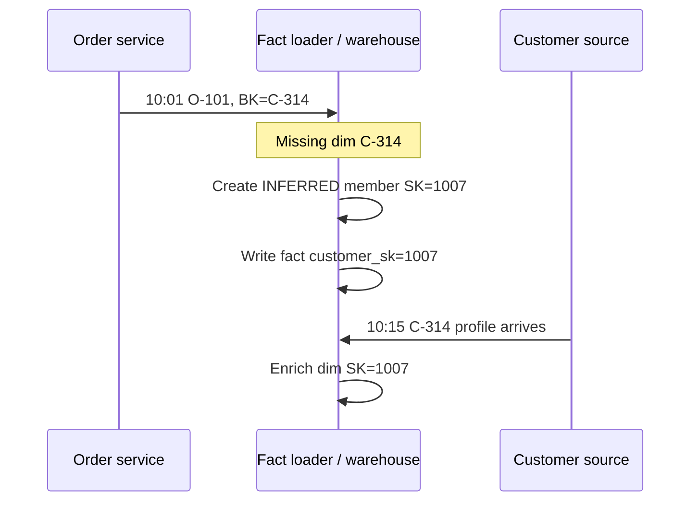
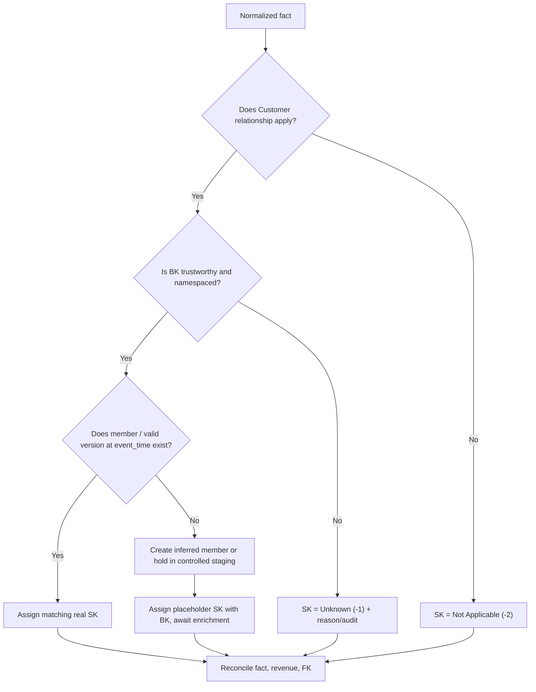

# Unknown Members, Not Applicable Members, and Late-Arriving Dimensions

Imagine a retail data warehouse receiving three sales lines:

1. An online order carries `customer_bk = C-314`, yet the customer record from CRM **has not synced yet**.
2. An order from a legacy system **is missing the customer code altogether**, even though the workflow requires one.
3. A vending-machine transaction **has no concept of a registered customer**, so customer-level analysis does not apply.

If all three are assigned `customer_sk = -1` labeled “Unknown”, reports cannot distinguish data quality bugs, sync backlogs, and valid business cases. If `customer_sk = NULL` is used, inner joins can make **revenue disappear**. If you synthesize fake customer records and guess their region, reports can misattribute revenue to the wrong geography.

In dimensional modeling, we must preserve both **the fact row** and **the meaning of why a complete dimension member is not yet present**. This lesson belongs to the **Dimension Tables** chapter of the **DATABASE_DATA_MODELING** module: moving from business requirements to entities, relationships, keys, constraints, physical schemas, and relational, document, graph, or analytical approaches. Here the focus is distinguishing **unknown**, **not applicable**, **inferred member**, and **late-arriving dimension/fact** cases, then designing ETL/ELT and verification so data remains explainable.

## 1. Start from Fact Grain and Dimension Role

In a star schema:

- The **fact table** holds measurable events or states at a defined **grain**, together with foreign keys referencing dimensions and measures.
- **Dimension tables** provide context to group, filter, and describe facts: customer, product, channel, location, time, employee, and so on.
- A **surrogate key (SK)** is typically a technical warehouse key used by facts to reference a specific dimension row.
- A **business/natural key (BK)** is an identifier supplied by the source system or business domain; the same BK can have multiple historical versions in an SCD Type 2 dimension.

Example:

```text
fact_sales_line
    grain: one recorded line item of an order from a source system
    key: (source_system, order_id, line_no)
    measures: net_amount, quantity
    foreign keys: customer_sk, product_sk, date_sk, channel_sk...

dim_customer
    grain Type 1: one customer identified by (source, customer_bk)
    grain Type 2: one effective attribute version of a customer
    columns: customer_sk, source_system, customer_bk, region, segment...
```

When a sales line occurs, **realized revenue** must not vanish merely because the customer profile has not arrived. Still, the warehouse must record **what is known, what is unknown, and why** in a controlled manner so customer reports are never misinterpreted.

## 2. Four Distinct States That Must Not Be Merged

| State | Is BK known? | Is the dimension relationship meaningful? | Example | Typical handling |
| --- | --- | --- | --- | --- |
| **Known member** | Yes | Yes | CRM already has customer C-314 with valid attributes | Look up real SK; SCD2 selects the matching point-in-time version |
| **Inferred member / early-arriving fact** | **Yes** | Yes | Fact carries C-314, but dim does not yet have C-314 | Create placeholder member with real SK, stable BK; enrich attributes later |
| **Unknown member** | No reliable identifier yet | **Yes, or expected** | Sales record should have a customer, but ID is missing | Use an intentional “Unknown” member; track reason and remediation progress |
| **Not applicable member** | Not needed | **No** | Anonymous kiosk sale, digital product without physical warehouse | Use a “Not Applicable” member separate from Unknown |

There are also cases such as **invalid BK**, **withheld/redacted for privacy**, **not yet loaded**, or **unclassified**. These may warrant separate status codes if workflows, access controls, or metrics demand them. Never force every case into `UNKNOWN` solely because a dimension row lookup failed.

> **Lock down semantics before assigning codes:** “We do not know who the customer is” differs from “this transaction has no customer”; “we know code C-314 but lack the profile” is a third scenario solvable with a placeholder dimension record.

### 2.1. Example Impact on Reporting

| Sales line | Source BK | Customer semantics | Revenue |
| --- | --- | --- | ---: |
| O-101 | `C-314` | Waiting on CRM, identifier known | 120 |
| O-102 | *blank* | Should have customer, ID missing | 40 |
| O-103 | *blank* | Transaction requires no registered customer | 10 |

Total revenue must still equal **170**. Once C-314's profile arrives, 120 can be grouped by region/segment if data is trustworthy. Meanwhile, 40 must never be guessed onto C-314, and 10 should not inflate the “missing-customer record rate” data quality KPI.

## 3. Special Members and Surrogate Keys

A practical technique is creating **special dimension rows** with reserved surrogate keys rather than using an unexplained `NULL`.

| Illustrative `customer_sk` | Label | Meaning |
| ---: | --- | --- |
| `-1` | `UNKNOWN` | Relationship expected, yet member cannot be identified yet |
| `-2` | `NOT_APPLICABLE` | No member exists by business definition |
| `> 0` | `KNOWN` or `INFERRED` | A specific identity carrying a source BK |

Values `-1`/`-2` are merely **a convention within a dimension**. Not every project must use negative integers, and “customer -1” does not share semantics with “product -1”. When using identity keys starting at 1, reserve the special-key range upfront and protect it via constraints or dimension-provisioning processes.

Benefits:

- Facts with `NOT NULL` foreign keys still point to **real dimension rows**, enabling referential integrity checks.
- “Unknown” and “Not Applicable” revenue can be grouped separately.
- No facts are dropped during reporting inner joins, and reports do not need ad-hoc `COALESCE` everywhere.
- ETL can measure missing-information rates rather than silently discarding rows or inventing fake customer names.

**Risk:** if `customer_sk = -1` becomes the default for **every** lookup failure without logging a reason, fact rows can stay Unknown forever even when a valid BK existed, leaving zero traceability. Special members do not replace **classification rules, staging, quality controls, and late-arriving data pipelines**.

## 4. Inferred Member: BK Known Before the Dimension Record Arrives

Suppose order event O-101 arrives ahead of CRM data:

```text
10:00  Order service -> order O-101, customer_bk = C-314
10:01  Fact loader   -> C-314 not yet in dim_customer
10:02  Create dim_customer(C-314, state=INFERRED, customer_sk=1007)
10:02  fact O-101    -> customer_sk=1007, net_amount=120
10:15  CRM sync      -> name, region, segment for C-314
10:16  Enrich dim_customer SK=1007, state=KNOWN
```

The fact **does not need its foreign key changed** once attached to the placeholder SK, provided dimension governance allows enriching that row in place. Reports run before 10:15 can group SK=1007 under “Unclassified”, while post-sync reports group it under its actual region; this behavior represents **retroactive enrichment to latest known data**. If you must reproduce reports “as known at 10:05”, retain point-in-time versions/knowledge snapshots rather than overwriting in place.

### 4.1. Why Not Always Use UNKNOWN?

When `customer_bk = C-314` is already present and trustworthy:

1. It is a specific identity, not “unknown person”.
2. Multiple facts for C-314 can share **one** placeholder SK, avoiding dumping every late customer into bucket `-1`.
3. When the CRM record arrives, updating the dimension by BK enriches everything without scanning and rewriting millions of fact rows.
4. If `-1` were used, you would have to preserve the original BK and run rekeying jobs later to link facts to the real dimension row; if the BK were lost, reliable recovery would be impossible.

**Prerequisite:** the BK must be standardized, source-namespaced, and uniquely identified by rules. String `C-314` from CRM and `C-314` from POS are not guaranteed to be the same customer; never match solely by raw string when source systems have separate keyspaces.

### 4.2. Enriching Attributes Does Not Always Keep the Same SK

In a **Type 1** dimension (overwriting current attributes), an `INFERRED` row can be updated to `KNOWN` while keeping the same SK. However, if the warehouse uses **SCD Type 2** to track historical versions, you must decide:

- From what timestamp is the placeholder valid?
- When the profile arrives, is it **filling in attributes already true at fact time**, or reporting a subsequent attribute change?
- Must a new version row be inserted and fact keys updated by **event time**?

Never assume every late-arriving dimension record is a Type 1 update.

## 5. Three “Late-Arriving” Axes Often Confused

| Scenario | Arrives first | Arrives later | Problem to solve |
| --- | --- | --- | --- |
| **Early-arriving fact / late-arriving dimension** | Fact with BK | Dimension row | Resolve SK for the fact before the dimension has full attributes |
| **Late-arriving dimension change** | Fact and known dimension version | Region/segment change effective **in the past** | Insert/fix SCD2 history and evaluate rekeying affected facts |
| **Late-arriving fact** | Dimension versions may have already changed | Fact with older `event_time` arrives late | Pick dimension row **effective at `event_time`**, not blindly the current row |

Example timeline:



The second and third cases require tracking **valid time**, not merely arrival order at the warehouse. When the system received a record and when an attribute held true in the business are two separate timelines.

## 6. Self-Contained PostgreSQL Schema for Special and Inferred Members

The example below uses a **Type 1** customer dimension to clarify early-arriving fact handling. Type 2 schemas and rules follow in a later section.

### 6.1. Creating the Dimension and Special Rows

```sql
CREATE TABLE dim_customer (
    customer_sk BIGINT GENERATED BY DEFAULT AS IDENTITY PRIMARY KEY,
    source_system TEXT NOT NULL,
    customer_bk TEXT NOT NULL,
    customer_name TEXT,
    region_code TEXT,
    member_state VARCHAR(20) NOT NULL,
    first_seen_at TIMESTAMPTZ,
    completed_at TIMESTAMPTZ,

    CONSTRAINT uq_customer_source_bk
        UNIQUE (source_system, customer_bk),

    CONSTRAINT ck_customer_state CHECK (
        member_state IN (
            'KNOWN', 'INFERRED', 'UNKNOWN', 'NOT_APPLICABLE'
        )
    ),
    CONSTRAINT ck_customer_key_state CHECK (
        (
            customer_sk = -1
            AND source_system = '__SYSTEM__'
            AND customer_bk = '__UNKNOWN__'
            AND member_state = 'UNKNOWN'
        )
        OR
        (
            customer_sk = -2
            AND source_system = '__SYSTEM__'
            AND customer_bk = '__NOT_APPLICABLE__'
            AND member_state = 'NOT_APPLICABLE'
        )
        OR
        (
            customer_sk > 0
            AND source_system <> '__SYSTEM__'
            AND length(btrim(source_system)) > 0
            AND length(btrim(customer_bk)) > 0
            AND member_state IN ('KNOWN', 'INFERRED')
        )
    )
);

INSERT INTO dim_customer (
    customer_sk,
    source_system,
    customer_bk,
    customer_name,
    member_state
) VALUES
    (-1, '__SYSTEM__', '__UNKNOWN__',
     'Unknown', 'UNKNOWN'),
    (-2, '__SYSTEM__', '__NOT_APPLICABLE__',
     'Not applicable', 'NOT_APPLICABLE');
```

Design details:

- `customer_sk` is the SK; normal records get positive identity values, while the two special rows explicitly use `-1` and `-2`.
- `UNIQUE(source_system, customer_bk)` ensures at most one row per namespaced BK in this **Type 1 model**.
- `member_state = 'INFERRED'` permits missing `customer_name`/`region_code`, yet **requires** a BK identifier.
- `member_state = 'UNKNOWN'` and `NOT_APPLICABLE` are restricted to the two system rows, preventing a real customer from carrying “Unknown” as that identity's state.
- A `KNOWN` record may still lack an optional attribute if business rules allow; do not treat any null column as making the whole member unknown. If `region_code` is mandatory to consider a profile “complete”, enforce stronger data quality rules and constraints.

**Do not confuse constraint validity with business policy:** The schema verifies format and presence, not whether two systems refer to the same real person or whether a customer's region is accurate. BK normalization and source reconciliation belong to pipelines and data governance.

### 6.2. Fact Holding Valid SKs and Grain Key

```sql
CREATE TABLE fact_sales_line (
    source_system TEXT NOT NULL,
    source_order_id TEXT NOT NULL,
    line_no INTEGER NOT NULL CHECK (line_no > 0),
    sold_at TIMESTAMPTZ NOT NULL,
    customer_sk BIGINT NOT NULL
        REFERENCES dim_customer(customer_sk),
    customer_source_system TEXT,
    customer_bk_seen TEXT,
    net_amount NUMERIC(18, 2) NOT NULL,
    currency_code CHAR(3) NOT NULL,
    ingested_at TIMESTAMPTZ NOT NULL DEFAULT now(),

    PRIMARY KEY (source_system, source_order_id, line_no),
    CONSTRAINT ck_customer_bk_pair CHECK (
        (customer_source_system IS NULL AND customer_bk_seen IS NULL)
        OR
        (customer_source_system IS NOT NULL
         AND customer_bk_seen IS NOT NULL)
    )
);
```

Grain is **one order line item in a source system**, not “one customer”. A single customer can appear across thousands of facts. `net_amount` is included here to emphasize **preserving measures** even when a dimension arrives late. In production schemas, `product_sk`, `date_sk`, `channel_sk`, and other scoped dimensions also appear.

`customer_source_system` and `customer_bk_seen` preserve the **source-observed identifier** for auditing and rekeying when needed; they can live in staging/audit tables instead of the fact if storage policies require. Keeping the raw BK never authorizes reports to join facts directly to all dimension versions while bypassing SKs.

## 7. ETL/ELT: Fact Knows BK Before Dimension Exists

Suppose OMS sends line `O-101` referencing `CRM/C-314`, while CRM has not synced yet. We ensure the placeholder dimension row exists **before writing the fact**, inside one PostgreSQL transaction.

```sql
BEGIN;

-- Create inferred member if it does not exist yet.
INSERT INTO dim_customer (
    source_system,
    customer_bk,
    member_state,
    first_seen_at
)
VALUES (
    'CRM',
    'C-314',
    'INFERRED',
    TIMESTAMPTZ '2026-11-20 10:02:00+00'
)
ON CONFLICT (source_system, customer_bk) DO NOTHING;

-- Fact looks up the member SK (pre-existing or newly created).
INSERT INTO fact_sales_line (
    source_system,
    source_order_id,
    line_no,
    sold_at,
    customer_sk,
    customer_source_system,
    customer_bk_seen,
    net_amount,
    currency_code
)
SELECT
    'OMS',
    'O-101',
    1,
    TIMESTAMPTZ '2026-11-20 10:00:00+00',
    d.customer_sk,
    'CRM',
    'C-314',
    120.00,
    'VND'
FROM dim_customer AS d
WHERE d.source_system = 'CRM'
  AND d.customer_bk = 'C-314'
ON CONFLICT (source_system, source_order_id, line_no)
    DO NOTHING;

COMMIT;
```

For the same BK, `UNIQUE(source_system,customer_bk)` and `ON CONFLICT DO NOTHING` prevent duplicate inferred rows when workers write concurrently. If the dimension is already `KNOWN`, this statement will not downgrade it back to `INFERRED`.

**Two points that must not be missed:**

1. `ON CONFLICT DO NOTHING` on the fact only illustrates idempotent retries without duplicates. If the same `(source_system, source_order_id, line_no)` arrives with a **different payload** (such as a changed amount), the system must recognize corrections/versions and handle them deliberately rather than silently ignoring differences.
2. If the SK lookup returns zero rows or the insert matches nothing, the pipeline must check written row counts and raise an error. Never allow a fact to vanish silently due to a failed lookup or transaction.

### 7.1. Enriching the Inferred Member When CRM Arrives

```sql
UPDATE dim_customer
SET customer_name = 'Customer C-314',
    region_code = 'NORTH',
    member_state = 'KNOWN',
    completed_at = TIMESTAMPTZ '2026-11-20 10:15:00+00'
WHERE source_system = 'CRM'
  AND customer_bk = 'C-314'
  AND member_state = 'INFERRED'
RETURNING customer_sk, customer_bk, member_state;
```

If `customer_sk` stays 1007, all facts already pointing to 1007 immediately join to the real name and region. This **in-place enrichment** fits when the requirement is current customer state (Type 1).

When CRM sends duplicate updates or subsequent profile changes after enrichment, use a dedicated update/versioning flow; the `member_state='INFERRED'` predicate here intentionally handles only the **placeholder → complete** transition rather than all profile updates.

### 7.2. Without a BK, You Cannot Infer a Member

A source order missing a required customer ID → assign `customer_sk = -1`, logging `source_event_id`/source/reason in an audit layer as needed. Never invent a fake customer with a BK derived from `order_id` just to satisfy a join; doing so turns one real (unknown) customer into many phantom customers.

A transaction with no customer relationship by design → `customer_sk = -2`. Never merge these two groups merely because both have `customer_bk_seen IS NULL`.

## 8. Classify Before Lookup: Transparent Decisioning

A pipeline can select members via a decision tree:



For sources carrying untrustworthy customer IDs (such as mapping collisions, invalid formats, or recycled BKs), creating inferred members **can be dangerous**. Depending on the data, quarantine rows for resolution rather than turning corrupt values into seemingly valid identities.

### Distinguishing “Inferred” from “Default Values”

An inferred member **does not** mean filling `region_code='NORTH'` or `segment='STANDARD'` for everyone. Display “Unclassified” in reports when attributes are missing; keep NULL or explicit quality codes on ingestion. Putting fake defaults into dimensions skews regional/segment KPIs without any way to tell real data from guesses.

## 9. Already-Loaded Unknown Rows: When to Rekey?

Suppose a legacy pipeline routed facts to `customer_sk=-1` even though `customer_bk_seen` was actually present. After fixing source mapping and creating real customer records, you can **rekey** verified facts:

```sql
-- Use only for facts retaining a trustworthy BK and still pointing to UNKNOWN.
-- Run inside an audited backfill workflow with concurrency protection.
UPDATE fact_sales_line AS f
SET customer_sk = d.customer_sk
FROM dim_customer AS d
WHERE f.customer_sk = -1
  AND f.customer_source_system IS NOT NULL
  AND f.customer_bk_seen IS NOT NULL
  AND d.source_system = f.customer_source_system
  AND d.customer_bk = f.customer_bk_seen
  AND d.customer_sk > 0;
```

This illustrates a Type 1 dimension, valid only when the mapping is **unique and reconciled**. In large warehouses, mass `UPDATE`s can be resource-heavy, mutate history, and invalidate aggregates/cubes. Options include key-batched updates, remap tables/partition rewrites, or rebuilding facts from trusted sources.

**Never rekey** a `-1` fact by guessing from IP addresses, similar names, or another order on the same device. If there was originally no BK and no deterministic link evidence, it stays Unknown. If a fact was accurately assigned `-2` (Not Applicable), do not turn it into a customer later just because a likely buyer was inferred; that requires a new business event or policy.

### 9.1. Impact on Previously Published Reports

After rekeying, revenue may shift from Unknown into NORTH while **total revenue stays 170**. Historical breakdowns may change when re-run:

| Read state | NORTH | UNKNOWN | NOT_APPLICABLE | Total |
| --- | ---: | ---: | ---: | ---: |
| Before enriching C-314 | 0 | 160 *(120 inferred missing region + 40 unknown)* | 10 | 170 |
| After C-314 region arrives | 120 | 40 | 10 | 170 |

In the illustration, “UNKNOWN” in the regional report is a **generic label for undetermined region**, not strictly identical to `customer_sk=-1`. An **inferred customer with a positive SK** also has `region_code IS NULL`. Dashboards should separate two concepts: *customer identity completeness* and *region attribute completeness*.

If users must compare “figures published last week” against “latest figures”, store `data_as_of`, metric snapshots/versions, and provenance—or build bitemporal reporting when truly warranted. Never assume late-arriving enrichment leaves historical reports untouched.

## 10. SCD Type 2: One Customer with Multiple Versions Over Time

SCD Type 1 overwrites attributes; SCD Type 2 keeps **versions with validity intervals**. Under Type 2, each version gets **its own SK**, even while sharing the customer's BK.

Suppose customer C-314 changes region:

| `customer_sk` | BK | Region | `valid_from` | `valid_to` |
| ---: | --- | --- | --- | --- |
| 1007 | C-314 | NORTH | 01/01 00:00 | 10/02 00:00 |
| 1088 | C-314 | SOUTH | 10/02 00:00 | ∞ |

An order occurring on **Feb 5 (05/02)** must link to SK **1007** if reports require the region **at purchase time** (*as-was*), even if the fact loads on Feb 20 (20/02). Joining via `is_current = true` to assign SK 1088 misclassifies history.

### 10.1. Reference Schema for Historical Dimensions

```sql
CREATE TABLE dim_customer_scd2 (
    customer_sk BIGINT GENERATED ALWAYS AS IDENTITY PRIMARY KEY,
    source_system TEXT NOT NULL,
    customer_bk TEXT NOT NULL,
    region_code TEXT,
    valid_from TIMESTAMPTZ NOT NULL,
    valid_to TIMESTAMPTZ NOT NULL,
    is_current BOOLEAN NOT NULL,

    CONSTRAINT ck_customer_scd2_time
        CHECK (valid_from < valid_to)
);

CREATE INDEX ix_customer_scd2_asof
    ON dim_customer_scd2 (
        source_system, customer_bk, valid_from, valid_to
    );
```

This is a **separate schema illustrating Type 2**, not combined directly with Section 6's Type 1 `dim_customer`. It still requires a **non-overlapping validity interval** rule for the same `(source_system,customer_bk)`. A plain index and `CHECK (valid_from < valid_to)` cannot enforce non-overlap. In PostgreSQL, consider an exclusion constraint using range types and appropriate extensions, or reliable transactional validation.

In SCD2 tables, `UNIQUE(source_system,customer_bk)` is **wrong** because one BK has multiple versions. You can enforce “at most one current row” with a partial unique index when managing a current flag, though that still does not replace validating non-overlapping historical intervals.

### 10.2. Looking Up the Dimension at Fact Event Time

```sql
-- stage_sales is a staging table holding source, BK, and event_time.
-- Each event should match at most one dimension version.
SELECT
    s.source_event_id,
    s.sold_at,
    d.customer_sk
FROM stage_sales AS s
LEFT JOIN dim_customer_scd2 AS d
    ON d.source_system = s.customer_source_system
   AND d.customer_bk = s.customer_bk
   AND s.sold_at >= d.valid_from
   AND s.sold_at < d.valid_to;
```

**Three outcomes must be controlled:**

1. Matches **one** version → use the corresponding SK.
2. Matches **zero** versions → determine whether it is a bad BK, late dimension, missing history gap, or not-applicable fact; never default blindly to the current member.
3. Matches **multiple** versions → dimension has overlapping intervals, and the join **multiplied fact rows**; fix before computing `SUM(revenue)`.

If a January fact arrives when the dimension currently holds only a February version, locate or reconstruct the version valid in January (or hold the fact unresolved) per policy—never pretend February's region applied to January.

### 10.3. Late-Arriving Retroactive Dimension Changes

Suppose the system created a NORTH version valid from 01/01 to infinity. On 20/02, a notice arrives that the customer **switched to SOUTH effective 10/02**:

- Close the NORTH version's interval at 10/02.
- Insert a SOUTH version starting 10/02 with a new SK.
- Identify facts from 10/02 onward that were previously pinned to the NORTH SK; if reports require *as-was by event time*, run **restatement/rekey** for the affected window or rebuild projections.
- Facts from 01/01 until just before 10/02 keep pointing to NORTH.
- Keep dimension and affected fact updates consistent, or publish a reprocessing status to prevent temporarily skewed reports.

**Never simply insert the new version and stop.** If facts after 10/02 still point to the NORTH SK, regional reports fail to reflect the change. Conversely, if a product requires “freezing published classifications”, skipping rekeying can be a valid policy; explicitly document *as-was*, *as-is*, and *as-known-at-publication* rather than choosing implicitly.

## 11. Late-Arriving Dimensions Differ from Late-Arriving Facts

### 11.1. Late-Arriving Fact

A transaction occurring on 05/02 loads on 20/02, after C-314 has already moved to SOUTH. If reports require the region at sale time, the lookup must use:

```text
customer BK = CRM/C-314
fact event_time = 05/02
choose dimension version valid on 05/02 -> NORTH
not current version on 20/02 -> SOUTH
```

Hence, store at least event time and ingestion time separately. If an order has an accounting `effective_date` distinct from its occurrence timestamp, state explicitly which timeline binds dimension attributes.

### 11.2. Late-Arriving Dimension with Missing Validity History

Fact C-314 arrives early before a dimension row covers `event_time`:

- For Type 1 needing only current attributes, a simple inferred member usually suffices.
- For Type 2, decide whether the placeholder represents **a specific time range** or waits on source history to determine versions. Setting `valid_from = ingestion_time` everywhere causes earlier-dated facts to miss; blindly setting `-infinity` can fabricate false history.
- Hold the fact in controlled staging/quarantine, or link to a BK placeholder marked **version unresolved** and rekey when history arrives. Choice depends on SLAs, reprocessing support, and whether facts must appear immediately on dashboards.

There is no “one-size-fits-all” inferred member rule for every SCD2 dimension; differences come down to **effective-time reliability and historical reproducibility needs**.

## 12. Data Quality: Unknown and Not Applicable Do Not Share One Denominator

Suppose on a single day there are:

- 1,000 transactions where customer info is **mandatory**.
- 50 transactions intentionally having no customer concept.
- Among the 1,000 mandatory transactions, 60 lack an identifier and 40 carry a BK as inferred members.

Different metrics apply:

| Metric | Illustrative formula | Result |
| --- | --- | ---: |
| **Missing identity rate** | 60 / 1,000 | 6% |
| **Pending dimension enrichment rate** | 40 / 1,000 | 4% |
| **Not applicable share** | 50 / 1,050 | ≈ 4.76% |
| **Known identity or BK share** | (900 + 40) / 1,000 | 94% |
| **Completed member coverage** | 900 / 1,000 | 90% |

Adding the 50 Not Applicable transactions into the missing-customer error denominator penalizes operations for a valid business choice. Treating the 40 inferred members as BK-less Unknowns hides CRM ingestion lag metrics.

### 12.1. Sample SQL by Dimension Member State

```sql
SELECT
    d.member_state,
    COUNT(*) AS fact_lines,
    SUM(f.net_amount) AS amount_by_state
FROM fact_sales_line AS f
JOIN dim_customer AS d
  ON d.customer_sk = f.customer_sk
GROUP BY d.member_state
ORDER BY d.member_state;
```

`KNOWN` does not guarantee every customer attribute is populated; track `region_code IS NULL` separately if needed. Also monitor **inferred member age**, count of facts stuck in Unknown, lookup failure rates, BK errors, facts awaiting backfill, and lag between `first_seen_at` and `completed_at`.

On a Type 1 table, once an inferred member becomes `KNOWN`, facts previously linked to it also show as `KNOWN` **as of today's query**. To measure “what was the dim state when the fact loaded”, log **resolution state at ingest** or a separate audit event rather than inferring backward from current dimension state.

### 12.2. Do Not Let Unknown Mask Data Quality Issues

A regional revenue dashboard might lump all `region_code IS NULL` rows into one “Unknown” bucket. Yet:

- Unknown region on a **real customer already carrying a BK** can be enriched later.
- Unknown customer identity (SK -1) is a separate failure mode.
- Not Applicable customer (SK -2) may be excluded from demographic breakdowns while remaining in total company revenue.
- Redacted/withheld for privacy must not count as “incomplete source data” in source-remediation KPIs.

Publish each KPI's **denominator** and unknown-reason taxonomy alongside reports to avoid creating perverse data-cleanup targets.

## 13. Joins and Aggregations: Preserving Revenue When Dimensions Are Incomplete

### 13.1. Why Can an `INNER JOIN` Drop Facts?

If a fact has a nullable foreign key or stores a BK without a matching dimension row, an `INNER JOIN` drops unmatched rows. `SUM(net_amount)` returns less than raw fact revenue—a bug easily missed when the missing rate is small.

With the **special members + `NOT NULL` FK** schema in Section 6, every valid fact points to a dimension row, letting reports join on SK without dropping rows. Still, ETL must guarantee special rows exist and FKs are genuinely enforced (never disabled for bulk loads and forgotten).

Compare totals:

```sql
-- Raw fact totals before any dimension joins.
SELECT COUNT(*) AS fact_rows,
       SUM(net_amount) AS total_amount
FROM fact_sales_line;

-- Totals after joining to dimension by SK.
SELECT COUNT(*) AS joined_rows,
       SUM(f.net_amount) AS total_amount_after_join
FROM fact_sales_line AS f
JOIN dim_customer AS d
  ON d.customer_sk = f.customer_sk;
```

In the sample schema with FKs enforced and clean loads, row counts and total amounts must match. Any mismatch points to bad data, disabled FKs, dimension filters, or joining on the wrong key. With SCD2, joining by BK without a time predicate can **multiply rows**, inflating totals instead of shrinking them.

### 13.2. Do Not Use `COALESCE` to Hide Distinct Causes

`COALESCE(d.region_code, 'UNKNOWN')` can be a clean display label for undetermined regions, yet **it hides the root cause**. Never infer fact/dimension status backward from display strings; store `member_state`/reasons and encode them in metric contracts.

### 13.3. Cohort Analysis and Historical Metrics

When customer C-314's region arrives after the fact appeared, regional reports can shift depending on when they run. If product managers ask for “revenue by customer region **at purchase time**”, use Type 2 and as-of mapping. If they ask for “historical revenue by customer's **current region**”, Type 1/as-is lookup is intentional. No single “right answer” exists until the question is defined.

## 14. Concurrency, Idempotency, and Data Remediation

When multiple workers ingest the same new BK concurrently before a dimension row exists, they risk minting two SKs and splitting facts across two rows. Protect against this **in the database**:

- Unique constraint on `(source_system,customer_bk)` in Type 1, or non-overlapping version rules in Type 2.
- Transactional upsert/lookup or engine-equivalent atomic pattern.
- Controlled retries on conflict; never mint a new SK on each retry.
- Idempotency on **fact grain** and `source_event_id` to avoid duplicate measures.
- When enriching inferred members, prevent late stale updates from overwriting newer values without version/effective-time checks.

In distributed warehouses, dimension and fact writes often run in separate pipelines without cross-system transactions. Choose appropriate **staging, reliable event logs, outbox/CDC, reconciliation, and reprocessing** rather than assuming the example's SQL `BEGIN/COMMIT` spans all storage layers.

### Rekeying and Reconciliation Are Not Always In-Place Updates

In columnar warehouses or data lakes, fixing millions of FKs typically happens via **`MERGE`, partition rewrites, new snapshots, or mapping views**, rather than OLTP-style single-row `UPDATE`s. Ensure:

1. Affected facts are scoped cleanly by BK, source, and effective interval.
2. A trusted mapping version exists before applying changes.
3. Old and new fact versions are never double-counted as two events.
4. Materialized aggregates and dashboard caches rebuild/refresh when needed.
5. Versions, actors/jobs, and rollback paths are audited.

## 15. Testing with a Small Dataset

Suppose the three facts from Section 2 are mapped as:

```text
O-101: C-314  -> inferred SK=1007 -> amount 120
O-102: no BK  -> UNKNOWN SK=-1     -> amount  40
O-103: N/A    -> NOT_APPLICABLE -2 -> amount  10
                                          total 170
```

Before CRM arrives:

```text
dim_customer:
  -1    | UNKNOWN        | region NULL
  -2    | NOT_APPLICABLE | region NULL
  1007  | INFERRED       | region NULL
```

After CRM arrives with `region=NORTH`:

```text
dim_customer:
  -1    | UNKNOWN        | region NULL
  -2    | NOT_APPLICABLE | region NULL
  1007  | KNOWN          | region NORTH
```

Invariants to preserve:

- Fact row count remains **3**; total revenue remains **170**.
- `O-101` still points to SK 1007; no new fact row is needed for Type 1 enrichment.
- 120 shifts into `region=NORTH` when reporting on current attributes.
- 40 stays in identity Unknown; 10 stays in Not Applicable.
- Never “patch” `O-102` to C-314 based on matching date/location without identity proof.

Summary verification query:

```sql
SELECT
    CASE
        WHEN d.member_state = 'NOT_APPLICABLE'
            THEN 'NOT_APPLICABLE'
        WHEN d.region_code IS NULL
            THEN 'REGION_UNKNOWN'
        ELSE d.region_code
    END AS customer_region_bucket,
    COUNT(*) AS fact_lines,
    SUM(f.net_amount) AS net_amount
FROM fact_sales_line AS f
JOIN dim_customer AS d
  ON d.customer_sk = f.customer_sk
GROUP BY 1
ORDER BY 1;
```

**Note:** This query groups by region for display; `REGION_UNKNOWN` contains **both inferred rows missing a region and Unknown identities**. To diagnose bad data, group by `member_state` as well. `NOT_APPLICABLE` stays isolated and is excluded from “share of customer profiles missing region” KPIs when no customer is expected.

## 16. Relational, Document, Graph, and Analytical Models: Preserving Semantics

| Storage model | Representation | What to control |
| --- | --- | --- |
| **Relational / star warehouse** | Dimension SK, fact FK, special rows and inferred members; Type 2 validity intervals | FKs, uniqueness, as-of lookups, restatement, and quality |
| **Document** | Fact event carrying source BK, resolution status, or customer doc reference | Omitted field vs. null, late customer docs, projection updates, and versions |
| **Graph** | Event/order with or without `BELONGS_TO_CUSTOMER` edge; placeholder vertex if policy requires | Missing edge does not automatically mean “not applicable”; store missing reason and valid time |
| **Columnar analytics** | Partitioned facts/dimensions, columnar scans, SK joins, and dimension snapshots/versions | Rekeying, aggregate rebuilds, historical data, and freshness upon enrichment |

In document or graph stores, “no relationship” can mean either **not loaded yet** or **genuinely none**; never jump straight to Not Applicable. Separate **business state** from **unsynced data state**.

For shared dimensions across multiple fact marts (*conformed dimensions*), keep BK namespaces, special-member catalogs, Type 1/Type 2 rules, and as-of policies consistent. If two marts both display “UNKNOWN” while one includes inferred members and the other excludes them, cross-mart KPI comparisons break despite matching labels.

## 17. Testing and Quality Controls

| Test case | Expected outcome |
| --- | --- |
| Fact carries BK C-314, dim not yet present | Inferred row or controlled staging per policy; no dropped fact |
| Two facts with same BK arrive concurrently | Only one inferred identity in Type 1, sharing the same SK |
| CRM enriches inferred row | Type 1 SK unchanged, facts not duplicated |
| Fact missing required BK | UNKNOWN with reason/audit; not silently set to N/A |
| Transaction with no customer concept | NOT_APPLICABLE, not counted as “missing identity” error |
| Fact pointing to nonexistent SK | Rejected by FK or data quality gate |
| Identical BK strings from two distinct sources | Never merged when namespaces differ |
| CRM sends enrichment payload twice | Idempotent; never downgrades KNOWN back to INFERRED |
| Account changes region retroactively | Non-overlapping SCD2; affected facts remapped per policy |
| Late fact occurred prior to region change | Selects version effective at event time, not current |
| Two SCD2 versions match one fact | Blocked/reconciled; revenue never doubled |
| Rekey Unknown fact that had a trustworthy BK | Fact count and measure sums unchanged, audited |
| Unknown fact lacking a BK | Never guesses an identity to rekey |
| Regional report before/after dim enrichment | Total measure preserved; distribution shifts per policy |
| Source correction at same grain | Never inserts a second fact and sums both |
| “Unknown rate” dashboard | Numerator/denominator separate missing identity, inferred, and N/A |
| Pipeline rerun after mid-step failure | Idempotent reprocessing; no extra SKs or duplicate facts |

### Sample Diagnostic Queries

```sql
-- Placeholder dimensions waiting too long for enrichment.
SELECT source_system, customer_bk, first_seen_at
FROM dim_customer
WHERE member_state = 'INFERRED'
  AND first_seen_at < now() - INTERVAL '1 day'
ORDER BY first_seen_at;

-- Member state distribution across fact rows.
SELECT d.member_state, COUNT(*) AS fact_count
FROM fact_sales_line AS f
JOIN dim_customer AS d ON d.customer_sk = f.customer_sk
GROUP BY d.member_state;

-- Detect high rates of placeholder/special SKs.
SELECT
    COUNT(*) FILTER (WHERE customer_sk = -1)
        AS unknown_lines,
    COUNT(*) FILTER (WHERE customer_sk = -2)
        AS not_applicable_lines,
    COUNT(*) AS total_lines
FROM fact_sales_line;
```

An alert threshold like “inferred older than 24 hours” must come from actual data SLAs, not a universal rule for every warehouse. With sensitive data, control access to raw BKs, logs, and reconciliation outputs; never use unauthorized side-channel data to infer identities for Unknown facts.

## 18. Practice Exercises

### Exercise A — Three Orders and Two Special Members

One fact has `customer_bk = CRM/C-314` missing from the dimension; one fact lacks a required customer BK; one anonymous sale requires no customer by workflow. Revenues are 120, 40, and 10 respectively.

Design the SK lookup and state classification, then describe what happens 15 minutes later when CRM supplies C-314 in region NORTH. Specify which reports change and which **must not change**.

**Hint:** C-314 → inferred member with real BK/SK; missing-BK fact → Unknown; non-applicable transaction → N/A. Total company revenue stays 170; regional breakdowns change once the inferred member is enriched.

### Exercise B — Distinguishing “Unknown” from “Withheld”

Due to privacy policy, customer BK is withheld in a specific flow. Should it be tagged Unknown and counted in the “missing source data” KPI? Propose a member state, access controls, statistical rules, and tests preventing accidental user re-identification.

**Hint:** if withheld/redacted carries distinct operational meaning, separate the reason; restrict stored/exposed fields and prohibit inferring identity from neighboring attributes.

### Exercise C — Late Fact and SCD2

Customer C-314 was in NORTH from 01/01 until before 10/02, moving to SOUTH on 10/02. On 20/02, the warehouse receives a transaction that occurred on 05/02 and another on 15/02.

Write the join condition using BK + `valid_from <= sold_at < valid_to`, pick the SK for each fact, and explain why `is_current=TRUE` is wrong for the 05/02 transaction.

**Hint:** 05/02 → NORTH; 15/02 → SOUTH, assuming non-overlapping validity ranges and reconciled sources.

### Exercise D — Late-Arriving Dimension Change and Backfill

Initially the system believed C-314 belonged to NORTH for all of February. On 20/02 it discovers the region change took effect on 10/02. Propose an SCD2 update workflow, identify facts needing remapping, handle materialized aggregates, and ensure total revenue stays invariant while regional groupings update.

**Hint:** close NORTH at 10/02, insert SOUTH, query facts by BK/event time from 10/02 onward, rekey or rebuild by version. Reconcile totals and monitor restatement jobs.

### Exercise E — Designing a Dimension Quality SLA

A warehouse ingests 1 million facts/day: 1% unknown identity, 3% pending inferred, and 4% not applicable. Operations targets “Unknown rate below 2%”.

Define the KPI **numerator and denominator**, how to avoid penalizing N/A facts, how to track enrichment latency for inferred rows, and alerting on Unknown spikes by source system.

**Hint:** separate missing BK, pending dimension, and not applicable; the identity-error denominator should be facts where a Customer relationship **is required**, not necessarily all facts.

## 19. Dimension Design Sign-Off Checklist

- [ ] Fact and dimension **grains** stated explicitly, with BK/SK and source-system namespaces defined.
- [ ] **UNKNOWN**, **NOT_APPLICABLE**, **INFERRED**, and **KNOWN** clearly separated; not every null collapsed into one bucket.
- [ ] Additional states (invalid, withheld, not-loaded) defined if they genuinely affect workflows or metrics.
- [ ] Special members exist as **real dimension rows** when using `NOT NULL` FKs, with reserved keys and constraints enforced.
- [ ] Trustworthy BKs arriving ahead of dimensions handled via inferred members or staging without losing facts.
- [ ] Pipeline enforces uniqueness, idempotency, and concurrency safety when workers process the same BK.
- [ ] Enriching inferred rows cannot downgrade them back to unknown; provenance/versioning and Type 1/Type 2 rules defined.
- [ ] For Type 2, validity intervals never overlap; late facts look up **by event time**, never blindly `is_current`.
- [ ] Late-arriving dimension changes have restatement/rekey policies, reconciliation, and published aggregate handling.
- [ ] Facts retain source evidence needed to resolve missing members where permitted; never guess unverified identities.
- [ ] Grand totals never lose revenue from missing dims or multiply revenue across multiple versions.
- [ ] Quality KPIs separate missing identity, pending enrichment, missing attributes, and N/A under proper denominators.
- [ ] Monitoring tracks inferred age, unknown rates, BK collisions, invalid FKs, backfill jobs, and data freshness.
- [ ] Privacy, deletion, and access controls cover BKs and potentially identifying attributes.
- [ ] Tested early/late arrivals, retroactive Type 2 updates, duplicates, corrections, and measure reconciliations.

**Takeaway:** **Unknown** means a relationship is expected yet the member cannot be identified; **Not Applicable** means no relationship exists by business definition; **Inferred member** means **an identity/BK is known while the dimension record or attributes have not arrived yet**. When data arrives out of order, keep SKs/FKs consistent, look up versions by business time, retain provenance, and define restatement rules. The goal is not merely making joins run, but **preserving every fact, keeping totals exact, and protecting historical meaning**.
