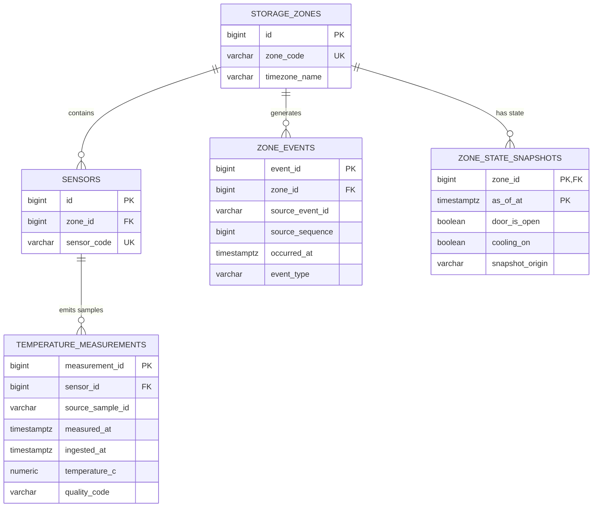
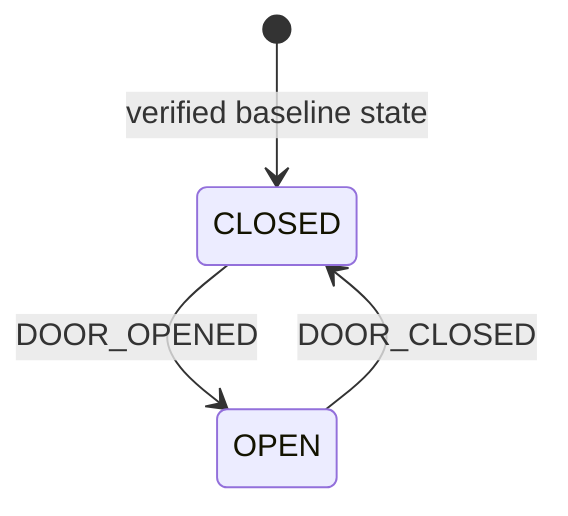
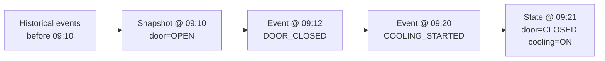
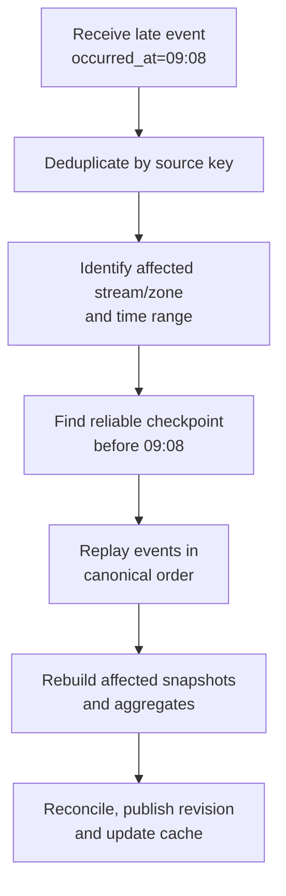

# Distinguishing Time-Series Measurements, Events, and State Snapshots

A cold storage facility has sensors measuring temperature every minute, a controller emitting notifications when the door opens or closes, and a system saving device state every hour. All three record types carry timestamps, yet they answer **three different questions**:

- **Time-series measurement**: “What was the temperature measured by the sensor at 09:09?”
- **Event**: “What happened at 09:08, and what does it mean to the business?”
- **State snapshot**: “At 09:10, was the door open or closed, and was the cooling unit running?”

Mixing these types into a single table without defining the **grain**, time semantics, and update rules makes it easy for the system to produce wrong answers: counting every temperature reading as an alarm, using end-of-day snapshots to infer how many times the door opened, or summing inventory balances across multiple timestamps as if they were incremental transactions.

This lesson belongs to the **Time-Series Data** chapter of the **DATABASE_DATA_MODELING** module. Its goal is to translate business requirements into a model with appropriate entities, keys, relationships, constraints, indexes, and storage choices; distinguish measurements, events, and states; choose data structures that evolve cleanly; and verify answers with SQL as well as real-world scenarios such as late-arriving messages, missing data, unsynchronized clocks, and retroactive corrections.

## 1. Three Data Types: Same Timestamp Concept, Different Semantics

| Characteristic | Measurement | Event | State Snapshot |
|---|---|---|---|
| What one row represents | A measured/observed value at a point in time | An occurrence or state transition that happened | The state of an entity at an *as-of* timestamp |
| Primary question | “What was the value then?” | “What happened?” | “What state was the system in then?” |
| Example | 5.1 °C at 09:09 | Door opened at 09:08 | Door open, cooling unit running at 09:10 |
| Frequency | Usually periodic or upon a new sample | Whenever a condition/occurrence happens | Periodic, on demand, or at checkpoints |
| Common key | Sensor + source sample ID | Unique source event ID | Entity + snapshot timestamp |
| Change pattern | Usually append samples; faulty samples may be corrected | Usually append-only; corrected via compensating events or controlled corrections | Can be rebuilt when late source data arrives |
| Common aggregations | Min, max, average, percentile, coverage | Count, frequency, duration between events | End-of-period state, time spent in state if full history exists |
| Major risks | Irregular sampling, dropped samples, wrong units | Duplicate/out-of-order delivery, missing transitions | Stale, missing timestamps, failing to reflect late-arriving events |

**A timestamp does not determine the data type.** An event also has a timestamp and can be stored in a time-series system; a snapshot can also be recorded on a fixed schedule. We classify data by **the meaning of a single row and the business question**, not by the database name or whether the table has a `timestamp` column.

### A Shared Timeline

Consider the same cold storage zone:

| Local Time | Type | Record | Interpretation |
|---|---|---|---|
| 09:00 | Event | `DOOR_CLOSED` | A door-closing event occurred |
| 09:05 | Measurement | Temperature `3.2 °C` | Sensor read a value at 09:05 |
| 09:08 | Event | `DOOR_OPENED` | Door state transitioned to open |
| 09:09 | Measurement | Temperature `5.1 °C` | New temperature sample |
| 09:10 | Snapshot | `door_open = true`, `cooling_on = true` | State at 09:10 |
| 09:12 | Event | `DOOR_CLOSED` | Door closed again |

You cannot conclude that “the temperature was continuously 5.1 °C from 09:09 to 09:12” from a single measurement unless the analytical model **explicitly specifies** holding the value between readings. Conversely, if door open/close events are complete, ordered, and backed by a reliable initial state, you can infer that the door was open from 09:08 to 09:12, i.e., **4 minutes**.

## 2. Grain: What Does Each Row Represent and When Are Two Rows Duplicates?

**Grain** is the exact definition of a single record's level of detail. A model with a clear grain can answer: “Are these two rows two distinct events/samples, or one message delivered twice?”

### 2.1. Grain of a Measurement

Example:

> One row in `temperature_measurements` = one temperature sample from **one sensor**, emitted by a source with a specific **sample ID**, at a measurement timestamp.

Sensors A and B can both take measurements at 09:09 without colliding. Sensor A could also emit two distinct samples sharing the same `measured_at` if hardware permits; therefore, `(sensor_id, measured_at)` is only a unique key when the source **guarantees** no two distinct samples share a timestamp. Without that guarantee, use a source-provided `source_sample_id`/sequence for exact identification.

### 2.2. Grain of an Event

Example:

> One row in `zone_events` = one specific event notification emitted by a controller, with a unique event ID within the source scope.

`DOOR_OPENED` at 09:08 and `DOOR_OPENED` at 10:03 are two distinct events. A `DOOR_OPENED` message at 09:08 sent three times due to retries is still **one** event if it shares the same source ID. The event ID supports deduplication and traceability; never assign a new ID each time a pipeline re-receives the same message and treat it as a new event.

### 2.3. Grain of a Snapshot

Example:

> One row in `zone_state_snapshots` = the state of an entire cold storage zone at one `as_of_at` timestamp, according to a defined snapshot methodology.

Two snapshots at 09:10 and 09:20 may contain the same value `door_open = true` yet remain two distinct snapshots because their **timestamps** differ. Conversely, two snapshots for the same `zone_id` and the same `as_of_at` require a rule: keep the latest effective version, store revisions, or reject duplicates. Do not rely on ingestion timestamps to distinguish states captured at the exact same business point in time.

### 2.4. Grain Does Not Have to Be One Row Per Second

A reading every 30 seconds, an event emitted only on state changes, and a snapshot taken every 15 minutes are all time-oriented datasets. Adding a `time_bucket` column enables aggregation, but it **does not turn** the underlying data into records with the same grain.

When rolling up from minutes to hours, clarify whether the result is:

- The average/extremes **of the measurement samples** within the hour.
- The number of **events** that occurred within the hour.
- The **state at the end of the hour** or the duration spent in each state.

These three quantities cannot be added together or substituted for one another arbitrarily.

## 3. Time Dimensions Must Be Named Precisely

In distributed systems, a single record can have multiple timestamps; naming all of them `created_at` destroys their meaning.

| Timestamp | Meaning | Example Column |
|---|---|---|
| **Event time** | When the occurrence actually happened according to the source | `occurred_at` |
| **Measurement time** | When the sensor measured/recorded a value | `measured_at` |
| **As-of time** | The point in time for which a snapshot claims to reflect the state | `as_of_at` |
| **Ingestion/received time** | When the system received the record | `ingested_at` / `received_at` |
| **Processing/computed time** | When a pipeline computed a result or snapshot | `computed_at` |
| **Valid time** | The time interval during which a state/rule is effective in the business domain | `valid_from` / `valid_to` when needed by the model |

### 3.1. An Event Can Arrive After It Occurred

```text
09:08:00   Door opens; controller records occurred_at
09:08:01   Device loses network connectivity
09:15:20   Connection restored; server receives event

occurred_at = 09:08:00
received_at = 09:15:20
```

If a dashboard asks “when did the door open?”, it must use `occurred_at`. If operations asks “how late did the pipeline receive the event?”, use `received_at - occurred_at`, while recognizing that device clocks can drift. Never assume both timestamps are equally trustworthy.

### 3.2. Use UTC to Store Instants, and Timezones for Display / Business Days

In PostgreSQL, `TIMESTAMPTZ` represents a timezone-aware instant; the database may display it in the session timezone, which does not mean it preserves the device's timezone name. For multi-region systems, store instants and separately track `zone_timezone`/business region when grouping by local calendar days.

For example, these two strings:

```text
2026-11-22T09:08:00+07:00
2026-11-22T02:08:00Z
```

represent **the exact same instant**. Grouping by “local day” must specify the timezone; in regions with DST rules, a day may not be exactly 24 hours long.

### 3.3. Ordering When Timestamps Are Equal

Two events with the same `occurred_at` have no deterministic business order from the timestamp alone. Use `source_sequence` or another source-guaranteed ordering field. An auto-incrementing `event_id` in the database only reflects insertion/arrival order, **not** occurrence order. If no tie-breaker exists, mark the order as **indeterminate** rather than fabricating order with `ORDER BY event_id` and treating it as ground truth.

## 4. Sample Data Model for Cold Storage

A relational model can use four main groups: storage zones, sensors, measurements, control events, and state snapshots. Their relationships are enforced with foreign keys.



### 4.1. Illustrative PostgreSQL DDL

```sql
CREATE TABLE storage_zones (
    id BIGINT GENERATED ALWAYS AS IDENTITY PRIMARY KEY,
    zone_code VARCHAR(40) NOT NULL UNIQUE,
    timezone_name VARCHAR(80) NOT NULL
);

CREATE TABLE sensors (
    id BIGINT GENERATED ALWAYS AS IDENTITY PRIMARY KEY,
    zone_id BIGINT NOT NULL REFERENCES storage_zones(id),
    sensor_code VARCHAR(80) NOT NULL UNIQUE
);

CREATE TABLE temperature_measurements (
    measurement_id BIGINT GENERATED ALWAYS AS IDENTITY PRIMARY KEY,
    sensor_id BIGINT NOT NULL REFERENCES sensors(id),
    source_system VARCHAR(40) NOT NULL,
    source_sample_id VARCHAR(100) NOT NULL,
    measured_at TIMESTAMPTZ NOT NULL,
    ingested_at TIMESTAMPTZ NOT NULL DEFAULT CURRENT_TIMESTAMP,
    temperature_c NUMERIC(7, 3),
    quality_code VARCHAR(12) NOT NULL
        CHECK (quality_code IN ('OK', 'SUSPECT', 'MISSING')),
    CONSTRAINT uq_temperature_source_sample
        UNIQUE (source_system, source_sample_id),
    CONSTRAINT ck_temperature_quality_value
        CHECK (
            (quality_code = 'MISSING' AND temperature_c IS NULL)
            OR
            (quality_code IN ('OK', 'SUSPECT')
             AND temperature_c IS NOT NULL)
        )
);

CREATE TABLE zone_events (
    event_id BIGINT GENERATED ALWAYS AS IDENTITY PRIMARY KEY,
    zone_id BIGINT NOT NULL REFERENCES storage_zones(id),
    source_system VARCHAR(40) NOT NULL,
    source_event_id VARCHAR(100) NOT NULL,
    source_sequence BIGINT NOT NULL,
    event_type VARCHAR(30) NOT NULL CHECK (
        event_type IN (
            'DOOR_OPENED', 'DOOR_CLOSED',
            'COOLING_STARTED', 'COOLING_STOPPED'
        )
    ),
    occurred_at TIMESTAMPTZ NOT NULL,
    received_at TIMESTAMPTZ NOT NULL DEFAULT CURRENT_TIMESTAMP,
    CONSTRAINT uq_event_source_id UNIQUE (source_system, source_event_id),
    CONSTRAINT uq_event_source_sequence
        UNIQUE (zone_id, source_system, source_sequence)
);

CREATE TABLE zone_state_snapshots (
    zone_id BIGINT NOT NULL REFERENCES storage_zones(id),
    as_of_at TIMESTAMPTZ NOT NULL,
    door_is_open BOOLEAN NOT NULL,
    cooling_on BOOLEAN NOT NULL,
    snapshot_origin VARCHAR(12) NOT NULL
        CHECK (snapshot_origin IN ('OBSERVED', 'REPLAYED')),
    source_watermark_at TIMESTAMPTZ,
    computed_at TIMESTAMPTZ NOT NULL DEFAULT CURRENT_TIMESTAMP,
    PRIMARY KEY (zone_id, as_of_at)
);

CREATE INDEX idx_measurements_sensor_time
    ON temperature_measurements(sensor_id, measured_at DESC);

CREATE INDEX idx_zone_events_type_time
    ON zone_events(zone_id, event_type, occurred_at DESC);
```

Important assumptions:

1. `source_sample_id` is unique **within a `source_system`**. If a source only issues IDs unique per sensor, include `sensor_id` in the unique key or normalize the source key beforehand.
2. `source_sequence` is monotonically generated and unique within each `(zone_id, source_system)` pair in this example. If the controller resets its sequence on reboot, add `epoch`/`session_id` to the identifier and ordering rule instead of relying on this constraint as-is.
3. When door state must be reconstructed accurately, door events in this example come from **a single authoritative control source**, such as `source_system = 'ZONE_CTRL'`. If multiple sources emit events, you must define reconciliation and unified ordering rules.
4. `snapshot_origin = 'OBSERVED'` means an independent snapshot captured from physical/actual state; `'REPLAYED'` means recomputed from the event stream. The two can diverge and must be reconciled rather than assumed identical.
5. `source_watermark_at` is meaningful only when the pipeline defines a corresponding completeness boundary. Storing a timestamp alone does not guarantee all earlier events have arrived.

This DDL illustrates the concepts; when porting to a time-series database or analytical warehouse, verify how that platform enforces PK/FK/UNIQUE constraints, partitioning, and timestamp storage.

### 4.2. Why Not Merge Everything into One `zone_log` Table?

A single table with `time`, `type`, `value` can record both “temperature = 5.1” and “door open”. However, the consequences include:

- `value` has to hold numbers, booleans, status codes, or JSON.
- No clear unit or data-type constraints per measurement.
- Difficult to define proper keys and deduplication rules for both samples and events.
- `AVG(value)` can accidentally include non-measurement rows.
- Current state has to be re-interpreted across rows with different semantics.

A generic raw stream like an event envelope can make sense at the **ingestion layer**, but analytical/query models should separate *record semantics* and enforce type-specific constraints. Do not substitute JSON log convenience for grain and data contracts.

## 5. Measurement Data: Values, Units, Quality, and Sampling Frequency

### 5.1. A Measurement Is an Observation, Not a State Change

A sensor records:

```text
Sensor T-A-01:
09:05  3.2 °C
09:09  5.1 °C
09:13  4.0 °C
```

Three rows represent **three measurements**. They do not mean “three temperature increases” happened, nor do they prove three alarms occurred. Turning measurements into alerts requires **detection rules**: thresholds, duration, hysteresis, sample quality, and missing-data policies.

Units must be fixed in the contract: `temperature_c` is always degrees Celsius; if a device sends °F, convert it in a controlled manner or store the unit type and normalize—never mix `32 °F` and `32 °C` in the same column and compute an average.

### 5.2. `NULL` Is Not Zero

If a sensor disconnects:

```text
09:05 = 3.2 °C  (OK)
09:06 = no sample
09:07 = no sample
09:08 = 4.1 °C  (OK)
```

Either **absent rows** or rows with `quality_code = 'MISSING'` represent missing data. Recording **0 °C** as a placeholder for missing data distorts averages and can trigger false alarms. SQL `AVG` ignores `NULL`, but that result is only the average over **present valid samples**, and does not automatically represent a continuous time-weighted average.

The `SUSPECT` code can be used when a sample exists but is questionable. Do not delete suspect rows from raw data if auditing is needed; whether metrics exclude or include them depends on the semantic contract.

### 5.3. Gauges and Counters Do Not Use the Same Math

Temperature, pressure, and instantaneous water level are **gauges**: observations of a value at a point in time. By contrast, a cumulative electricity meter `total_kwh` is a **counter**: a cumulative value that normally increases and may reset when equipment is replaced or restarted.

| Type | Example | Valid Queries | Typical Mistake |
|---|---|---|---|
| Gauge | `temperature_c` | Min/max, sample or time-weighted average, threshold exceedance | `SUM(temperature_c)` labeled “total temperature” |
| Cumulative counter | `total_kwh` | Difference between valid points, consumption rate, handling resets | Summing raw counter readings across a day |
| Delta/event count | `items_moved = +3` | Sum of deltas over an appropriate window | Treating delta as current balance |
| Snapshot balance | `stock_on_hand = 50` | Balance at a point in time, end of period | Summing daily snapshots to get monthly stock |

If a counter rises from 1200 to 1212 kWh, consumption between the two points is **12 kWh**, **assuming** no reset, rollover, correction, or source change occurred. When a counter drops from 1212 to 8, you must not conclude negative consumption of −1204 kWh; you must check for a reset or meter replacement.

### 5.4. Sample Average vs. Time-Weighted Average

Suppose temperature readings are:

```text
09:00:  2 °C
09:01: 10 °C
09:10:  2 °C
```

The arithmetic sample average of the three readings is `(2 + 10 + 2) / 3 = 4.67 °C`. However, if you choose a **last-observation-carried-forward model**, it is 2 °C from 09:00 to 09:01 (1 minute) and 10 °C from 09:01 to 09:10 (9 minutes). Then the time-weighted average over **[09:00, 09:10)** is `(2×1 + 10×9)/10 = 9.2 °C`.

Both numbers are mathematically correct **for two different definitions**. Do not hold a value indefinitely when a sensor drops offline; specify a **maximum gap**, interpolation/carry-forward method, and interval boundaries. When devices sample uniformly, sample average can be an acceptable approximation, but verify that assumption.

## 6. Events: Changes, Causes, and Replayable Records

### 6.1. Events Store “What Happened”, Not Necessarily Full State

`DOOR_OPENED` says that **the door opened** at `occurred_at`; it does not necessarily contain every current attribute of the storage zone. In many designs, an event includes:

- Source event ID and entity ID.
- Event type and occurrence time.
- Data payload needed to explain or apply the change.
- Source sequence or ordering metadata.
- Schema/version, causation ID, and correlation ID if auditing or business-chain tracing is needed.

A business event like `ORDER_CONFIRMED` is not the same as a technical log “HTTP 200”. Nor is it necessarily a CDC record `UPDATE table SET ...`: CDC describes storage changes, whereas a domain event expresses business meaning.

### 6.2. Events Can Represent State Transitions

For a cold storage door:



If the source guarantees door events are complete, ordered, and have an initial baseline, the door state is derived by applying transitions sequentially.

What happens when two consecutive `DOOR_OPENED` events arrive? Possible causes include:

- The source resent an old event.
- The device emits non-standard transitions.
- A `DOOR_CLOSED` event was lost.
- The semantics of `DOOR_OPENED` actually mean “sensor sees door currently open” rather than “transitioned from closed to open”.

Therefore, do not hard-code “every OPENED event increments the open count by one” unless the source contract explicitly guarantees transition semantics. Use event IDs, sequences, and an appropriate state machine.

### 6.3. Counting Events vs. Counting State Transitions

```sql
SELECT date_trunc('hour', occurred_at) AS hour_utc_session,
       COUNT(*) AS open_events
FROM zone_events
WHERE zone_id = :zone_id
  AND source_system = 'ZONE_CTRL'
  AND event_type = 'DOOR_OPENED'
GROUP BY date_trunc('hour', occurred_at)
ORDER BY hour_utc_session;
```

This query counts **stored `DOOR_OPENED` events**, which does not prove the actual number of transitions if the source duplicates, drops, or emits events with different semantics. The alias `hour_utc_session` is accurate only when the PostgreSQL session uses UTC; the safer approach is to specify the timezone explicitly in the query or reporting configuration.

For local-day reports, use the business timezone rather than defaulting to the server's timezone.

### 6.4. Computing Open Duration from State Transitions

Given two consecutive events `OPENED` at 09:08 and `CLOSED` at 09:12, the door was open for 4 minutes. When summing over a reporting window, you must **clip intervals against window boundaries** and handle doors that were already open before the window started.

An illustrative PostgreSQL query for a door stream that is **already deduplicated, complete, and ordered**:

```sql
WITH transitions AS (
    SELECT
        event_type,
        occurred_at AS start_at,
        LEAD(occurred_at) OVER (
            ORDER BY occurred_at, source_sequence
        ) AS next_at
    FROM zone_events
    WHERE zone_id = :zone_id
      AND source_system = 'ZONE_CTRL'
      AND event_type IN ('DOOR_OPENED', 'DOOR_CLOSED')
)
SELECT
    SUM(
        EXTRACT(EPOCH FROM (
            LEAST(COALESCE(next_at, :to_time), :to_time)
            - GREATEST(start_at, :from_time)
        ))
    ) AS open_seconds
FROM transitions
WHERE event_type = 'DOOR_OPENED'
  AND start_at < :to_time
  AND COALESCE(next_at, :to_time) > :from_time;
```

Here `:from_time` and `:to_time` are `TIMESTAMPTZ` values defining the half-open interval `[from, to)`. This query is only correct when a `DOOR_OPENED` starts an open interval lasting until the next transition event and events are normalized. You must still handle streams starting in an already-open state, missing events, non-alternating transitions, equal-timestamp ties, and trailing intervals without a closing event. If no open interval overlaps the window, `SUM` returns `NULL`; dashboards may coalesce it to 0 per contract after verifying sufficient history.

**Do not use the count of snapshot rows with `door_is_open = true` as “number of door openings”**: multiple snapshots may belong to a single opening.

## 7. Snapshots: State at a Point in Time, Not a New Event

### 7.1. Directly Observed vs. Replayed Snapshots

There are two ways to produce snapshots:

1. **Observed snapshot:** the controller reports “door is open, cooling is running at 09:10”. This is an independent observation at that timestamp.
2. **Replayed snapshot:** a pipeline applies events from a baseline state and stores the result “door open, cooling running at 09:10”.

Both share the grain “one state at one point in time”, but their reliability dependencies differ: observed snapshots can expose lost events; replayed snapshots reduce replay cost but inherit every flaw or gap in the event stream.

### 7.2. Snapshots Do Not Capture Every Change Between Checkpoints

```text
09:00 snapshot: door=CLOSED
09:05 event: DOOR_OPENED
09:07 event: DOOR_CLOSED
09:10 snapshot: door=CLOSED
```

If you only keep the two snapshots, it may look like the door stayed closed throughout 09:00–09:10. **You cannot infer that.** A snapshot describes state at the capture instant; it does not prove no state transitions occurred between snapshots.

Therefore:

- Need **number of door openings**: use events (or an equivalent defined counter source).
- Need **whether the door was open at 09:10**: a valid snapshot or replay works.
- Need **total door-open duration**: complete event transitions or observed data with sufficient resolution and an accepted calculation method; sparse snapshots do not provide exact durations.

### 7.3. Snapshots as Checkpoints for Fast Reconstruction

With millions of events, replaying from device installation every time you query current state is expensive. A **checkpoint snapshot** saves the computed state up to `as_of_at`. To return state after that point, you only apply events occurring **after** the snapshot.



For results to be accurate, snapshots must be computed using **the exact same reducer rules**, record a clear processed event position (timestamp/sequence/watermark), and be invalidated/rebuilt if a late-arriving historical event alters the saved state.

### 7.4. Difference from Current-State Tables

A table `zone_current_state(zone_id PK, door_is_open, cooling_on, updated_at)` serves real-time queries well, but it retains only **the current version** and cannot accurately answer “what was the state at 09:10 yesterday” without separate history. It is a *materialized current state*, distinct from a historical snapshot series keyed by `(zone_id, as_of_at)`.

Do not treat the `updated_at` column on a current-state table as turning it into a complete historical fact table.

## 8. “As-Of” Queries: Reconstructing State at a Point in Time

### 8.1. Fetching the Latest Event May Suffice for a Simple State

If door state is solely determined by `DOOR_OPENED` and `DOOR_CLOSED` events, and `ZONE_CTRL` is authoritative:

```sql
SELECT
    CASE event_type
        WHEN 'DOOR_OPENED' THEN TRUE
        WHEN 'DOOR_CLOSED' THEN FALSE
    END AS door_is_open,
    occurred_at
FROM zone_events
WHERE zone_id = :zone_id
  AND source_system = 'ZONE_CTRL'
  AND event_type IN ('DOOR_OPENED', 'DOOR_CLOSED')
  AND occurred_at <= :as_of_time
ORDER BY occurred_at DESC, source_sequence DESC
LIMIT 1;
```

This returns the state **inferred from the last door event**, not from the latest temperature reading. If no event exists before the query timestamp, the state is **unknown** unless a reliable baseline is defined.

This query works only if `source_sequence` defines ordering for equal timestamps within the chosen source. When a stream has competing sources, reconcile them first.

### 8.2. Combining a Replayed Snapshot with Subsequent Events

When reliable checkpoint snapshots and a corresponding event stream exist, take the latest snapshot no later than the target time, then look up the latest door event **after** that snapshot:

```sql
WITH latest_snapshot AS (
    SELECT as_of_at, door_is_open
    FROM zone_state_snapshots
    WHERE zone_id = :zone_id
      AND snapshot_origin = 'REPLAYED'
      AND as_of_at <= :target_time
    ORDER BY as_of_at DESC
    LIMIT 1
),
last_door_event AS (
    SELECT event_type
    FROM zone_events
    WHERE zone_id = :zone_id
      AND source_system = 'ZONE_CTRL'
      AND event_type IN ('DOOR_OPENED', 'DOOR_CLOSED')
      AND occurred_at <= :target_time
      AND occurred_at > COALESCE(
          (SELECT as_of_at FROM latest_snapshot),
          '-infinity'::timestamptz
      )
    ORDER BY occurred_at DESC, source_sequence DESC
    LIMIT 1
)
SELECT CASE
    WHEN (SELECT event_type FROM last_door_event) = 'DOOR_OPENED'
        THEN TRUE
    WHEN (SELECT event_type FROM last_door_event) = 'DOOR_CLOSED'
        THEN FALSE
    ELSE (SELECT door_is_open FROM latest_snapshot)
END AS door_is_open;
```

This snippet illustrates **one door attribute**. To reconstruct `cooling_on`, handle `COOLING_STARTED/STOPPED` and the corresponding snapshot field separately. For complex reducers (e.g., events carrying increments/decrements or coordinating multiple entities), you cannot just inspect the final event; you must **apply all events sequentially** from the checkpoint.

Conditions for correctness:

1. The `REPLAYED` snapshot reflects all known events up to `as_of_at` under the same rules.
2. Events after the snapshot are deduplicated, properly ordered, and not missing within the requested range.
3. Events with `occurred_at = as_of_at` are already included in the snapshot per the stated half-open rule; the query only replays events strictly after it.
4. If a late event arrives **before** the snapshot and affects state, that checkpoint and subsequent snapshots must be recomputed. Replaying only events after the snapshot **will not fix that error**.

For `OBSERVED` snapshots, do not blindly combine them with event replay using this formula without a contract defining baseline authority, reliability, and conflict resolution.

### 8.3. “As-Of” Has Multiple Temporal Meanings

“State at 09:10” can mean:

- The state that was **actually in effect** at 09:10 given all source events eventually known.
- The state that **the system knew at 09:10**, when an event from 09:08 had not yet arrived until 09:15.

These are two different questions. If you must reproduce “what the system knew back then”, you need **received/recorded time** or a *bitemporal* model, not `occurred_at` alone.

## 9. Time-Window Queries and Half-Open Intervals

Time-series queries typically use windows of the form:

```text
[from_time, to_time)
```

which includes `from_time` and excludes `to_time`. That ensures adjacent windows `[09:00, 09:05)` and `[09:05, 09:10)` do not double-count samples or events landing exactly at 09:05.

### 9.1. Averaging Measurements in 5-Minute Buckets

Example for PostgreSQL versions supporting `date_bin`:

```sql
SELECT
    sensor_id,
    date_bin(
        INTERVAL '5 minutes',
        measured_at,
        TIMESTAMPTZ '1970-01-01 00:00:00+00'
    ) AS bucket_start,
    COUNT(*) FILTER (WHERE quality_code = 'OK') AS valid_samples,
    AVG(temperature_c) FILTER (WHERE quality_code = 'OK') AS avg_temp_c,
    MIN(temperature_c) FILTER (WHERE quality_code = 'OK') AS min_temp_c,
    MAX(temperature_c) FILTER (WHERE quality_code = 'OK') AS max_temp_c
FROM temperature_measurements
WHERE sensor_id = :sensor_id
  AND measured_at >= :from_time
  AND measured_at < :to_time
GROUP BY sensor_id, bucket_start
ORDER BY bucket_start;
```

Here `AVG` is **the average across OK-quality samples**, not a time-weighted average if the sensor samples irregularly. If a bucket has no rows, the query returns **no row** for that bucket. To render charts showing gaps, generate expected buckets and left-join with the results rather than synthesizing zero readings.

### 9.2. Counting Events per Bucket

```sql
SELECT
    zone_id,
    date_bin(
        INTERVAL '5 minutes',
        occurred_at,
        TIMESTAMPTZ '1970-01-01 00:00:00+00'
    ) AS bucket_start,
    COUNT(*) AS opened_events
FROM zone_events
WHERE zone_id = :zone_id
  AND source_system = 'ZONE_CTRL'
  AND event_type = 'DOOR_OPENED'
  AND occurred_at >= :from_time
  AND occurred_at < :to_time
GROUP BY zone_id, bucket_start
ORDER BY bucket_start;
```

Both SQL queries look similar in their `date_bin` structure, yet **one aggregates measured values while the other counts events**. Similarity in bucketing syntax does not make the two metrics equivalent.

### 9.3. End-of-Period Snapshot Instead of Summing Snapshots

Suppose a snapshot table captures door state every 15 minutes. To get the state at the end of an hour, take the latest snapshot **not after the end timestamp**, or better yet, reconstruct state up to that timestamp from events. Do not write:

```sql
-- Semantically wrong if called the number of door openings:
SELECT SUM(door_is_open::int)
FROM zone_state_snapshots
WHERE zone_id = :zone_id;
```

`SUM(boolean)` over snapshots, where casting is allowed, merely counts **how many snapshot timestamps had the door open**. That number depends on capture frequency; it is neither the number of openings nor the total minutes open. With sparse snapshots, there is no way to infer exact duration between points without additional data or assumptions.

## 10. Missing Data, Irregular Sampling, Poor Quality, and Clock Skew

### 10.1. Distinguishing “No Data Seen” States

| Situation | Meaning | How to Handle |
|---|---|---|
| No measurement row | Sample not received or device did not emit | Preserve gap, detect missing data |
| Row with `quality_code = MISSING` | Source reported a timestamp with no valid value | Do not replace with 0 |
| Row with `SUSPECT` | Value present but not fully trustworthy | Queries need quality filters |
| Actual value `0 °C` | Valid measurement equal to 0 | Keep 0 |
| No door event | Might mean unchanged **or** source dropped events | Check baseline, heartbeats, completeness |
| No snapshot at query time | Sparse snapshots or pipeline hasn't generated it | Replay from nearest checkpoint/source if complete |

**Missing information does not mean nothing changed.** For an offline device, a door state inferred from prior events is only the “last known state”, not necessarily the “current physical state”.

### 10.2. Heartbeats Differ from Measurements and Business Events

A device may send a `DEVICE_ONLINE` heartbeat every minute to report connectivity. A heartbeat is operational availability telemetry; it does not turn into a `DOOR_OPENED` event or a temperature measurement. If no heartbeat arrives for 10 minutes, monitoring rules may generate a `DEVICE_OFFLINE` detection event, but you must distinguish **derived events** from **directly observed device states**.

### 10.3. Do Not Arbitrarily Interpolate Across Long Gaps

Suppose a sensor reports 3 °C at 10:00 and 8 °C at 11:00. Drawing a straight line between the two yields 5.5 °C at 10:30, but that is an **assumption-based estimate**, not an observed value. In food-safety compliance, an hour of missing data may be grounds for an “insufficient control evidence” alert rather than filling the gap and claiming temperatures stayed in range the entire time.

If you do interpolate, explicitly state:

- Method (linear, forward-fill, predictive model).
- Maximum allowed gap length.
- A column distinguishing observed vs. interpolated values.
- Confidence level and permitted use cases.

### 10.4. Devices Can Report Future Timestamps

`measured_at > ingested_at` is not “time travel”: a device clock may run fast, or a system may send timestamps in the wrong timezone. Add per-source skew checks; flag anomalies and apply tracked corrections with lineage rather than silently overwriting `measured_at` with `ingested_at` just to make charts render.

## 11. Late Arrivals, Out-of-Order Delivery, and Duplicates

Over unreliable networks, three phenomena are common:

- **Late arrival:** an event from 09:08 arrives at the store at 09:15.
- **Out of order:** `DOOR_CLOSED` at 09:12 arrives before `DOOR_OPENED` at 09:08.
- **Duplicate delivery:** the same `source_event_id` is sent multiple times.

### 11.1. An Event Delivered Twice Must Be Counted Once

Example:

```sql
INSERT INTO zone_events (
    zone_id, source_system, source_event_id,
    source_sequence, event_type, occurred_at
)
VALUES (
    :zone_id, 'ZONE_CTRL', :source_event_id,
    :source_sequence, 'DOOR_OPENED', :occurred_at
)
ON CONFLICT (source_system, source_event_id) DO NOTHING;
```

`ON CONFLICT DO NOTHING` is a pattern when identical IDs with identical contents are true retries. If the same ID arrives with a different payload, do not silently discard it: detect the conflict and route it to a correction/investigation workflow. Unique constraints act as a safeguard when concurrent ingestion workers race.

### 11.2. Do Not Use Arrival Order for Replay

`received_at` reflects only when the server received the record. To reconstruct physical state, sort by `occurred_at` plus the source's tie-breaker, not `received_at`. When messages arrive out of order, the reducer must reorder within its allowed window or recompute the affected state segment.

If a device emits monotonic sequence numbers, a gap such as 41 → 43 can indicate missing message 42. However, sequences may reset or span multiple partitions; define sequence scope before concluding an event was lost.

### 11.3. When Can a Result Window Be Closed?

A dashboard may accept provisional results and update them as late events arrive. A compliance audit report may need to wait until the source confirms completeness before publishing.

A **watermark** is operational metadata indicating stream progress/completeness according to source and pipeline rules. It is not synonymous with `MAX(occurred_at)` seen so far: seeing an event at 10:00 does not prove no event from 09:50 will arrive late.

To preserve trust, each window's output should carry a **provisional/final** status or freshness metadata, plus an update policy when arrivals exceed the lateness bound.

## 12. Stale Snapshots and Rebuilding After Late Events

Suppose a pipeline builds a snapshot at 09:10 using events received so far. At build time, it **had not yet received** `DOOR_OPENED` from 09:08. The snapshot records `door_is_open = false`. At 09:15, the 09:08 event arrives.

If queries replay only after the 09:10 snapshot, the query in Section 8 will ignore the 09:08 event because `occurred_at <= as_of_at`. Therefore, the incorrect snapshot must be **invalidated/rebuilt**, or the system must store revisions and mark the updated authoritative version.

### 12.1. Sound Correction Workflow



If a system keeps append-only snapshots for auditability, instead of updating the same PK in place, store a **revision** (e.g., adding `snapshot_revision` or a history table) and mark which version is currently active. The DDL earlier in this lesson chose **one effective snapshot per timestamp**, without automatically retaining every recomputation history.

### 12.2. Snapshots Can Be Authoritative Source Data

In some systems, devices report current state more reliably than lost transition events. An `OBSERVED` snapshot at 09:10 can serve as a **new baseline**, provided there are rules for resolving conflicts with events and distinguishing “observed” from “replayed”. Never silently alter historical events to match a snapshot without an audit trail; discrepancies themselves are often a vital signal of data loss.

### 12.3. Bitemporal Concepts When Answering “What Was Known Then?”

If a report later asks “At 09:11, did the monitoring system believe the door was open or closed?”, storing backfilled events alone is insufficient. You need to know **when each record was received/effective in the system**, along with state revisions if applicable. A bitemporal model separates:

- **Valid time:** the instant or interval during which a state is considered true in the business domain.
- **System/recorded time:** when the system recorded that version of the information.

Not every sensor platform needs full bitemporality. Apply it only when audit requirements such as “as known at time T”, explaining past alerts, or reproducing prior decisions genuinely exist.

## 13. Choosing Storage Models and Indexes from Workloads

### 13.1. Common Query Patterns

| Use Case | Primary Data | Query Path |
|---|---|---|
| 24-hour temperature chart | Measurement | Filter sensor/time, bucket or raw samples |
| Count door openings | Event | Filter zone, type, `occurred_at` |
| Door state right now | Current-state read model or latest event | As-of with explicit freshness |
| State at 09:10 yesterday | Snapshot/checkpoint + events | Replay / as-of |
| Total minutes door open in a shift | Event transitions | Duration clipped to window bounds |
| Temperature alert evaluation | Measurement + detection rules | Threshold-exceedance intervals / quality |
| Audit query of what system knew at time T | Event/recorded history + revisions | Bitemporal when needed |

Do not force every query through a single “catch-all” table. Each workload has different keys, indexes, and update patterns.

### 13.2. Indexes and Key Ordering

In the DDL, `temperature_measurements(sensor_id, measured_at DESC)` supports querying one sensor over a range; `zone_events(zone_id, event_type, occurred_at DESC)` supports fetching events of a type for a zone. PK `(zone_id, as_of_at)` locates the nearest prior snapshot for a zone.

However, index choices are hypotheses derived from the workload:

- If queries filter **system-wide by time** more often than by sensor, a time-first index or time partitioning may matter more.
- If replay queries read events **by source sequence**, you may need an index tailored to replay rather than `event_type`.
- At large scale, extra indexes add write amplification, storage, and maintenance cost; do not create an index for every `WHERE` variation blindly.
- With billions of measurements, partitioning, a time-series engine, or columnar storage may fit better than an unpartitioned row-store table.

Verify plans with `EXPLAIN (ANALYZE, BUFFERS)` in PostgreSQL or an equivalent tool, using representative data covering both high-volume and low-volume sensors.

### 13.3. Time Partitioning Affects Uniqueness

A `PARTITION BY RANGE(measured_at)` design enables partition pruning for range queries. However, in PostgreSQL, unique/primary key constraints on partitioned tables have requirements tied to the **partition key**. You cannot always copy `UNIQUE(source_system, source_sample_id)` verbatim onto a time-partitioned table and retain the same global guarantee.

Options include:

- Including the partition key in the unique key **if** it is genuinely part of the source identity.
- Maintaining a separate deduplication table/ledger with a global unique constraint on the source key.
- Enforcing idempotency in the pipeline alongside verification and conflict-handling mechanisms.

Never alter grain or event definitions merely to make partitioned DDL compile without evaluating the consequences.

### 13.4. Which Database Fits?

- **Relational row-store:** strong when foreign keys, transactions, state management, and joins with business entities matter; can be extended with partitioning or time-series extensions.
- **Time-series database:** typically optimized for high-rate time-ordered ingestion, retention, downsampling, compression, and range scans; check its support for constraints, joins, and event modeling.
- **Columnar analytical warehouse:** suited for large historical aggregations, multi-dimensional analytics, and reporting; do not assume single-row real-time snapshot updates are as cheap as in OLTP.
- **Event log/stream:** suited for ordered offsets and message replay; pair with read models for as-of queries, analytics, deduplication, and tailored retention.

Having a timestamp column does not mandate a specialized database product. Choose based on **ingest rate, retention, latency, query patterns, consistency, and relational join needs**.

## 14. Retention, Downsampling, and Correctness When Summarizing History

Measuring every 30 seconds across 1,000 sensors produces roughly **2.88 million samples/day** if every sensor runs 24 hours: `1,000 × 24 × 60 × 2`. Over a year, row counts become huge even before factoring in replication, indexes, and metadata.

An operational design might specify:

| Data Tier | Grain | Example Retention | Purpose |
|---|---|---|---|
| Raw measurement | One sample | 90 days (example) | Detailed investigation, device reconciliation |
| 5-minute aggregate | One sensor × 5 min | 2 years (example) | Trend charts and reporting |
| Daily summary | One sensor × day | 5 years (example) | Long-term trends |
| Domain events | One event | Per audit/ops policy | Reconstruct transitions, explain alerts |
| State snapshots | One zone × timestamp | Per replay and audit needs | As-of queries, fast checkpoints |

These durations are **discussion examples**, not mandatory rules or compliance defaults. Retention must be driven by business, regulatory, audit, and privacy requirements; do not purge raw data before confirming whether downstream metrics ever need recomputation.

### 14.1. What Information Does Downsampling Lose?

Storing only `avg_temp_c` every 5 minutes loses temperature extremes and intra-bucket sample distribution. To preserve monitoring fidelity, a useful aggregate table may keep:

```text
bucket_start
sensor_id
sample_count
valid_sample_count
min_temp_c
max_temp_c
sum_temp_c
time_coverage_seconds
rule_version
computed_at
```

`sum_temp_c` and `valid_sample_count` allow recomputing **sample averages** across buckets using the same filter; they do not enable computing **time-weighted averages** unless appropriate time-weight components are also stored. Exact percentiles across multiple buckets cannot be recovered from per-bucket percentiles alone; you need raw data or well-defined distribution sketches.

### 14.2. Do Not Downsample Events into Snapshots If You Need Event Counts

Keeping one door snapshot at the end of each hour does not recover how many times the door opened or closed during that hour. If policy requires event reporting for 7 years, you cannot delete events after 90 days simply because snapshots exist.

You can store hourly **aggregated event counts**, yet those cannot replace granular events when explaining individual openings, durations, or ordering. Measurements, events, and snapshots **can have different retention policies**.

## 15. Integrity, Consistency, and Transactions

### 15.1. Data Quality Must Accompany the Semantic Contract

A system may require rules such as:

- A sensor must exist and belong to a valid zone at measurement time.
- Source IDs and event sequences cannot duplicate within their defined scope.
- `measured_at`, `occurred_at`, and `as_of_at` are typed as instants with proper timezone handling.
- Missing values are represented explicitly, never replaced with 0.
- State-transition events are validated against the state machine.
- Replayed snapshots record the reducer version and applied event boundary.

If a sensor can be **moved from zone A to zone B**, the current `sensors.zone_id` foreign key cannot determine the right zone for historical readings. You need time-effective assignment history or a zone snapshot captured at measurement time. This is a temporal data modeling principle: **relationships have history too**.

### 15.2. A Single Transaction Cannot Solve Every Data Source

Inserting an event into `zone_events` and updating a current-state table inside the same database transaction ensures both operations commit or roll back together. However, if events arrive from a message broker and the application also dispatches external alerts, you need deduplication and side-effect strategies such as idempotent consumers, outbox, or inbox patterns suited to the architecture.

Do not assume `exactly-once` simply because a queue acknowledges delivery. Guarantee **once-only business-state effects** using appropriate keys, transactions, and retry handling.

### 15.3. Watermarks and Last Known State

A state read model might expose:

```text
door_is_open = true
as_of_at = 09:10
computed_at = 09:11
source_watermark_at = 09:09
freshness_status = PROVISIONAL
```

Here, `source_watermark_at < as_of_at` signals a potential gap per the pipeline's watermark definition; you cannot declare the state complete merely from the snapshot timestamp. These fields are **conceptual metadata examples**, not all of which appear in Section 4's DDL. Storing `freshness_status` requires explicitly extending the schema or read model.

## 16. SQL and Data Tests to Implement

### 16.1. Detecting Duplicate Source Identifiers

```sql
SELECT source_system, source_sample_id, COUNT(*) AS copies
FROM temperature_measurements
GROUP BY source_system, source_sample_id
HAVING COUNT(*) > 1;
```

In PostgreSQL with the `UNIQUE` constraint declared, this result must be empty. In a warehouse that does not enforce uniqueness, a similar query serves as a post-ingestion data quality test.

### 16.2. Detecting Anomalous Sequence Gaps

```sql
WITH sequenced AS (
    SELECT
        zone_id, source_system, source_sequence, occurred_at,
        LAG(source_sequence) OVER (
            PARTITION BY zone_id, source_system
            ORDER BY source_sequence
        ) AS previous_sequence
    FROM zone_events
)
SELECT *
FROM sequenced
WHERE previous_sequence IS NOT NULL
  AND source_sequence > previous_sequence + 1;
```

Results highlight **sequence jumps**, which only indicate errors when the source truly emits contiguous numbers without skips or unrecorded resets/epochs. Do not run this check and blindly declare lost events in every system.

### 16.3. Detecting Invalid Door State Transitions

```sql
WITH door_events AS (
    SELECT
        zone_id, occurred_at, source_sequence, event_type,
        LAG(event_type) OVER (
            PARTITION BY zone_id, source_system
            ORDER BY occurred_at, source_sequence
        ) AS previous_type
    FROM zone_events
    WHERE source_system = 'ZONE_CTRL'
      AND event_type IN ('DOOR_OPENED', 'DOOR_CLOSED')
)
SELECT *
FROM door_events
WHERE previous_type = event_type;
```

Two consecutive events of the same type may indicate semantic duplicates, a source emitting status reports rather than transitions, or a missing opposite event. This query **flags suspects**; it does not prove which row is wrong. Inspect the source contract and replay rules before editing or deleting rows.

### 16.4. Message Ingestion Latency

```sql
SELECT
    source_system,
    COUNT(*) AS events_received,
    AVG(EXTRACT(EPOCH FROM (received_at - occurred_at)))
        AS avg_delay_seconds,
    MAX(EXTRACT(EPOCH FROM (received_at - occurred_at)))
        AS max_delay_seconds
FROM zone_events
WHERE received_at >= :from_received_time
  AND received_at < :to_received_time
GROUP BY source_system;
```

If devices experience clock skew, delay values can be negative or abnormally large for reasons unrelated to network lag. Distinguish network latency from clock drift; latency percentiles are often more informative than averages when outliers exist.

### 16.5. Reconciling Snapshots Against Events

Given a test dataset with a complete baseline and events:

```text
09:00 DOOR_CLOSED
09:08 DOOR_OPENED
09:10 snapshot REPLAYED door=true
09:12 DOOR_CLOSED

Expected:
as-of 09:07 -> false
as-of 09:09 -> true
as-of 09:10 -> true
as-of 09:13 -> false
```

If a late event `DOOR_CLOSED @ 09:09` arrives later in authoritative source order, the earlier snapshot `@09:10` must be revisited. This test validates not only the as-of query, but also **the ability to revise previously computed outputs**.

## 17. Common Pitfalls

**“Every table with a timestamp is a time-series measurement table.”** Business events and snapshots also have timestamps, yet differ in grain and semantics.

**“A new temperature sample means the temperature changed.”** Two readings can be identical, while actual changes may occur unobserved between readings.

**“No new events means state definitely didn't change.”** True only when the source is complete and device connectivity/health is verified.

**“Minute-by-minute snapshots tell us how many times the door opened.”** Snapshots show state at each minute mark and miss transitions occurring in between.

**“Having a 09:10 snapshot means earlier events aren't needed.”** For audits, transition counts, or rebuilding flawed snapshots, historical events remain essential.

**“`AVG(value)` is the time-weighted average.”** With irregular sampling, sample averages and time-weighted averages differ.

**“Record 0 for missing samples.”** `0 °C` is a valid physical measurement, not a missing-data sentinel.

**“A decreasing counter means negative output.”** It may be a reset or rollover; differencing requires counter-specific logic.

**“Sorting events by `received_at` gives occurrence order.”** Networks reorder packets; rely on event time and guaranteed source sequences.

**“An event with a new ID on retry is a new event.”** Deduplicate using a stable source key, otherwise counts and replays break.

**“A checkpoint snapshot stays valid after late events arrive.”** Historical events can force snapshot and aggregate rebuilds.

**“A current-state table can answer as-of historical queries.”** Holding only the latest state cannot reconstruct the past.

**“Storing as-of timestamps in server timezone is enough.”** Business days and instants need explicit timezone conventions, especially across regions.

**“Downsample to 5 minutes, delete raw, and still compute every metric.”** Extremes, percentiles, durations, and event counts may be unrecoverable depending on retained aggregates.

**“Time-partitioned tables have global unique source IDs just like regular tables.”** Partitioned unique constraints vary by DB; design deduplication deliberately.

**“Keeping data forever is safest.”** Retention must reflect business needs, applicable regulations, sensitive data, and storage costs—not arbitrary infinity.

## 18. Design Process from Requirements to Data Model

**Step 1 — Write down the business questions.** For example: “max temperature”, “number of door openings”, “is the door open right now?”, “open duration”, “what the system knew during an incident”.

**Step 2 — Classify measurements, events, and snapshots.** Base classification on single-row semantics, not JSON payload shapes or source system names.

**Step 3 — Define grain and source identifiers.** Sensor/sample ID, event ID/sequence, zone/as-of; specify uniqueness scope and retry strategy.

**Step 4 — Identify all timestamps.** Measured/occurred/as-of/received/computed; define timezone rules and tie-breakers for equal timestamps.

**Step 5 — Define states and derivations.** Gauges, counters, deltas, state machines, baselines, reducers, interpolation rules, and duration calculations.

**Step 6 — Design tables and constraints.** PK/FK/UNIQUE/CHECK, sample quality, measurement units, revisions, workload-driven indexes, and historical relationship needs.

**Step 7 — Design ingestion.** Deduplication, out-of-order handling, clock skew checks, watermarks, and late-data correction mechanisms.

**Step 8 — Design read models and queries.** Raw measurements for charts, events for counts/durations, snapshots + replay for as-of queries, and current-state models where low latency is required.

**Step 9 — Choose retention and downsampling.** Identify which metrics may need recomputation, minimum required resolution, and historical retention windows.

**Step 10 — Verify with realistic scenarios.** Test dropped samples, retries, reordered events, missing transitions, stale snapshots, cross-timezone behavior, bulk history, and high load.

### Modeling Checklist

| Question | Risk If Unanswered |
|---|---|
| Does each row express a value, an event, or a state? | Risk of choosing the wrong aggregation |
| How is a single sample/event uniquely identified? | Retries can create duplicate records |
| Which timestamp is event time vs. ingestion time? | Late arrivals get bucketed into the wrong day |
| How is order determined when timestamps tie? | State replay becomes non-deterministic |
| How do missing samples differ from zero values? | Distorted averages and false alerts |
| Do gauges/counters/deltas have distinct math rules? | Sums produce meaningless numbers |
| Is the snapshot observed or replayed? | Unclear whether outputs can be verified from events |
| Do you have a baseline and complete events for duration/as-of? | Missing streams yield false conclusions |
| When late events arrive, which snapshots/aggregates are affected? | Historical dashboards become stale |
| Are retention and post-downsampling recomputation addressed? | Inability to audit or recalculate metrics |
| Do indexes/partitions align with time ranges and entity keys? | Slow queries and unexpected uniqueness behavior |
| Have concurrency, dedup, clock skew, and timezones been tested? | System passes sequential tests but fails in production |

## 19. Practical Exercise: Cold Storage Monitoring and Inventory Control

**Context:** A company operates 200 cold storage zones. Each zone has two temperature sensors emitting samples every 60 seconds, a door controller emitting `DOOR_OPENED`/`DOOR_CLOSED`, and an operations system taking end-of-period state snapshots every 15 minutes. The warehouse also records stock receipts/issues and end-of-day inventory balances.

Product requirements:

1. Plot hourly temperature charts per sensor, showing gaps when data is missing.
2. Count door openings per shift and total door-open duration.
3. Answer “at 15:30, was the door open or closed?” even when events arrive late.
4. Calculate end-of-day stock on hand per SKU in the warehouse.
5. Record alerts whenever temperature exceeds the threshold for 5 consecutive minutes.
6. Retain alert reasons so staff can investigate incidents afterward.
7. Support near-real-time 5-minute dashboards while requiring higher completeness for end-of-day audit reports.

### Questions

1. Classify temperature readings, door open/close, 15-minute door state, stock receipts/issues, and end-of-day stock into measurements, events, or snapshots. Which ones can be derived from others given complete data?
2. Write the grain and unique key for each table; what source identifiers are needed to prevent duplicate ingestion when the broker retries?
3. In measurements, can `temperature_c = NULL` be interpreted as 0 °C? How should an average query treat `quality_code`?
4. Why does `COUNT(*)` on a snapshot table where the door is open not give the number of door openings?
5. If a door-open event from 15:20 reaches the server at 15:40, which timestamp should shift-based opening reports use? How must the `@15:30` snapshot be handled?
6. Compute door-open duration given `OPENED @15:20` and `CLOSED @15:26` within the window `[15:22, 15:30)`. What changes if `CLOSED` is missing?
7. A sensor emits irregular samples: 2 °C at 10:00, 10 °C at 10:01, and 2 °C at 10:10. Compute both the sample average and the time-weighted average over `[10:00, 10:10)` using carry-forward until the next sample.
8. Can end-of-day `stock_on_hand` be summed across 30 days to compute monthly inventory? Which metric should be used instead?
9. To count alerts, should every sample above 8 °C be counted as a separate alert? Design the alert state and start/end events.
10. Propose retention periods for raw measurements and 5-minute aggregates, and state conditions under which raw data/events must not be deleted.

### Solution Guide

**1.** Temperature is a measurement. Door open/close are state-transition events. The 15-minute door state is an observed or replayed snapshot. Stock receipts/issues can be modeled as **inventory movement events** carrying quantity deltas, while end-of-day stock is an **inventory snapshot**. If movements are complete with a starting balance and correction rules, stock balances can be derived from events; if data is incomplete, observed snapshots help reconcile balances though they cannot recover full movement history.

**2.** Measurement: one sample/sensor/source ID; event: one source event ID/stream sequence; snapshot: one entity/as-of timestamp plus revision if revision history is kept. Stable source idempotency keys and a clear uniqueness scope contract are required.

**3.** No. `NULL` represents missing/unavailable values per measurement rules, whereas 0 °C has physical meaning. Averages must filter for valid samples and report sample counts/coverage; under irregular sampling, clarify whether a time-weighted average is required.

**4.** Each open-door snapshot only indicates the door was open **at that capture timestamp**; multiple snapshots may correspond to one opening, or an entire opening may occur between two snapshots.

**5.** Use `occurred_at = 15:20` for reports reflecting when things actually happened. When that event arrives at 15:40, the `@15:30` replayed snapshot may be wrong and must be rebuilt; if a report asks what the system knew at 15:30, recorded time/revisions are needed.

**6.** The intersection of `[15:20, 15:26)` and `[15:22, 15:30)` is `[15:22, 15:26)`, which is **4 minutes**. If `CLOSED` is missing, you cannot assume the door stayed open indefinitely; display partial/window-bounded duration with a data-quality flag.

**7.** Sample average = `(2 + 10 + 2) / 3 = 4.67 °C`. Time-weighted average under carry-forward = `(2×1 + 10×9) / 10 = 9.2 °C`.

**8.** No. End-of-month stock is the appropriate end-of-period snapshot or reconciled balance derived from movements, not the sum of daily balances.

**9.** Multiple consecutive samples above 8 °C may belong to **one alert episode**. Use a state machine enforcing “above threshold for 5 consecutive minutes”, emitting `ALERT_STARTED` and `ALERT_ENDED` based on return-to-threshold/hysteresis rules. Handle gaps and sample quality so missing data does not trigger false alerts.

**10.** For example, raw measurements could be retained for 90 days and 5-minute aggregates longer; however, if proving exact point-in-time temperatures, threshold-exceedance durations, or recomputing different metrics is required, downsampling is insufficient and retention/historical storage must satisfy actual requirements.

### Self-Check with a Small Dataset

Create a door event sequence: `CLOSED @09:00`, `OPENED @09:08`, `CLOSED @09:12`; create snapshot `REPLAYED @09:10 = OPEN`, plus three separate measurements. Test as-of queries at `09:07`, `09:09`, and `09:13`. Then:

- Resend `OPENED @09:08` with the **same** `source_event_id`; the opening count must not increase.
- Reverse arrival order of `CLOSED @09:12` and `OPENED @09:08`; replayed state ordered by event time must not change.
- Insert a late event **before the snapshot**; verify the snapshot is flagged stale or rebuilt.
- Drop the 09:09 temperature sample and mark the gap; charts must not plot 0 °C automatically.
- Change the display timezone while keeping the same source instants; business-day groupings must follow the defined rules.

## 20. Key Takeaways

**Time-series measurements** answer “what value was observed?”; **events** answer “what happened?”; **state snapshots** answer “what state was the entity in at a point in time?”. They share timestamps yet differ in **grain, identifying keys, aggregation semantics, reconstructability, and correction policies**.

Sound design explicitly defines **measurement/event/as-of time**, ingestion time, units, quality, source ordering, baselines, and state semantics. Never use snapshots to count events, never default to sample averages when time-weighted averages are needed, never substitute 0 for missing data, and never assume checkpoints remain valid when historical events arrive late.

Ultimately, choices around tables, indexes, partitioning, retention, and read models must stem from **business questions and required completeness**. A strong time-series model does not just render charts quickly—it can also explain why results are right, what data is missing, which states are inferred, and what must be corrected when source data changes.
