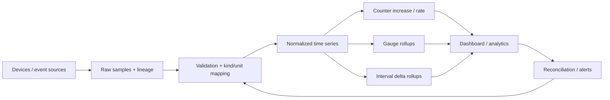

# Instantaneous Gauges, Cumulative Counters, and Interval Deltas

Time-series data is often represented as “timestamp — value” pairs. Yet seeing two rows `(10:00, 120)` and `(10:05, 127)` is not enough to know whether to sum, average, or subtract them. The value 120 might be an **instantaneous temperature**, **total electricity consumed since device startup**, or **request volume during a measurement window**. The exact same SQL aggregation can be valid for one type and completely wrong for another.

The three foundational semantics are:

- **Gauge** (instantaneous value): reflects the level or state of a quantity at the time of observation, such as temperature, water level, memory currently in use, or current stock on hand.
- **Cumulative counter**: reflects the total accumulated **since an initialization/reset point**, such as total requests, total bytes transmitted, or an electricity meter reading.
- **Delta / interval change**: reflects the **increase, decrease, or net change over a defined time interval**, such as 7 kWh in 5 minutes, +5 units received, or −2 units shipped.

This lesson belongs to the **Time-Series Data** chapter of the **DATABASE_DATA_MODELING** module. Its objective is to turn measurement requirements into a data model with clear **series identity, timestamps, units, measure semantics, constraints, indexes, and testability**. SQL examples use PostgreSQL 15+ for illustration, alongside analogous representations in relational, document, graph, and analytical models. **Choosing the right metric kind before writing any aggregation query** is the most important requirement.

## 1. Three Metric Types That Look Alike but Are Not Equivalent

| Aspect | Gauge — instantaneous | Counter — cumulative | Delta — interval change |
|---|---|---|---|
| What one row represents | Level observed at time \(t\) | Total since the start of a **counting epoch** | Amount changed over **interval** \((t_0,t_1]\) or equivalent convention |
| Example | Temperature 27 °C at 10:00 | 127 kWh since last reset | 7 kWh consumed from 10:00 to 10:05 |
| Can decrease? | Yes, normally | No within **the same monotonic epoch**; can drop on reset/wrap/error | Can be negative for net change, e.g., −2 items |
| Direct `SUM` across time? | Usually **semantically wrong** | **Wrong** because each sample already includes prior history | **Conditional**: compatible, non-overlapping, complete intervals |
| Viewing latest state | Latest valid sample, with freshness check | Latest sample in epoch, with reset metadata | Delta is **not** state; level requires starting balance + changes |
| Computing rate | Approximate derivative/change of gauge | Counter difference divided by time, handling resets | Delta divided by interval length |
| With sample gaps | Value in unobserved intervals is unknown | Total difference between two same-epoch samples is known, but **distribution over time is unknown** | **Loses** intervals of change that were never recorded |
| Axis to manage | Observation timestamp + interpolation policy | Timestamp + **epoch/reset** | **Both interval bounds**, or a defined bucket |

A cumulative counter is also typically a number measured “at a point in time”, yet its **cumulative semantics** differ fundamentally from a gauge. Do not classify metrics by column shape `TIMESTAMP + NUMERIC`; classify them by **business meaning and how the measurement is generated**.

### Quick Recognition Examples

- `temperature_celsius = 28.3`: gauge — can rise or fall.
- `http_requests_total = 120348`: counter — total requests since process start; restarts may reset it.
- `requests_in_5m = 89`: delta — request volume inside a defined five-minute window.
- `inventory_on_hand = 350`: gauge — stock state at a point in time; never sum yesterday's 350 with today's 360.
- `stock_movement = −15`: **signed** delta — sales/outbound shipment reduces inventory.
- `month_to_date_revenue = 750000`: cumulative figure per **accounting month**, resetting at month turnover; never subtract two samples across a month boundary.

The word “counter” does not imply an integer: cumulative electricity can be fractional kWh. Likewise, “delta” does not imply non-negative: net changes in inventory, balances, and temperature can be negative.

## 2. Ask Business Questions Before Choosing the Model

When given a `value` field, ask:

1. **Does one value represent a level at an instant or change over an interval?** If an interval, what are its start and end bounds?
2. **What is the unit of measurement?** °C, kWh, bytes, requests, units, USD, VND...? Can the unit change over time?
3. **What subject does each series belong to?** Tenant, device, sensor, measurement zone, metric name, dimension tags?
4. **Does the source ever reset?** On restart, battery swap, meter replacement, month rollover, or counter wraparound?
5. **Does every increment carry the same meaning?** Does the counter track only successful requests or all requests? Is an inventory delta net change or receipts only?
6. **Is the sampling cadence regular?** Can samples be missing, delayed, revised, or duplicated?
7. **What output does the user want?** Current level, time-weighted average, total change in period, rate per second, peak value, or end-of-period balance?
8. **What freshness and accuracy guarantees are required?** Must the system report “insufficient data” when intervals are missing?

A sound model moves from these answers to a **data contract** first, then selects tables, data types, indexes, and SQL.

## 3. Observation Time vs. Ingestion Time vs. Effective Interval

A telemetry system typically has at least two timestamps:

- **`event_time` / `observed_at`:** when the phenomenon was measured or state was recorded at the source.
- **`received_at` / `ingested_at`:** when the storage system received the sample.

If a device measures at 10:00, loses connectivity, and transmits at 10:17, the record belongs to **10:00** for occurrence-time reporting, not 10:17. `received_at` is useful for measuring pipeline lag, not as a substitute for `event_time`.

For **deltas**, the full interval is required:

\[
(t_{\text{start}},\ t_{\text{end}}]
\]

per system convention; for example, “7 kWh during the interval after 10:00 through 10:05”. Storing only `timestamp=10:05, value=7` without specifying whether the timestamp marks **interval start or end** makes hourly/daily rollups ambiguous.

### Aggregation Window Boundaries

To prevent an event from landing in two adjacent buckets, use **half-open** intervals:

\[
[t_0,t_1),\quad[t_1,t_2).
\]

For instance, a point at exactly 11:00 belongs to the 11:00–12:00 bucket, **not** 10:00–11:00. For deltas recorded over \((a,b]\), pick one rule—assign by interval end, apportion by overlap, or keep raw intervals intact—and never mix boundary conventions.

**Timezones:** store absolute instants using a type like `TIMESTAMPTZ`, and specify the **business timezone** for calendar day/month grouping. Oct 01 in Vietnam does not align with a UTC day; calling `DATE(event_time)` under an unmanaged session timezone can shift numbers into the wrong period.

## 4. Formulas and Nature of the Three Metric Types

Let \(x(t)\) denote the observed quantity at time \(t\).

### 4.1. Gauge

A gauge sample has the form:

\[
g_i = x(t_i).
\]

Given readings of \(25, 30, 20\) °C, we can state that **the values measured at those instants** were 25, 30, and 20 respectively. You cannot say total temperature is 75 °C as an additive quantity. The **arithmetic sample mean** only averages over **the sampled instants**; if spacing is irregular, it is not necessarily the time-weighted average.

Under a *last observation carried forward* (LOCF) assumption with an explicit staleness limit, the time-weighted average is:

\[
\overline{g}_{\text{time}}
=
\frac{\sum_i g_i\,\Delta t_i}
{\sum_i \Delta t_i},
\]

where \(\Delta t_i\) is the duration **represented by sample \(g_i\)** within the window. This is an **interpolation-based estimate**, not an exact continuous measurement.

### 4.2. Cumulative Counter

For two consecutive samples **within the same non-reset epoch**:

\[
\Delta C_i = C(t_i)-C(t_{i-1}).
\]

If the counter is monotonic and the source is reliable, \(\Delta C_i\geq0\). That difference is the **additional accumulation between the two readings**, never the sum of the two counter readings.

When intervals \(\Delta t_i\) vary, the average rate is:

\[
r_i=\frac{\Delta C_i}{t_i-t_{i-1}}.
\]

The unit of \(r_i\) is **counter units per time unit**, e.g., requests/second or kWh/hour. For electricity, kWh/hour corresponds to kW as the interval's average power draw.

### 4.3. Delta

A source may emit directly:

\[
D_i = \text{amount changed during }(t_{i-1},t_i].
\]

If intervals are **non-overlapping**, in scope, in the same unit, and complete, the total change across their union is:

\[
D_{\text{total}}=\sum_i D_i.
\]

For signed deltas, `+5` units received and `−2` units shipped yield a net change of **+3**, not 7. If you need **total inbound** and **total outbound** separately, preserve transaction type or separate positive/negative flows; a net sum discards directional detail.

**Relationship between counters and deltas:** deltas can be *derived* by differencing counters when conditions hold. However, a source-emitted delta can carry stronger or different semantics than sample subtraction, especially across resets or missing intervals.

## 5. Worked Example by Hand: Irregularly Sampled Gauge

Suppose a temperature sensor reports:

| Reading Time | Value |
|---|---:|
| 10:00 | 25 °C |
| 10:05 | 30 °C |
| 10:20 | 20 °C |

We want the average temperature from **10:00 to 10:25**.

**Sample mean**:

\[
(25+30+20)/3=25\,^\circ C.
\]

However, sampling intervals are uneven. If the data contract allows carrying each value forward until the next sample and carrying the last sample until 10:25:

| Represented Interval | Value | Minutes |
|---|---:|---:|
| [10:00, 10:05) | 25 °C | 5 |
| [10:05, 10:20) | 30 °C | 15 |
| [10:20, 10:25) | 20 °C | 5 |

**Time-weighted average**:

\[
\frac{25\times5+30\times15+20\times5}{5+15+5}
=\frac{675}{25}=27\,^\circ C.
\]

Both 25 and 27 are mathematically “correct” under two different formulas, yet they answer **two different questions**. The number 27 is valid only if holding a value for 15 minutes fits the sensor physics and use case.

If policy allows at most **10 minutes without a new sample**, the 10:05 reading cannot represent data up to 10:20. Only 20 out of 25 minutes are covered:

\[
\text{coverage}=20/25=80\%.
\]

Computing the mean over only the covered duration gives:

\[
\frac{25\times5+30\times10+20\times5}{20}
=26.25\,^\circ C.
\]

This is not the average of the **entire** 25-minute span because 5 minutes remain unknown; reports should include **coverage** or withhold publication below a threshold. Never use `COALESCE(missing, 0)` to turn unmeasured temperatures into 0 °C.

## 6. Worked Example by Hand: Counters, Resets, and Unknown Intervals

An industrial meter sends cumulative energy readings in kWh:

| Reading Time | Counter | Counter Epoch | Valid Increase from Prior Sample |
|---|---:|---:|---:|
| 10:00 | 120 | 7 | Unknown — first sample |
| 10:05 | 127 | 7 | 7 kWh |
| 10:10 | 134 | 7 | 7 kWh |
| 10:15 | 3 | 8 | **Unknown — reset occurred** |
| 10:20 | 9 | 8 | 6 kWh |

In epoch 7, the increase is `7 + 7 = 14` kWh from 10:00 to 10:10. In epoch 8, the measured increase from 10:15 to 10:20 is `6` kWh.

**You must not conclude that total consumption from 10:00 to 10:20 was definitely 20 kWh.** The number 20 is only **the sum of observed increases across valid intervals**. The 10:10–10:15 span is interrupted by a reset; the post-reset reading `3` reveals nothing about energy accumulated *before* the reset during that interval. With a reliable reset event capturing a pre-reset/post-reset reading or a separate source delta, part of that gap may be recoverable; otherwise, mark it as **missing/unknown**.

### Why Not Take the Absolute Value?

Across the reset boundary:

\[
3-134=-131.
\]

`ABS(3-134)=131` is **not** energy consumed. Nor should you write `GREATEST(3-134,0)=0` and silently pretend consumption was 0: an **unknown** interval differs from an interval **known to have zero consumption**.

Similarly, `MAX(counter)-MIN(counter)` across two epochs gives `134-3=131`, which is wrong. `LAST(counter)-FIRST(counter) = 9-120=-111` is also wrong. You must respect counter epochs before differencing.

### A Source Delta Can Fill In Lost Coverage

If the meter separately emits an event “4 kWh consumed during 10:10–10:15”, you have **an independent delta measurement** capable of filling the missing span, provided source semantics and boundaries match. Never fabricate such an event from the post-reset `counter=3`.

## 7. Resets, Wraparound, and Corrections Are Not the Same Thing

A counter reading can decrease for several distinct reasons:

| Cause | Observable Signal | How to Handle |
|---|---|---|
| **True restart/reset** | Process/device rebooted; new `boot_id` or `counter_epoch` | Start a new epoch; never subtract across boundaries |
| **Wraparound** | Fixed-width counter rolls past max back to low values | Compute modulo arithmetic only if **bit width and wrap policy are known** |
| **Source correction** | Older row corrected after faulty reading | Record revision and recompute affected neighbors |
| **Out-of-order arrival** | Received time inverted relative to event time | Sort by event time and handle late data |
| **Device replacement** | Sensor ID reused on new hardware | Change identity/epoch; do not link as one continuous counter |
| **Measurement/transmission glitch** | Single sudden drop then rebound with no reset event | Route to quality inspection; do not guess a reset |
| **Counter actually allowed to decrease** | Source spec defines a fluctuating cumulative balance | Likely **wrong metric kind**; needs a different contract |

For an \(b\)-bit counter known to wrap after \(2^b-1\), wrap-aware increment computation can be:

\[
\Delta=(C_{\text{new}}-C_{\text{old}})\bmod 2^b.
\]

However, this formula holds only when wrap count per interval is bounded (e.g., at most one wrap under maximum-rate assumptions) and resets cannot be mistaken for wraps. **Never apply modulo math blindly to every counter drop.**

### Reset Metadata Is Data, Not Guesswork

Use `counter_epoch`, `boot_id`, or `reset_event_id` managed reliably by the source or ingestion layer. An epoch is **a continuous domain of a monotonic counter**. If a device resets without signaling, the system can only flag an unexpected decrease for reconciliation. Treating every drop as a “valid reset” hides sensor faults.

If the source can revise a sample, decide whether to store a new version, update latest state, or keep an audit log—then recompute deltas for **both that sample and the following sample**, since `LAG` depends on its predecessor.

## 8. Designing Keys, Units, and Metric-Kind Boundaries

A relational model can separate a series definition table (**`metric_series`**) from a sample table (**`metric_samples`**). Each series has an independent identity combining tenant, device/measurement context, and metric code. In this lesson, `series_id` already represents **one specific device–metric pair** within a tenant; multi-device systems add `device_id`, location tags, and a device dimension table.

Minimum **series contract**:

| Field | Example | Meaning |
|---|---|---|
| `tenant_id`, `series_id` | 42, 2 | Prevents mixing data across distinct streams |
| `metric_code` | `energy_used_total` | Stable business metric name |
| `metric_kind` | `COUNTER` | Determines valid computations |
| `unit_code` | `KWH` | Prevents summing across incompatible units |
| `event_time` | 10:05 +07 | Observation instant or interval end |
| `sample_value` | 127 | Numeric value interpreted per unit and kind |
| `counter_epoch` | 7 | Epoch identifier for counters |
| `period_start` | 10:00 +07 | Mandatory start bound for delta intervals |
| `source_event_id` | `c-1005` | Deduplication key against retries |
| `received_at` | 10:18 +07 | Measures latency; not used as business time |

To keep the example compact while enforcing strong invariants, the DDL below uses **a multi-kind sample table** with intentionally duplicated `metric_kind`. A composite FK from samples to series ensures **the sample's declared kind matches the series kind**. That is one physical choice; at high scale with per-kind requirements, gauge/counter/delta tables can be split or stored in a dedicated time-series database.

### 8.1. Illustrative PostgreSQL DDL

```sql
CREATE TABLE metric_series (
    tenant_id BIGINT NOT NULL,
    series_id BIGINT NOT NULL,
    metric_code TEXT NOT NULL,
    metric_kind TEXT NOT NULL,
    unit_code TEXT NOT NULL,

    CONSTRAINT pk_metric_series
        PRIMARY KEY (tenant_id, series_id),
    CONSTRAINT uq_series_code
        UNIQUE (tenant_id, metric_code),
    CONSTRAINT uq_series_id_kind
        UNIQUE (tenant_id, series_id, metric_kind),
    CONSTRAINT ck_series_kind
        CHECK (metric_kind IN ('GAUGE', 'COUNTER', 'DELTA')),
    CONSTRAINT ck_series_code
        CHECK (btrim(metric_code) <> ''),
    CONSTRAINT ck_series_unit
        CHECK (btrim(unit_code) <> '')
);

CREATE TABLE metric_samples (
    tenant_id BIGINT NOT NULL,
    series_id BIGINT NOT NULL,
    event_time TIMESTAMPTZ NOT NULL,
    metric_kind TEXT NOT NULL,
    sample_value NUMERIC(24, 6) NOT NULL,
    counter_epoch BIGINT,
    period_start TIMESTAMPTZ,
    source_event_id TEXT NOT NULL,
    received_at TIMESTAMPTZ NOT NULL DEFAULT CURRENT_TIMESTAMP,

    CONSTRAINT pk_metric_samples
        PRIMARY KEY (tenant_id, series_id, event_time),
    CONSTRAINT uq_sample_source_event
        UNIQUE (tenant_id, series_id, source_event_id),

    CONSTRAINT fk_sample_series_kind
        FOREIGN KEY (tenant_id, series_id, metric_kind)
        REFERENCES metric_series (tenant_id, series_id, metric_kind)
        ON DELETE RESTRICT,

    CONSTRAINT ck_source_event_id
        CHECK (btrim(source_event_id) <> ''),

    CONSTRAINT ck_sample_semantics
        CHECK (
            (
                metric_kind = 'GAUGE'
                AND counter_epoch IS NULL
                AND period_start IS NULL
            )
            OR
            (
                metric_kind = 'COUNTER'
                AND counter_epoch IS NOT NULL
                AND counter_epoch >= 0
                AND period_start IS NULL
                AND sample_value >= 0
            )
            OR
            (
                metric_kind = 'DELTA'
                AND counter_epoch IS NULL
                AND period_start IS NOT NULL
                AND period_start < event_time
            )
        )
);
```

**Why is the schema designed this way?**

- `(tenant_id, series_id, event_time)` is the PK because **each series has at most one valid sample at a given timestamp**. If a device emits two valid events with the same timestamp and distinct meanings, change the grain/key rather than silently dropping one.
- `source_event_id` is a dedicated idempotency key preventing re-ingestion of **the same source event** on retries.
- `metric_kind` in `metric_samples` is intentionally duplicated so the FK references `(tenant_id, series_id, metric_kind)`, stopping a `COUNTER` sample from being inserted into a `GAUGE` series.
- `counter_epoch` is required for `COUNTER`, while `period_start` is required for `DELTA`. Delta intervals use `event_time` as **the end boundary**.
- Only `COUNTER` is constrained to be non-negative. **`DELTA` can be negative** because inventory, balances, or net changes can decrease; if a specific delta metric such as electricity usage **must be non-negative**, enforce per-metric validation.
- Gauges are allowed to be negative (e.g., °C temperatures). Never put a global `CHECK(value >= 0)` across all metrics.

### What These Constraints Do **Not** Protect Against

1. Counter monotonicity within the same epoch: requires comparing across rows, which a single-row `CHECK` cannot express.
2. Non-overlapping or gap-free `DELTA` intervals: requires interval constraints, late-event handling, exclusion constraints where appropriate, or a write gate.
3. Unit immutability for a series **over time**: the DDL stores `unit_code` on the series, yet updating `unit_code` after samples exist without converting historical rows corrupts data. Enforce unit immutability or versioning.
4. Realistic, physically plausible values: per-metric domain bounds must be enforced separately.
5. Proper epoch increments on reset, authentic event sources, and accurate device clocks.
6. Series completeness: PK/FK cannot prove no samples were dropped or that no interval gaps exist.

**Technical note:** `NUMERIC(24,6)` is an illustrative choice for decimal measurements; not every device needs six fractional digits. High-rate telemetry or huge integer counters may fit other integer/decimal types better; choose types based on range, precision, subtraction behavior, and overflow limits. At high ingestion volumes, partition the table by time and add tailored indexes.

## 9. Loading Verifiable Data and Linking the Three Series

Using three primary series:

- `series_id=1`: room temperature gauge in °C.
- `series_id=2`: cumulative energy since reset, counter in kWh.
- `series_id=3`: interval energy change, delta in kWh.

Plus `series_id=4` to demonstrate **signed** deltas for inventory movement.

```sql
INSERT INTO metric_series
    (tenant_id, series_id, metric_code, metric_kind, unit_code)
VALUES
    (42, 1, 'room_temperature', 'GAUGE', 'DEG_C'),
    (42, 2, 'energy_used_total', 'COUNTER', 'KWH'),
    (42, 3, 'energy_interval_change', 'DELTA', 'KWH'),
    (42, 4, 'inventory_movement', 'DELTA', 'UNIT');

-- Gauge: three irregularly spaced samples.
INSERT INTO metric_samples
    (tenant_id, series_id, event_time, metric_kind,
     sample_value, source_event_id)
VALUES
    (42, 1, '2026-10-01 10:00:00+07', 'GAUGE', 25, 'g-1000'),
    (42, 1, '2026-10-01 10:05:00+07', 'GAUGE', 30, 'g-1005'),
    (42, 1, '2026-10-01 10:20:00+07', 'GAUGE', 20, 'g-1020');

-- Counter: epoch 8 starts between two samples.
INSERT INTO metric_samples
    (tenant_id, series_id, event_time, metric_kind,
     sample_value, counter_epoch, source_event_id)
VALUES
    (42, 2, '2026-10-01 10:00:00+07', 'COUNTER', 120, 7, 'c-1000'),
    (42, 2, '2026-10-01 10:05:00+07', 'COUNTER', 127, 7, 'c-1005'),
    (42, 2, '2026-10-01 10:10:00+07', 'COUNTER', 134, 7, 'c-1010'),
    (42, 2, '2026-10-01 10:15:00+07', 'COUNTER',   3, 8, 'c-1015'),
    (42, 2, '2026-10-01 10:20:00+07', 'COUNTER',   9, 8, 'c-1020');

-- Grounded deltas; DO NOT fabricate a 10:10–10:15 interval across reset.
INSERT INTO metric_samples
    (tenant_id, series_id, period_start, event_time, metric_kind,
     sample_value, source_event_id)
VALUES
    (42, 3, '2026-10-01 10:00:00+07',
            '2026-10-01 10:05:00+07', 'DELTA', 7, 'd-1005'),
    (42, 3, '2026-10-01 10:05:00+07',
            '2026-10-01 10:10:00+07', 'DELTA', 7, 'd-1010'),
    (42, 3, '2026-10-01 10:15:00+07',
            '2026-10-01 10:20:00+07', 'DELTA', 6, 'd-1020');

-- Inventory delta can be negative.
INSERT INTO metric_samples
    (tenant_id, series_id, period_start, event_time, metric_kind,
     sample_value, source_event_id)
VALUES
    (42, 4, '2026-10-01 10:00:00+07',
            '2026-10-01 10:05:00+07', 'DELTA',  5, 'inv-1005'),
    (42, 4, '2026-10-01 10:05:00+07',
            '2026-10-01 10:10:00+07', 'DELTA', -2, 'inv-1010');
```

The examples use Vietnam offset `+07:00` so learners can cross-check calculations by hand; `TIMESTAMPTZ` stores **an absolute instant**, not the raw offset text. Daily groupings must specify an explicit business timezone such as `Asia/Ho_Chi_Minh`.

The sample dataset deliberately leaves a **gap between 10:10 and 10:15** for counter-derived deltas. The absence of a delta row there does not mean consumption was zero.

## 10. Querying Gauges: Latest, Extremes, and Averages

### 10.1. Latest Value as of Query Time

```sql
SELECT
    event_time,
    sample_value
FROM metric_samples
WHERE tenant_id = 42
  AND series_id = 1
  AND metric_kind = 'GAUGE'
  AND event_time <= TIMESTAMPTZ '2026-10-01 10:25:00+07'
ORDER BY event_time DESC
LIMIT 1;
```

The result is **20 °C at 10:20**, not `MAX(sample_value) = 30`. `MAX` yields the **peak in a sample set**, while `LAST` gives **the latest sample in time**. Never substitute `MAX` for “latest” just because timestamps exist.

A “current temperature” dashboard also needs a **freshness** check:

\[
age = query\_time-last\_sample\_time.
\]

If the freshness threshold is 2 minutes and the latest sample is 5 minutes old, display “stale/no recent data” or follow an approved policy. Never display 20 °C as if it were just measured.

### 10.2. Sample Average vs. Time-Weighted Average

```sql
SELECT
    AVG(sample_value) AS sample_mean,
    MIN(sample_value) AS sample_min,
    MAX(sample_value) AS sample_max,
    COUNT(*) AS observed_samples
FROM metric_samples
WHERE tenant_id = 42
  AND series_id = 1
  AND metric_kind = 'GAUGE'
  AND event_time >= TIMESTAMPTZ '2026-10-01 10:00:00+07'
  AND event_time <  TIMESTAMPTZ '2026-10-01 10:25:00+07';
```

This returns `sample_mean = 25`, `sample_min = 20`, and `sample_max = 30`. It does **not** compute Section 5's time-weighted mean of 27 °C; it averages the three observations equally.

### 10.3. SQL Time-Weighted Average with a Staleness Policy

Assuming **carry-forward until the next sample**, capped at 30 minutes from the sample timestamp, each sample spans a segment that gets **clipped** to the query window:

```sql
WITH bounds AS (
    SELECT
        TIMESTAMPTZ '2026-10-01 10:00:00+07' AS from_time,
        TIMESTAMPTZ '2026-10-01 10:25:00+07' AS to_time
),
ordered AS (
    SELECT
        event_time,
        sample_value,
        LEAD(event_time) OVER (ORDER BY event_time) AS next_time
    FROM metric_samples
    WHERE tenant_id = 42
      AND series_id = 1
      AND metric_kind = 'GAUGE'
),
segments AS (
    SELECT
        o.sample_value,
        GREATEST(o.event_time, b.from_time) AS segment_start,
        LEAST(
            COALESCE(o.next_time, b.to_time),
            b.to_time,
            o.event_time + INTERVAL '30 minutes'
        ) AS segment_end
    FROM ordered AS o
    CROSS JOIN bounds AS b
    WHERE o.event_time < b.to_time
      AND COALESCE(o.next_time, b.to_time) > b.from_time
),
durations AS (
    SELECT
        sample_value,
        EXTRACT(EPOCH FROM segment_end - segment_start)
            AS represented_seconds
    FROM segments
    WHERE segment_end > segment_start
)
SELECT
    SUM(sample_value * represented_seconds)
        / NULLIF(SUM(represented_seconds), 0)
        AS time_weighted_mean,
    SUM(represented_seconds) AS covered_seconds
FROM durations;
```

On the sample data, `covered_seconds = 1500` and `time_weighted_mean = 27`. This SQL computes coverage under the carry-forward assumption; it **does not prove the sensor stayed constant between readings**.

If you tighten the cap from `30 minutes` to `10 minutes`, the 10:15–10:20 span lacks a valid sample: total covered duration becomes 1,200 seconds and the covered mean is 26.25 °C. Production queries should return a **coverage ratio** against the full window and reject or flag insufficient-data results.

**Note when a window does not start right on a sample:** you must still inspect the nearest sample **before `from_time`** if LOCF is allowed across the window start. The query above intentionally keeps full series history before clipping rather than filtering `event_time >= from_time` inside `ordered`. On large tables, optimize by fetching the single predecessor sample separately instead of scanning all history.

## 11. Querying Counters with `LAG` and Reset Epochs

To retrieve the prior sample for each row, use `LAG` **partitioned by series** and ordered by `event_time`. The example's primary key ensures no two samples share a timestamp within the same series.

```sql
WITH ordered AS (
    SELECT
        tenant_id,
        series_id,
        event_time,
        sample_value,
        counter_epoch,
        LAG(event_time) OVER (
            PARTITION BY tenant_id, series_id
            ORDER BY event_time
        ) AS prev_time,
        LAG(sample_value) OVER (
            PARTITION BY tenant_id, series_id
            ORDER BY event_time
        ) AS prev_value,
        LAG(counter_epoch) OVER (
            PARTITION BY tenant_id, series_id
            ORDER BY event_time
        ) AS prev_epoch
    FROM metric_samples
    WHERE tenant_id = 42
      AND series_id = 2
      AND metric_kind = 'COUNTER'
),
classified AS (
    SELECT
        *,
        CASE
            WHEN prev_time IS NULL THEN 'FIRST_SAMPLE'
            WHEN counter_epoch IS DISTINCT FROM prev_epoch
                THEN 'RESET_BOUNDARY'
            WHEN sample_value < prev_value
                THEN 'UNEXPECTED_DECREASE'
            ELSE 'VALID_INTERVAL'
        END AS quality_status,
        CASE
            WHEN prev_time IS NOT NULL
             AND counter_epoch = prev_epoch
             AND sample_value >= prev_value
                THEN sample_value - prev_value
            ELSE NULL
        END AS delta_kwh
    FROM ordered
)
SELECT
    event_time,
    sample_value,
    counter_epoch,
    quality_status,
    delta_kwh,
    CASE
        WHEN delta_kwh IS NOT NULL THEN
            delta_kwh
            / NULLIF(
                EXTRACT(EPOCH FROM event_time - prev_time) / 3600,
                0
            )
        ELSE NULL
    END AS average_kw
FROM classified
ORDER BY event_time;
```

Expected results:

| Time | `counter_epoch` | `quality_status` | `delta_kwh` | Interval Average |
|---|---:|---|---:|---:|
| 10:00 | 7 | `FIRST_SAMPLE` | NULL | Unknown |
| 10:05 | 7 | `VALID_INTERVAL` | 7 | 84 kW |
| 10:10 | 7 | `VALID_INTERVAL` | 7 | 84 kW |
| 10:15 | 8 | `RESET_BOUNDARY` | NULL | Unknown |
| 10:20 | 8 | `VALID_INTERVAL` | 6 | 72 kW |

This assumes the span between two samples represents **total cumulative growth** over that interval. The 84 kW rate is the **average rate** from consuming 7 kWh over 5 minutes, not instantaneous power measured continuously by the meter.

**Three critical rules when using `LAG`:**

1. `PARTITION BY tenant_id, series_id`: never pull a prior sample from **another device or tenant**.
2. `ORDER BY event_time`: never sort by `received_at`, because late data can arrive out of order.
3. When querying a day/month range, fetch the **predecessor sample before the window start** before filtering results. Filtering source rows strictly to the window before running `LAG` loses or misclassifies the increase from the prior period's last sample to the new period's first sample.

### Can You Compute `SUM(delta_kwh)`?

You can sum **valid deltas** to obtain “total observed increase across valid contiguous spans”. However, when a `RESET_BOUNDARY` or unexplained gap occurs, that sum **is not the complete total for the entire window**.

Store or return `unknown_interval_count`, `covered_seconds`, and missing-data policy alongside the sum. Never report 20 kWh as complete consumption when 10:10–10:15 is unknown.

## 12. Querying `DELTA`: Additive When Intervals Are Exact

For a delta metric defined as **change over \((period_start, event_time]\)**, inspect raw intervals:

```sql
SELECT
    period_start,
    event_time AS period_end,
    sample_value AS change_in_interval
FROM metric_samples
WHERE tenant_id = 42
  AND series_id = 3
  AND metric_kind = 'DELTA'
ORDER BY period_start, event_time;
```

Resulting intervals:

| Interval | Delta kWh |
|---|---:|
| 10:00–10:05 | 7 |
| 10:05–10:10 | 7 |
| 10:15–10:20 | 6 |

Total is **20 kWh across three observed intervals**, with 10:10–10:15 missing. If a dashboard asks for the total from 10:00 to 10:20, report coverage and warn about the missing interval.

### Why Not Simply `SUM` by Day?

A delta of “7 kWh from 23:58 to 00:03” crosses **the day boundary**. Grouping purely by `event_time`'s calendar day assigns all 7 kWh to the next day, even though part occurred the day before. That **may be a valid accounting policy** (recognize at interval end), but it is not the exact physical consumption per calendar day.

If exact boundary alignment is required:

- Have the source emit intervals aligned to buckets (if feasible), or
- Prorate by overlap length **only if uniform rate within the interval is acceptable**, or
- Keep raw intervals and report “insufficient resolution” for daily splitting.

Never split 7 kWh proportionally by time if actual load swings sharply and the domain demands exact figures.

### Overlapping and Missing Intervals

Two deltas `[10:00, 10:05) = 7` and `[10:03, 10:08) = 9` **overlap**. Summing them to 16 double-counts the overlapping span. Conversely, if no delta exists between 10:05 and 10:10, `SUM` gives no hint that an interval is missing.

To run a preliminary check:

```sql
WITH d AS (
    SELECT
        tenant_id,
        series_id,
        period_start,
        event_time AS period_end,
        LAG(event_time) OVER (
            PARTITION BY tenant_id, series_id
            ORDER BY period_start, event_time
        ) AS prev_end
    FROM metric_samples
    WHERE metric_kind = 'DELTA'
      AND tenant_id = 42
)
SELECT
    series_id, period_start, period_end, prev_end,
    CASE
        WHEN prev_end IS NULL THEN 'FIRST_INTERVAL'
        WHEN period_start < prev_end THEN 'OVERLAP'
        WHEN period_start > prev_end THEN 'GAP'
        ELSE 'CONTIGUOUS'
    END AS interval_quality
FROM d
ORDER BY series_id, period_start, period_end;
```

This is a **preliminary check against the immediately preceding interval's end**, suitable when inputs are designed as sequential non-nested intervals. With deeply nested intervals, `LAG(prev_end)` alone cannot catch every overlap; compare against **the running maximum end time of all prior intervals**, or use range exclusion constraints / dedicated reconciliation procedures.

For inventory movements, two separate events can share the same timestamp without being mutually exclusive “bucket intervals”. In that case, model them as **event facts** with unique event IDs rather than forcing them into a one-interval-delta-per-timestamp assumption.

## 13. Rates Are Neither Deltas Nor Gauges

From a counter or delta, you can derive an average rate:

\[
rate = \frac{\text{change}}{\text{elapsed time}}.
\]

For example, 7 kWh over 5 minutes:

\[
\frac{7}{5/60}=84\ \text{kWh/h}=84\ \text{kW}.
\]

For requests, 120 requests over 60 seconds equals an average of **2 requests/second**, not 120 requests/second.

### Averaging Rates Must Account for Interval Length

Suppose:

- First 5 minutes: 100 requests in 5 minutes = 20 requests/min.
- Next 15 minutes: 150 requests in 15 minutes = 10 requests/min.

The unweighted mean of the two rates is `(20 + 10) / 2 = 15` requests/min. Yet the true average rate across **20 minutes** is:

\[
\frac{100+150}{5+15}=12.5\ \text{requests/min}.
\]

When intervals differ in length, compute **total change / total covered duration**, or take a duration-weighted average of rates. Never run an unweighted `AVG(rate)` over heterogeneous intervals and label it the period rate.

### Do Not Equate a Derived Rate with a Directly Measured Gauge

A sensor might report instantaneous `power_kw` at 10:05 (a gauge); an energy meter gives cumulative `kWh`, and dividing delta by time gives **average power over the interval**. The two can diverge whenever load fluctuates. If a report asks for “peak power”, `MAX(power_kw)` from an instantaneous gauge or continuous metering answers a different question than `MAX(average_kw)` derived between sparse readings.

### Negative and Undefined Rates

- Monotonic counter in the same epoch: deltas and rates are expected to be non-negative.
- Net inventory delta: rate can be negative, e.g., −2 units per 5 minutes.
- Rate of change of a temperature gauge: approximate derivative can be negative, labeled “°C/min”, not treated as a “counter rate”.
- Counter reset: rate across a reset must be **undefined/NULL** if bridging details are absent, never negative or defaulted to 0.
- Two samples with identical timestamps: never divide by zero; schemas must prevent duplicate timestamps or define how they merge.

## 14. Choose Aggregations by Semantics, Not SQL Convenience

| Question | Gauge | Counter | Delta |
|---|---|---|---|
| **Latest** value | Latest sample, with sample age | Latest sample **and epoch** | Does not represent current state |
| **Maximum** in period | `MAX` of samples, noting sampling limits | `MAX` only within one epoch, never period total | `MAX` of interval deltas if seeking “peak interval change” |
| **Total** in period | Usually meaningless; some gauges integrate over time into another quantity | Compute **increase** per epoch/reset, never sum raw sample values | `SUM` non-overlapping deltas with sufficient coverage |
| **Average** | Sample mean or time-weighted mean with explicit policy | Averaging counter levels rarely has business meaning | Mean delta per interval; rate requires interval length |
| **Rate** | Approximate derivative of gauge if meaningful | Counter delta / elapsed time, reset-safe | Delta / interval length |
| **End of day / end of month** | Last valid sample with freshness policy | End-of-period counter is **not** period consumption | Delta of the final interval, not state |
| **Across multiple entities** | Sum only if gauge represents additive counts without entity overlap | Sum counters/deltas only after aligning epochs, scope, and units | Can sum independent same-unit deltas without double-counting |

For instance, **current stock on hand** is a gauge that can be summed across **non-overlapping warehouses** at **the same snapshot timestamp**. You must never sum Oct 01 end-of-day stock with Oct 02 end-of-day stock and call it end-of-period stock. In analytics, this is **semi-additive across time**.

A gauge like temperature **is not summed across sensors** to get building temperature; computing a regional average requires weights, area, sensor reliability, or a suitable physical model.

## 15. Rollups and Downsampling: Preserve Derivability

Time-series systems often retain high-resolution samples for a few days, then store 5-minute, hourly, or daily rollups to save space. Design **distinct rollup structures for each metric kind**.

### 15.1. Gauge Rollups

Consider storing:

- `sample_count`, `sample_sum` for **sample-based** means (with caveats).
- `min_value`, `max_value`.
- `first_value`, `last_value` with **their timestamps**.
- `weighted_value_seconds` and `covered_seconds` for **time-weighted** means.
- `expected_coverage_seconds` or `coverage_ratio` per staleness policy.

Adjacent buckets can combine weighted sums when interpolation rules match and boundaries are neither dropped nor double-counted. Storing only per-bucket `AVG` and then calling `AVG` over buckets **is wrong** whenever buckets differ in sample count or covered duration. Use weighted sums and total durations to roll up to coarser levels.

### 15.2. Counter Rollups

Never store `SUM(counter_samples)` as “daily requests”. Store:

- **Verified** increases within epochs.
- `first/last counter` plus epoch/timestamp if buckets must be stitched together.
- Reset count, missing interval count, covered seconds.
- Count of anomalous/unexplained decreases.
- Source metadata and calculation algorithm version.

**Bucket-boundary issue:** a pair of samples straddling 11:00 still produces an increase. If each rollup job reads only rows strictly inside its bucket before running `LAG`, the increase crossing the boundary disappears. Fetch the predecessor sample or carry-forward state with matching epoch and a clear policy assigning deltas to buckets.

### 15.3. Delta Rollups

When intervals are **non-overlapping**, share units, and share an attribution policy, store:

- `sum_delta`, `event_count`.
- `covered_seconds` and gap/overlap flags.
- Separate positive/negative delta sums when inbound vs. outbound visibility is needed.
- `min/max interval_delta` if peak per-interval change matters.

A delta spanning a bucket boundary cannot be split accurately from its total alone without intra-interval detail. Decide up front between “end-of-interval attribution”, approximate proration, or rejecting finer-grained splits.

### Suggested Rollup Design Table

| Metric Kind | Minimum Columns to Retain | Dangerous Mistake |
|---|---|---|
| Gauge | min/max, first/last + time, count, weighted sum + coverage | Storing only rounded average and re-averaging |
| Counter | verified increase, epochs, reset/gap flags, boundary samples | Directly summing cumulative readings |
| Delta | sum, interval bounds/coverage, sign breakdown if needed | Summing overlapping intervals |
| Derived rate | numerator, time denominator, quality | `AVG` of rates from unequal intervals |

**A good rollup retains enough components to combine cleanly**, not just a generically named “average” or “total”.

## 16. Late Data, Dropped Samples, Duplicates, and Revisions

Real-world time series can arrive **out of event order**. A source might send 10:10 before 10:05, then retransmit 10:05 after a timeout. If a pipeline computes deltas **blindly in arrival order**, it can emit bogus differences.

### 16.1. Idempotency and Deduplication

`source_event_id` identifies retries of the same source event. An idempotent ingestion statement can rely on unique constraints alongside explicit conflict handling:

```sql
-- Illustrative example: authenticated source and the same sample retried.
INSERT INTO metric_samples
    (tenant_id, series_id, event_time, metric_kind,
     sample_value, counter_epoch, source_event_id)
VALUES
    (42, 2, '2026-10-01 10:10:00+07',
     'COUNTER', 134, 7, 'c-1010')
ON CONFLICT (tenant_id, series_id, source_event_id)
DO NOTHING;
```

If the same `source_event_id` arrives again with a **different value**, `DO NOTHING` hides a conflict; pipelines should compare payloads or hashes/versions to distinguish **identical retries** from **source corrections**. If two events with different IDs share a timestamp, the temporal PK also rejects the insert; define a resolution policy rather than blindly letting “last write wins”.

### 16.2. What Do Late Events Affect?

If a counter already has 10:00 and 10:10, the system inferred a 14 kWh delta over 10 minutes. When `10:05 = 127` arrives late, that span splits into 7 and 7 kWh. The **10-minute total** stays unchanged if the counter is continuous, yet **5-minute bucket rates** change and must be rebuilt.

If the late 10:05 record is a **reset event**, inserting it invalidates any delta previously computed across that boundary. When inserting or revising a sample, recompute **every interval whose neighbors changed**, not solely the bucket matching the new sample's timestamp.

For gauges, a late sample alters how long the prior sample is carried forward under LOCF; rebuild the segment from predecessor to successor and any affected buckets.

### 16.3. Watermarks and Period-Close Policies

A pipeline can publish the 10:00–11:00 window as **provisional** until a watermark passes (e.g., waiting up to 15 minutes for late arrivals), then mark it **final**. Even so, late events past the watermark can still occur; define a **restatement** or exception-logging policy with an audit trail.

**A watermark is not a guarantee that late events will never arrive.** It is an operational contract stating the lateness bound handled routinely. Critical metrics must log post-close restatements.

### 16.4. Missing Differs from Zero

- No gauge sample: level unknown, **not** 0.
- Counter reset interrupting a span: increase unknown, **not** 0.
- No delta interval: missing interval, **not** delta = 0.
- A delta interval confirmed by the source as 0: **known zero change** under the source contract.

Distinguish **missing**, **stale**, **invalid**, and **observed zero** via explicit data-quality states, never by defaulting numeric columns to 0.

## 17. Testing Invariants and Time-Series Quality

Writing rows into a database is not enough; verify that derived metrics behave properly for each semantic kind.

| Test Case | Expected Result |
|---|---|
| Gauge values 25, 30, 20 spaced 5 and 15 min apart | Sample mean 25; time-weighted mean 27 if 25 min covered and LOCF permitted |
| Gauge past staleness threshold | Not shown as current reading; report age/coverage |
| Same-epoch counter: 120 → 127 → 134 | Deltas 7 and 7; never `SUM(120+127+134)` |
| Counter epoch change: 134/7 → 3/8 | Cross-reset delta = **NULL/unknown** |
| Counter decrease within same epoch | Flag anomaly; never apply `ABS` |
| Counter swaps device while reusing series ID | Caught by identity/epoch checks; never stitched as one continuous series |
| Counter with 15-min then 5-min spacing | Rate uses actual elapsed seconds, not an assumed 5-min cadence |
| Inventory deltas +5 and −2 | Net sum = +3; do not globally ban negative deltas |
| Two overlapping delta intervals | Flag overlap or resolve per policy before summing |
| Missing delta interval | Do not claim “complete period total” when coverage is incomplete |
| Late-arriving sample | Rebuilds affected deltas/rates and rollups |
| Retry with same `source_event_id` and identical payload | Does not create a second sample |
| Retry with same ID and different payload | Conflict detected, not silently ignored |
| Two genuinely distinct events at same timestamp | Neither event lost due to an overly narrow key |
| Averaging 5-min and 15-min rates | Total change / total time, not unweighted mean |
| End-of-month stock gauge | Latest valid snapshot; never sum daily stock levels |
| Local-day reporting | Uses designated business timezone |
| Bucket rollup with pre-boundary sample | Does not drop cross-boundary counter increase by filtering before `LAG` |
| Summing deltas in two currencies/UOMs | Refuses to sum without unit normalization |
| Entire day missing | Reports missing data; does not fill 0 to “beautify” charts |

### Continuous Counter Quality Check

A query on `metric_samples` can detect **counter decreases within the same epoch** (prior sample determined in event-time order):

```sql
WITH c AS (
    SELECT
        tenant_id,
        series_id,
        event_time,
        sample_value,
        counter_epoch,
        LAG(sample_value) OVER (
            PARTITION BY tenant_id, series_id
            ORDER BY event_time
        ) AS prev_value,
        LAG(counter_epoch) OVER (
            PARTITION BY tenant_id, series_id
            ORDER BY event_time
        ) AS prev_epoch
    FROM metric_samples
    WHERE metric_kind = 'COUNTER'
)
SELECT *
FROM c
WHERE counter_epoch = prev_epoch
  AND sample_value < prev_value;
```

This query flags **anomalies** under the monotonic contract; it cannot by itself distinguish an unrecorded device reset from a faulty reading or an approved correction. Inspect reset logs, lineage, and source metadata before modifying data.

## 18. Indexing, Partitioning, and Data Retention

A time-series platform can ingest millions of samples per hour. Base index decisions on actual query access paths:

- Reading one series over a time range: `(tenant_id, series_id, event_time)`.
- Reading the latest sample of a series: a time-ordered PK index can be scanned backward in PostgreSQL for `ORDER BY event_time DESC LIMIT 1`.
- Reading/writing time buckets across many series: consider time partitioning, BRIN, or time-first indexes depending on distribution and workload.
- Bulk queries by metric/device: require series/metadata dimensions and indexes matching common predicates.
- Multi-tenant analytics: always enforce tenant scope and authorization; the query planner is not a substitute for access control.

### Partitioning Does Not Change Data Semantics

Daily or monthly partitioning helps retention drops, time-range scans, and operations, yet **it does not turn a counter into a delta**. PostgreSQL imposes rules on unique/primary keys for partitioned tables (especially with time partition keys); design uniqueness and idempotency to match the partitioned schema rather than assuming single-table unique constraints carry over unchanged.

When purging old granular data, computing counter growth at the **start boundary of remaining history** still requires a predecessor sample or stored boundary rollup. Purging prior samples without retaining boundary metadata turns the start of the remaining window into unknown even when no reset occurred.

### Keep Raw, Normalized, and Derived Layers with Clear Roles

A pipeline might be structured as:



**The source of truth** must be explicit: raw packets are original measurement evidence; normalized samples are standardized records from raw; counter-derived deltas and rollups are **recomputable** outputs whenever formulas, reset metadata, or late arrivals change. Never patch aggregate tables while ignoring root errors in raw/normalized data.

Version delta-derivation logic, timezones, reset policies, and staleness limits. Changing logic without rebuilding history causes the same metric to carry two definitions across different months.

## 19. Equivalent Representations in Relational, Document, Graph, and Analytical Models

### 19.1. Relational

A schema like `metric_series`/`metric_samples` makes it straightforward to enforce tenant-scoped PK/FKs, validate metric kinds, prevent duplicate timestamps or source events, and run window queries with `LAG`/`LEAD`. However, **counter monotonicity**, reset semantics, and interval completeness cannot be fully enforced with single-row checks; they require write gates and reconciliation.

### 19.2. Document / Time-Series Collections

You can store one document per sample containing `seriesId`, `eventTime`, `kind`, `value`, `epoch`, and `intervalStart`. Time-series engines often provide efficient storage and columnar compression. Still, if documents omit `kind` or units, queries can easily aggregate incorrectly. For deltas, store explicit interval bounds instead of a single ambiguous timestamp. Enforce uniqueness/deduplication at the engine or pipeline layer if relational FKs are absent.

Never embed a sensor's unbounded entire history into **one single document**: concurrent updates, document size limits, and time-range scans quickly degrade. Bucketing documents by time/workload is a physical design choice.

### 19.3. Graph

Graphs shine at modeling **device–sensor–room–plant** hierarchies and metric lineage: which device feeds which series, or which electrical meter serves which zones. At scale, time-stamped samples still belong in specialized structures or referenced time-series storage.

When multiple sensors link to one room, never sum temperature gauges across graph edges as if summing energy: graph topology does not alter aggregation rules. Time-effective edges also need versioning to track which sensor belonged to which zone at any historical point.

### 19.4. Analytical Warehouses

An analytical model may contain:

- `DimTime`, `DimDevice`, `DimMetric` with kind and unit attributes.
- `FactGaugeSample` at grain **one level measurement of a series**.
- `FactCounterSample` at grain **one counter reading within an epoch**.
- `FactIntervalDelta` at grain **one source-confirmed or derived interval**.
- `FactHourlyRollup` at grain **one series × one hour**, storing measures by kind and coverage.

When drilling across “average temperature”, “energy consumed”, and “end-of-hour inventory”, apply **different aggregation functions per measure**. An hourly rollup needs sum/weight/coverage for gauges, increase/reset flags for counters, and sum/coverage for deltas—never a single `value` column fed to `SUM` for everything.

In particular, inventory snapshots are **semi-additive** over time: summing across independent warehouses at **the same timestamp** makes sense, whereas summing across consecutive days does not.

## 20. Common Anti-Patterns

| Anti-Pattern | Why It Is Wrong | Better Alternative |
|---|---|---|
| `SUM(counter_value)` by day | Counter already includes past accumulation | Compute increase within valid epochs |
| `MAX(counter) - MIN(counter)` across resets | Extremes may belong to different epochs | Difference each continuous segment and flag gaps |
| `ABS(counter_new - counter_old)` on drops | Turns resets/glitches into fake usage | Identify resets/wraps and mark unknown |
| Assigning delta = 0 to missing spans | Hides missing telemetry | Use `NULL`/quality flags/coverage |
| Calling unweighted `AVG(gauge)` a time average | Dense samples dominate sparse ones | Time-weighted mean with explicit interpolation policy |
| `AVG(rate)` across unequal intervals | Incorrect weighting | Total change / total valid elapsed time |
| Storing only end timestamp for intervals | Loses duration and boundary clarity | Store start/end or explicit bucket policy |
| Summing overlapping delta intervals | Double-counts overlapping spans | Prevent overlap or reconcile per source rules |
| Grouping by `received_at` | Assigns late arrivals to wrong business period | Group by event time and designated timezone |
| Resetting counter while keeping old epoch | Creates negative or bogus deltas | Maintain reliable reset metadata |
| Filtering window before running `LAG` | Drops predecessor / cross-boundary delta | Compute over neighboring samples first, then clip |
| Labeling every metric `TOTAL` | Leads consumers to sum non-additive values | Explicit `metric_kind` and unit metadata |
| Summing two same-device series with different units | Meaningless numeric output | Normalize units and measurement scope |
| Rollup storing only rounded averages | Cannot aggregate accurately to coarser grains | Retain numerators, denominators, and coverage |
| Conflating raw and derived layers | Unclear which side to fix on mismatch | Explicit source of truth, rule versions, and rebuilds |

**Especially in operations and finance:** dashboards can look deceptively “clean” after heavy `COALESCE` or over-interpolation. Honest reporting of missingness is almost always better than a fabricated 0 or a negative rate caused by a reset.

## 21. Practical Exercise: Devices, Requests, and Inventory Movements

A plant operations platform manages:

- `SensorTemperature` reporting temperature only on significant changes, at irregular intervals.
- `HttpGateway` recording `requests_total`, which resets on service restarts and occasionally reboots without emitting an immediate reset event.
- `ElectricMeter` emitting a kWh counter every 10 minutes plus certain device-confirmed interval deltas.
- `WarehouseMovement` recording inbound/outbound goods as signed events by SKU, warehouse, and tenant.
- Ingestion pipelines that handle samples up to 20 minutes late (sometimes later), with consumers reprocessing events on retry.

The business requires reports on **hourly average temperature**, **5-minute requests/second**, **daily electricity consumption**, **net inventory change**, and **end-of-day stock**.

Complete the following tasks:

1. Classify each metric as gauge, cumulative counter, signed/unsigned delta, or derived metric. State each row's **unit and grain**.
2. Define series metadata, tenant/device scope, reset epoch identity, event time, received time, and interval bounds.
3. Write the time-weighted mean formula for temperature with a **10-minute max staleness limit**; describe how to handle an hour with only 35 minutes covered.
4. Given request counter readings `100, 160, 210` at 10:00/10:05/10:10 in the same epoch, compute each interval's increase and rate. Then change epoch and read `5` at 10:15; explain why neither `210−5` nor `ABS` is valid.
5. Design SQL/pseudocode computing rates via `LAG` partitioned by series and ordered by `event_time`, preserving the predecessor sample before the hour boundary.
6. If an energy delta spans 23:55–00:05, choose either end-of-interval attribution or proportional allocation, and explain accuracy limits.
7. Model `InventoryMovement` with `movement_id` and signed quantities; derive end-of-day stock from **opening balance + sum of movements**, retaining history and reconciliation. Explain why daily stock snapshots must not be summed.
8. Design primary and idempotency keys; show an example of an event arriving twice with identical payload and one arriving with the same ID but different payload.
9. Plan rollup rebuilds when a 10:05 sample arrives after 10:10, or when a reset event arrives late.
10. Propose quality metrics: missing intervals, coverage ratio, reset count, unexpected decreases, late event count, stale gauges, and raw-to-rollup discrepancies.
11. Explain how to organize raw, normalized, and derived layers in a relational or time-series DB and how finalized reports are published relative to watermarks.

**Passing criteria:** never sum raw counters; never confuse sample mean with time-weighted mean; never assume uniform spacing for rates; distinguish **unknown** from **zero**; properly guard resets/epochs, overlaps, units, late data, and rebuildability.

## 22. Summary

- Every time-series measurement needs **metric kind**, **unit**, **series identity**, **event time**, and a **reset/interval contract**; a bare numeric column is not enough.
- **Gauges** answer “level at an instant”; `LAST`, min/max, and time-weighted means are valid when freshness and interpolation rules are specified. Never sum gauge samples arbitrarily.
- **Counters** answer “how much accumulated since baseline”; compute increases and rates **only within valid epochs**, never subtracting across resets or taking `ABS` on drops.
- **Deltas** answer “how much changed over an interval”; they can be summed when intervals are non-overlapping, complete, and consistent in unit/policy. Deltas can be negative.
- **Rates** equal change divided by actual elapsed interval duration; never take an unweighted average of rates across unequal intervals.
- Resets, wraps, corrections, late arrivals, and missing samples have distinct causes requiring separate metadata and quality tracking.
- Rollups must preserve **enough components to re-aggregate accurately**: weighted sums/coverage for gauges, verified increases/epochs for counters, and interval coverage for deltas.
- **Unknown is not zero.** Accurate reporting surfaces gaps, staleness, and quality issues even when UI stakeholders wish for a single clean number.
- Choose physical schemas, indexes, partitions, pipelines, and storage engines (relational, document, graph, or warehouse) only after locking down business invariants.
