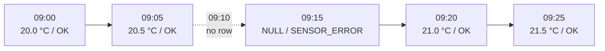
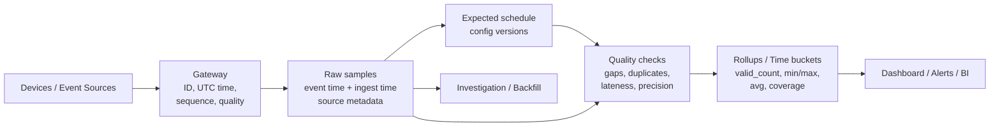

# Sampling Frequency, Precision, and Missing Values

A temperature sensor sends readings every **5 minutes**. Over one hour, the system receives 10 records and computes an average of **20.8 °C**. Does that result represent the entire hour? Not necessarily. The sensor may have failed to transmit during a temperature spike, one record might hold an error reading, the device clock might be skewed, or duplicate samples might have been counted multiple times. On the exact same table of rows, choices around **sampling frequency, precision, and missing-value interpretation** can lead to completely different conclusions.

This lesson belongs to the **Time-Series Data** chapter of the **DATABASE_DATA_MODELING** course. The course builds skills in translating business requirements into clear data models—from entities, relationships, constraints, keys, and indexes to physical schemas—comparing relational, document, graph, and analytical models to choose structures that evolve cleanly and stay verifiable. Accordingly, the focus here **is not just a `AVG` query**, but building a **time-series data contract**: what each record measures, when, with what reliability, and what an interval without records means.

After this lesson, you will be able to:

- Distinguish **sampling frequency**, **timestamp resolution**, **clock accuracy**, **measurement accuracy**, and **numeric representation precision**.
- Choose an observation cadence based on phenomenon rate of change, alerting requirements, storage budget, and latency.
- Model **event time**, **ingestion time**, sampling schedules, and per-observation quality.
- Distinguish **unreceived samples**, **`NULL` values**, **valid zeros**, **faulty readings**, **late samples**, and **not applicable**.
- Use SQL to detect gaps, compute valid coverage ratios, and build time buckets without hiding missing data.
- Choose policies for **preserving gaps, gap filling, interpolation, averaging, and accumulation** suited to each metric type.
- Design data checks and ingestion pipelines capable of handling duplicates, out-of-order delivery, cadence changes, and multi-granularity storage.

## 1. Time Series Is Data with Timestamps and Measurement Semantics

**Time-series data** consists of observations or events anchored to time, usually belonging to a specific **subject/data source** and a defined **quantity type**.

Two examples that look alike yet differ fundamentally:

```text
Sensor TEMP-01:
  09:00 → 20.0 °C
  09:05 → 20.5 °C
  09:10 → ?
  09:15 → sensor error

Order events:
  09:01:13 → Order O-101
  09:07:42 → Order O-102
  09:43:11 → Order O-103
```

The sensor is configured for **scheduled sampling**: we expect one observation every 5 minutes. Orders are **action-driven events**; there is no rule saying “an order must be created every 5 minutes”. Therefore:

- **No sensor record at 09:10** is likely a **missing sample**.
- **No orders during minute 09:10** can be completely normal.
- If the order-event pipeline **suffered an outage**, a count of 0 in that minute is **unreliable**, even though no records exist.

Before calling an interval “missing data”, you must know **what data was expected to arrive**.

### 1.1. Fields That Should Never Be Ambiguous

| Concept | Question Answered | Example |
| --- | --- | --- |
| **Series identity** | Which device/source/metric does this stream belong to? | `(tenantId, deviceId, metricCode)` |
| **Observed/event time** | When was the phenomenon observed or did the event occur? | `2026-10-01 09:00:00+07` |
| **Received/ingest time** | When did the system receive or store the record? | `2026-10-01 09:00:06+07` |
| **Value** | What was the observed value? | `20.0` |
| **Unit** | Which quantity and unit does the value represent? | `°C` |
| **Quality/status** | Is the value eligible for metric calculations? | `OK`, `SENSOR_ERROR` |
| **Expected cadence** | How often is a sample expected? | `5 minutes` |
| **Source identity** | Which specific record needs deduplication on retries? | `sampleId = S-001` |
| **Configuration version** | Which schedule, calibration, and unit version applied at measurement time? | `sensorConfigVersion = 7` |

Do not store only `device_id, timestamp, value` if your problem requires investigating discrepancies or keeping reports accurate when clocks, sensors, or sampling schedules change.

## 2. Sampling Frequency Differs from Event Frequency and Reporting Frequency

### 2.1. Sampling Period and Sampling Rate

If a sensor attempts to measure every `Δt = 5 minutes`, the **nominal frequency** is:

\[
f_s = \frac{1}{\Delta t}
\]

This is the **configured frequency**; it does not prove all samples actually arrived or that spacing between samples was strictly 5 minutes.

| Nominal Period | Expected Samples per Device / 24h Day |
| --- | ---: |
| 5 minutes | 288 |
| 1 minute | 1,440 |
| 10 seconds | 8,640 |
| 1 second | 86,400 |

With **1,000 devices** reporting every second, the system receives roughly **86.4 million samples/day**, or **2.592 billion samples over 30 days** assuming zero drops and constant cadence. This is an ingestion capacity estimate, **not a storage footprint forecast**, since storage depends on encoding, metadata, indexes, compression, and retention.

### 2.2. Three Distinct “Frequency” Concepts

- **Sampling cadence:** how often the sensor takes a reading.
- **Transmission/ingestion cadence:** how often data is transmitted and ingested; devices may **batch-send** every 15 minutes even when measuring every minute.
- **Reporting cadence:** dashboards refresh every 10 seconds, minute, or day; this may be faster or slower than transmission.

For example, measuring every 10 seconds, sending a 30-sample batch every 5 minutes, and refreshing dashboards every minute gives 10-second measurement granularity while display lag can exceed 5 minutes. **Refreshing a dashboard more often cannot compensate for delayed source delivery.**

### 2.3. Regular Samples, Near-Regular Samples, and Irregular Events

**Fixed-schedule sampling** expects timestamps at `09:00, 09:05, 09:10, ...`; in practice clocks exhibit ± a few seconds of *jitter*.

**Adaptive sampling** may measure every 1 minute when stable and every 5 seconds during rapid swings. Sample counts per period then vary **by valid policy**, so missing points on a 1-minute grid are not errors.

**Irregular events** like logins, payments, orders, or alerts have no fixed schedule. To measure event rates per minute, create **aggregation buckets**, without assuming every bucket must contain an event record.

### 2.4. Point Events vs. Interval-Representing Measurements

A value `20 °C at 09:00` could mean:

1. **Instantaneous reading:** sensor read near 09:00.
2. **Prior 5-minute average:** value pre-aggregated by the device over `[08:55, 09:00)`.
3. **End-of-period reading:** last reading in the window ending at 09:00.
4. **5-minute delta/accumulation:** total increase over the entire interval.

All four share the same `timestamp` and `value` shape yet **differ in downstream aggregation rules**. When a source sends interval measurements, store `interval_start`, `interval_end`, or an explicit `measurement_kind` rather than assuming timestamps are instantaneous points.

## 3. Choosing Frequency: Fast Enough to Capture Phenomena, Practical to Operate

### 3.1. Sparse Sampling Can Miss Events

Suppose temperature spikes for **20 seconds** then returns to normal, while the sensor measures strictly every **5 minutes**. No sample may land inside that 20-second spike. Reports show “normal” readings, which means **the short spike went unobserved**—not proof that no spike occurred.

When users ask “did temperature ever exceed 40 °C?”, confidence in the answer depends on:

- How often and how the sensor measures.
- Whether **internal min/max** values per window are captured.
- When the sensor was actually active.
- Device latency, accuracy, and physical response limits.

If alerting must catch brief excursions, you may need **higher sampling rates, on-device threshold evaluation, per-interval min/max loggers**, or a different monitoring design. Querying sparse data more frequently can never recover missed peaks.

### 3.2. Aliasing: Fast Signals Masquerading as Wrong Shapes

In sampling theory, for a **continuous band-limited signal**, the ideal condition to avoid aliasing requires sampling faster than **twice the highest meaningful frequency**:

\[
f_s > 2 f_{\max}
\]

For instance, an oscillation with a 20-second period has frequency `0.05 Hz`. Sampling once every 60 seconds gives `f_s ≈ 0.0167 Hz`, well below that idealized threshold. Sampled points can trace an oscillation that appears **slower, phase-shifted, or even flat**, depending on sampling phase.

However, the Nyquist criterion **does not guarantee capturing every event peak**. It assumes band-limited continuous signals and typically relies on an **anti-alias filter**. Aperiodic spikes, short bursts, and discrete events must be evaluated against dedicated detection SLAs.

### 3.3. Deriving Cadence from Business Requirements

| Requirement | Questions Governing Cadence |
| --- | --- |
| Safety alerting | What is the shortest excursion that must be detected? What is the max allowed occurrence-to-alert latency? |
| Energy accounting | Do you need minute-level power integration or hourly totals? Are min/max and coverage available? |
| Application performance monitoring | Do p95/p99 metrics require event-level data or histograms rather than per-minute averages? |
| Environmental monitoring | How fast does the phenomenon change, and what are sensor error and transmission lag? |
| Infrastructure budget | What are device count, retention, write throughput, compression, bandwidth, and backfill cost? |
| Long-term analytics | Must raw samples be kept for incident investigation, or do quality-scored rollups with min/max suffice? |

A solid practice is identifying the **coarsest resolution with business value**, testing against dense raw samples, quantifying error when downsampling, and only then locking in configuration. Never assume all series share one cadence.

## 4. “Accuracy” Has Multiple Independent Layers

### 4.1. Accuracy, Precision, and Resolution of Measured Values

Suppose a device displays `21.37 °C`:

- **Resolution:** the smallest increment a device displays or represents; two decimal places show a 0.01 °C step, without guaranteeing the sensor physically resolves 0.01 °C.
- **Accuracy:** closeness to true physical value; a sensor spec may state ±0.5 °C error under operating conditions, so displaying `21.37 °C` does not mean true temperature is accurate to ±0.01 °C.
- **Precision / repeatability:** repeated readings under identical conditions may cluster tightly while still carrying **systematic bias** relative to truth.
- **Storage precision:** database types like `NUMERIC(6,2)` or `DOUBLE PRECISION` govern **numeric representation** and arithmetic, never upgrading hardware accuracy.

More **digits** do not automatically mean more trustworthiness. Proper interpretation requires **unit, operating range, resolution, calibration records, and source error bounds**.

### 4.2. Timestamp Resolution Differs from Clock Accuracy

A timestamp like:

```text
2026-10-01T09:00:00.123+07:00
```

has **millisecond digits**, yet the device clock may be off by **±2 seconds** from reference time. Storing microsecond timestamps in a database **does not make event times accurate to the microsecond**.

Distinguish:

| Attribute | Example | Meaning |
| --- | --- | --- |
| `observed_at` | `09:00:00.123+07` | Timestamp reported by the device for the measurement |
| `received_at` | `09:00:02.900+07` | When the system received the sample |
| `clock_offset_estimate_ms` | `+1800` | Estimated clock offset if time sync telemetry exists |
| `clock_sync_status` | `SYNCED / UNKNOWN / DRIFTED` | Reliability of the time source |
| `timestamp_resolution_ms` | `1` | Representation step of source timestamps |
| `sample_period_seconds` | `300` | Nominal period, not clock accuracy |

The difference `received_at − observed_at` can reflect network transit, batching, clock skew, or all three; **do not assume the entire delta is network latency**. If `observed_at` exceeds `received_at`, suspect clock drift or timestamp formatting bugs; investigate instead of silently overwriting.

### 4.3. Pick One Time System for Storage and One for Presentation

Data from multiple regions should store **absolute instants** in UTC or a timezone-aware type with clear semantics. In PostgreSQL, `TIMESTAMPTZ` stores an **absolute instant** and formats it in the query session's timezone; it does not preserve the sender's original timezone name.

When reporting by **local site business day**, store metadata such as `site_timezone = 'Asia/Ho_Chi_Minh'` and convert instants to that timezone when bucketing days. Never substring timestamps or strip offsets. In regions observing Daylight Saving Time, **a local calendar day is not always 24 hours long**.

### 4.4. Combine Accuracy with Alert Thresholds

If a sensor has ±0.5 °C accuracy and the alert threshold is 30.0 °C, a reading of 30.1 °C does not prove beyond doubt that true temperature exceeded 30.0 °C. Policies may require **hysteresis, consecutive breaches, safety margins, or cross-sensor corroboration** depending on risk.

Likewise, taking 100 ultra-dense samples from **an uncalibrated sensor** does not cure systematic bias. Higher cadence improves temporal visibility, not **measurement accuracy**.

## 5. Running Example: A 5-Minute Sensor with Two Kinds of Missing Data

Suppose `TEMP-01` is configured to measure temperature **every 5 minutes** over the half-open window `[09:00, 09:30)` on 2026-10-01 in `+07:00`. Six slots are expected:

```text
09:00, 09:05, 09:10, 09:15, 09:20, 09:25
```

Records actually received before 09:30:

| Expected Slot | Record Present? | Value (°C) | Quality Code | Interpretation |
| --- | --- | ---: | --- | --- |
| 09:00 | Yes | 20.0 | `OK` | Valid sample |
| 09:05 | Yes | 20.5 | `OK` | Valid sample |
| 09:10 | **No** | — | — | No record; cause unknown |
| 09:15 | Yes | `NULL` | `SENSOR_ERROR` | Record received, measurement failed |
| 09:20 | Yes | 21.0 | `OK` | Valid sample |
| 09:25 | Yes | 21.5 | `OK` | Valid sample |

At the close of this analysis:

- **Expected slots:** 6.
- **Slots with a received record:** 5.
- **Slots with a valid value:** 4.
- **Slots completely absent:** 1.
- **Slots with a record but invalid measurement:** 1.
- **Received-slot coverage:** `5/6 = 83.3%`.
- **Valid-slot coverage:** `4/6 = 66.7%`.
- **Mean of the four valid samples:** `(20.0 + 20.5 + 21.0 + 21.5) / 4 = 20.75 °C`.

**20.75 °C is the mean over valid observations**, not unconditionally the average temperature **of the entire 30-minute window**. Unobserved periods could differ drastically, so publish coverage alongside the mean or enforce an explicit imputation policy.

### 5.1. Diagram: “No Row” vs. “Row with NULL”



Do not automatically blame “network drop” for 09:10 just because no row appeared. The sensor may not have sampled, transmitted late, been filtered at a gateway, changed schedule, or lost packets in transit. Determining root cause requires device logs, heartbeats, configuration history, and ingestion metrics.

### 5.2. Zero Can Be a Completely Valid Measurement

For a **water flow** or power sensor, `0.0` may mean **zero flow / zero power draw**—a meaningful physical fact.

```text
flow_liters_per_minute = 0.0   // sample present and measured 0
flow_liters_per_minute = NULL  // no valid measured value
no record                      // unknown whether an observation occurred at that time
```

**Never** apply `COALESCE(value, 0)` before understanding the metric type. Replacing `NULL` with 0 artificially drags down flow averages or creates baseless engineering/financial figures.

## 6. Designing Time-Series Tables to Preserve Time and Quality

### 6.1. Raw Sample Table

The example below uses **PostgreSQL**. The table stores **one observation event**, not strictly one row per fixed time slot. Two distinct messages can carry nearby timestamps, so source identity is decoupled from timestamp.

```sql
CREATE TABLE sensor_sample (
    tenant_id VARCHAR(32) NOT NULL,
    device_id VARCHAR(64) NOT NULL,
    sample_id VARCHAR(80) NOT NULL,
    observed_at TIMESTAMPTZ NOT NULL,
    received_at TIMESTAMPTZ NOT NULL,
    temperature_c NUMERIC(6,2),
    quality_code VARCHAR(32) NOT NULL,
    sensor_config_version INTEGER,
    PRIMARY KEY (tenant_id, device_id, sample_id),
    CHECK (
        quality_code IN ('OK', 'SENSOR_ERROR', 'OUT_OF_RANGE')
    ),
    CHECK (
        quality_code <> 'OK' OR temperature_c IS NOT NULL
    )
);

CREATE INDEX sensor_sample_device_time_idx
    ON sensor_sample (tenant_id, device_id, observed_at DESC);
```

Explanation:

- `(tenant_id, device_id, sample_id)` is the **event key** managed by the source or gateway to prevent duplicate ingestion on retries. It must remain stable across retries.
- `observed_at` is the observation timestamp; `received_at` is ingestion time.
- `quality_code` distinguishes valid readings from errors; error rows may retain raw values for investigation, so the constraint requires a non-null value only when `OK`.
- `sensor_config_version` links back to sampling cadence, resolution, and calibration settings.
- The index on `(tenant_id, device_id, observed_at DESC)` accelerates time-range queries for a single series.

Do not make `(device_id, observed_at)` the unique key **if business rules legitimately allow multiple observations at the same timestamp** (e.g., multiple channels, corrections, or second-level truncation). Conversely, if the source contract guarantees **strictly one observation per timestamp** as event identity, you may intentionally adopt that key.

### 6.2. Runnable Sample Data

```sql
INSERT INTO sensor_sample (
    tenant_id, device_id, sample_id,
    observed_at, received_at,
    temperature_c, quality_code, sensor_config_version
) VALUES
('T-01', 'TEMP-01', 'S-001',
 TIMESTAMPTZ '2026-10-01 09:00:00+07',
 TIMESTAMPTZ '2026-10-01 09:00:05+07',
 20.0, 'OK', 7),
('T-01', 'TEMP-01', 'S-002',
 TIMESTAMPTZ '2026-10-01 09:05:00+07',
 TIMESTAMPTZ '2026-10-01 09:05:08+07',
 20.5, 'OK', 7),
('T-01', 'TEMP-01', 'S-003',
 TIMESTAMPTZ '2026-10-01 09:15:00+07',
 TIMESTAMPTZ '2026-10-01 09:15:04+07',
 NULL, 'SENSOR_ERROR', 7),
('T-01', 'TEMP-01', 'S-004',
 TIMESTAMPTZ '2026-10-01 09:20:00+07',
 TIMESTAMPTZ '2026-10-01 09:20:06+07',
 21.0, 'OK', 7),
('T-01', 'TEMP-01', 'S-005',
 TIMESTAMPTZ '2026-10-01 09:25:00+07',
 TIMESTAMPTZ '2026-10-01 09:25:05+07',
 21.5, 'OK', 7);
```

This dataset omits `09:10`. To handle retries idempotently without duplicates, use an upsert/ignore pattern on the event key paired with conflict handling. `ON CONFLICT DO NOTHING` is valid only when **duplicate messages have immutable contents**; if the same `sample_id` arrives with a different value, flag a conflict or apply versioning rather than silently dropping one copy.

### 6.3. Effective-Dated Cadence Configuration Table

If `TEMP-01` switches from 5-minute to 1-minute sampling on Oct 02, we **cannot apply the 5-minute schedule to every date**. Track schedules over intervals:

| device_id | config_version | valid_from | valid_to | expected_period |
| --- | ---: | --- | --- | --- |
| TEMP-01 | 7 | 2026-10-01 00:00+07 | 2026-10-02 00:00+07 | 5 minutes |
| TEMP-01 | 8 | 2026-10-02 00:00+07 | None | 1 minute |

Intervals follow **`[valid_from, valid_to)`** and must not overlap for the same device unless multiple concurrent observation modes exist. Explicitly record exceptions such as maintenance windows, sensor swaps, scheduled pauses, or `INACTIVE` device states.

**Expected slots are derived from valid schedules**, not a blind rule that every minute always requires a row.

## 7. Detecting Gaps with Time Grids and Buckets

### 7.1. Why `LAG` Alone Is Insufficient

`LAG(observed_at)` spots large gaps between consecutive received rows, yet cannot determine on its own:

- Whether sampling was even scheduled during that gap.
- Whether the device changed cadence or entered maintenance.
- Whether a sample is merely arriving late.
- Whether multiple nearby samples landed in the same slot.
- Whether a received row has `SENSOR_ERROR`.

For **fixed-schedule** series, the clearest check generates **expected slots** and joins observations against them.

### 7.2. SQL to Generate Six Expected Slots and Evaluate Coverage

PostgreSQL 14+ example using `generate_series` and `date_bin`. `date_bin` maps a timestamp into a bucket by width and origin. In the sample dataset, timestamps land **on exact schedule marks**, so bucket alignment is direct.

```sql
WITH expected AS (
    SELECT slot_start
    FROM generate_series(
        TIMESTAMPTZ '2026-10-01 09:00:00+07',
        TIMESTAMPTZ '2026-10-01 09:25:00+07',
        INTERVAL '5 minutes'
    ) AS slots(slot_start)
),
observed AS (
    SELECT
        date_bin(
            INTERVAL '5 minutes',
            observed_at,
            TIMESTAMPTZ '2026-10-01 09:00:00+07'
        ) AS slot_start,
        COUNT(*) AS received_count,
        COUNT(*) FILTER (
            WHERE quality_code = 'OK'
              AND temperature_c IS NOT NULL
        ) AS valid_count
    FROM sensor_sample
    WHERE tenant_id = 'T-01'
      AND device_id = 'TEMP-01'
      AND observed_at >=
          TIMESTAMPTZ '2026-10-01 09:00:00+07'
      AND observed_at <
          TIMESTAMPTZ '2026-10-01 09:30:00+07'
    GROUP BY 1
)
SELECT
    e.slot_start,
    COALESCE(o.received_count, 0) AS received_count,
    COALESCE(o.valid_count, 0) AS valid_count,
    CASE
        WHEN COALESCE(o.received_count, 0) = 0 THEN 'MISSING'
        WHEN o.received_count > 1 THEN 'MULTIPLE'
        WHEN COALESCE(o.valid_count, 0) = 0 THEN 'INVALID'
        ELSE 'VALID'
    END AS slot_status
FROM expected AS e
LEFT JOIN observed AS o
  ON o.slot_start = e.slot_start
ORDER BY e.slot_start;
```

Output: `09:00 VALID`, `09:05 VALID`, `09:10 MISSING`, `09:15 INVALID`, `09:20 VALID`, `09:25 VALID`.

Interpretation:

- `MISSING`: **no observation at all** received in the expected slot.
- `INVALID`: observation exists, yet **no valid value** was recorded.
- `MULTIPLE`: more than one observation landed in the slot. This is a **flag for investigation**, not automatic proof of duplicates—it could be retries or multiple valid readings under a different mode.
- `VALID`: one observation with a valid value per contract.

**Limitation of bucketing:** with boundary jitter, `09:04:59` falls into the `09:00` bucket while `09:05:01` falls into `09:05`; if the reading was nominally for `09:05` but arrived at `09:04:59`, `date_bin` misassigns the slot. Production systems need **nearest-expected-slot matching within tolerance** or device sequence numbers to handle jitter cleanly, plus explicit conflict resolution when two readings contend for one slot instead of masking them with `DISTINCT`.

### 7.3. Computing Coverage Over Expected Slots

From `received_count` and `valid_count`, compute:

\[
\text{Received coverage}
= \frac{\text{slots with at least one record}}{\text{expected slots}}
\]

\[
\text{Valid coverage}
= \frac{\text{slots with a valid measurement}}{\text{expected slots}}
\]

Example:

```text
Expected slots       = 6
Slots with any row   = 5   --> 83.3%
Slots with valid row = 4   --> 66.7%
Missing slots        = 1
Invalid-only slots   = 1
```

If one slot receives **three retry copies**, dividing `COUNT(*)` by expected slots can exceed 100%. Base coverage on **distinct slots** meeting quality rules, and track duplicate/multiple counts separately. This shows why “received row count” is not equivalent to “time coverage”.

### 7.4. Measuring Spacing Between Actual Events

When sampling is not strictly uniform, `LAG` remains useful for inspecting inter-arrival gaps:

```sql
SELECT
    observed_at,
    observed_at - LAG(observed_at) OVER (
        PARTITION BY tenant_id, device_id
        ORDER BY observed_at, sample_id
    ) AS gap_since_previous
FROM sensor_sample
WHERE tenant_id = 'T-01'
  AND device_id = 'TEMP-01'
ORDER BY observed_at, sample_id;
```

In the sample data, spacing between `09:05` and `09:15` is **10 minutes**, exceeding the 5-minute cadence. Still, `LAG` cannot diagnose why 09:10 dropped or reveal that 09:15 was invalid; pair it with quality checks and expected schedules.

## 8. Missing Values, Zeros, Staleness, and Late Arrivals

### 8.1. States That Must Be Distinguished

| State | Example | Can It Be Treated as 0? |
| --- | --- | --- |
| **Observed valid zero** | Flow rate of 0 L/min when valve is closed | **Yes**, because 0 was actually measured |
| **Not observed** | No sample for 09:10 | **No**; value is unknown |
| **Invalid reading** | Sensor sends `NULL` with `SENSOR_ERROR` | **No**; measurement failed |
| **Out of range** | Device reports value outside physical bounds | **Not by default**; requires quality policy |
| **Late arrival** | Sample measured at 09:10 ingested at 09:40 | Absent before 09:40, valid once ingested |
| **Not applicable** | Metric does not apply to a device model | Do not treat as 0 or transmission failure |
| **Intentionally paused** | Device under maintenance; schedule paused | Not counted as missing if exception schedule exists |
| **Stale value** | Screen still displays 09:00 value at 09:30 | Must not be presented as a fresh observation |
| **Aggregate suppressed** | Output hidden by quality or privacy threshold | Never infer underlying data equals 0 |
| **Duplicate delivery** | Same `sample_id` sent three times | Must not create three real observations |

A **lossless ingestion policy** preserves raw payloads, quality codes, sources, and ingestion timestamps. Gaps can be surfaced via **expected-slot views** or **gap metadata** without injecting synthetic rows into raw tables and erasing their derived origin.

### 8.2. Distinguishing “No Data” from “No Events”

When counting **orders per minute**, zero orders in minute 09:10 genuinely equals **0 orders** if the event pipeline is healthy and the metric counts completed events.

If the order queue went down from 09:00 to 09:30, empty buckets **do not prove** zero orders occurred; they represent **lost observability or delayed data**. Check heartbeats, offsets, watermarks, or source health before turning empty buckets into zeros.

### 8.3. Missingness May Not Be Random

Missing observations often correlate with the measured phenomenon itself:

- A sensor drops offline **specifically when temperatures spike too high**.
- A battery-powered device stops transmitting under **heavy load**.
- Events are shed due to overload during **peak hours**.
- A thresholded device reports only when **values change enough**.

Consequently, the mean of remaining samples can suffer **selection bias**. Never assume missing points are missing completely at random or match neighboring readings. Investigate root causes and test sensitivity to imputation assumptions.

### 8.4. When Is a Sample Considered “Late”?

Suppose:

```text
observed_at = 09:10
received_at = 09:40
report_as_of = 09:30
```

At 09:30, the sample **is not yet in the system's known dataset**, so watermark rules may mark it `PENDING/LATE`. By 09:40, the 09:10 slot gets filled with a valid reading. If you must reproduce “what was known at 09:30”, retain `received_at` or ingestion history and query **on both observed time and as-of ingestion time**.

Do not declare the latest slot “missing” the instant a window closes: telemetry may still be within **normal transit lag**. Set a **grace period / watermark** aligned with transport behavior and SLAs before flagging instability.

## 9. `AVG`, `COUNT`, and Zero-Filling: Meaningful Differences

### 9.1. SQL Ignores `NULL` in `AVG`

```sql
SELECT
    COUNT(*) AS received_rows,
    COUNT(temperature_c) AS rows_with_numeric_value,
    COUNT(*) FILTER (
        WHERE quality_code = 'OK'
          AND temperature_c IS NOT NULL
    ) AS valid_rows,
    AVG(temperature_c) FILTER (
        WHERE quality_code = 'OK'
          AND temperature_c IS NOT NULL
    ) AS valid_sample_mean_c
FROM sensor_sample
WHERE tenant_id = 'T-01'
  AND device_id = 'TEMP-01'
  AND observed_at >= TIMESTAMPTZ '2026-10-01 09:00:00+07'
  AND observed_at <  TIMESTAMPTZ '2026-10-01 09:30:00+07';
```

On the sample dataset:

```text
received_rows           = 5
rows_with_numeric_value = 4
valid_rows              = 4
valid_sample_mean_c     = 20.75
```

Standard SQL `AVG(temperature_c)` **skips `NULL`**, yet if `OUT_OF_RANGE` rows hold a non-null garbage number, `AVG` without a quality `FILTER` still includes them. Thus, **`NULL` handling and quality filtering are two separate concerns**.

### 9.2. Why `COALESCE(value, 0)` Distorts Conclusions

```sql
-- Wrong intent if NULL means the sensor could not take a reading:
SELECT AVG(COALESCE(temperature_c, 0))
FROM sensor_sample
WHERE tenant_id = 'T-01'
  AND device_id = 'TEMP-01'
  AND observed_at >= TIMESTAMPTZ '2026-10-01 09:00:00+07'
  AND observed_at <  TIMESTAMPTZ '2026-10-01 09:30:00+07';
```

Over the **5 received rows**, this computes `(20 + 20.5 + 0 + 21 + 21.5) / 5 = 16.6 °C`. There is zero evidence temperature was 0 °C at 09:15. If you also synthesize a 0 row for 09:10, the six-slot mean plunges to roughly **13.83 °C**—a huge error caused solely by “filling blanks”.

**Rule:** zeros belong in calculations only when **measured or derived via a verified business rule**, never just because a UI wants continuous chart lines.

### 9.3. Sample Average Is Not Always Time-Weighted Average

Consider an **irregular** series:

```text
10:00  value 10
10:01  value 20
10:11  value 20
```

The arithmetic mean of the three samples is **16.67**. Yet if the quantity is a **gauge** and policy assumes “values hold until the next sample” (*last observation carried forward*), over `[10:00, 10:11)` we have:

```text
10 for 1 minute
20 for 10 minutes
time-weighted average = (10 × 1 + 20 × 10) / 11
                      ≈ 19.09
```

This result is **conditional on assuming a 10-minute carry-forward hold**. If reliability policy caps holds at **2 minutes after a sample**, `[10:03, 10:11)` is **insufficiently observed** and 19.09 cannot be published as a reliable mean for all 11 minutes.

Models must distinguish:

- **Sample mean:** mean across selected observations.
- **Time-weighted mean:** duration-weighted mean under explicit interpolation/hold assumptions.
- **Window mean with coverage:** mean reported alongside valid coverage, withheld if too sparse.
- **Model-estimated mean:** output of an estimation model carrying explicit uncertainty and provenance.

Never expose a column named `avg_value` without documenting which definition it uses.

## 10. Resampling, Downsampling, and Upsampling Depend on Metric Kind

**Resampling** maps a series onto a new cadence or bucket grid. Choosing whether to average, sum, take last, or interpolate is **a metric-semantics decision**, not merely a technical transform.

### 10.1. Common Metric Types

| Metric Type | Examples | Typical Time Aggregation | Watch Out For |
| --- | --- | --- | --- |
| **Gauge** | Temperature °C, CPU %, water level | AVG/min/max, last, percentiles with quality/coverage | Never sum gauge readings into a “total temperature” |
| **Cumulative counter** | Total bytes sent, requests since boot | Compute **differences**, handle resets/wraps for rates | Never `SUM` raw counter readings across timestamps |
| **Event count** | Orders, requests, errors per bucket | `COUNT`/`SUM` events or source-reported counts | 0 is trustworthy only when logging is complete |
| **Rate** | Flow L/min, power W | Time-weighted average; integrate over `dt` for totals | Never `SUM` rates without multiplying by interval duration |
| **Snapshot balance** | End-of-day inventory | `LAST`/end-of-period, or defined `AVG` | Never `SUM` balances across days |

For example, converting **power (W)** into **energy (Wh)** requires integrating `power × duration_hours` over valid intervals. Calling `SUM(power_w)` across samples does not produce energy because each sample's duration weight is missing.

### 10.2. Downsampling Should Not Keep Only the Mean

Rolling 1-second data into 5-minute buckets puts 300 ideal points into each bucket. Storing only `AVG` erases any record of **brief high peaks**.

A 5-minute rollup record can store:

```text
bucket_start
expected_samples       = 300
received_samples
valid_samples
invalid_samples
min_value
max_value
avg_value
last_valid_value
p95_value if defined and supported by engine
quality_status
source_config_version / processing_version
```

`MIN/MAX` cannot replace raw data if you must prove the exact **timestamp, duration, and cause** of a spike. When dropping raw samples per retention policy, document which questions the rollups can no longer answer.

### 10.3. SQL to Aggregate Gauges into 5-Minute Buckets

PostgreSQL example where intra-bucket observation counts may vary:

```sql
SELECT
    tenant_id,
    device_id,
    date_bin(
        INTERVAL '5 minutes',
        observed_at,
        TIMESTAMPTZ '2026-10-01 09:00:00+07'
    ) AS bucket_start,
    COUNT(*) AS received_count,
    COUNT(*) FILTER (
        WHERE quality_code = 'OK'
          AND temperature_c IS NOT NULL
    ) AS valid_count,
    MIN(temperature_c) FILTER (
        WHERE quality_code = 'OK'
    ) AS min_c,
    MAX(temperature_c) FILTER (
        WHERE quality_code = 'OK'
    ) AS max_c,
    AVG(temperature_c) FILTER (
        WHERE quality_code = 'OK'
    ) AS sample_mean_c
FROM sensor_sample
WHERE tenant_id = 'T-01'
  AND device_id = 'TEMP-01'
GROUP BY tenant_id, device_id, bucket_start
ORDER BY bucket_start;
```

This emits **only buckets with received rows**. It **does not materialize empty buckets**, and raw `valid_count` alone does not express coverage when expected cadences vary. For gap-accurate charts, left-join against expected buckets derived from configuration as shown earlier.

### 10.4. Counters: Handle Resets Before Differencing

Suppose a device reports cumulative `bytes_total` since boot:

```text
10:00  1,000 bytes
10:01  1,200 bytes  → increase of 200
10:02     50 bytes  → likely device reset, not -1,150 bytes transferred
```

A simple `LAG` calculation:

```sql
WITH ordered AS (
    SELECT
        tenant_id,
        device_id,
        observed_at,
        bytes_total,
        LAG(bytes_total) OVER (
            PARTITION BY tenant_id, device_id
            ORDER BY observed_at
        ) AS previous_total
    FROM network_counter_sample
)
SELECT
    tenant_id, device_id, observed_at,
    CASE
        WHEN previous_total IS NULL THEN NULL
        WHEN bytes_total >= previous_total
          THEN bytes_total - previous_total
        ELSE NULL
    END AS bytes_delta_without_reset_rule
FROM ordered;
```

This is **purely illustrative logic**, assuming `network_counter_sample` exists with those columns and ignoring duplicates, out-of-order arrivals, clocks, wraparound counters, or explicit reset flags. When a counter decreases, return `NULL` **awaiting reset-handling rules** rather than taking absolute values or adding negative deltas to throughput.

To convert deltas to bytes/second, **divide by elapsed seconds between valid observations**, and note accuracy limits whenever intervening samples were dropped.

### 10.5. Upsampling: Filling Data Does Not Create Real Observations

Suppose you have 5-minute samples while a dashboard requests 1-minute points. Common strategies:

- **No fill:** leave `NULL`/gaps at unobserved minutes, faithfully showing sparse telemetry.
- **Forward fill / LOCF:** hold the last known value; valid only when semantics imply **persistent state** and within `max_staleness`.
- **Backward fill:** use future readings to fill past slots; generally **unsuitable for real-time systems** and risks future data leakage in forecasting models.
- **Linear interpolation:** draw straight lines between points; suitable only for smooth phenomena over bounded gaps, never as a default for alarms, counter resets, or financial series.
- **Domain-based imputation:** physical models or validated statistical estimators, tagged with uncertainty and provenance.

Whichever method is chosen, derived points must carry a **provenance flag** such as `OBSERVED`, `FORWARD_FILLED`, `INTERPOLATED`, or `MODEL_ESTIMATED`. Never overwrite raw tables so consumers mistake estimates for real samples.

## 11. Missing-Data Policies by Objective

| Objective | Usually Suitable Handling | What to Avoid |
| --- | --- | --- |
| Temperature monitoring | Preserve gaps; alert on sensor loss; interpolate short spans only if justified | Treating missing as 0 °C |
| Machine status display | Carry forward last state up to `max_staleness` | Displaying `RUNNING` indefinitely after contact is lost |
| Orders per minute | Count 0 when stream is healthy and no events occurred | Treating ingestion outage as zero orders |
| Traffic reporting | Fill via validated model, accompanied by coverage/uncertainty | Blindly summing missing rate slots |
| Energy computation | Integrate over valid spans; flag unobserved energy | Assuming missing power readings equal 0 W |
| Time-series forecasting | Consistent train/serve missing handling; prevent leakage | Filling online forecasts with future values |
| Auditing / billing | Retain raw data; apply approved estimation policy with lineage | Ad-hoc interpolation treated as actual events |

### 11.1. Should Invalid Rows Be Deleted?

Raw storage should generally retain **faulty records and their quality flags**, subject to retention and privacy policies. Excluding faulty records from **KPI calculations** is separate from deleting them from the system.

Including out-of-range values skews averages. Silently deleting all out-of-range rows without reporting how many were dropped introduces **selection bias**. Report received, valid, invalid, out-of-range, and missing expected slot counts separately.

### 11.2. A Publishing Rule with a Coverage Threshold

Suppose a 30-minute average temperature report requires **at least 80% valid coverage**:

```text
Expected slots = 6
Valid slots    = 4
Valid coverage = 66.7%

Result:
  observed_sample_mean = 20.75 °C
  publish_as_full_window_mean = false
  quality_status = INCOMPLETE
```

An 80% threshold is **just a policy example**, not a universal standard. For safety alarms, even 99% coverage can miss a dangerous spike; design criteria per risk profile.

### 11.3. When Do You Need Structured Missing-Data Modeling?

When monitoring thousands of sensors, you may record a **gap incident**:

```text
deviceId           = TEMP-01
from               = 2026-10-01 09:10+07
to                 = 2026-10-01 09:15+07
expected_count     = 1
observed_count     = 0
detected_at        = 2026-10-01 09:35+07
reason             = UNKNOWN
status             = OPEN
```

When late data arrives, the incident transitions to `RESOLVED_LATE_ARRIVAL` with a resolution timestamp. **A gap incident is derived metadata**, not a synthetic measurement. This aids operational SLAs and quality history, though care is needed to avoid double-counting when cadences change.

## 12. Storage and Pipeline Design for Time Series

### 12.1. Reference Data Flow



Separate **raw**, **normalized/quality-checked outputs**, and **rollups**. That allows changing interpolation rules or thresholds without losing original observations.

### 12.2. Identity and Deduplication

Devices retry after network drops; the same sample may arrive two or three times. Differing `received_at` values do not make retries independent measurements.

Use a stable `sample_id`, or `(device_id, boot_id, sequence_no)` if the device guarantees per-boot monotonic sequences. Relying solely on timestamps rounded to whole seconds risks falsely merging two real sub-second samples. Base deduplication rules **on the source contract**.

### 12.3. Out-of-Order Data

A sample with `observed_at = 09:05` may arrive after the `09:10` sample. Ordering phenomena by `received_at` scrambles timelines. Most domain analyses must sort by **event time**, while pipeline monitoring tracks **ingestion time**.

Use watermarks and recompute affected buckets on late arrivals; if reports are already finalized, apply a **restatement or report-versioning policy**. Never “freeze” buckets prematurely and silently drop late arrivals.

### 12.4. Indexes, Partitioning, and Retention

For queries like “device D over `[start, end)`”, designs typically consider:

- Indexes or clustering by `(tenant_id, device_id, observed_at)`.
- Time-based partitioning to manage retention and large range scans.
- Compressing raw data, with separate retention windows for raw vs. rollups.
- Minute/hour/day rollups retaining **`expected_count`, `valid_count`, and quality policy**.
- Bounding tag/label/series identity cardinality where engines are sensitive.
- Tenant isolation and access controls for device telemetry.

No single partitioning or indexing strategy fits all workloads. With millions of devices writing continuously, benchmark against actual series counts, write rates, query windows, retention, and rollup rebuild costs.

### 12.5. When Reducing Data Volume, Never Drop Quality Evidence

A rollup storing only:

```text
hour = 09:00
avg_temperature_c = 20.75
```

hides the fact that two of six slots **had no valid measurement**. A better design stores:

```text
window_start = 09:00
window_end = 09:30
sample_mean_c = 20.75
min_c = 20.0
max_c = 21.5
expected_slots = 6
received_slots = 5
valid_slots = 4
quality_status = INCOMPLETE
aggregation_policy = VALID_SAMPLES_ONLY
```

This lets UIs state “20.75 °C across four valid readings; 66.7% coverage” rather than claiming unconditionally “the 30-minute average temperature was 20.75 °C”.

## 13. Edge Cases That Break Simple Models

### 13.1. Sensors Changing Cadence

Starting Oct 02, `TEMP-01` switches to **1-minute** sampling instead of 5-minute sampling. Any query hard-coding `288 expected samples/day` for every date will report over 100% coverage or miss new gaps. Schedules must carry **versions and effective time ranges**, especially during temporary battery-saver or alarm modes.

### 13.2. Two Records with the Same Timestamp

If a source has 1-second timestamp precision yet samples twice in one second, `(device_id, observed_at)` cannot be unique. You need `sample_id` or `sequence_no`. If two rows are **retries of the same `sample_id`**, deduplicate them. Never use `SELECT DISTINCT value` to decide whether two equal values are the same event.

### 13.3. Timezones and Half-Open Intervals

Use `[start, end)` so adjacent windows never double-count boundary points:

```text
[09:00, 09:05)  covers 09:00:00 up to just before 09:05:00
[09:05, 09:10)  starts at exactly 09:05:00
```

At a 5-minute cadence, bucket `09:05` may label the point at `09:05` or the aggregate over `[09:05, 09:10)` per contract. Standardize **whether timestamps mark interval start or end**, especially for devices reporting pre-aggregated prior-window values.

### 13.4. Valid Value Ranges Are Not Always Static

An industrial furnace thermometer has a different valid range than a room sensor; negative readings are valid in Celsius yet invalid for order counts. `OUT_OF_RANGE` rules must depend on **metric type, sensor, operating mode, and config version**, not just `value < 0`.

### 13.5. A Flat Reading Does Not Always Mean a Broken Sensor

If temperature sits at 20 °C for several hours, the room may genuinely be stable. Or a stuck sensor may repeat the same reading endlessly. Detecting `STUCK_SENSOR` requires sensor resolution, operating context, device status, and correlated signals—never a blanket rule flagging “repeated identical values” across every sensor.

### 13.6. Averaging Across All Devices Can Also Mislead

A plant has 10 sensors: 9 report 60 times/hour, while 1 reports once/hour. Running `AVG(value)` across all rows **heavily over-weights the 9 high-rate sensors** instead of weighting all 10 locations equally. If the KPI is **site-wide average temperature**, you likely need to:

1. Compute each device's metric over the same window and coverage policy.
2. Assign weights by area, zone, or device role.
3. Aggregate eligible devices and publish the contributing device count.

This mirrors irregular-sampling bias: raw row count **is not automatically the right business weight**.

## 14. Relational, Document, Graph, and Analytical Perspectives

| Concern | Relational / Time-Series SQL | Document | Property Graph | Dimensional / Analytical |
| --- | --- | --- | --- | --- |
| Raw timestamped data | `sensor_sample` table with keys and time indexes | One document per sample or batch | Event vertices linked to devices when traversal matters | Measurement fact table at defined grain |
| Cadence and schedules | Versioned config table; time grids | Config embedded in device/metadata docs | Time-effective device–config edges | Device/config dimensions and expected slots |
| Missing samples and quality | `LEFT JOIN` to schedule; quality columns | Distinguish absent vs. null in schema | Can model gap events; graph unnecessary solely for gaps | Fact/rollup with expected, valid, missing counts |
| Range queries and rollups | SQL window functions, buckets, aggregates; indexes/partitions | Aggregation pipelines per engine | Possible, though rarely optimal for bulk numeric scans | Star/warehouse for multi-dimensional trends and KPIs |
| Device–incident–service dependency paths | `JOIN`/CTE | Cross-document references | Strong when multi-hop dependency paths are central | Can ingest impacted entity lists from graph |
| Source-of-truth guarantees | Constraints, transactions, ingestion contracts | Validation, upserts | Controlled identities and relationships | ETL reconciliation, metric contracts |

A time-series table in a **relational database** handles many workloads cleanly. Purpose-built time-series engines add compression, retention automation, chunking/partitioning, and continuous aggregates. Graphs help when linking devices across **multi-hop dependency topologies**, not merely because records contain timestamps. Analytical warehouses excel at historical multi-dimensional KPIs, provided coverage and metric-kind rules are preserved.

Base technology choices on **cadence, series count, query depth, volume, retention, SLAs, integrity rules, and required math**—not simply on the label “time series”.

## 15. Verification Checklist Before Using Time Series for Decisions

| Check | Question |
| --- | --- |
| Series definition | Does every row have the right tenant, device, and metric/unit? |
| Grain | Is one row an instantaneous sample, an interval aggregate, or an event? |
| Event time | Does `observed_at` have clear timezone handling and known reliability? |
| Ingestion time | Are late arrivals, outages, and report cutoffs tracked? |
| Expected schedule | Are cadence, config versions, maintenance, and inactive periods handled? |
| Duplicates | Can retries with the same `sample_id` be counted more than once? |
| Jitter | Are slightly off-grid samples mapped to slots via tolerance rules? |
| Quality | Are valid, invalid, out-of-range, `NULL`, missing, and zero distinguished? |
| Coverage | Is coverage computed over expected slots rather than raw row counts? |
| Accuracy | Do sensor and clock accuracies support the decision threshold? |
| Resampling | Do `SUM`/`AVG`/`LAST`/`MAX`/integration match metric kind? |
| Imputation | Are estimated values flagged and bounded by max gap/staleness? |
| Completeness | Are partial reports flagged or withheld from publication? |
| Retention | Do raw/rollup tiers preserve enough evidence for required investigations? |
| Reconciliation | After backfills/late arrivals, are buckets and KPIs recomputed cleanly? |
| Security | Are tenant isolation and device-data access controls enforced? |

Run these checks with **purpose-built edge-case test data** and monitor them in production. A system rendering smooth charts that conflates gaps with zeros can drive costly wrong decisions.

## 16. Practice Exercises and Solution Hints

### Exercise 1 — Computing Coverage and Mean

`TEMP-01` is configured for `09:00, 09:05, 09:10, 09:15, 09:20, 09:25`. Observed outcomes: `20.0`, `20.5`, no row, `NULL/SENSOR_ERROR`, `21.0`, `21.5`.

**Questions:** How many expected slots, received slots, and valid slots are there? What are the valid sample mean, received coverage, and valid coverage?

**Hint:** **6 expected slots**, **5 received slots**, **4 valid slots**. Mean is **20.75 °C**; received coverage is **83.3%**; valid coverage is **66.7%**. The 20.75 figure does not automatically represent the entire 30 minutes.

### Exercise 2 — How 0 Differs from `NULL`

A flow sensor sends `0.0 L/min` at 10:00, `NULL/SENSOR_ERROR` at 10:05, and sends no record at 10:10.

**Questions:** How do the three cases differ? Can `COALESCE(value, 0)` be used to average flow rate?

**Hint:** 10:00 is a **valid zero**; 10:05 has an observation whose measurement failed; 10:10 is an **unobserved slot**. Filling 0 for the latter two distorts results because true flow was not observed.

### Exercise 3 — Sampling Too Sparsely

A sensor measures every 5 minutes, while operations requires catching 15-second temperature spikes.

**Questions:** Can 5-minute samples guarantee catching every spike? How can this be improved?

**Hint:** **No.** Increase sampling cadence to match the SLA, evaluate thresholds on-device, or record **per-window max** and threshold-breach events. Refreshing dashboards faster cannot fix missing source resolution.

### Exercise 4 — Millisecond Timestamps

A device logs `09:00:00.123`, yet clock-sync diagnostics indicate ±2 seconds of potential drift.

**Questions:** What are the timestamp resolution and actual time accuracy? Can two events 100 ms apart always be ordered reliably?

**Hint:** Timestamp representation resolution is **1 ms**, while clock accuracy is only within roughly **±2 seconds** as given. Two events 100 ms apart **cannot be reliably ordered** by device clocks when drift exceeds their separation.

### Exercise 5 — Sample Mean vs. Time-Weighted Mean

Given readings `10:00 → 10`, `10:01 → 20`, `10:11 → 20`.

**Questions:** How do the arithmetic sample mean and the time-weighted mean over `[10:00, 10:11)` under carry-forward differ?

**Hint:** Sample mean is **16.67**; time-weighted mean is `(10×1 + 20×10) / 11 ≈ 19.09`. The latter assumes `20` can be **held reliably for 10 minutes**; if policy caps holds at 2 minutes, it cannot be reported as a complete-window mean.

### Exercise 6 — Counter Reset

A cumulative byte counter reads `1,000`, `1,200`, and `50` over three consecutive minutes.

**Questions:** Should the third delta be computed as `-1,150` and added into throughput?

**Hint:** **No.** The counter likely reset or wrapped. Before computing rates, apply reset/wrap detection, event-time ordering, and quality checks. If unresolved, mark that delta invalid rather than producing nonsensical negative throughput.

### Exercise 7 — Versioned Cadence Changes

On Oct 01 a device samples every 5 minutes; on Oct 02 it samples every 1 minute. The dashboard still uses `288 expected samples/day` for both days.

**Questions:** What is wrong and how do you fix it?

**Hint:** Day 2 expects **1,440 samples** if active all 24 hours at 1-minute cadence. Compute expected schedules from **versioned configurations and effective intervals**, accounting for maintenance/paused schedules rather than a fixed denominator.

### Exercise 8 — Late-Arriving Sample

A sample measured at 09:10 arrives at 09:40. A report closed at 09:30 recorded 09:10 as missing.

**Questions:** Was the closed report wrong? What should the system do by 09:45?

**Hint:** If labeled **as-of ingestion 09:30**, it was accurate given data known then. Once the late sample arrives, update gaps/rollups and apply your **restatement policy**, retaining lineage or report versions to explain before/after differences.

### Exercise 9 — Bucketing Under Jitter

A sensor scheduled for 09:05 stamps `09:04:59`; its 09:10 reading stamps `09:10:02`.

**Questions:** Why can raw `date_bin(5 minutes, observed_at, origin)` distort coverage? What is a better approach?

**Hint:** `09:04:59` gets placed into the `09:00` slot even though it is nominally the `09:05` reading. Assign slots via **expected schedules with tolerance windows**, optionally paired with sequence numbers and contention handling, rather than inflating counts from raw rows.

### Exercise 10 — Choosing Architecture and Rollups

A company monitors 10,000 devices measuring power every second, needing daily energy reports and 7-day incident analysis of brief spikes.

**Questions:** Should it keep only hourly `avg_power_w` and purge all raw data immediately? Why or why not, and how should data be managed?

**Hint:** No, if short-spike investigation is still needed. Retain raw data at least for the 7-day window using compression/time partitioning, build minute/hourly rollups with **min/max/coverage/quality**, and compute energy by **integrating power over valid durations** rather than summing W samples. Validate write cost, storage, backfills, and query performance on realistic workloads.

## Summary

**Sampling frequency** determines which variations can be observed, yet does not guarantee data arrives completely or on time. **Measurement accuracy**, **display resolution**, **clock accuracy**, and **numeric storage precision** are separate concepts. An interval with **no record**, a `NULL` record, a valid `0`, a faulty reading, and a **late sample** must be modeled and handled differently. Reliable time-series design requires **grain, versioned expected schedules, event time, ingestion time, units, quality, idempotency**, and verified policies for **coverage, resampling, interpolation, and retention**. Only then do `AVG`, `SUM`, rate calculations, and dashboards carry clear business meaning instead of merely looking plausible.
