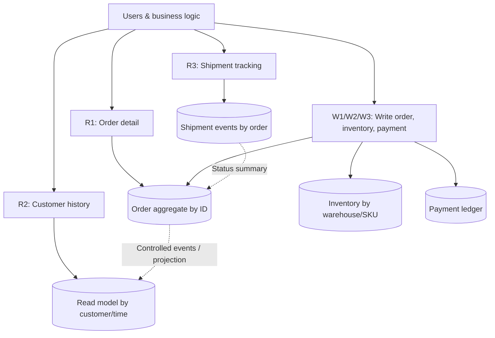
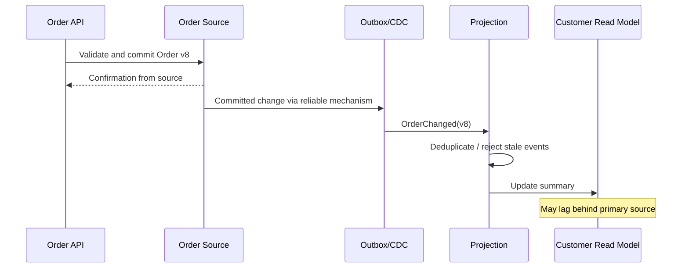
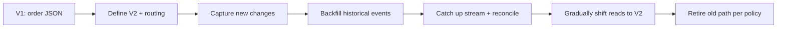

# Designing Around Co-Read and Co-Write Data Boundaries

## Learning Objectives

After this lesson, you will be able to:

- Explain the **co-access boundary** and distinguish between **co-read** and **co-write**.
- Distinguish between **business aggregate boundary**, **storage unit**, **partition key**, **logical partition**, **physical shard**, and **transaction scope**.
- Translate read/write requirements into an **access pattern matrix** with known keys, row counts, ordering, frequency, latency, consistency, and invariants.
- Propose how to group data into a single value, a group of rows in the same partition, or multiple tables/read models without broad scans.
- Identify when placing data close together helps queries and when it increases **hotspots, write contention, oversized partitions, cross-partition transactions**, or data duplication.
- Design write boundaries that protect business invariants using atomic operations, appropriate transactions, or stateful workflows with idempotency and reconciliation.
- Evaluate partition key choices by **hash, range, time, and tenant**, and their impact on queries, load balancing, migration, and late-arriving data.
- Verify physical schemas using **fan-out, partition size, hot-key traffic, read/write amplification, p95/p99**, and correctness as data changes.

This lesson belongs to the **DATABASE_DATA_MODELING** module: building skills to translate business requirements into entities, relationships, constraints, normalization, keys, indexes, and physical schemas; while comparing relational, document, graph, and analytical models based on real-world needs. In the **Distribution and Partitioning** chapter, the central question is not merely "how many machines should we split the data across?" but rather:

> **Which parts of the data are frequently read or need to be updated as a single business unit, and how should they be organized so that access is correct, fast enough, scalable, and still preserves invariants?**

The challenge is that **the optimal boundary for reading does not necessarily match the optimal boundary for writing**. A good design must expose and verify this difference.

---

## 1. What Does "Data Accessed Together" Mean?

An entity is rarely used in isolation. For example, when a customer opens an order, the UI typically reads **the order header together with its line items**. When the business reserves inventory, it needs to read/write **the available quantity and reserved quantity of a SKU at a warehouse**. When a customer views "the 20 most recent orders," the UI only needs **summaries of multiple orders**, not every line item of each order.

There are four important types of relationships:

| Relationship Type | Question | Example | Design Consequence |
| --- | --- | --- | --- |
| **Co-read** | Which records are frequently retrieved together in one read operation? | Order header + 3 line items | Consider placing in the same value/partition or preparing a read model |
| **Co-write** | Which values typically change within the same command? | Modifying an item quantity and updating the subtotal | Consider transaction/aggregate, limit contention |
| **Co-invariant** | Which values must jointly satisfy a constraint on commit? | Available inventory is non-negative | Needs an atomic enforcement point or an appropriate consistency mechanism |
| **Co-lifecycle** | Which data is created, retained, and deleted under the same policy? | Finalized line items together with the order | Consider the same storage unit; separate event logs with a different TTL |

**Co-read** is a performance requirement. **Co-invariant** is a correctness requirement. They may suggest the same data boundary, but they are **not equivalent**.

For example, an "order detail" page needs to display the order, payment, and shipping. Placing all three in one partition might help certain queries, but it does not automatically create an ACID transaction across three services. The payment system may be its own authoritative source, so the order service should not mutate payment state directly just to save a read.

### 1.1. Boundaries Cannot Be Decided by an Entity Diagram Alone

A business relationship `Order 1—N OrderItem` is important information, but it does not yet answer:

- Does the detail page always read **every item**, or only a summary?
- What is the maximum number of items, and what is the item size?
- Are items updated after the order is finalized?
- Do all items share the same permissions, TTL, and lifecycle as the header?
- Do commands editing multiple items require an atomic commit?
- Do multiple services mutate the order concurrently?

If an order has 3–10 small items and is almost always read together with them, storing them together may make sense. If an "order" represents a bulk shipment batch with millions of lines, putting all of them into one JSON document or an unbounded partition will cause problems even though the entity relationship is still 1—N.

## 2. Distinguishing Six Types of Boundaries

In distributed data systems, it is easy to conflate concepts that share the word "group."

| Boundary | What does it define? | What does it NOT guarantee by itself? |
| --- | --- | --- |
| **Business aggregate** | Set of state and invariants managed by a component as one logical unit | Same row, same partition, or same DB transaction |
| **Document/value** | Unit returned or updated via the store's API | Fast querying of arbitrary nested attributes; transactions with other keys |
| **Row/record** | A keyed record; may be the atomic write unit depending on the product | Atomicity across multi-row writes |
| **Logical partition** | Set of rows sharing a routing key / logical access group | Always residing on one machine; always updated atomically |
| **Physical shard/tablet/region** | Unit the engine allocates or splits to store data and serve requests | Remaining static forever; one-to-one mapping with a logical partition |
| **Transaction scope** | Updates the engine allows to commit/rollback with specific guarantees | Coinciding with partition or aggregate boundaries |

Some systems provide atomic writes at the single-document level; others support transactions across multiple rows/partitions; still others only guarantee atomicity for certain types of operations. **Do not infer transactional capability merely because data is "placed close together."**

For example:

```text
Aggregate "Order"                = business rules of one order
Document "order:ord_908"         = a bytes/JSON structure
Partition "(shop_17, ord_908)"   = group of rows read per order
Tablet / shard                   = how the engine physically places data
Transaction                      = commit scope supported by the DBMS
```

The five concepts above can be related, but they are **not required to be identical**.

### 2.1. A Partition Key Is Not a Business Identifier

`orderId` is the business identifier of an order within a shop. However, the customer history screen needs to query by `(shopId, customerId)`. Therefore:

- **Primary key by ID:** `(shopId, orderId)` to locate a single order.
- **Customer history read model key:** `(shopId, customerId, monthBucket)` to locate the group of orders listed together.
- **Status dashboard key:** `(shopId, status, dayBucket)` to locate the list of orders by status.

An object can appear in multiple read paths, with a clear **source of truth and synchronization mechanism**.

## 3. Running Example: A Multi-Shop Order Platform

Suppose an e-commerce service must handle:

- Many shops; each shop has thousands of customers, but load varies heavily across shops.
- Orders have metadata and product line items; orders can be reserved, paid, shipped, and delivered at different times.
- An inventory service maintains available quantities by `(warehouseId, sku)`.
- Shipping events are appended after the order has been paid.
- Customers frequently view a list of recent orders and open details for a single order.
- Shop staff view orders by status and date.
- Financial reports aggregate totals by month and category.

An illustrative order:

```json
{
  "shopId": "shop_17",
  "orderId": "ord_908",
  "customerId": "user_42",
  "status": "PAID",
  "createdAt": "2026-11-22T10:30:00Z",
  "currency": "VND",
  "items": [
    {"lineId": "1", "sku": "A17", "quantity": 2, "unitPriceMinor": 95000},
    {"lineId": "2", "sku": "B03", "quantity": 1, "unitPriceMinor": 29000}
  ],
  "totalMinor": 219000
}
```

Here `totalMinor` is an example of **item subtotal** with `2 × 95,000 + 29,000 = 219,000 VND`, before discounts/taxes/shipping fees; all real monetary rules must be stated in the business contract.

### 3.1. Access Pattern Matrix: The Starting Point of Design

| Code | Operation | Known Inputs | Data Required | Frequency / Freshness |
| --- | --- | --- | --- | --- |
| R1 | Open order detail | `shopId, orderId` | Header + items, possibly latest shipping summary | Frequent; status must have clear consistency level |
| R2 | Customer's recent orders | `shopId, customerId` | 20–50 summaries, sorted by time | Frequent, paginated |
| R3 | Shipment tracking | `shopId, orderId` | Delivery events in chronological order | List read, mostly append-only updates |
| R4 | PAID orders dashboard | `shopId, status, range` | Many orders by time | High during business hours; can lag by a few seconds |
| W1 | Create/finalize order | `shopId, orderId, items` | Header + finalized items | Must protect order invariants |
| W2 | Reserve inventory | `warehouseId, sku, qty, requestId` | Available/reserved quantities | Contended writes; must never go negative |
| W3 | Record payment | `paymentId, orderId` | Monetary transaction state | Separate payment invariants and idempotency |
| W4 | Record shipping event | `shopId, orderId, eventId` | Append event, update derived status | May arrive duplicated or out of order |
| A1 | Sales reporting | Month, shop, category | Very large set for aggregation | Batch/OLAP or rollup |

**Key question:** Which data is read together in **R1**, and which data must be updated atomically in **W2**? If we try to place all order, inventory, payment, and shipping information under `shopId` just to keep them "close together," we risk creating a hot partition, the wrong transaction boundary, and coupling data groups with independent lifecycles.

### 3.2. Relationship Between Read and Write Paths



The dashed arrows indicate **logical synchronization**; they do not automatically provide distributed transactions or instantaneous updates. The application itself must define the authoritative source and acceptable staleness for each read path.

## 4. Designing from Co-Read: Placing the Right Data Groups Together

A simple approach is to ask: *when the API is called, what exact data does it need to read and what keys can it construct from its inputs?*

### 4.1. Option A: Entire Order in One Value/Document

```text
key = order:v1:shop_17:ord_908

value = {
  metadata: {...},
  items: [...],
  shippingSummary: {...}
}
```

Appropriate when:

- The parts inside the value are usually read together.
- The maximum size has a reasonable upper bound.
- Multiple related changes stay within one aggregate.
- The store supports value-level atomic/conditional updates as required.
- You do not need to continuously query individual items from large values.

Trade-offs:

- If editing one field requires reading and rewriting the entire value, byte transfer and contention can increase.
- Larger values more easily hit system size limits.
- A `customerId` attribute inside JSON **does not automatically create an index** to find all orders for a customer.
- Unbounded shipping events should not be appended forever into the order value without a cap.

A single value can be an **effective read boundary**, yet if multiple independent writers update different parts of it concurrently, it can also become a **point of contention**.

### 4.2. Option B: Multiple Rows/Items Sharing a Partition Key

In systems with a partition key and sort key, we can group the items of an order:

```text
PK = SHOP#shop_17#ORDER#ord_908

SK = META
  -> {customerId, status, createdAt, totalMinor}

SK = ITEM#0001
  -> {sku:A17, quantity:2, unitPriceMinor:95000}

SK = ITEM#0002
  -> {sku:B03, quantity:1, unitPriceMinor:29000}

SK = SHIPPING_SUMMARY
  -> {lastStatus:PACKED, lastChangedAt:...}
```

If the product supports **queries by partition key + sort key condition**, an API opening an order can read the order's group of items. If it only needs items, the API can select the `ITEM#` prefix instead of loading unrelated data.

**Notes:**

- A string prefix does not automatically enable partition/range queries in every hash key–value store.
- Sharing a partition **does not prove** that all items are written atomically in a single transaction.
- Some products limit the number of items/partition size and the types of predicates allowed on the sort key.
- Conventions like `SK=ITEM#0001` must handle ordering, uniqueness, delimiters, and line additions/deletions.
- If shipping events are numerous or retained for 7 years while orders are retained for 3 years, separating them may be better.

### 4.3. Option C: Query-Driven Tables

In a CQL/wide-column style model, two tables can be used:

```sql
-- Detail of a single order, read by (shop_id, order_id).
CREATE TABLE order_items_by_order (
    shop_id            text,
    order_id           text,
    line_no            int,
    sku                text,
    quantity           int,
    unit_price_minor   bigint,
    PRIMARY KEY ((shop_id, order_id), line_no)
);
```

```sql
-- Customer history by month, newest orders first.
CREATE TABLE orders_by_customer_month (
    shop_id       text,
    customer_id   text,
    month_bucket  text,
    created_at    timestamp,
    order_id      text,
    status        text,
    total_minor   bigint,
    PRIMARY KEY (
        (shop_id, customer_id, month_bucket),
        created_at,
        order_id
    )
) WITH CLUSTERING ORDER BY (
    created_at DESC,
    order_id ASC
);
```

Fetch items of an order:

```sql
SELECT line_no, sku, quantity, unit_price_minor
FROM order_items_by_order
WHERE shop_id = 'shop_17'
  AND order_id = 'ord_908';
```

Fetch a customer's recent orders in a month:

```sql
SELECT order_id, created_at, status, total_minor
FROM orders_by_customer_month
WHERE shop_id = 'shop_17'
  AND customer_id = 'user_42'
  AND month_bucket = '202611'
LIMIT 20;
```

These SQL/CQL examples illustrate **key-based access paths**; exact syntax, partitioning/clustering capabilities, and transactions vary by product. Because these are two distinct read patterns, they have two representations.

**Important:** If `orders_by_customer_month` is a derived summary from the authoritative order-by-ID source, there must be a synchronization mechanism when `status` or `total` changes. Faster reads are not free: we pay in storage, additional writes, and reconciliation responsibility.

## 5. Co-Read Does Not Mean "Stuff All Related Data into One Place"

A screen may need data from multiple sources, but those sources do not necessarily share the same lifecycle or ownership.

For example, an order page displays:

- Order info and line items: relatively stable once finalized.
- Payment status: confirmed by the payment service.
- Shipping progress: append-only events over time.
- Product recommendation analytics: derived data, potentially cached.

Putting all of these into **one document updated by multiple services** easily causes:

- **Lost updates:** two writers read the same version and overwrite each other's changes.
- **Write contention:** every small update competes to modify the same key.
- **Unbounded growth:** event history keeps growing.
- **Coupling:** schema or retention changes in shipment affect orders.
- **Security leakage:** an API's read payload receives unnecessary PII or payment data.

You can choose **API composition**—where authoritative sources keep their own data and the read layer aggregates when needed—or build a **consolidated read model** with trimmed fields and an explicit staleness policy. Both are valid options depending on SLAs.

### 5.1. Three Levels of Co-Access

| Level | Structure | Benefits | Limitations |
| --- | --- | --- | --- |
| Same value/document | Single key read monolithically | Simple for small aggregates | Large values, update contention |
| Same logical partition | Multiple rows/items sharing partition key | Grouped queries, ordering if engine supports it | Partition limits, not automatically transactional |
| Different partitions/systems, with read path | Multiple tables, lookup/index/read model | Flexible lifecycle, scaling, and ownership | Multiple requests or derived synchronization |

Rule of thumb: **co-locate only the data that is frequently read together and has compatible size and lifecycle**. Do not pick the same partition simply because entities share a business foreign key.

## 6. Designing from Co-Write: The Boundary of Business Invariants

Co-write asks a different question: *which changes must be correct together, and what guarantees does the storage product offer for them?*

### 6.1. Example: Reserving Inventory

A SKU at a warehouse has:

```text
Inventory aggregate:
  warehouseId = wh_3
  sku = A17
  available = 10
  reserved = 2
  version = 41
```

A command to reserve 3 more units must maintain:

\[
available \geq 0
\]

and the precondition `available_before >= 3`. If two checkouts both read `available=10` and write the new number unconditionally, updates can be lost or inventory oversold.

One SQL approach when using a relational system that supports atomic UPDATE and transactions:

```sql
BEGIN;

UPDATE inventory_balance
SET available_qty = available_qty - 3,
    reserved_qty  = reserved_qty + 3
WHERE warehouse_id = 'wh_3'
  AND sku = 'A17'
  AND available_qty >= 3;

-- The application must verify that exactly 1 row was affected.
-- If 0 rows, roll back and return "insufficient stock / SKU not found".
-- Writing the reserve_request_id/idempotency record must be
-- executed within the chosen transaction boundary.

COMMIT;
```

**This is a conceptual example:** it relies on the UPDATE and transaction guarantees of a specific database. To prevent checkout retries from reserving stock twice, you also need an **idempotency key** or a reservation record with a unique key—not just a quantity UPDATE. If the business reserves multiple SKUs in the same request, you must decide between a multi-row transaction or a workflow with compensation.

### 6.2. Write Boundaries for Orders and Inventory Can Differ

Order `ord_908` contains SKUs A17 and B03 from two different warehouses. We cannot assume:

```text
Partition (shopId, orderId)
  includes every inventory balance of the involved warehouses
```

Because inventory is shared across many orders, placing it under each order ID would create **multiple conflicting copies of "stock quantity."** Placing all orders and inventory of a shop into one partition creates hotspots and fails to handle multiple warehouses/services.

A cleaner set of boundaries:

- **Order aggregate:** rules for creating/finalizing/canceling an order and order status.
- **Inventory aggregate:** quantities for a `(warehouseId, sku)` or the required business control unit.
- **Payment aggregate:** payment transaction identified by the authoritative source.
- **Order workflow:** coordinates multiple aggregates via states, events, and compensation, or uses an actual transaction if supported by the environment and required by business rules.

**Cross-aggregate invariants** are an architectural decision requiring analysis; they cannot be solved merely by assigning the same partition key.

### 6.3. Three Consistency Scopes

| Scope | Example | Commonly Considered Mechanisms |
| --- | --- | --- |
| Single record/value | Updating the version of one order | Atomic update, CAS, optimistic locking |
| Multiple rows in a transactional store | Finalizing order header and order lines together | Transactions per the specific DB's guarantees |
| Multiple services/partitions/systems | Order + inventory + payment | Distributed transaction when truly available and appropriate; or saga/outbox, idempotency, compensation |

Putting rows in the same partition **may** enable optimizations or certain conditional operations depending on the engine. However, it **does not inherently provide atomic commit across multiple tables**, nor does it replace business state modeling.

## 7. When Co-Read and Co-Write Conflict: Which Model to Choose?

Consider two important APIs:

1. **Customer history:** always needs the 20 most recent orders of a customer. Ideal partition by `customerId` + time.
2. **Order updates:** must protect the invariants of a single `orderId`. Ideal write boundary by `orderId`.

If we use the same table `orders_by_customer_month` as the primary write source, an order whose `customerId` or `createdAt` changes would have to move keys, while status updates still need a stable order identifier. The customer-facing table could also become hot from high-volume customers.

We can use:

```text
Authoritative write model:
  order_by_id(shopId, orderId) -> versioned state

Read model:
  orders_by_customer_month(shopId, customerId, yyyyMM, createdAt, orderId)
     -> summary fields for display
```

Write path:



Outbox makes sense when writing the source change and the outbox record are committed in the same supported transaction; CDC can read the committed log. The diagram **does not claim that projections update instantaneously** or that the entire pipeline is exactly-once. You still need version rules, retries, idempotency, and reconciliation.

### 7.1. Adjusting the Read-After-Write Experience

If a customer just created an order but the history read model has not updated yet, the UI can:

- Navigate directly to the order detail by `orderId` at a read source with the required consistency level.
- Render the newly created order from the creation response while the list refreshes.
- Use a wait/projection watermark mechanism if available and allowed by SLAs.
- Choose a system with synchronous transactions/indexes if the business strictly requires read-your-writes.

Do not conclude an order "was not created" simply because a **read replica/projection** has not caught up yet.

## 8. Partitioning Strategies: Close Together in What Sense?

Partitioning is not a single mechanism; how data is placed depends on the DBMS.

| Partitioning Type | Routing Intuition | Strengths | Trade-offs |
| --- | --- | --- | --- |
| **Hash by key** | Hash of partition key distributes data groups | Distributes many keys fairly evenly if load permits | Does not natively support range scans across the entire keyspace; a single hot key stays hot |
| **Range by key** | Ordered key ranges placed/moved by the engine | Range scans by key, time, or suitable prefix | Monotonically increasing keys can overheat the trailing range |
| **By time** | Day/hour/month in partition key or physical partition | Bounds history, easy to scope retention | Long-range queries touch many buckets; current bucket stays hot |
| **By tenant/entity** | Data for the same tenant/order/device grouped together | Local for per-tenant/per-entity queries | Large tenants or hot entities cause skew |
| **Sharding with salt/sub-hash** | Add `shardId` to split load of large groups | Spreads concurrent writes if truly distributed | Group reads require fan-out/merge; routing complexity |
| **Directory/lookup-based** | Routing table points to the shard holding an entity | Flexible tenant/object movement | Lookup overhead, mapping cache, consistency, and migration |

**A key string sharing a prefix does not prove physical proximity.** In a pure hash key–value store, `order:shop_17:*` can be spread widely. In an ordered key store, prefix/range scans may be effective. In partition+clustering systems, behavior depends on the **actual partition key and sort key**.

### 8.1. Composite Keys and Locality

With the schema:

```text
partition_key = (shopId, customerId, monthBucket)
clustering_key = (createdAt DESC, orderId ASC)
```

Rows with the same `(shopId, customerId, monthBucket)` form **one logical group by customer–month**. Within that group, the clustering key organizes ordering by time. However, if a query only knows `shopId`, it **does not identify a complete partition**.

Do not assume that putting `shopId` first in a composite key makes querying all orders of a shop fast; that depends on the engine type and access path.

### 8.2. Colocation in Distributed Relational Systems

Some distributed SQL systems support partitioning two tables on the same key and routing rule to **reduce data transfer during joins**. For example:

```text
orders       partition by hash(shop_id)
order_items  partition by hash(shop_id)

join on (shop_id, order_id)
```

If both tables are colocated using the **same routing function, partition map, and join condition**, the engine can execute part of the join near the data. However:

- Having the same partition column name **does not guarantee** two tables sit on the same node.
- Join queries without predicates on the partition key may still require shuffling data.
- Partitioning by shop easily skews if there is a very large shop.
- Cross-table transactions and constraints must be checked against what the engine actually supports.

Colocation is a **query-path optimization**, not an integrity constraint.

## 9. Query-Group Design: Measuring "Proximity" by Cost

A design is only useful if it reduces the cost of the **real workload**, not merely the number of tables.

We can measure:

- **Number of partitions/shards/tablets a request touches** (*fan-out*).
- **Rows and bytes read by the engine** compared to rows/bytes actually returned by the API.
- **Number of round-trips** and network/coordination wait time.
- **Cross-node join/shuffle cost**.
- **Extra writes** for indexes/read models.
- **Contention level** and retry counts when updating the same key.
- **Scaling and migration cost** when tenant distribution shifts.

### 9.1. Preliminary Cost Model

Define:

\[
\text{Read amplification}
=
\frac{\text{rows or bytes that must be read}}{\text{useful rows or bytes returned}}
\]

\[
\text{Logical write amplification}
=
\frac{\text{write operations across source and read models}}{\text{business changes}}
\]

This is a **logical-layer modeling** ratio; write amplification at the LSM/SSD layer means something else. When measuring, always state the denominator and units explicitly.

An API that wants 20 summaries but scans 5 million orders has high read amplification. An API that fetches 1 document containing 10,000 items just to display 2 items also transfers excessive bytes even though the request count is one.

### 9.2. Peak Load Matters More Than Averages

Suppose a large shop has **20,000 orders/day** and an average summary of **200 bytes/row** (illustrative numbers):

\[
20\,000 \times 200 = 4\,000\,000\ \text{bytes/day}
\]

If 3 years of history live under one partition keyed by `shopId`, summary payload alone is roughly:

\[
4\,000\,000 \times 365 \times 3
= 4.38\ \text{GB}
\]

That excludes metadata, replication, tombstones, compaction, and multiple versions. Bucketing by **day** brings each bucket down to roughly 4 MB/day under these assumptions, yet a flash sale can still funnel writes into **today's partition**. Bucketing bounds **size over time**, not **concurrent write throughput**.

If 500 requests/second update **a single** inventory key, adding partitions for other shops does not reduce contention on that inventory key. You must evaluate atomic operations, read caching, workflow decomposition, or a different data model.

### 9.3. Trade-off Matrix

| Design | Co-read | Co-write/invariant | Scaling | Secondary Costs |
| --- | --- | --- | --- | --- |
| Entire order in one JSON | Good for small orders | Convenient if engine offers atomic documents | Single key suffers contention with multiple writers | Large payloads, hard to query non-key fields |
| Header + items in same partition | Good when querying by order ID | Depends on engine transactions, not guaranteed | Partition must stay bounded | Many rows, sort/range semantics |
| Order by ID + list by customer | Good for both separate read paths | Authoritative order source | Spreads across many keys | Projections, lag, rebuilds |
| All data by shop | Good for small shop queries | Does not auto-create cross-entity transactions | Large shops become hot | Oversized partitions and overly broad permissions |
| Event log separated from aggregate | UI needs composition or summary | Writers experience less contention | Append-only can be bucketed | Summary synchronization, separate retention |
| Normalized relational with indexes | Flexible joins, optimizer chooses path | Transactions/constraints if DB supports them | Physical partitioning needs planning | Join/shuffle or index overhead |

No row is "the best" without knowing query types, data distribution, load limits, and consistency requirements.

## 10. Designing History: Bucketing to Keep Data Groups Bounded

A customer can accumulate years of order history. The read path needs "the 20 newest orders" as well as date-range queries.

Instead of:

```text
partition = (shopId, customerId)
sort = (createdAt DESC, orderId)
```

we can use:

```text
partition = (shopId, customerId, monthBucket)
sort = (createdAt DESC, orderId ASC)
```

Splitting by month:

- Bounds the number of rows in **one logical partition**.
- Still serves customer order queries within a month.
- Allows walking backward to earlier months when fewer than 20 results are found.
- Increases the number of partitions read when querying across many years.

### 10.1. Time and Bucket Definitions

You must clearly specify:

- Is the bucket based on **order creation time** or status change time?
- Do you use UTC or the shop's local calendar date?
- Can late-arriving events be written into historical buckets?
- If a timestamp is corrected, must the row move to a new key?
- Can a single customer have two rows with the same `createdAt`? Use `orderId` as a tie-breaker.

For example:

```text
monthBucket = YYYYMM(createdAtUTC)
key = (shopId, customerId, monthBucket,
       createdAt DESC, orderId ASC)
```

If using shop-local time, you must preserve **effective timezones and calendar rules** so two services never compute different buckets.

### 10.2. Pseudocode for Fetching the 20 Most Recent Orders

```text
function listRecentOrders(shopId, customerId, limit, cursor):
    checkPermission(shopId, customerId)
    enforceLimitAndLookback(limit, cursor)

    result = []
    state = decodeCursorOrStartAtLatestMonth(cursor)

    while result.size < limit and state.withinLookback:
        rows, state = readNextPageFromPartition(
            shopId, customerId, state.monthBucket,
            (createdAt DESC, orderId ASC),
            state.position
        )
        result.add(rows)
        if state.currentPartitionExhausted:
            state.monthBucket = previousMonth(state.monthBucket)
            state.position = beginning

    return result, encodeCursor(state)
```

This pseudocode describes the **read path**. A real implementation must handle resource limits, engine cursors, status of the final bucket, insertions/deletions between pages, and total ordering. **A cursor does not automatically create an immutable snapshot**.

When a customer has no orders for many months, the API must enforce a lookback limit; it must never scan empty buckets indefinitely just to find 20 results.

### 10.3. When a Time Bucket Is Still Too Hot

If an enterprise customer generates tens of thousands of orders per second, even a monthly partition can be too hot in the moment. You can add `shardId` to the partition key:

```text
partition = (shopId, customerId, monthBucket, shardId)
shardId = stableHash(orderId) mod shardCount
```

To read the top 20, you must query multiple shards and **merge by timestamp**; changing shard count requires a versioning/routing plan. Do not add shards just to "have more partitions": measure the bottleneck first and determine how many sub-queries are acceptable.

## 11. Co-Write Data: Do Not Split Constraints and Expect JOINs to Fix Them

A partitioning decision can change where invariants are enforced. Consider two examples.

### 11.1. Contended Balance/Inventory Updates

If `available_qty` and `reserved_qty` are two independent keys, an inventory reservation must read and write two keys. Then:

- If the engine only supports **per-key** atomic writes, updating one key and crashing can leave inconsistent state.
- If the engine supports multi-key transactions over the needed scope, you can protect both updates in one commit.
- If no suitable transaction exists, you must design a **small value aggregate** or a workflow/state machine that never exposes invalid states under the contract.

Never issue two consecutive PUTs and call it "co-write" if they are merely sequential operations without atomicity guarantees.

### 11.2. Orders and Payments Have Separate Lifecycles

A payment command can succeed while the event reaches the order service late. At that moment:

```text
Payment source: PAID
Order read model: AWAITING_PAYMENT
```

This can be a valid transient state if the architecture accepts **eventual consistency** and has a completion workflow. Do not allow refunds or shipments based solely on a lagging copy if the business requires current state.

You must clarify:

- What is the authoritative source for "payment captured"?
- Do events carry IDs/versions to handle duplicates and out-of-order delivery?
- If a step fails, how are retries or compensations executed?
- When is the workflow considered complete?
- Does the UI display a **provisional**, **confirmed**, or **failed** state?

**Partitioning reduces access cost; transactions and workflows determine update correctness.**

## 12. Join Locality and Cross-Partition Queries

In a distributed relational system, a join can be:

1. **Local/co-located:** the rows to be joined are already placed correspondingly by routing key and the engine supports local execution.
2. **Scatter lookup:** query one record, then fetch related data from other shards.
3. **Shuffle/broadcast:** move data across nodes to join or aggregate across many partitions.

For example:

```sql
SELECT o.order_id, i.sku, i.quantity
FROM orders AS o
JOIN order_items AS i
  ON i.shop_id = o.shop_id
 AND i.order_id = o.order_id
WHERE o.shop_id = 'shop_17'
  AND o.order_id = 'ord_908';
```

If both are routed by `(shopId, orderId)`, the join **may** be local in some engines; if items are partitioned by `sku` while orders are partitioned by `orderId`, nodes may need to transfer data. However, **sharing the same key values does not prove physical co-location**: you must verify the partition map, engine execution plan, and rebalance policy.

If the system does not support joins or queries on non-key attributes, the alternative is to **denormalize read views** or design a table per access pattern. A workload-aligned read path can be simpler than a distributed join during peak traffic.

### 12.1. Cross-Tenant Queries

"Revenue across all shops over 5 years" usually lacks a narrow routing key to target just a few partitions. It belongs to **large-scale analytical workloads**, which may require OLAP/data warehouses, materialized aggregates, or batch pipelines.

Do not force a table optimized for `GET(orderId)` and `listRecentOrders(customerId)` to also efficiently serve arbitrary `GROUP BY` queries. Different access patterns may require different technologies and models.

## 13. Fast Reads Require Managing Data Replication

When creating tables by customer or status to serve queries, a single order is represented in multiple places:

```text
order_by_id:
  (shopId, orderId) -> canonical order state/version

orders_by_customer_month:
  (shopId, customerId, monthBucket, createdAt, orderId)
  -> summary/status

orders_by_status_day:
  (shopId, status, dayBucket, statusChangedAt, orderId)
  -> summary
```

The issue is not that "repeating data is wrong." The issue is **who updates which copy and how to rebuild it**.

### 13.1. Status Transitions Move Index Entries

If order `ord_908` transitions from `PAID` to `SHIPPED`, `orders_by_status_day` has `status` in its partition key. Then you must:

1. Identify the old status entry using **the exact old key**.
2. Delete or invalidate the old entry.
3. Insert the new entry under the new status/timestamp.
4. Update the projection version/checkpoint according to rules.
5. Retry/reconcile if failure happens midway through the operation.

Two entries in **different partitions** may not be updated atomically by the engine. If SLAs allow lag, you must **measure lag and repair drift**; if not, choose a suitable indexing or transactional mechanism.

### 13.2. Duplicate and Out-of-Order Events

```text
v7: order ord_908 -> PAID
v8: order ord_908 -> SHIPPED

Delivery order:
  v8, v7, v8
```

Applying events in arrival order could regress status back to PAID. The contract requires:

- A per-order monotonically increasing `orderVersion` from a reliable emitter.
- Consumers ignoring stale or duplicate events via version checks.
- Version validation and projection mutation using a **race-safe mechanism**, not unconditional read-then-write.
- Index delete/insert operations that are **idempotent** and safe to retry.
- **Reconciliation** against the primary source; do not rely solely on an event log with finite retention.

If events only carry **deltas**, losing one version may prevent reconstructing current state; you need full event replay, source snapshots, or recovery procedures.

### 13.3. Deletion and Lifecycle Across Boundaries

Data groups read together do not necessarily share the same TTL:

- Order metadata may need long-term retention for compliance.
- Line items must remain to audit a transaction.
- Shipping events have their own retention window.
- Caches or list read models may be retained for shorter periods.

A `DELETE` at the source does not automatically clean every cache, index, or analytics store. You need appropriate **deletion events/logical tombstones, versioning, reconciliation, and recovery procedures**. For personal data, every derived copy falls under access and erasure governance.

## 14. Multi-Region: Close to Which Data, Close to Which Users?

Data boundaries can also involve **geographic location** when systems operate across regions:

- An order and its items are typically read together in the region serving the customer.
- Reserving inventory at a warehouse/region needs a single authoritative write coordinator to prevent overselling.
- Global admin dashboards may accept a replica near users that **lags behind the source**.
- Personal data may have residency constraints; you cannot move it to another region solely to reduce latency without reviewing applicable policies.

### 14.1. Proximity Does Not Eliminate Network Latency

If the order service is in region A, the inventory service is in region B, and the payment provider is elsewhere, placing order rows in the same partition does not eliminate cross-region round-trips during checkout.

A design commonly separates:

- **Transactional decision path:** where sufficient data and guarantees exist to enforce invariants.
- **Local read path:** replicas/caches/read models with published staleness bounds.
- **Analytical path:** ETL/streams to a warehouse for aggregation, usually without immediate commit coupling to the order.

**Replication**, **sharding**, and **co-location** are three distinct mechanisms: replication creates extra copies; sharding splits the dataset; co-location optimizes distance between data frequently accessed together.

### 14.2. When Location or Ownership Changes

A tenant may migrate regions, a shop may change storage placement, or an order may transfer management ownership. You need:

1. **Stable** business identifiers that do not depend rigidly on the current shard ID.
2. A routing table / routing version that can transition.
3. Migration procedures with checkpoints and duplicate/loss checks.
4. A contract for write authority during cutover to avoid uncoordinated dual writes.
5. Post-migration reconciliation of permissions, TTLs, and derived data.

Do not embed region/shard directly into public business IDs if that forces user-visible IDs to change on every rebalance.

## 15. Skew and the Limits of "Placing Together"

A boundary chosen for common queries can become a **hot partition** under skewed workloads.

### 15.1. A Large Partition Is Not Necessarily Hot

- **Large:** holds many bytes/rows, possibly read rarely.
- **Hot:** receives high requests or bytes/s simultaneously, even if small.
- **Hot key:** a single key under heavy read/write contention.
- **Skew:** a small number of tenants/keys/partitions account for a disproportionate share of data or load.

All four must be measured. **Hashing that evenly distributes distinct keys does not distribute load for a single hot key.**

### 15.2. Choosing Mitigations by Bottleneck

| Bottleneck | Mitigation to Consider | Trade-offs |
| --- | --- | --- |
| Historical partition grows too large | Time bucketing, lifecycle policies | Cross-bucket reads increase fan-out |
| Current partition receives hot writes | Sharding by stable ID, different write structure | Merging multiple shards on reads |
| Single key has extreme GET rate | Cache/read replicas/request coalescing | Freshness, invalidation, cache stampede |
| Single key has contended writes | Atomic ops, split aggregates if invariants allow | Correctness and retries |
| Sequential range key causes hotspot | Distributed prefix/pre-splitting per engine | More complex time-range scans |
| Query lacks partition key | Secondary index, read model, different technology | Sync/index maintenance cost |
| Analytical query across many groups | OLAP/warehouse/aggregates | Freshness, ETL, and reconciliation |

Time bucketing bounds **size growth over time**, but does not necessarily reduce **write load in the current bucket**. Adding concurrent shards can relieve heat, at the expense of more read requests and pagination complexity.

### 15.3. Fan-Out and Merging Across Multiple Shards

For example, `orders_by_status_day` for a large shop using 8 shards:

```text
partition = (shopId, status, dayBucket, shardId)
sort = (statusChangedAt DESC, orderId ASC)

shardId = stableHash(orderId) mod 8
```

To fetch the 30 newest PAID orders:

- Query the shards of the current bucket.
- Read a candidate slice from each shard.
- Perform a **K-way merge** under a total order (timestamp + ID).
- If fewer than 30 are found, continue to older buckets within the lookback limit.
- The cursor must store positions across every source and shard/bucket rules, not just the last timestamp.

You cannot claim "splitting one hot partition into 8 shards makes queries 8x faster." Writes and reads incur different costs, especially when one shard is slow or many buckets are empty.

## 16. Consistency When Data Parts Are Not Stored Together

If a screen needs three separate sources, three consistency profiles usually matter:

| Requirement | Example | Approach |
| --- | --- | --- |
| **Immediate command consistency** | No overselling, valid payment state | Validate at transactional/atomic state source |
| **Session / read-your-writes consistency** | Customer who just placed an order sees it | Read source, target version, or optimistic UI |
| **Eventual consistency for lists** | Status dashboard lags by a few seconds | Derived read model, measure lag, retry/reconcile |

If source A returns order version 9 while replica B only has shipment summary version 7, the UI may display data "from different points in time." Sometimes this is acceptable; other times it requires **snapshot/as-of reads**, a version watermark, or re-querying. This must be defined by business rules—never assume all reads share a common snapshot.

### 16.1. Update Boundaries Protect Ownership

Different services should not directly mutate each other's source records just because they share a partition key. You need:

- Clear owners for each aggregate and event.
- APIs/commands that check versions and permissions.
- Auditable and replayable mutation paths.
- Separation between authoritative writes and projections.
- No overly broad write permissions granted just to optimize co-location.

**Co-location is a physical choice; write authority is an architectural and security choice.**

## 17. Tenant Isolation and Data Boundaries

Partition keys often include `tenantId` or `shopId` to group data. However, this **does not automatically constitute an access control mechanism**.

An API like:

```text
GET /shops/shop_17/orders/ord_908
```

must:

1. Authenticate the user/service.
2. Determine the shops they are authorized to access from a trusted source.
3. Verify `shop_17` is within that authorized scope.
4. Construct the query with the full key.
5. Return only fields permitted for that caller.

If using a shared multi-tenant partition to optimize dashboards, check for cross-tenant scan or index leakage risks. Do not put raw emails, tokens, or phone numbers into keys if keys may appear in logs or metrics.

Data "co-read" by an internal API should not necessarily be returned wholesale to **every API caller**. Field-level or entity-level access control may still require separate read models or field masking.

## 18. Changing Boundaries After the System Is Live

Initially, data might be small enough to store in one order JSON document. Two years later, shipping events grow to millions of records and the API slows down. Moving events to a separate table is a **change in access path and lifecycle**, not merely "renaming a key."

### 18.1. Migration Scenario

V1:

```text
order:v1:<shopId>:<orderId> -> metadata + items + events[]
```

V2:

```text
order:v2:<shopId>:<orderId>    -> metadata + items + summary
shipment-events:v2:<shopId>:<orderId>:<bucket> -> ordered events
```

Steps:

1. **Define V2 schema and responsibilities.** Which part is the source of truth; what event ID/timestamp acts as tie-breaker.
2. **Define versioned routing.** How are unmigrated V1 orders read?
3. **Reliably capture new changes.** Where are events written during backfill?
4. **Backfill historical events** by ID, with checkpoints and deduplication.
5. **Reconcile** IDs/counts/versions/timestamps and data samples, not just total row counts.
6. **Gradually shift read traffic**, measuring latency, request counts, and correctness.
7. **Decommission the old path conditionally**, handle TTLs and copies safely, and preserve rollback capability if needed.



If backfilling from a snapshot while new events continue arriving, you need a log/offset watermark or version merge rule so events are neither lost nor duplicated. Two PUTs to V1 and V2 are **not atomic by default**.

### 18.2. Changing Shard Counts Requires Routing Versions

Moving from:

```text
shardId = hash(orderId) mod 4
```

to:

```text
shardId = hash(orderId) mod 16
```

changes the storage address of many order IDs. Changing only a constant will cause new code to miss old data. Options include maintaining versioned routing by time/bucket, dual-reads with deduplication, or backfilling to new keys while constraining write authority during cutover.

Do not treat the current partition key/shard ID as an immutable part of the business identifier if you want future rebalancing flexibility.

## 19. A Repeatable Process for Choosing Data Boundaries

Use this process before finalizing a model:

1. **Identify entities and invariants.** Orders, items, inventory, payment, shipment; where is the source of truth?
2. **List queries/commands.** Known inputs, read/write scope, sorting, limits, and SLAs.
3. **Mark co-reads.** Which records are typically read together in one API; what are their sizes and frequencies?
4. **Mark co-writes/co-invariants.** Which changes must be atomic, and which can be eventual?
5. **Define update boundaries.** Single value, row, aggregate, DB transaction, or multi-service workflow?
6. **Choose access paths.** Direct key, partition+sort, index, read model, join, or OLAP.
7. **Estimate distribution.** Top tenants, p50/p95/p99 rows/bytes/partition, write/read QPS, retention.
8. **Check co-location/engine behavior.** Hash/range, split/rebalance behavior, transaction and query limits.
9. **Design fan-out and pagination.** Buckets/shards, total ordering, cursors, limits, lookback.
10. **Design copy synchronization.** Outbox/CDC, versions, idempotency, lag, deletions, and rebuilds.
11. **Test load and correctness.** Time boundaries, hot partitions, cross-partition failures, and retries.
12. **Plan evolution.** Schema/key versioning, backfill, cutover, permissions, and data lifecycle.

### 19.1. Decision Sheet for a Table

| Item | Example `orders_by_customer_month` |
| --- | --- |
| Query served | Order history by customer, sorted newest first |
| Available inputs | `shopId, customerId`, date range or starting from latest |
| Row grain | One order in a customer's list |
| Partition key | `(shopId, customerId, monthBucket)` |
| Sort key | `(createdAt DESC, orderId ASC)` |
| Replicated fields | `status, totalMinor` plus ID/timestamp |
| Authoritative source | Order by `(shopId, orderId)` |
| Consistency level | List may lag per SLA; sensitive actions read source |
| Lifecycle | Retention per policy; clean up when source deleted/reassigned |
| Query bounds | Max limit, lookback, multi-bucket cursor |
| Extreme loads | High-volume monthly customers, flash sales, late events |
| Verification evidence | Rows/bytes/partition, p99 latency, lag, ID/status reconciliation |

A useful design document contains more than DDL. It must show **why queries match the keys**, **where invariants are protected**, and **how scale increases while staying correct**.

## 20. Testing Co-Location Choices

### 20.1. Testing Read Paths

| Scenario | What Must Be Proven |
| --- | --- |
| Open order with 3 items | Correct header/items, lookup count within SLA |
| Open order with 10,000 items | Does not load everything unnecessarily; pagination/limits exist |
| Customer history within one month | Queries exact partition, stable ordering |
| History across 12 months | Bounded fan-out, cursor does not drop identical timestamps |
| Query by status | Does not scan every customer when low latency is required |
| Large shop with flash sale | No hot partition/key exceeds targets |
| Tenant with very sparse data | Does not scan empty buckets indefinitely to find 20 orders |
| Join order and items in distributed SQL | Execution plan shows data transfer/reads within limits |
| Multi-year shop-wide dashboard | Uses suitable analytical model rather than reading orders one by one by ID |

### 20.2. Testing Write Paths and Invariants

| Scenario | What Must Be Proven |
| --- | --- |
| Two checkouts reserve same SKU | No overselling; contention handled properly |
| Retry with same `requestId` | Does not double-reserve stock or create duplicate orders |
| Order finalized while item changes | Snapshot/order price constraints are explicit |
| Payment succeeds but Order worker fails | Workflow retries/reconciles; never arbitrarily marks payment failed |
| Shipment events arrive out of order | Version/state machine never regresses to an older state |
| Partial failure updating read model | Missing/extra entries can be rebuilt and repaired |
| Customer/status changes | Index/read model moves keys without leaving stale entries beyond SLA |
| Single key receives hot updates | Contention/retries stay bounded; invariants remain intact |
| Order deleted | Copies and logs follow retention policy and are not resurrected by old events |
| Schema/shard version transition | Both old and new data are discoverable during cutover |
| Tenant A user accesses tenant B | Denied even when knowing the primary key |

### 20.3. Metrics to Observe

- **Read fan-out:** partitions/shards queried per request by API.
- **Read amplification:** rows/bytes read vs. useful rows/bytes returned.
- **Write amplification:** logical writes per business event and bytes generated.
- **Top-key/partition traffic:** read/write QPS, throughput, contention, retries.
- **Partition distribution:** rows/bytes at p50/p95/p99 and extreme outliers.
- **Query latency:** p50/p95/p99 by query type, tenant, range, and result size.
- **Cross-node network/shuffle:** data transferred during joins/analytics if exposed by engine.
- **Projection lag/divergence:** derived copies lagging behind, stale entries, orphaned entries.
- **Transactional correctness:** CAS failure rates, duplicate requests, workflow states needing compensation.
- **Lifecycle cost:** TTL/tombstone/compaction/index cleanup and backfill throughput per product.

Do not pick universal "safe" thresholds for all products. Limits on document size, partition size, throughput, and transaction types must be grounded in the **actual engine, configuration, and SLA**.

## 21. Common Design Pitfalls

| Pitfall | Consequence | Fix |
| --- | --- | --- |
| Putting everything for a shop in one partition | Large shops overheat and accumulate unbounded history | Group by query, aggregate/bucket; measure skew |
| Putting data in the same partition and assuming ACID | Multi-row updates can fail partially | Verify transaction guarantees or design a workflow |
| Letting every service edit the same order JSON | Lost updates, hard to manage permissions and schema | Define source/owner; use projections for reads |
| Embedding inventory inside every order | Stock counts duplicated and oversold | Give inventory its own write source by SKU/warehouse |
| Stuffing everything co-read into one value | Small queries fetch large blobs; writers contend | Group only small, bounded data; split long event logs |
| Naming keys after entities instead of query inputs | Queries scan because partition key is missing | Build an access matrix and explicit access paths |
| Mistaking a key string prefix for a range index | Hash key–value stores do not natively support prefix scans | Check actual engine, indexes, or ordered keys |
| Caring only about average QPS | One hot tenant/partition breaks p99 | Measure top-K, skew, and peak |
| Adding buckets to solve every hotspot | Current bucket still absorbs all writes | Separate oversized partitions from hot writes; shard if needed |
| Adding shards while forgetting the read path | Top-N queries hit many shards uncontrollably | K-way merge, cursors, limits |
| One read model for every filter combination | High duplication and massive write amplification | Select critical queries; consider optimizer/indexes |
| Leaving business timestamps ambiguous | Wrong buckets on late events or timezone shifts | Standardize event time and bucket contract |
| Treating replication like sharding | Creates read copies instead of splitting write hot keys | Pick the mechanism matching the bottleneck |
| Checking only total record counts after backfill | Data may differ in IDs/versions despite equal counts | Reconcile by key and version |
| Assuming rows in the same partition share access rights | Leaks sensitive fields or other tenants' data | Enforce authorization and minimize returned fields |
| Exposing physical keys as public business IDs | Hard to rebalance or migrate | Keep business IDs stable; version routing |

## 22. Practice Exercises

### Exercise A — Choosing Boundaries for Orders and Line Items

An average order has 4 items, but wholesale orders can contain up to 100,000 lines. The detail page API normally displays only the first 50 lines; customers can search by SKU within an order.

**Question:** Should all items be stored in one JSON document under `orderId`? Choose the co-read boundary and pagination path.

**Hint:** Store metadata/summary by order ID, and store items as rows with sorting/pagination or an appropriate index. A huge JSON document forces every GET to load excessive bytes; if SKU filtering is required, design an access path scoped to the order. Finalization invariants must still be preserved at the source.

### Exercise B — Inventory and Orders

A cart contains two SKUs from two warehouses. Two users concurrently check out an item with only one unit left.

**Question:** Does placing everything under partition `(shopId, orderId)` prevent overselling? Which write boundary and mechanism are required?

**Hint:** No. Inventory is shared state across multiple orders, so it must be controlled at `(warehouseId, sku)` using atomic/conditional updates and idempotency. Multi-warehouse checkouts require a properly scoped transaction or a compensating workflow.

### Exercise C — Huge Shop and Status Dashboard

Initial design:

```text
partition = (shopId, status)
sort = (statusChangedAt DESC, orderId)
```

One shop has millions of orders, and during a flash sale sees 10,000 status changes/second.

**Question:** What are the risks? What does switching to `(shopId, status, dayBucket)` solve? When must shards be added, and what is the impact on top-N?

**Hint:** The old partition grows without bound and gets hot. Bucketing limits history per group, but daily write load still concentrates on today's bucket; sharding can spread writes, at the cost of requiring top-N queries to merge multiple shards and manage cursors/versioning.

### Exercise D — Customer History and Order Detail

One API needs `GET /orders/{orderId}`, another needs `GET /customers/{id}/orders?limit=20`.

**Question:** Can a single table keyed by `orderId` directly serve both? Propose two read paths and the source of truth.

**Hint:** Keying by ID serves details well; customer history needs an index/read model by customer + `createdAt` with limits/bucketing, explicit projection/idempotency, and documented lag.

### Exercise E — Co-Located Join?

A distributed SQL database stores `orders` hashed by `shop_id` but `order_items` hashed by `sku`. A join query on orders/items by `(shop_id, order_id)` runs slowly.

**Question:** Can you conclude the join is always local because both belong to the same shop? What should you inspect before changing partitioning?

**Hint:** No; different partition keys mean rows can reside on different nodes. Inspect the execution plan/shuffle, feasibility of co-location via matching routing, and trade-offs with SKU-based queries; avoid optimizing one join at the expense of breaking other access paths.

### Exercise F — Multi-Region Data Placement

A tenant has customers in Vietnam, warehouses in Europe, and a payment provider elsewhere. Dashboards tolerate 30 seconds of lag, but inventory reservations must be accurate.

**Question:** Should all data be replicated as writable in every region? What consistency boundaries and read paths do you recommend?

**Hint:** Stock decisions need clear write authority/contention guarantees; dashboards can use lagged replicas/read models within SLA, mindful of data residency and failover procedures. Replication does not automatically solve distributed transactions or multi-writer conflicts.

### Exercise G — Splitting One Value into Many Records

V1 stores all shipping events inside the order JSON. V2 moves them to a dedicated events table and a summary read model. Data continues updating during backfill.

**Question:** How do you avoid missing or duplicating events, and when can V1 reads be retired?

**Hint:** You need stable event IDs, snapshot/log watermarks, an authoritative source, live change capture during backfill, ID/version reconciliation, canary/dual-reads, and a rollback plan. Do not assume two PUTs to different keys are atomic.

### Exercise H — Measuring the Chosen Boundary

A team claims the new design is better because "the detail page only needs one request." However, that request returns 4 MB of which the UI uses 10 KB, and the record is updated concurrently by 20 writers.

**Question:** Is the team's claim sufficient? Which metrics must be measured?

**Hint:** Measure bytes read vs. useful bytes, p95/p99 latency, contention/CAS retries, size growth, update frequency, network cost, correctness, overall request count, and options to split metadata/details. Fewer requests do not equate to lower cost or better correctness.

## Key Takeaways

**Designing around co-read and co-write data boundaries** starts with **access patterns and business invariants**, not node counts or table names. Co-read guides how to organize values, rows, and partitions to reduce lookups and fan-out. Co-write requires defining **authoritative sources, aggregates, atomic scopes, transactions, or controlled workflows**.

When the two needs conflict, you can separate the aggregate-aligned write model from query-aligned read models, provided you manage **data replication, versioning, synchronization, deletion, indexing, and reconciliation**. Every partitioning choice must also be validated against **skew, peak load, hot partitions, pagination, join locality, and migration capability**.

Before locking in a physical schema, ask yourself: **"Which keys does this API know, and what does it usually read together? Which invariants must be written atomically, and who owns them? As data grows or skews, how many partitions must be read and where are the hotspots? If we later need to split or move data, can the system still find it, update it accurately, and verify correctness?"**
