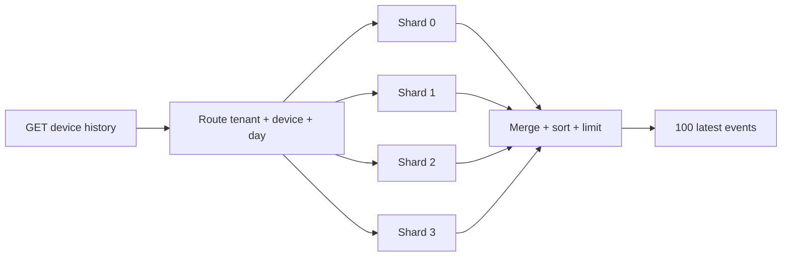

# Choosing a Partition Key Based on Data Distribution and Access Patterns

An event ingestion system collects telemetry from multiple enterprise customers (*tenants*). Each tenant has anywhere from a few dozen to millions of devices; most API requests read **the 100 most recent measurements of a single device**, while operations teams occasionally search for **all devices with errors within an hour**. If partitioned solely by `tenant_id`, large tenants can create hot partitions; if partitioned randomly by `event_id`, fetching a device's history must scan many locations; if partitioned solely by day, events on the same day pile into a few data regions.

**The partition key** is a design decision that simultaneously affects **query routing, data distribution, load distribution, scaling limits, data integrity, and operational cost**. No single key is optimal for every workload.

This lesson belongs to the **Distribution and Partitioning** chapter of the **DATABASE_DATA_MODELING** module. The goal of this module is to translate business requirements into clear entities, relationships, and constraints—from keys, indexes, and normalization to physical schemas—and to compare modeling across relational, document, graph, and analytical systems to choose structures that are easy to verify and evolve. Accordingly, we will **start from grain, queries, and data distribution**, and only then choose the partitioning strategy and storage engine.

## 1. What Is Partitioning, and What Types of "Keys" Exist?

**Partitioning** is splitting a dataset into parts according to a deterministic rule. **Sharding** is typically used when those data parts are placed across independent nodes or resource groups. The two concepts are related, but **not synonymous**: a PostgreSQL table partitioned by month can still reside on a **single** machine; it does not automatically become a distributed database.

| Concept | Question It Answers | Example |
| --- | --- | --- |
| **Business key** | Which business entity does the data belong to? | `tenant_id`, `device_id`, `order_id` |
| **Primary key** | What uniquely identifies a single row? | `(tenant_id, device_id, event_time, event_id)` |
| **Partition/shard key** | Which partition/shard is the row routed to? | `(tenant_id, device_id, event_day)` |
| **Clustering/sort key** | How are rows ordered within a partition? | `event_time DESC, event_id` |
| **Secondary index** | Is there another access path besides the primary key? | Index on `status` in a supporting engine |
| **Logical partition** | Which set of data is treated as one partitioning unit? | Events for device D on April 1 |
| **Physical placement** | Which node/storage region holds the partition/replica? | Hash/token/coordinator metadata of the DBMS |

In **Apache Cassandra**, the partition key is part of the CQL primary key structure; it locates the logical partition, while clustering columns order rows within that partition. In **PostgreSQL declarative partitioning**, the partition key is defined on the parent table and determines which child table a row belongs to via `RANGE`, `LIST`, or `HASH`. In a **MongoDB sharded cluster**, the shard key governs how data is split and routed across shards.

**Do not blindly apply rules from one product to another:** replication, routing, indexing, uniqueness, isolation, and node scaling mechanics depend on each DBMS and deployment version.

## 2. Write the Access Pattern Table Before Designing the Partition Key

Consider an event whose grain is: **a raw measurement emitted by one device**, identified by `(source_system, event_id)`. Data fields:

| Field | Conceptual Type | Role |
| --- | --- | --- |
| `tenant_id` | Tenant UUID/ID | Ownership and authorization boundary |
| `device_id` | Device UUID/ID | Most frequently queried entity |
| `event_id` | UUID stable across retries | Event identifier for deduplication |
| `event_time` | UTC Instant | Time the measurement occurred |
| `received_at` | UTC Instant | Ingestion time; may arrive late |
| `temperature_c` | Decimal in °C | Measure |
| `error_code` | Optional error code | Filter error events |
| `region_id` | Region code | Regional analytics; may change over time |

APIs and reports may take the following shapes:

| ID | Access Pattern | Available Keys | Result | Priority |
| --- | --- | --- | --- | --- |
| Q1 | Get the 100 latest events of one device on one day | Tenant + device + day | Up to 100 rows, descending time order | High |
| Q2 | History of one device over 7 days | Tenant + device + date range | Hundreds to thousands of rows | High |
| Q3 | Get the latest state of all devices for one tenant | Tenant | One row per device | Medium |
| Q4 | Count errors by region and hour system-wide | Time range + region | Aggregation over millions of rows | Medium |
| Q5 | Look up one event by ID to handle retries | Source + event ID | 0 or 1 event | Mandatory for ingestion |
| Q6 | Delete all data belonging to a tenant when contract ends | Tenant | Potentially very many rows | Operational |

A partition key of only `(tenant_id, device_id, event_day)` fits **Q1/Q2** very well, but **does not natively solve Q3/Q4/Q5 well**. To satisfy all of them simultaneously, you may need additional tables/projections, a separate `event_id` lookup table, appropriate indexes, or to offload Q4 to an analytical warehouse. **Controlled data duplication aligned with access patterns** can be much wiser than forcing every query onto a single table.

### Do Not Write Vague Requirements

"There are 100 million rows" is not enough. You must add:

- How many writes/reads per second? What is the skew across tenants, devices, regions, and time?
- Which queries have the **full partition key**, and which know only part of it?
- How many partitions/nodes may a single request touch at most?
- What are the required p95/p99 latency, throughput, freshness, and retention?
- Are there updates/deletes, or is it mostly append-only? Are there late events, retries, and corrections?
- Are there joins/transactions across multiple entities or legal data residency rules?

## 3. Evaluate Data Distribution, Not Just Distinct Value Counts

A good key usually has **high cardinality**, but "many distinct values" **does not guarantee** balanced data or load. For example, a system might have one million devices, yet a single industrial device emits 30% of all events while every other device sends only a few records.

### 3.1. Four Distributions to Measure

| Distribution | Question | Consequence If Ignored |
| --- | --- | --- |
| **Rows/bytes per key** | How much storage does the largest partition occupy? | Oversized partitions; hard compaction, splitting, or movement |
| **Write rate per key** | Which key receives the most writes? | Hot partition, queuing, retries, rising write p99 |
| **Read rate per key** | Which key is looked up continuously? | Hot reads, imbalanced cache/replica load |
| **Queries across key sets** | How many keys does one request traverse? | Scatter-gather, network cost, and tail latency |

A key with evenly distributed row counts can still suffer **hot reads** if one popular tenant is queried 1,000x more often. Conversely, a tenant storing large historical data with little traffic may put minimal immediate pressure on latency. You must measure both **storage skew** and **traffic skew**.

### 3.2. Metrics to Inspect

- Partition size percentiles: p50, p95, p99, **max** (bytes, rows, tombstones).
- Share of traffic from the **top 1%, top 10 keys**, and each large tenant; max/median ratio.
- Requests/second, bytes/second, queue depth, and read/write p99 per partition/node.
- Percentage of requests touching 1 partition, 2–10 partitions, and hundreds of partitions.
- Frequency of queries lacking filter predicates that enable partition pruning.
- Storage growth trends per key as retention or sensor frequency changes.

Never conclude "uniform distribution" solely from a histogram of tenant counts; you must inspect **intra-tenant distributions** and heavy hitters.

## 4. Common Partitioning Strategies

| Strategy | Illustrative Rule | Where It Shines | Where It Goes Wrong |
| --- | --- | --- | --- |
| **Hash** | `hash(tenant_id) mod N` | Spreads many keys with relatively even rates | One hot tenant still hashes to **one** bucket; changing N requires data movement |
| **Range** | Timestamp falls within month/day | Range queries, retention, pruning | New writes pile into the current partition; monotonically increasing keys overheat |
| **List** | Specific group of tenants/regions | Storage policies, operational boundaries | Uneven distribution; requires routing maintenance when adding groups |
| **Composite key** | `(tenant, device, day)` | Keeps entity + time-bucket queries local | Any query missing part of the key may fan out |
| **Bucketing** | `event_day`, `event_hour` | Bounds partition size over time | Too-small buckets create excessive partitions and requests |
| **Salting/sub-sharding** | `hash(event_id) mod S` | Splits one overly hot key across multiple shards | Querying one key must read and merge **S** shards |
| **Geo-aware placement** | Route tenant to permitted region | Data residency, cross-region latency | Cross-region queries are hard; must manage migration and reliability |

**Hashing is not always consistent hashing.** Application-level `hash(key) mod N` is a simple routing scheme; when N changes, many keys move. Distributed systems variously use token rings, metadata maps, range splitting, or custom replica placement. Never write your own hash formula and assume it matches the internal routing of Cassandra, MongoDB, or a cloud store.

### 4.1. Queries Must Have Compatible Predicates

If stored by `hash(event_id)`, lookup by event ID can be fast, but querying "7 days of one device" must locate and scan many shards. If stored by `(tenant, device, day)`, device/day queries hit the exact partition, yet a report counting errors across a region must read huge numbers of partitions.

**Optimizing one read path usually makes other paths more expensive.** The right strategy comes from workload priority, not from searching for a "perfectly balanced" key that forces every query to scatter.

## 5. The Crucial Trade-Off: Locality vs. Load Distribution

**Data locality** is the extent to which data needed for a query sits within a narrow access scope. In a tenant/device/day model, a request almost always hits just one partition:


However, if you split one device across multiple shards to avoid a hotspot:



Read cost scales roughly with **number of time buckets × shards per bucket**, plus retries, replicas, pagination, and merge overhead. Querying 7 days at 4 shards/day can touch up to 28 partitions. You cannot just take `LIMIT 100` from one shard and assume it is the global top 100.

### 5.1. No Single Partition Size Threshold Fits Every Engine

A simple estimation model:

\[
\text{logical bytes per bucket}
\approx
\text{events per second} \times
\text{average logical bytes/event} \times
\text{bucket seconds}
\]

Suppose a very hot device emits **500 events/second**, averaging **900 logical bytes/event**:

- **1-day** bucket: roughly 38.88 GB of logical data.
- **1-hour** bucket: roughly 1.62 GB.
- **10-minute** bucket: roughly 270 MB.

This is **not disk usage**: you must still account for encoding, indexes, compression, replicas, tombstones, and amplification. Do not treat these numbers as universal safe limits for Cassandra/PostgreSQL/HBase; benchmark on your target engine version and hardware.

Smaller buckets shrink partition size, but increase partition counts, query counts, metadata, and long-range read costs. If a key experiences extreme traffic bursts, shrinking buckets from days to hours may not suffice; examine **instantaneous write rate**, not only total bytes per bucket.

## 6. Running Scenario: Multi-Tenant Telemetry

Suppose the operational system prioritizes:

1. Q1/Q2 must return device history quickly.
2. Tenants are access-controlled by identity; every request includes `tenant_id`.
3. Events can arrive several hours late; timestamps are not always in ingestion order.
4. Most devices have low traffic, but industrial telemetry devices can be very hot.
5. Global regional reports are offloaded to a separate analytical system if needed.

Candidate keys:

| Partition Key | Q1/Q2 Read by Device | Write Distribution | Weakness |
| --- | --- | --- | --- |
| `tenant_id` | Must filter across many devices in a tenant | Large tenants become hotspots | Partitions can grow unboundedly |
| `device_id` | Easy device history reads | Extremely hot devices still hotspot | Does not scope tenant or time retention; needs separate security scoping |
| `event_day` | Does not isolate device | Same-day writes pile into few keys | Scans many devices; huge daily partitions |
| `hash(event_id)` | Wide fan-out for device history | Can be very uniform | Loses locality by device and time |
| `(tenant_id, device_id, event_day)` | **Good** for specific days | Separates tenant/device and day | Hot devices still need sub-buckets/shards; multi-day reads fan out |
| `(tenant_id, device_id, event_day, shard)` | Good if shards are known and read | Splits hot device write load | Single query must merge multiple shards |

**Initial choice:** `(tenant_id, device_id, event_day)` is a reasonable starting point **for the workload described**, paired with heavy-device monitoring and sub-sharding contingency for ultra-hot devices. It is not a universal recommendation, nor does it automatically solve Q3/Q4/Q5.

### 6.1. Separate Partition-Routing Attributes from Filter Attributes

`region_id` can change when a device is relocated. Using region as a primary part of the partition key causes historical and new events to route differently; querying one device would require knowing its region history. Never put a **mutable** attribute into the routing key merely because a dashboard filters by region.

Conversely, if most actual queries are "fetch all error events in region R in the last 5 minutes" and device queries are rare, a read model by `(region, time_bucket, ...)` may be necessary. Prioritize real queries rather than getting boxed in by textbook examples.

## 7. Cassandra: Partition Key, Clustering, and Key-Aware Queries

This is an **Apache Cassandra CQL** model illustrating Q1/Q2. It uses a composite partition key and clustering columns. Do not treat CQL statements as PostgreSQL syntax.

### 7.1. CQL Schema by Device and UTC Day

```sql
CREATE TABLE telemetry_by_device_day (
    tenant_id uuid,
    device_id uuid,
    event_day date,
    event_time timestamp,
    event_id uuid,
    received_at timestamp,
    temperature_c decimal,
    error_code text,
    PRIMARY KEY (
        (tenant_id, device_id, event_day),
        event_time,
        event_id
    )
) WITH CLUSTERING ORDER BY (
    event_time DESC,
    event_id ASC
);
```

Meaning:

- `(tenant_id, device_id, event_day)` defines **one logical partition**.
- `event_time` and `event_id` distinguish rows within a partition. `event_id` must be stable across retries if replaying the same event should not create extra rows.
- Clustering `event_time DESC` suits reading the latest events within a day; ties on identical timestamps are broken by `event_id ASC`.
- `event_day` must be derived from `event_time` using a **fixed UTC rule** at ingestion. Never mix server-local dates and client-local dates.
- A partition must stay sized appropriately for the workload, not merely satisfy query predicates.

Example queries via **prepared statements** (`?` represents driver-bound parameters):

```sql
-- Read the 100 most recent events of one device on one day.
SELECT event_time, event_id, temperature_c, error_code
FROM telemetry_by_device_day
WHERE tenant_id = ?
  AND device_id = ?
  AND event_day = ?
LIMIT 100;

-- Read a time interval within that same partition.
SELECT event_time, event_id, temperature_c
FROM telemetry_by_device_day
WHERE tenant_id = ?
  AND device_id = ?
  AND event_day = ?
  AND event_time >= ?
  AND event_time < ?
LIMIT 500;
```

A 7-day range query must compute the UTC dates intersecting the range, read each required partition, and merge by `(event_time, event_id)`; do not expect Cassandra `ORDER BY` to establish a **global order across multiple partitions**.

### 7.2. Which Queries Do Not Fit This Table?

The following questions lack a narrow routing path from this schema alone:

- "All error events in one hour across every device."
- "Top 10 tenants with highest temperatures over 90 days."
- "Look up solely by `event_id` without knowing tenant/device/day."
- "Read the latest state of every device in a tenant with one simple query."

Do not abuse `ALLOW FILTERING` to turn multi-partition scans into real-time APIs. Consider query-specific **projections**, a separate ID lookup store, or a columnar warehouse for large aggregations.

### 7.3. Partitioning Is Not Replication or Consistency

The partition key locates the logical partition; replica placement, replication factor, and consistency levels belong to Cassandra's configuration and consistency model. Putting rows in the same partition does not automatically guarantee multi-table transactions or linearizable reads for every operation. Read/write consistency properties must be specified per API, consistency level, write path, and concurrency requirement.

When TTL and deletes manage retention, monitor tombstones, compaction, repairs, and copy-deletion requirements. TTL normally counts from write time, not automatically `event_time + retention` for late-arriving events.

## 8. Very Hot Devices: Shorter Buckets or Sub-Sharding?

If a device emits 500 events/s, keeping all events in a single daily partition can cause both **partition size** and **hot write** issues. Two distinct techniques:

### 8.1. Shortening Bucket Duration

Replace `event_day` with `event_hour` or `event_10m_bucket`. This reduces events accumulated per partition, yet **at the current instant** all events from the device still pour into the currently open bucket. If throughput per partition is too high, splitting by time alone may not relieve the instantaneous hotspot.

When querying 24 hours, hourly buckets touch up to 24 partitions; 10-minute buckets can touch up to 144. Long-range read cost rises with the number of buckets.

### 8.2. Sub-Sharding a Hot Device Concurrently

A design with `shard` based on the event identifier:

```text
partition = (
    tenant_id,
    device_id,
    event_day,
    shard = stable_hash(event_id) mod shard_count
)
```

Example CQL schema with shards (**an alternative option** to Section 7's table, not an implicit schema change):

```sql
CREATE TABLE telemetry_by_device_day_shard (
    tenant_id uuid,
    device_id uuid,
    event_day date,
    shard smallint,
    event_time timestamp,
    event_id uuid,
    temperature_c decimal,
    PRIMARY KEY (
        (tenant_id, device_id, event_day, shard),
        event_time,
        event_id
    )
) WITH CLUSTERING ORDER BY (
    event_time DESC,
    event_id ASC
);
```

Suppose a device uses `shard_count = 4`; the system can spread consecutive events across four partitions to reduce load on a single key. However, Q1 must read **all four shards** and merge by time. Each shard must return enough candidates to guarantee the global top 100; a simple approach fetches up to 100 candidates from **each shard** before merging, rather than taking just 25 per shard. For pagination across shards, you must track per-shard cursors/state and a consistent tie-break order.

**Migration warning:** If you change `shard_count` from 4 to 8 using only `mod S`, old events sit under mod-4 routing while new events use mod-8 routing. Readers must support **time-based or metadata-based routing versions**, reading both configurations during transition or running a controlled backfill. Never change the constant and assume existing events relocate automatically.

### 8.3. Deterministic Partition Routing in Java 17+

This self-contained example only illustrates **application-layer key generation**; it does not replace Cassandra's token/replica routing. No external libraries beyond the JDK are required.

```java
import java.time.Instant;
import java.time.LocalDate;
import java.time.ZoneOffset;
import java.util.Objects;
import java.util.UUID;

public class PartitionRoutingDemo {

    record Event(
        UUID tenantId,
        UUID deviceId,
        UUID eventId,
        Instant eventTime
    ) {
        Event {
            Objects.requireNonNull(tenantId);
            Objects.requireNonNull(deviceId);
            Objects.requireNonNull(eventId);
            Objects.requireNonNull(eventTime);
        }
    }

    record Route(
        UUID tenantId,
        UUID deviceId,
        LocalDate eventDayUtc,
        int shard
    ) {}

    static Route route(Event event, int shardCount) {
        Objects.requireNonNull(event, "event");
        if (shardCount <= 0) {
            throw new IllegalArgumentException("shardCount must be > 0");
        }
        LocalDate day = event.eventTime()
            .atZone(ZoneOffset.UTC)
            .toLocalDate();
        int shard = Math.floorMod(
            event.eventId().hashCode(), shardCount
        );
        return new Route(
            event.tenantId(),
            event.deviceId(),
            day,
            shard
        );
    }

    public static void main(String[] args) {
        Event e = new Event(
            UUID.randomUUID(),
            UUID.randomUUID(),
            UUID.fromString(
                "8b88bd8f-dc6f-46a9-b321-019196d5e31e"
            ),
            Instant.parse("2030-04-01T23:59:59Z")
        );

        Route a = route(e, 4);
        Route retry = route(e, 4);
        System.out.println(a.equals(retry)); // true
        System.out.println(a.eventDayUtc());  // 2030-04-01
        System.out.println(a.shard() >= 0 && a.shard() < 4); // true
    }
}
```

`UUID.hashCode()` is a **Java-internal** illustrative choice; if writers and readers use multiple languages, you must lock down **hash algorithm, byte encoding, endianness, ID normalization, shard count, and routing version** as a shared contract. This hash is not cryptographic and should not be treated as protection against adversarial key distribution. If untrusted clients choose keys, evaluate key-flooding risks and rate-limiting policies.

**Idempotency note:** deterministic routing for the same `event_id` does not prove the event ID is **globally unique** or that its payload did not mutate on retry. You still need source identification, validation, and correction-handling rules.

## 9. PostgreSQL: Time Partitioning Is Different from Tenant Sharding

In PostgreSQL, time-range workloads can use **declarative range partitioning**. This example runs on **a single PostgreSQL instance**; partitions can live on different tablespaces, but they do not automatically route across multiple database servers.

### 9.1. Table Partitioned by UTC Month

```sql
CREATE TABLE telemetry_event (
    tenant_id UUID NOT NULL,
    device_id UUID NOT NULL,
    event_time TIMESTAMPTZ NOT NULL,
    event_id UUID NOT NULL,
    received_at TIMESTAMPTZ NOT NULL DEFAULT now(),
    temperature_c NUMERIC(7, 3),
    error_code TEXT,

    CONSTRAINT pk_telemetry_event PRIMARY KEY (
        tenant_id, device_id, event_time, event_id
    ),
    CONSTRAINT ck_temperature_range CHECK (
        temperature_c IS NULL
        OR temperature_c BETWEEN -100 AND 200
    )
) PARTITION BY RANGE (event_time);

CREATE TABLE telemetry_event_2030_04
    PARTITION OF telemetry_event
    FOR VALUES FROM ('2030-04-01 00:00:00+00')
               TO ('2030-05-01 00:00:00+00');

CREATE TABLE telemetry_event_2030_05
    PARTITION OF telemetry_event
    FOR VALUES FROM ('2030-05-01 00:00:00+00')
               TO ('2030-06-01 00:00:00+00');

CREATE INDEX ix_telemetry_device_time
    ON telemetry_event (
        tenant_id, device_id, event_time DESC, event_id
    );
```

Read path:

```sql
-- $1=tenant_id, $2=device_id, $3=from, $4=to
SELECT event_time, event_id, temperature_c, error_code
FROM telemetry_event
WHERE tenant_id = $1
  AND device_id = $2
  AND event_time >= $3
  AND event_time < $4
ORDER BY event_time DESC, event_id
LIMIT 100;
```

**Partition pruning** can skip months outside the `event_time` interval; the index supports tenant/device lookup and ordering within each partition. However, a query lacking a time predicate may have to examine many partitions. Monthly partitions are convenient for retention, though not necessarily optimal for every data volume; pick daily/weekly/monthly granularity based on **size, partition count, operational needs, and query windows**.

### 9.2. Unique Keys on Partitioned Tables

In PostgreSQL declarative partitioning, primary/unique constraints on a partitioned table must include **all partition key columns** per version and partitioning rules. That is why this example includes `event_time` in the primary key. This **does not automatically enforce global `event_id` uniqueness across months**, because the same event ID with a different timestamp can create two rows.

If ingestion requires "each `(source_system, event_id)` is recorded at most once globally," you need an idempotency mechanism with matching uniqueness scope (e.g., an independent registry/ledger table, reliable event log, or transactional check), rather than inferring uniqueness from `PRIMARY KEY(tenant, device, event_time, event_id)`.

### 9.3. Hash Partitioning in PostgreSQL Does Not Distribute Across Machines Either

A `tenant_settings` table might use `PARTITION BY HASH(tenant_id)` to split the keyspace across multiple partitions **within the same database**. Hashing distributes **different tenants** into buckets, yet **all rows of a specific `tenant_id`** still land in the same bucket.

Therefore, if one tenant generates 70% of write traffic, hashing by tenant alone does not solve the intra-tenant hotspot. Likewise, PostgreSQL hash partitioning is not Cassandra's token ring or MongoDB sharding: application and infrastructure still need a mechanism to place data on independent nodes if you want multi-machine write scale-out.

## 10. HBase, MongoDB, and Warehouses: Same Problem, Different Rules

### 10.1. HBase: Row Keys and Hot Regions

HBase locates rows using **ordered row keys** across regions. If a row key starts with a **monotonically increasing** timestamp, new writes pile into the trailing key range, causing a hotspot. Salting or reverse timestamps alter that distribution, but range queries must know the key structure and scan multiple prefixes.

An illustrative row key shape:

```text
<salt>|<tenant>|<device>|<reverse_time>|<event_id>
```

This is not an HBase command, nor a recommendation to apply a fixed salt prefix to every workload. Salt bucket counts, reverse-timestamp construction, row sizes, scan ordering, and multi-prefix read logic must all be benchmarked and documented.

### 10.2. MongoDB: Shard Keys Govern Query Targeting

In a MongoDB sharded cluster, choosing a **ranged vs. hashed shard key** and key distribution governs how data is split, routed, and balanced. A shard key with stable values present in primary queries generally enables targeted reads. Hashed keys help spread monotonically increasing values or unfavorable key patterns in some workloads, but can make range queries on the hashed field less efficient.

Before choosing hashed `tenant_id`, check large tenants: every document for the same tenant still shares the same hashed tenant value. Also verify uniqueness enforcement, chunk movement, shard-key updates, and deployment version; do not assume single-node RDBMS unique index rules behave identically across a sharded cluster.

### 10.3. Columnar Analytics: Partitioning to Reduce Scans

In a warehouse like BigQuery, an events table can be **partitioned by day** and **clustered by tenant/device**, pruning data for time-filtered queries. This optimizes analytical scans/aggregations and read cost, rather than matching Cassandra-style key design for hundreds of thousands of point queries per second.

Example **BigQuery Standard SQL**:

```sql
CREATE TABLE analytics.telemetry_events (
    tenant_id STRING NOT NULL,
    device_id STRING NOT NULL,
    event_id STRING NOT NULL,
    event_time TIMESTAMP NOT NULL,
    temperature_c NUMERIC,
    error_code STRING
)
PARTITION BY DATE(event_time)
CLUSTER BY tenant_id, device_id;
```

A global error query:

```sql
SELECT
    TIMESTAMP_TRUNC(event_time, HOUR) AS event_hour,
    error_code,
    COUNT(*) AS error_count
FROM analytics.telemetry_events
WHERE DATE(event_time) BETWEEN DATE '2030-04-01'
                            AND DATE '2030-04-07'
  AND error_code IS NOT NULL
GROUP BY event_hour, error_code
ORDER BY event_hour, error_code;
```

This is an **analytical projection**, distinct from the operational device/day Cassandra table. If ingestion retries occur, `COUNT(*)` is only accurate if the pipeline deduplicates by event ID; partitioning does not solve duplicate counting.

### 10.4. Graphs: Edge Locality and High-Degree Vertices

In graphs, queries typically start at a vertex and traverse adjacent edges across multiple hops. Keeping frequently traversed edges close together can matter more than uniformly random event-ID hashing. However, very high-degree vertices (*supernodes*) can create hotspots or massive adjacency blocks. Choose graph partitioning based on traversal queries, hop depth, and degree distribution—do not mechanically copy time-series tenant/device keys.

## 11. Keys Changing Over Time and Historical Correctness

An ideal partition key stays immutable throughout a row's lifecycle. Attributes like `region_id`, `customer_segment`, or `order_status` can change:

| Field | Problem If Used as Key | Mitigation |
| --- | --- | --- |
| `tenant_id` | Tenant migration, mergers, ownership changes | Tenant migration rules and durable identifiers |
| `device_id` | Device replacement/renaming, inconsistent source IDs | Canonical identity, source mapping, versioning |
| `event_day` | Late events routed by arrival date instead | Compute from UTC `event_time` per contract |
| `region_id` | Device relocation fragments history | Avoid as primary key when queries target devices |
| `status` | Status UPDATE forces partition move | Keep status as attribute/index or separate projection |
| `hash(event_id) mod S` | Changing S breaks routing of older data | Versioned routing, controlled dual-read/backfill |

**Do not treat the partition key as access-control encryption.** Even if every event contains `tenant_id` and routes by tenant, every query must still verify identity/authorization, prevent cross-tenant leaks, and enforce row-level security or equivalent controls. Knowing a partition name does not grant permission to read it.

When data residency applies, jurisdictional placement can be a harder constraint than load balancing. Tenants spanning two regions need explicit contracts for source data, copies, cross-region queries, and region transfers.

## 12. Combine Multiple Access Paths Instead of One "Universal" Key

From the same event source, you can maintain:

```text
Source event log (stable event_id)
   |
   +-- telemetry_by_device_day
   |      key=(tenant, device, UTC day)
   |      Q1/Q2: device history
   |
   +-- latest_telemetry_by_device
   |      key=(tenant, device)
   |      Q3: current state of a set of devices
   |
   +-- event_id_registry
   |      key=(source, event_id)
   |      Q5: lookup/idempotency by original ID
   |
   +-- analytics.telemetry_events
          partitioned by day, clustered by tenant/device
          Q4: global analysis by hour/region
```

Each projection has **its own grain and key**. If you build this, you must solve synchronization:

- **Source of truth:** which event stream holds authoritative truth?
- **Idempotency:** will a retried event create extra rows and skew totals?
- **Event time vs. ingestion time:** which historical bucket receives late arrivals?
- **Latest-state rule:** can an older event arriving late overwrite newer state?
- **Freshness:** operational APIs and dashboards may see different points in time; state the SLA.
- **Corrections/deletes:** edits or deletions must propagate to every derived projection.

For example, do not implement `latest_telemetry_by_device` as naive "last write wins" if **latest means highest `event_time`**. Use compare-and-set, per-key serialized processing, or conditional updates matching the engine and concurrency model.

This is not an argument to always build multiple databases. For smaller workloads with complex relationships, a single RDBMS with well-designed indexes and partitioning can be simpler, cheaper, and safer than a multi-projection architecture.

## 13. Partition Keys and Integrity Constraints

Partitioning decides **where data lives**; it does not automatically enforce **whether data is valid**.

### 13.1. Unique Keys and Duplicates

If an event is globally identified by `(source, event_id)` but partitioned by day, a retry with a different `received_at` could land in a different day if routed wrongly. You need:

1. Stable `event_id` preservation—never generate a fresh ID on retry.
2. Canonical UTC `event_time` and bucket calculation prior to routing.
3. Event-identity idempotency **across the required enforcement scope**, even if the store lacks cluster-wide unique constraints on arbitrary keys.
4. A correction policy when the same `event_id` arrives with a modified payload.

Never assume a `PRIMARY KEY` in PostgreSQL or Cassandra automatically means "unique `event_id` across all partitions." Uniqueness scope is an explicit design element.

### 13.2. Joins, Transactions, and Co-Location

If most transactions update `order` and `order_items` together, co-locating them on the same shard by `order_id` can avoid cross-shard operations. However, this does not automatically create ACID across all operations; check each engine's transactional scope. Conversely, if a transaction must update **balances of two different tenants**, sharding by `order_id` may not help.

Placing related entities under the same key achieves locality when **business workflows** align. For queries spanning partitions, weigh fan-out, denormalization, batching, or revising aggregate boundaries.

### 13.3. Indexes Cannot Fix Every Bad Partition Key

Secondary indexes can assist certain queries, but when data spans hundreds of nodes, indexes also incur storage, write, synchronization, and query-planning costs. Do not assume "adding an index on `region_id`" turns every global query into a targeted single-shard lookup. Inspect execution plans, index distribution, and product limits.

## 14. Partition Pruning and Scatter-Gather: Calculating Read Cost Properly

A qualitative model:

\[
\text{Query latency}
\approx
\text{routing overhead}
+ \max(\text{latency of touched partitions})
+ \text{merge / network overhead}
\]

This is **not** an exact latency prediction formula. It highlights that a request touching many partitions is dragged down by the slowest partition (*tail latency*) plus merge overhead. Hundreds of parallel sub-queries also consume cluster capacity, even if surface latency looks acceptable under light test loads.

Before accepting a candidate key, trace it against every query:

| Query | Partitions to Read | Good Pruning? | Needs Merge? |
| --- | --- | --- | --- |
| Q1 device/day | 1 partition without sub-sharding | Yes | No |
| Q2 device/7 days | Up to 7 daily partitions | Yes, by tenant/device and dates | Yes, if global order is required |
| Q1 with 4 shards/day | 4 partitions | Yes, shard set known | Yes, top-K |
| Q2 with 4 shards/day | Up to 28 partitions | Yes, but many requests | Yes |
| Q4 system-wide | Many device partitions | Poor on operational table | Better via projection/OLAP |
| Q5 event ID only | Cannot locate device partition without mapping | No | Needs lookup registry or suitable index |

Beyond partition count, consider **bytes read per partition** and whether filter pushdown/pruning applies. Touching one 40 GB partition is not automatically cheaper than reading 20 tiny partitions; inspect actual query plans and profiles.

## 15. Testing Key Selection Before Deployment

### 15.1. Gather Representative Sample Distributions

Collect logs/traces covering at least:

- Peak and off-peak hours, weekdays and weekends.
- Largest tenant, median tenant, small tenant, and anomalous bursty devices.
- Hot vs. historical data proportions and late-arrival rates.
- Single-partition, multi-partition range, and global queries.
- Bulk imports, post-outage retry storms, and backfills.

If production data is unavailable, generate synthetic load using **explicitly documented distributions** that include heavy hitters and traffic bursts. Never test only uniform synthetic data and conclude hashing works fine.

### 15.2. Comparison Scenarios

| Variant | Data Writes | Q1/Q2 | Retention | Risk |
| --- | --- | --- | --- | --- |
| A: tenant/device/day | Lowest fan-out | Strong Q1, 7-day Q2 | Daily buckets easy to drop | Hot devices |
| B: tenant/device/hour | Lower bytes/partition | Q1 needs hour, large Q2 fan-out | Many partitions | Metadata/read overhead |
| C: tenant/device/day/shard4 | Splits hot device writes | Q1 merges 4, Q2 up to 28 | Needs shard metadata | Routing version/merge |
| D: hash(event_id) | Broad event spread | Poor targeting for Q1/Q2 | Not aligned with day/device lifecycle | Scatter-gather |

Metrics to report: read/write p50/p95/p99, total bytes scanned, number of touched partitions, tail retries, queue depth, p99/max partition size, cost, compaction, throughput, and recovery behavior. **Measured results** decide among A/B/C—never theoretical tables alone.

### 15.3. Size Shard Count to Workload, Not Node Count

Never hardcode `shard_count = current node count` as an invariant. Node counts change with autoscaling and rebalancing, whereas routing and historical data require stability. If virtual shards/partitions exist, choose ranges and metadata per engine capabilities, keeping placement decoupled from logical data identity.

## 16. Changing a Partition Key in Production

Changing a partition key is generally harder than adding a normal column: it can **relocate billions of records**, impacting queries, uniqueness, consumers, and TTLs.

A plan to migrate from `(tenant, device, day)` to `(tenant, device, hour, shard)` typically includes:

1. **Freeze the old routing contract:** key/bucket/hash versions, UTC definition, shard count, and metadata location.
2. **Create the new schema/partitions:** indexes, constraints, retention, permissions, and query paths.
3. **Choose a reliable backfill source:** event log or source table with stable identities; handle duplicates and corrections.
4. **Canary checks:** row counts per grain, measure sums, range hashes/checksums, p99, and top-K accuracy.
5. **Deploy compatible readers:** handle both old and new keys during transition; distinguish pre- vs. post-cutover events.
6. **Switch writers under control:** feature flags, dual-write/CDC where appropriate; never assume two writes succeed atomically.
7. **Reconcile and cut over:** late data, retries, backfill, deletes, and TTLs; retire the old path only when exit criteria pass.
8. **Planned rollback:** do not simply revert code if new data has already routed to new partitions; plan reader/writer rollback and data state handling.

If rows are concurrently updated, avoid lost updates or double counting when reading across both versions. You can deduplicate results using event identity and defined versions/timestamps, rather than blindly running `DISTINCT` across entire payloads and assuming all edge cases are covered.

### Watch Out for Late Events

After cutover, an event with last month's `event_time` may arrive late. It must route according to a rule chosen by the system **and understood by readers**: by event time, by routing epoch, or written to the new version and backfilled consistently. Without an explicit rule, a time interval can split across schemas and produce incomplete query results.

## 17. Common Pitfalls

| Pitfall | Why It Hurts | Fix |
| --- | --- | --- |
| "High cardinality ⇒ balanced load" | Heavy hitters can still dominate reads/writes | Measure top keys, bytes, and traffic skew |
| Partitioning solely by tenant | One large tenant becomes a hot key | Add stable dimensions/buckets/shards per read path |
| Partitioning solely by day | All active devices write into few buckets | Combine with tenant/device or a suitable key |
| Hashing event ID and expecting fast device queries | Destroys locality by device | Build a device/time projection |
| Adding sub-shards but forgetting read fan-out | Top-K and paging miss data or spike latency | Read/merge all shards; maintain cursors |
| Changing `mod 4` to `mod 8` without migration | Old and new data use mismatched routing | Version routing and backfill/dual-read |
| Deriving daily bucket from `received_at` when querying `event_time` | Late events land in wrong business day | Enforce explicit UTC and event-time rules |
| Using mutable `status` or `region` in primary key | Updates force row relocation | Keep mutable attributes in indexes or separate projections |
| Treating PostgreSQL partitioned tables as a distributed DB | Does not scale write throughput across nodes | Distinguish partitioning from sharding |
| Assuming CQL primary keys support arbitrary SQL filters | Queries missing partition key are very expensive | Design around queries and projections |
| Using `ALLOW FILTERING` to "fix" schema | Broad scans, unpredictable p99 | Use suitable read models/indexes |
| Leaving hot tenants unconstrained | One noisy tenant degrades others | Admission control, quotas, fair scheduling |
| Lacking cross-partition idempotency | Retries/corrections duplicate events | Use registry/unique contracts and auditing |
| Changing keys without checking late data | Missing events in historical queries | Define event/routing version cutover plan |
| Routing by tenant and skipping auth checks | Risks cross-tenant data leakage | Enforce authorization/RLS independently of routing |

## 18. Testing Design and Constraints

| Test Case | What Must Be Confirmed |
| --- | --- |
| Two events with same `event_time`, different `event_id` | Both persist; tie-breaking is deterministic |
| Retry with same `event_id` and payload | No duplicate row at the contracted grain |
| Retry with same `event_id` but changed payload | Correction/conflict policy runs, never silent duplication |
| Events at `23:59:59Z` and `00:00:01Z` | Route to two distinct UTC day buckets |
| 7-day query crossing a month boundary | No missing events in adjacent daily/monthly partitions |
| 100x burst on a hot device | Measure request/byte hotspots, not only partition size |
| Single tenant generating 70% of traffic | Design never promises `hash(tenant)` splits one tenant |
| Top-100 query across 4 shards | Correctly merges global top 100, not top 25/shard |
| Paginating top-K across shards | No duplicates/gaps from cursors or tie-break order |
| Global Q4 | Query plan does not force operational wide-column scans under unsuitable SLOs |
| Changing `shard_count` and cutover | Readers observe complete data from both versions |
| Late event arriving after cutover | Routes properly and remains queryable historically |
| Tenant deletion | Deletes/retention propagate to all projections/replicas per policy |
| PostgreSQL query with/without `event_time` filter | Verify partition pruning and index plan |
| Key affected by region/status correction | No data loss or silent duplicates |
| Tenant A tries querying Tenant B | Authorization rejects even when B's key is known |
| Large backfill | Rate-limited to avoid starving operational traffic |
| Analytical projection lagging by 30 minutes | UI/reports surface freshness and watermark |

Run benchmarks on the target engine, version, node count, replication factor, storage setup, and realistic scale. A Java unit test for routing only proves **hash and bucket calculation are deterministic**, not that the cluster meets p99 or consistency targets.

## 19. Practice Exercises

### Exercise A — Multi-Tenant Order System

A SaaS platform has 50,000 tenants. 99% of requests list orders for **one tenant** over 30 days; 1% look up an order by `order_id` from webhooks; one tenant generates 40% of total traffic.

Evaluate keys `tenant_id`, `order_id`, `(tenant_id, month)`, and `(tenant_id, month, shard)`. Propose a webhook lookup path, hot-tenant protection policy, and query table justifying your choice.

**Hint:** No single key optimizes every query; use an order-ID projection/registry if needed. Hot tenants may require sub-sharding or resource isolation; validate results via traffic distribution and p99.

### Exercise B — Cross-Day Sensor Telemetry

Device D emits 100 events/s at roughly 1 KB/event. Estimate logical bytes per day and per hour, then choose an appropriate bucket size to test. How many buckets must a 48-hour history API touch when using daily, hourly, and 10-minute buckets?

**Hint:** Use `rate × bytes/event × seconds`; the result is logical bytes, not disk footprint. Smaller buckets reduce per-partition size at the expense of higher fan-out.

### Exercise C — Sub-Sharding and Top-K

One device is split into 8 shards via `hash(event_id) mod 8`. A query requests the 100 most recent events in a day, including events with identical timestamps. Describe how to query each shard, merge-sort by `(event_time DESC, event_id ASC)`, paginate, and handle retries. Analyze what happens when scaling to 16 shards.

**Hint:** Fetch enough candidates from **each** shard before selecting the global top-K; keep sort tie-breakers deterministic; a new shard count requires routing versioning/migration.

### Exercise D — PostgreSQL Partitioning and Uniqueness

Design an `events` table partitioned monthly by `event_time` where the application requires global uniqueness on `(source, event_id)`. Explain why `PRIMARY KEY(event_time, source, event_id)` alone does not satisfy this requirement. Propose an idempotency mechanism or storage change to protect uniqueness beyond a single partition.

**Hint:** A primary key containing the partition key only enforces uniqueness across the full composite key; the same source/event ID with a different `event_time` can still exist. A dedicated registry or compatible transactional ingest contract is needed.

### Exercise E — Choosing Keys for Graph Traversals

A social network has normal users with 20–100 connections and a celebrity account with 50 million edges. Common queries read a user's friends and traverse 2 hops. Analyze why both randomly hashing all edges and placing all edges of the celebrity account in one partition carry risks. Propose how to evaluate locality, supernodes, sub-sharding, and traversal fan-out.

**Hint:** Measure degree distribution and traversal patterns; vertex-oriented placement helps locality, while supernodes require specialized strategies alongside query limits and caching.

## 20. Pre-Finalization Checklist for Partition Keys

- [ ] Documented **grain**, business key, primary key, and distinguished them from the partition/shard key.
- [ ] Listed primary queries, always-known key predicates, returned row counts, p95/p99 SLOs, and read/write rates.
- [ ] Measured **actual distributions**, top keys/heavy hitters, bytes/partition, and traffic skew—not just cardinality.
- [ ] Chose hash/range/list/composite/bucketing based on queries, retention, and engine-specific mechanics.
- [ ] Calculated buckets/shards touched per query and merge/paging costs, especially for top-K.
- [ ] For hot keys, distinguished **large partitions** from **instantaneous read/write hotspots**, with matching tests.
- [ ] Standardized `event_time`, UTC rules, bucket boundaries, retry/late-event handling, and event identity.
- [ ] Where sub-sharding exists, documented hash algorithm, encoding, shard count, and routing version.
- [ ] Verified product-level uniqueness/FK/transaction scope, with cross-partition idempotency if needed.
- [ ] Did not confuse PostgreSQL table partitioning with distributed sharding, or partition keys with replication/authorization.
- [ ] Evaluated dedicated read models/indexes for ID lookups, latest state, and global analytics.
- [ ] Assessed mutable attributes, data residency, tenant isolation, and cross-projection data deletion.
- [ ] Enabled observability for partition size/skew/hotspots, queue depth, p99, fan-out, and read cost.
- [ ] Prepared a resharding/backfill/cutover/rollback plan before the key becomes a hard-to-change contract.
- [ ] Tested with realistic or explicitly skewed synthetic data, not solely uniform distributions.

**Takeaway:** A good partition key is not simply one with high cardinality or "random" hashing. It must keep **frequently co-read data** within a reasonable scope while avoiding **oversized or overheated keys**, and allow the system to manage retention, authorization, idempotency, and controlled scaling. Choose keys from **data distribution and access patterns**, measure both hot partitions and query fan-out, and only then lock in the physical schema for your specific DBMS.
