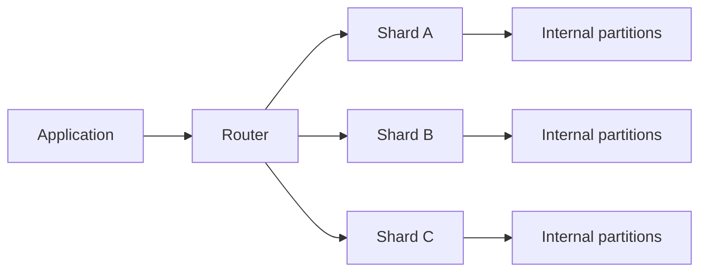
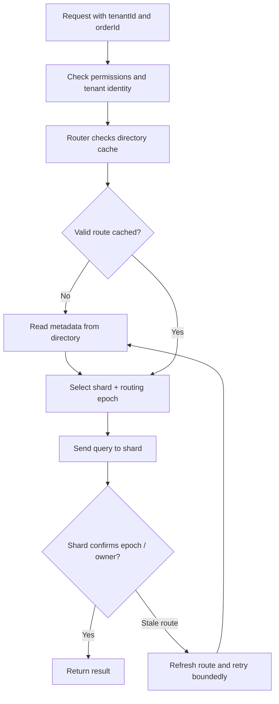
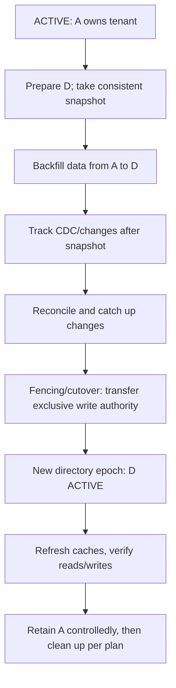

# Partitioning by Range, Hash, or Routing Directory

## 1. Why Is Choosing a Partitioning Method a Data Modeling Decision?

A system may initially store all orders, events, or accounts in a single table or collection. Once data grows to hundreds of millions of records, two pressures emerge: **where each query must look for data** and **which resources absorb read/write load**.

For example, a multi-organization sales platform has these requirements:

- Users of an organization view the newest orders over the last 30 days.
- Looking up a single order by `tenantId` and `orderId` must be fast.
- Transaction data is retained for many years, while detailed event data is kept for only 90 days.
- A few large organizations generate most of the traffic.
- Monthly reports run across all organizations, whereas daily transactions must be isolated per tenant.

Data can be split **by range** (*range partitioning*), **by hash** (*hash partitioning*), or **by routing directory** (*directory-based partitioning*). All three determine which partition a record belongs to, yet they optimize for **different query patterns, growth characteristics, and operational workflows**.

This lesson belongs to the **Distribution and Partitioning** chapter within **DATABASE_DATA_MODELING**. The module builds the skill of translating business requirements into a data model with explicit entities, relationships, constraints, keys, indexes, and physical schemas—while comparing relational, document, graph, and analytical structures to pick a design that can evolve and be verified.

**After this lesson, you will be able to:**

1. Distinguish logical partitioning, physical partitioning, sharding, replication, and routing.
2. Choose a partition key from **query shapes**, load profiles, and business constraints.
3. Compare range, hash, and directory partitioning by locality, load balance, hot partitions, and data movement.
4. Practice range and hash partitioning syntax in PostgreSQL, interpret execution plans, and understand unique key limitations.
5. Design directory routing with version management, caching, routing failures, and ownership transfers.
6. Evaluate impacts on transactions, uniqueness, JOINs, indexes, security, and late-arriving data.
7. Build experiments with skewed data, observe metrics, and document evidence-based architecture decisions.

## 2. How Does Partitioning Differ from Sharding and Replication?

### 2.1. Partitioning

A **partition** is a subset of a dataset defined by a deterministic rule: a time interval, a set of hash values, or a set of keys mapped to that partition.

For example:

```text
orders
  2026-01 -> p_2026_01
  2026-02 -> p_2026_02
  2026-03 -> p_2026_03
```

This may simply be **partitioning inside a single database**, not necessarily across multiple machines. The query optimizer can skip irrelevant partitions when filter predicates are clear enough (*partition pruning*), though exact mechanics depend on the product.

### 2.2. Sharding

**Sharding** distributes data subsets across multiple shards or storage units, usually to scale capacity and throughput beyond a single node's limits. Each shard can itself use internal partitions.



A query routed to **one shard** is generally easier to optimize than one sent to all shards and merged afterward, though not every single-shard query is fast and not every multi-shard query is bad.

### 2.3. Replication

**Replication** maintains copies of data to improve availability, recovery, or serve certain read workloads. It is not synonymous with partitioning:

- You can have **one partition and multiple replicas**.
- You can have **multiple partitions, each with its own replicas**.
- Replication does not increase the logical dataset capacity the way sharding does; replicas still hold copies of their assigned data slice.

If the system has lagging read replicas, a request routed to the right shard that hits a lagging replica may still read stale data. Consistency requirements must be defined independently of partitioning.

### 2.4. Five Frequently Confused Concepts

| Concept | Question Answered | Does NOT Automatically Guarantee |
| --- | --- | --- |
| **Partition key** | Which partition does the record belong to? | System-wide unique primary key |
| **Shard routing** | Which storage location should handle the request? | Consistent reads during shard moves or replica failovers |
| **Replication policy** | How many copies, where, and in what mode? | Queries scanning only one partition |
| **Business key** | Which business entity does the record represent? | Even load distribution |
| **Index key** | Which fields locate/filter/sort records? | Safe and effective partitioning |

**Never choose a partition key solely because it is the primary key.** Evaluate query routing, data distribution, and invariant scopes.

## 3. Start from the Workload: Do Queries Reveal Where Data Lives?

Before comparing the three methods, list your access paths. Example multi-tenant order system:

| Code | Use Case | Primary Filter | Sort / Scope | Priority |
| --- | --- | --- | --- | --- |
| Q1 | Open a single order | `tenantId, orderId` | Single result | Very high |
| Q2 | Recent orders list | `tenantId, createdAt` | Newest first, 20 rows/page | Very high |
| Q3 | View a customer's history | `tenantId, customerId` | Chronological | High |
| Q4 | Count orders by month | `createdAt` | Grouped by day/month | Batch |
| Q5 | Reconcile failed orders | `status, updatedAt` | Across tenants | Batch |
| Q6 | Purge expired event data | `eventTime` | By time range | Periodic |
| Q7 | Migrate one tenant to a new region | `tenantId` | Entire tenant dataset | Operational |

Follow-up questions shape the partitioning design:

- Does Q1 provide the **full partition key**?
- Does Q2 read only a few time intervals or must it scan entire history?
- Does Q4 scan multiple partitions offline or online?
- Can one very large tenant create a hotspot?
- Does Q7 need to move **one tenant** independently, or move millions of records scattered everywhere?
- How many queries lack the partition key, and do they require low-latency SLAs?

**A query containing only `orderId` cannot locate the shard if the router uses `tenantId` and there is no global index or directory.** APIs, keys, and access controls must be designed together.

### 3.1. Quantitative Metrics to Gather

- Total records, data/index sizes, and growth rate.
- Read/write ratio, average/peak QPS, p95/p99 latency.
- Partition key cardinality: how many values and how they are distributed.
- Share of storage and throughput held by the largest tenant.
- Frequency of point queries, range queries, aggregations, and cross-tenant queries.
- Result sizes, pagination ordering, transaction/uniqueness requirements.
- Data residency, retention, backup, and recovery policies.

Never measure averages alone. A single tenant generating 40% of load can dictate the architecture even if the other 99% of tenants are tiny.

## 4. Range Partitioning

**Range partitioning** places keys falling within a contiguous value interval into the same partition. Commonly used with:

- Event timestamps: by day, week, or month.
- Sequential ID ranges, if the business scans by ID range.
- Ordered value domains, when query predicates align with those ranges.

Example rule:

```text
createdAt ∈ [2026-01-01, 2026-02-01)  -> orders_2026_01
createdAt ∈ [2026-02-01, 2026-03-01)  -> orders_2026_02
createdAt ∈ [2026-03-01, 2026-04-01)  -> orders_2026_03
```

Use **half-open** intervals `[start, end)` so a value exactly on the boundary belongs strictly to the trailing partition, never both.

### 4.1. Strengths

1. **Fits range queries:** if users filter February, the planner can scan only the February partition.
2. **Natural data lifecycle:** partitions can be archived, dropped, or moved by month as policies permit.
3. **Easy storage visibility over time:** immediately see which month spiked.
4. **Temporally adjacent data grouped together:** convenient for timeline and batch queries.
5. **Explainable rules:** deterministic mapping of any interval to its region.

### 4.2. Limitations

- **Write hotspot:** writes targeting "the current month" pile into one partition.
- **Skew:** promotional months have far higher volume than normal months.
- **Queries lacking the range key:** looking up `orderId` across all history may examine many partitions.
- **Boundaries and calendars:** late-arriving data, timezones, week start days, and retention rules must be defined.
- **Too many small partitions:** metadata, query planning, maintenance, and operational overhead grow.
- **Partitioning does not automatically split load across machines:** if all partitions stay on one machine, physical CPU/IOPS bottlenecks may remain.

**Important:** range partitioning by time is not equivalent to perfectly sorted time-series storage. Indexes, clustering, and storage engines still govern speed.

### 4.3. When to Choose It?

Range partitioning is a strong candidate when **most queries and data policies are time-bounded**. If nearly every operation accesses by tenant and rarely includes a date filter, range-by-date alone can be a poor fit for that workload.

## 5. PostgreSQL Practice: Monthly Partitions

Example of PostgreSQL declarative partitioning; the syntax illustrates an **implementation on one RDBMS**, not a universal API across all storage systems.

```sql
CREATE TABLE orders_by_date (
    tenant_id text NOT NULL,
    order_id text NOT NULL,
    order_date date NOT NULL,
    status text NOT NULL,
    amount_minor bigint NOT NULL CHECK (amount_minor >= 0),
    PRIMARY KEY (tenant_id, order_date, order_id)
) PARTITION BY RANGE (order_date);

CREATE TABLE orders_2026_01 PARTITION OF orders_by_date
FOR VALUES FROM (DATE '2026-01-01') TO (DATE '2026-02-01');

CREATE TABLE orders_2026_02 PARTITION OF orders_by_date
FOR VALUES FROM (DATE '2026-02-01') TO (DATE '2026-03-01');

CREATE TABLE orders_other PARTITION OF orders_by_date DEFAULT;

CREATE INDEX orders_date_tenant_lookup
ON orders_by_date (tenant_id, order_date DESC, order_id);
```

Explanation:

- A record with `order_date = '2026-02-01'` goes to the February partition, not January.
- A `DEFAULT` partition catches rows outside declared ranges; monitor it so an uncreated new month does not silently dump everything into `DEFAULT`.
- PostgreSQL creates matching indexes on partitions when an index is created on the partitioned table; check version-specific behavior and rollout plans for large indexes.
- The example primary key **includes `order_date`**: in declarative partitioned tables, PostgreSQL unique/primary key constraints must obey partition-key inclusion rules.

**Uniqueness limitation:** `PRIMARY KEY (tenant_id, order_date, order_id)` does not prevent the same `order_id` within a tenant from appearing on **two different dates**. If business rules require `(tenant_id, order_id)` to be unique across all dates, add a dedicated ID allocator/registry constraint or choose a different partition key; never claim this example enforces that rule.

### 5.1. Range Queries Can Prune Partitions

```sql
EXPLAIN (ANALYZE, BUFFERS)
SELECT order_id, amount_minor
FROM orders_by_date
WHERE tenant_id = 'ORG-07'
  AND order_date >= DATE '2026-02-01'
  AND order_date <  DATE '2026-03-01';
```

Verify whether the plan accesses only the February partition. Note that `EXPLAIN ANALYZE` executes the query—run it only on appropriate data/environments.

A query with only:

```sql
SELECT *
FROM orders_by_date
WHERE tenant_id = 'ORG-07'
  AND order_id = 'O-100';
```

does not specify `order_date`, so it may have to inspect many partitions. **An index on `order_id` does not turn the partition key into a routing key.**

### 5.2. Watch Out for Function Wrappers in Filters

If the application applies `DATE_TRUNC` or casts on the partition column in predicates, depending on the product and planner, the optimizer may fail to infer the interval for pruning.

Rather than relying solely on `date_trunc('month', order_timestamp) = ...`, prefer direct half-open predicates on the chosen column:

```sql
WHERE occurred_at >= TIMESTAMPTZ '2026-02-01 00:00:00+00'
  AND occurred_at <  TIMESTAMPTZ '2026-03-01 00:00:00+00'
```

This snippet illustrates a different table partitioned by timestamp column `occurred_at`. Do not copy it verbatim onto `orders_by_date` above, which uses `order_date` of type `date`. **Column types and timezones must be designed consistently.**

### 5.3. Late-Arriving Data and Partition Lifecycle

A January order ingested in March still belongs to the January partition by **`order_date`**, not March by ingestion time. If the January partition has already been detached/dropped, you need a policy for late data:

- Reject it into a reconciliation queue.
- Restore the appropriate partition if policy allows.
- Route to a correction stream with lineage.
- Choose a different partition key if the business routinely edits distant history.

Never use `DEFAULT` as an "indefinite catch-all bin" for mismatched rows; doing so breaks both pruning and data lifecycle goals.

## 6. Hash Partitioning

**Hash partitioning** computes a hash function on the partition key and assigns the partition from the hash result. The typical goal is distributing many distinct keys fairly evenly across regions.

A simple illustration:

```text
partition = positive_hash(tenant_id) mod 8

tenant ORG-07 -> one of the 8 partitions
tenant ORG-12 -> likely a different partition
tenant ORG-23 -> may collide with ORG-07's partition
```

**Note:** this is a conceptual formula. Hash functions, encodings, negative-number handling, nulls, and partitioning algorithms vary across DBMSs; never compute a hash in application code and assume it matches the database's internal hash partitioning.

### 6.1. Strengths

- Independent of ascending key order; avoids funneling new values into the trailing range when keys are diverse.
- Typically balances **distinct key counts** better when key cardinality is broad.
- Well-suited for point queries supplying the full partition key.
- Creates fairly balanced buckets/shards across entities with comparable load.
- Combines well with virtual buckets or directories to manage physical placement.

### 6.2. Limitations

- Range queries on the **hashed key** are not co-located: `tenantId BETWEEN ...` may scan many partitions.
- Balancing key counts **does not balance QPS** when one key is extremely hot.
- Hashing by `tenantId` still routes all writes of a huge tenant to the same logical region.
- Hashing by `orderId` scatters a tenant's data, making "all orders of a tenant" harder to keep local.
- Changing partition counts with direct `mod N` forces many keys to relocate, causing massive redistribution.
- Hashing alone does not solve queries missing the partition key, global uniqueness, or distributed transactions.

### 6.3. One "Giant Tenant" Breaks the Balance Assumption

Suppose 1,000 tenants are hashed across 16 partitions, yet one tenant generates **40% of all writes**. Because all records of that tenant share the same `tenantId`, its partition absorbs at least 40% of the load, even if all other tenants spread evenly.

This is a **hot key / hot partition**, not an insufficiently random hash. Choosing a hash key requires evaluating **per-key load weights**, not just distinct key count.

If keeping all orders of a tenant on one shard is mandatory for intra-tenant transactions, you may accept the imbalance and **isolate large tenants** onto dedicated resources. If the goal is spreading one tenant's extreme throughput, you may need sub-buckets within the tenant, trading off fan-out on intra-tenant queries.

## 7. PostgreSQL Practice: Hash by Tenant

This example is distinct from the range table in Section 5; do not rename tables and expect data to migrate automatically between models.

```sql
CREATE TABLE orders_by_tenant (
    tenant_id text NOT NULL,
    order_id text NOT NULL,
    order_date date NOT NULL,
    amount_minor bigint NOT NULL CHECK (amount_minor >= 0),
    PRIMARY KEY (tenant_id, order_id)
) PARTITION BY HASH (tenant_id);

CREATE TABLE orders_h0 PARTITION OF orders_by_tenant
FOR VALUES WITH (MODULUS 4, REMAINDER 0);

CREATE TABLE orders_h1 PARTITION OF orders_by_tenant
FOR VALUES WITH (MODULUS 4, REMAINDER 1);

CREATE TABLE orders_h2 PARTITION OF orders_by_tenant
FOR VALUES WITH (MODULUS 4, REMAINDER 2);

CREATE TABLE orders_h3 PARTITION OF orders_by_tenant
FOR VALUES WITH (MODULUS 4, REMAINDER 3);

CREATE INDEX orders_tenant_date_idx
ON orders_by_tenant (tenant_id, order_date DESC, order_id);
```

The table has four partitions defined by `(modulus, remainder)` pairs. Records with the same `tenant_id` route to the same logical partition under PostgreSQL's mechanism.

Query:

```sql
EXPLAIN (ANALYZE, BUFFERS)
SELECT order_id, order_date, amount_minor
FROM orders_by_tenant
WHERE tenant_id = 'ORG-07'
  AND order_date >= DATE '2026-02-01'
  AND order_date <  DATE '2026-03-01'
ORDER BY order_date DESC, order_id
LIMIT 20;
```

Because the query specifies an equality predicate on `tenant_id`, it **qualifies for hash-key partition pruning**; the index further accelerates searching and sorting inside that partition.

If `tenant_id` is omitted while filtering February, hashing by tenant **cannot prune partitions by month**, and the engine may scan all four partitions.

**Key distinction:** in this example, PostgreSQL partitions **within that single DBMS instance**—it does not put partitions on four separate machines. Multi-node distribution requires a separate sharding capability or architecture.

## 8. Hash Partitioning, Consistent Hashing, and Virtual Buckets Are Not the Same

Some discussions use "hash" loosely to mean very different mechanisms.

| Mechanism | Idea | When Node Count Changes |
| --- | --- | --- |
| **Fixed modulo hash** | `h(key) mod N` | Changing N moves many keys |
| **Consistent hashing** | Maps keys and nodes/tokens onto a ring or hash space | Usually reduces keys changing owners vs. raw modulo, depending on implementation |
| **Virtual buckets/slots** | Hashes keys to a fixed number of logical buckets, then maps buckets to nodes | Individual buckets move without changing the bucket hash function |
| **Directory routing** | Metadata lookup from key/bucket to node | Moves via managed mapping updates; needs reliable metadata |

**Consistent hashing is not the default in every database's "hash partition."** PostgreSQL hash partitioning above does not carry the node-movement semantics of a consistent-hash ring.

### 8.1. Why Are Virtual Buckets Useful?

Instead of `hash(key) mod machine_count`, you can use:

```text
logical_bucket = hash(key) mod 1024
physical_shard = directory[logical_bucket]
```

For example:

```text
Bucket 0000–0341 -> Shard A
Bucket 0342–0683 -> Shard B
Bucket 0684–1023 -> Shard C
```

When Shard D is added, some buckets can move from A/B/C to D without changing the `logical_bucket` formula.

**Trade-off:** the bucket is the unit of movement. If a single bucket holds a very hot key, moving that bucket to another machine does not split that key into smaller pieces. Bucket count, size, load distribution, and granularity must be planned upfront.

## 9. Directory-Based Partitioning

Here **directory** means a **metadata table or service mapping logical keys to storage locations**, not a filesystem directory.

For example:

```text
Tenant ORG-07 -> Shard A
Tenant ORG-12 -> Shard C
Tenant ORG-23 -> Shard B
```

When the application needs to read orders for `ORG-07`, the router queries the directory to find the authoritative shard and forwards the query to Shard A.

### 9.1. Minimal Directory Structure

A mapping table might look like:

```text
tenant_routes
  tenant_id
  shard_id
  routing_epoch
  state
  updated_at
```

Where:

- `tenant_id`: logical key received by the router.
- `shard_id`: current or target responsible shard.
- `routing_epoch`: monotonically increasing version number to detect stale metadata.
- `state`: coordination state, e.g., `ACTIVE` or `MOVING`.
- `updated_at`: for observability, **never a substitute for `routing_epoch`**.

For example:

```text
tenant_id | shard_id | routing_epoch | state
----------+----------+---------------+--------
ORG-07    | A        | 17            | ACTIVE
ORG-12    | C        |  8            | ACTIVE
ORG-23    | B        |  5            | ACTIVE
```

Some systems centralize the directory; others distribute or cache it. Correctness hinges on enforcing **atomic mapping updates, single ownership, and stale-route handling**.

### 9.2. Strengths

- **Intentional placement:** large tenants can be assigned dedicated shards.
- **Expressive single-tenant moves:** update the mapping once data is copied and verified.
- **Location isolation:** select regions, clusters, or resource tiers by policy.
- **Independent of ID order or hash uniformity:** place data by load, size, and custom rules.
- **Works with bucket lookups:** the directory does not need one row per document.

### 9.3. Limitations

- The directory is **another stateful component** needing high availability, access control, backups, and monitoring.
- Routers pay a lookup or cache-miss penalty before requests.
- Stale route caches can send requests to the wrong shard after data moves.
- If the directory becomes unreachable, the system needs an explicit fallback policy: fail writes closed, use bounded leases, or read-only mode.
- Moving data is not finished just by updating the directory table: you must copy data and protect in-flight writes.
- A huge tenant can still overheat a shard if the directory only routes at the tenant level.

**A directory does not automatically eliminate hotspots.** It simply gives operators control over **where** keys or buckets are placed.

## 10. Routing Flow Through a Directory



This is a conceptual diagram; not every database validates epochs on the data plane. If shards do not enforce ownership and routers hold stale caches, stale reads or misrouted writes during migration become much riskier.

### 10.1. Safe Routing Pseudocode

```text
function handleOrderRequest(request):
    assertAuthenticated(request.user)
    assertAuthorizedForTenant(request.user, request.tenantId)

    route = routingDirectory.resolve(request.tenantId)
    if route is missing:
        failClosed("Tenant route unavailable")

    if route.state is not ACTIVE:
        applyDefinedMovePolicyOrRetry()

    result = shardClient(route.shardId).execute(
        tenantId = request.tenantId,
        orderId = request.orderId,
        expectedEpoch = route.routingEpoch
    )

    if result indicates STALE_ROUTE:
        invalidateCachedRoute(request.tenantId)
        retryAtMostOnceAfterRefreshing()
    else:
        return result
```

**Important notes:**

- Tenant authorization must come from a trusted auth layer—never trust an arbitrary client-supplied `tenantId`.
- `expectedEpoch` only works if **the shard or write coordinator actually enforces fencing**.
- Write retries are not automatically safe. You need an **idempotency key**, conditional writes, or matching transactions to avoid creating duplicate orders if the first write committed before a lost response.
- If the directory is unavailable and the cache has expired, **never guess the shard** from `tenantId` when the architecture relies on explicit mappings.

### 10.2. Should the Directory Map Tenants, Buckets, or Records?

| Mapping Granularity | Metadata Entries | Ease of Movement | Limitations |
| --- | --- | --- | --- |
| **One tenant → one shard** | Scales with tenant count | Moves whole tenant | Huge tenant still overheats one shard |
| **One virtual bucket → one shard** | Fixed bucket count | Moves buckets; better balance | A tenant spans shards if hashed per row |
| **One range → one shard** | Scales with key ranges | Split/merge ranges | Boundary management and skewed ranges |
| **One record → one shard** | Scales with record count | Maximum placement flexibility | Huge metadata, complex lookups and consistency |

Do not default to a per-record directory when tenant or bucket routing works; the directory itself can turn into a second database operating at nearly the scale of the primary data.

## 11. Comparing Range, Hash, and Directory

| Criterion | Range | Hash | Directory |
| --- | --- | --- | --- |
| Principle | Key belongs to contiguous interval | Hash of key selects bucket | Metadata maps key/bucket to location |
| Point query with partition key | Usually routes well | Usually routes well | Requires route lookup, then one location |
| Range query on **same key** | Strong pruning advantage | Usually scans many buckets | Depends on whether directory is range- or tenant-based |
| Time-ordered growth | Easy monthly partitions, but current range heats up | Spreads load if hashed key is diverse | Manual/managed placement offloads hot regions |
| Record count balance | Depends on range boundaries | Tends to balance across diverse keys | Depends on placement policy |
| Load balance with one hot key | Does not self-resolve | Does not self-resolve if hashing whole hot key | Can move hot key to dedicated shard, does not split one key |
| Time-based retention | Convenient when partitions match retention unit | Must purge across many buckets | Depends on structure and policy |
| Adding/removing shards | Split and move ranges | Requires rehash/rebalance mechanism | Update mapping after data migration |
| Cross-partition queries | Scatters when range key missing | Scatters when hash key missing | Fans out when route unknown or multi-tenant |
| Metadata overhead | Partition boundaries | Hash function / bucket topology | Directory store, caches, and migration state |
| Initial fit | Time-series, retention, range scans | Key-value/point reads with many keys | Multi-tenant, policy placement, tenant migration |

**No column is universally "fastest."** The exact same query may be fast with range and slow with hash—or vice versa—depending on the partition key and filter placement.

## 12. Combining Methods Across Two Dimensions

In real systems, a single partitioning scheme may not meet all requirements.

### 12.1. By Tenant, Then by Time

Suppose you want to:

- Isolate each tenant onto a resource group.
- Purge old data monthly.
- Query within a tenant over 30 days.

One model is **routing tenants to shards**, then **range-partitioning by month inside each shard**:

```text
Router
  tenantId -> Shard B (directory)
      Shard B:
        orders_2026_01
        orders_2026_02
        orders_2026_03
```

Benefit: tenant-scoped queries route to one shard; time predicates prune internal partitions.

Trade-off: a massive tenant still overheats if assigned to only one shard. Splitting one tenant across multiple shards requires changing routing keys or introducing sub-buckets.

### 12.2. Hash Buckets, Then Range by Time

Another option:

```text
bucket = stable_hash(tenantId, orderId) mod 128
shard = directory[bucket]
partition_in_shard = month(orderDate)
```

This spreads writes of one tenant across multiple buckets. However, querying "all orders of a tenant" may have to query many buckets/shards, incurring fan-out and merge overhead.

### 12.3. Fixed Virtual Buckets for Easier Rebalancing

A mapping table:

```text
bucket_id -> shard_id

000–031 -> Shard A
032–063 -> Shard B
064–095 -> Shard C
096–127 -> Shard D
```

When a shard fills up, some buckets can migrate to another shard **without changing the `key -> bucket` formula**.

You still need a plan for **skewed buckets**. If one high-load tenant maps all its orders into a single bucket, moving that bucket alone does not split the load inside it.

### 12.4. Composite Keys Do Not Guarantee Balance by Themselves

Hashing `(tenantId, orderId)` spreads writes per order; hashing only `tenantId` keeps a tenant's data local. **Adding components to a hash key changes query trade-offs**—it is never a free "distribution improvement."

## 13. Hotspots, Skew, and Metrics You Must Measure

### 13.1. Three Types of Skew

1. **Storage skew:** one partition holds far more bytes/rows than others.
2. **Load skew:** one partition receives far more QPS, IOPS, CPU, or writes.
3. **Temporal skew:** a new interval (the current month) is hot while historical intervals are mostly read-only.

Even a small partition can be a **hotspot** if it holds a key accessed tens of thousands of times per second. Conversely, a huge partition that is rarely read may not be an active bottleneck.

### 13.2. Minimum Observability

- Bytes, row counts, and index entry counts per partition/shard.
- Read/write QPS; peak QPS and p95/p99 latency.
- CPU, memory, cache hit rate, IOPS, network bandwidth.
- Single-shard vs. fan-out request counts.
- Retry rates caused by stale routes, ownership transfers, or timeouts.
- Data volume moved during rebalancing.
- Tenant distribution: p50, p95, p99, and top-N by QPS and storage.
- Unique constraint errors, deadlocks, cross-shard transactions, and replication lag.

### 13.3. Load Calculation Example

Suppose a system handles **100,000 writes/second** across 20 partitions. If perfectly uniform:

```text
100,000 / 20 = 5,000 writes/second/partition
```

Yet if one tenant generates 40,000 writes/second and the partition key is `tenantId`, that tenant's partition receives **at least 40,000 writes/second** before counting any other tenants.

The takeaway is not "we need a stronger hash function," but **change the unit of load distribution**: sub-buckets inside the tenant, isolating the tenant onto dedicated resources, splitting write streams, or adjusting architecture if strict intra-tenant transactions are still needed.

These numbers illustrate the principle, not actual benchmark results.

## 14. How Partition Keys Impact Uniqueness and Transactions

### 14.1. Global Unique Constraints Are Not Always Free

In an unpartitioned table, a unique index on `(tenantId, orderId)` prevents duplicates within that table's scope. When partitioned by `orderDate`, two orders with the same `(tenantId, orderId)` could sit in two different partitions.

Depending on the product, a unique constraint on a partitioned table may have to **include the partition key**, or else require a global index or separate coordination.

As seen in PostgreSQL:

```sql
PRIMARY KEY (tenant_id, order_date, order_id)
```

is not equivalent to:

```sql
UNIQUE (tenant_id, order_id)
```

across all `order_date` values.

If the business requires order IDs to be unique across time, you can:

- Issue IDs through a reliable allocator and check duplicates.
- Maintain a `(tenantId, orderId)` registry with a strong uniqueness constraint.
- Pick a partition/primary key compatible with the uniqueness rule.
- Use a global unique index if the product supports the required scope.

**Never rely purely on random ID collision improbability** when business rules demand strict uniqueness guarantees within a controllable boundary.

### 14.2. Intra-Partition vs. Cross-Partition Transactions

If creating an order and updating a related balance live on the same shard, transactions are easier to manage than when the two entities sit on different shards. However, actual atomicity depends on the database engine and isolation level; "same shard" **does not automatically prove** the transaction is properly protected.

If an operation must update two shards, verify:

- Does the DBMS support distributed transactions?
- What are the latency, failure modes, and contention of cross-shard transactions?
- Can data boundaries be redesigned so critical operations share a shard?
- If using non-atomic workflows (saga/outbox), which invariants hold at each step and how do compensation/reconciliation work?

### 14.3. JOINs, Foreign Keys, and Aggregations

When `orders` and `order_items` both route by `tenantId/orderId`, related rows have a chance to stay co-located, reducing network joins. If the two tables follow different distribution rules, queries may transfer data across shards.

Do not assume every distributed database enforces cross-shard foreign keys like a single-node RDBMS. Confirm product capabilities and handle delete/update rules at the business layer.

### 14.4. Identifiers Must Suffice for API Routing

If routing by `tenantId`, an endpoint receiving only `/orders/{orderId}` cannot determine the shard unless global IDs encode routing information by design or a global lookup/index exists.

An API like:

```text
GET /tenants/{tenantId}/orders/{orderId}
```

makes the tenant explicit, yet **does not prove the caller is authorized for that tenant**. Always authenticate and authorize before returning data.

## 15. Indexes, Pruning, and Multi-Shard Queries

### 15.1. Partition Pruning vs. Index Scans

- **Partition pruning:** eliminates partitions guaranteed not to contain matching rows.
- **Index scan:** locates rows inside one or more remaining partitions using an index.

For example, when range-partitioned by `orderDate`, a single-month query prunes down to that month and uses `(tenantId, orderDate)` index to locate the tenant's rows. Without that index, the query still scans many rows inside that month's partition.

Conversely, even with great indexes inside each partition, a query omitting the partition key may have to check **every partition**.

### 15.2. Scatter–Gather

When the router cannot narrow down a single data location, it may:

1. Fan out requests to multiple shards.
2. Execute the query locally on each shard.
3. Collect results.
4. Merge/sort/aggregate.
5. Return results or fail if a shard does not respond.

For instance, a global "top 20 newest orders across the system" report on a tenant-hashed cluster must be handled carefully: each shard returns its 20 newest orders, and the router merges them into the final top 20. With extra filters, pagination, or top-N by aggregates, the merge algorithm gets more complex.

**Scatter–gather is not always wrong**, especially for batch analytics; however, for low-p99 APIs, wide shard fan-out multiplies failure points and destabilizes latency.

### 15.3. Optimizing by Workload Type

| Workload | Typically Suitable Direction |
| --- | --- |
| API fetching one order by tenant | Tenant routing or key containing full info |
| List of tenant orders over 30 days | Tenant routing + index/date partitions inside shard |
| System-wide monthly reports | Time range or dedicated analytical pipeline |
| Search by customer email across all tenants | Authorized global search/index or trusted mapping source |
| Purge event data older than 90 days | Range partitions tied to retention where supported |
| Extremely high writes from one tenant | Intra-tenant sub-buckets or workload/infra isolation |
| Move one tenant to a dedicated region | Directory and controlled migration workflow |

Never add a global index without accounting for write amplification, sync lag, and consistency rules.

## 16. Rebalancing and Changing Partition/Shard Counts

Partitioning must be designed for **evolvability**. A choice that works well at 10 GB can become a bottleneck at 10 TB.

### 16.1. Range: Splitting or Merging Boundaries

If a yearly partition grows too large, you may want to split it into months:

```text
Before: [2026-01-01, 2027-01-01)

After:
[2026-01-01, 2026-02-01)
[2026-02-01, 2026-03-01)
...
[2026-12-01, 2027-01-01)
```

Depending on the product, splitting may be online or require backfilling and routing changes. Never assume metadata updates alone suffice: physical data may need to move, indexes rebuild, or tables lock per engine rules.

### 16.2. Hash: Increasing N Is More Than Adding Machines

Changing `hash(key) mod 8` to `mod 16` relocates many keys. If the application switches the routing formula before data moves, queries look in the wrong places.

You need:

- A rehash or bucket migration mechanism.
- A plan for handling old and new locations concurrently during migration.
- Guarantees against two owners writing the same logical key.
- Row/data verification and a rollback-capable cutover.

Consistent hashing or virtual buckets reduce data movement, but do not eliminate synchronization and error-handling requirements.

### 16.3. Directory: Moving a Tenant to Another Shard

A directory lets you state "ORG-07 moves from A to D," yet **records do not move themselves**. An illustrative workflow:



The hardest window is **between backfill and cutover**:

- New writes may still arrive at A.
- CDC events may lag, replay, or arrive out of order.
- Routers with stale caches may keep sending requests to A.
- A request committed on A whose response was lost might be retried on D.
- Reads from A and D over a brief interval may diverge.

A safe design needs a **single-owner rule**, fencing via epoch/lease or equivalent, in-flight request handling, idempotency, and verification steps. Never assume `UPDATE tenant_routes.shard_id` is atomic with **data residing in two different databases**.

### 16.4. An Illustrative State Machine

```text
ACTIVE_A
  -> COPYING_TO_D
  -> CATCHING_UP
  -> CUTOVER_PENDING
  -> ACTIVE_D
  -> CLEANUP_A

On failure:
  - before cutover: keep A as write owner, cancel/restart copy safely
  - after cutover: never arbitrarily re-enable A for writes once D has accepted new writes
```

State names matter less than the **invariant**: at any point in time, exactly one authoritative owner accepts non-mergeable writes. If concurrent multi-writer operation is required, the problem shifts to multi-primary replication and conflict resolution under a separate contract—no longer simple routing.

## 17. Directory Metadata: Consistency, Caching, and Failures

### 17.1. The Directory Needs Higher Reliability Than a "Secondary Lookup Table"

If the directory fails, requests may not know their target shard. Therefore, design:

- Metadata high availability, replication, and backups.
- Strict authorization for route changes.
- Audit history for routes, epochs, and migrations.
- Recovery procedures if metadata drifts from actual shard state.
- Cache TTLs and epoch-based invalidation rules.
- Monitoring for stale route rates, lookup errors, and routing latency.

### 17.2. Caching Improves Performance, but Creates Stale-Data Risk

If `ORG-07` moves from A to D, a router with a stale cache still believes A is the owner. Merely shrinking TTL from 5 minutes to 5 seconds **does not guarantee safety during those 5 seconds of transition**.

Techniques to evaluate include:

- Every write carries `routingEpoch`, and shards validate epoch/owner.
- The old shard rejects writes or returns redirect/`STALE_ROUTE` after cutover.
- Routers refresh routes upon receiving errors and retry boundedly.
- Order-creation operations use durable idempotency keys.
- Cutover finishes only after draining in-flight data and requests.

If the legacy database **cannot fence stale writes** when routes change, an external coordinator must manage ownership. Never claim "zero data loss" solely from a cache configuration.

### 17.3. What If the Directory Is Unreachable?

Choose behavior according to risk:

- **High-correctness writes:** typically fail closed or rely on valid owner leases; avoid guessing target shards.
- **Reads tolerating staleness:** may use valid cached routes under clear SLA/lease rules.
- **Reads needing strong freshness:** may verify owner/replica or reject when route cannot be confirmed.
- **Batch analytics:** can pause and retry.

This is a **consistency and availability** decision, not merely optimizing away an extra lookup.

## 18. Tenant Isolation, Data Residency, and Security

Partition/shard boundaries help organize resources by tenant or region, yet **they do not replace authorization**.

- A request carrying `tenantId` specifies only the requested scope, not proof of permission.
- If a query scatters across shards, tenant/role filters must still apply to all results.
- If a tenant must stay in a specific region, the directory, failovers, and migrations must comply with applicable data residency rules.
- Replicas, backups, caches, search indexes, and analytical pipelines may replicate data elsewhere; enforce matching policies.
- Moving a tenant to another region must also clean up copies, logs, and residual data on old shards.

### 18.1. Can a Partition Key Be Sensitive Data?

Yes. Never use raw emails, phone numbers, or national IDs as public partition keys merely for high cardinality. Hashing PII does not automatically anonymize it; over predictable domains, hashes can still be brute-forced or correlated.

Use stable, access-controlled identifiers, and account for erasure/retention policies.

## 19. Capacity Sizing and Partition Granularity

### 19.1. Initial Estimation

Suppose a system has:

- 240 million event records/year.
- Average 1 KiB physical payload per record (working assumption).
- One year of active data retention.
- Monthly range partitioning.

Estimate **raw payload** data:

```text
240,000,000 × 1 KiB ≈ 240,000,000 KiB
                        ≈ 229 GiB

Monthly average:
240,000,000 / 12 ≈ 20,000,000 records
Payload ≈ 19.1 GiB/month
```

This excludes indexes, metadata, WALs, replicas, compression, updates, hot/cold tiers, and headroom. Never treat this 229 GiB figure as final disk sizing.

### 19.2. Too Few vs. Too Many Partitions

- A single partition holding 200 million records may be too large for scheduled maintenance windows.
- 10,000 partitions each holding a few thousand rows can inflate metadata, planning, and maintenance overhead.
- Monthly intervals may fit 12-month retention, yet fail if exact daily drops are required.
- 1,024 virtual buckets allow finer rebalancing than 16 buckets, but every bucket adds management and metadata cost.

There is no "standard" partition count for all systems. Choose based on **target size, purge cadence, query frequency, engine limits, and operational manageability**.

### 19.3. Size Capacity for p99 Rather Than Averages

If a promotional day generates 10x average QPS and pours into the current time partition, the system must survive that peak. If 1% of tenants own 50% of data, average-tenant sizing will underestimate large-shard needs.

Measure top tenants/peak dates and simulate skewed synthetic loads rather than dividing total rows by partition count.

## 20. Case Study: Multi-Tenant Order Platform

### 20.1. Context

A SaaS service has:

- 800 tenants, of which 20 generate most of the orders.
- Some tenants require regional data placement.
- 90% of read/write APIs provide `tenantId`.
- Critical APIs: get order by ID, list newest orders, update order status together with line items.
- Monthly revenue reports across all tenants run in batch.
- Operational events are retained 90 days; orders are retained longer by policy.

**Task:** compare three designs.

### 20.2. Option A — Range by `createdAt`

```text
orders_2026_01
orders_2026_02
orders_2026_03
...
```

**Strengths:** easy monthly queries and time-based retention.

**Weaknesses:** opening an order knowing only `tenantId, orderId` may search many partitions without a supporting index/registry. New orders pile into the current partition. Large tenants are not resource-isolated by range alone.

**Better suited for:** event logs or time-series reporting where time predicates are the primary access path.

### 20.3. Option B — Hash by `tenantId`

```text
bucket = hash(tenantId) mod N
```

**Strengths:** many intra-tenant APIs stay within one partition/bucket, favoring data locality.

**Weaknesses:** top tenants can still cause hotspots; system-wide monthly queries must scan many buckets or use a separate analytical model. Direct `mod N` requires a migration plan whenever N changes.

**Better suited for:** intra-tenant transactional workloads when tenant load is fairly balanced or large tenants are handled separately.

### 20.4. Option C — Directory by Tenant + Range Inside Shards

```text
tenant_routes:
  ORG-07 -> Shard A
  ORG-12 -> Shard C
  ORG-23 -> Shard B

Inside each shard:
  orders_2026_01
  orders_2026_02
  orders_2026_03
```

**Strengths:** intra-tenant APIs route cleanly; large tenants can move to dedicated shards; shards can align with regions; monthly partitions aid lifecycle management.

**Weaknesses:** introduces directory, cache, cutover, and routing ownership overhead; an ultra-hot tenant can still exceed a single shard's capacity; system-wide reports need an aggregation/warehouse pipeline or controlled fan-out.

**Better suited for:** multi-tenant platforms needing explicit placement and residency control.

### 20.5. A Conditional Decision

With a **90% intra-tenant** workload and a few large tenants needing custom placement, you might pick **directory by tenant + monthly range inside shards**, paired with:

1. Maintaining an ID registry or compatible routing to enforce `(tenantId, orderId)` uniqueness.
2. Placing `orders` and `order_items` on the same shard if critical transactions require locality.
3. Separating 90-day event logs into dedicated tables/time partitions.
4. Offloading monthly cross-tenant reports to an analytical model with source reconciliation.
5. Monitoring top tenants; if one outgrows a single shard, revisit intra-tenant bucketing and transaction scope.

This is a **candidate design**, not a foregone conclusion prior to benchmarking. If regional placement is unnecessary and tenants are fairly uniform, plain hashing can drastically cut operational cost.

### 20.6. Sample Architecture Decision Record

```text
Decision:
  Directory mapping tenant -> shard.
  Monthly range partitions inside shards for orders.
  Separate time-partitioned table for event logs.

Rationale:
  Most APIs supply tenantId.
  Requires regional placement and large-tenant migration.
  Orders are commonly read by tenant + date range.

Trade-offs:
  Adds routing metadata service and migration operations.
  Cross-tenant reporting requires analytics pipeline or fan-out.
  Ultra-large tenants may still need sub-buckets.

Verification criteria:
  API p95/p99, top-tenant QPS, stale-route rate,
  tenant move duration, uniqueness accuracy,
  rows/bytes per shard, and reporting cost.

Do NOT claim:
  "Zero data loss", "zero downtime", "perfect balance"
  without explicit tests and protective mechanisms.
```

## 21. Fair Benchmarking: What to Measure Before Deciding?

Benchmarks should use **identical record counts, query shapes, and result requirements** across candidates.

### 21.1. Minimum Test Suite

| Scenario | What to Check |
| --- | --- |
| Point query `tenantId + orderId` | Does it route to one partition/shard? What is p95/p99? |
| Tenant list over 30 days | Do pruning/indexes/sorting combine efficiently? |
| Find `orderId` without tenant | Does it need a global index, directory, or scatter? |
| System-wide monthly query | How many partitions, bytes, and seconds are scanned? |
| Many small tenants | Does hashing distribute fairly evenly? |
| One tenant at 40% QPS | Where do hotspots form? Is there a split plan? |
| Promotional day at 10x writes | Does the current time partition saturate? |
| Moving a tenant under concurrent writes | Any lost/duplicate/stale data? Do epoch/fencing work? |
| Directory unavailable | Do read/write paths behave per defined SLA? |
| Lagging replica or shard failover | Does the router hit the right target and meet consistency goals? |
| Late-arriving data | Does it land in the right partition, miss retention, or hit `DEFAULT`? |
| Dropping expired partitions | Are policies, foreign keys, backups, and history checked? |

### 21.2. Concrete Metrics

- p50/p95/p99 latency, throughput, and error rate.
- Partitions/shards read per query.
- Keys/rows examined, sort spills, CPU, memory, and I/O.
- Data/index size per partition/shard.
- Write retry rates, uniqueness errors, lock contention, or distributed transaction overhead.
- Stale routes, redirects, and directory cache misses.
- Duration, data volume, and versions synced during migration.
- Operational costs for backup, restore, adding shards, and purging partitions.
- Correctness: invariant fact/order totals, zero orphaned records or unauthorized access.

### 21.3. Compare the Entire Architecture

If the range option adds a global index to locate `orderId`, include that index's maintenance cost. If the directory relies on a replicated metadata service, include its latency, availability, and operational burden. If hashing uses consistent hashing, include token/metadata overhead and data movement on node changes.

Never compare only a pre-computed "SELECT is 5 ms faster" while ignoring synchronization, migration, or replica costs.

## 22. Exercise: IoT Device Event System

**Context:** A monitoring platform has 100,000 devices across many customers. Each device emits timestamped events with status and measurements. Users need to:

1. View the last 24 hours of data for one device.
2. Look up a single event by `deviceId + eventId`.
3. Drop or move hot data older than 90 days to cold storage.
4. Aggregate system-wide daily totals.
5. One industrial customer produces 40% of all events.
6. Some customers require data residency in designated regions.

### 22.1. Three Candidate Designs

**Range by event time:**

```text
events_2026_11_20
events_2026_11_21
events_2026_11_22
```

Great for retention and daily queries. However, fetching one device across multiple days hits many partitions, and incoming events concentrate into the hot current partition.

**Hash by `deviceId`:**

```text
hash(deviceId) mod 64
```

Great for device point lookups and spreading many devices. However, full-day system queries and purging data older than 90 days touch many buckets unless paired with internal partitioning.

**Directory by customer + daily range inside shards:**

```text
customerId -> shard in required region
inside shard -> day partitions
```

Great for placement and retention, yet the massive industrial customer may require splitting into `deviceId` buckets. Customer-wide reads may fan out across those buckets.

### 22.2. Self-Check Questions

1. If a single device emits 30% of QPS, does hashing by `deviceId` eliminate the hotspot?
2. If you must purge by `eventTime` while hashing by device, where does retention cost go?
3. If an event arrives 120 days late, where should the system put it?
4. Must `eventId` be unique per device, per tenant, or globally? Which partition structure enforces it?
5. If a caller omits `customerId`, how can the router resolve the shard from `deviceId`?
6. If moving a customer to a new region while route caches have not expired, who holds write authority?
7. Which measurements prove daily range partitioning outperforms monthly range partitioning?
8. Can daily reports be offloaded to an analytical warehouse without miscounting late events?
9. If a caller only has permission for one customer, at which layer must multi-shard scatter queries filter permissions?
10. When using 1,024 virtual buckets, does adding a new node change the `key -> bucket` hash function?

**Required solution elements:** key schemas, query shapes, range/hash/directory choice, index placement, transaction boundaries, retention policy, hot-tenant scaling plan, and verification metrics.

## 23. Common Mistakes

**Mistake 1 — Picking the partition key from the primary key without examining the workload.**  
The primary key may distribute evenly while critical queries omit it, forcing scatter-gather.

**Mistake 2 — Using time-range partitioning and assuming new writes are balanced.**  
All current writes can still concentrate on the newest partition.

**Mistake 3 — Hashing by tenant and concluding all partitions carry equal load.**  
Large tenants create hot keys; hashing does not split a single key value.

**Mistake 4 — Increasing `mod N` directly when adding nodes.**  
Many keys relocate. You need migration, virtual buckets, or a verified consistent-hashing scheme.

**Mistake 5 — Using a directory without protecting write ownership during cutover.**  
Stale caches may keep writing to the old shard. You need fencing, epochs/leases, retries, and idempotency.

**Mistake 6 — Believing partitioning creates multiple machines.**  
A partitioned table in one database instance can still share the same node's CPU and disk.

**Mistake 7 — Creating a unique index containing the partition key and claiming global uniqueness on another business key.**  
Uniqueness paired with date does not enforce uniqueness across dates.

**Mistake 8 — Optimizing only partition pruning while neglecting indexes.**  
Scanning a single remaining 50-million-row partition is still slow without an appropriate access path.

**Mistake 9 — Lacking policies for late data and the `DEFAULT` partition.**  
Out-of-range data may be rejected, pile into `DEFAULT`, or disappear from aggregations.

**Mistake 10 — Assuming shard routing guarantees tenant security.**  
Routing to the right shard does not mean the caller is authorized to read that data.

**Mistake 11 — Switching routes before new data catches up.**  
Readers may observe missing data and writers may create split-brain state.

**Mistake 12 — Benchmarking only with uniform data.**  
Ignoring super-tenants, promotional peaks, hot keys, and rebalancing leads to bad architectural choices.

## 24. Decision Process and Handoff Checklist

### 24.1. Ten-Step Process

1. **Identify entities and constraints:** tenant, order, event, line item, identifiers, and uniqueness scope.
2. **List query shapes:** point lookups, time ranges, lists, aggregations, and cross-tenant queries.
3. **Measure load distribution:** top keys, p95/p99, sizes, peaks, and growth.
4. **Select candidate partition keys:** tenant, time, device/order ID, or explicit composite.
5. **Compare range/hash/directory:** pruning, transaction locality, fan-out, and retention.
6. **Define indexes and uniqueness:** never confuse partition keys with business keys.
7. **Design routing and consistency:** caching, replicas, ownership, epochs, metadata failures, and access control.
8. **Design rebalancing:** splits, bucket migrations, copy/CDC, cutover, and conditional rollback.
9. **Benchmark and reconcile:** query plans, p95/p99, skewed loads, correctness under concurrent writes.
10. **Record the decision and review triggers:** when a shard is too big/hot, when to add buckets or analytical models.

### 24.2. Checklist

- [ ] Distinguished internal partitioning, multi-node sharding, and replication.
- [ ] Selected partition keys from real query shapes and constraints.
- [ ] Critical queries route to one or very few partitions.
- [ ] Strategy defined for queries missing the partition key, scatter–gather, and aggregations.
- [ ] Range partitioning uses half-open bounds and handles timezones and late data.
- [ ] Hash partitioning defines a key contract and rebalance rules when node/bucket counts change.
- [ ] Accounted for hot tenants/keys rather than measuring key cardinality alone.
- [ ] Directory has mappings, epochs, change permissions, backups, and monitoring.
- [ ] During migration, two uncoordinated write owners never coexist.
- [ ] Stale route caches can refresh/reject, and write retries use idempotency.
- [ ] Unique constraints, foreign keys, and transactions are protected within product-supported boundaries.
- [ ] Appropriate indexes exist inside partitions—not relying solely on pruning.
- [ ] Correctness and tenant authorization are enforced on every query path.
- [ ] Retention, partition cleanup, and backups follow the data lifecycle.
- [ ] Replicas and regional placement follow explicit policies.
- [ ] Tested point, range, multi-shard, skewed data, and concurrent migration scenarios.
- [ ] Instrumented p95/p99, QPS, I/O, data/partition, and stale routing metrics.
- [ ] Documented plan to scale shards up/down, split buckets, and revise decisions when workloads shift.

**Key Takeaway:** **Range** groups data by intervals for range queries and data lifecycle; **hash** spreads many keys for point lookups and load balancing when distributions cooperate; **directory** enables explicit placement by tenant, bucket, or operational policy. No method by itself guarantees perfect balance, global uniqueness, or cross-shard transactions. Sound design aligns **partition keys, query shapes, business invariants, routing, migratability, and real measurements**.
