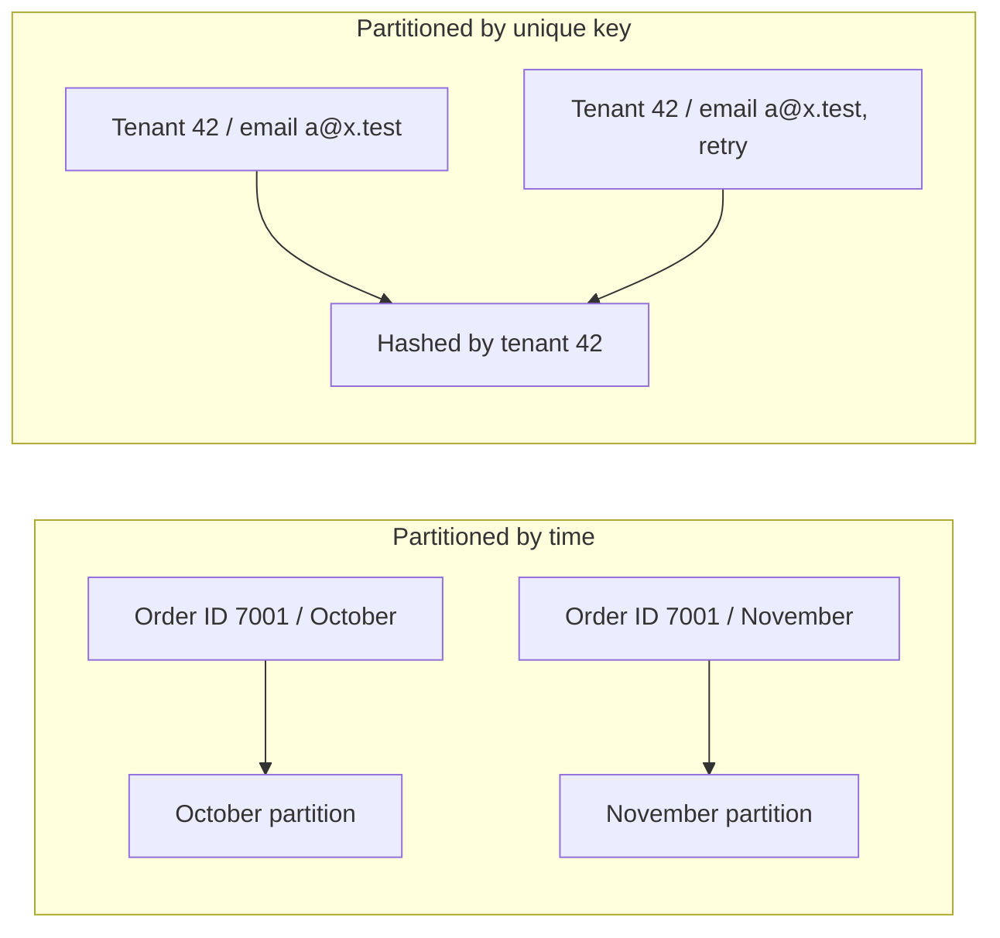
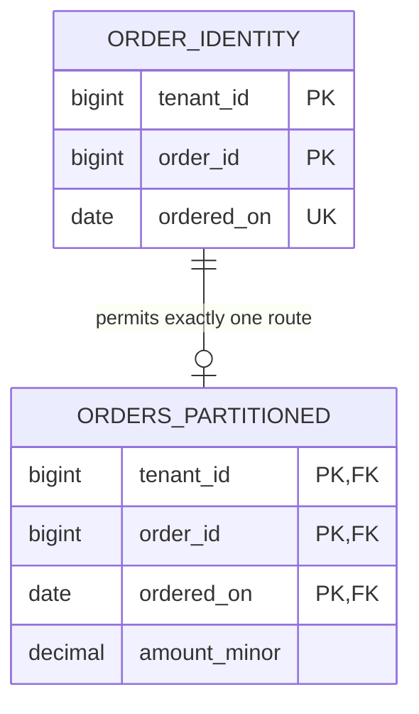
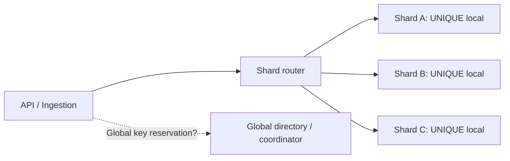

# Partition-Local vs. System-Wide Unique Constraints

When a table is small, the clause `UNIQUE (order_id)` is usually understood simply: “no two orders have the same ID.” However, if the data is split by **month**, **tenant**, **region**, or multiple **shards**, a more important question arises: **unique within what scope, and which system can actually enforce that scope?**

A unique index on a single partition can reject two duplicate rows **within that partition** while still allowing the same key to appear in another partition. Even an application-generated ID with a very low collision probability does not by itself prove that the entire storage cluster enforces a uniqueness constraint. When the wrong scope is chosen, data can be syntactically valid yet violate business rules: an order is created twice, an email is registered twice, or an event is recorded again in the following month.

This lesson belongs to the **Distribution and Partitioning** chapter of the **DATABASE_DATA_MODELING** module: developing the skill to turn requirements into a model with clear entities, keys, relationships, constraints, indexes, and physical schemas; and evaluating choices across relational, document, graph, and analytical storage. The focus is on distinguishing **partition-local uniqueness** (*partition-local uniqueness*) from **logical dataset-wide uniqueness** (*global uniqueness*), and then choosing a design that can be verified.

The SQL examples use **PostgreSQL 15+**. Different DBMSs and distributed platforms may provide different global index or global transaction mechanisms; do not extrapolate PostgreSQL behavior as a universal rule for every technology.

## 1. Business invariants must state their scope explicitly

The three statements below sound similar, yet have different meanings:

1. “A tenant cannot have two customers with the same email.” This means uniqueness on **`(tenant_id, normalized_email)`**.
2. “An order ID may be used only once across the entire enterprise.” This means uniqueness on **`order_id`**, or on **`(business_id, order_id)`** if the enterprise scope is explicitly bounded.
3. “Each month, a tenant may restart invoice numbers from 0001.” This means uniqueness on **`(tenant_id, invoice_month, invoice_number)`**, not just on the invoice number alone.

| Rule | Attribute set that must be unique | What can two rows share? |
|---|---|---|
| Email unique within a tenant | `(tenant_id, normalized_email)` | Two tenants can use the same email |
| Order ID unique platform-wide | `order_id` | No duplicate ID is allowed even across different days/tenants |
| Order ID unique within a tenant | `(tenant_id, order_id)` | Two tenants can have the same `order_id` |
| Invoice number unique per month | `(tenant_id, invoice_month, invoice_number)` | The next month can reuse number 0001 |
| Event must not be re-ingested | `(source_system, source_event_id)` or an extended tuple including tenant | Two deliveries of the same event must be recognized as one |

**“System-wide” must also be defined**: the entire logical table within **a single database**, all tenants belonging to **one cluster**, or multiple **independent regions and databases**? A `UNIQUE` constraint in database A does not automatically apply to database B.

### Mathematical definition

Given a set of records \(R\) and a key function \(K(r)\), the global uniqueness invariant is:

\[
\forall r_1,r_2\in R,\quad K(r_1)=K(r_2)\Rightarrow r_1=r_2.
\]

If the data is partitioned into subsets \(P_1,P_2,\ldots,P_n\), checking uniqueness **within each partition** only proves:

\[
\forall i,\ \forall r_1,r_2\in P_i,\quad
K(r_1)=K(r_2)\Rightarrow r_1=r_2.
\]

The second condition **does not prevent** some \(r_1\in P_i\) and \(r_2\in P_j\) with \(i\neq j\) from sharing the same key. To deduce global uniqueness from local checks, an additional condition is required, such as **every record with the same unique key is always routed to the same partition**.

## 2. Partitioning, distribution, sharding, and replication are different

| Concept | Meaning | Relevance to uniqueness |
|---|---|---|
| **Partitioning** | Splitting one logical table into parts by a partition key | Must know whether the unique index is enforced on the parent or per partition |
| **Range partition** | Splitting by ranges of dates, IDs, metrics, etc. | The same `order_id` in two different months may sit in two partitions |
| **Hash partition** | Splitting by a hash function of a key | The same hash/routing key generally lands in the same partition if the policy is stable |
| **Sharding** | Splitting data across multiple nodes/databases with independent write authority | Local uniqueness on each shard does not mean cluster-wide uniqueness |
| **Replication** | Copying the same data to replicas | Replicas are not disjoint subsets of data; requires leader/quorum/write policies and conflict handling |
| **Global index/directory** | A structure that stores or routes identifiers across the entire scope | Can enforce global uniqueness depending on transactional capabilities and engine |

For example, splitting a table by **`created_at`** to make dropping old monthly data easier does not mean it is **sharded by `order_id`**. With time-based partitioning, a new `order_id` that collides with an old ID can still be written in the following month if the model has no cross-month protection mechanism.

Conversely, if hash partitioning is performed on the exact **key that needs to be unique**, every record with the same key will reach the same local enforcement point, assuming routing and rebalancing are executed consistently. That can turn local uniqueness into a logical scope-wide guarantee **without needing a physical index spanning every node**.

### Diagram of the two organizational approaches



In the time-based branch, two duplicate IDs can land in **two different partitions**. In the tenant-hash branch, two duplicate emails **within the same tenant** are routed to **the same partition**, where a unique index on `(tenant_id, email)` can reject them.

## 3. Distinguishing primary key, business key, and partition key

An orders table often has three kinds of keys/identifying attributes:

- **Business key:** `order_number` issued by the business; may be unique per tenant, per year, or platform-wide.
- **Technical key:** `order_id` that is stable for referencing; may be numeric, UUID, or another type.
- **Partition key:** `ordered_on` or `tenant_id` to determine which part holds the data.

They **may coincide, overlap, or be independent**. Do not include `ordered_on` in the business key merely because the database requires a unique constraint to include the partition key.

For example, a table with PK `(tenant_id, order_id, ordered_on)` still **does not prove** that `(tenant_id, order_id)` is unique across the whole year. It only proves there are no duplicates of **all three values together**. If an order has `order_id=7001` on two different dates, both composite keys are distinct.

| Perspective | Question to verify |
|---|---|
| **Business identity** | Are two rows with the same `order_id` on different dates **the same order written twice**? |
| **Storage identity** | Which columns actually belong to `PRIMARY KEY`/`UNIQUE`? |
| **Partition routing** | Are two rows with the same business key guaranteed to land in the same partition? |
| **Referencing** | Can an FK with only `order_id` identify a single parent row? |
| **Time and mutation** | Is updating the creation date allowed, potentially forcing a record to move across partitions? |

Do not treat a “well-generated” surrogate ID as a substitute for an **enforceable uniqueness constraint**, especially when data from multiple systems is imported or replicated.

## 4. PostgreSQL example: partitioning orders by month

Suppose a business stores orders across multiple years and wants to partition by order date to scan/drop historical data faster.

### 4.1. DDL of the partitioned table

```sql
CREATE TABLE sales_orders_by_date (
    tenant_id BIGINT NOT NULL,
    order_id BIGINT NOT NULL,
    ordered_on DATE NOT NULL,
    customer_id BIGINT NOT NULL,
    amount_minor NUMERIC(20, 0) NOT NULL,

    CONSTRAINT pk_sales_orders_by_date
        PRIMARY KEY (tenant_id, order_id, ordered_on),
    CONSTRAINT ck_order_amount CHECK (amount_minor >= 0)
) PARTITION BY RANGE (ordered_on);

CREATE TABLE sales_orders_2026_10
    PARTITION OF sales_orders_by_date
    FOR VALUES FROM ('2026-10-01') TO ('2026-11-01');

CREATE TABLE sales_orders_2026_11
    PARTITION OF sales_orders_by_date
    FOR VALUES FROM ('2026-11-01') TO ('2026-12-01');
```

The primary key `(tenant_id, order_id, ordered_on)` is **structurally valid** because it includes the partition key `ordered_on`. PostgreSQL organizes the corresponding indexes on the partitions; there is no independent global index checking `(tenant_id, order_id)` across months.

### 4.2. Two rows with the same ID in two months are still allowed

```sql
INSERT INTO sales_orders_by_date
    (tenant_id, order_id, ordered_on, customer_id, amount_minor)
VALUES
    (42, 7001, DATE '2026-10-18', 501, 100000),
    (42, 7001, DATE '2026-11-02', 501, 200000);

SELECT tenant_id, order_id, ordered_on, amount_minor
FROM sales_orders_by_date
WHERE tenant_id = 42 AND order_id = 7001
ORDER BY ordered_on;
```

Result:

| `tenant_id` | `order_id` | `ordered_on` | `amount_minor` |
|---:|---:|---|---:|
| 42 | 7001 | 2026-10-18 | 100000 |
| 42 | 7001 | 2026-11-02 | 200000 |

PostgreSQL does not treat this as a primary key duplicate because `ordered_on` differs. **If the business rule states that `order_id` can only be used once per tenant, this model does not satisfy the requirement.**

Even two orders in **the same month** but on different `ordered_on` dates can share the same ID, because the PK checks the triple, not the pair. That is different from “unique `(tenant_id,order_id)` within each partition.”

### 4.3. Why can’t the desired unique constraint be added on the parent?

The snippet below is an **example that must fail**—do not run it in a real migration:

```sql
-- PostgreSQL 15+: invalid because the partition key ordered_on is missing.
ALTER TABLE sales_orders_by_date
    ADD CONSTRAINT uq_order_id_in_tenant
    UNIQUE (tenant_id, order_id);
```

With **declarative partitioning** in PostgreSQL 15, to create a PK/UNIQUE constraint on a partitioned table, the constraint’s key columns must include **all relevant partition key columns**, and the partition key cannot be an expression/function in the case where such a constraint is applied. With multi-level partitioning, the partition keys of child partitioned tables must also be accounted for under PostgreSQL’s rules.

Reason: PostgreSQL uses the indexes on each individual partition to back a parent unique constraint. When the unique column set **contains the partition key**, any two rows matching the entire unique key must be routed into the same partition. Without the partition key, two rows could land in two different partitions and the local indexes would not see each other.

**Do not create `UNIQUE (tenant_id, order_id, ordered_on)` and then advertise that `order_id` is unique across the entire tenant.** The database only guarantees the exact column set declared in the constraint.

## 5. Partition-local uniqueness is not table-wide uniqueness

You can create a **unique index directly on each partition**:

```sql
CREATE UNIQUE INDEX uq_orders_oct_tenant_id
    ON sales_orders_2026_10 (tenant_id, order_id);

CREATE UNIQUE INDEX uq_orders_nov_tenant_id
    ON sales_orders_2026_11 (tenant_id, order_id);
```

These indexes prevent a tenant from having two rows with `order_id=7001` **within the October partition**, and likewise for November. However, two rows in **two different months** from the dataset in section 4.2 remain valid.

Key points to remember:

- The index on the October partition **cannot see** November’s data.
- Adding a December partition requires ensuring a similar local index is created and maintained; do not assume an index will be auto-generated from a **non-existent** parent constraint.
- A month-local constraint is only appropriate if the business truly allows IDs to be reused in subsequent months.
- If a tenant has two rows with the same ID on different days within the same month, the new local unique index will reject them—unlike a PK that includes the date.

### When per-month uniqueness is a genuine requirement

Suppose the rule is that **invoice numbers are allowed to repeat in different months**. Instead of choosing `created_at` by day and trying to infer monthly uniqueness, you can put the business month into **both the logical key and the partition key**:

```sql
CREATE TABLE monthly_invoices (
    tenant_id BIGINT NOT NULL,
    invoice_month DATE NOT NULL,
    invoice_number TEXT NOT NULL,
    total_minor NUMERIC(20,0) NOT NULL,

    CONSTRAINT pk_monthly_invoices
        PRIMARY KEY (tenant_id, invoice_month, invoice_number),
    CONSTRAINT ck_month_first_day
        CHECK (EXTRACT(DAY FROM invoice_month) = 1),
    CONSTRAINT ck_invoice_number
        CHECK (btrim(invoice_number) <> ''),
    CONSTRAINT ck_invoice_total
        CHECK (total_minor >= 0)
) PARTITION BY RANGE (invoice_month);

CREATE TABLE monthly_invoices_2026_10
    PARTITION OF monthly_invoices
    FOR VALUES FROM ('2026-10-01') TO ('2026-11-01');

CREATE TABLE monthly_invoices_2026_11
    PARTITION OF monthly_invoices
    FOR VALUES FROM ('2026-11-01') TO ('2026-12-01');
```

Here `(tenant_id, invoice_month, invoice_number)` **is the agreed-upon business key**. October and November can both use number `0001`; two invoices numbered `0001` for the same tenant **within the same month** will be rejected by the PK.

However, `invoice_month` must be defined by the **accounting invoice month**, not arbitrarily computed from the server date when the record is written. A late-recorded invoice might still belong to a prior accounting period. If regulations require invoice numbers to be unique for the whole year or never reused, this example no longer holds.

## 6. When the partition key aligns with the uniqueness scope

A natural strategy is partitioning by **tenant** when the primary requirement is uniqueness **within a tenant**.

### 6.1. Hash partitioning by tenant

```sql
CREATE TABLE customer_accounts_by_tenant (
    tenant_id BIGINT NOT NULL,
    customer_id BIGINT NOT NULL,
    normalized_email TEXT NOT NULL,
    display_name TEXT NOT NULL,

    CONSTRAINT pk_accounts
        PRIMARY KEY (tenant_id, customer_id),
    CONSTRAINT uq_email_in_tenant
        UNIQUE (tenant_id, normalized_email),
    CONSTRAINT ck_normalized_email
        CHECK (
            normalized_email = lower(btrim(normalized_email))
            AND normalized_email <> ''
        ),
    CONSTRAINT ck_display_name
        CHECK (btrim(display_name) <> '')
) PARTITION BY HASH (tenant_id);

CREATE TABLE customer_accounts_h0
    PARTITION OF customer_accounts_by_tenant
    FOR VALUES WITH (MODULUS 2, REMAINDER 0);

CREATE TABLE customer_accounts_h1
    PARTITION OF customer_accounts_by_tenant
    FOR VALUES WITH (MODULUS 2, REMAINDER 1);
```

Because the same `tenant_id` is routed to **the same hash partition** (under the current definition and configuration), the unique constraint on `(tenant_id, normalized_email)` ensures that a normalized email cannot appear twice **within the same tenant**, even though the table has multiple partitions.

```sql
INSERT INTO customer_accounts_by_tenant
    (tenant_id, customer_id, normalized_email, display_name)
VALUES
    (42, 1, 'a@example.test', 'An'),
    (43, 1, 'a@example.test', 'Binh');

-- Must be rejected: tenant 42 already has this email.
INSERT INTO customer_accounts_by_tenant
    (tenant_id, customer_id, normalized_email, display_name)
VALUES
    (42, 2, 'a@example.test', 'Anh');
```

Two tenants can have the same email, matching the invariant. The parent’s unique index remains **globally unique for the pair `(tenant_id, normalized_email)`** because no two different partitions hold the same tenant when routing is sound.

### 6.2. What is not protected?

If a new requirement states “each email may be registered only once **across the entire platform**, regardless of tenant,” the constraint `UNIQUE (tenant_id, normalized_email)` **is not sufficient**. Attempting to add `UNIQUE (normalized_email)` on the parent hash-partitioned by tenant will hit the restriction due to the missing partition key.

Similarly, `customer_id=1` appearing in both tenant 42 and tenant 43 is valid under the composite PK. If a public API accepts only `customer_id=1` without a tenant, queries become ambiguous and risk data leakage. **Keys must be interpreted within the same scope** across storage, lookup, FKs, and authorization checks.

### 6.3. Normalized email must be well-defined

The example uses `lower(btrim(email))` for illustration, **not as a claim** of being a complete email standard. Domain rules may require handling Unicode, collation, address verification, case comparison rules, and provider policies. Do not blindly strip dots or `+tag` suffixes for all email providers. All datasets must use **the same controlled and versioned normalization algorithm**.

With `normalized_email NOT NULL`, the example avoids multiple `NULL`s causing differing interpretations of uniqueness. If email is optional, you must decide whether multiple accounts without an email are allowed and how the DBMS handles `NULL` in unique constraints.

## 7. Proving when local uniqueness implies global uniqueness

A core rule:

> If every record with the same key set that must be unique is routed to **the same uniqueness enforcement point**, and that point checks uniqueness atomically, then local uniqueness can imply global uniqueness within that routing scope.

Let \(h(K)\) be the function that selects the partition/shard from key \(K\). If two rows with the same \(K\) always produce the same \(h(K)\), then any uniqueness violation on \(K\) must occur within a single partition and be caught by its index.

Examples:

- Hash by `tenant_id`, unique `(tenant_id, email)`: two duplicates share the same tenant and are routed to the same place → sound.
- Range by `ordered_on`, desired unique `(tenant_id, order_id)`: two duplicates can have different dates → **does not** guarantee the same partition.
- Hash by `order_id`, unique `order_id`: all duplicate IDs go to the same shard → local uniqueness can work if the distributed design guarantees proper routing/transactions.

### Three non-negotiable conditions

1. **Stable and authoritative routing function:** every writer, including imports/batches, uses the exact same rule; rebalancing must preserve uniqueness.
2. **Atomic check at the key owner:** two concurrent requests must never both observe “absent” and both write successfully.
3. **No bypass write path:** direct writes to an arbitrary shard bypassing routing/constraints must not be permitted.

If a shard is split into multiple new shards, the same key must still map to a single logical owner, and the migration process must never allow a key to exist simultaneously under two valid write targets.

## 8. Global uniqueness via a key registry table

When the business requires `(tenant_id, order_id)` to be **unique across months** while the main table must be partitioned by date, one solution within **a single PostgreSQL database** is to maintain an **unpartitioned identity registry table** (*identity registry*).

The registry table must store not only the ID, but also the **locked-in partition key value**, to prevent two physical rows in two different partitions from both “borrowing” a single valid registration.

### 8.1. ERD of the registry and partitioned table



The relationship in the diagram is **at most one order row per registration** when the constraints below are applied. However, it **does not require** every registry row to already have an order row: transactions/reconciliation are needed to handle incomplete registrations.

### 8.2. Illustrative PostgreSQL DDL

```sql
CREATE TABLE order_identity (
    tenant_id BIGINT NOT NULL,
    order_id BIGINT NOT NULL,
    ordered_on DATE NOT NULL,

    -- Each order ID can be registered only once per tenant.
    CONSTRAINT pk_order_identity
        PRIMARY KEY (tenant_id, order_id),

    -- Target key for the FK that validates the exact partition date.
    CONSTRAINT uq_order_identity_route
        UNIQUE (tenant_id, order_id, ordered_on)
);

CREATE TABLE orders_partitioned (
    tenant_id BIGINT NOT NULL,
    order_id BIGINT NOT NULL,
    ordered_on DATE NOT NULL,
    amount_minor NUMERIC(20, 0) NOT NULL,

    CONSTRAINT pk_orders_partitioned
        PRIMARY KEY (tenant_id, order_id, ordered_on),

    CONSTRAINT fk_orders_registered_route
        FOREIGN KEY (tenant_id, order_id, ordered_on)
        REFERENCES order_identity (tenant_id, order_id, ordered_on)
        ON UPDATE RESTRICT
        ON DELETE RESTRICT,

    CONSTRAINT ck_orders_partitioned_amount
        CHECK (amount_minor >= 0)
) PARTITION BY RANGE (ordered_on);

CREATE TABLE orders_partitioned_2026_10
    PARTITION OF orders_partitioned
    FOR VALUES FROM ('2026-10-01') TO ('2026-11-01');

CREATE TABLE orders_partitioned_2026_11
    PARTITION OF orders_partitioned
    FOR VALUES FROM ('2026-11-01') TO ('2026-12-01');
```

The guarantee is formed by **two layers of constraints working together**:

- `order_identity` has at most **one** row per `(tenant_id, order_id)`.
- A row in `orders_partitioned` must reference **the exact `(tenant_id, order_id, ordered_on)` tuple** from the registry.
- Within that same triple, the PK of `orders_partitioned` prevents two duplicate rows.

Therefore: if the same tenant/order ID appears with two different `ordered_on` values, **at least one row cannot reference a single locked-in registry route**. This is an integrity proof built on a composite FK **and** the PKs of both tables, not merely on an isolated registry.

**Counterexample of a flawed design:** if orders only had an FK `(tenant_id, order_id)` pointing to the registry, two rows with the same ID in two different months **could both use the same registration**. A unique registry by itself **does not limit how many child rows** point to it. You must lock down the route/partition key as well, or apply another mechanism that proves “one identity → one logical record.”

### 8.3. Atomic order creation

```sql
BEGIN;

INSERT INTO order_identity (tenant_id, order_id, ordered_on)
VALUES (42, 9001, DATE '2026-10-20');

INSERT INTO orders_partitioned
    (tenant_id, order_id, ordered_on, amount_minor)
VALUES
    (42, 9001, DATE '2026-10-20', 150000);

COMMIT;
```

If the transaction fails on either statement, **both are rolled back**. If two concurrent requests try to register `(42,9001)` with different dates, the registry PK allows at most one transaction to register successfully; the other transaction must handle the conflict rather than writing an order without a registry entry.

Now try inserting the same ID directly into November:

```sql
-- Must fail: the registry entry for (42,9001) has ordered_on=2026-10-20.
INSERT INTO orders_partitioned
    (tenant_id, order_id, ordered_on, amount_minor)
VALUES
    (42, 9001, DATE '2026-11-03', 200000);
```

This row has a different triple from the registered one, so the FK rejects it. If someone tries to update `ordered_on` in the registry to November to make it legal, `ON UPDATE RESTRICT` blocks it whenever an order row already references the old route.

### 8.4. Limitations and cost of a registry

- The registry table is a **write coordination point**; at very high scale, it can become a throughput or operational bottleneck.
- Every order creation requires at least two operations/data locks, a transaction, and extra storage.
- If a registry entry is inserted without inserting the order, you can end up with a **reserved identity that has no main record**; this state must be handled/reconciled. An FK from orders to the registry does not enforce the reverse direction.
- If partitions are dropped or detached for retention, the registry may still contain historical identities. You must decide **whether IDs may be reused**; usually a minimal tombstone/registry should be kept if the invariant is “never reuse.”
- A registry table in **a single database** only protects that database’s scope. If multiple independent databases accept writes, you need a shared coordination mechanism or reliable distributed routing rules.
- FKs from other child tables to the partitioned table may need the partition key as well if referencing it directly. They can point to the registry via `(tenant_id,order_id)` if it represents the stable identity, and then define how the lifecycle and integrity of related objects are maintained.

A registry is **a design option**, not the default answer for every partitioned table. If a global order ID is not required, keep uniqueness aligned with the real scope and avoid extra structural overhead.

## 9. Why checking `SELECT` before `INSERT` does not guarantee uniqueness

A common application bug:

```text
T1: SELECT ... WHERE order_id = 9001 -> not found
T2: SELECT ... WHERE order_id = 9001 -> not found
T1: INSERT order_id = 9001 -> succeeds
T2: INSERT order_id = 9001 -> also succeeds if there is no shared unique constraint
```

Two requests that both check “does not exist yet” can **both be right at the time of checking** yet produce duplicate records afterward. This is a **check-then-act** race condition and is not solved by “checking faster.”

**Safe mechanisms** typically are:

- A `UNIQUE`/PK enforced atomically at **the authoritative owner of the key**, or
- An atomic reserve/compare-and-insert operation in a registry/coordination service, or
- A transaction and isolation protocol genuinely capable of enforcing the invariant across all participating write targets.

An in-process Java lock **provides no protection** when the application runs multiple instances. A cache with non-atomic `SET` or a delayed “key exists” message also does not guarantee system-wide uniqueness.

If using a distributed lock, you must account for TTL, fencing tokens, crash recovery, network partitions, and an **atomic** link between lock ownership and the write operation. A lock expiring mid-transaction can allow a second writer to proceed; therefore, many problems are simpler when relying on the key owner’s unique constraint.

## 10. Sharding: where do constraints live?

Suppose a platform stores customers across three independent shards:



If routing by `tenant_id`:

- `UNIQUE (tenant_id, normalized_email)` on each shard can prevent duplicate emails **within a tenant**, provided all records of a tenant always reside on the same shard.
- `UNIQUE (normalized_email)` on each shard **is not enough** to enforce “email unique across all tenants platform-wide.”
- Moving a customer across tenants or migrating a tenant to another shard requires a safe migration protocol so that two places never **simultaneously hold write authority** for the same key.

If routing by `normalized_email`, all identical emails can land on the same shard and be protected platform-wide by local uniqueness, but queries **by tenant** may have to scatter across multiple shards. Choosing a shard key is a trade-off among **invariants**, **query patterns**, **load distribution**, **data movement**, and **availability requirements**.

### Three common approaches to global uniqueness

| Approach | How it protects | Trade-offs |
|---|---|---|
| **Route by the key that must be unique** | Same key lands on the same shard with a unique constraint | Great for uniqueness by that key; queries by other keys may fan out |
| **Transactional global index/directory** | A metadata service/layer registers each key once | Needs coordination, failure handling, and bottleneck evaluation |
| **Engine-supported distributed transactions / serializable constraints** | The DBMS coordinates across shards on write | Depends on engine, topology, latency, and partition/failure policy |

A “global index” that only accelerates lookups but **is not updated atomically with data writes** may fail to enforce uniqueness. You must verify the DBMS’s exact guarantee: strong consistency at commit or merely eventual consistency?

### Do not confuse a “unique ID generator” with a global unique constraint

Random UUIDs, UUIDv7, Snowflake-like IDs, or shard-encoded IDs can **reduce collision risk** and aid routing. However:

- Random UUIDs ensure a very low collision probability, **not an absolute mathematical proof that duplicates cannot occur**.
- Clock/machine-based ID generators require node ID configuration, clock rollback/restart handling, and range partitioning.
- Imports from legacy systems can introduce existing IDs even when the new generator produces no collisions.
- A unique technical ID does not automatically prevent **duplicate email registration** or **the same business request being processed twice**.

Therefore, you still need **business constraints** and a duplicate-request detection mechanism.

## 11. Global uniqueness, idempotency, and exactly-once are not the same

A `POST /orders` API may receive the same request again due to a client timeout. There are three distinct questions:

1. **Can `order_id` be duplicated?** Protected by the PK/unique constraint over the identity scope.
2. **Can a single business request create two orders with two different IDs?** Requires an `idempotency_key` scoped to the caller/use case, or a unique business code.
3. **Can a single event be applied twice to metrics/inventory?** Requires an idempotent consumer, transactions, and event identity.

A per-tenant idempotency table can use:

```sql
CREATE TABLE order_request_keys (
    tenant_id BIGINT NOT NULL,
    idempotency_key TEXT NOT NULL,
    request_fingerprint TEXT NOT NULL,
    order_id BIGINT,
    created_at TIMESTAMPTZ NOT NULL DEFAULT CURRENT_TIMESTAMP,
    CONSTRAINT pk_order_request_keys
        PRIMARY KEY (tenant_id, idempotency_key),
    CONSTRAINT ck_request_fingerprint
        CHECK (btrim(request_fingerprint) <> '')
);
```

This table assumes **a single authoritative write database**, not scattered uncoordinated shards. Inside the order-creation transaction, you must check that the same `idempotency_key` carries the **same payload fingerprint** and return the same recorded result; if the payload differs, report a conflict. A row with `order_id NULL` can represent an in-flight/reserved request; clear status, timeout, and recovery rules are needed.

If idempotency keys are only stored in a cache with a short TTL, the same request after TTL expiration can create a new order. That might be an acceptable policy for some APIs, but it is not equivalent to “never duplicate an order” in a transactional system.

### `ON CONFLICT` only protects keys with an actual unique constraint

On the date-partitioned table from section 4, the statement:

```sql
-- There is no unique/PK matching only (tenant_id,order_id)
-- on the parent, so it cannot be used as an arbiter as expected.
INSERT INTO sales_orders_by_date
    (tenant_id, order_id, ordered_on, customer_id, amount_minor)
VALUES
    (42, 7001, DATE '2026-11-03', 501, 100000)
ON CONFLICT (tenant_id, order_id) DO NOTHING;
```

cannot “automatically detect that the ID already existed last month”: there is no parent constraint matching those two columns. An `ON CONFLICT` specifying all three columns only guards the triple `(tenant_id,order_id,ordered_on)`; it **does not** change the uniqueness scope of `(tenant_id,order_id)`.

On the registry table, `ON CONFLICT (tenant_id,order_id)` can work because `order_identity` actually has that PK. However, `DO NOTHING` must be paired with checking **the partition date and request payload**; never silently treat two different requests sharing an ID as the same valid action.

## 12. Foreign keys and relationships when the parent table is partitioned

For the `sales_orders_by_date` table, the valid parent-level referenced key is the triple `(tenant_id, order_id, ordered_on)`. An order-lines table may require:

```sql
CREATE TABLE sales_order_lines_by_date (
    tenant_id BIGINT NOT NULL,
    order_id BIGINT NOT NULL,
    ordered_on DATE NOT NULL,
    line_no INTEGER NOT NULL,
    amount_minor NUMERIC(20,0) NOT NULL,

    CONSTRAINT pk_order_line_by_date
        PRIMARY KEY (tenant_id, order_id, ordered_on, line_no),
    CONSTRAINT fk_line_order_by_date
        FOREIGN KEY (tenant_id, order_id, ordered_on)
        REFERENCES sales_orders_by_date
            (tenant_id, order_id, ordered_on)
        ON DELETE RESTRICT,
    CONSTRAINT ck_order_line_no CHECK (line_no > 0)
);
```

The child table in the example **does not need to be partitioned yet**, though it can be partitioned by `ordered_on` for matching distribution and retention. The composite FK prevents a line from pointing to an order on a different date; this is an **integrity strength**, though it also requires APIs/ETLs to know or look up `ordered_on` when creating lines.

### Do not assume “FK on `order_id` is enough” just because IDs are randomly generated

Even if the application promises rare ID collisions, the database **does not inherently have** uniqueness on `order_id`. Thus creating an FK solely on `order_id` to a partitioned parent table generally cannot target a valid unique key, and joining manually in the application risks ambiguous references.

An **identity registry** with PK `(tenant_id,order_id)` can serve tables that only need to reference a stable identity. However, you must clarify whether child tables are referencing **a reserved identity** or **an order that actually exists**: an FK to the registry does not guarantee an order row exists when registration is still incomplete.

### Consequences of changing the partition key

If `ordered_on` changes, some engines may have to **move the record to another partition**. That can affect PK/FKs, indexes, locks, and downstream systems using the partition key in identity. If the order date is a **settled business fact**, it is usually best kept immutable; if edits are allowed, you need a transactional process to update relationships and an audit policy.

In distributed systems, moving partitions/shards also requires write-authority control and route mapping; it is not just a single `UPDATE` on the date column.

## 13. Choosing a partition key by uniqueness or by workload?

A good partition key does more than satisfy even data distribution. It must be compatible with:

- **Uniqueness scope** and where constraints are enforced.
- **Primary queries**: filtering by tenant, date, order ID, email, or product?
- **Retention**: is dropping/archiving whole months of data required?
- **Write volume and hot partitions**: will one huge tenant create a hot shard?
- **FK relationships and joins**: do frequently joined tables share the same routing key to avoid distributed joins?
- **Partition movement**: is the partition key immutable over the record’s lifecycle?
- **Access control and residency**: do tenants/regions require data never to leave a zone?
- **Historical data governance**: must uniqueness still hold after partitions are dropped?

### Selection matrix

| Primary need | Design to consider | Warning |
|---|---|---|
| Read/drop by month, ID only unique per day | Range by date + unique including date | Only valid if the business allows ID reuse across dates |
| Read/drop by month, order ID unique for life | Range by date + global identity registry / global index mechanism | Adds coordinated writes and registry retention |
| Email unique within a tenant | Hash/range by tenant + unique `(tenant,email)` | Very large tenants, resharding, and email normalization |
| Email unique platform-wide | Route by email or global registry/constraint | Cannot rely on local uniqueness of tenant-sharded storage |
| Invoice numbers reused monthly | Partition by `invoice_month` + key including month | Month must be a canonical business concept |
| Event ID unique across source | Route by event ID or shared dedupe table | Late events crossing months and retries |
| Inventory by warehouse/SKU, concurrent cross-region reads | Partition by warehouse/tenant per transaction pattern | Uniqueness rules and atomic updates per SKU–warehouse |
| Append-only daily analytics | Range by event date + fact key and upstream dedupe | UNIQUE including partition date does not replace event identity |

**No single partition key is optimal for every kind of uniqueness, every join, and every query**. If a strict system-wide non-duplication invariant matters more than the speed of dropping partitions, prioritize enforcing the invariant first and optimize around that foundation.

## 14. Differences among local index, partitioned index, and global index

Three terms often cause confusion:

1. **Local index:** a physical index residing on a single partition/shard, checking only rows within that scope.
2. **Partitioned index:** a parent-level index structure managed across child indexes. In PostgreSQL 15, a partitioned parent’s unique constraint uses the corresponding partition indexes and **must include the partition key** to ensure logical non-duplication.
3. **Global index:** an index capable of looking up/enforcing keys across multiple partitions/shards, if genuinely supported by the engine.

A **partitioned index** is not synonymous with a **global index** in the sense of enforcing arbitrary business keys that omit the partition key.

### Questions to verify in the engine documentation

- Must a parent Unique/PK include **all partition key columns**?
- Is a **global unique index** independent of the partition key supported?
- Is the global index updated **atomically with the record** on insert/update/delete?
- When detaching/dropping/moving a partition, does the index still preserve uniqueness?
- During online rebuilds or attaching a populated partition, how does the system **check for duplicates**?
- How do NULLs, collations, and expression indexes affect uniqueness?
- Are FKs to a partitioned table or distributed shards actually **enforced**?
- Could a network/leader failover allow two places to simultaneously accept writes for the same key?

Do not copy a PostgreSQL example and conclude that SQL Server, Oracle, MySQL, MongoDB, or a distributed SQL system shares the exact same capability set. Global index mechanisms, shard-key uniqueness, transactions, and FK support vary across versions and deployment modes.

## 15. NULL semantics, code normalization, and unique indexes

A unique constraint is only accurate with respect to the **actual compared values**. Before concluding “no duplicate emails,” determine what the DB compares:

- Is it case-sensitive? Are `User@Example.test` and `user@example.test` considered the same?
- Are leading/trailing spaces significant?
- How are Unicode and collations handled?
- If a field is `NULL`, are one or multiple rows with missing values allowed?
- If uniqueness applies only to active records, which condition defines the `deleted_at`/`is_active` state?

### Example: unique only for active records

For an **unpartitioned** table, PostgreSQL can create a partial unique index:

```sql
-- Hypothetical example table:
-- customer_accounts(tenant_id, normalized_email, deleted_at, ...).
CREATE UNIQUE INDEX uq_active_email_per_tenant
    ON customer_accounts (tenant_id, normalized_email)
    WHERE deleted_at IS NULL;
```

This is a **different model example**, not run on `customer_accounts_by_tenant` in section 6 because that table does not have `deleted_at`. For a partitioned/sharded table, verify whether the predicate and key tuple **are protected across partitions** or only per part. A partial index **does not automatically turn** a local scope into a global one.

If compliance policy prohibits re-registering a deleted email, uniqueness solely on active records is the wrong invariant. If re-registration is allowed, you must address historical consequences: the old email already appears in audits, invoices, or notifications of the deactivated account.

**PostgreSQL 15** provides `NULLS NOT DISTINCT` for unique constraints/indexes in appropriate cases, but whether to use it must stem from missing-data semantics. Never coerce `NULL` into an empty string just to “make uniqueness easier.”

## 16. Changing partitions and migrating without losing uniqueness

A legacy system has an unpartitioned orders table with `UNIQUE (tenant_id,order_id)`. When migrating to range partitioning by `ordered_on`, you cannot automatically preserve the old parent unique constraint in PostgreSQL 15. This is a **data contract change**, not merely an infrastructure operation.

### Safe migration procedure

1. **Read current invariants:** which tables, APIs, messages, and reports treat `(tenant_id,order_id)` as an all-time identity?
2. **Profile the data:** find duplicate IDs, `NULL`s, non-normalized codes, broken FK references, and records with wrong creation dates.
3. **Choose the partition key and uniqueness mechanism:** intentionally change the logical key, use a global registry, change routing, or choose a DBMS with suitable global constraints.
4. **Design the new table and related relationships:** including order-line/payment FKs, indexes, access permissions, and retention.
5. **Batch backfill:** with a registry, create identities first and then bind routes; resolve historical conflicts explicitly rather than silently picking an arbitrary row.
6. **Protect concurrent writes:** transactional dual-write or CDC/cutover with watermarks and coordination rules; never let two systems hold authority to create the same key at once.
7. **Reconcile:** same logical identity count, same order count, no duplicate IDs across partitions, no orphan registry rows, valid route FKs, and unchanged totals and statuses.
8. **Controlled cutover:** switch write/read paths, measure conflicts/latency, and keep a rollback path ready.
9. **Clean up the old schema:** only after all downstream consumers and import jobs have switched to the new key/route.
10. **Drill failover and retention:** verify that adding partitions, detaching, resharding, and restoring from backup preserve uniqueness.

### Query to check duplicates across the entire logical table

```sql
SELECT
    tenant_id,
    order_id,
    COUNT(*) AS rows_with_same_logical_id,
    MIN(ordered_on) AS earliest_day,
    MAX(ordered_on) AS latest_day
FROM sales_orders_by_date
GROUP BY tenant_id, order_id
HAVING COUNT(*) > 1
ORDER BY rows_with_same_logical_id DESC, tenant_id, order_id;
```

On the section 4 dataset, the query finds `(42,7001)` with two rows. This is **data verification evidence**, not a constraint that stops two concurrent transactions from writing duplicates in the future. Enforcement on the write path is still required.

### Reconciling registry rows that have an identity without an order

```sql
SELECT
    k.tenant_id,
    k.order_id,
    k.ordered_on
FROM order_identity AS k
LEFT JOIN orders_partitioned AS o
  ON o.tenant_id = k.tenant_id
 AND o.order_id = k.order_id
 AND o.ordered_on = k.ordered_on
WHERE o.order_id IS NULL;
```

Returned rows may be **in-flight reservations**, **leftover registrations after a failure**, or **tombstones preserving non-reusable IDs**. Classify them by state and age policy before deleting; deleting all “orphans” can break the guarantee against order ID reuse.

Reconciliation should run on a consistent snapshot or with a watermark; reading the registry and orders at different moments can mistake a validly in-progress order creation for a temporary orphan.

## 17. Query indexing, partition pruning, and global lookup cost

Choosing range partitioning by date helps a query with the predicate:

```sql
SELECT tenant_id, order_id, ordered_on, amount_minor
FROM sales_orders_by_date
WHERE tenant_id = 42
  AND ordered_on >= DATE '2026-10-01'
  AND ordered_on < DATE '2026-11-01';
```

read only October’s data instead of scanning the entire history, provided the planner recognizes the condition for **partition pruning**.

Conversely, a query that only knows `order_id`:

```sql
SELECT *
FROM sales_orders_by_date
WHERE tenant_id = 42 AND order_id = 7001;
```

has no date predicate. It may have to check **multiple partitions** to locate the row, even if each partition has an index on `order_id`. This is the trade-off between **time-based partitioning** and **lookup by identifier**.

A registry containing `(tenant_id,order_id,ordered_on)` lets the application look up the partition key first:

```sql
SELECT ordered_on
FROM order_identity
WHERE tenant_id = 42 AND order_id = 9001;
```

and then query the order with `ordered_on`. You must handle the case where the registry entry exists but the order has not been created yet or has already been archived. **Lookup indexes** and **uniqueness constraints** are related but not synonymous: adding a faster index does not automatically solve cross-partition uniqueness.

### Write cost and contention

A global registry/unique index can increase write amplification, logging, locking, and latency. A hot key or an extremely high-traffic tenant can create contention. Benchmark at realistic scale and write patterns:

- New order `INSERT`s per second and key conflicts.
- P95/P99 latency when the registry is under load.
- Index size and cache hit ratio.
- Number of partitions scanned on ID lookups lacking a date.
- Speed of attach/detach and index rebuilds.
- Retry/deadlock/serialization failure rates.
- Impact when a region/shard loses connectivity.

If strict uniqueness is required, never “boost throughput” by disabling checks without replacing them with an equivalent guarantee.

## 18. Retention, archiving, and “lifetime” uniqueness

An order created in 2021 was deleted from the online table because its retention period expired. In 2026, is reusing that `order_id` allowed?

**There is no automatic technical answer.** A policy decision is required:

- **Unique within active data:** IDs may be reused after old data is purged per policy; evaluate downstream consumers still holding old IDs.
- **Unique within a retention window:** IDs do not repeat within N months; systems outside the window must include a timestamp to disambiguate identity.
- **Unique for the enterprise lifetime:** IDs are never reused; keep a minimal registry/tombstone or coordinated ID issuance with proper protection.

### Dropping a partition is not the same as deleting reference history

If invoices, payments, disputes, or external events still reference `order_id`, dropping an orders partition can leave those links without an explanatory target. The design may separate minimal identity/history into a table with a different retention lifecycle, or archive it with dedicated lookup and constraint mechanisms.

A system using a **global registry** must decide whether to keep its rows when the main data partition expires. Deleting registry rows to reclaim space can **break the “never reuse ID” guarantee**. Keeping the registry requires independent security, access control, and retention policies.

### Moving partitions/shards must not allow two concurrent write owners

While migrating a tenant from shard A to B, if both A and B accept creating customers with the same email, **both local constraints** can succeed. The procedure requires quiescing/forwarding writes, fencing or a single-writer ownership mechanism, before-and-after data reconciliation, and rollback if migration fails.

## 19. Relational, document, graph, and analytical perspectives

### Relational

In an RDBMS, PK/UNIQUE/FK are the natural tools for expressing identity and references. However, once a table is partitioned, read **the actual scope enforced by the engine**. A local unique index does not become global simply because users query through a parent table name.

### Document

In a document database, a collection sharded by `tenant_id` can enforce uniqueness via an index that includes the shard key, depending on the product and version. If you need `normalized_email` to be unique **system-wide** while sharded by tenant, verify actual global index/unique support or use a separate registration/routing mechanism. Do not assume per-shard unique indexes suffice for the whole cluster.

A document containing an array of IDs also does not guarantee uniqueness across IDs in other documents. When ingesting from multiple sources, apply idempotency and corresponding canonical identity policies.

### Graph

A graph has `Customer` and `Order` nodes and `PLACED` edges. If the graph is partitioned by community/tenant, whether a node with property `order_id=7001` in two different regions is blocked depends on **the graph engine’s unique constraint and distributed scope**, not on the fact that it is a graph.

Edges can connect to two nodes sharing the same business key if there is no identity management mechanism. When merging graphs across tenants or combining source datasets, enforce canonical keys and explicit scopes.

### Analytical

Fact tables are often partitioned by date for periodic loading and scanning. A source key `(source_system,event_id)` can repeat across dates due to late-arriving events or replays. A unique constraint including `event_date` **does not** protect deduplication by event ID across all history.

An analytical warehouse may choose an **upstream registry/deduplication table**, an identity mapping table, or batch/stream tests ensuring each event has a canonical key. If the warehouse does not enforce PK/FKs, declared schemas are merely metadata; you must have **data assertions, watermarks, and reconciliation**.

In particular, a fact loaded twice can **double revenue** even when every dimension FK and grain is modeled correctly. Global uniqueness of **event identity** is an independent invariant, not merely an indexing issue.

## 20. Testing constraints under load and failures

| Test scenario | Expected result |
|---|---|
| Same `(tenant,order_id,ordered_on)` in range table | PK rejects the second row |
| Same `(tenant,order_id)` in two months on range table **without registry** | **Allowed**, proving the current constraint is not ID-global |
| Same `(tenant,order_id)` on two days in the same month with date-composite PK | May be allowed if dates differ, unless a separate local unique index exists |
| Two duplicate `order_id`s in the same monthly partition with local index `(tenant,order_id)` | Local index rejects |
| Same `(tenant,email)` on tenant hash partition | Unique rejects |
| Same email in two tenants on tenant hash partition | Allowed under the sample policy |
| Create `UNIQUE(normalized_email)` on tenant-hashed parent | Invalid due to missing partition key |
| Registry holds an ID but order attempts to use a different `ordered_on` | Composite FK rejects |
| Two concurrent requests reserve the same `(tenant,order_id)` | At most one transaction creates the registry row successfully |
| Insert order without a registry entry | Composite FK rejects |
| Insert registry entry but transaction fails before inserting order | Rolls back both if in the same transaction |
| Registry/tombstone exists without an order | Reconciliation detects and classifies per policy |
| Retry request with same idempotency key but different payload | Conflict; not silently treated as the same request |
| Import existing ID from legacy system | Unique/registry or pipeline prevents duplicate creation |
| Shard migration with two writers active simultaneously | Write-authority protocol prevents identity split-brain |
| Drop an old partition, attempt to reuse a lifetime ID | Blocked if policy requires global identity to outlive retention |
| Query by order ID missing date | Has a controlled lookup plan or bounded multi-partition scan |
| Late fact event arriving the next month | Deduplicated by event identity, not just partition date |
| `NULL` email or different casing | Must obey the agreed normalization/NULL policy |
| Warehouse receives the same event twice | Reconciliation detects duplicate global source identity |

### Test real concurrency, not just sequential statements

To test concurrency, use **two sessions/transactions**:

1. T1 begins registering `(42,9001)` in the registry without committing yet.
2. T2 tries to register **the same pair** with a different date.
3. T1 commits or rolls back depending on the scenario.
4. T2 must wait/receive a conflict, or proceed if T1 rolls back, according to the DB’s mechanism.
5. Final verification: **no two order records share the same identity**.

Repeatedly running `SELECT` then `INSERT` in a single session does not prove race safety. With multiple shards, test network partitions/failovers and router transitions—if the platform does not support strong consistency transactions for the required invariant, the design must state the limitation rather than calling it absolute uniqueness.

## 21. Practice exercise: multi-tenant platform with orders and events

A SaaS platform has these requirements:

- Each tenant has customers whose normalized email is **unique within the tenant**.
- Each order has an `order_id` unique **within the tenant**, never reused even when orders are old.
- Orders must be partitioned by month for periodic archiving and purging.
- The order-creation API accepts an `idempotency_key` from the client; retried identical requests must not create two orders.
- A payment system stores `payment` referencing an order, though it does not always know the order creation month.
- A sales event stream can replay the same `source_event_id` across different days.
- Data is deployed across multiple shards by tenant, with plans to move large tenants to new shards.

Complete the following:

1. List **each uniqueness invariant**, its scope, and authoritative data source; distinguish technical ID, order code, email, and idempotency key.
2. Propose a tenant-hashed model for customers with `UNIQUE(tenant_id, normalized_email)` and verify when two tenants share an email.
3. Write the DDL for range-partitioning orders by month and explain why a PK containing `ordered_on` does not protect `(tenant_id,order_id)` across all time.
4. Design a `(tenant_id,order_id,ordered_on)` registry with FK/PKs strong enough so **no two orders in different months share one identity**.
5. Present the order-creation transaction covering identity registration, order write, and idempotency record; describe error/retry handling.
6. Design an appropriate payment FK/lookup when payment lacks `ordered_on`; distinguish referencing an identity vs. an existing physical order.
7. Propose a deduplication key for source events and explain why uniqueness on `(event_date,source_event_id)` can miss next-month replays.
8. Describe how to move a tenant between shards without **two places holding key-creation authority simultaneously**.
9. Design a retention strategy specifying how long identities/tombstones are kept to satisfy no ID reuse.
10. Create at least 12 test cases, covering two-session concurrency, cross-month duplicates, missing registry, mismatched idempotency payload, failover, and historical imports.
11. Compare global registry, route-by-key, and distributed SQL with global indexes across latency/throughput, HA, and migration cost.
12. Propose periodic reconciliation for scope-wide uniqueness, orphan registry rows, same-tenant FKs, duplicate events, and lookups missing the partition key.

**Passing criteria:** clearly state **which constraint protects which scope**, never conflate uniqueness of `(tenant_id,order_id,ordered_on)` with `(tenant_id,order_id)`, and never treat UUID generation or `SELECT`-before-`INSERT` as an absolute uniqueness mechanism.

## 22. Summary

- **Uniqueness is an invariant of a key tuple over a defined scope**, not merely an index named “unique.”
- **Local uniqueness** on each partition/shard does not automatically imply **global uniqueness**. To imply it, duplicate keys must be routed to **the same atomic enforcement point**.
- In **PostgreSQL 15 declarative partitioning**, parent PK/UNIQUE constraints must include the partition key columns; `UNIQUE(tenant_id,order_id,ordered_on)` does not protect `(tenant_id,order_id)` across months.
- **Partitioning by tenant** suits tenant-scoped uniqueness; **partitioning by date** suits retention but often requires another mechanism if order IDs cannot collide across dates.
- **Registry + FK including the routing key** can prove an identity maps to at most one partitioned record within a database; a registry containing only IDs and an FK omitting the route is **not enough**.
- **Global unique ID generation, idempotency, email uniqueness, and event deduplication** are distinct requirements requiring separate design and testing.
- When sharding, there must be a **single key-ownership point** and clear write/cutover protocols; checking with `SELECT` before `INSERT` does not eliminate race conditions.
- Evaluate **NULLs, normalization, FKs, UPSERT, partition pruning, retention, and resharding** alongside uniqueness because they determine data correctness over time.
- For document, graph, and warehouse engines, still verify **whether the engine truly enforces global uniqueness**; if not, pipelines/coordination and reconciliation must compensate.
