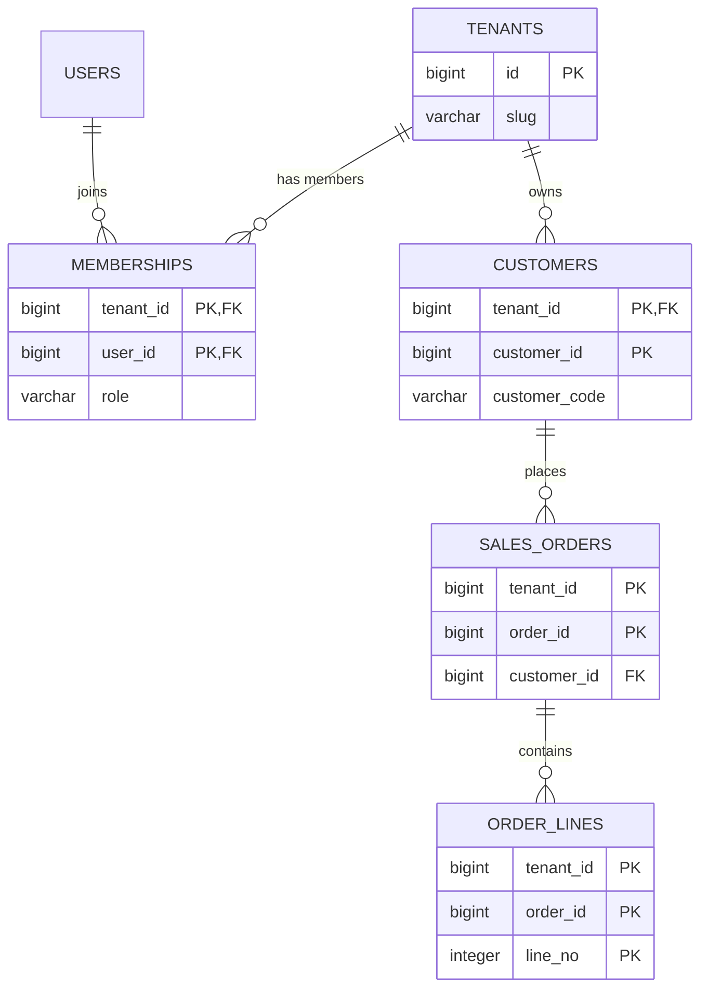
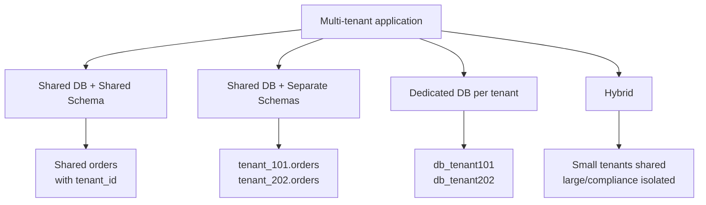
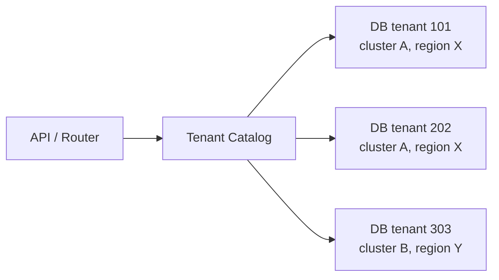
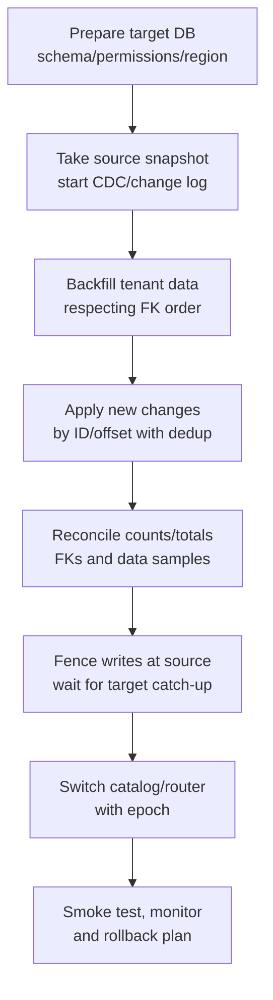

# Multi-Tenant Data with Shared Tables or Isolated Storage

A SaaS sales management platform serves thousands of businesses. Company A and Company B both have a customer coded `CUS-001`, yet they must never view, edit, reference, or accidentally restore each other's data. One large enterprise wants predictable performance, independent backups, and data stored in a specific geographic region. Should the platform use **shared tables with `tenant_id`**, **separate schemas**, **dedicated databases**, or a hybrid of multiple options?

This is the **multi-tenancy** problem in the **Distribution and Partitioning** chapter of the **DATABASE_DATA_MODELING** module. The focus goes beyond storage configuration: it is about turning business requirements into verifiable keys, relationships, constraints, indexes, query scopes, and isolation mechanisms. A sound design balances **integrity, privacy, performance, cost, portability, and operations**.

## 1. Understanding Tenant, Schema, Partition, Shard, and Database

A **tenant** is an organization with its own access-control and data boundary. In our example, a tenant is a business using the SaaS platform. One user can belong to **multiple tenants** with different roles; never conflate `user_id` with `tenant_id`.

| Concept | Role | Example |
|---|---|---|
| Tenant | Ownership and business-permission boundary | Company A |
| `tenant_id` | Stable identifier for that boundary | `101` |
| Schema | Namespace for tables, views, and DB objects | `tenant_101.orders` |
| Database | Catalog, connection, and DB operational boundary | `database_tenant_101` |
| Partition | Physical subset of one logical table | Hash by `tenant_id` |
| Shard | Data subset distributed to another node/database | Tenant A on shard 1 |
| Cluster/instance | Infrastructure compute/storage resources | One DB server or server group |
| Replica | Copy for reads, standby, or recovery | Read replica per region |

**Separate schemas do not mean separate servers; separate partitions do not grant separate access permissions; separate databases on the same instance still share CPU, RAM, I/O, and failure domains.** A design must explicitly state what is isolated: rows, tables, schemas, databases, compute, regions, credentials, encryption, or backups.

### 1.1. Requirements Must Be Expressed as Invariants

1. **Isolation:** a user authorized in tenant 101 must never read/modify tenant 202's data.
2. **Integrity:** an order in tenant 101 must never reference a customer in tenant 202.
3. **Scoped uniqueness:** two tenants can both use code `CUS-001`, yet one tenant cannot create two customers with the same code if rules forbid it.
4. **Scalability:** a large tenant must not consume unbounded resources and degrade small tenants uncontrollably.
5. **Lifecycle:** you must be able to onboard, migrate, export, back up, restore, and offboard a single tenant.
6. **Data residency:** primaries, replicas, backups, and exports must stay inside permitted regions when contracts require it.

Adding `WHERE tenant_id = ?` in a few queries solves only **part** of the requirement. You must protect every read, write, sync, cache, report, and operational path.

## 2. Domain Model and Grain with Tenant Boundaries

Suppose the entities are: `Tenant`, `User`, `Membership`, `Customer`, `SalesOrder`, `OrderLine`.



Grain:

- `tenants`: one row per business.
- `users`: one row per platform-wide user identity, **if** the account policy uses global identities.
- `memberships`: one row per user's role within one tenant.
- `customers`: one customer **within a tenant's scope**.
- `sales_orders`: one order **within a tenant's scope**.
- `order_lines`: one line belonging to a specific order of a tenant.

`tenant_id` should be immutable and never arbitrarily reused. `tenant_slug` is typically a mutable display or lookup code and should not automatically become an FK across millions of tables. **Knowing a tenant ID does not prove permission to access it**; the server must verify user, membership, and permissions.

### 2.1. Not All Data Belongs to One Tenant

Some tables are **platform-global** like `countries`, `currency_codes`, or subscription plans. Some tables are **tenant-owned** like `orders` and `invoices`. Conditionally shared data—such as a user belonging to multiple tenants—needs dedicated permission tables rather than assuming a single owner.

| Category | Typical Pattern | Security Question |
|---|---|---|
| Tenant-owned | `tenant_id` or separate namespace/DB | Are all FKs and queries properly scoped? |
| Platform-global | Shared reference tables | Are tenants blocked from mutating this data? |
| Shared-with-permission | Entity + sharing permission table | Who can view/edit, and within what scope? |
| Cross-tenant analytics | Dedicated warehouse/summary tables with separate perms | Could raw tenant data leak inadvertently? |

Avoid sprinkling `tenant_id IS NULL` for global data and adding `OR tenant_id IS NULL` to every query without explicitly defining permission policies and constraints.

## 3. Four Storage Placement Models



| Criterion | Shared-Table | Separate Schema | Separate DB | Dedicated Instance/Cluster |
|---|---|---|---|---|
| Data isolation | By row | By schema objects | By DB | By infrastructure |
| Cost for many small tenants | Usually low | Grows with object count | Grows with DB/pool count | Usually high |
| Query path | Tenant filter / RLS | Select right schema | Select right connection | Route to cluster |
| Migrations | One shared schema | Repeat across every schema | Repeat across every DB | Repeat across every cluster |
| Per-tenant backup/restore | Complex | Easier object grouping | Clearer boundary | Strongest boundary |
| Noisy neighbor risk | High without limits | Still shares instance | May still share instance | Easier resource isolation |
| Per-tenant schema variation | Hard; needs extensions/data model | Moderately flexible | More flexible | Most flexible, highest cost |

These are **design tendencies**, not guarantees of a specific DB engine or managed service. Some platforms offer advanced quotas, restore tools, resource groups, and partitioning; verify against your target deployment environment.

### 3.1. When Does Shared-Table Fit?

Thousands of small tenants sharing the same domain and schema; fast onboarding, low cost, and synchronized migrations. In return, tenant scoping must be enforced consistently on **every** read/write path, and large tenants can create hotspots.

### 3.2. When Does Schema-per-Tenant Fit?

You want namespace/object separation or limited schema customization while still sharing a DB/instance. You must invest in migration orchestration, managing many schemas, and controlling context/`search_path`.

### 3.3. When Does Database-per-Tenant Fit?

You need separate backups/restores, DB configs, DB-level permissions, or data residency; or have large tenants with specialized demands. You must manage many connections, pools, DB migrations, and cross-tenant analytics.

### 3.4. When Does Hybrid Fit?

Most small tenants share a DB while large or compliance-bound tenants get dedicated DBs/clusters. Here a **tenant catalog and tenant migration capability** become core architecture.

## 4. Shared-Table: Keys and FKs Must Enforce Same-Tenant Scope

PostgreSQL example for shared database / shared schema:

```sql
CREATE TABLE tenants (
    id BIGINT PRIMARY KEY,
    slug VARCHAR(80) NOT NULL UNIQUE,
    status VARCHAR(20) NOT NULL
        CHECK (status IN ('ACTIVE', 'SUSPENDED', 'CLOSED'))
);

CREATE TABLE users (
    id BIGINT PRIMARY KEY,
    login_name VARCHAR(160) NOT NULL UNIQUE
);

CREATE TABLE memberships (
    tenant_id BIGINT NOT NULL REFERENCES tenants(id),
    user_id BIGINT NOT NULL REFERENCES users(id),
    role VARCHAR(30) NOT NULL,
    PRIMARY KEY (tenant_id, user_id)
);

CREATE TABLE customers (
    tenant_id BIGINT NOT NULL REFERENCES tenants(id),
    customer_id BIGINT NOT NULL,
    customer_code VARCHAR(64) NOT NULL,
    display_name VARCHAR(200) NOT NULL,
    PRIMARY KEY (tenant_id, customer_id),
    UNIQUE (tenant_id, customer_code)
);

CREATE TABLE sales_orders (
    tenant_id BIGINT NOT NULL,
    order_id BIGINT NOT NULL,
    customer_id BIGINT NOT NULL,
    status VARCHAR(20) NOT NULL
        CHECK (status IN ('DRAFT', 'CONFIRMED', 'CANCELLED')),
    created_at TIMESTAMPTZ NOT NULL,
    total_amount NUMERIC(19, 2) NOT NULL
        CHECK (total_amount >= 0),
    PRIMARY KEY (tenant_id, order_id),
    CONSTRAINT fk_order_customer_same_tenant
        FOREIGN KEY (tenant_id, customer_id)
        REFERENCES customers(tenant_id, customer_id)
);

CREATE TABLE order_lines (
    tenant_id BIGINT NOT NULL,
    order_id BIGINT NOT NULL,
    line_no INTEGER NOT NULL CHECK (line_no > 0),
    sku VARCHAR(80) NOT NULL,
    quantity INTEGER NOT NULL CHECK (quantity > 0),
    PRIMARY KEY (tenant_id, order_id, line_no),
    CONSTRAINT fk_line_order_same_tenant
        FOREIGN KEY (tenant_id, order_id)
        REFERENCES sales_orders(tenant_id, order_id)
);

CREATE INDEX idx_orders_tenant_created
    ON sales_orders(tenant_id, created_at DESC, order_id DESC);
```

Assumption: `tenant_id`, `customer_id`, `order_id`, and `users.id` are issued safely outside this DDL example. `customer_id`/`order_id` only need to be unique **within a tenant**. You can use UUIDs, global sequences, or per-tenant ID allocators; every option must prevent collisions under concurrent writes.

### 4.1. Why Must FKs Include `tenant_id`?

Suppose:

```text
Tenant 101: Customer (101, 7)
Tenant 202: Customer (202, 7)
```

`customer_id = 7` does not uniquely identify a customer system-wide. An FK on `(tenant_id, customer_id)` guarantees tenant 101's orders can reference only tenant 101's customers. A quick test:

```sql
-- Assume only Customer (202, 9) exists, not Customer (101, 9).
INSERT INTO sales_orders (
    tenant_id, order_id, customer_id,
    status, created_at, total_amount
)
VALUES (101, 1001, 9, 'DRAFT', CURRENT_TIMESTAMP, 100.00);
-- Expected: same-tenant FK rejects.
```

Merely having a `tenant_id` column in both tables is insufficient if the FK constraint omits it. The SQL database must enforce referential integrity even when application code sends a wrong ID.

### 4.2. Global Surrogate Keys Can Still Use Composite FKs

An **alternative** design using globally auto-generated `id`:

```sql
-- This is an ALTERNATIVE design, not meant to run concurrently
-- alongside the customers/sales_orders tables above.
CREATE TABLE customers (
    id BIGINT GENERATED ALWAYS AS IDENTITY PRIMARY KEY,
    tenant_id BIGINT NOT NULL REFERENCES tenants(id),
    customer_code VARCHAR(64) NOT NULL,
    UNIQUE (tenant_id, id),
    UNIQUE (tenant_id, customer_code)
);

CREATE TABLE sales_orders (
    id BIGINT GENERATED ALWAYS AS IDENTITY PRIMARY KEY,
    tenant_id BIGINT NOT NULL REFERENCES tenants(id),
    customer_id BIGINT NOT NULL,
    FOREIGN KEY (tenant_id, customer_id)
        REFERENCES customers(tenant_id, id)
);
```

`id` is a single-column PK, while `UNIQUE(tenant_id, id)` serves as a valid target for the **same-tenant composite FK**. That constraint might look redundant since `id` is already globally unique, yet it enforces tenant-scoped referencing. Composite PKs are not mandatory on every multi-tenant table; weigh FK width, tenant moves, queries, and ORM ergonomics.

## 5. Tenant-Scoped Queries and Data-Leakage Bugs

List query:

```sql
SELECT order_id, created_at, status, total_amount
FROM sales_orders
WHERE tenant_id = :tenant_id
  AND created_at >= :from_time
  AND created_at < :to_time
ORDER BY created_at DESC, order_id DESC
LIMIT 50;
```

Common bugs:

- List queries filter by tenant, while detail queries use only `WHERE order_id = ?`.
- `UPDATE`/`DELETE` and bulk operations omit tenant scoping.
- Cache keys contain only `order_id` even though IDs repeat across tenants.
- Reporting or full-text search queries omit `tenant_id`.
- ORM association loaders omit same-tenant constraints.
- Tenant context is read straight from an HTTP header without verifying membership.
- Workers/ETLs run as admin and accidentally scan across tenants.

Required request pipeline:

```text
Authenticate user
  -> resolve requested tenant
  -> verify active membership + permission
  -> establish trusted tenant context
  -> read/write only scoped rows
  -> return only authorized fields
```

**Unpredictable IDs are not proof of authorization.** Even with global UUIDs, APIs must verify authorization for both the tenant and the target object.

## 6. PostgreSQL Row-Level Security for Database-Layer Defense

**Row-Level Security (RLS)** adds database-enforced row read/write predicates, reducing damage when an application query forgets a tenant filter. This example uses PostgreSQL with an existing runtime role `app_runtime` that **already has required grants**, is neither table owner nor superuser, and lacks `BYPASSRLS`.

### 6.1. Enabling RLS with Transactional Tenant Context

```sql
ALTER TABLE customers ENABLE ROW LEVEL SECURITY;
ALTER TABLE customers FORCE ROW LEVEL SECURITY;

CREATE POLICY customers_tenant_policy
ON customers
FOR ALL TO app_runtime
USING (
    tenant_id =
    NULLIF(current_setting('app.current_tenant', true), '')::BIGINT
)
WITH CHECK (
    tenant_id =
    NULLIF(current_setting('app.current_tenant', true), '')::BIGINT
);

ALTER TABLE sales_orders ENABLE ROW LEVEL SECURITY;
ALTER TABLE sales_orders FORCE ROW LEVEL SECURITY;

CREATE POLICY orders_tenant_policy
ON sales_orders
FOR ALL TO app_runtime
USING (
    tenant_id =
    NULLIF(current_setting('app.current_tenant', true), '')::BIGINT
)
WITH CHECK (
    tenant_id =
    NULLIF(current_setting('app.current_tenant', true), '')::BIGINT
);

ALTER TABLE order_lines ENABLE ROW LEVEL SECURITY;
ALTER TABLE order_lines FORCE ROW LEVEL SECURITY;

CREATE POLICY lines_tenant_policy
ON order_lines
FOR ALL TO app_runtime
USING (
    tenant_id =
    NULLIF(current_setting('app.current_tenant', true), '')::BIGINT
)
WITH CHECK (
    tenant_id =
    NULLIF(current_setting('app.current_tenant', true), '')::BIGINT
);
```

`USING` restricts which rows the role can read or target in updates/deletes. `WITH CHECK` validates new/modified row values on inserts/updates. `current_setting(..., true)` returns `NULL` instead of throwing if unset; `NULLIF(..., '')::BIGINT` converts empty strings to `NULL` so an unset tenant context **matches nothing** rather than opening access.

Inside an application transaction:

```sql
BEGIN;
SELECT set_config('app.current_tenant', '101', true);

SELECT order_id, status
FROM sales_orders
ORDER BY order_id;
-- Under app_runtime with policy: returns only tenant_id=101 rows.

COMMIT;
```

The `true` argument to `set_config` scopes the setting to **the current transaction**. Connection pools must set the tenant on **the right connection after `BEGIN`** before any query requiring it. Under transaction pooling, never assume a session keeps the same tenant across connections' lifetimes.

### 6.2. RLS Does Not Replace Authentication and Authorization

A custom GUC like `app.current_tenant` is not proof that a tenant was authenticated. Application runtime code can modify that setting via SQL in some contexts. Therefore:

1. **The server**, not the client, verifies which tenants a user may access.
2. Parameterize all queries; SQL injection can bypass many controls, including resetting custom settings.
3. Run the DB runtime role with least privilege—never table owner, superuser, or `BYPASSRLS`.
4. Avoid bypasses via `SECURITY DEFINER` functions, views, or over-privileged background jobs.
5. Enforce tenant-scoped FKs/`UNIQUE` even with RLS enabled.
6. Run tests as the actual runtime role, not solely as an admin user.

RLS helps catch missing query predicates when threat models and role governance are sound; **it is not an impenetrable barrier against arbitrary SQL execution** if runtime code can change its own tenant context. For stronger isolation, consider tighter DB roles, dedicated databases, or infrastructure boundaries depending on your threat model.

### 6.3. Verifying Policy Behavior

| Operation in Tenant 101 Context | Expected Result |
|---|---|
| `SELECT` tenant 101 orders | Succeeds if role has grants |
| `SELECT` tenant 202 orders | Returns zero rows |
| `UPDATE` tenant 202 order status | Affects zero rows |
| `INSERT` customer with `tenant_id=202` | Rejected by `WITH CHECK` |
| `UPDATE` a row's `tenant_id` from 101 → 202 | Rejected by `WITH CHECK`/FK |
| No tenant context set | Sees zero tenant-owned rows, or fails closed |

Production systems may define distinct policies per command, support role, or global write path. Admin and support paths must be tightly restricted and audited separately—never share them with normal query roles.

## 7. Tenant-Aware Indexing and Data Distribution

For the workload "fetch the 50 newest `CONFIRMED` orders for a tenant," a candidate B-tree index to test is:

```sql
CREATE INDEX idx_orders_tenant_status_time
ON sales_orders (
    tenant_id, status, created_at DESC, order_id DESC
);
```

`tenant_id, status` handle equality predicates, followed by time/ID sort order. Verify with:

```sql
EXPLAIN (ANALYZE, BUFFERS)
SELECT order_id, created_at, total_amount
FROM sales_orders
WHERE tenant_id = 101
  AND status = 'CONFIRMED'
ORDER BY created_at DESC, order_id DESC
LIMIT 50;
```

Do not assume every query needs the same index. Looking up `customer_code` may need `UNIQUE(tenant_id, customer_code)`; monthly aggregations need a different plan. When a PK/UNIQUE already creates a matching index in PostgreSQL, avoid redundant duplicate indexes.

### 7.1. Large Tenants Are a Form of Data Skew

```text
Tenant 101: 4,000,000 orders
Tenant 202:       400 orders
Tenant 303:     1,200 orders
```

Total tenant counts hide when one massive tenant consumes most CPU, memory, or I/O. Tiny queries from tenant 202 can suffer when tenant 101 runs bulk imports or heavy aggregations.

Adding `tenant_id` to a table **does not partition** connection slots, locks, buffer caches, or compute per tenant. Controlling noisy neighbors requires query timeouts, queues, quotas, proper indexes, reasonable batch sizes, or moving large tenants to isolated placement.

### 7.2. Enforce Tenant Scoping Consistently

In pagination, `tenant_id` must apply from the count query, through ID fetching, to detail queries. Likewise, cache keys must include full scope:

```text
Wrong: cache["order:50"]
Right: cache["tenant:101:order:50"]
```

Even with global IDs, authorization checks remain mandatory; scoping cache keys never replaces access control.

## 8. Partitioning by Tenant Is Physical Organization, Not Access Control

Partitioning splits **one logical table** into physical parts for data management, pruning, and maintenance. It is not a security policy.

### 8.1. PostgreSQL Hash Partition Example

Independent example from `sales_orders` above:

```sql
CREATE TABLE tenant_orders_partitioned (
    tenant_id BIGINT NOT NULL,
    order_id BIGINT NOT NULL,
    created_at TIMESTAMPTZ NOT NULL,
    status VARCHAR(20) NOT NULL,
    PRIMARY KEY (tenant_id, order_id)
) PARTITION BY HASH (tenant_id);

CREATE TABLE tenant_orders_p0
    PARTITION OF tenant_orders_partitioned
    FOR VALUES WITH (MODULUS 4, REMAINDER 0);
CREATE TABLE tenant_orders_p1
    PARTITION OF tenant_orders_partitioned
    FOR VALUES WITH (MODULUS 4, REMAINDER 1);
CREATE TABLE tenant_orders_p2
    PARTITION OF tenant_orders_partitioned
    FOR VALUES WITH (MODULUS 4, REMAINDER 2);
CREATE TABLE tenant_orders_p3
    PARTITION OF tenant_orders_partitioned
    FOR VALUES WITH (MODULUS 4, REMAINDER 3);

CREATE INDEX idx_partitioned_tenant_time
    ON tenant_orders_partitioned(
        tenant_id, created_at DESC, order_id DESC
    );
```

Hash partitioning **does not mean one partition per tenant**. Multiple tenants hash into each partition. Queries filtering `WHERE tenant_id = 101` allow the planner to *prune partitions* and skip others; verify via query plans and real workloads.

### 8.2. Watch Uniqueness on Partitioned Tables

In PostgreSQL, unique/PK constraints on a partitioned table must follow partition-key inclusion rules to enforce uniqueness across partitions. When partitioned by `tenant_id`, `PRIMARY KEY(tenant_id, order_id)` fits naturally. Never assume you can create a table-wide `UNIQUE(order_id)` lacking the partition key.

If business rules demand globally unique IDs, generate UUIDs/sequences from a reliable service and enforce global uniqueness architecturally, or reconsider the partition key. **Never distort business key definitions just to make partitioning DDL compile.**

### 8.3. Choosing Partition Keys from the Workload

| Workload | Candidate Approach | Trade-Off |
|---|---|---|
| Queries almost always filter by tenant | Hash/list by tenant | Large tenants can still run hot |
| Large event history with monthly retention | Range by time | Multi-year per-tenant queries scan many partitions |
| Both tenant and time-bounded | Two-level partitioning if data justifies it | More objects, planner/maintenance overhead |
| Data outgrows one node | Sharding across multiple DBs/nodes | Routing, distributed queries, and data movement |

Creating **one partition per tenant** can produce thousands of partitions that bloat metadata, migrations, and query planning. Measure choices rather than assuming "isolating every tenant is best."

## 9. Separate Schema per Tenant

In **shared database, separate schemas**:

```text
database: saas_app
├── public
│   └── tenant_catalog
├── tenant_101
│   ├── customers
│   ├── sales_orders
│   └── order_lines
└── tenant_202
    ├── customers
    ├── sales_orders
    └── order_lines
```

Example:

```sql
CREATE SCHEMA tenant_101;
CREATE SCHEMA tenant_202;

CREATE TABLE tenant_101.customers (
    id BIGINT GENERATED ALWAYS AS IDENTITY PRIMARY KEY,
    customer_code VARCHAR(64) NOT NULL UNIQUE,
    display_name VARCHAR(200) NOT NULL
);

CREATE TABLE tenant_202.customers (
    id BIGINT GENERATED ALWAYS AS IDENTITY PRIMARY KEY,
    customer_code VARCHAR(64) NOT NULL UNIQUE,
    display_name VARCHAR(200) NOT NULL
);
```

Both schemas can hold `customer_code='CUS-001'` without violating `UNIQUE` because they are **two distinct tables**.

### 9.1. Benefits

- Clear per-tenant namespaces for tables, indexes, and constraints.
- Grants can be scoped per schema/table, fitting some security models.
- Easier object-level export/dump per tenant in certain scenarios.
- Supports controlled per-tenant schema customizations if versioning is well-managed.

### 9.2. Costs

- Every new tenant adds another full set of tables, indexes, triggers, and catalog objects.
- Every migration must execute across **every schema**, tracking which tenants succeeded or failed.
- CPU, I/O, WAL, storage, connection limits, and physical backups may still share **one database**.
- Cross-tenant analytical queries get harder, requiring multi-schema queries or warehouse sync.
- `search_path` can leak across requests if connection pools are mismanaged.

### 9.3. Selecting Schemas Safely

Never concatenate a schema name from a request directly into SQL:

```java
// Unsafe if tenantSlug comes from untrusted input:
String sql = "SELECT * FROM " + request.getTenantSlug() + ".customers";
```

The server must authenticate/authorize the tenant, look up the schema name from a **trusted tenant catalog**, and quote/validate identifiers safely per driver/ORM rules. Standard `?` parameter binding handles **values**, not schema or table names.

If using session `search_path`, strictly manage connection/transaction lifecycles and resets; if using fully qualified table names, still block unauthorized namespace selection. **Separate schemas do not stop a DB role with broad schema grants from querying the wrong schema.**

## 10. Dedicated Database per Tenant

In **database-per-tenant**, each business gets its own DB, hosted either on a shared instance or across separate servers/regions.



Typical advantages include clearer permission/backup/migration **boundaries** and simpler per-tenant placement and tuning, making it easier to move large tenants onto dedicated infrastructure.

Trade-offs:

- Many DBs multiply connection pools, monitoring, backups, restores, and migration overhead.
- Sharing an instance still means sharing hardware resources and failure domains.
- Cross-tenant/cross-DB queries or transactions are far harder than single-DB joins.
- Platform-wide reporting usually requires ETL/warehouses with separate access controls.
- Using a separate DB does not prove backups, replicas, logs, and object storage stay inside the permitted region.

**Database-per-tenant does not equal instance-per-tenant.** State explicitly whether isolation applies at the database, cluster, region, connection, or encryption level.

### 10.1. Tenant Catalog Controls Routing

| `tenant_id` | `placement_mode` | `region` | `storage_locator` | `schema_version` |
|---:|---|---|---|---:|
| 101 | SHARED | region-a | shared-db-01 | 12 |
| 202 | DEDICATED_DB | region-a | db-tenant-202 | 12 |
| 303 | DEDICATED_CLUSTER | region-b | cluster-303 | 12 |

The catalog should store only a **target locator** so routers fetch credentials from a secure secrets manager—never embed plaintext passwords or let clients supply database URLs directly. Protect the catalog with strict access control, auditing, and synchronization during tenant moves.

## 11. Hybrid: Grouping Small Tenants and Special Tenants

A practical strategy: small tenants share tables, while large or high-isolation tenants get dedicated DBs/clusters. Prerequisite: domains and APIs never hardcode a tenant to one server; placement is resolved from a trusted catalog.

```text
Authenticate user
  -> authorize tenant_id
  -> resolve placement from trusted catalog
  -> choose pool/connection and tenant scope
  -> execute a scoped transaction
  -> record tenant-aware telemetry/audit
```

Hybrid architectures must support **migrating tenants across locations** without changing business IDs. Router caches must never hold stale placement indefinitely, or writes can hit the old DB post-cutover. A routing generation/epoch paired with fencing against stale writers helps prevent **split-brain**.

### 11.1. Transaction Boundaries Across Multiple DBs

A local transaction commits or rolls back multiple tables together. Yet if a use case writes across two distinct DBs/regions, never assume simple cross-target ACID. Evaluate idempotency, outbox, sagas, or controlled orchestration workflows based on your invariants.

Never split data solely to optimize one query if doing so forces a core business invariant onto fragile distributed transactions.

## 12. Partition, Shard, and Replica Are Not the Same Mechanism

### 12.1. Partitioning

One logical table split into physical pieces, usually still queried under one table name. Aims at partition pruning, retention management, index maintenance, and slice operations. Hashing `tenant_id` or ranging `created_at` are common choices, though neither enforces tenant authorization.

### 12.2. Sharding

Data **distributed across multiple databases/nodes**. Routers compute shards from `tenant_id` or look up tenant→shard mappings:

```text
tenant 101 -> shard A
tenant 202 -> shard B
tenant 303 -> shard B
```

Tenant-based sharding keeps tables owned by one tenant together, minimizing cross-shard joins. Still, a huge tenant 101 can overheat all of shard A. When adding shards, simple static modulo hashing forces many tenants to move; a **placement catalog** or consistent hashing helps rebalancing, provided you manage cutover and consistency.

### 12.3. Replication

Replicas improve redundancy and read capacity. However, read replicas can **lag** behind the primary. A user creating an invoice and immediately reading a replica might observe stale data. Workflows needing read-your-writes require explicit routing or consistency policies.

Replicas never bypass tenant scoping; a replica of a shared DB still holds multi-tenant data and needs identical access policies as the primary.

### 12.4. Brief Comparison

| Mechanism | Primary Purpose | Does NOT Automatically Solve |
|---|---|---|
| Partition | Prune, store, and manage table slices | Authorization and isolated compute |
| Shard | Split storage/load across nodes | Simple cross-node joins/transactions |
| Replica | Reads and redundancy | Always-fresh read state |
| Dedicated DB | Separate catalog/permissions/backup scope | Dedicated CPU if sharing an instance |
| Dedicated cluster | Isolate hardware resources and failure domains | Correct application-layer tenant authorization |

## 13. Noisy Neighbors and Per-Tenant Resource Limits

In a shared DB, one tenant can degrade others through:

- Reports scanning millions of rows with massive sorts/aggregations consuming CPU/RAM.
- Bulk imports of millions of rows saturating WAL and I/O.
- Long-running transactions holding locks or connection slots.
- Massive working sets evicting smaller tenants from buffer caches.
- Floods of background jobs monopolizing worker pools.

**Tenant filtering does not equal resource isolation.** Separate unoptimized queries from genuinely high legitimate demand.

### 13.1. Layered Controls

1. **Application:** rate limits, batch size caps, query timeouts, API pagination, concurrent job caps.
2. **Database:** workload-aligned indexes, short transactions, connection/statement timeouts, and DB workload groups where supported.
3. **Queues:** per-tenant concurrency limits; prioritize interactive jobs over long exports.
4. **Analytics:** offload reporting from OLTP to warehouses or dedicated read replicas.
5. **Placement:** migrate high-demand tenants to dedicated DBs/clusters when benefits outweigh cost.

Never just throw more CPU at a table because one report missing `WHERE tenant_id` is running full table scans.

### 13.2. Per-Tenant Telemetry

Monitor:

- QPS, error rates, and p95/p99 latency by tenant or tenant tier.
- Row counts, storage bytes, index sizes, and growth rates.
- Connections, active transactions, lock waits, I/O, and cache hit ratios.
- Backup/restore times, replication lag, and job queue latency.
- Schema versions, placement versions, and migration events.

Telemetry itself can be sensitive: customer-facing dashboards must never accidentally expose another tenant's usage metrics or names without authorization.

## 14. Per-Tenant Backup, Restore, and Deletion

### 14.1. Physical Shared-DB Backups Normally Restore the Whole DB

In a shared-table model, physical backups and PITR typically apply to **the entire database**, not one tenant. To restore tenant 101 without overwriting tenant 202:

1. Restore the backup into an isolated staging environment.
2. Extract only tenant 101's rows across all tenant-owned tables respecting keys and FKs.
3. Reconcile schema versions and any referenced global lookup data.
4. Account for orders/invoices created **after the backup timestamp** in production.
5. Merge/restore inside scoped transactions with strict permissions—never touch other tenants.
6. Verify row counts, FKs, data samples, and audit logs post-restore.

Separate schemas can make object-level exports easier, yet WAL and physical backups may still be shared DB-wide. Dedicated DBs usually provide cleaner restore boundaries, though exact capabilities depend on the DB/managed service.

### 14.2. Offboarding a Tenant

Offboarding is never just:

```sql
-- Insufficient to claim an entire tenant was deleted:
DELETE FROM customers WHERE tenant_id = 101;
```

Data also lives in orders, lines, invoices, payments, audits, object storage, caches, search indexes, queues, analytics, backups, and replicas. You should:

- Revoke access/writes and halt background jobs for the offboarding tenant.
- Export contractually permitted data.
- Classify data to delete, anonymize, or retain under legal retention rules.
- Clean up dependent records in proper order and audit results.
- Apply lifecycle policies across logs, object storage, search, analytics, and backups where allowed.
- Update the tenant catalog and prove no active routing path reaches revoked data.

Never assume "dropping a dedicated DB" automatically erases records held by payment providers, email platforms, or backups. Conversely, keeping everything forever violates erasure/anonymization mandates.

### 14.3. RTO, RPO, and Backup Boundaries

**RTO** is Recovery Time Objective; **RPO** is Recovery Point Objective. If a tenant mandates a very short RTO and independent restores, shared tables can make recovery prohibitively complex. Thus **operational requirements** alone can justify dedicated databases even at modest data sizes.

Rehearse actual restores rather than trusting documentation claiming "daily backups." An untested backup never proves real RTO/RPO.

## 15. Regions, Data Residency, and Encryption

A mandate that "tenant data must reside in region X" requires auditing **the entire data pipeline**:

| Component | What Must Be Verified |
|---|---|
| Primary DB | Hosted inside permitted region |
| Read replicas / standby | Do any replicate outside the region? |
| Backups / DR | Where are they stored, and for how long? |
| Object storage | Do attachments obey the same policy? |
| Search indexes / analytics | Are sensitive copies shipped out of region? |
| Logs / tracing / crash dumps | Do they capture tenant data or PII? |
| Queues / event streams | Where do message bodies and retention live? |
| Operational support | Who can access data, and from where? |

Keeping the database in region X is insufficient if ETL copies invoices into a warehouse in region Y without permission. Data residency is an **end-to-end** constraint covering every copy and export path.

### 15.1. Encryption Does Not Replace Authorization

Encryption at rest protects physical storage; TLS protects transit. Still, an application can read/decrypt every row if its DB role has broad grants. If a query omits tenant scoping, encryption cannot stop API data leaks.

Per-tenant encryption keys can help separate access/rotation in some architectures, yet require rigorous key backup, recovery, rotation, key-access permissions, and ensuring one unchecked role cannot read every key.

## 16. Migrating from Shared-Table to a Dedicated DB

Suppose tenant 202 grows from a few thousand to 50 million orders and needs a dedicated DB. The goal is **preserving tenant IDs, business IDs, and integrity** without losing writes during copying.



### 16.1. Verifiable Steps

**Preparation:** provision target DB and schemas, secrets/permissions, indexes, extensions, compatible migration versions, and backups. Verify target sits in the right region.

**Backfill:** read all tables for tenant 202 from a consistent snapshot or offset-tracked scan; copy in FK dependency order. For global tables, decide what gets replicated vs. centrally referenced.

**Change capture:** while source still accepts writes, tail CDC/change logs and apply idempotently to target. Retried messages must not duplicate orders; deletes/corrections must apply in order.

**Reconciliation:** verify row counts, monetary sums, line counts, statuses, FKs, group checksums/hashes, and sample records. Matching totals alone **never prove** every row is right, as two errors can cancel out.

**Cutover:** stop/fence legacy writes, wait for target to reach the exact cutover offset, then update placement in the catalog. Routers and connection pools must enforce placement **generation/epoch** so stale writers cannot sneak writes into the old DB.

**Observation and recovery:** run smoke tests, check target RLS/credentials, latency, backups, and read-after-write behavior. Keep source read-only long enough for rollback/reconciliation per policy; never allow source and target to accept independent writes simultaneously.

### 16.2. Why "Copy Then Flip Route" Is Dangerous

```text
10:00 start copying tenant 202
10:05 user creates Order #5001 on source
10:10 copy finishes without CDC for #5001
10:11 router switches to target
=> Order #5001 vanishes from the tenant's view on target
```

Another hazard is **split-brain**: one app instance already routes to target while another still routes to source, and both accept writes. You need a fenced cutover point and stale-placement rejection.

### 16.3. Independent Reconciliation Across Both Sides

For example, running the exact same SQL on source and target (when both schemas carry `tenant_id`):

```sql
SELECT tenant_id,
       COUNT(*) AS order_count,
       SUM(total_amount) AS total_amount
FROM sales_orders
WHERE tenant_id = 202
GROUP BY tenant_id;
```

If target omits `tenant_id`, adapt the reconciliation query accordingly. Cross-check row counts, keys, canonical hashes, currencies, and time buckets. Never purge source data based solely on one `COUNT(*)`.

### 16.4. Rollback Must Be Prepared Before Cutover

Once target accepts new writes, flipping routers back to the old source **is unsafe** because the source lacks those newer writes. You need reverse sync or an explicit write-freeze/recovery protocol. A rollback plan is never just "flip one value back in the catalog" after state has diverged.

## 17. Testing Multi-Tenancy from Schema to Operations

### 17.1. Minimal Adversarial Dataset

Create:

```text
Tenant 101:
  Customer (101, 7), code CUS-001
  Order (101, 50) -> Customer (101, 7)

Tenant 202:
  Customer (202, 7), code CUS-001
  Order (202, 50) -> Customer (202, 7)
```

IDs **are allowed to collide** across tenants. Verify:

1. `UNIQUE(tenant_id, customer_code)` allows `CUS-001` in 101 and 202 while blocking duplicates inside 101.
2. FKs reject creating Order `(101, 51)` referencing a Customer that exists only in 202.
3. Reading/updating/deleting Order 50 under context 101 leaves Order `(202, 50)` untouched.
4. An API user belonging only to tenant 101 cannot access 202 even when knowing the exact ID.
5. Search, export, pagination, bulk updates, and caches all enforce tenant scope.
6. A user with `VIEWER` in tenant 202 cannot leverage `EDITOR` in tenant 101 to edit 202.

### 17.2. Testing RLS and Connection Pools

- Under `app_runtime`, missing tenant context must fail closed.
- Context 101 sees only 101 rows and cannot read/update/delete 202.
- `INSERT` for tenant 202 while context is 101 is rejected by `WITH CHECK`.
- Attempting to update a managed row's `tenant_id` is blocked by policy/FK.
- Consecutive requests 101 → 202 reusing a pooled connection never leak 101's setting; test transaction errors and rollbacks too.
- Test a dedicated admin/support path separately to verify auditing and least privilege.
- Test SQL injection and untrusted tenant inputs cannot override the context setting.

**Never run all tests as table owner or superuser and conclude RLS works**: those roles bypass policies.

### 17.3. Testing Tenant Size Skew and Partition Pruning

In an environment with one million-order tenant and many small tenants:

```sql
EXPLAIN (ANALYZE, BUFFERS)
SELECT order_id, total_amount
FROM sales_orders
WHERE tenant_id = 101
  AND status = 'CONFIRMED'
ORDER BY created_at DESC, order_id DESC
LIMIT 50;
```

Measure query counts, scanned rows, p95 latency, lock waits, index/partition pruning, and bulk-batch impact. For partitioned tables, execute against the actual partitioned table rather than assuming `sales_orders` in an earlier snippet is partitioned.

### 17.4. Test Recovery and Migration, Not Just CRUD

Practice restoring a single tenant from a shared backup into a separate environment; verify FKs and zero data from other tenants. When testing migrating tenant 202 to a dedicated DB, send live writes during backfill and verify CDC, routing epochs, and rejection of requests carrying stale placement.

A multi-tenant design is only seriously verified after testing **misconfigurations, background jobs, restores, context leaks, and region/shard moves**—not just a passing list endpoint.

## 18. Storage Placement Decision Matrix

| Top Priority | Starting Direction | What Must Be Proven |
|---|---|---|
| Thousands of small tenants, uniform schema, low cost | Shared-table + tenant scope + auth/RLS | Every read/write and FK is tenant-scoped |
| Separate object namespaces & limited schema customization | Schema-per-tenant | Migration orchestration, roles, and connection context |
| Independent backup/restore or custom DB tuning | Database-per-tenant | DB/pool overhead, lifecycle, auth, and analytics |
| One massive tenant causing noisy neighbor | Dedicated DB/cluster for large tenant | Post-split performance and incremental cost |
| Tenants with distinct geographic residency rules | Regional routing, typically hybrid | Primary, backups, replicas, logs, and analytics comply |
| Huge event table with time-based retention | Partition by time | Pruning, retention, and uniqueness |
| Predominantly per-tenant queries on a huge table | Partition/hash or shard by tenant | PK/UNIQUE preservation, hotspot avoidance, movability |
| Multiple tenant-specific schema versions | Controlled separate schemas/DBs | Migration orchestrator and supported version count |

### 18.1. Step-by-Step Selection Workflow

**Step 1 — Define tenant boundaries.** Can users belong to multiple organizations? Which data is shared, tenant-owned, or conditionally shared?

**Step 2 — Write invariants.** What read/write isolation, same-tenant FKs, intra-tenant uniqueness, intra-tenant RBAC, and sensitive-data limits are required?

**Step 3 — Define grain and keys.** Pick immutable `tenant_id`, composite PKs or surrogate PKs with composite FKs/`UNIQUE` as appropriate.

**Step 4 — Quantify the workload.** How many tenants, rows/tenant, growth rate, largest tenant, p95 latency, and reporting frequency?

**Step 5 — Pick an initial storage model.** Weigh shared-table, separate schemas, separate DBs, or dedicated clusters against real requirements.

**Step 6 — Design routing and safeguards.** App authorization, RLS/DB roles, catalog, cache keys, transaction context, and indexes/partitions.

**Step 7 — Design operations before scaling.** Onboarding, migrations, backups, restores, offboarding, regions, and tenant moves.

**Step 8 — Run adversarial, load, and recovery tests.** Colliding IDs across tenants, unfiltered queries, cross-tenant FKs, pooled context leaks, RLS bypasses, noisy neighbors, and cutovers under live writes.

## 19. Common Mistakes

**Mistake 1 — "Adding `tenant_id` is enough."** The column is merely metadata unless queries, authorization, and FKs enforce its scope.

**Mistake 2 — "UUIDs are unguessable, so we don't need authorization checks."** IDs are not secrets, and knowing an ID does not grant read rights.

**Mistake 3 — "FK on `customer_id` alone is safe because the app always filters by tenant."** One buggy batch/import can insert cross-tenant references; composite FKs protect inside the DB.

**Mistake 4 — "Table-wide `UNIQUE(customer_code)` is always safer."** It stops two tenants from using the same business code, violating scoped uniqueness.

**Mistake 5 — "RLS with a custom setting is unbreakable."** You must authenticate tenant context, prevent SQL injection, and block privileged bypass roles.

**Mistake 6 — "Changing `search_path` per request is always safe."** Pooled sessions can carry the wrong schema forward unless context lifecycles are strictly controlled.

**Mistake 7 — "Partitioning by tenant is a permission boundary."** Partitioning is a physical optimization—it never replaces authorization/RLS.

**Mistake 8 — "One partition per tenant scales infinitely."** Thousands of partitions bloat catalog metadata, DDL, query planning, and maintenance.

**Mistake 9 — "Separate databases mean separate hardware resources."** Databases can still share the exact same instance, CPU, and storage.

**Mistake 10 — "Putting the DB in the chosen region satisfies data residency."** Replicas, backups, logs, object storage, and analytics can leak copies outside the region.

**Mistake 11 — "The tenant ID in a request header is always trustworthy."** You must authenticate the user and verify membership/permissions server-side.

**Mistake 12 — "Cache keys only need the object ID."** When local IDs repeat across tenants, caches leak cross-tenant data; APIs must also still check authorization.

**Mistake 13 — "Cross-tenant analytics can just query directly using the admin API role."** Aggregations need separate permissions, data minimization, and audit policies.

**Mistake 14 — "Copy data and flip the router—done."** Concurrent writes during copy and stale routes cause data loss or split-brain.

**Mistake 15 — "Shared DB backups make single-tenant restores easy."** You must prove an extraction/merge process preserving FKs, versions, and other tenants' data.

**Mistake 16 — "If a large tenant is slow, just scale up."** Inspect query plans and resource usage; moving to dedicated placement is sometimes the right fix.

**Mistake 17 — "Separate DBs remove the need for authorization checks."** Buggy routers, credentials, or catalogs can still connect to the wrong DB; enforce auth at every layer.

## 20. Practice Exercise: Multi-Organization Project Management SaaS

**Context:** A platform serves 5,000 companies, each having `Project`, `Task`, `Client`, and `Invoice`. One user can join multiple companies with different roles. Roughly 99% of companies are small (<50,000 tasks); 1% have millions of tasks. Some customers mandate independent backup/restore and strict regional storage.

### 20.1. Questions

1. Which model should hold the small tenants initially? What conditions would change that choice?
2. Write the PK and `UNIQUE` constraints for `clients` if `client_code` is unique only within each tenant.
3. Write the `tasks → projects` FK so a task in A can never reference a project in B.
4. A user holds `EDITOR` in A and `VIEWER` in B. How do you ensure they cannot update B's tasks using A's permissions?
5. When using PostgreSQL RLS, what does `WITH CHECK` protect? Why are SQL injection defense and blocking bypass roles still mandatory?
6. Design an index for "the 50 newest tasks in a project of a tenant."
7. If the system creates 5,000 per-tenant partitions, which operational metrics must be measured?
8. A large tenant hits severe p95 latency: add an index, raise quotas, or move to a dedicated DB? Based on what evidence?
9. If a tenant requires region X, what data outside the primary DB must be audited for residency?
10. Describe backfill/CDC and cutover conditions to avoid losing tasks created during migration.
11. How do you test that connection pools never reuse tenant context from a prior request?
12. How do you restore a single tenant from a shared backup without disturbing other tenants?

### 20.2. Reference SQL Schema

Standalone example using tenant-scoped composite PKs:

```sql
CREATE TABLE projects (
    tenant_id BIGINT NOT NULL,
    project_id BIGINT NOT NULL,
    project_code VARCHAR(80) NOT NULL,
    PRIMARY KEY (tenant_id, project_id),
    UNIQUE (tenant_id, project_code)
);

CREATE TABLE tasks (
    tenant_id BIGINT NOT NULL,
    task_id BIGINT NOT NULL,
    project_id BIGINT NOT NULL,
    title VARCHAR(300) NOT NULL,
    created_at TIMESTAMPTZ NOT NULL,
    PRIMARY KEY (tenant_id, task_id),
    CONSTRAINT fk_task_project_same_tenant
        FOREIGN KEY (tenant_id, project_id)
        REFERENCES projects(tenant_id, project_id)
);

CREATE INDEX idx_tasks_tenant_project_time
ON tasks(tenant_id, project_id, created_at DESC, task_id DESC);
```

This snippet illustrates the core model; a full implementation adds FKs to `tenants`, `memberships`, status rules, authorization, and ID generators. Local IDs may overlap across tenants.

Query:

```sql
SELECT task_id, title, created_at
FROM tasks
WHERE tenant_id = :tenant_id
  AND project_id = :project_id
ORDER BY created_at DESC, task_id DESC
LIMIT 50;
```

### 20.3. Reference Solution Guide

- Start with **shared-table** for small tenants when schemas are uniform and cost matters; enforce tenant-scoped keys/FKs/UNIQUEs, authorization, and proper DB roles. Tenants with residency or special mandates can start directly on dedicated placement.
- `clients` can use `PRIMARY KEY(tenant_id, client_id)` and `UNIQUE(tenant_id, client_code)`; if using a global ID as PK, still keep business uniqueness and same-tenant FKs.
- `tasks` uses `FOREIGN KEY(tenant_id, project_id) REFERENCES projects(tenant_id, project_id)`.
- Roles are checked **strictly within the membership of the selected tenant**. `EDITOR` in tenant A grants zero write rights in tenant B.
- RLS `WITH CHECK` blocks inserts/updates producing rows outside the tenant context. It neither authenticates users nor stops arbitrary SQL if runtime holds bypass privileges.
- Index `(tenant_id, project_id, created_at DESC, task_id DESC)` matches both equality filters and sort order; verify with query plans and benchmarks.
- 5,000 partitions require measuring DB object counts, planner overhead, migrations, index DDL durations, and retention cost; consider hash partitioning into tenant groups instead.
- Measure slow queries, lock waits, I/O, p95/p99, rows/tenant, and job load. Optimize queries/indexes first; if the large tenant genuinely saturates shared resources, consider a dedicated DB/cluster.
- Audit primaries, replicas, backups, DR, logs, object storage, search indexes, event streams, and analytics under the same region policy.
- Migrate via snapshot/backfill + idempotent CDC, reconcile, fence source writes, wait for target catch-up, switch epoch-versioned routes, and validate post-cutover.
- Test sequential tenant A then B requests on reused pools—including rollbacks, failed transactions, and missing-context requests; zero data may leak.
- Shared backups must restore to an isolated environment, extract/merge only the target tenant while preserving FKs and newer state—never overwrite the shared production database.

### 20.4. Self-Test Adversarial Check

Create Project `(101, 1)`, Project `(202, 1)`, Task `(101, 9)`, and Task `(202, 9)`. Then try creating a Task in tenant 101 referencing `project_id = 7` that exists only in tenant 202: the FK must reject it. Call the API to read/edit Task 9 as a user belonging only to tenant 101: it must never expose or mutate 202's task. Repeat across caches, background jobs, and connection pools. A model passes only when **every access path** upholds the tenant boundary.

## 21. Key Takeaways

**Shared tables** offer low cost and simple schema management, yet demand tenant-scoped keys, FKs, queries, authorization, and defensive guardrails. **Separate schemas** isolate namespaces while potentially sharing one DB and multiplying migrations. **Dedicated databases/clusters** sharpen operational, residency, and resource isolation at the cost of managing many instances. **Hybrid models** combine options and require a trusted tenant catalog, router, and controlled migration workflows.

Never confuse **partitioning with tenant isolation**. Partitions organize physical data and help query plans under the right conditions; tenant boundaries must be built on **authorization, DB privileges/RLS, tenant-scoped FKs/UNIQUEs, strict context control, and safe operations**. Whether sharing tables or isolating storage, always verify against colliding cross-tenant IDs, unfiltered queries, cross-tenant FKs, connection-pool leaks, single-tenant restores, and migrations under concurrent writes.

Good design does not blindly isolate as much as possible—it places **the right boundaries on data, permissions, and resources**, backed by verification evidence, while staying flexible enough for any organization to grow or relocate without compromising the integrity or privacy of the rest.
