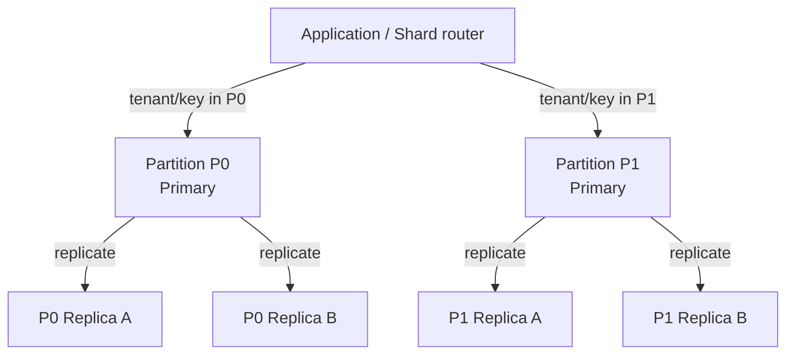
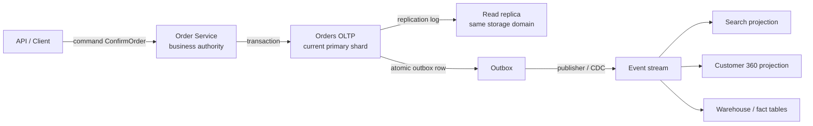

# Data Replication and Identifying Authoritative Sources

An order was just confirmed in the transactional system, yet the search screen still shows "awaiting confirmation." A customer updated their phone number, yet the customer support system still reads the old number. One server region failed over to a replica, only to discover two sites had accepted conflicting updates. All three scenarios raise one core question: **which copy holds the authority to decide business truth, which copies are merely replicas or projections, and what must the system do when copies temporarily diverge?**

In the **Distribution and Partitioning** chapter of the **DATABASE_DATA_MODELING** module, data design goes beyond choosing tables, nodes/edges, or documents. You must define **identifiers, keys, constraints, write authorities, replication topology, read policies, and verification procedures**. This lesson focuses on **data replication** and **identifying the authoritative source / data ownership**, connecting them to relational, document, graph, and analytical models to design structures suited to real-world systems.

After this lesson, you will be able to:

- Distinguish **business source of truth**, **shard primary/leader**, **read replicas**, **caches**, and **derived read models**.
- Build a data ownership matrix covering every entity, field, write command, responsible owner, and update path.
- Compare **synchronous replication, asynchronous replication, logical replication, CDC, snapshots, and materialized projections**.
- Understand the consequences of **replication lag**, consistency levels, and differences among **read-your-writes**, **eventual consistency**, and **linearizable reads**.
- Design a **transactional outbox → events → projections** pipeline with **idempotency, versioning, tombstones, and reconciliation**.
- Recognize risks of **split-brain, accidental replica writes, multi-writer conflicts, unfenced failovers**, cross-tenant leaks, and incomplete delete propagation.
- Define tests, metrics, and operational procedures once data is partitioned and replicated.

## 1. Three Distinct Questions Often Conflated into One

Before designing replication, separate three types of responsibility:

| Question | Meaning | Example |
| --- | --- | --- |
| **Who has authority to mutate business truth?** | Business/data authority | `Order Service` approves order status transitions |
| **Which node accepts writes for a physical store?** | Primary/leader of a shard or replica group | Node `db-order-shard-2-primary` executes transactions |
| **Which systems hold copies for reading?** | Read replicas, caches, indexes, projections | Search index, Customer 360, warehouse |

These three roles can reside at different layers:

- `Order Service` is the **business owner** of order status.
- After failover, a different node becomes the **physical primary** for the shard storing orders.
- The search index holds a **copy** of order status; it must never accept a "confirm order" command merely because it stores a `status` column matching the source.

**A change in physical primary does not transfer business ownership.** Conversely, having multiple stores labeled "master" is insufficient unless you specify exactly which **fields, commands, and versions** each owns.

### 1.1. A Practical Definition of "Source of Truth"

An **authoritative source** is the source recognized by system policy as having authority to decide the value of a fact within a specific scope and point in time. Typically, it is a write system/interface guarded by transactions and constraints—not necessarily a **specific physical server**.

Examples:

```text
Order.status, Order.lines     → Order Service / OLTP order store
Product.title, Product.sku    → Catalog Service
Stock.availableToPromise     → Inventory Service (per reservation rules)
Payment.settlementStatus     → verified payment settlement source
Customer.verifiedPhone       → governed/verified customer profile
BI.dailyRevenue              → derived calculation from transaction sources
Search.orderDocument         → projection of order data
```

Service names here merely illustrate separation of responsibility. In practice, a fact can pass through multiple verification stages: an external payment partner is the source of **settlement events**, while `Payment Service` is responsible for **verifying, mapping, and interpreting internal payment state**. Document exact authority and evidence at each stage rather than treating every external webhook as final truth blindly.

### 1.2. Replication Does Not Multiply Ownership

From a single row `orders.status = 'CONFIRMED'`, a system might produce:

1. An identical copy on a **physical read replica**.
2. A document in a **search index**.
3. A `lastOrderStatus` field in a **Customer 360 projection**.
4. Event/fact rows in a **data warehouse**.
5. An entry in a **cache**.

Those places may return different values at a given instant due to lag or sync failures. **Never use "majority of copies agree" as a substitute for business-source rules**, unless you are explicitly running a **purpose-built consensus/quorum protocol** within that single storage cluster. Multiple independent apps holding copies do not form a distributed consensus system.

## 2. Replication and Partitioning Are Two Independent Axes

**Partitioning/sharding** splits a dataset into slices by key or partitioning rule. **Replication** maintains multiple copies of a data slice to improve availability, read scaling, or durability. A system can apply both.



Here:

- `P0` and `P1` hold **disjoint sets of keys**.
- Each partition maintains **multiple replicas**.
- Any write command must route to **the right partition and the node authorized to accept writes** under the active protocol.
- A replica of `P0` **cannot substitute for `P1`**, even if `P0` has three replicas.
- If `P0`'s primary fails, an eligible replica may be promoted to new primary via failover; never assume every replica holds the latest committed state.

### 2.1. Examples of Partitioning by Tenant or Key

| Strategy | Example | Risk to Verify |
| --- | --- | --- |
| By `tenant_id` | All orders of a tenant on the same shard | Massive tenants can overheat one shard |
| By hash `(tenant_id, order_id)` | Spreads orders fairly evenly | Finding all orders of one tenant may fan out |
| By time | `order_date` split by month | Looking up one order by ID may need partition key or secondary index |
| By region/geography | Tenant placed in a designated region | Region moves and data residency compliance add complexity |
| Hybrid | Tenant/region, then time intervals | Harder routing, rebalancing, and partition keys |

Choose partition keys from **workload and consistency rules**, not table size alone. If a command must update an order, reserve inventory, and record payment across **three independent shards/services**, a local transaction inside `orders` does not make the overall action atomic.

### 2.2. Different Copy Types Serve Different Purposes

| Copy Type | Data Held | Who Writes? | Characteristics |
| --- | --- | --- | --- |
| **Physical/storage replica** | Byte/log equivalent of a database | Per primary/consensus protocol | Supports HA, failover, reads |
| **Logical replica** | Selected tables/objects or logical changes | Usually publisher source; product exceptions exist | Can differ in schema/version |
| **Read replica** | Copy serving read queries | Typically rejects direct business writes | Can lag behind leader |
| **Cache** | Subset of hot read data | Populated/evicted by policy | TTL/invalidation never guarantees zero staleness |
| **Search projection** | Documents optimized for text search/filtering | Consumers fed by source events | Differs in structure and lags |
| **Analytical replica / warehouse** | Historical facts/dimensions/rollups | ETL/ELT pipelines, no OLTP commands | Latency, enrichment, separate KPI definitions |

Copies may or may not be byte-identical. A **search projection** is not a physical read replica: it is **transformed into its own schema**, may drop fields, aggregate data, or refresh under its own policy.

## 3. Replication Strategies and Trade-Offs

### 3.1. Synchronous vs. Asynchronous Replication

**Synchronous replication** means the write path waits for acknowledgment from a configured set of replicas before returning success. That acknowledgment may mean "log received," "fsynced durably," or "applied," depending on **product and configuration**. Never assume "sync" means every replica immediately exposes identical readable state.

**Asynchronous replication** lets the writer return success before other replicas receive or apply the change. This generally lowers write latency, but introduces **replication lag** and risks losing unreplicated commits if the primary fails in certain setups.

| Criterion | Sync (per ACK policy) | Async |
| --- | --- | --- |
| Write latency | Potentially higher waiting for replicas | Generally lower |
| Write availability on replica/network fault | Can block/fail without enough ACKs | Primary can continue in some architectures |
| Reading from followers | Must still check how far logs are **applied** | May read stale values |
| Durability on primary loss | Depends on ACK threshold and safe failover | Unshipped commits risk loss |
| Operations | Manage quorums, timeouts, topology | Manage lag, replay, and data-loss exposure |

Durability does not rest solely on a "sync/async" label. Inspect **RPO**, log shipping, quorums, ACK timing, leader election, data placement, and rebuild mechanisms.

### 3.2. Single-Leader, Multi-Leader, and Leaderless

**Single-leader:** one leader accepts writes for a data scope; followers pull changes from the leader. Common for multi-update transactional data.

**Multi-leader:** multiple sites accept writes for the same dataset and synchronize/resolve conflicts. Useful for multi-region or offline writes, yet complex when mutating the same object.

**Leaderless/quorum-based:** no fixed single leader per system model; clients or coordinators read/write across multiple replicas per quorum rules. Consistency depends on versioning, partitioning, hinted handoff, and actual configuration.

**Never equate "multiple replicas" with "writable at any replica."** Single-leader, multi-leader, and leaderless models carry distinct safety invariants. Even a quorum system does not automatically guarantee linearizability in every scenario if quorums, networks, and protocols violate required assumptions.

### 3.3. When Is Multi-Site Writing Acceptable?

A content catalog allowing per-region metadata edits might have clean merge policies. By contrast, **money balances, reservable inventory, payment states, or sensitive access permissions** usually break under naive "last-write-wins" because updates get lost or invariants break.

For example, two regions concurrently receive commands to decrement stock from 1:

```text
Inventory is 1
Region A reads 1, accepts reservation of 1
Region B also reads 1, accepts reservation of 1
Final merge: two valid reservations exist for a single unit
```

No simple timestamp conflict-resolution rule can decide "which reservation must be rejected." You need **authoritative write ownership**, partition ownership, reservation protocols, transactions, or per-region quota allocations depending on the problem.

## 4. Defining Ownership by Entity, Field, and Command

Large systems often have multiple services touching `Customer`, `Order`, `Product`, and `Stock`. Never just declare "Database A is the source of truth" for the whole company. Build an **ownership matrix**.

### 4.1. Sample Data Ownership Matrix

| Fact / Command | Authoritative Source | Copies / Consumers | Mutation Rules |
| --- | --- | --- | --- |
| `Order.lines`, `Order.status` | Order Service + order store | Search, warehouse, Customer 360 | Only Order Service accepts commands; emits events post-commit |
| `Product.title`, `Product.sku` | Catalog Service | Order snapshots, search, BI | Catalog mutates; past orders preserve name/price snapshots if rules require |
| `Inventory.availableToPromise` | Inventory Service | Product pages, analytics | Stock/reservations follow inventory logic; never mutate caches directly |
| Internal `Payment.settlementState` | Payment Service after verifying provider | Order views, BI | Separate raw received webhooks from verified settlement truth |
| `Customer.verifiedPhone` | Customer Profile Service | CRM, support screens | Mutated via verification flow, never edited directly in CRM copy |
| `Search.orderDocument` | Search projection consumer | Search UI | Updated solely by consumer from source change log |
| `BI.netRevenue` | Analytics pipeline / metric owner | Dashboards | Derived measure from events and revenue recognition rules |

**A field should have at most one authoritative write owner at any point under governance policy**, while potentially having **many read copies serving different queries**. Ownership includes approving schema changes, defining state semantics, handling sync failures, and owning reconciliation.

### 4.2. "Data Owner" Differs from "Database Operator"

The platform team may operate databases, backups, and failovers, yet holds no authority to decide `Order.status = 'PAID'` in business terms. A business team may own order confirmation logic, yet must not manually patch analytical replicas.

Separate roles explicitly:

- **Business owner:** defines and approves data semantics.
- **Write/command owner:** valid write APIs and state-transition rules.
- **Storage operator:** operates primaries, replicas, backups, and failovers.
- **Data product/projection owner:** accountable for derived copy quality.
- **Consumer owner:** defines freshness, accuracy requirements, and stale-state handling.

During incidents, clear role separation tells you **who may fix source data** and **who may only rebuild projections**, stopping multiple teams from "patching" copies and creating conflicts.

### 4.3. What Fields Belong in an Ownership Contract?

```text
Data asset: Order
Authoritative writer: Order Service
Primary business key: (tenant_id, order_id)
Write API/commands: CreateOrder, ConfirmOrder, CancelOrder
Invariants: valid status transition, tenant isolation,
            item ownership, amount/currency semantics
Event envelope: event_id, aggregate_id, aggregate_version,
                event_type, occurred_at, schema_version
Downstream copies: SearchOrder, Customer360, WarehouseFact
Freshness objective: search lag target, BI batch SLA
Read-after-write requirement: order detail must reflect commit
Correction path: source command -> outbox -> consumers
Deletion/retention: tombstone or authorized purge with lineage
Operational contacts: owner, on-call, escalation
```

Distinguish **committed source events** from unverified notifications, and **derived documents** from authoritative business mutations. Without an ownership contract, a team might update a search document directly because it feels "faster," causing search to diverge from the source and get overwritten on the next sync.

## 5. Running Example: Replicating Orders to Search and Analytics

Suppose an e-commerce platform has:

- `Order Service` managing orders in a relational OLTP store partitioned by tenant/shard.
- `Search Service` using document projections for fast lookups by code, customer name, or status.
- `Analytics Service` building fact/dimension tables for reporting.
- `Customer 360` holding recent order lists inside an aggregated document.
- `Order Detail API` needing to reflect newly confirmed changes immediately without showing stale reads.



**Business source:** `Order Service` with its OLTP transaction. **Change evidence:** committed row plus outbox row in the same transaction. **Read copies:** read replicas, search, Customer 360, warehouse.

If `Search Service` lags by two seconds, it must never push stale state back to `Order Service` as if it were a fresh command. Projections are **rebuilt** from the source—they must never accidentally act as peer writers.

### 5.1. Setting Grain and Keys for the Source

One `orders` row represents **one business order** identified by `(tenant_id, order_id)`. If an order has multiple items, `order_lines` sits at the **one line item** grain; never flatten lines into an order table projection and count `COUNT(*)` as order count.

Example source schema:

```sql
-- PostgreSQL, simplified business example.
CREATE TABLE orders (
    tenant_id VARCHAR(32) NOT NULL,
    order_id VARCHAR(40) NOT NULL,
    order_version BIGINT NOT NULL DEFAULT 1,
    status VARCHAR(24) NOT NULL,
    amount_minor BIGINT NOT NULL,
    currency_code CHAR(3) NOT NULL,
    updated_at TIMESTAMPTZ NOT NULL,
    PRIMARY KEY (tenant_id, order_id),
    CHECK (order_version > 0),
    CHECK (amount_minor >= 0),
    CHECK (status IN ('CREATED', 'CONFIRMED', 'CANCELLED'))
);

CREATE INDEX orders_tenant_status_idx
    ON orders (tenant_id, status, updated_at);
```

`amount_minor` is meaningful only when `currency_code` and **minor-unit/scale rules** are defined. For instance, VND may use whole VND units per source policy; never assume every currency has two decimal places.

`order_version` is a **monotonically increasing per-order logical version** at the source. Derived copies use it to reject duplicate or out-of-order events. If versions ever reset during migrations, enforce an **epoch/identity** strategy and never compare version numbers across independent sources on the same axis.

### 5.2. Transactional Outbox: Committing State and Event Together

If code updates `orders` and crashes **before publishing the event**, search stays stuck on stale state forever. If it publishes first and the transaction rolls back, consumers receive **an event for a commit that never happened**.

The **transactional outbox pattern** writes business changes and an outbox record **inside the exact same source database transaction**. A publisher polls or tails the outbox to send to the broker; publishing may retry, so consumers must be idempotent.

Outbox table:

```sql
CREATE TABLE order_outbox (
    event_id UUID PRIMARY KEY,
    tenant_id VARCHAR(32) NOT NULL,
    aggregate_type VARCHAR(40) NOT NULL,
    aggregate_id VARCHAR(40) NOT NULL,
    aggregate_version BIGINT NOT NULL,
    event_type VARCHAR(80) NOT NULL,
    schema_version INTEGER NOT NULL,
    payload JSONB NOT NULL,
    occurred_at TIMESTAMPTZ NOT NULL,
    published_at TIMESTAMPTZ,
    UNIQUE (
        tenant_id, aggregate_type,
        aggregate_id, aggregate_version
    )
);

CREATE INDEX order_outbox_pending_idx
    ON order_outbox (occurred_at)
    WHERE published_at IS NULL;
```

Example order confirmation transaction, after the API has **verified permissions and business preconditions**:

```sql
BEGIN;

WITH changed AS (
    UPDATE orders
    SET
        status = 'CONFIRMED',
        order_version = order_version + 1,
        updated_at = CURRENT_TIMESTAMP
    WHERE tenant_id = :tenant_id
      AND order_id = :order_id
      AND status = 'CREATED'
    RETURNING
        tenant_id, order_id, order_version,
        status, amount_minor, currency_code, updated_at
)
INSERT INTO order_outbox (
    event_id, tenant_id, aggregate_type, aggregate_id,
    aggregate_version, event_type, schema_version,
    payload, occurred_at
)
SELECT
    :event_id,
    tenant_id, 'Order', order_id,
    order_version, 'OrderConfirmed', 1,
    jsonb_build_object(
        'orderId', order_id,
        'status', status,
        'amountMinor', amount_minor,
        'currencyCode', currency_code,
        'updatedAt', updated_at
    ),
    updated_at
FROM changed;

COMMIT;
```

If `UPDATE` affects zero rows (order missing, wrong status, or already handled), `INSERT ... SELECT` inserts nothing either. **The application must check affected row counts**, distinguishing *already confirmed* from *not found* and *invalid transition*—never assume success solely because SQL returned no error.

This snippet illustrates **one local transaction**. By itself, it does not guarantee data has already reached the broker, search, or warehouse at `COMMIT` time. Publishers must retry, and consumers must tolerate duplicates. With multiple publisher workers, enforce **per-aggregate ordering** or compatible version/gap handling.

### 5.3. Event Shape Must Suffice for Copy Control

```json
{
  "eventId": "a5c3a2f1-1111-4f00-8c00-000000000041",
  "eventType": "OrderConfirmed",
  "schemaVersion": 1,
  "tenantId": "T-01",
  "aggregateType": "Order",
  "aggregateId": "O-101",
  "aggregateVersion": 41,
  "occurredAt": "2026-10-01T10:00:02Z",
  "data": {
    "orderId": "O-101",
    "status": "CONFIRMED",
    "amountMinor": 1250000,
    "currencyCode": "VND",
    "updatedAt": "2026-10-01T10:00:02Z"
  }
}
```

This is an **illustrative envelope**. The contract should specify:

- `eventId` identifies **a single event emission**, enabling deduplication and tracing.
- `tenantId` and `aggregateId` identify key scope.
- `aggregateVersion` is the source-issued change version for ordering old vs. new.
- `schemaVersion` tracks payload structure evolution, **not order version**.
- `occurredAt` is when the source recorded the business event; consumer arrival time can differ.
- `data` is explicitly declared as either a **full state snapshot** or a **delta event**.

**Crucially:** `OrderConfirmed` above carries meaningful source state. If consumers are allowed to skip older versions and jump directly to newer ones, payloads must contain **enough fields to reconstruct everything the projection manages**. If events only emit deltas like "add 10" and version 40 is skipped, applying version 41 loses updates. Delta streams generally require **contiguous sequencing, gap detection, and replay/snapshot recovery**.

## 6. Consumers Receiving Duplicate and Out-of-Order Events

Brokers, networks, and retries can deliver the same event multiple times or deliver a newer event before an older one. A resilient projection relies on **source versions** rather than consumer `received_at` timestamps to decide truth.

### 6.1. Illustrative Timeline

| Time | Source | Event / Replica | What to Understand |
| --- | --- | --- | --- |
| 10:00:00 | O-101 version 40, `CREATED` | Search version 40 | In sync |
| 10:00:02 | Source commits version 41, `CONFIRMED` | Outbox v41 | Source changed |
| 10:00:02.2 | Source v41 | Search still v40 | **Stale read**, not a source rollback |
| 10:00:03 | Source v41 | Search applies v41 | Caught up |
| 10:00:04 | Source v41 | Broker redelivers v41 | Consumer must ignore duplicate |
| 10:00:05 | Source v41 | Late event v39 arrives | Consumer must never overwrite v41 with v39 |

In this model, **search writes come from the consumer**, yet authority over status remains with Order Service. If a user opens the order screen immediately after confirming, the app should read from the source or wait until the projection reaches at least version 41, rather than showing search v40 ("unconfirmed") as final truth.

### 6.2. Projection Table Carrying Source Version

```sql
CREATE TABLE order_search_projection (
    tenant_id VARCHAR(32) NOT NULL,
    order_id VARCHAR(40) NOT NULL,
    source_version BIGINT NOT NULL,
    status VARCHAR(24) NOT NULL,
    amount_minor BIGINT NOT NULL,
    currency_code CHAR(3) NOT NULL,
    source_updated_at TIMESTAMPTZ NOT NULL,
    projected_at TIMESTAMPTZ NOT NULL,
    is_deleted BOOLEAN NOT NULL DEFAULT FALSE,
    PRIMARY KEY (tenant_id, order_id)
);
```

The projection uses the same **business key `(tenant_id, order_id)`**, while `source_version` records the latest source version applied to this copy. It must **never invent** a source version when only tweaking mappings or indexes.

### 6.3. Upsert Applying Only Newer Versions

PostgreSQL example assuming payloads hold **the complete projection state** and the consumer verified the event source:

```sql
INSERT INTO order_search_projection (
    tenant_id, order_id, source_version,
    status, amount_minor, currency_code,
    source_updated_at, projected_at, is_deleted
)
VALUES (
    :tenant_id, :order_id, :source_version,
    :status, :amount_minor, :currency_code,
    :source_updated_at, CURRENT_TIMESTAMP, FALSE
)
ON CONFLICT (tenant_id, order_id) DO UPDATE SET
    source_version = EXCLUDED.source_version,
    status = EXCLUDED.status,
    amount_minor = EXCLUDED.amount_minor,
    currency_code = EXCLUDED.currency_code,
    source_updated_at = EXCLUDED.source_updated_at,
    projected_at = EXCLUDED.projected_at,
    is_deleted = EXCLUDED.is_deleted
WHERE order_search_projection.source_version <
      EXCLUDED.source_version;
```

Benefits:

- Re-receiving **version 41**: leaves the projection untouched.
- Receiving **version 39** after version 41: never rolls back.
- Receiving newer version 42: updates cleanly if payloads are **full snapshots** per contract.
- The PK preserves one projection row per order per tenant.

**Critical limitation:** this query **does not guarantee zero missed intermediate versions**. It fits updating current state from **full-state events**; if a consumer accumulates amounts from deltas, enforce `expected_next_version = applied_version + 1` with replay/gap recovery. If two events carry different payloads for the same version due to a source bug, the upsert drops the second one—emit a **conflicting duplicate** alert rather than silently ignoring it.

### 6.4. "Exactly Once" Cannot Be Inferred from Tooling Alone

A real pipeline has multiple retry points:

```text
source commit → outbox poll → broker publish
→ consumer receive → projection write → broker ack
```

Crashing after the projection write but before broker ACK causes the broker to redeliver the event. **Idempotent consumers** allow safe replays without multiplying effects. Transactional outbox solves **dual writes with the source database**, without turning the entire pipeline into "end-to-end exactly once."

Even when a broker supports exactly-once within its own boundary, the business must define **transaction boundaries** (broker stream vs. external DBs), idempotency keys, retention, and replay handling. For money, inventory, or quantities, never naively run `amount = amount + delta` on every event without deduplication safeguards.

## 7. Freshness and Consistency Levels Dictate the Read Path

### 7.1. Common Guarantees

| Consistency Property | Practical Meaning | Example Requirement |
| --- | --- | --- |
| **Eventual consistency** | Once updates stop and the system is healthy, replicas/projections converge | Product search listings tolerating brief lag |
| **Read-your-writes** | After a successful write, the same session reads at least its own update | Order detail page right after confirmation |
| **Monotonic reads** | A reading session never observes older state than previously seen | Never flip from `CONFIRMED` back to `CREATED` across replicas |
| **Bounded staleness** | Reads stay within an explicit staleness bound if enforced/measured | Dashboard tolerating up to 30 seconds lag |
| **Linearizable read** | Reads reflect real-time order of completed operations per protocol | Sensitive permission or inventory checks where supported |
| **Snapshot consistency** | Read values belong to one consistent point-in-time snapshot | Reports never mixing versions from different timestamps |

These guarantees **never materialize automatically** from picking a database product name. Check read preference settings, leader/quorum config, session tokens, transaction/snapshot isolation, and failover behavior. Even **"read from primary"** fails if requests hit the wrong shard, failover is mid-flight, or the app reads a stale cache.

### 7.2. Choosing Read Paths by Purpose

| Query | Design Recommendation | Why |
| --- | --- | --- |
| Order detail right after `ConfirmOrder` | Source/primary or projection caught up to returned version | Requires read-your-writes |
| Keyword search across orders | Search projection with freshness indicator | Eventual consistency acceptable |
| Daily revenue reports | Warehouse with watermark / cutoff period | Intentional latency, measured data quality |
| Public catalog lookups | Cache / read replica within freshness SLO | Speed priority, managed with TTL/invalidation |
| Verify remaining stock to reserve | Authoritative Inventory Service with write constraints | Never decide from a lagging inventory cache |
| Sensitive access permission checks | Policy decision point using fresh/trusted data | Revoked permissions must not persist via stale replicas |

A UI can display **"syncing"** when only stale views are available, or route causal reads straight to the source—rather than presenting stale data as current fact.

### 7.3. Using Source Versions for Read-Your-Writes

Suppose an update API returns:

```json
{
  "orderId": "O-101",
  "status": "CONFIRMED",
  "sourceVersion": 41
}
```

On the next read, the app can:

1. Read from the source with matching guarantees.
2. Or require the projection to reach `source_version >= 41` before serving it.
3. On timeout, **fall back** to the source or surface a "syncing" notice per UX contract.

**Never turn unbounded polling into a completion requirement.** If a projection stalls or fails on a version, enforce timeouts, circuit breakers, and data-repair paths. When versions are per-aggregate, **only compare versions within the exact `(tenant_id, order_id)`**—never compare version 41 of one order against version 41 of another.

### 7.4. Replication Lag Is More Than a Single Second Count

Measure distinct dimensions:

- **Transport lag:** have logs/events reached the replica/broker?
- **Apply lag:** how far has the replica/consumer applied changes?
- **Projection lag:** which version has the projection applied?
- **Wall-clock freshness:** elapsed time from source update to copy application.
- **Backlog:** count of unprocessed logs/events.
- **Per-aggregate version gap:** order is at version 41 in source while projection sits at 39.

Clock skew makes subtracting timestamps across two hosts unreliable. When version accuracy matters, prefer **log positions/offsets/source versions or snapshot watermarks** paired with synchronized timing metrics.

## 8. Failover: Who Is Primary and How Do We Prevent Dual Writers?

### 8.1. The Core Failure Mode

```text
t0: Primary A accepts writes for shard P0
t1: Network partition; B cannot reach A
t2: Control plane promotes B to new primary
t3: A is still alive and believes it is primary
t4: Two clients send writes to A and B
```

Without fencing against the stale primary, **split-brain** occurs: two nodes accept writes for the same data scope, causing divergent state that is hard to reconcile cleanly.

### 8.2. Leader Election Is Insufficient Without Fencing

Systems typically combine:

- **Term/epoch/lease:** each primary term carries a monotonically newer generation ID.
- **Quorum/consensus:** at most one side meets write acceptance conditions under the protocol.
- **Fencing tokens:** writes from an old primary carrying a lower epoch are rejected at storage/write targets.
- **Routing updates:** clients/routers stop sending commands to the demoted node.
- **Promotion/replay:** the new primary catches up to the required commit/log point before serving traffic.
- **Operational runbook:** verify the old primary can no longer accept writes, audit RPO/RTO, and reconcile ambiguous in-flight requests.

Specifically, **inferring node A is dead from a timeout alone is unsafe**: A may be alive behind a network partition. A sound failover protocol preserves safety under partitions rather than maximizing availability by letting both sides accept writes.

### 8.3. RPO and RTO Differ

- **RPO (Recovery Point Objective):** maximum tolerable data loss measured in time/commits (e.g., seconds of unreplicated changes).
- **RTO (Recovery Time Objective):** target duration to restore service availability.

Zero RPO is a strict requirement—never achieved automatically just by having two replicas. Low RTO does not prove zero lost writes either. Evaluate **ACK timing, quorums, log durability, promotion paths, backups, and failover drills**.

## 9. Multi-Writer Conflicts

### 9.1. LWW Can Lose Data

Under **last-write-wins (LWW)**, the system picks one value by timestamp/order:

```text
A writes Customer.email = "a@example.org" in region 1
B writes Customer.email = "b@example.org" in region 2
Timestamp merge: picks B, silently discarding A's value
```

This may be acceptable if the business allows **overwrites** with an audit trail, yet it does not mean B was "more correct." Under clock skew across regions, timestamp-based "last write" can even disagree with actual user wall-clock order.

For **balances, reward points, inventory, permissions, and payment states**, LWW usually fails to preserve invariants. Any automatic merge must be proven valid for **the business operation**, not merely the data type.

### 9.2. When Can Data Be Merged Automatically?

Some structures have well-defined merge semantics:

- **Approved tag sets**, if add/remove conflict rules are explicitly defined.
- **CRDT counters** merging increments from multiple sources in valid domains, paired with duplicate-event identity control.
- **Offline drafts** surfacing conflicts for manual user resolution rather than silent auto-merging.
- **Field-owned metadata:** two teams editing disjoint fields when schemas and rules permit.

Never assume "CRDTs solve every conflict": CRDTs impose specific data models, operations, and convergence rules—they do not protect payment transactions or arbitrary cross-object invariants.

### 9.3. Reducing Conflicts at the Modeling Layer

If each `Order` has one authoritative writer and consumers only update projections, an entire class of multi-writer conflicts disappears. When multi-region writes are truly needed, evaluate:

- **Partition ownership/affinity** by tenant or aggregate so each key has one active writer at a time.
- **Command forwarding** from remote regions to the key's owner.
- **Reservation/escrow** splitting quotas across regions whose sum never exceeds source totals.
- **Conflict detection + manual resolution** for appropriate domains.
- **Version preconditions (optimistic concurrency):** commands apply only if the source remains at the expected version.

Choice depends on data type, acceptable latency, and mandatory invariants. Never apply one generic conflict algorithm to every aggregate.

## 10. Deletes, Backdated Edits, and Copy Security

### 10.1. Source Deletes Must Propagate to Copies

If a customer requests deletion or restriction under applicable policy, you cannot delete the OLTP row while caches, search, and warehouses keep storing restricted personal fields.

Maintain a **copy inventory**:

```text
Customer Profile:
  source: customers
  replicas: read replicas
  projections: CRM, Customer360, Search
  analytics: customer dimension / events
  caches: profile cache
  archives/backups: per retention and applicable regulations
```

Mitigations include **delete events/tombstones**, cache invalidation, analytical dataset cleanup, and backup procedures aligned with legal/security policies. Where transaction or audit retention is legally mandated, apply **anonymization/access restriction** rather than blindly wiping regulated audit trails.

### 10.2. Tombstones Should Carry Versions

If `O-101` is deleted via a "deleted" event and the consumer simply deletes the projection row, a **late-arriving older event** can resurrect `O-101`. Standard pattern:

```text
OrderDeleted {
  tenant_id = T-01
  order_id = O-101
  source_version = 52
}
```

The projection stores a **tombstone with version 52** to reject events at version 51 or lower. Tombstones may be `is_deleted = true` plus version in the projection table, or a separate structure depending on the engine. Purge tombstones only under explicit **retention, watermark, and replay guarantees**; purging too early allows old events to resurrect deleted records.

### 10.3. Field-Level Ownership and Limiting PII Spread

A search index might need only `customerId` and `orderStatus`, not verified phone numbers, street addresses, or payment details. **Replication does not mean copying every field everywhere.**

A projection contract should document:

- Allowed field list, sources, and purposes.
- Masking/tokenization/encryption rules where needed.
- Authorized tenants and read scopes.
- Retention and update/deletion deadlines.
- Access auditing and which actors may touch the projection.

Designating a source of truth is insufficient for security if consumers can cross tenant boundaries or leak copies into lower-privilege stores.

## 11. Monitoring Copy Correctness and Freshness

### 11.1. Recommended Metrics

| Metric | Meaning | Investigation Trigger |
| --- | --- | --- |
| `outbox_unpublished_count` | Unpublished events in outbox | Monotonically growing |
| `outbox_oldest_age` | Age of oldest pending outbox event | Exceeds freshness target |
| `consumer_lag_offsets` | Offsets consumer trails behind head | Backlog rising rapidly |
| `projection_apply_lag` | Elapsed time from source commit to apply | Violates query SLO |
| `projection_version_gap` | Gap between source and projection versions per aggregate | Stuck aggregates |
| `duplicate_event_count` | Retried/duplicate events detected | Abnormal spike or non-idempotent consumer |
| `out_of_order_count` | Events older than current state | Abnormal broker/ordering/rewinds |
| `dead_letter_count` | Unprocessable events | Schema or data errors |
| `reconciliation_mismatch_count` | Aggregates diverging from source post-check | Drift or missing copies |
| `cross_tenant_violation_count` | Cross-tenant data linkage detected | Critical security risk |
| `replica_failover_count` | Primary promotion frequency | Stability and root-cause review |

Measure lag against **explicit SLOs**: search may tolerate 10 seconds, a warehouse 15 minutes, while access-control checks require far tighter freshness. No single lag threshold fits every fact.

### 11.2. Reconciliation Must Never Rely Solely on `COUNT`

Matching row counts between source and projection **is insufficient**: counts can match while statuses, amounts, or tenants differ. Reconciliation should compare:

- `(tenant_id, order_id)` key sets and active/deleted states.
- Highest applied `source_version`.
- Critical fields: `status`, `amount_minor`, `currency_code`.
- Checksums over **canonical schemas and ordering**, or field-by-field diffs.
- Snapshots/watermarks accounting for normal replication lag so transient lag is not flagged as permanent drift.
- Counts of intentionally excluded or unpermitted fields/records at the projection.

If the event stream has finite retention, a long-paused consumer may **lack enough retained events to catch up**. Maintain a **source-snapshot backfill/rebuild** path that seamlessly joins the log without dropping or double-counting boundary changes.

### 11.3. Checking Source vs. Projection

Illustrative SQL reconciliation when both tables are accessible together:

```sql
SELECT
    s.tenant_id,
    s.order_id,
    s.order_version AS source_version,
    p.source_version AS projection_version,
    s.status AS source_status,
    p.status AS projection_status
FROM orders AS s
LEFT JOIN order_search_projection AS p
  ON p.tenant_id = s.tenant_id
 AND p.order_id = s.order_id
WHERE s.tenant_id = :tenant_id
  AND (
    p.order_id IS NULL
    OR p.source_version < s.order_version
    OR (
      p.source_version = s.order_version
      AND p.status IS DISTINCT FROM s.status
    )
  );
```

In practice, source and projection typically reside in **two separate storage engines** and cannot be `JOIN`ed directly like this. Instead, reconciliation exports **watermarked snapshots/manifests** to a comparison job or calls reconciliation APIs. Separate **in-SLO replication lag** from **persistent drift**, never treating every transient delta as data corruption.

## 12. Impact on Relational, Document, Graph, and Analytical Models

### 12.1. Relational / OLTP

Foreign keys, transactions, uniqueness constraints, and version checks enforce local invariants. An `orders` row with `PRIMARY KEY (tenant_id, order_id)` plus an outbox row in the same transaction is a strong foundation. Yet **source foreign keys do not replicate automatically into cross-database consistency**; consumers must handle ordering, missing references, schema evolution, and validation.

### 12.2. Document / Read Models

A UI-facing document may bundle `Order`, customer name, and line items in one object. That speeds reads, yet **customer fields inside the document are copies**. When customer phone/name changes, know which field **belongs to which owner** and update projections properly; `Order` events do not carry `Customer` updates.

You can consume two streams (`Order` + `Customer`) or trigger rebuilds; when combining them, track **per-source versions** rather than comparing `Customer.version = 5` with `Order.version = 41` on the same scale.

### 12.3. Property Graphs

A graph with `Customer`, `Order`, `Device` nodes and `PLACED`, `USED_DEVICE` edges excels at multi-hop traversals, yet if built from OLTP events, **it is a projection**. Before making fraud or access decisions, check freshness, source authority, evidence, and edge scope.

If an order is deleted or reassigned, never just add a new edge while leaving old edges indefinitely; enforce **derived-edge replacement/deletion rules**, event identity, and versioning.

### 12.4. Analytical Warehouses

Facts/dimensions are typically loaded via CDC/ETL; a fact row may reflect **source state at a cutoff point**, not live millisecond transactional state. Include:

- **Explicit grain** for every fact (e.g., one order line or one payment).
- **Source IDs** for lineage back to events.
- **As-of/watermarks** showing how current the dataset is.
- SCD policies and backdated-adjustment handling for dimensions/facts.
- Metric contracts and reconciliation for money, currency, and quantity.

Never rely solely on a warehouse copy for real-time inventory reservations unless the system is explicitly engineered for that guarantee.

### 12.5. Role Comparison Table

| Store | Owns Commands? | Primary Query Focus | Risk If Misunderstood |
| --- | --- | --- | --- |
| Order OLTP | Yes, for Orders | Transactions and invariants | Bypassing API or writing wrong shard |
| OLTP Read Replica | Per replication protocol, usually read-only | Read scaling | Stale reads right after writes |
| Search Index | No; fed by projection consumer | Search and filtering | Stale statuses shown as truth |
| Customer 360 Document | Does not own all bundled fields | Consolidated UI screen | Fields from different owners out of sync |
| Graph Projection | Typically no, if derived from source | Relationship traversal | Stale edges creating false links |
| Analytics Warehouse | Typically no, for operational transactions | KPIs, history, BI | Wrong grain, timestamps, or history |
| Cache | No | Fast lookups | Unexpired TTL after source revocation |

## 13. Step-by-Step Design Workflow

### Step 1 — Write the Ownership Matrix Before Copying Data

List every domain, key field, valid write command, and owner. Separate **canonical** from **derived** data. If two sites accept writes to the same field, document explicit **conflict rules** or redesign around a single owner.

### Step 2 — Choose Global Keys and Partition Keys

For example, `(tenant_id, order_id)` identifies orders within the business domain. Preserve the exact key across source, messages, caches, search, and warehouse. Choose partition keys from workload, locality, tenant isolation, and transaction scope, with a plan for shard moves/rebalancing and routing versions.

### Step 3 — Define Replication Model and ACK Semantics

Choose primary–follower, sync/async, CDC/logical stream, or another topology from SLO/RPO/RTO and cost. Specify write ACK rules, read preferences, failover, and fencing. Never assume default engine settings meet your invariants.

### Step 4 — Define Event Contracts and Projection Grain

Every event needs ID, aggregate key, version, schema version, payload semantics, and timestamp. Every projection needs grain, field owners, update/delete rules, and freshness targets. Gap handling differs between full-state and delta events.

### Step 5 — Design Idempotent Consumers and Ordering

Handle retries, duplicates, out-of-order arrivals, schema evolution, dead-letter queues, and rebuilds. For current-state projections, apply only newer versions; for deltas, enforce contiguous sequences and event deduplication. If an aggregate combines multiple owners, **never share one scalar version** across independent owner timelines.

### Step 6 — Define Read Policies by Freshness

Classify every API: tolerates staleness vs. needs read-your-writes, monotonic reads, bounded staleness, or stronger guarantees. Return source versions from write commands where helpful. For security/financial gates, never rely on eventual replicas if policy demands fresher state.

### Step 7 — Prepare Failover, Tombstones, and Reconciliation

Test primary disconnects, follower promotions, stale leaders, heavy lag, replayed events, late events arriving after deletes, and post-retention backfills. Design fencing, rollback/reconciliation, and recovery for ambiguous in-flight requests.

### Step 8 — Measure Under Realistic Workloads

Test partition counts, tenant/shard skew, write rates, consumer concurrency, cross-region latency, log storage, catch-up duration, rebuilds, and cost. Measure **p95/p99 freshness**, not just averages, and separate app processing delay from replication delay.

## 14. Edge Cases You Must Test

| Scenario | Correct Designed Behavior |
| --- | --- |
| Publisher crashes after source commit | Outbox row persists and publishes safely on restart |
| Consumer crashes after projection write, before ACK | Replay does not duplicate or double-charge |
| Event v41 arrives before v40 | Current-state projection does not regress; delta detects gap |
| Event v41 delivered twice | Version/event ID checked; zero duplicate effects |
| Search still at v40 right after source v41 | Read-your-writes uses source or waits for v41; never misleads user |
| Follower has not applied recent commit | Never treats stale read as latest state |
| Failover during network partition | Stale primary is fenced; no dual writers |
| Shard migration | Routers follow ownership/routing epoch; no misrouted writes |
| Order deleted at v52, then late v50 arrives | Tombstone v52 blocks resurrection |
| Customer edits a field at a different source than Order | Each field/projection respects its own owner/version |
| Consumer misses logs past retention window | Rebuilds from watermarked snapshot and catches up seamlessly |
| Cache TTL has not expired after permission revocation | Never authorizes sensitive actions from stale cache |
| Same `order_id` in two tenants | Never merges or cross-updates |
| Warehouse has matching count but different totals | Reconciliation checks values, currencies, versions, and grain |

## 15. Common Pitfalls

1. **Calling every copy a source of truth.** Holding data does not grant business write authority.
2. **Confusing physical primary with domain owner.** Failover changes nodes, not business rules.
3. **Letting search index edit order status and sync back to source.** Creates unruled sync loops and conflicts.
4. **Believing three replicas prevent all data loss.** Check ACK rules, quorums, log durability, and failover.
5. **Reading a follower right after write and concluding transaction rolled back.** Could simply be replication lag.
6. **Using async replication without measuring lag.** Consumers can stall indefinitely unseen by UIs.
7. **Updating DB then publishing outside the transaction as if atomic.** Leaves a dual-write failure window.
8. **Assuming outbox yields end-to-end exactly-once.** Publishers and consumers can still retry.
9. **Using `occurred_at` or `received_at` to pick the latest event across skewed clocks.** Use explicit source sequence/versions.
10. **Skipping old events without gap checks on delta payloads.** Silently drops cumulative changes.
11. **Using LWW for stock or balances.** Loses updates and violates invariants.
12. **Promoting a replica without fencing the old primary.** Risks split-brain.
13. **Deleting projection rows without keeping versioned tombstones.** Late old events resurrect deleted rows.
14. **Reconciling solely by row counts.** Counts can match while statuses, amounts, or identities diverge.
15. **Sharing one version counter across two independent aggregates/owners.** Lacks valid causal ordering.
16. **Forgetting tenant ID in keys/events/consumers.** Mixes orders and leaks cross-tenant data.
17. **Applying one freshness SLO to every copy.** Search, BI, permissions, and inventory have vastly different requirements.
18. **Lacking a rebuild path past log retention.** Long-lagging consumers cannot catch up from expired logs.
19. **Replicating full PII everywhere.** Expands security blast radius and complicates erasure.
20. **Optimizing replication before clarifying source owners and query contracts.** Creates many copies without knowing which is right.

## 16. Practice Exercises and Solution Hints

### Exercise 1 — Who Is the Authoritative Source?

Order Service stores `Order.status`, Search stores `orderDocument.status`, and the warehouse stores `fact_order_status`. Staff need to fix an incorrect order status.

**Task:** where must the fix be made so projections don't overwrite it? Who is responsible for verifying?

**Hint:** fix via an **authorized command on Order Service / OLTP source** after validating business preconditions. Search and warehouse update from source events/snapshots. The data owner governs status semantics; projection teams own catch-up and reconciliation.

### Exercise 2 — Do Primary and Replica Share the Same Authority?

Shard `P0` has primary A and followers B/C. The app writes successfully to A, then reads B and sees stale data.

**Task:** did the transaction definitely roll back? May we write directly to B to "fix" it?

**Hint:** **no**. B likely hasn't applied the log yet. Never write directly to followers in single-leader systems. For read-your-writes, read from a stronger consistency path or wait until B reaches the target version/log position.

### Exercise 3 — Replayed Events

Source order version 41 has status `CONFIRMED`. The consumer already applied v41, then the broker redelivers v41 three times.

**Task:** what should the projection state be? What if v39 arrives afterward?

**Hint:** the projection stays **v41, CONFIRMED**; duplicates and older versions cause no change. Idempotency relies on aggregate key/version or event ID per contract. If the consumer also triggers **external side effects** like sending emails, enforce separate side-effect idempotency—not just projection upserts.

### Exercise 4 — Full-State vs. Delta Events

A consumer holds `count = 10` at version 5. It receives `v7: +3` without having seen `v6: +2`.

**Task:** can it update to 13 immediately? How does that differ if v7 is a snapshot `count = 15`?

**Hint:** with **deltas**, skipping v6 loses +2; it needs gap detection, replay, or a snapshot to reach the right **15**. With a **full snapshot v7**, the consumer can set state to **15** and ignore older events if contract and version rules guarantee completeness.

### Exercise 5 — Transactional Outbox

An app updates an order and publishes an event to a broker in two independent operations. It crashes after committing the order but before sending the event.

**Task:** what failure occurs? What does an outbox solve, and what remains unsolved?

**Hint:** search/warehouse never receive notice and stay stale indefinitely. Outbox persists state and event record in **one source transaction**, enabling safe publisher retries. However, the broker can still deliver duplicates, so consumers must still be idempotent; outbox alone is not system-wide "exactly once."

### Exercise 6 — Failover and Split-Brain

A is primary; a network partition prompts the control plane to promote B. A continues serving writes from one group of clients.

**Task:** what is the hazard? Which mechanisms are required?

**Hint:** **split-brain**. Use leader terms/epochs, quorum/consensus, or fencing tokens, update routers, and ensure stale primaries reject writes—never rely solely on timeouts or an old "primary" label in stale configs.

### Exercise 7 — RPO/RTO

A setup ACKs immediately after the primary writes its WAL, while async replicas lag by 5 seconds. The primary suffers total data loss before recent logs reach replicas.

**Task:** is zero loss of ACKed commits guaranteed? What do RPO and RTO measure?

**Hint:** async replication alone offers no such guarantee. RPO is target tolerable data loss; RTO is target recovery time. Inspect ACK durability, replication policy, and failover runbooks to evaluate.

### Exercise 8 — Deletes and Late Events

Source emits `OrderDeleted v52`, consumer deletes the document, then receives `OrderUpdated v51`.

**Task:** how do you prevent recreating the deleted document?

**Hint:** retain a **tombstone with `source_version` 52**, rejecting v51; purge tombstones only when retention/replay rules permit. Deleting the row without versioned tombstones lets old events resurrect data.

### Exercise 9 — Multiple Tenants and Shards

Tenants `T-01` and `T-02` both have order `O-101`. The search projection keys solely by `order_id`.

**Task:** what goes wrong? What structure must be fixed?

**Hint:** the two orders overwrite/merge erroneously; use **`(tenant_id, order_id)`** across source, messages, projections, and queries. Partition routers must also respect tenant scope, and backends must enforce access control.

### Exercise 10 — Three Systems Knowing a Customer's Name

Customer Service owns `Customer.verifiedName`. Order Service keeps a name snapshot at checkout, Search shows current name, and the warehouse needs both "name at transaction time" and "current name."

**Task:** are these three conflicting sources of truth? How should this be modeled?

**Hint:** not necessarily. **Current verified name** belongs to Customer Service; **checkout-time snapshot name** is immutable historical fact of the Order event; **historical vs. current BI** are two distinct analytical semantics. Explicitly track timestamps/owners, slowly changing dimensions or snapshots, and change contracts. Never overwrite checkout snapshots with current names when historical auditability is required.

### Exercise 11 — Read Policies for Two Features

After changing order status, the detail page must show the result immediately. The search page tolerates up to 10 seconds lag.

**Task:** must every query hit the primary?

**Hint:** no. The detail page uses **source/read-your-writes** or a projection caught up to the target version. Search uses async projections monitored against a 10-second lag SLO. Consistency levels should be designed **per query**, not one-size-fits-all.

### Exercise 12 — Watermarked Reconciliation

Source has 10,000 orders; search also has 10,000 documents, yet 20 statuses and 5 amounts mismatch.

**Task:** is a `COUNT` check enough? How should reconciliation work?

**Hint:** no. Compare keys, tenant, version, status, amount/currency, and delete markers against an **explicit snapshot/watermark**. Classify mismatches as persistent drift only after accounting for in-SLO lag; discrepancies may trigger replay/rebuild or source-event investigation.

## Summary

**Data replication** creates additional copies for durability, availability, read speed, or analytics; it **never creates extra authorities permitted to alter business truth**. In distributed design, define **owners per entity/field/command**, **physical primaries per partition**, **keys and tenant scopes**, **per-query consistency levels**, and **versioned/idempotent projection updates**. Sync/async replication, outbox, CDC, failover/fencing, and tombstones all carry limits that must be stated clearly. A trustworthy data model does more than keep multiple copies—it answers: **who may write, how fresh each copy is, why copies differ from the source, and how the system reconciles or recovers when failures happen**.
