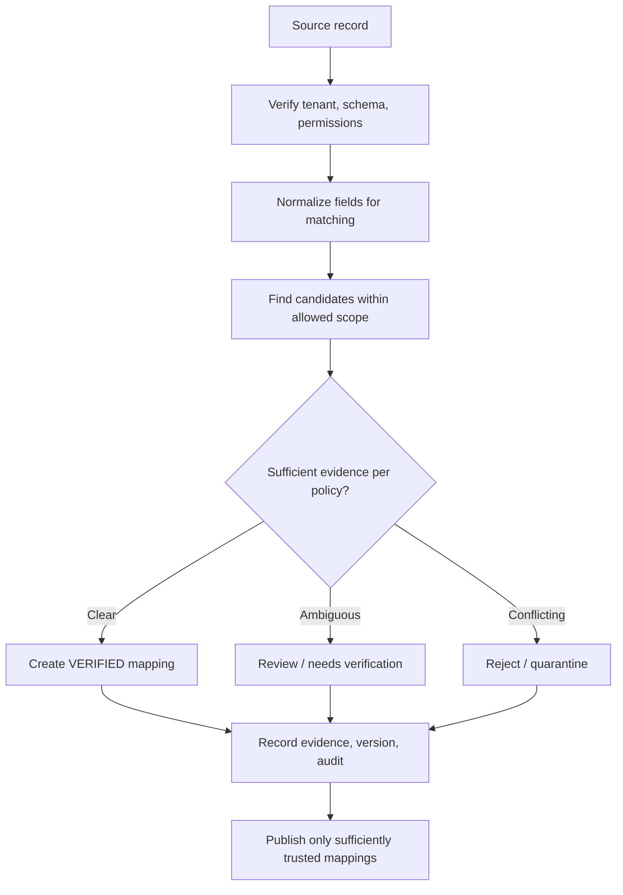
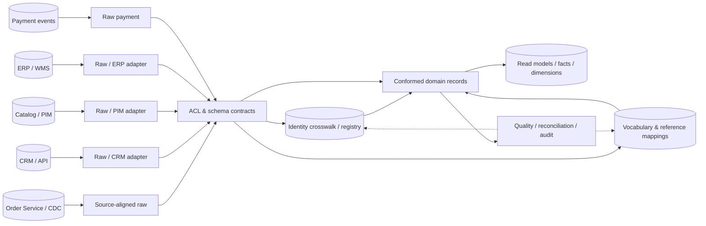

# Reconciling Identities, Terminology, and Reference Data Across Sources

## Learning Objectives

After this lesson, you will be able to:

- Distinguish between **source identifier**, **canonical identifier**, **business key**, **surrogate key**, **category code**, and **display label**; understand why two identical IDs do not necessarily represent the same entity.
- Build an **identity crosswalk** table with namespace, tenant scope, provenance, version, and effective time.
- Explain the difference between **same entity**, **same term**, and **same semantics**; recognize when a 1–1 mapping is wrong.
- Design a **data dictionary**, **canonical code set**, **anti-corruption layer**, and business state mapping rules across bounded contexts.
- Reconcile **product catalogs, geographic regions, units of measure, currencies, and classification hierarchies** against authoritative sources.
- Handle duplicate records, identifier reuse, entity merges/splits, multi-label classification, effective-time history, and late-arriving data.
- Distinguish **master data**, **reference data**, **transaction data**, and **read models**, and identify the owner of each field.
- Propose synchronization, reconciliation, and testing mechanisms so that multi-source integration does not lose data, double-count KPIs, or erroneously merge personal data.

In **DATABASE_DATA_MODELING**, we practice turning business requirements into verifiable entities, relationships, constraints, normalization, keys, indexes, and physical schemas. The **Boundaries and Integration** chapter adds another layer of questions: when each system already has a data model that fits its own business domain, **how do we connect them without losing identity, semantics, and history?**

A join that is syntactically valid is not guaranteed to link the right objects. A column with the same name `status` is not guaranteed to have the same meaning. A category code `CAT01` might mean "Household" in one source but "Home Care" in another source or in a newer taxonomy version. Reliable integration requires **semantic contracts**, not just renaming fields.

---

## 1. Context: Five Sources Talking About One Sales Transaction

Suppose a commerce platform integrates the following systems:

| Source System | Responsibility | Typical Identifiers and Fields |
| --- | --- | --- |
| **Order Service** | Order creation and management | `shopId`, `orderId`, `customerId`, `orderStatus` |
| **CRM** | Profiles, contacts, and customer relationships | `contactId`, `accountId`, email, phone number |
| **Catalog/PIM** | SKUs, variants, brands, and categories | `productId`, `variantId`, `sellerSku`, `categoryCode` |
| **ERP/WMS** | Warehouse item codes, inventory, and packaging units | `itemCode`, `warehouseId`, `unitCode` |
| **Payment Service** | Charge/refund transactions | `paymentId`, `providerTxnId`, `paymentStatus`, `amountMinor` |

Sample data:

```text
Order Service:
  orderId=ord_908, customerId=user_42, sku=A17,
  status=COMPLETED, quantity=2

CRM:
  contactId=c-0199, accountId=acc_77, email=an@example.test

Catalog:
  variantId=var_813, sellerSku=A17,
  categoryCode=HOME_02

ERP:
  itemCode=000A17, unitCode=BOX, packSize=6

Payment:
  paymentId=pay_510, providerTxnId=tr_991,
  status=CAPTURED
```

At first glance, one might want to join `customerId` with `contactId`, `sku` with `itemCode`, and conclude that `COMPLETED` = `CAPTURED`. All three inferences require **verification rules**:

- A customer in Order may link to multiple CRM contacts, or one contact may represent multiple accounts depending on the business rules.
- `A17` may be a SKU scoped to **shop 17**, not a platform-wide unique SKU; ERP may pack items in boxes of 6 pieces.
- An order `COMPLETED` is a placement/fulfillment workflow state; a payment `CAPTURED` is a funds-captured state according to the payment source. The two states can occur at different times and cannot be inferred from one another.

### 1.1. Three Integration Problems That Must Be Handled Separately

| Problem | Question | Desired Outcome |
| --- | --- | --- |
| **Identity reconciliation** | "Are `user_42` and `c-0199` the same person/contact?" | Crosswalk relationship with evidence provenance and scope |
| **Terminology reconciliation** | "Does Order's `COMPLETED` mean the same as Payment's `CAPTURED`?" | Business glossary and context-aware state mapping |
| **Reference/category reconciliation** | "Which reporting group did PIM's `HOME_02` belong to at the time of sale?" | Canonical taxonomy, mapping version, and effective time |

These three problems are related, but **cannot be solved by a single generic mapping table containing only `source_code` and `target_code`**.

## 2. Namespaces: An ID Only Has Meaning Within Its Issuing Scope

An identifier does not stand alone. In many systems, the **effective key** consists of the issuing source, entity type, tenant scope, and ID value.

For example:

```text
("order-service", "shop_17", "CUSTOMER", "42")
("crm",           "global",  "CONTACT",  "42")
("catalog",       "shop_17", "SELLER_SKU", "A17")
("catalog",       "shop_18", "SELLER_SKU", "A17")
```

Two strings `42` are not necessarily the same person; two strings `A17` can be two different products in two different shops.

### 2.1. Common Key Types

| Key Type | Meaning | What to Watch For |
| --- | --- | --- |
| **Source ID/external ID** | ID issued by the source system | Not inherently unique across all sources/tenants |
| **Business/natural key** | Attribute treated by the business as an identifier | May change or be reused depending on policy |
| **Canonical ID** | Unified internal identifier for a reconciled entity | Requires a registry, merge/split rules, and governance |
| **Surrogate key** | Technical key of a table/dimension/version | Not automatically the same identifier across systems |
| **Composite key** | Multiple components forming a unique scope | For example `(shopId, orderId)` |
| **Event ID** | A change/event that was emitted | Different from an entity ID; there can be many events per order |
| **Locator/route key** | Indicates which shard/partition a record lives on | Should not become an immutable business ID |
| **Category code** | Code of a value in a code set/taxonomy | Requires taxonomy and version; not a product ID |

**Design rule:** before joining two ID fields, ask "**who issued it, within what scope is it unique, can it change or be reused, and what does it mean?**"

### 2.2. Do Not Use Email or Phone Number as a Default Merge Key

Emails can change, be shared among multiple people, or be reassigned. Phone numbers can belong to a corporate switchboard, change owners, or be mistyped. These attributes can serve as **controlled matching signals**, not definitive proof that two profiles must be merged.

Incorrectly reconciling customers poses a more severe risk than a miscounted report: one person's orders, addresses, and sensitive data could be exposed to someone else.

### 2.3. Stable IDs and Lifecycles

If ERP reuses `itemCode=000A17` after retiring an old product, `(source, itemCode)` no longer uniquely identifies a single entity **across all time**. You may need:

- An epoch or identifier release version from the source.
- An effective interval `valid_from`–`valid_to`.
- A retire/reassign state with history and approval audit trail.
- A constraint preventing one source ID from mapping to two canonical IDs **simultaneously in effect** if the business requires single-valuedness.

Do not mutate the canonical ID of historical transactions simply because a source ID is reassigned later.

## 3. Identity Crosswalk Table

A **crosswalk** stores the relationship between a source identifier and a canonical identifier, or between two verified namespaces. It is business data belonging to the integration layer, **not a string replacement operation**.

Example mappings:

| source_system | source_tenant | entity_type | source_id | canonical_id | Verification Method |
| --- | --- | --- | --- | --- | --- |
| order | shop_17 | CUSTOMER | user_42 | cust_880 | Verified account link |
| crm | global | CONTACT | c-0199 | cust_880 | Link confirmed by profile owner |
| catalog | shop_17 | PRODUCT_VARIANT | var_813 | prodvar_240 | Mapping from PIM |
| erp | wh_3 | STOCK_ITEM | 000A17 | stockitem_710 | Warehouse management mapping |

**Do not automatically infer** `prodvar_240 = stockitem_710`. A retail product variant may correspond to one or more stock items, kits, or packaging configurations. If a relationship between them is needed, model a **conversion relationship** rather than forcing them to share the same canonical ID.

### 3.1. Crosswalk Fields to Store

| Field | Why It Is Needed |
| --- | --- |
| `source_system` | Name of the system issuing the ID |
| `source_tenant_scope` | Tenant/organizational unit scope of the source |
| `entity_type` | CUSTOMER, CONTACT, PRODUCT_VARIANT, STOCK_ITEM... |
| `source_id` | ID value from the source, preserved in normalized encoding form |
| `canonical_id` | ID of the canonical entity of the **exact same type** |
| `valid_from`, `valid_to` | Effective interval in business time, if mappings change |
| `mapping_status` | VERIFIED, PROVISIONAL, REJECTED, RETIRED... |
| `match_method` | SYSTEM_LINK, SOURCE_ASSERTION, MANUAL, RULE, MODEL |
| `decision_id` / `evidence_ref` | Access-controlled trail of the reconciliation decision |
| `mapping_version` / `recorded_at` | Supports synchronization, changes, and auditing |
| `owner` | Who is authorized to modify or remove the mapping |

You can apply the half-open interval convention **`[valid_from, valid_to)`**: inclusive of the start instant, exclusive of the end instant. For currently active mappings, `valid_to` can be NULL. You must enforce **non-overlapping intervals** for the same source key when the business requires a single active mapping at any point in time.

### 3.2. SQL Example for a Mapping Table

The DDL is illustrative in PostgreSQL style; depending on the engine, constraints and temporal types must be adapted. `source_tenant_scope` is made **NOT NULL**, using a conventional sentinel such as `GLOBAL` to avoid NULL uniqueness pitfalls.

```sql
CREATE TABLE identity_crosswalk (
    mapping_id           BIGINT GENERATED ALWAYS AS IDENTITY PRIMARY KEY,
    source_system        VARCHAR(80) NOT NULL,
    source_tenant_scope  VARCHAR(80) NOT NULL,
    entity_type          VARCHAR(60) NOT NULL,
    source_id            VARCHAR(180) NOT NULL,
    canonical_id         VARCHAR(180) NOT NULL,

    valid_from           TIMESTAMPTZ NOT NULL,
    valid_to             TIMESTAMPTZ NULL,
    mapping_status       VARCHAR(24) NOT NULL,
    match_method         VARCHAR(40) NOT NULL,
    decision_id          VARCHAR(100),
    mapping_version      BIGINT NOT NULL,

    CHECK (valid_to IS NULL OR valid_to > valid_from),
    UNIQUE (
        source_system, source_tenant_scope, entity_type,
        source_id, valid_from
    )
);
```

The `UNIQUE(..., valid_from)` constraint **does not prevent two effective intervals from overlapping**. If the database engine supports exclusion constraints or range types, you can add one; otherwise, you must enforce serialization, transactions, and tests to prevent overlaps. If a source is allowed to reassign identifiers across epochs, add `identity_epoch` to the model rather than arbitrarily overwriting the canonical ID.

**Important:** this is a table **mapping compatible entity types**, not a license to collapse CONTACT with CUSTOMER or STOCK_ITEM with PRODUCT_VARIANT into a single entity without a clear relationship definition.

### 3.3. Point-in-Time Lookup Rule

```sql
-- Find the canonical customer for a source ID at the event timestamp.
SELECT canonical_id
FROM identity_crosswalk
WHERE source_system = 'order'
  AND source_tenant_scope = 'shop_17'
  AND entity_type = 'CUSTOMER'
  AND source_id = 'user_42'
  AND mapping_status = 'VERIFIED'
  AND valid_from <= :event_time
  AND (valid_to IS NULL OR :event_time < valid_to);
```

This query **must return at most one row** by contract. If it returns 0: missing mapping or unapproved. If it returns more than 1: a data quality/overlap error that must be quarantined; do not pick the "first row" using `LIMIT 1` to hide the bug.

Production queries also require a policy on "mapping semantics by event time vs. recorded time (system time)"; if a mapping is corrected retroactively, historical query results can change and require report versioning.

## 4. The Same Entity Does Not Guarantee a 1–1 Relationship Between Two Systems

Relationships are often more complex than a pair of codes:

| Case | Example | Suitable Model |
| --- | --- | --- |
| Verified 1–1 | Order user ID ↔ canonical account | Single-valued crosswalk over time |
| N–1 | Two source accounts merged into one canonical customer | Multiple source IDs pointing to one canonical ID, with a merge decision |
| Business 1–N | One CRM account has multiple contacts | ACCOUNT–CONTACT relationship table; do not force every contact to be the same person |
| N–M | One sales kit contains multiple stock items; one stock item belongs to multiple kits | Bridge table with quantities/effective rules |
| 1–N over time | ERP reuses an itemCode for a different product in a later period | Crosswalk with effective intervals or epochs |
| Unresolved | Two records have the same name but different date of birth/address | Provisional + manual review or reject merge |

**Common mistake:** adding a `canonical_id` column directly onto a source table and assuming every relationship is single-valued and permanent. When a customer merges two accounts, a SKU is reused, or a kit splits into components, the model can no longer express the business reality.

### 4.1. Merge and Split

Suppose `cust_880` and `cust_991` are determined to be the same subject under an authorized workflow. The system must decide:

- Which ID becomes the surviving representative ID? Will an **alias/redirect** from the old ID be preserved?
- Will historical orders continue referencing the old ID or be remapped according to policy?
- Should "unique customer count" metrics in already-finalized reports be recomputed?
- Does the merge affect data access permissions or account ownership?
- How do you roll back if a merge conclusion turns out to be wrong?

Conversely, when **two people are discovered to have been merged by mistake**, you must have a **split** workflow and restore exact relationships, including downstream read models/search indexes/exports that received the merged ID. This is far more than a single `UPDATE` on the crosswalk.

### 4.2. Distinguishing Identity from Relationships

A `CRM account` may represent a company, a `contact` an individual contact person, and a `customer` in the order service a purchasing/billing entity. You should model relationships such as:

```text
CRM Account acc_77
    ├── HAS_CONTACT -> c-0199
    └── HAS_CONTACT -> c-0215

Order Customer user_42
    └── BILL_TO_ACCOUNT -> acc_77

Canonical Person cust_880
    └── VERIFIED_CONTACT -> c-0199
```

Do not infer that `acc_77`, `c-0199`, and `user_42` are all "the same entity." They may be connected via **different edge types**.

## 5. Identity Matching Workflow: Deterministic, Suggested, Approved

Not every source provides a foreign key or reliable mapping out of the box. In those cases, an **entity resolution** workflow is needed.

### 5.1. Levels of Evidence

1. **Authenticated link from an authoritative source:** the user performs account linking, a signed/verified identity assertion from the source, or a contract with a trusted foreign key.
2. **Governed durable matching key:** for example, a corporate registration code verified for scope and validity period.
3. **Validated deterministic rules:** combining normalized attributes and business conditions, with a measured error rate.
4. **Probabilistic matching:** predictive models/similarity scores across multiple signals, requiring thresholds and explainability.
5. **Manual verification:** handling ambiguous, conflicting, or high-risk cases.

**Do not treat name, email, phone number, or address as absolute truth** unless business constraints guarantee uniqueness.

### 5.2. Controlled Matching Pipeline



For personal data, matching across tenants or sources must have a valid legal/business basis, proper authorization scope, and data minimization. Do not pool customer emails from multiple organizations into a shared identity store just to "match quickly."

### 5.3. Match Thresholds Have No Universal Value

Suppose a model outputs `score=0.93`. This **does not automatically mean a 93% true probability** if the score has not been calibrated and validated. You must measure false matches, missed matches, distributions across data cohorts, and the cost of errors.

| Error | Consequence | Mitigation |
| --- | --- | --- |
| **False positive**: merging two distinct entities | Data leak, wrong permissions, wrong reports | Prioritize precision, review, and split/rollback |
| **False negative**: missing two IDs of the same entity | Duplicate counts, fragmented profile info | Track unresolved items, improve candidate generation and mapping |
| **Wrong point-in-time match** | Attaching an old ID after source reuse | Effective-interval / epoch-aware mapping |
| **Wrong entity type match** | Confusing contact with account, SKU with stock item | Define explicit entity types and relationship types |

In authorization or financial contexts, a false positive can be far more dangerous than leaving an entity in an unresolved state.

## 6. Terminology: Identical Words Do Not Mean Identical Semantics

Within a bounded context, each service uses a language tailored to its responsibility.

For example:

```text
Order context:     status = COMPLETED
Payment context:   status = CAPTURED
Fulfillment:       status = DELIVERED
Accounting:        posting_status = POSTED
```

These states are **not equivalent**:

- `COMPLETED`: the order workflow has reached its terminal milestone **as defined by Order**.
- `CAPTURED`: the payment capture request has been recorded by the payment system **as defined by Payment**.
- `DELIVERED`: shipment delivery has been confirmed **as defined by Fulfillment**.
- `POSTED`: the accounting entry has been posted to the ledger **as defined by Accounting**.

An order can be paid successfully yet not shipped; a delivered order may still be awaiting payment settlement; a payment can be partially refunded after the order was completed.

### 6.1. Business Glossary Table

| Canonical Term | Definition and Scope | Authoritative Source | Must Not Infer |
| --- | --- | --- | --- |
| `order_created` | Valid order creation command committed | Order Service | Funds collected |
| `order_completed` | Order reached completion state per defined workflow | Order Service | Accounting revenue recognized |
| `payment_captured` | Payment funds captured per gateway contract | Payment Service | Goods delivered |
| `shipment_delivered` | Parcel confirmed successfully delivered | Fulfillment/WMS | Entire order delivered if multi-parcel |
| `stock_reserved` | Quantity held at inventory source | Inventory Service | Funds collected |
| `accounting_posted` | General ledger posting finalized | Accounting/ERP | Operational states are equivalent |

A **data dictionary** should record: term, definition, unit of measure, scope, owner, conditions, exclusions, examples, version, and evidence links. A dictionary is not just a list of columns with `VARCHAR` types.

### 6.2. Do Not Collapse Multiple State Machines into One Enum

An anti-pattern:

```text
global_status = {
  NEW, PAID, SHIPPED, DONE, REFUNDED
}
```

If used to replace all states from Order, Payment, and Shipping, the system loses information such as **an order with two payments, a partial refund, or multiple independent shipment parcels**.

The alternative is to model them separately:

```text
order_status
payment_capture_status
refund_status
shipment_status
accounting_posting_status
```

Then, if the UI needs a combined badge, create a **derived display status** with an explicit formula, ownership, and consistency level. It is a **read model**, not a replacement for each domain's authoritative state.

## 7. Context-Aware and Versioned Terminology Mapping Tables

One source may use `DONE` to mean "delivered," while another uses `DONE` to mean "paid." Therefore, the minimum mapping key should include:

```text
(source_system, source_entity, source_field,
 source_code, vocabulary_version, effective_time)
    -> canonical_concept
```

Examples:

| System/Field | Source Code | Canonical Concept | Notes |
| --- | --- | --- | --- |
| order.v3 / `order_state` | `DONE` | `ORDER_WORKFLOW_COMPLETED` | Per Order v3 contract |
| payment.v2 / `txn_state` | `SUCCESS` | `PAYMENT_CAPTURED` | Only for CAPTURE transaction type |
| wms.v5 / `delivery_state` | `DONE` | `SHIPMENT_DELIVERED` | Per parcel, not per order |
| refund.v2 / `refund_state` | `DONE` | `REFUND_PROCESSED` | Single refund event, may be partial |

If source rules change, the **mapping version** may also have to change. Never permanently bind `DONE -> COMPLETED` while ignoring source and record type.

### 7.1. One Source Code May Not Map to One Concept

For example, a source has `ORDER_STATE = CLOSED`. To know whether the order was completed, cancelled, or expired, you must inspect `close_reason`:

```text
CLOSED + reason=FULFILLED -> ORDER_COMPLETED
CLOSED + reason=CANCELLED -> ORDER_CANCELLED
CLOSED + reason=EXPIRED   -> ORDER_EXPIRED
```

This is **conditional mapping**, not a context-free `Map<String,String>`. If `close_reason` is missing, return `UNMAPPED/AMBIGUOUS` or follow an approved policy; never silently pick a value that happens to make a report look clean.

### 7.2. Sample Mapping Contract

```yaml
mappingName: order-close-reason-v2
source:
  system: order-service
  schemaVersion: orders.v3
  field: order_state
canonical:
  vocabulary: order-lifecycle
  vocabularyVersion: 2
rules:
  - when:
      order_state: CLOSED
      close_reason: FULFILLED
    emit: ORDER_COMPLETED
  - when:
      order_state: CLOSED
      close_reason: CANCELLED
    emit: ORDER_CANCELLED
onUnmapped: QUARANTINE
owner: order-domain
```

This YAML illustrates a **mapping contract**, not the configuration of a specific tool. For production operations, contracts require test fixtures, release paths, approving owners, and rollback plans.

## 8. Reference Data and Master Data

Both concepts are often lumped together as "catalog/reference data," yet their responsibilities differ.

| Data Type | Examples | Governance Boundary |
| --- | --- | --- |
| **Reference data** | Currency codes, countries, units of measure, canonical statuses, tax types, taxonomy codes | Governed value sets with versions and effective dates |
| **Master data** | Products, customers, suppliers, warehouses, organizations | Entities referenced across systems with lifecycles |
| **Transaction data** | Orders, payments, refunds, inventory movements | Business events/activities occurring over time |
| **Metadata/mapping** | Crosswalks, code-set mappings, lineage, ownership | Describes how two data spaces relate |
| **Read model** | Orders per customer list, revenue by category table | Query-optimized derived views backed by sources of truth |

**Reference data** may be a small set of codes, yet it is critical: changing the definition of a status code can affect millions of historical events. **Master data** may have attributes contributed by multiple sources, so you must define who has authority over each field.

### 8.1. Do Not Confuse Codes with Labels

For example:

```text
source categoryCode = HOME_02
source label vi      = "Đồ dùng nhà cửa"
source label en      = "Home essentials"
canonical categoryId = cat_120
```

Labels can change for translation or branding while the category's identity remains intact. Conversely, the code `HOME_02` may be **reclassified** when the taxonomy changes version. Therefore, never use text labels as keys or join on trimmed/lowercased names without explicit rules.

### 8.2. Taxonomies and Hierarchies

A category hierarchy might look like:

```text
CATALOG taxonomy v2
  Home (cat_100)
    ├── Kitchen (cat_110)
    └── Cleaning (cat_120)
        └── Detergents (cat_121)
```

You need to model:

- A stable `category_id` within the defined taxonomy scope.
- `parent_category_id` or a versioned parent–child relationship table.
- `taxonomy_id`, `taxonomy_version`, and effective dates if applicable.
- Active/retired status and localized labels.
- **Cycle prevention** checks if the taxonomy requires a tree structure.
- If a category can have multiple parents, it is a **graph/DAG** rather than a simple tree; you must define roll-up aggregation rules to avoid double counting.

Total revenue by **parent group** requires roll-up rules. If a product appears under two branches, simply joining all branches and running `SUM` can **double-count revenue**.

## 9. Category Mapping Between Two Sources Is Not Necessarily 1–1

Suppose PIM uses:

```text
PIM:
  HOME_02 = Cleaning & Laundry
  ELEC_01 = Consumer Electronics
```

In the analytics warehouse, the taxonomy has:

```text
Enterprise taxonomy:
  cat_120 = Cleaning Supplies
  cat_130 = Laundry Care
  cat_210 = Consumer Electronics
```

`HOME_02` spans both `cat_120` and `cat_130`. If you force the mapping:

```text
HOME_02 -> cat_120
```

then laundry products get misclassified. There are three options depending on requirements:

1. **Map by SKU/variant:** when the SKU already has detailed attributes, use the product ID + taxonomy to classify it.
2. **N–M relational mapping:** preserve links to multiple categories and specify primary/secondary membership.
3. **Unresolved:** store `UNMAPPED/AMBIGUOUS` and route for review when data is insufficient to decide.

### 9.1. Effective-Dated Category Mapping Table

Example:

| source_system | source_taxonomy_version | source_code | target_taxonomy_version | target_category | valid_from | valid_to | mapping_type |
| --- | --- | --- | --- | --- | --- | --- | --- |
| pim | v2 | ELEC_01 | corp_v4 | cat_210 | 2026-01-01 | NULL | EXACT |
| pim | v2 | HOME_02 | corp_v4 | cat_120 | 2026-01-01 | NULL | BROADER |
| pim | v2 | HOME_02 | corp_v4 | cat_130 | 2026-01-01 | NULL | BROADER |

In this example, `HOME_02` **has no single EXACT target**. The two `BROADER` rows describe scope relationships, **not a promise that every transaction belongs to both targets**.

A consequence: reporting queries must not blindly join `HOME_02` to both `cat_120` and `cat_130` and sum both. You must select at the product level, use a primary assignment, apply validated allocation rules, or refuse to publish an ill-defined metric.

### 9.2. Primary Category and Multi-Label

A product may simultaneously carry:

- A primary category for **additive** revenue reporting.
- Multiple tags/secondary categories for search and recommendations.
- Channel-specific categories.

If reporting requires that **each unit of revenue appears exactly once when summing across all primary categories**, you need an invariant of **one active primary category per product/classification unit at any point in time**. With many-to-many labels, monetary amounts are not automatically additive across labels.

If the business genuinely needs to allocate revenue across multiple groups, add weights:

```text
category_allocation:
  productId=prodvar_240, version=v4, cat_120, weight=0.60
  productId=prodvar_240, version=v4, cat_130, weight=0.40
```

and enforce `sum(weight) = 1` within the **exact active allocation set**. Weights must be approved by the metric owner; never split evenly across tags just to make numbers "tie out."

## 10. Effective Time and Category Changes

Suppose product A17 moves from "Household" to "Home Care" on Nov 15. An order is sold on Nov 10, but CDC arrives on Nov 20.

There are two different reports:

- **By category at time of sale:** the Nov 10 order belongs to the classification in effect on **Nov 10**.
- **By current category:** the same order can be displayed under the new classification as of the report run date.

If this is not explicitly stated, results shift over time and cannot be explained.

### 10.1. Two Time Axes to Distinguish

| Axis | Question | Example |
| --- | --- | --- |
| **Valid time / business effective time** | "When was this classification in effect for the transaction?" | From Nov 15 |
| **System/recorded time** | "When did the warehouse learn/record this mapping?" | Received update on Nov 20 |

A mapping may be recorded on Nov 20 yet apply retroactively from Nov 15. If you need to reproduce a report exactly as published on Nov 18, you may need **bitemporal history**: storing both business time and system time.

**Do not equate `ingested_at` with `valid_from`.** Late-arriving data does not change when a category became effective in the business.

### 10.2. SCD Type 2 and Taxonomy Version

A product/category dimension might store:

| product_sk | canonical_product_id | category_id | valid_from | valid_to |
| ---: | --- | --- | --- | --- |
| 101 | prodvar_240 | cat_100 | 2026-01-01 | 2026-11-15 |
| 205 | prodvar_240 | cat_120 | 2026-11-15 | NULL |

With the `[valid_from, valid_to)` rule, an order completed on Nov 10 selects `product_sk=101`, and an order completed on Nov 22 selects `205`. Only call this "category at time of sale" if `completed_at` is the **date anchor** confirmed by the KPI owner; a metric based on order creation date may use a different anchor.

**SCD2 does not replace taxonomy versioning.** A product changing categories over time is one kind of history; the category tree/taxonomy structure itself can also change versions wholesale. You must decide which taxonomy version each report uses.

### 10.3. Illustrative As-Of Query

```sql
-- Assume the dimension has at most one valid version for
-- each canonical_product_id at any business instant.
SELECT
    f.order_id,
    f.line_id,
    f.completed_at_utc,
    p.category_id_at_time,
    f.line_amount_minor
FROM fact_order_line AS f
JOIN dim_product_history AS p
  ON p.canonical_product_id = f.canonical_product_id
 AND p.valid_from <= f.completed_at_utc
 AND (
     p.valid_to IS NULL
     OR f.completed_at_utc < p.valid_to
 );
```

Before aggregating, you must verify that **each fact line matches exactly one dimension version** if that is the requirement. If it matches two rows due to overlap, `SUM` will multiply money. If it matches zero rows, you need an unknown/unmapped rule rather than silently dropping revenue.

## 11. Units of Measure, Currencies, and Other Reference Codes

Not every "catalog/reference" is a product category. Small code sets such as units of measure, currencies, countries, and taxes also require reconciliation.

### 11.1. Units of Measure

ERP provides:

```text
ERP itemCode=000A17
unitCode=BOX
packSize=6 PIECE
quantity=2 BOX
```

Order provides:

```text
sellerSku=A17
quantity=12 PIECE
```

The numbers `2` and `12` do not conflict if there is a mapping for **the exact item and packaging specification**:

\[
2\ \text{BOX} \times 6\ \frac{\text{PIECE}}{\text{BOX}}
= 12\ \text{PIECE}
\]

However, you must not create a global mapping `BOX = 6 PIECE`: a box of batteries might hold 4 pieces, while a box of paper holds 12. The conversion factor can depend on **stock item, packaging variant, source, and effective time**.

You need to check:

- Which unit does `quantity` belong to, and is there rounding?
- Does one "piece" mean a retail selling unit, finished good, or inventory unit?
- What precision/decimal places are required for weight conversions?
- Do packaging changes apply to historical transactions?
- Is a negative quantity a valid return transaction?

### 11.2. Currencies

`amount=219000` is not enough to know whether it is 219,000 VND, 2,190.00 currency units, or 219,000 cents. Contracts need `currency_code`, **minor/major unit**, scale, and rounding.

Do not add:

```text
1.000.000 VND + 100 USD = 1.000.100 "currency"
```

If reporting requires converted currency, you need an exchange rate table with:

- Rate source, rate type, and approval authority.
- Effective time, currency pair, and conversion direction.
- Rounding rules, precision, and handling of missing rates.
- Both original and converted amounts, if reconciliation is needed.

### 11.3. Countries, Regions, and Timezones

Country codes may follow ISO or internal codes; administrative region codes may be renamed or split. A timestamp without a timezone cannot reliably determine the local business date unless the source provides the rule.

Standard data rules should store **IANA timezone IDs** when available from a reliable source (e.g., `Asia/Ho_Chi_Minh`), keep UTC instants for events, and derive business dates according to the effective zone. For regions with DST, local time without an offset can be ambiguous.

**A reference code can be syntactically valid yet semantically wrong** if scope, version, and effective time are not checked.

## 12. Data Ownership: Who Has Authority Over Each Field?

A common mistake is declaring "CRM is the source of truth for customers" and copying every field from CRM to Order, Payment, and Analytics. In practice, ownership is usually per **entity and field**, not just system name.

| Entity/Attribute | Suggested Authoritative Source | Should Not Be Arbitrarily Overwritten By |
| --- | --- | --- |
| Order status | Order Service | CRM/PIM |
| Payment capture status | Payment Service/gateway per contract | `orderStatus` field |
| Available stock per warehouse–SKU | Inventory/ERP | Product cache |
| Selling variant identity | PIM/Catalog | ERP itemCode if packaging differs |
| CRM contact relationship | CRM | Order user ID when unverified |
| Reporting taxonomy | Designated data governance/domain owner | Free-text shop labels |
| Posted ledger amount | Accounting/Finance | Unprocessed order totals |
| Profile access permissions | Identity/Authorization service | Unreviewed crosswalks |

This table is **an architectural suggestion**, not a universal law for every company. Actual ownership must be established through contracts and accountable owners.

### 12.1. Survivorship Rules When Sources Disagree

If two sources provide different values, do not default to "most recently updated value wins":

```text
CRM:   customerName = "Nguyễn An", updatedAt=10:00
Order: customerName = "An Nguyễn", updatedAt=12:00
```

The name in Order may be the **recipient name on a single order**, not the customer's legal profile name. Two fields with different semantics should **not compete** for one canonical `customerName` column.

For fields that truly share semantics, survivorship rules may evaluate:

1. Preferred source for **that attribute**.
2. Verification status/quality/trust level.
3. Business effective time.
4. Version/correction from the authoritative source.
5. Conflict resolution rules and escalation to review.

Retain **provenance**: source, version, evidence, and decision timestamp so you know why a value was chosen.

## 13. Integration Patterns: Protecting Domain Models from Corruption

In bounded-context design, an **anti-corruption layer (ACL)** is an adapter/translation layer that prevents a domain from being forced to adopt another system's model or terminology as if it were its own internal data.

For example, the Order API needs:

```text
OrderPaymentProjection:
  orderId
  capturedAmountMinor
  currencyCode
  paymentState
  lastSourceVersion
```

Payment Service may emit separate `AUTHORIZATION`, `CAPTURE`, and `REFUND` events. The ACL translates confirmed events into an **Order-oriented projection**, but **does not redefine** `CAPTURE` as `ORDER_COMPLETED`.

### 13.1. Illustrative Architecture



Each source retains its own owner. Registries and mappings do not turn into a **centralized transactional database holding write authority over every domain**. They support integration, traceability, and read/analytical serving.

### 13.2. Where in the Pipeline Should Reconciliation Happen?

| Activity | Appropriate Boundary | Reason |
| --- | --- | --- |
| Preserve raw IDs and source statuses | Landing/ingestion | Retains replay and debugging capability |
| Verify tenant, schema, operation, source version | Adapter/ACL | Stops invalid data before it propagates |
| Map source IDs to canonical IDs | Integration registry/conformed | Shared logic with history |
| Map status codes and units | Vocabulary/UOM mapping | Prevents each consumer from inventing interpretations |
| Build facts with business time and as-of categories | Conformed/serving | Defines grain and temporal semantics |
| Build dashboards using enterprise taxonomy | Serving/semantic layer | Ties to KPIs and metric versions |
| Handle unknown codes | Quarantine/review/unknown per contract | Avoids mutating sources without evidence |

If product features require real-time lookups, the ACL can run inline on the request path; if data feeds reporting, mapping can run in ETL/streaming. Choose based on latency and consistency needs, not layer names.

## 14. End-to-End Processing of a Record from Source to Canonical Model

Suppose Order emits:

```json
{
  "eventId": "orders:000891",
  "sourceVersion": 12,
  "shopId": "shop_17",
  "orderId": "ord_908",
  "customerId": "user_42",
  "sellerSku": "A17",
  "quantity": 2,
  "unitCode": "PIECE",
  "orderStatus": "COMPLETED",
  "occurredAt": "2026-11-22T10:30:00Z"
}
```

The pipeline must decide:

1. **Identify source, tenant, schema/version, and idempotency ID**.
2. Retain raw data/metadata needed for replay per policy.
3. Verify that `(shop_17, user_42)` has an authorized CUSTOMER mapping.
4. Resolve `(shop_17, A17)` to the appropriate variant; **do not** join SKUs globally.
5. Check `quantity` and `unitCode`; if an ERP stock item is needed, use a bridge/conversion.
6. Map `orderStatus` using **Order schema vX**, not Payment status.
7. Select the category according to the taxonomy and business time defined for the metric.
8. Upsert the canonical state or fact at the right grain, with version control.
9. Record lineage: source event, mapping version, identity decision, taxonomy version.
10. If a mapping is missing, **do not pick a lookalike code**: handle unresolved items according to severity.
11. Reconcile record counts, monetary amounts/quantities, and lag before publishing.

### 14.1. Retry-Safe Integration Pseudocode

```text
processOrderLine(event):
    assertTrustedTenant(event.shopId)
    assertValidSourceContract(event)

    key = (event.shopId, event.orderId, event.lineId)
    current = conformedLines.get(key)

    if current exists and event.sourceVersion <= current.sourceVersion:
        return  # stale/duplicate event per version contract

    customer = crosswalk.lookup(
        source="order", scope=event.shopId,
        entityType="CUSTOMER", id=event.customerId,
        at=event.occurredAt
    )

    product = productResolver.lookup(
        seller=event.shopId,
        sellerSku=event.sellerSku,
        at=event.occurredAt
    )

    state = orderVocabulary.resolve(
        schemaVersion=event.schemaVersion,
        orderStatus=event.orderStatus,
        context=event
    )

    if customer is ambiguous or product is ambiguous or state is unmapped:
        quarantine(event, reason="MAPPING_UNRESOLVED")
        return

    desired = buildCanonicalLine(
        event, customer, product, state
    )

    # Version check and write must be protected against
    # multiple workers applying concurrent updates.
    conformedLines.conditionalUpsert(key, desired, event.sourceVersion)
    recordLineageAndAppliedMappingVersion(key, desired)
```

This is **conceptual pseudocode**, not a complete transaction. If canonical records and lineage/checkpoints are stored in different systems, partial failures can still occur; retry/reconciliation must be designed. Moreover, if `event` lacks `lineId`, you cannot assume one order has one line: you must require a valid source key for the chosen grain.

### 14.2. When a Mapping Arrives After the Event

An order may arrive before PIM publishes the mapping for a new SKU. Two options:

- **Staging/quarantine with retry:** hold the unresolved record and reprocess once the mapping arrives.
- **Controlled unknown/unmapped member:** allow the fact into reporting under an unclassified bucket while flagging it for reprocessing later.

Do not silently drop orders from revenue simply because a SKU has not been resolved yet. Equally, do not book revenue into an arbitrary category just to make charts look neat.

## 15. Syncing Mappings, CDC, and Late-Arriving Data

Crosswalks and reference mappings also **change over time**, not just business transactions.

The following sequence can occur:

```text
T1: Order event for SKU A17 arrives (sourceVersion 12)
T2: PIM sends a new category mapping, effective from T0 < T1
T3: ERP updates item packSize, effective from T2
T4: CDC re-delivers Order event version 11
```

The pipeline must distinguish:

- **Source record version:** version of the order/order line.
- **Mapping version:** version of how SKUs, statuses, and categories are translated.
- **Business effective time:** when the mapping takes effect.
- **Ingestion/processing time:** when the integration system receives and processes it.

An older event may still need to be **recomputed under a new mapping** when business restatement is required, even though overwriting the Order state with an older source version must be forbidden. Therefore, deduplication at the **ingest layer** and **rebuilding under new logic** are two separate concerns.

### 15.1. Preventing Dual-Write Bugs and Replays

When Order changes state, updating the source and emitting an event need a reliable mechanism: transactional outbox if the source supports committing in the same transaction, or CDC from the committed log. Still, events can be redelivered; consumers must be idempotent.

Do not assume "exactly once" across an entire multi-system, multi-registry pipeline. Design for:

- Stable event IDs and properly scoped source versions.
- Checkpointing/acking only after recoverable state is durable.
- Conditional upsert/CAS or serialized processing per key scope.
- DELETE handling and **deletion fences** to prevent old events from resurrecting deleted records.
- Reconciliation and dead-letter/retry queues with clear owners.

### 15.2. Should New Mappings Modify Historical Data?

There are three distinct policies:

| Policy | Meaning | Outcome |
| --- | --- | --- |
| **As-was** | Keep the classification known/applied at that time | Easy to compare against finalized historical reports |
| **As-of business time** | Apply the mapping effective at the business instant | Late-arriving data is placed into the right period |
| **As-is/current view** | Present all history under today's taxonomy | Useful for current-portfolio analysis, not as-was reporting |

Do not pick one policy blindly for every report. When a mapping changes retroactively, you must know which metrics require **restatement**, which preserve published versions, and how to record the impact.

## 16. From Conformed Data to Reporting Without Multiplying Money

Suppose order `ord_908` has two order lines, and one product has two category labels:

```text
fact_order_line:
  (ord_908, line_1, prodvar_240, amount=190000 VND)
  (ord_908, line_2, prodvar_241, amount= 29000 VND)

product_category_labels:
  prodvar_240 -> Cleaning
  prodvar_240 -> Laundry
  prodvar_241 -> Kitchen
```

If you join the fact table directly to the labels table and run `SUM(amount)`:

```sql
-- Wrong if you want total distinct merchandise value per order.
SELECT SUM(f.line_amount_minor)
FROM fact_order_line AS f
JOIN product_category_labels AS l
  ON l.canonical_product_id = f.canonical_product_id;
```

Line `line_1` appears **twice**, so the sum can become:

```text
190000 + 190000 + 29000 = 409000
```

instead of **219000**.

### 16.1. Two Correct Designs for Two Types of Questions

**If reporting total revenue by primary category:** use an assignment table with **exactly one active primary category** per variant at business time.

```sql
SELECT
    a.primary_category_id,
    f.currency_code,
    SUM(f.line_amount_minor) AS gross_minor
FROM fact_order_line AS f
JOIN product_primary_category_history AS a
  ON a.canonical_product_id = f.canonical_product_id
 AND a.valid_from <= f.completed_at_utc
 AND (
     a.valid_to IS NULL
     OR f.completed_at_utc < a.valid_to
 )
GROUP BY
    a.primary_category_id,
    f.currency_code;
```

You must still verify that **each fact row matches exactly one assignment**; if no mapping exists, route to a designated Unknown bucket or quarantine per SLA. The assignment table must enforce non-overlapping intervals.

**If reporting revenue across multiple labels:** explicitly state that this is **revenue of products carrying each label**, and never sum across labels to get company-wide revenue. If totals must be allocated additively, use contracted allocation weights.

### 16.2. Grain First, Mapping Second

The right order:

1. Define the fact grain: **one order line** keyed by `(shopId, orderId, lineId)`.
2. Enforce uniqueness at the grain and correct monetary units.
3. Resolve the product/variant ID.
4. Map category by version/time.
5. Verify join cardinality.
6. Only then `SUM` by category.

Never use `SUM(DISTINCT amount)` to "patch" a fan-out: two lines with identical amounts are two valid lines, and `DISTINCT` on amount will **under-report** revenue.

## 17. Reconciliation: Not Just Counting Rows

An integration system must prove that numbers and correspondences remain accurate after mapping, backfill, retry, or migration.

### 17.1. Four Layers of Reconciliation

| Layer | What to Check | Example |
| --- | --- | --- |
| **Source ingestion** | Event/file counts, checksums, offsets, schema versions | No missed segment of a CDC log |
| **Identity** | Resolved source ID counts, ambiguity, duplicates, overlaps | One `source_id` having two active mappings |
| **Terminology/category** | Code coverage, mapping versions, taxonomy validity | `CLOSED` code missing `close_reason` |
| **Business outcomes** | Entity/fact counts at grain, totals by currency, versions | Gross total by shop/day before/after mapping |

Simply checking "total row counts match" is insufficient. Two datasets can both have 1 million rows while differing in IDs, customers, statuses, or categories.

### 17.2. A Coverage Monitoring Table

| Metric | Meaning |
| --- | --- |
| `identity_resolution_rate` | Share of valid IDs resolved within required scope |
| `ambiguous_match_rate` | Share of IDs with multiple unreviewed candidates |
| `false_merge_incidents` | Incorrect merge incidents detected |
| `unmapped_vocabulary_rate` | Share of status codes that cannot be translated |
| `unknown_category_share` | Share of facts/value in the unresolved category bucket |
| `mapping_overlap_count` | Number of keys/versions with overlapping effective intervals |
| `mapping_drift_count` | Number of unplanned mapping changes |
| `join_cardinality_violations` | Facts multiplied or dropped by joins |
| `reconciliation_delta_minor` | Monetary difference by exact currency and grain |
| `mapping_backfill_lag` | Wait time for historical data to reflect new mappings |
| `source_to_serving_freshness` | Latency from source commit to serving availability |

Targets for each metric must be set according to risk. For instance, a customer ID mismatch causing unauthorized data access may warrant **blocking release** even at a tiny error rate, whereas an unresolved category might temporarily display as "Uncategorized" in internal reports.

### 17.3. Monetary Reconciliation Formula

For additive metrics, you can reconcile by `shopId, businessDate, currencyCode`:

\[
\Delta =
\sum \text{amountMinor}_{\text{source-eligible}}
-
\sum \text{amountMinor}_{\text{conformed}}
\]

Only compare two datasets sharing the same **eligibility definition**, business date, currency, refund policy, and data version. Otherwise, discrepancies may reflect **semantic differences** rather than lost events.

When drilling down, trace back to `(shopId, orderId, lineId)`, source event, and mapping version to pinpoint the exact faulty record.

## 18. Access Control and Data Protection When Merging Sources

Crosswalks can link multiple personal-data systems, enabling broader identification than any single source originally had. Therefore, access policy must be part of the design.

### 18.1. Risks

- Merging two customers by mistake and exposing another person's orders.
- Using CRM contact IDs to infer personal data from Order without authorization.
- Storing plaintext emails, phone numbers, or addresses inside the crosswalk for matching.
- Recording match evidence containing PII in logs or public tables.
- A profile deletion event failing to propagate to all derived systems.
- Replaying/backfilling from old raw data and **resurrecting deleted subjects**.

### 18.2. Design Controls

1. **Purpose- and tenant-scoped authorization:** which users/services are allowed to match or read results.
2. **Attribute minimization:** once a verified ID exists, do not duplicate emails/phones across every table.
3. **Isolate sensitive evidence:** the crosswalk stores references to access-controlled evidence rather than sprawling payloads.
4. **Encryption and auditing:** protect mapping stores and log match/merge/split decisions.
5. **Limit data exposure:** public APIs should not expose canonical IDs or cross-tenant links unnecessarily.
6. **Deletion workflow:** handle sources, crosswalks, read models, caches, search, analytics, and snapshots/backups per policy.
7. **Anti-resurrection:** deletion/version fences when consumers replay old events; verify after restores.
8. **Human review for high-impact actions:** never use probabilistic matching to grant new permissions.

Do not treat `tenantId` in a key as an automatic authorization mechanism. Authentication/authorization must come from a trusted authority and be enforced on the access path.

## 19. Contract Changes and Mapping Migrations

Sources can change enums, ID structures, taxonomies, or units of measure. A small schema change can trigger major data errors.

For example, PIM v2 had `categoryCode=HOME_02`; PIM v3 switches to `categoryId=cat_120` and redefines classification branches. If the pipeline immediately swaps the mapping without versioning:

- Replayed v2 events may be interpreted under v3 rules.
- Historical reports may shift unintentionally.
- Older consumers continue sending `HOME_02`, which the system has stopped accepting.
- You cannot reconcile against the logic version used in prior publications.

### 19.1. Controlled Change Plan


You must determine:

- Effective milestone for the vocabulary/taxonomy.
- Which historical records must be recomputed versus preserved as-is.
- Lookup behavior when both versions coexist.
- How to avoid **dual-write inconsistency** when writing two models.
- How to handle deleted records or revoked mappings during backfill.
- When cutover and rollback are safe, and how outcomes are verified.

### 19.2. Preserve Source Originals, Version Interpretations

A maintainable design keeps:

```text
raw.source_id
raw.source_code
raw.source_schema_version
raw.event_time
raw.source_position

conformed.canonical_id
conformed.canonical_concept
conformed.identity_mapping_version
conformed.vocabulary_mapping_version
conformed.taxonomy_version
```

When rules change, the system can rebuild projections at the right version and reconcile instead of destroying source information. Raw retention must still follow policy; never assume permission to store all data indefinitely just for replay convenience.

## 20. Cross-System Mapping Design Checklist

### 20.1. Identity

- Does each source have a clear **namespace**: system, entity type, tenant/scope?
- Can source IDs change or be reused, and at what points in time?
- Is the canonical ID permanently meaningful or a surrogate key for one version?
- Is the true relationship 1–1, N–1, 1–N, or N–M?
- On what evidence does matching rely, and within what authorization scope?
- Where are unresolved/ambiguous items handled, and who reviews them?
- Do merges/splits have history, rollback, and permission impact handling?
- Can an as-of lookup return more than one result?

### 20.2. Terminology

- Does every field have a business definition, type, unit, and owner?
- Are mappings keyed on system/entity/schema version?
- Can the same code carry different meanings depending on context?
- Are provenance and untranslatable states preserved?
- Is treating Payment statuses as Order statuses forbidden?
- How are mapping changes approved, tested, and versioned?

### 20.3. Reference Data & Categories

- Who governs the taxonomy/code set?
- Are code, label, and category ID clearly separated?
- Are parent–child relations effective-dated/versioned?
- Are there multi-label categories, multi-parent hierarchies, or kits?
- Do revenue roll-ups across categories prevent join fan-out?
- Should reporting follow as-was, as-of, or current taxonomy?
- Are units of measure, currencies, and timezones scoped and time-bounded?

### 20.4. Synchronization and Governance

- Are idempotency, source versions, and CDC ordering clear?
- Do delete events clean up mappings and read models?
- Are raw data and lineage sufficient for explanation while respecting privacy/security?
- Do metrics reconcile by grain/currency/business date?
- Do new mapping versions have backfill and rollback plans?
- Are there clear owners, SLAs, metrics, and runbooks for unresolved mappings?

## 21. Mandatory Test Suite

| Scenario | Outcome to Prove |
| --- | --- |
| Two shops both use `sellerSku=A17` | SKUs are not merged across shops without a valid relationship |
| CRM contact ID and Order customer ID share the same string | Not auto-matched based on text equality |
| One CRM account has two contacts | Both entity types and their relationships are preserved |
| One source ID is reused after retirement | As-of lookup returns the right entity for each period |
| Two effective mappings overlap | Detected/blocked; not masked with `LIMIT 1` |
| Two canonical IDs are merged | Aliases/history and permissions are right; impacted reports are versioned |
| Erroneous merge needs a split | No cross-subject data access after restoration |
| `DONE` code from Order and WMS | Translated to distinct concepts, not collapsed |
| `CLOSED` missing `close_reason` | Returns unmapped/ambiguous, not guessed |
| Source category changes label | Display name is not treated as a new key |
| N–M category mapping | Revenue is not double-counted on roll-up |
| Product changes category on Nov 15 | As-of joins on Nov 10 and Nov 22 return appropriate versions |
| Late-arriving event | Ingest time is not substituted for business effective time |
| ERP `BOX=6 PIECE` applies to only one item | Conversion is not applied globally to all items |
| Same amount in different currencies | Values are not summed across units |
| Event source version 8 arrives before 7 | Newer data is not overwritten by stale data |
| Projection crashes between two tables | Retry/idempotency/reconciliation recovers cleanly |
| Historical backfill with new mapping | No missing/duplicate records; metric versions preserved |
| Source DELETE followed by old CDC replay | Deleted data is not resurrected against policy |
| Identity match across wrong tenant scope | Rejected; no cross-tenant data leakage |
| Category revenue summary report | Post-join sum matches fact at exact grain/currency |
| Quarantine backlog grows | Alerting, owner, and lossless recovery exist |

### 21.1. Operational Metrics to Track

- Unresolved source IDs, ambiguities, and review wait times.
- Mapping overlaps, false merge/split incidents, detected ID reuse.
- Unmapped terminology/category ratio and quarantine rate by source version.
- Metric variance by shop/day/currency; join duplication rate.
- Lag from source event to conformed and serving layers; backfill backlog.
- Taxonomy churn rate, mapping age, fallback/unknown usage rate.
- Idempotent event/retry counts, out-of-order errors, and deletion replays.
- Blocked unauthorized access attempts and accesses to sensitive evidence.
- p95/p99 crosswalk lookup latency if integration sits on an online request path.

Do not set one universal threshold for the entire organization: acceptable error margins depend on whether data drives UI display, analytics, billing, or authorization.

## 22. Common Pitfalls

| Pitfall | Why It Is Wrong | How to Improve |
| --- | --- | --- |
| Joining IDs purely because string values match | Each source has a different namespace | Composite key of source/scope/entity type |
| Using email as primary key across all sources | Emails change, are shared, reassigned, and sensitive | Verified links, access-controlled crosswalk |
| Collapsing CONTACT, ACCOUNT, and CUSTOMER into one type | Different entities and relationships | Explicit entity types and relationship types |
| Equating `COMPLETED` with `CAPTURED` | Different state machines | Dictionaries per bounded context |
| Mapping `DONE -> COMPLETED` across all systems | Ignores source/field/version/close reason | Context- and condition-aware mapping |
| Using category names instead of IDs | Labels change, are localized, and non-unique | Taxonomy ID, version, and locale |
| Giving every source code one default category | Hides N–M/ambiguous mappings | Resolve by SKU, primary assignment, or review |
| Joining fact to multi-label then running SUM | Fan-out multiplies monetary totals | Verify grain, use primary or allocation |
| Using current taxonomy for historical reports unintentionally | Results shift silently | Explicit as-was/as-of/current policies |
| Converting `BOX` to a fixed system-wide PIECE count | Pack size depends on item/version | Item- and effective-time-scoped UOM mapping |
| Summing different currencies | Totals are meaningless | Keep currency, governed FX rules |
| Declaring CRM owns every customer field | Ownership varies by field | Authority per attribute |
| Dropping records missing a mapping from facts | KPIs undercount silently without alerts | Unknown/quarantine and reconciliation |
| Keeping only canonical values and discarding raw codes | Cannot replay or reconcile | Retain provenance per retention policy |
| Last-write-wins by ingest time | Late events can overwrite newer states | Source version and business effective time |
| Editing crosswalks via un-audited UPDATE | No record of why or when a match changed | Decision history, version, owner |
| Using probabilistic matches to grant permissions | False positives can expose data | Verified evidence and access controls |
| Backfilling without tracking prior DELETEs | Deleted records can come back to life | Deletion/version fences |
| Comparing only total row counts after migration | Datasets can match in count while wrong in IDs | Reconcile by key, status, amount, version |

## 23. Practice Exercises

### Exercise A — Duplicate SKU Across Two Shops

`shop_17` and `shop_18` both sell SKU `A17`, which are two completely different products. The current crosswalk table only has `sourceSku` and `canonicalProductId`.

**Question:** how should the mapping key change? If a SKU can be reused after a product model change, what else is needed?

**Hint:** identify by `source_system, seller/shop scope, entity type, sourceSku`; if reused, add an epoch or effective interval. Never use a bare SKU value as a global key.

### Exercise B — CRM Account and Contacts

An `accountId=acc_77` has two contacts `c-0199` and `c-0215`. Order `user_42` belongs to that company, but order viewing permissions belong only to authorized contacts.

**Question:** should all three IDs be merged into one canonicalCustomerId? What model is more accurate?

**Hint:** separate account, contact, user/customer, and the relationships between them; viewing permissions must rely on authoritative authorization, not letting every contact see every order merely via a company link.

### Exercise C — The `DONE` Status

Order v3 sends `DONE` for a workflow-completed order, Payment v2 sends `DONE` for a processed refund, and WMS sends `DONE` for a delivered parcel.

**Question:** is a `source_code -> canonical_code` table enough?

**Hint:** no. You need source, entity, field, version, and context; the canonical concepts differ because their bounded contexts differ.

### Exercise D — Multi-Label Categories

A fact line is worth 190,000 VND. The variant carries two labels: Cleaning and Laundry. An analyst joins labels and sees 380,000 VND.

**Question:** why? Propose designs for a "revenue by primary category" report and a "revenue of labeled products" report.

**Hint:** an N–M join multiplies fact rows; use a unique primary assignment for additive category totals; multi-label reports must disclose that figures overlap when summed across labels.

### Exercise E — Packaging Units

ERP reports `2 BOX` of SKU A17, each BOX containing 6 PIECE; Order records `12 PIECE`. Another SKU packs 4 PIECE/BOX.

**Question:** what mapping key and formula are needed to reconcile without misconverting other SKUs?

**Hint:** UOM conversion scoped by stock item/packaging variant, source, and effective time; normalize to base unit and check precision and rounding rules.

### Exercise F — Retroactive Mapping Change

On Nov 20, PIM announces that A17's category was corrected effective Nov 15. An order sold on Nov 16 was already included in a report published on Nov 18.

**Question:** do the Nov 18 figures change? How do you build both "as-published" and "recomputed under new mapping" views?

**Hint:** define as-was vs. as-of and record system time; version results/metrics, run controlled backfills, and reconcile at grain.

### Exercise G — Ambiguous Match Data

Two CRM contacts share a corporate email address, while Order only has that email. The business demands merging them immediately to personalize orders.

**Question:** can you auto-match? How should you handle insufficient evidence?

**Hint:** do not treat email as a unique identity; route to review/verification, keep mappings unconfirmed, and never use them to grant permissions or expose orders.

### Exercise H — Testing and SLA Design

An integration pipeline from Order, Catalog, and ERP runs every 5 minutes. This week, 2% of SKUs are unresolved, category mappings overlap, and backfill lag is 3 hours.

**Question:** what metrics and release-gating conditions should exist? Can revenue by currency and category be published while unverified mappings remain?

**Hint:** measure coverage by monetary value and row count, overlap/duplicate facts, reconciliation delta, and lag; define Unknown/quarantine handling per SLA rather than dropping SKUs or picking random mappings to publish numbers.

## Key Takeaways

**Identity reconciliation** is not just joining two ID columns. It requires understanding namespaces, entity types, tenants, effective time, evidence, and 1–1/N–M relationships; managing merges/splits; and avoiding authorization based on unverified matches.

**Terminology reconciliation** means aligning meaning while respecting **bounded contexts**: `COMPLETED` in Order, `CAPTURED` in Payment, and `DELIVERED` in Fulfillment are distinct states. Glossaries, source/version-scoped vocabulary mappings, and anti-corruption layers keep domains from adopting misaligned language.

**Reference data reconciliation** requires taxonomies, distinct codes and labels, effective-time/as-of rules, cardinality checks, and verifiable aggregation. Units of measure, currencies, regions, and timezones also require conversion contracts rather than mere column renames.

Before finalizing an integration schema, ask yourself: **"Do I know for certain within what scope two IDs represent the same object? Do two terms truly share meaning across domains? Are categories and units of measure accurate for the right version and point in time? If a mapping changes, can I trace, replay, reconcile, and protect data access without corrupting results?"**
