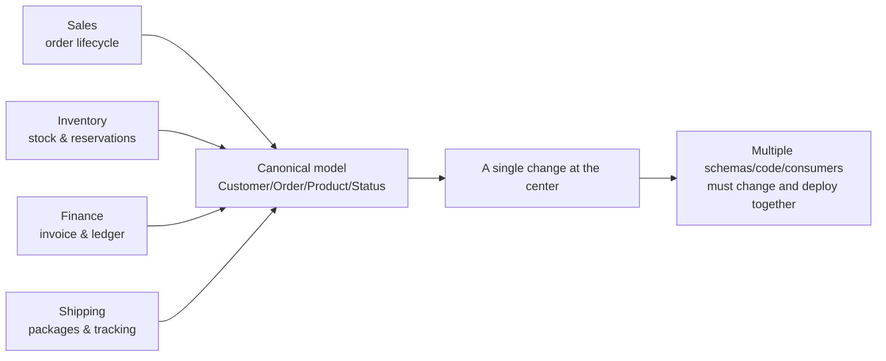
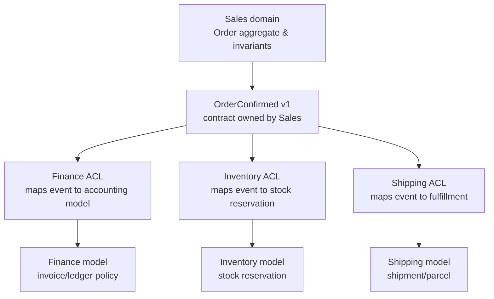

# Shared Canonical Models and the Risk of Becoming an Over-Coupled Dependency Hotspot

## 1. A Shared Model Can Reduce Integration Effort, Yet Can Also Create a "Data Monolith"

In the `DATABASE_DATA_MODELING` module, the goal is to turn business requirements into clear data models—from entities, relationships, and constraints to normalization, keys, indexes, and physical schemas—while comparing modeling across relational, document, graph, and analytical engines. Reaching the **Boundaries and Integration** chapter, we must answer a broader question: *which models should be owned inside each business domain, and which information genuinely needs to be standardized across domains?*

Suppose a commerce platform has the following domains:

- **Sales:** takes orders, preserves locked prices and order status.
- **Inventory:** manages stock by SKU, warehouse, batch, and allocatable quantity.
- **Finance:** handles invoicing, taxes, receivables, and ledger posting per accounting rules.
- **Shipping:** handles packing, transit, and delivery tracking.

Initially, the systems exchange many separate payloads. An architecture group proposes a **Canonical Data Model (CDM)** with shared entities like `Customer`, `Product`, `Order`, `Payment`, and `Address`, complete with unified statuses and types. The pitch is appealing: every system knows how to read one format.

Later, however, Finance needs to separate `bill_to_party` from `sold_to_party`; Inventory needs `stock_item` and `batch` instead of `product`; Shipping needs multiple parcels per order; Sales wants to add `PARTIALLY_CONFIRMED`. If every domain must upgrade the same library, table, or format to accommodate those changes, the canonical model becomes a **coupling hotspot**. At that point, "integration standardization" has turned into a **distributed monolith** at the data layer.

**Core message:** a shared canonical model is a **scoped design choice with real costs**, not a single data entity "right for every domain". Only standardize semantics that are genuinely stable and needed for exchange; everything else belongs under each business boundary's ownership.

### Learning Outcomes

After completing this lesson, you will be able to:

1. Distinguish **conceptual enterprise model**, **canonical integration model**, **shared database schema**, **API/event contract**, **master data**, and **conformed dimension**.
2. State the conditions under which a CDM lowers integration cost, and the signs that it has become an over-coupled dependency hotspot.
3. Define **bounded context**, data ownership, *published language*, and *anti-corruption layer* (ACL).
4. Choose among a bounded canonical model, domain-owned contracts, pairwise mappings, an integration hub, and read models.
5. Design identifiers, timestamps, units, statuses, versions, and constraints for an exchange contract.
6. Illustrate outbox/inbox, schema evolution, contract testing, and safe migrations without forcing two systems to share database tables.
7. Evaluate consistency, security, operations, and cross-domain change cost with concrete examples.

## 2. "Shared Canonical Model" Means Different Things

Before accepting a request to "just share one model", ask **shared at which layer**.

| Concept | What Is Shared? | Primary Goal | Key Distinction |
|---|---|---|---|
| **Conceptual enterprise model** | Enterprise-level vocabulary and concepts | Communication, domain discovery, terminology governance | Not necessarily a schema to read/write directly |
| **Canonical integration model** | Intermediate exchange format among a set of systems | Reduce mapping variants, standardize contracts | Can be a **communication model**, not source operational data |
| **Published API/event schema** | Contract for a capability or domain event | Give consumers stable integration | Producer owns meaning; does not require identical internal entities |
| **Shared database schema** | Same tables and often same keys/constraints | Easy joins and shared data inside one DB | Creates tight coupling on migrations, writes, and deployments |
| **Master Data Management (MDM)** | Identities and reconciliation workflows for core entities | Reduce duplicate customer, product, supplier identities | A "golden record" does not replace every domain's lifecycle/semantics |
| **Conformed dimension** | Analytical dimension aligned across data marts | Compare metrics across facts and departments | Serves reporting; not a transactional write model |
| **Shared code/DTO library** | Application-level types and classes | Reduce serialization/validation boilerplate | Easily causes lockstep deployments if carrying volatile business entities |

A team might say "we have a canonical customer" when all they actually need is **a cross-domain reference identifier**; forcing every CRM, Billing, and Support attribute into one shared `customer` table is a vastly bigger decision.

**A CDM is most useful when scope, owner, version, semantics, and translation rules are all clear.** It is most dangerous when treated as "the canonical internal schema every system must depend on directly".

## 3. Why Does a Shared Model Emerge in Integration Architecture?

Suppose there are four systems A, B, C, and D. If every pair exchanges data directly in each partner's custom format, the potential number of pairwise links is:

\[
\frac{n(n-1)}{2}
\]

With \(n=4\), there are six pairs; with \(n=10\), 45 pairs. If every pair needs **two separate directional translators**, the adapter count grows even higher.

A canonical format can reshape this into:

```text
A ----> [Canonical exchange] <---- B
                 ^
                 |
C ---------------+--------------- D
```

Each system maps to/from the intermediate contract instead of writing new translators for every pair.

**Potential benefits:**

- Reduces duplication of **truly universal** conversion rules, such as UTC timestamps and standardized country codes.
- Reuses contract validation, schema registries, testing tools, and data-quality monitoring.
- Eases integration of legacy systems with idiosyncratic formats when the canonical format is stable.
- Improves source lineage and identity reconciliation.
- Supports enterprise-level governance for data that genuinely must align company-wide.

However, the `n(n-1)/2` formula is an **idealized mesh model**, not proof that every point-to-point architecture has 45 adapters or that a hub is always superior. In practice, few systems talk to every other system; many consumers need only one specialized event or API. If a canonical format continually expands to serve everyone, the cost of maintaining **central semantics** can outweigh the adapters saved.

## 4. Bounded Context: One Word, Multiple Business Truths

A **bounded context** is a boundary within which a business model has consistent meaning, governed by a clear team/capability. The same term `Customer` or `Order` need not share the same structure and rules across all domains.

| Shared Term | Sales Understands It As | Finance Understands It As | Shipping / Inventory Understands It As |
|---|---|---|---|
| **Customer** | Buyer/order placer, possibly a guest shopper | Invoicing party, payment obligor, and tax ID | Recipient / delivery contact and address |
| **Product** | Sellable variant with price and promotions | Accounting category, tax class, revenue stream | Stocked SKU, packaging unit, batch, or material |
| **Order** | Sales commitment by product line and acceptance state | Not automatically recognized revenue | May split into multiple warehouse picks/parcels |
| **Price** | Quoted/locked transaction price | Pre-tax price, taxable base, receivable amount | Often irrelevant |
| **Status** | `DRAFT`, `CONFIRMED`, `CANCELLED` | Unposted, invoiced, paid | `READY`, `PACKED`, `SHIPPED`, `DELIVERED` |

If you create one shared `OrderStatus` enum holding every status, each domain must understand values outside its lifecycle. Worse, Shipping's `DELIVERED` can be mistaken for Finance's `REVENUE_RECOGNIZED`, even though operational handoff and accounting recognition follow different rules.

**Rule:** an identical name does not guarantee identical definition, scope, constraints, owner, or timestamps. When two domains carry different meanings, **two separate models with controlled translation** are usually safer than an ever-growing shared layer.

## 5. How Does an Over-Coupled Dependency Hotspot Form?



High coupling becomes problematic when:

1. **Internal changes turn into global changes:** adding a Finance-only attribute requires modifying a model imported by Inventory.
2. **Semantics get flattened:** a single `customer_id` field serves buyer, payer, and recipient even though three different people/entities may fill those roles.
3. **Versions move in lockstep:** every service must bump the same SDK/DDL version for one service to release.
4. **The schema becomes a shared write mechanism:** multiple teams directly `UPDATE` the same canonical table and nobody truly owns invariants.
5. **Changes slow down behind central review:** one central board must approve every field even when it affects no integrations.
6. **Vague catch-all values proliferate:** `status = 'OTHER'`, `metadata_json`, and optional columns become hiding places for unmodeled differences.
7. **Testing loses independence:** service A cannot test or deploy without service B's environment or schema.

A larger canonical model is not necessarily more complete; it may simply be accumulating unmodeled boundary exceptions.

### Spotting a Data-Layer "Distributed Monolith"

A strong signal is **a small change in one domain forcing multiple domains to change simultaneously**, even when nothing changed in the capabilities consumers actually use. The risk lies not in having shared documentation, but in **runtime, deployment, and semantic coupling**.

## 6. A Contrasting Diagram: Integrating via Domain-Owned Contracts



In this structure:

- **Sales** owns the meaning of `OrderConfirmed`: the order met Sales acceptance conditions, **without asserting revenue has been recognized**.
- **Finance** maintains an *anti-corruption layer* (ACL) to map order references to accounts/invoices and decide when to recognize revenue per accounting policy.
- **Inventory** interprets order lines as SKU reservation/issue demands under warehouse rules.
- **Shipping** translates delivery details into shipments/parcels, potentially creating multiple parcels for one order.

Each consumer does not share table structures, internal enums, or lifecycles with Sales. They only need to understand **the published contract** and their own translation rules.

The diagram above illustrates an **event-oriented** pattern. When consumers need synchronous answers, domain-owned capability APIs may fit better. Choose synchronous vs. asynchronous communication based on latency, consistency, and failure needs—not a slogan like "everything must be an event".

## 7. Which Shared Semantics Actually Need Standardization?

A good canonical contract states far more than "this field is a `string`".

| Contract Property | Example Specification | Risk if Omitted |
|---|---|---|
| **Name / definition** | `confirmed_at` = timestamp Sales accepted the order | Finance mistakes it for payment time |
| **Authoritative owner** | Sales emits the event and owns the schema | Unclear who may change meaning |
| **Identity scope** | `order_ref` unique within `(tenant_id, source_system)` | Two tenants with code `0001` collide |
| **Type and precision** | Monetary decimal vs. fractional/integer quantity | Silent rounding or overflow |
| **Units** | `quantity` in pieces; money paired with `currency_code` | Adding kg with pieces, or VND with USD |
| **Timestamps** | UTC instant; event time distinct from publish time | Misattributed reporting periods or reference versions |
| **Null / missing** | Delivery address may be absent on digital orders | Consumers treat missing as empty string |
| **Cardinality** | An order has 1..n lines; 0..n shipments | Wrong grain and multiplied/dropped facts |
| **Enum / state** | When a new enum value appears, how do old consumers behave? | Consumers crash on unknown statuses |
| **Security** | Does the field hold PII? Who may receive it? | Unintended broadcast of phone numbers/addresses |
| **Version / compatibility** | Schema v1, v2, and v1 sunset roadmap | Legacy consumers break unexpectedly |
| **Idempotency / ordering** | `event_id` unique per producer; per-aggregate ordering | Duplicate ingestion or out-of-order application |
| **Delivery SLA** | Retries, disconnects, and late arrivals possible | Consumers assume exactly-once delivery |

**Schema syntax** addresses only structure; a **semantic contract** must document the invariants all teams rely on. Two equally valid JSON payloads can mean opposite things if one treats `amount` as pre-tax and the other assumes tax-included.

## 8. Distinguish Three Key Layers Across System Boundaries

Suppose a shopper has:

- `sales.buyer_id = 412` in Sales.
- `finance.party_id = 8801` in Finance.
- `shipping.recipient_ref = 'R-002'` in Shipping.

Never infer these three IDs denote the same identity just because someone labeled them `customer_id`. Buyer, payer, and recipient can be **three different people or organizations**.

### Three ID Types to Separate

1. **Local surrogate key:** internal table/aggregate ID owned by the domain. Consumers must never adopt it as a primary key in their own DBs.
2. **External / business reference:** contract-published ID with explicit namespace, owner, and stability policy.
3. **Cross-domain identity mapping:** verified mapping table with evidence provenance and often effective-time intervals; never assume a permanent 1–1 mapping automatically.

For instance, mapping a `buyer_ref` to a `billing_party_id` requires **acceptance rules**. In a personal order, buyer and payer may match; in a corporate order, an employee places the order while a legal entity pays.

### Risk of One "Global `customer_id`"

A global identifier can help when an entity genuinely has a unified enterprise-governed identity. Yet if it forces every domain to collapse **buyer, payer, recipient, contact, and legal entity** into one undifferentiated entity without roles, the system loses business meaning. Use a **global reference** only within verified scopes while keeping **roles** distinct inside each domain.

## 9. Never Use a Shared Database as the Default Integration Mechanism

An initially tempting shortcut is letting Sales, Finance, and Shipping directly read and write shared `customer`, `order`, and `product` tables in one database.

**Problems with multiple writers:**

- Who is allowed to change `order.status`, and what does that enum mean to each system?
- A column migration in Sales can lock Finance queries or break Shipping's ORM.
- Transactions across workflows intermingle, creating runtime and rollback coupling.
- Teams struggle to enforce column/row permissions and minimize PII exposure.
- Index tuning for one workload hurts write throughput and lock contention for another.
- Data can be edited directly, bypassing business invariants the aggregate owner must protect.

**This does not mean a shared DB is always wrong.** In a monolith with a **single invariant owner and unified deployment lifecycle**, a shared schema can be simple and effective. Problems arise when **multiple teams want to evolve independently** while sharing an unowned write model.

A sound rule for multi-domain systems: clarify **data ownership**. Other consumers should obtain data via appropriate APIs, events, read models, or published contracts—never treat direct `SELECT` access on internal tables as a long-term public contract.

## 10. Choosing Between a Central Standard and Domain Contracts

The choice is not binary between "one enterprise-wide canonical model" and "every system does whatever it wants".

| Approach | When It Can Make Sense | Risks and Limits |
|---|---|---|
| **Large enterprise-wide CDM** | Relatively homogeneous domains, strong governance, slow rate of change | Forced shared semantics, lockstep migrations/deployments, universal coupling |
| **Bounded canonical exchange model** | Several legacy systems exchange a small stable concept set, genuinely cutting translator count | Central hub/schema can become a bottleneck if scope creeps |
| **Domain-owned published contracts** | Bounded contexts evolve independently; APIs/events have clear owners | Each consumer must map contracts into its local model |
| **Anti-corruption layer (ACL)** | Integrating legacy or partner systems with incompatible concepts | Mapping code cost; requires semantic tests and monitoring |
| **MDM / identity registry** | Reconciling customer/partner/product identities | Does not replace operational tables or lifecycles |
| **Read projection / serving model** | Consumers need fast search/combined reads across domains | Derived data with lag; requires replay/reconciliation |
| **Conformed dimensions in warehouse** | Cross-domain reports need consistent time/customer/region definitions | Analytical standard only; never force onto OLTP schemas |

**The best choice is usually a hybrid:** a small set of governed identifiers/vocabularies, domain-owned contracts, ACLs across semantic boundaries, and conformed dimensions for reporting. You do not need one absolute standard at every layer.

## 11. Minimal Shared Boundary: Contracts, Not Internal Tables

An *event envelope* can standardize stable metadata fields:

```json
{
  "event_id": "54a66833-b20d-4761-b0d9-607ac24bd2e9",
  "event_type": "sales.order-confirmed",
  "schema_version": 1,
  "producer": "sales",
  "tenant_ref": "tenant-42",
  "aggregate_ref": "sales-order-8071",
  "occurred_at": "2027-03-15T10:15:00Z",
  "published_at": "2027-03-15T10:15:03Z",
  "data": {
    "order_ref": "SO-8071",
    "buyer_ref": "buyer-19",
    "currency_code": "VND",
    "merchandise_subtotal": "150000.00",
    "lines": [
      {
        "line_ref": "L01",
        "sales_item_ref": "ITEM-58",
        "quantity": "2",
        "unit_price": "75000.00"
      }
    ]
  }
}
```

This is an **illustrative contract**, not a universal canonical schema. Interpret it precisely:

- `event_id`: stable identifier preserved across retries; never regenerated on redelivery.
- `event_type` and `schema_version`: classify payload content; v1 has a published specification.
- `tenant_ref` and `aggregate_ref`: namespaced references; not cross-database foreign keys.
- `occurred_at`: when the order was **confirmed** in Sales per contract; `published_at` is transport time, never a substitute for event time.
- `merchandise_subtotal`: goods total **before tax, shipping, and other adjustments** per this example's assumptions; decimal string parsed accurately. It does **not automatically equal recognized accounting revenue**.
- `lines`: each line has a unique `line_ref` within the order; `sales_item_ref` does not force Inventory to adopt the same SKU ID.
- `buyer_ref`: the buyer per Sales; does not assert it is always Finance's `billing_party_id`.

**Avoid publishing whole internal records** disguised as events. A purposeful contract carries only the events and attributes consumers are permitted and required to use, with clear lifecycle and retention policies.

## 12. Name Events After Domain Facts, Not CRUD Operations

Compare:

| Event | What Does the Recipient Learn? | Risk |
|---|---|---|
| `CustomerUpdated` | Some record changed | Unclear which attributes carry business meaning; couples to internal schema |
| `OrderRowChanged` | A DB row mutated | Consumers must infer business state from before/after columns |
| `sales.order-confirmed` | Sales accepted an order per Sales rules | Says nothing about invoices/revenue unless contracted |
| `billing.invoice-issued` | Billing issued an invoice per Billing policy | Consumers respect the invoice issuance boundary |
| `inventory.stock-reserved` | Warehouse recorded a reservation per Inventory rules | Does not mean goods have shipped |

Business events are not "direct commands to every consumer". An event reflects what occurred in the source domain. Consumers decide their own reactions under their own rules; multiple consumers can subscribe without the emitter needing to know all of them.

When data is needed **synchronously on demand**, an API like `GetOrderSummary(order_ref)` or `ReserveStock(request)` fits better than emitting an event and waiting. Never confuse an event like `OrderConfirmed` with a command like `ReserveStock`: one records a fact, the other asks a capability to act.

## 13. Relational Example Separating Sales and Finance Boundaries

To illustrate avoiding "one shared order table", we place two **logical** schemas inside one PostgreSQL 16 environment. Using one PostgreSQL instance here **does not mean two production services should access each other's schemas directly**; in practice they may reside in independent databases connected via events/APIs.

### 13.1. Sales Owns the Order Lifecycle

```sql
CREATE SCHEMA sales;
CREATE SCHEMA finance;

CREATE TABLE sales.order_header (
    sales_order_id BIGINT GENERATED ALWAYS AS IDENTITY PRIMARY KEY,
    tenant_id BIGINT NOT NULL,
    source_system VARCHAR(40) NOT NULL,
    order_ref VARCHAR(80) NOT NULL,
    buyer_ref VARCHAR(80) NOT NULL,
    order_status VARCHAR(20) NOT NULL DEFAULT 'DRAFT',
    currency_code VARCHAR(3) NOT NULL,
    merchandise_subtotal NUMERIC(18,2) NOT NULL,
    confirmed_at TIMESTAMPTZ,

    CONSTRAINT uq_sales_order_ref
        UNIQUE (tenant_id, source_system, order_ref),
    CONSTRAINT ck_sales_status
        CHECK (order_status IN ('DRAFT','CONFIRMED','CANCELLED')),
    CONSTRAINT ck_sales_subtotal
        CHECK (
            merchandise_subtotal >= 0
            AND merchandise_subtotal <> 'NaN'::numeric
        ),
    CONSTRAINT ck_sales_currency_code
        CHECK (currency_code ~ '^[A-Z]{3}$'),
    CONSTRAINT ck_sales_confirmation
        CHECK (
            (order_status = 'CONFIRMED' AND confirmed_at IS NOT NULL)
            OR (order_status <> 'CONFIRMED')
        )
);

CREATE TABLE sales.order_line (
    sales_order_id BIGINT NOT NULL
        REFERENCES sales.order_header (sales_order_id),
    line_ref VARCHAR(40) NOT NULL,
    sales_item_ref VARCHAR(80) NOT NULL,
    quantity NUMERIC(16,3) NOT NULL,
    unit_price NUMERIC(18,2) NOT NULL,
    CONSTRAINT pk_sales_order_line
        PRIMARY KEY (sales_order_id, line_ref),
    CONSTRAINT ck_sales_line_quantity CHECK (quantity > 0),
    CONSTRAINT ck_sales_line_price
        CHECK (unit_price >= 0 AND unit_price <> 'NaN'::numeric)
);
```

**Guarantee scope of this example:**

- `order_status` is **Sales's status**, not a shared enterprise enum. `CONFIRMED` requires `confirmed_at`, though `CHECK` constraints do not enforce transition lifecycles or non-zero line counts.
- `merchandise_subtotal` is computed/locked by Sales under the example's no-discount/no-tax rule. The DB does not automatically verify it equals the line sum because `CHECK` cannot span tables. Application/transaction logic must verify the subtotal before confirming.
- `buyer_ref` is namespaced (`tenant_id`, `source_system`); there is no FK to Finance's party table.
- This example has one header `currency_code`, assuming all lines share a currency. Multi-currency or tax cases must extend the contract meaningfully rather than overloading generic fields.

### 13.2. Finance Maintains Its Own Identity and Transaction Model

```sql
CREATE TABLE finance.billing_party (
    billing_party_id BIGINT GENERATED ALWAYS AS IDENTITY PRIMARY KEY,
    tenant_id BIGINT NOT NULL,
    legal_name TEXT NOT NULL,
    tax_identifier VARCHAR(80),
    CONSTRAINT uq_finance_party_tenant_id
        UNIQUE (tenant_id, billing_party_id)
);

CREATE TABLE finance.buyer_reference_map (
    tenant_id BIGINT NOT NULL,
    source_system VARCHAR(40) NOT NULL,
    external_buyer_ref VARCHAR(80) NOT NULL,
    billing_party_id BIGINT NOT NULL,
    mapping_status VARCHAR(16) NOT NULL DEFAULT 'VERIFIED',
    verified_at TIMESTAMPTZ NOT NULL DEFAULT clock_timestamp(),
    CONSTRAINT pk_buyer_reference_map
        PRIMARY KEY (tenant_id, source_system, external_buyer_ref),
    CONSTRAINT fk_map_billing_party_same_tenant
        FOREIGN KEY (tenant_id, billing_party_id)
        REFERENCES finance.billing_party (tenant_id, billing_party_id),
    CONSTRAINT ck_map_status
        CHECK (mapping_status IN ('VERIFIED','PENDING','REJECTED'))
);
```

Here, `billing_party_id` **is not** `sales.buyer_ref`. Mapping requires identity verification rules. `mapping_status` in this DDL does not by itself block queries from reading `PENDING` rows: adapters must filter for approved rows, or workflows must enforce stricter constraints/queues.

**Never create an FK from `sales.order_header.buyer_ref` directly to `finance.billing_party`.** Across independent services, cross-database FKs are typically unavailable and couple deployment lifecycles. The real constraint is the contract and mapping/reconciliation workflow; Finance's internal FK only protects rows **within Finance**.

### 13.3. Relationships Change Over Time

A buyer may change their authorized billing entity; a business may change legal entities or merge/split. If mappings must reconstruct history, this map table is **insufficient**: you need `valid_from`/`valid_to`, overlap prevention, and support for one buyer having multiple payers. Never treat a PK on `(tenant_id, source_system, external_buyer_ref)` as proof of a permanent 1–1 business relationship.

## 14. Transactional Outbox: Publishing Contracts Without Losing Local Consistency

If Sales commits an order status and then **calls the broker** outside the transaction, a crash between steps leaves the order confirmed with no event sent. Conversely, publishing before commit can notify consumers of a transaction that later rolls back.

A **transactional outbox** stores the event inside the same transaction as the aggregate update in the Sales DB:

```sql
CREATE TABLE sales.integration_outbox (
    event_id UUID PRIMARY KEY,
    tenant_id BIGINT NOT NULL,
    aggregate_type VARCHAR(60) NOT NULL,
    aggregate_ref VARCHAR(120) NOT NULL,
    event_type VARCHAR(100) NOT NULL,
    schema_version INTEGER NOT NULL,
    occurred_at TIMESTAMPTZ NOT NULL,
    payload JSONB NOT NULL,
    published_at TIMESTAMPTZ,
    CONSTRAINT ck_outbox_schema_version
        CHECK (schema_version > 0),
    CONSTRAINT ck_outbox_payload_object
        CHECK (jsonb_typeof(payload) = 'object')
);

-- Candidate index for publisher polling only.
CREATE INDEX idx_sales_outbox_unpublished
    ON sales.integration_outbox (occurred_at, event_id)
    WHERE published_at IS NULL;
```

### 14.1. Confirming an Order and Writing the Outbox in One Step

Assuming the order was created in `DRAFT` with verified lines and subtotal, the snippet below illustrates atomicity:

```sql
BEGIN;

WITH confirmed AS (
    UPDATE sales.order_header
       SET order_status = 'CONFIRMED',
           confirmed_at = clock_timestamp()
     WHERE tenant_id = 42
       AND source_system = 'WEB'
       AND order_ref = 'SO-8071'
       AND order_status = 'DRAFT'
     RETURNING sales_order_id, tenant_id, source_system,
               order_ref, buyer_ref, currency_code,
               merchandise_subtotal, confirmed_at
)
INSERT INTO sales.integration_outbox (
    event_id, tenant_id, aggregate_type, aggregate_ref,
    event_type, schema_version, occurred_at, payload
)
SELECT
    gen_random_uuid(),
    c.tenant_id,
    'SalesOrder',
    c.order_ref,
    'sales.order-confirmed',
    1,
    c.confirmed_at,
    jsonb_build_object(
        'order_ref', c.order_ref,
        'source_system', c.source_system,
        'buyer_ref', c.buyer_ref,
        'currency_code', c.currency_code,
        'merchandise_subtotal', c.merchandise_subtotal::text,
        'confirmed_at', to_char(
            c.confirmed_at AT TIME ZONE 'UTC',
            'YYYY-MM-DD"T"HH24:MI:SS.US"Z"'
        )
    )
FROM confirmed AS c
RETURNING event_id, event_type, occurred_at;

-- COMMIT only when both updated row count and outbox event count
-- match expectations. Otherwise: ROLLBACK and handle state.
COMMIT;
```

If `UPDATE` matches 0 rows, `INSERT ... SELECT` inserts 0 events; the application must check row counts and not falsely report "confirmation succeeded". If two concurrent requests try to confirm the same order, `order_status='DRAFT'` ensures at most one succeeds under standard PostgreSQL locking.

This example writes an **abbreviated payload**, omitting `lines` shown in the Section 11 sample contract. In production, build the **complete event matching the published schema** (with consistent lines), validating identity, ordering, and versions—never emit an event missing required fields and call it a complete `OrderConfirmed v1`.

### 14.2. Outbox Does Not Automatically Guarantee Exactly-Once Delivery

A publisher may send an event to the broker, lose the ACK, and resend; consumers experience **at-least-once** or duplicate deliveries depending on infrastructure. `published_at` updates may lag; brokers and consumers have distinct ordering and retention guarantees. Therefore:

- The producer needs a stable `event_id` and must retry using **the same ID**.
- The consumer needs deduplication/idempotency mechanisms.
- Ordering rules per **aggregate_ref** or sequence must be defined if consumers depend on order.
- Outbox/publishers require backlog monitoring, dead-letter queues, and recovery policies.
- Never claim all cross-service side effects commit atomically solely because an outbox is used.

## 15. Consumer Inbox and Mapping: Receiving Does Not Mean Executing Business Actions

Finance receives `sales.order-confirmed` and uses it to prepare invoicing/reconciliation workflows—never treating the event automatically as "payment collected".

```sql
CREATE TABLE finance.integration_inbox (
    producer VARCHAR(40) NOT NULL,
    event_id UUID NOT NULL,
    tenant_id BIGINT NOT NULL,
    event_type VARCHAR(100) NOT NULL,
    schema_version INTEGER NOT NULL,
    payload JSONB NOT NULL,
    received_at TIMESTAMPTZ NOT NULL DEFAULT clock_timestamp(),
    processed_at TIMESTAMPTZ,
    process_status VARCHAR(12) NOT NULL DEFAULT 'RECEIVED',
    CONSTRAINT pk_finance_inbox PRIMARY KEY (producer, event_id),
    CONSTRAINT ck_finance_inbox_version CHECK (schema_version > 0),
    CONSTRAINT ck_finance_inbox_status
        CHECK (process_status IN ('RECEIVED','PROCESSED','FAILED')),
    CONSTRAINT ck_finance_inbox_payload
        CHECK (jsonb_typeof(payload) = 'object')
);
```

**Two distinct levels of idempotency:**

1. `UNIQUE(producer,event_id)` prevents inserting the same event into the inbox twice.
2. **Business side effects** inside Finance (creating invoice requests, updating states, ledger postings) must also be idempotent by business key/command, executed in a coordinated transaction with the inbox status. A handler could create an invoice and crash before marking the inbox `PROCESSED` if the two operations are not atomic.

### Do Not Let Missing Mappings Drop Events

Suppose an event carries `buyer_ref='buyer-19'` while Finance does not yet have a verified `billing_party_id`. The wrong approach is an `INNER JOIN finance.buyer_reference_map` that silently **drops** unmatched events.

A safer workflow:

- Persist the event in inbox/staging and validate schema, namespace, and version.
- Look up `VERIFIED` mappings within the exact tenant/source scope.
- If missing or ambiguous, route the event to a pending/quarantine queue—never force it onto an existing party.
- Monitor queue age/SLA, retry once mappings arrive, or request supporting evidence.
- Reconcile counts of received, pending, rejected, and processed events.

**Note:** a Sales buyer might not be authorized for invoicing, or the payer may differ from the buyer. Consumers must enforce **Finance's own rules**, never substituting raw mapping lookup results for business decisions.

## 16. Anti-Corruption Layer (ACL): Translate Meaning, Not Just Field Names

An ACL shields internal models from source assumptions, especially when integrating legacy or partner systems with different concepts.

For example, `OrderConfirmed` from Sales received by Finance:

```text
Sales event: buyer_ref, merchandise_subtotal, confirmed_at
       |
       v
Finance ACL
  1. Validate event schema/version/tenant.
  2. Resolve buyer_ref -> billing_party candidate.
  3. Check invoice recipient/tax rules; may require separate data.
  4. Create a request to finance workflow with source event id.
  5. Record mapping/decision/errors for replay.
       |
       v
Finance domain: invoice_request (not automatically revenue ledger)
```

An ACL is not a naive field copier:

```text
source.customerId -> target.customerId
source.amount     -> target.revenue
source.status     -> target.status
```

These three lines can be **semantically wrong** even when all data types match. Check party roles, amount definitions, lifecycles, and timestamps. If the source contract lacks enough information to decide, the ACL must **request more information or hold the record unprocessed**, rather than fabricating values to populate target fields.

### Example Semantic Mapping Table

| Sales Field | Finance Field / Concept | Rule |
|---|---|---|
| `buyer_ref` | `billing_party_id` | Look up verified mapping; may not be 1–1 |
| `merchandise_subtotal` | `invoice_merchandise_base` | Use strictly per contract's pre-tax/pre-fee definition; apply tax rules separately |
| `confirmed_at` | `order_confirmed_at` | Source event timestamp; **not** `invoice_issued_at` |
| `order_ref` | `source_order_reference` | Preserve namespace + tenant to avoid collisions |
| `order_status` | Never map directly to `payment_status` | Two distinct lifecycles |
| `sales_item_ref` | `accounting_item_code` | Requires an accounting classification table governed by Finance |

This illustrates *semantic mapping*. If two systems genuinely share identical, stable semantics, the ACL can stay thin—never build a bloated translation layer just for the pattern's name.

## 17. Versioning: Adding a Field Does Not Guarantee Compatibility

Integration contracts need an evolution policy from day one:

| Change | Usually Compatible When... | Likely Breaking When... |
|---|---|---|
| Add optional field | Consumers ignore unknown fields and use sensible defaults | Consumer validators forbid unknown fields, or field is immediately required |
| Add enum value | Consumers have an explicit unknown-value branch per policy | Consumers use exhaustive switches and crash on new values |
| Rename field | An alias / dual-read transition period exists | Old field name is removed before consumers upgrade |
| Change `amount` from minor-unit int to decimal string | A new field name and clear specification are introduced | Old name is kept while type/unit changes |
| Split `customer_id` into buyer/payer | New contract documents roles and mappings | Legacy consumers assume buyer equals payer |
| Add new event version | Producer maintains prior versions per commitment | Only v2 is emitted while v1 consumers still run |
| Change timestamp meaning | New field added via approved migration | `occurred_at` shifts from confirm time to publish time |
| Change identifier source/key | Mapping table and idempotency migration exist | Old IDs reused for new entities or namespace changed silently |

**Compatibility has multiple dimensions:**

- *Backward compatibility:* can new consumers read old data/payloads?
- *Forward compatibility:* can old consumers tolerate producers emitting new payloads?
- *Semantic compatibility:* even when parsing succeeds, do calculations and interpretations remain **business-accurate**?
- *Operational compatibility:* during rolling deployments, can old and new versions coexist safely?

JSON Schema or Avro/Protobuf schema registries check certain **structural** changes, yet cannot prove semantic compatibility. Changing `amount` from "pre-tax" to "tax-included" while keeping a decimal type is a bug **schema checkers will not necessarily catch**.

### Illustrative v1 → v2 Roadmap

Suppose event v1 has `buyer_ref`, and v2 splits `buyer_ref` and `bill_to_ref` per new requirements:

1. Publish v2 with clear definitions without silently altering v1's `buyer_ref` meaning.
2. Producer supports both versions during transition, or retains v1 alongside new fields per contract.
3. Consumers update ACLs to handle v1/v2 with **verified** fallbacks; when v1 lacks `bill_to_ref`, do not blindly assume `bill_to_ref = buyer_ref` in every case.
4. Run consumer-driven contract tests using sample payloads and missing-mapping cases.
5. Monitor remaining v1 consumer counts, parse errors, semantic errors, and queue backlogs.
6. Retire v1 only after verifying consumers, replay/reprocessing needs, and retention policies.

For events retained months for replay, stopping v1 emissions **does not** mean upgraded consumers will never encounter v1 payloads. Upgrade paths must keep legacy decoders/mappings or migrate stored events.

## 18. Sign Contracts with Tests, Not Just Documentation

A **data contract** is more than a schema file:

- Has a **producer/owner** accountable for definitions, versions, and data quality.
- Has known **consumers** and approved use cases within required scope.
- Includes **schema validation** for formats and versions.
- Provides **semantic examples**: buyer ≠ payer, pre- vs. post-tax amounts, UTC vs. business time, currencies.
- Includes **contract tests**: producer emits compliant payloads; consumers decode and translate accurately.
- Specifies **nonfunctional terms**: latency, retries, ordering, duplicates, retention, privacy, availability.
- Defines a **deprecation policy**: version bumps, parallel-support windows, and historical replay handling.

### Minimum Test Suite

| Case | Input / Change | What Must Be Proven |
|---|---|---|
| T1 | Two tenants both have `order_ref='0001'` | Identifiers never merge mistakenly |
| T2 | Same `event_id` emitted twice | Inbox and business side effects are idempotent |
| T3 | Same ID with a different payload | Contract violation or correction rule triggered; never silently ignored |
| T4 | Producer adds an optional field | Legacy consumers behave per compatibility policy |
| T5 | Producer adds an enum value | Consumers handle unknown values deterministically |
| T6 | v2 adds `bill_to_ref` distinct from buyer | Finance does not equate buyer and payer |
| T7 | Late event with `occurred_at` in prior month | Time attribution follows business rules |
| T8 | v1 event replayed after v2 deployment | Decoders/mappings still read it cleanly |
| T9 | Finance mapping missing or `PENDING` | Event is not lost and never invoices wrong party |
| T10 | Finance processes event, broker ACK fails | Retry creates zero duplicate side effects |
| T11 | Consumer downtime causes backlog growth | SLAs, alerts, and catch-up recovery work |
| T12 | Product code changes; Inventory unrecognized | Alias/version mapping and explicit error rules apply |
| T13 | New field holds PII outside consumer rights | Contract/policy blocks broadcast or enforces access control |
| T14 | Sales refactors internal table, keeps v1 event | Consumers need zero redeployments alongside Sales |

**One test proving independence:** rename internal column `sales.order_header.buyer_ref` in a new Sales release while emitting an identical `OrderConfirmed v1` contract. If Finance and Inventory require zero changes, boundaries are far better protected than sharing an ORM entity.

## 19. Contracts and Schemas Do Not Replace Distributed Consistency Models

When Sales, Inventory, and Finance do not share a single global ACID transaction, data becomes consistent **after a delay**. A canonical format does not eliminate this distributed nature.

Concerns to design explicitly:

1. **Delivery:** events can duplicate, arrive late, or be temporarily unavailable.
2. **Ordering:** ordering within a stream/aggregate can hold under infrastructure guarantees, yet global ordering across all services does not exist automatically.
3. **Retries:** consumers must ensure retries are safe when an effect already succeeded previously.
4. **Idempotency:** event IDs, command IDs, and business keys serve distinct roles.
5. **Compensation:** if stock reservation succeeds yet invoicing fails, you need a compensating/continuation workflow—not an automatic Inventory rollback via a shared FK.
6. **Reconciliation:** counts of confirmed Sales orders, Inventory holds, and Finance invoices may differ at any measurement instant; explain intermediate states instead of forcing immediate equality.
7. **Latency/SLAs:** derived read models may lag; UIs need timestamps and freshness indicators.

Example workflow:

```text
Sales: OrderConfirmed
   -> Inventory: ReserveStock (succeeds or fails)
   -> Billing: InvoicePreparation (after domain-specific checks)
   -> Shipping: CreateFulfillment (when ready)
```

This is a **multi-step business process**, not a single database transaction. If you expose a summary `Order.status = COMPLETED`, define at which boundary "completed" holds—never use it to replace all internal states.

## 20. Minimal Shared Scope and Data Ownership

One way to prevent canonical bloat is standardizing **little and clearly**:

| Data Safe to Standardize | Conditions for Sharing | Do Not Force Sharing |
|---|---|---|
| ISO currency codes, dates / UTC instants | Published standard/version and clear timezone rules | Every domain's revenue recognition date |
| Tenant / source / event ID namespaces | Consistent naming, idempotency, and privacy rules | Internal auto-increment PKs of every service |
| Country codes, units of measure | Clear standard definitions, conversions, and locales | Domain-specific units lacking safe mappings |
| Reference IDs / identity registry | Reconciliation workflows, role separation, and access controls | Collapsing buyer/payer/recipient into one "customer" |
| Event envelope (id, type, version, time) | Consumers share common transport infrastructure | One giant entity payload for every event type |
| Conformed reporting dimensions | Cross-domain analytics sharing identical meaning | OLTP lifecycles, state machines, or per-domain write constraints |

**Shared parts should change much more slowly than internal parts.** If a shared element changes frequently for one service's needs, that signals it belongs inside that service and should only be exposed through a contract.

An architecture governance group still plays a role: managing vocabularies, identifiers, security standards, and compatibility. Yet governance should steward **cross-domain contracts**, not require teams to ask permission to rename every internal column.

## 21. Distinguishing Canonical Operational Models from Analytical Conformed Dimensions

In analytics, sharing `dim_customer` or `dim_date` across multiple data marts is highly valuable. However, the purpose of a **conformed dimension** is to compare facts under **consistent analytical definitions**—not to dictate that every operational service share one `Customer` table.

For example:

- Sales has `buyer_ref` and order placement time.
- Finance has `billing_party_id` and invoice issuance time.
- The data warehouse builds a conformed dimension `dim_legal_entity` for approved reporting by legal entity.

Mappings allow two facts to share a dimension when semantics **genuinely align**. If the buyer is an individual and the payer is a company, you cannot join both facts to one "customer" key simply by renaming columns. The warehouse must distinguish **roles** or use separate dimensions.

### SCD Type 2 and Reference Time

An SCD2-versioned conformed dimension has distinct `customer_sk` surrogate keys per effective interval, while facts store the SK valid at the right timestamp. For retroactive corrections, define an **as-booked** vs. **restated** policy. Sharing dimensions does not eliminate temporal complexity; in fact, one corrupted dimension version shared across marts amplifies errors enterprise-wide.

**Master data ≠ universal domain model ≠ conformed dimension.** An identity registry, an exchange model, and an analytical dimension have distinct owners, latencies, and sources of truth; they coordinate without being the same table.

## 22. Document, Graph, and Relational Architectures All Have Semantic Boundaries

### Relational

Normalized tables and PK/FK/UNIQUE constraints protect integrity **inside one database**. However, FKs **cannot express** every cross-domain link, especially across independent systems with distinct effective dates. Use verified events/APIs and mappings when cross-DB transactions do not exist.

### Document

A canonical JSON payload travels easily across systems, yet sharing a JSON Schema does not guarantee shared meaning. A `customer` document embedding addresses, orders, and preferences fits inside one bounded context, not as a license for every consumer to read everything. On updates, decide which events to emit and which consumers have rights to see them.

### Graph

A graph can power an identity registry linking `buyer → legal party → recipient` with time-bounded edges. Still, a `SAME_AS` edge between two IDs does not prove all roles/attributes are interchangeable. Multi-hop traversals across systems require provenance, confidence, supporting evidence, and privacy controls.

### Analytical / Columnar

Warehouses can build read models and conformed dimensions tuned for cross-domain queries. Some analytical engines treat PK/FKs as metadata without OLTP enforcement; pipelines must check identity mappings, fact grain, dimension versions, and duplicates. Never turn a convenient analytical summary into a mandatory write schema for operational services.

**Semantic boundaries exist in every storage model.** Switching to JSON or graphs changes representation, not coupling.

## 23. Data Security and Privacy When Sharing Models

The more fields a canonical model carries, the easier it is for consumers to receive **unnecessary** data. Especially for customer/party records, an all-in-one payload may contain:

- Legal names, tax IDs, phone numbers, and emails.
- Shipping addresses, billing addresses, and recipient details.
- Purchase history, segments, and payment statuses.
- Data governed by differing purposes, legal bases, or storage regions.

Principles:

1. **Data minimization:** contracts carry only data required for the purpose—never broadcast the whole `customer` table out of habit.
2. **Purpose limitation:** an order event does not grant Finance, Shipping, or Analytics carte blanche to reuse details for unrelated purposes.
3. **Tenant isolation:** `tenant_id` in a payload does not replace authentication and authorization; consumers must enforce tenant checks.
4. **Encryption / access control:** protect data in transit and at rest across brokers, DLQs, staging, logs, and backups.
5. **Retention / deletion:** erasing or restricting PII may require coordinating across consumers; immutable event logs still require compliant handling.
6. **Schema registry security:** schema metadata can reveal sensitive field names; restrict access where warranted.

**Never solve privacy by building one "canonical customer" holding all data with blanket read access.** Minimal shared contracts are safer and easier to govern.

## 24. Measure Coupling with Metrics Instead of Gut Feel

Is a shared model helping or becoming a bottleneck? Observe:

| Metric | Signal to Track | Interpretation |
|---|---|---|
| **Change propagation** | How many services must modify/deploy per internal change? | Multiple services forced into lockstep signals coupling |
| **Lead time for change** | Time from request to releasing a contract/mapping change | Delays waiting on central schema approval indicate bottlenecks |
| **Breaking contract rate** | Consumer failures after schema/version changes | Needs better compatibility tests and deprecation |
| **Mapping exceptions** | Events missing or holding ambiguous identity mappings | Contracts/MDM incomplete or business rules undecided |
| **Integration backlog age** | Lag in outbox, broker, inbox, and quarantine | Canonical hub may be an operational bottleneck |
| **Direct DB access count** | How many consumers read an owner's internal tables? | High schema-change cost and weak data governance |
| **Field utilization** | Share of canonical fields actually used per consumer | Many unused fields signal model bloat |
| **Duplicate transformations** | How many times is the same unit/ID conversion reimplemented? | High-value opportunity for narrow standardization |
| **Semantic incidents** | Wrong reports due to buyer/payer, amount, timezone, or status | Measures meaning accuracy, not just API uptime |
| **Independence test** | Can one service deploy without touching internal consumers? | Evidence that boundaries actually hold |

**Never optimize a single metric in isolation.** Consolidating adapters into one huge shared library might reduce duplicated code while spiking lead time and rollout blast radius. Weigh technical reuse against evolutionary speed, semantic accuracy, and operational cost.

## 25. Migrating from "One Shared Schema" to Domain-Owned Contracts

Suppose a database currently has a `common_order` table updated by multiple services, and the goal is to separate incrementally so Sales owns orders, Finance owns invoices, and Shipping owns shipments. No big-bang rewrite is required.

### Step 1. Map Ownership

Inventory every field, table, workflow, and read/write path:

- Who currently **writes** each value? Who decides its meaning and validity rules?
- Who **reads** it and for what decisions?
- Do any fields carry two meanings across two domains?
- Do transactions, triggers, FKs, or batch jobs update across boundaries?
- What historical, timezone, tenant, privacy, and retention constraints apply?

The key artifact is an **ownership + semantic map**, not a giant endpoint wish list.

### Step 2. Extract Minimal Contracts

Define focused APIs/events per source capability, such as `sales.order-confirmed`, `billing.invoice-issued`, and `shipping.shipment-created`. Each contract has an owner, IDs, versions, timelines, and sample payloads—never create a single `CanonicalEntityUpdated` event to replace every business event.

### Step 3. Build Adapters and Translators

New consumers read published contracts and map them into local models. Legacy consumers can temporarily stay behind compatibility facades, provided sunset dates are set and dependencies are monitored.

### Step 4. Add Outbox/Inbox and Replay/Reconciliation

Implement transactional outbox at the source domain with retries, namespaced event IDs, and backlog alerts. Consumers maintain inbox/dedup tables and quarantine queues for payload/version/mapping failures. Keep a **reliable read-model rebuild path** from authoritative sources.

### Step 5. Shift Write Authority

Each aggregate gets one write owner. Consumers previously mutating internal tables must switch to calling owner APIs/commands or workflow requests. Never treat an `updated_by_service` column in a shared table as a sufficient boundary.

### Step 6. Reconcile and Cut Over Read Paths Incrementally

Reconcile order counts by tenant/date, totals in matching currency/amount definitions, lagged events, missing mappings, invoice statuses, and shipping states. When numbers differ, separate **expected lag** from **semantic bugs** first.

### Step 7. Retire Legacy Dependencies in a Controlled Way

Revoke direct DB read rights or retire shared DTOs only after proving consumers have migrated, rollback runbooks exist, and replays are tested. For legacy shared schemas holding historical data, archive/retain per audit policy instead of deleting ad hoc.

## 26. Common Misconceptions and Design Mistakes

| Misconception | Why It Is Risky | How to Adjust |
|---|---|---|
| "One shared `Customer` ensures every service shares meaning." | Buyer, payer, and recipient have distinct roles | Separate models by bounded context with verified mappings |
| "Sharing one DTO class removes all coupling." | Changing the shared class forces every service to upgrade | Share versioned contracts, not volatile internal entities |
| "A canonical schema must include every field from every service." | Bloat, abundant NULLs, blurry ownership | Standardize only stable, shared exchange semantics |
| "Having JSON Schema means business semantics are aligned." | Parsing passes while amounts/times/statuses remain wrong | Semantic contracts + behavioral tests |
| "A global ID makes every legal role identical." | Identity and business role are not identical | Map roles and namespaces explicitly |
| "A shared DB gives automatic cross-service consistency." | Tight deployment coupling, locking, bypassed domain invariants | Explicit write owners, APIs/events, and transaction boundaries |
| "Outbox delivers events strictly once." | Publisher/consumer retries can still duplicate | Inbox/idempotency, ordering, and replay handling |
| "If a consumer mapping join misses, drop the event." | Lost transactions or incomplete reports | Quarantine, SLAs, and mapping-failure handling |
| "`OrderConfirmed` equals recognized revenue." | Sales status differs from accounting rules | Finance decides invoices/revenue under its own rules |
| "Adding fields/enums is always backward compatible." | Strict decoders or exhaustive switches can crash | Test consumer compatibility |
| "Schema registry validates semantic changes." | Types stay identical when field meaning changes | Semantic contracts and regression/consumer tests |
| "Every service must release a new canonical version together." | Lockstep deployments, distributed monolith | Version overlap and boundary adapters |
| "MDM is one enterprise-wide `Customer` database." | Identity registries do not replace all lifecycles | Separate MDM, semantic maps, and domain write models |
| "Warehouse dimensions are shared, so OLTP must share too." | Reporting goals differ from transactional goals | Conformed dimensions inside the analytical context |
| "Switching to events/documents/graphs eliminates coupling." | Wrong semantics still propagate through edges/payloads | Ownership, mappings, tests, and boundaries |

## 27. Practice Exercise: Designing Boundaries for Four Marketplace Domains

**Context:** An enterprise has Sales, Inventory, Finance, and Shipping. Currently all four teams depend on a `CanonicalOrder` library with 120 fields and an `OrderStatus` enum with 24 values. Roughly 15 schema changes occur per quarter; on average, all four services must redeploy for a single change. Finance needs to separate buyer from payer, Inventory wants batch tracking, and Shipping wants multiple shipments per order. The warehouse needs revenue reports by tenant, product category, and month.

Test scenarios:

- Sales confirms a 2-line order; Inventory only has stock for 1 line.
- An employee places the order, while a corporation is the paying party.
- One order ships in 3 parcels, and 1 parcel is returned.
- The source system redelivers the same `OrderConfirmed` due to a lost ACK.
- Finance cannot find `buyer_ref` in the party registry.
- Sales adds a new internal status for order splitting without altering the confirmation contract.
- Product categories change retroactively; the warehouse needs both as-published and restated reports.

### Practice Tasks

1. **Draw a context map:** identify which data and invariants each domain owns; specify domain events and commands between domains.
2. **Analyze semantic drift:** pick at least five fields from `CanonicalOrder` whose meanings diverge across domains; explain why a single shared enum/ID fails.
3. **Propose an alternative architecture:** compare a bounded canonical exchange model, domain-owned events + ACLs, and a shared DB across lead time, translator count, write authority, and operational failure modes.
4. **Design the `OrderConfirmed v1` contract:** specify event ID, tenant namespace, timestamps, per-line IDs, currency, pre-/post-tax amounts, null/missing rules, schema version, and retry policy.
5. **Design Finance's ACL:** map buyer/payer, handle missing mappings, and avoid treating `OrderConfirmed` as revenue-recognized.
6. **Design Inventory's ACL:** map `sales_item_ref` to effective SKUs/stock items, handle shortages, and avoid mutating Sales facts directly in internal tables.
7. **Design Shipping's workflow:** one order with multiple shipments, distinguishing delivered vs. invoiced; define event IDs and idempotency.
8. **Analyze evolution:** v2 adds `bill_to_ref` and new enum values. Outline a parallel v1/v2 roadmap, tests, and replay handling for v1 events after v1 emission stops.
9. **Reconciliation:** design a check table by tenant/date/currency comparing counts of `OrderConfirmed`, `StockReserved`, `InvoiceIssued`, and `ShipmentCreated`, plus valid reasons counts differ at a point in time.
10. **Security:** specify which consumers need addresses, tax IDs, and phone numbers; show how to avoid broadcasting unnecessary PII in events.
11. **Analytical warehouse:** design mappings to conformed dimensions and facts, separating buyer/payer roles and order-line vs. shipment vs. invoice-line grains.
12. **Measure outcomes:** set target metrics for lower change propagation, shorter lead time, fewer semantic bugs, missing-mapping rates, backlogs, and deployment independence.

### Architecture Decision Checklist

- [ ] Defined the exact scope genuinely needing a standard model; did not conflate conceptual model, CDM, shared DB, MDM, and conformed dimensions.
- [ ] Each bounded context has its own owner, keys, statuses, and invariants.
- [ ] Shared terms are compared by **semantics**, not merely name or data type.
- [ ] Exchange contracts specify ID/namespace, units, time, cardinality, nulls, security, and versions.
- [ ] Buyer/payer/product/SKU mappings are verified; missing or ambiguous cases have explicit handling paths.
- [ ] APIs/events and ACLs shield internal models from partner/legacy changes.
- [ ] Outbox/inbox, retries, idempotency, ordering, and reconciliation match infrastructure guarantees.
- [ ] Contract tests, semantic tests, and multi-version coexistence policies exist.
- [ ] No external team arbitrarily `UPDATE`s an owner's internal tables bypassing published capabilities.
- [ ] Personal data is minimized with access controls, retention, and lineage tracking.
- [ ] Coupling and deployment independence metrics are measured before and after architectural changes.
- [ ] When shared data is needed for reporting, conformed dimensions/read models are used without forcing OLTP services onto one shared write schema.

**A good canonical model is a bridge, not a mold forcing every domain to look alike.** It creates value by eliminating accidental format differences while preserving genuine business differences. When a standard expands until every service must change together, coupling costs outweigh reuse benefits. Sustainable design starts with ownership and bounded contexts, shares only necessary semantic contracts, uses ACLs to translate across domains, and verifies compatibility against real data and real behavior.
