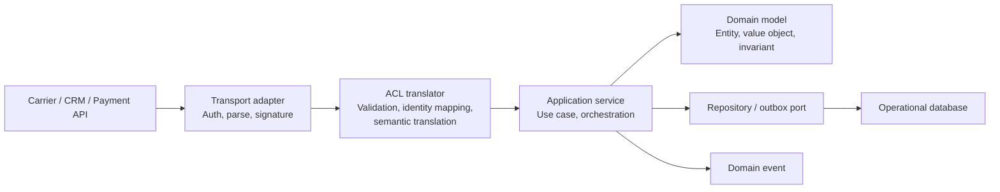
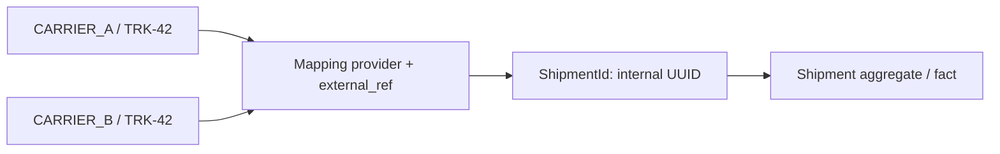
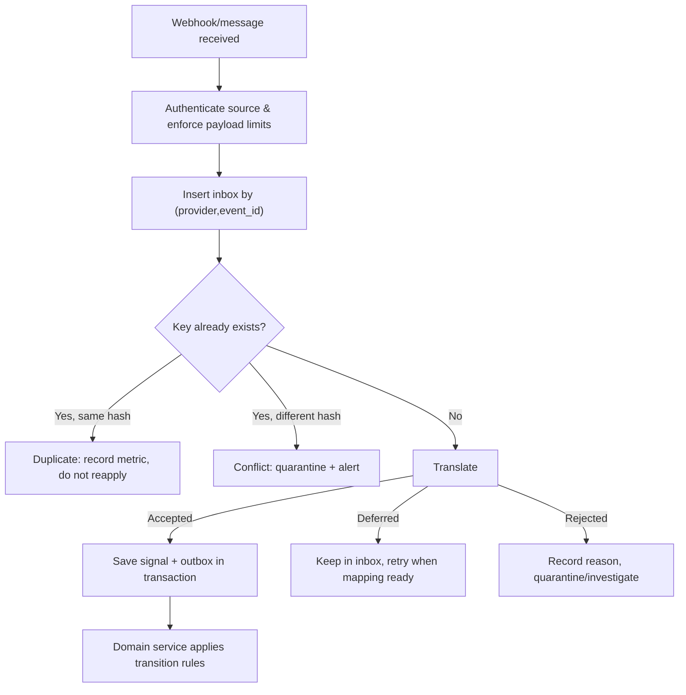

# Translation Layers to Protect Models from External Interpretations

An order management system receives a carrier webhook with status `DLV`, which the partner calls **delivered**. In the internal business model, however, "delivery completed" requires **verified proof of handover**, not merely a status update posted by a driver. If the API adapter takes the string `DLV` and directly sets `order.status = COMPLETED`, the same word has masked **two different concepts**.

Another example: a partner reports `totalAmount = 125000` in **minor currency units**, whereas the sales model uses `Money(amount, currency)` and separates merchandise revenue, tax, and shipping fees. If `125000` is converted directly into "revenue 125,000 VND", reports can record both the wrong unit and the wrong financial substance.

A common solution in domain design is the **Anti-Corruption Layer (ACL)**: a boundary responsible for **understanding external contracts, validating them, and translating their semantics into the language of the internal model**, so that changes, ambiguities, or mismatches from external partners do not leak directly into core entities, schemas, and business rules.

This lesson belongs to the **Boundaries and Integration** chapter of the **DATABASE_DATA_MODELING** module. The goal of the module is to turn business requirements into clear entities, relationships, keys, constraints, and physical schemas—and to evaluate relational, document, graph, and analytical models so structures can evolve and be verified. Therefore, we will examine the ACL **not just as DTO mapping code**, but also as a set of decisions about **who owns data semantics**, how to store identities and provenance, protect invariants, handle late-arriving events, and preserve data correctness across integrated systems.

## 1. When Is a Translation Layer Truly Necessary?

A boundary appears whenever two sides have **independent business languages and rules** (*bounded contexts*) or heterogeneous data lifecycles.

| External Context | Internal Context | Risk of Direct Coupling |
| --- | --- | --- |
| Carrier: `DLV` means driver reported delivered | Order: completed only when delivery proof satisfies policy | Orders closed prematurely; disputes ignored |
| Payment gateway: `AUTHORIZED` means funds are held | Accounting: revenue or collected cash follows capture/settlement rules | Revenue recognized before funds are captured |
| CRM: `customer_id = "42"` in CRM namespace | Domain: `CustomerId` is an internal identifier | Confusing CRM's `"42"` with POS's `"42"` |
| Partner: amount `1999` expressed in cents | Domain: `Money` has explicit currency and scale | Monetary errors from multiplying/dividing by 100 or mixing currencies |
| Source: `NULL` means "field omitted" in PATCH | Domain: clearing a value is an explicit operation | Data wiped out during partial updates |
| Partner: timestamp is local time without timezone | Domain: UTC `Instant`, plus business date if needed | Wrong cutoffs, TTLs, or reporting periods |
| Source: one "order" spans multiple shipping parcels | Domain: one order can have multiple shipments | Dropped records or cardinality violations |

**Not every REST call requires a heavy ACL.** If two contracts genuinely share the same semantics and governance, a simple adapter may suffice. An ACL is valuable when you must **protect the core model from interpretations, changes, or drift** controlled by external teams.

### 1.1. Distinguishing Syntactic Translation from Semantic Translation

- **Syntax:** JSON `"2026-11-22T09:00:00Z"` → `Instant`; JSON string → validated enum or code.
- **Semantics:** "carrier reported delivered" → **a signal from the carrier**, **not** "customer confirmed receipt"; `AUTHORIZED` → **authorized**, not "paid".
- **Identity:** `external_tracking_no` → internal `ShipmentId` via a mapping table; never force a tracking number to be the domain's UUID.
- **Structure:** one partner event may need to be split into multiple domain concepts, or multiple external messages may be needed to establish one internal state.
- **Policy:** unknown external codes or missing data → reject/quarantine/wait per rules; never silently pick a lookalike value.

A mapper that only renames `customerId` to `customer_id` is not necessarily an ACL. The value of an ACL lies in **semantic decisions**.

## 2. Designing Dependency Direction: The Domain Knows Nothing of Partner Types

The recommended architecture separates roles:



**Source-code dependency arrows must be controlled:** domain types must not import SDKs or enums published by a carrier. Adapters and ACLs may depend on external contracts and **ports** owned by the inside; the domain should never modify a class simply because a carrier renamed `"DLV"` to `"DELIVERED"`.

| Component | Primary Responsibility | What It Should Avoid |
| --- | --- | --- |
| **Transport adapter** | HTTP/Kafka/files, source authentication, JSON parsing, size limits, response codes | Mutating aggregate state directly from JSON field names |
| **External DTO** | Faithfully represents the source contract by version | Becoming a core entity merely for deserialization convenience |
| **ACL translator** | Normalizing, validating, looking up IDs, classifying and interpreting meaning, producing internal commands/signals | Assigning defaults that erase meaning; overriding domain rules |
| **Application service** | Coordinating transactions, idempotency, invoking the domain, handling translator results | Scattering dependencies on every external enum code |
| **Domain model** | Business rules, aggregates, invariants, true identity, and true state | Knowing `carrierCode`, JSON fields, or vendor HTTP statuses |
| **Repository/outbox** | Persisting according to the model, transactions, and reliable messaging | Treating raw payloads as the domain schema |

The ACL can live inside the same service as the adapter or as a standalone component; creating a new microservice is not mandatory. **Separate logical responsibilities first**, and split processes only when operational needs justify it.

## 3. Define Domain Contracts Before Inspecting External JSON

In the delivery example, the internal domain has these definitions:

| Domain Concept | Definition to Protect |
| --- | --- |
| `ShipmentId` | Shipping parcel/lot identifier managed by the internal system |
| `DeliveryReported` | Carrier reported successful delivery; does not yet prove verified recipient handover |
| `ProofOfDeliverySubmitted` | Carrier sent a delivery-proof reference; does not mean the proof has been approved |
| `ReturnedToSender` | Carrier reported returning/returned goods to sender per contract |
| `MovementObserved` | Carrier reported a transit scan; not equivalent to delivered |
| `DeliveryConfirmed` | Domain verified handover confirmation conditions under business policy |

An event name is not absolute truth. `ProofOfDeliverySubmitted` only states that **the source submitted a reference**; verifying signature, location, recipient, or documents may belong to a separate process. Never translate `POD` directly into `DeliveryConfirmed`.

### 3.1. Semantic Translation Table

Suppose carrier `CARRIER_A` has an illustrative contract:

| Source Code | Verified Meaning in Source Contract | Suggested Domain Signal | Handling When Data Is Missing |
| --- | --- | --- | --- |
| `SCAN` | Transit scan observed | `MovementObserved` | Missing timestamp/ID → reject |
| `DLV` | Carrier marked as delivered | `DeliveryReported` | Do not auto-complete order |
| `POD` | Carrier sent proof-of-delivery reference | `ProofOfDeliverySubmitted` | Missing reference → reject/quarantine |
| `RTS` | Reported return to sender | `ReturnedToSender` | Domain handles conflict with current state |
| New/unknown code | No reliable definition yet | **Do not guess** | Quarantine/alert, add versioned translator |

This table is an **illustrative contract**, not a claim that `DLV`, `POD`, and `RTS` carry the same meaning across all carriers. Adding Carrier B requires its own verified map rather than reusing status strings just because they look similar.

### 3.2. One External Field May Not Map to One Internal Object

If a partner sends `order_status = "COMPLETE"`, ask:

1. Does "Complete" mean warehouse handling finished, payment finished, or customer received the goods?
2. Can one order have multiple incomplete shipments?
3. Can the value be reversed later?
4. Is there supporting evidence in the payload or another lookup API to confirm?

The answer may be **emitting an IntegrationSignal for the domain to process** or **waiting for supplemental data**, rather than setting a matching enum. An ACL must not force a many-to-one mapping via renaming if renaming loses critical information.

## 4. Distinguish Three Translation Outcomes

Not every input is valid or immediately convertible into a domain event.

| Outcome | Meaning | Next Action |
| --- | --- | --- |
| **Accepted** | Source contract valid; ID and semantics mapped | Dispatch internal signal/command to application service |
| **Deferred** | Message valid, but missing a dependency that may arrive later (e.g., tracking → ShipmentId mapping) | Hold in inbox, retry on schedule/backoff; never drop raw event |
| **Rejected/Quarantined** | Contract mismatch, unsupported code, invalid data, or conflict | Record controlled reason, alert/investigate; never force meaning |

Avoid code like:

```java
// Anti-pattern: every unknown code is treated as an active transit state.
if ("DLV".equals(externalCode)) {
    order.setStatus(OrderStatus.COMPLETED);
} else {
    order.setStatus(OrderStatus.IN_TRANSIT);
}
```

This snippet breaks three rules at once: `DLV` is over-interpreted, `POD/RTS` codes are misinterpreted, and unknown codes fall into a default state. **Classify the outcome** before mutating any aggregate.

## 5. Self-Contained Java 17+ Example: Translating Carrier Events

This example uses Java 17 with no external frameworks or libraries. `ExternalCarrierEvent` is the DTO for `CARRIER_A`'s contract; the domain only sees `ShipmentId` and signals with internal semantics. The translator returns `Accepted`, `Deferred`, or `Rejected` without touching a database directly.

Save the entire program below as `CarrierTranslationDemo.java`:

```java
import java.time.Instant;
import java.time.format.DateTimeParseException;
import java.util.Map;
import java.util.Objects;
import java.util.UUID;

public class CarrierTranslationDemo {

    // External boundary DTO; never pass into domain entities.
    record ExternalCarrierEvent(
        String eventId,
        String trackingNumber,
        String statusCode,
        String occurredAt,
        String proofReference
    ) {}

    record ShipmentId(UUID value) {
        ShipmentId {
            Objects.requireNonNull(value, "shipmentId");
        }
    }

    record SourceEventKey(String provider, String eventId) {
        SourceEventKey {
            provider = required(provider, "provider");
            eventId = required(eventId, "eventId");
        }
    }

    record ProofReference(String value) {
        ProofReference {
            value = required(value, "proofReference");
        }
    }

    // Signal set accepted by the domain; contains no vendor status codes.
    sealed interface ShipmentSignal
        permits MovementObserved, DeliveryReported,
                ProofOfDeliverySubmitted, ReturnedToSender {}

    record MovementObserved(ShipmentId shipment, Instant at)
        implements ShipmentSignal {}

    record DeliveryReported(ShipmentId shipment, Instant at)
        implements ShipmentSignal {}

    record ProofOfDeliverySubmitted(
        ShipmentId shipment, ProofReference proof, Instant at
    ) implements ShipmentSignal {}

    record ReturnedToSender(ShipmentId shipment, Instant at)
        implements ShipmentSignal {}

    // Retains source key for auditing/dedup in application/integration layers.
    record NormalizedMessage(
        SourceEventKey source, ShipmentSignal signal
    ) {}

    sealed interface TranslationResult
        permits Accepted, Deferred, Rejected {}

    record Accepted(NormalizedMessage message)
        implements TranslationResult {}

    record Deferred(String reason) implements TranslationResult {}

    record Rejected(String reason) implements TranslationResult {}

    // Port owned by the inside. Backed by a repository/mapping in production.
    interface ShipmentLookup {
        ShipmentId find(String provider, String trackingNumber);
    }

    static String trimToEmpty(String raw) {
        return raw == null ? "" : raw.strip();
    }

    static String required(String raw, String field) {
        String s = trimToEmpty(raw);
        if (s.isEmpty()) {
            throw new IllegalArgumentException(field + " is blank");
        }
        return s;
    }

    static TranslationResult translate(
        String provider,
        ExternalCarrierEvent input,
        ShipmentLookup lookup
    ) {
        Objects.requireNonNull(lookup, "lookup");

        // This contract applies only to CARRIER_A.
        if (!"CARRIER_A".equals(provider)) {
            return new Rejected("UNSUPPORTED_PROVIDER");
        }
        if (input == null) {
            return new Rejected("EMPTY_PAYLOAD");
        }

        String sourceId = trimToEmpty(input.eventId());
        String tracking = trimToEmpty(input.trackingNumber());
        String status = trimToEmpty(input.statusCode());

        if (sourceId.isEmpty() || tracking.isEmpty()
            || status.isEmpty()) {
            return new Rejected("MISSING_REQUIRED_FIELD");
        }

        Instant eventTime;
        try {
            // Require UTC ISO-8601 with offset/Z; never guess timezone.
            eventTime = Instant.parse(
                required(input.occurredAt(), "occurredAt")
            );
        } catch (DateTimeParseException
                 | IllegalArgumentException e) {
            return new Rejected("INVALID_EVENT_TIME");
        }

        // Unknown external codes are rejected, never defaulted to IN_TRANSIT.
        if (!status.equals("SCAN") && !status.equals("DLV")
            && !status.equals("POD") && !status.equals("RTS")) {
            return new Rejected("UNSUPPORTED_STATUS_CODE");
        }
        if (status.equals("POD")
            && trimToEmpty(input.proofReference()).isEmpty()) {
            return new Rejected("MISSING_PROOF_REFERENCE");
        }

        ShipmentId shipment = lookup.find(provider, tracking);
        if (shipment == null) {
            // Mapping may arrive later: hold event and reprocess.
            return new Deferred("SHIPMENT_MAPPING_NOT_READY");
        }

        ShipmentSignal signal = switch (status) {
            case "SCAN" -> new MovementObserved(shipment, eventTime);
            case "DLV" -> new DeliveryReported(shipment, eventTime);
            case "POD" -> new ProofOfDeliverySubmitted(
                shipment,
                new ProofReference(input.proofReference()),
                eventTime
            );
            case "RTS" -> new ReturnedToSender(shipment, eventTime);
            default -> throw new IllegalStateException(
                "Status prevalidation failed"
            );
        };

        return new Accepted(
            new NormalizedMessage(
                new SourceEventKey(provider, sourceId),
                signal
            )
        );
    }

    record TrackingKey(String provider, String tracking) {}

    public static void main(String[] args) {
        ShipmentId shipment = new ShipmentId(
            UUID.fromString("68221ee1-2a88-46ef-b6de-e3498bf36929")
        );
        Map<TrackingKey, ShipmentId> mapping = Map.of(
            new TrackingKey("CARRIER_A", "TRK-42"), shipment
        );
        ShipmentLookup lookup = (provider, tracking) ->
            mapping.get(new TrackingKey(provider, tracking));

        TranslationResult reported = translate(
            "CARRIER_A",
            new ExternalCarrierEvent(
                "evt-01", "TRK-42", "DLV",
                "2030-05-01T10:00:00Z", null
            ),
            lookup
        );
        System.out.println(reported);
        // Accepted(DeliveryReported), NOT DeliveryConfirmed.

        TranslationResult proof = translate(
            "CARRIER_A",
            new ExternalCarrierEvent(
                "evt-02", "TRK-42", "POD",
                "2030-05-01T10:05:00Z", "proof-123"
            ),
            lookup
        );
        System.out.println(proof);
        // Accepted(ProofOfDeliverySubmitted); requires separate verification.

        System.out.println(translate(
            "CARRIER_A",
            new ExternalCarrierEvent(
                "evt-03", "TRK-UNKNOWN", "RTS",
                "2030-05-02T01:00:00Z", null
            ),
            lookup
        )); // Deferred: mapping not ready yet.

        System.out.println(translate(
            "CARRIER_A",
            new ExternalCarrierEvent(
                "evt-04", "TRK-42", "NEW_CODE",
                "2030-05-02T02:00:00Z", null
            ),
            lookup
        )); // Rejected: unsupported status code.
    }
}
```

### 5.1. What Has Been Protected?

- **No SDK/DTO leakage:** the domain uses `ShipmentId` and `ShipmentSignal`, without importing `ExternalCarrierEvent`.
- **No semantic confusion:** `DLV` becomes `DeliveryReported`; `POD` becomes `ProofOfDeliverySubmitted`, and neither event automatically confirms order completion.
- **No forcing tracking numbers into IDs:** lookup goes through `ShipmentLookup` scoped by provider namespace.
- **No fabricated values:** timestamps must parse cleanly; proof is mandatory for `POD`; new codes are rejected with an explicit reason.
- **Distinguishing missing dependencies:** unready mapping → `Deferred`, distinct from invalid payload → `Rejected`.
- **Source attribution:** `SourceEventKey(provider,eventId)` supports duplicate handling and auditing at the integration layer.

This is an illustrative program; it **does not handle webhook authentication, transactions, retries, or persistence**. Those belong to the adapter/application/infrastructure layers and must be implemented for reliable production operation.

### 5.2. Why Not Use One Unified Status Enum?

If you create a shared enum `IN_TRANSIT, DELIVERED, RETURNED` and force carriers, warehouse, sales, and customer support to share it, differences in what "delivered" means are hidden. The core model must own its own language; each partner can have its own codes and workflows at the boundary.

One source may emit multiple events for one domain state, or one event may require checking prior state to know whether it applies. **Mappings are not necessarily 1–1**.

## 6. Using ACLs to Protect Data Types, Units, and Constraints

Semantic translation does not apply only to statuses:

| Category | External Value | Desired Domain Form | Required Validation |
| --- | --- | --- | --- |
| Money | `125000` "minor units", `currency=VND` | `Money(125000, VND)` if minor unit is defined as 1 VND | ISO currency, exponent per policy, never infer from locale |
| Money | `1999` "cents", `currency=USD` | `Money(19.99, USD)` or keep raw 1999 cents | Exact scale, never use `double` for money |
| Weight | `2500` grams | `Weight(2.5 kg)` if domain uses kg | Unit, negative values, rounding |
| Time | `"01/05/2030 17:00"` without timezone | `Instant` or contextual `LocalDateTime` | Never guess UTC; verify offset/zone from contract |
| Identity | `tracking="TRK-42"` | `ShipmentId(UUID)` | Correct provider, mapping version, avoid collisions |
| Nullable field | `address` omitted in PATCH | "Keep unchanged" if contract defines omission that way | Distinguish omitted field, explicit null, and empty string |
| Status | `"CLOSED"` on external ticket | Domain distinguishes multiple close reasons | Never assign `RESOLVED` without a resolution |
| Cardinality | Partner maps one order to many parcels | Domain `Order` has a set of `Shipment`s | Never pick only the first parcel and discard the rest |

### 6.1. Currency Unit Conversion Example

If a partner guarantees `amount_minor` and `currency` per ISO-4217, you can represent the **exact raw value** accurately:

```java
import java.math.BigDecimal;
import java.util.Currency;

record Money(BigDecimal amount, Currency currency) {}

static Money fromMinor(long minorUnits, String currencyCode) {
    Currency currency = Currency.getInstance(currencyCode);
    int fractionDigits = currency.getDefaultFractionDigits();
    if (fractionDigits < 0) {
        throw new IllegalArgumentException(
            "Currency exponent not defined"
        );
    }
    return new Money(
        BigDecimal.valueOf(minorUnits, fractionDigits),
        currency
    );
}
```

This snippet belongs inside an appropriate Java class and is not a standalone program. **Do not** apply it mechanically to every API: a partner may use custom exponents, internal currency codes, non-fiat currencies, or different rounding rules. Most importantly, **the source contract and domain monetary policy** must be matched explicitly, never inferred from field names.

Even when currency conversion is accurate, `order_total` may include tax, shipping, and vouchers; it **does not automatically become** `net_revenue`. If the domain needs separate components while the source only provides a total, the ACL should report **insufficient information** or call a supplemental API rather than setting tax/shipping to 0.

### 6.2. Missing Value Does Not Mean "Not Applicable"

For example, CRM sends `region = null`. That could mean unclassified, hidden for privacy, or the customer's address has no region in that model. If the domain distinguishes `UNKNOWN`, `NOT_APPLICABLE`, and `REDACTED`, the ACL must classify using **authoritative context/metadata**; never convert every `null` into "unknown" or an empty string.

With PATCH, a **missing field**, a field present with `null`, and a field present with `""` can be three different operations. Read the specific HTTP/JSON contract and translate them into commands like `Unchanged`, `Clear`, and `Replace(value)`; never set `null` on an entity before determining its meaning.

## 7. Cross-System Identity Mapping Is Part of the Data Model

An external code is usually unique only **within the source's namespace**. For example, `trackingNumber="TRK-42"` from Carrier A has no default relationship with `"TRK-42"` from Carrier B. The domain should use its own meaningful, stable identity, typically a surrogate ID.



Two identical source codes must never automatically collapse into the same shipment. A typical mapping table needs:

- `provider` or `source_system`;
- `external_tracking_no`, format, and normalization rules;
- internal `shipment_id`;
- metadata such as `created_at`, `verified_at`, contract version, reconciliation source;
- if external codes are **reused**, add effective-time intervals/history and temporal lookup rules.

**Subtle point:** mappings can be 1–N, N–1, or change over time. If an external partner manages a "consignment" spanning multiple parcels, do not force one consignment code into a single `ShipmentId` when the domain tracks multiple shipments. Instead, pick the right identity granularity or introduce a linking entity.

## 8. PostgreSQL Design: Inbox, Mapping Table, and Normalized Signals

A reliable translation layer needs **explainability** for where everything came from, reprocessability when dependencies arrive late, and protection against duplicate events. The PostgreSQL schema below is **one illustrative approach**, not a mandatory design for every queue or warehouse.

### 8.1. Internal Entity and External Mapping

```sql
CREATE TABLE shipment (
    shipment_id UUID PRIMARY KEY,
    order_id UUID NOT NULL,
    fulfillment_state VARCHAR(32) NOT NULL
        CHECK (fulfillment_state IN (
            'CREATED', 'IN_TRANSIT', 'REPORTED_DELIVERED',
            'CONFIRMED_DELIVERED', 'RETURNED'
        )),
    version BIGINT NOT NULL DEFAULT 0 CHECK (version >= 0)
);

CREATE TABLE carrier_shipment_link (
    provider TEXT NOT NULL,
    external_tracking_no TEXT NOT NULL,
    shipment_id UUID NOT NULL REFERENCES shipment(shipment_id),
    linked_at TIMESTAMPTZ NOT NULL DEFAULT now(),
    PRIMARY KEY (provider, external_tracking_no),
    CONSTRAINT ck_tracking_nonempty CHECK (
        length(btrim(provider)) > 0
        AND length(btrim(external_tracking_no)) > 0
    )
);
```

`shipment` uses **domain-managed statuses**. `carrier_shipment_link` is an integration mapping, not the primary key of shipment; this allows changing carriers without changing internal identity.

This schema assumes one tracking number maps to one shipment **within the retained data lifetime** of a provider. If codes are reused, you must change the unique key and design temporal or shipment-lifecycle mapping before deploying.

`fulfillment_state` illustrates possible displayable states; it **must not** be updated to `CONFIRMED_DELIVERED` simply because the ACL received `DLV` or `POD`. The aggregate/domain service must validate transitions, evidence, and races with returns/cancellations.

### 8.2. Inbox Storing External Events and Classification Outcomes

```sql
CREATE TABLE carrier_inbox (
    provider TEXT NOT NULL,
    external_event_id TEXT NOT NULL,
    contract_version TEXT NOT NULL,
    received_at TIMESTAMPTZ NOT NULL DEFAULT now(),
    occurred_at TIMESTAMPTZ,
    payload_sha256 CHAR(64) NOT NULL,
    raw_payload JSONB NOT NULL,
    processing_state VARCHAR(16) NOT NULL
        DEFAULT 'RECEIVED'
        CHECK (processing_state IN (
            'RECEIVED', 'DEFERRED', 'REJECTED', 'NORMALIZED'
        )),
    reason_code TEXT,
    PRIMARY KEY (provider, external_event_id),
    CONSTRAINT ck_inbox_identity CHECK (
        length(btrim(provider)) > 0
        AND length(btrim(external_event_id)) > 0
        AND length(btrim(contract_version)) > 0
    )
);

CREATE INDEX ix_carrier_inbox_pending
    ON carrier_inbox (processing_state, received_at)
    WHERE processing_state IN ('RECEIVED', 'DEFERRED');
```

Benefits:

1. `(provider, external_event_id)` acts as the **dedup key**, provided the contract confirms event IDs are unique within that scope. If a provider reuses event IDs per account/tenant, include the appropriate namespace.
2. `payload_sha256` distinguishes **identical-content retries** from **same-ID different-payload conflicts**; do not substitute a hash for an authoritative identifier.
3. `raw_payload` exists only for auditing/reprocessing within retention and access limits. Never store secrets, PII, tokens, or unnecessary sensitive evidence in unprotected logs.
4. `processing_state` and `reason_code` allow tracking deferred/rejected items instead of returning HTTP 200 and dropping the event.

**Note:** if webhook digital signatures are required, verify signatures against the **original raw bytes** before parsing/normalizing JSON; `JSONB` can alter field ordering and whitespace, so never reconstruct the message from parsed values for signature verification. You can store a hash of the received raw bytes and retain only sanitized payloads per policy.

### 8.3. Normalized Internal Signals

```sql
CREATE TABLE shipment_signal (
    provider TEXT NOT NULL,
    external_event_id TEXT NOT NULL,
    shipment_id UUID NOT NULL REFERENCES shipment(shipment_id),
    signal_kind VARCHAR(32) NOT NULL,
    event_time TIMESTAMPTZ NOT NULL,
    proof_reference TEXT,
    normalized_at TIMESTAMPTZ NOT NULL DEFAULT now(),

    PRIMARY KEY (provider, external_event_id),
    FOREIGN KEY (provider, external_event_id)
        REFERENCES carrier_inbox(provider, external_event_id),
    CONSTRAINT ck_signal_kind CHECK (
        signal_kind IN (
            'MOVEMENT_OBSERVED',
            'DELIVERY_REPORTED',
            'PROOF_SUBMITTED',
            'RETURNED_TO_SENDER'
        )
    ),
    CONSTRAINT ck_signal_proof_shape CHECK (
        (
            signal_kind = 'PROOF_SUBMITTED'
            AND proof_reference IS NOT NULL
            AND length(btrim(proof_reference)) > 0
        )
        OR
        (
            signal_kind <> 'PROOF_SUBMITTED'
            AND proof_reference IS NULL
        )
    )
);

CREATE INDEX ix_shipment_signal_timeline
    ON shipment_signal (shipment_id, event_time, external_event_id);
```

The `ck_signal_proof_shape` constraint prevents a `PROOF_SUBMITTED` record from missing a reference and prevents the proof column from leaking onto other signals in this example. If a real source permits attaching proof on `DLV`, redesign the contract rather than silently dropping data.

Rows in `shipment_signal` are **evidence/signals from sources**; they are not necessarily the aggregate's final state-transition history. Separating the two concepts allows revising verification logic later while preserving data provenance.

## 9. Handling Duplicates, Retries, and Transactions

Webhooks/message buses can redeliver an event due to timeouts, retries, or consumer restarts. **At-least-once delivery** is the standard safe operational assumption; never build logic assuming a source delivers strictly once.

A workflow might look like:



### 9.1. Do Not Just Use `ON CONFLICT DO NOTHING` and Forget

Example principled insert:

```sql
INSERT INTO carrier_inbox (
    provider, external_event_id, contract_version,
    payload_sha256, raw_payload
) VALUES (
    'CARRIER_A', 'evt-01', 'v1',
    '0123456789abcdef0123456789abcdef0123456789abcdef0123456789abcdef',
    '{"eventId":"evt-01","statusCode":"DLV"}'::jsonb
)
ON CONFLICT (provider, external_event_id)
    DO NOTHING
RETURNING provider, external_event_id;
```

If `RETURNING` yields a row, it is a new inbox entry. If not, you must **read back the existing entry and compare the hash/payload policy**: exact match → idempotent completion; same key with different content → conflict, never silently discard a correction. Hashes must be computed consistently from raw bytes or a defined canonical representation; never mix two hashing methods and raise false conflicts.

### 9.2. Transaction Boundaries

Inside a single PostgreSQL database, transitioning the inbox from RECEIVED → NORMALIZED, creating `shipment_signal`, and writing the **outbox message** can happen inside **one transaction**. A separate worker publishes outbox rows to the message broker and can retry safely. This prevents the "updated DB but crashed before sending event" failure mode when the outbox pattern is implemented properly.

Minimal outbox schema:

```sql
CREATE TABLE integration_outbox (
    outbox_id UUID PRIMARY KEY,
    provider TEXT NOT NULL,
    external_event_id TEXT NOT NULL,
    shipment_id UUID NOT NULL REFERENCES shipment(shipment_id),
    message_kind TEXT NOT NULL,
    message_body JSONB NOT NULL,
    created_at TIMESTAMPTZ NOT NULL DEFAULT now(),
    published_at TIMESTAMPTZ,
    UNIQUE (provider, external_event_id),
    FOREIGN KEY (provider, external_event_id)
        REFERENCES shipment_signal(provider, external_event_id)
);
```

To **avoid creating redundant outbox entries**, the implementation must verify that inserting `shipment_signal` actually created a new/eligible row using transactions, unique constraints, and idempotent application logic. An outbox message that was published before `published_at` was marked can be re-emitted after a crash, so **consumers must still be idempotent**. A transactional outbox does not automatically yield end-to-end "exactly once" across multiple systems.

### 9.3. Parallel Processing and Ordering

Two events for the same shipment can arrive out of order:

```text
event_time 10:00:00  Carrier: DLV
event_time 10:01:00  Carrier: POD

arrival 10:02:00     POD arrives first
arrival 10:05:00     DLV arrives later due to retry
```

If the application service blindly sets `shipment.state = REPORTED_DELIVERED` on every `DLV`, it can **downgrade state** after verified proof was already recorded. The domain must validate state transitions using **version, event time, business rules, and evidence trust level**, not raw arrival order.

Reversals/returns, chargebacks, and callback corrections may require a new event with its own semantics. Never solve ordering by "always picking the highest enum ordinal" because workflows are often **non-monotonic** and include valid rollback/return paths.

## 10. Data Boundaries: Raw, Normalized, and Domain State

Three distinct data layers answer three distinct questions:

| Layer | Question Answered | Example | Properties |
| --- | --- | --- | --- |
| **Raw/inbox** | What did the source send, when, and under which contract? | `statusCode="DLV"`, raw hash, receivedAt | Immutable/audit with retention and PII controls |
| **Normalized integration event** | How did we interpret that signal after translation? | `DeliveryReported(ShipmentId, at)` | Internal codes/IDs and semantics validated |
| **Domain state/ledger** | After applying all rules, what is the shipment's current state? | `IN_TRANSIT`, `CONFIRMED_DELIVERED`, version | Updated via aggregate/application transactions |

Never put a `carrier_status` column on `shipment` and let every report/application read it directly as internal truth. Domain state can depend on **multiple sources**: carrier, warehouse, customer confirmation, dispute resolution, and approved proof.

### 10.1. Mapping Tables Are Not Domain Entities

`carrier_shipment_link` should belong to integration data or mapping repositories. It answers "which shipment corresponds to Carrier A's code?" without necessarily becoming an attribute of `Order` used across every use case.

**Exception:** if a tracking number carries core business meaning (customer support lookups, handover verification), the domain may need a `TrackingNumber` value object. That **does not** mean the domain depends on a vendor SDK class or knows Carrier A's error-code syntax. Boundaries are drawn by **conceptual ownership**, not a blanket rule banning all external fields.

## 11. Time and History Considerations

Multiple timestamps commonly appear alongside a single event:

- `occurred_at`: when the source claims the event **happened**;
- `received_at`: when the system received the message;
- `normalized_at`: when the ACL succeeded in translating it;
- `effective_at`: which instant the domain selects for business effect, if applicable;
- `published_at`: when the integration outbox actually dispatched it.

They are **not interchangeable**. If a source sends local time without a timezone, `Instant.parse` cannot infer the true instant; reject it or resolve using a trusted contracted timezone. In multi-region syncs, daylight saving transitions and late-arriving events are major sources of skew.

For analytical warehouses, clarify:

1. Which timestamp partitions events (`occurred_at` vs. `received_at`)?
2. Does a late-verified signal trigger **restatement** of prior-month reports?
3. When a partner amends a source event, does the warehouse keep revisions or overwrite?
4. Is a "delivered yesterday" report based on **carrier report**, **proof submission**, or **domain confirmation**?

A well-designed ACL separates **source events** from **confirmed business facts**, preventing a "Delivered" dashboard from silently using a different denominator than customer support.

## 12. Changing Contracts and Multiple Versions

Carrier A might change from:

```json
{
  "eventId": "evt-01",
  "trackingNumber": "TRK-42",
  "statusCode": "DLV",
  "occurredAt": "2030-05-01T10:00:00Z"
}
```

to:

```json
{
  "event_id": "evt-01",
  "tracking_no": "TRK-42",
  "delivery_status": "DELIVERED_TO_SAFE_PLACE",
  "event_time_ms": 1903860000000,
  "schema_version": 2
}
```

**These are illustrative payloads, not a real carrier contract.** `DELIVERED_TO_SAFE_PLACE` may not mean "delivered to recipient." `event_time_ms` must be verified as Unix epoch **milliseconds**, not seconds. Before writing the v2 translator, verify semantics and units instead of renaming fields and reusing v1 logic.

An implementation structure:

```text
Carrier A v1 DTO/parser -> CarrierATranslatorV1 -> internal signal
Carrier A v2 DTO/parser -> CarrierATranslatorV2 -> internal signal
Carrier B v3 DTO/parser -> CarrierBTranslatorV3 -> internal signal
                                             |
                                             v
                                    Domain application port
```

During version transitions, the inbox should retain the original version. When reprocessing old events, pick the matching v1 translator or a verified migration. **Never blindly run the newest translator** over historical payloads if semantics changed.

### 12.1. Translation Can Be Lossy

If both `"DELIVERED_TO_SAFE_PLACE"` and `"DELIVERED_TO_RECIPIENT"` map to the same `DeliveryReported`, you lose the ability to distinguish handover modes. That is acceptable only when:

- the domain genuinely does not need to distinguish them in any relevant use case;
- the source payload or critical metadata is safely retained for audit;
- reporting systems do not need to analyze the difference, or carry a supporting normalized attribute.

If this distinction affects delivery liability, you must **extend the domain signal** or preserve the semantic attribute rather than "compressing" data. Any lossy mapping should be **explicitly documented and approved**, not an accidental side effect of shorter code.

## 13. Contract Testing for the Translation Layer

Do not test only "JSON deserializes without error." Tests must verify **post-translation semantics** and behavior under bad or late external data.

| Case | Expected Outcome |
| --- | --- |
| `DLV` with valid timestamp and mapped tracking | `Accepted(DeliveryReported)`, not `DeliveryConfirmed` |
| `POD` with proof reference | `Accepted(ProofOfDeliverySubmitted)`, domain still validates proof |
| `POD` missing proof | `Rejected(MISSING_PROOF_REFERENCE)` |
| `RTS` after delivered event | Signal accepted, domain checks transition per policy |
| `NEW_CODE` status | Rejected/quarantined, no fallback to `IN_TRANSIT` |
| Timestamp missing offset/unparseable | Rejected, never defaults to server clock |
| Carrier A tracking number not yet mapped | Deferred; raw event preserved for reprocessing |
| Two carriers share the same tracking string | Never merged into one shipment |
| Two webhooks with same `(provider,eventId)` and hash | Deduped; signals/outbox not duplicated |
| Same event ID with different payload | Conflict/audit, no silent overwrite |
| Late-arriving event | Preserves `occurred_at` and `received_at`; domain does not downgrade state |
| Domain requires verified proof | `DLV` alone does not complete the order |
| Source upgrades v1 → v2 | Each version uses its matching translator; contract tests include fixtures |
| Field omitted in PATCH | Not interpreted as a delete instruction |
| Amount USD 1999 cents | 19.99 USD if real contract confirms 2 decimal places |
| `order_total` includes tax/shipping | Never recorded directly as `net_revenue` |
| One external → many internal mapping | No lost shipments/consolidation errors |
| Service restarts after outbox insert before publish | Can replay, while consumer remains idempotent |

### 13.1. Test Layers to Combine

**Translator unit tests:** use v1/v2 fixtures, testing input → `Accepted/Deferred/Rejected`, including blank strings, bad timestamps, unknown codes, and boundary inputs. These tests run without a DB.

**Contract tests:** verify against real partner fixtures/schemas or mutually agreed protocols; alert when new codes appear. Base tests on verified contracts, not field names guessed by developers.

**Integration tests:** verify mapping tables, inbox unique keys, FKs, transactions, outbox, concurrent webhooks, and reprocessing; prove a retry does not inflate `shipment_signal` rows or report counts.

**End-to-end/domain tests:** prove `DLV` alone does not close an order and only verified proof triggers the proper transition; test disputed return/cancel races.

**Replay tests:** take a sanitized/anonymized event set, run the new translator in shadow mode, and compare against published outputs; avoid re-triggering live side effects during testing.

## 14. Operations: Quarantine, Retries, and Data Quality Observability

No integration pipeline receives only valid data. A well-run ACL needs **visibility into unrecognized or incomplete inputs**.

Useful metrics:

- Counts of `Accepted`, `Deferred`, and `Rejected` events by provider, version, and reason code.
- Age of oldest event in `DEFERRED`, and latency from `received_at` to normalized.
- Count of unsupported status codes and frequency of occurrence.
- Count of same-source-event-ID conflicts with differing hashes.
- Tracking → shipment mapping hit rate and mapping completion latency.
- Signals ignored by the domain due to duplicate/stale/invalid transitions.
- Outbox and consumer lag, retry counts, poison messages, and DLQ depth.
- Reconciliation of total events received/sent, normalized, applied, and pending.

**Never infinitely retry every failure type.** `Deferred(SHIPMENT_MAPPING_NOT_READY)` can retry with backoff within an SLA; `Rejected(UNSUPPORTED_STATUS_CODE)` usually requires updating the contract/translator first rather than spinning in a futile loop. Failures from unauthenticated partner requests must be rejected immediately at the security boundary, not retried as valid data.

### 14.1. Sensitive Data and Authorization

Webhooks can contain addresses, phone numbers, proof codes, signatures, and photo URLs. Before persisting raw payloads:

- Authenticate the source and enforce payload size and rate limits.
- Minimize unnecessary data; mask/encrypt PII and secrets per policy.
- Enforce dedicated access controls on inbox/quarantine and identity mapping tables.
- Establish retention, deletion workflows, and access auditing.
- Avoid logging full payloads into error logs or high-cardinality metric labels.
- If documents may hold sensitive data, store only **access-controlled references** with appropriate expiration.

An ACL is a **data and semantic** trust boundary; it does not replace HTTP authentication, encryption, or user authorization checks.

## 15. Outbound Translation: Domain → Partner

An ACL can also protect the domain when **sending data outward**.

For example, the internal system produces:

```text
ShipmentReadyForPickup(shipmentId, pickupWindow, address)
```

Carrier A expects:

```json
{
  "pickup_ref": "PK-123",
  "window_start": "2030-05-02T08:00:00Z",
  "window_end": "2030-05-02T10:00:00Z",
  "service_code": "STANDARD"
}
```

The **outbound** translation layer must handle:

1. `ShipmentId` → carrier's `pickup_ref` via mapping/registration;
2. `pickupWindow` in UTC → format/timezone expected by the carrier;
3. `service_code` selected per carrier capabilities and business policy;
4. required payload fields, length limits, and units;
5. whether retries create duplicate bookings or pass an **idempotency key** so the partner recognizes the same request;
6. translating external error responses into meaningful **application outcomes**, keeping the domain decoupled from specific HTTP codes.

Outbound translation is **not necessarily the inverse** of inbound translation: source and target contracts can differ in cardinality, precision, defaults, or workflows. Never force `toExternal(toInternal(x)) == x` when data is normalized or relationships are not 1–1.

## 16. Comparing Architectural Alternatives

| Approach | Idea | When Appropriate | Risk |
| --- | --- | --- | --- |
| **Use external DTO/SDK directly in domain** | Entities directly use vendor enums/fields | Only tiny prototypes with 100% identical semantics | Tight coupling and semantic corruption |
| **Simple adapter** | Parse/rename fields to a stable API | External contract shares identical meaning with minimal rules | Can overlook subtle business semantic differences |
| **Anti-Corruption Layer** | Translate identities, data, and workflows to internal model | Two bounded contexts differ in meaning or evolve independently | Extra component; needs tests/versioning/observability |
| **Published Language / Open Host Service** | Both sides agree on a shared contract and govern changes | Two teams/orgs genuinely share a standard language | Semantics may still diverge inside each domain |
| **Enterprise-wide Canonical Data Model** | One shared schema across many integrations | Can standardize certain exchange fields | Easily turns into a "god schema" forcing all bounded contexts to share meaning |
| **Pure data replication/CDC** | Copy table rows/change logs | Projections/replication once semantics are clear | Does not automatically resolve differences in meaning, lifecycle, keys, or time |

**Decision point:** the ACL is the responsibility of whichever side **wants to keep its model independent**. The external side might not even know it exists. It may be implemented via DTO mappers, adapters, mapping tables, translators, message handlers, or dedicated pipelines; **naming a class "Mapper" or "ACL" does not guarantee good design**.

## 17. Boundaries Across Relational, Document, Graph, and Analytical Models

| Storage Model | Risk When Ingesting External Data | How an ACL Protects It |
| --- | --- | --- |
| **Relational** | FKs from external IDs fail to match internal IDs; external enums forced into `CHECK`s; facts dropped by inner joins | Namespace → SK/PK mappings, explicit/Deferred statuses, separate constraints |
| **Document** | JSON schemas drift; omitted/null/empty carry distinct meanings; nested shapes do not match aggregates | Versioned parsers, validation, canonical domain commands, controlled raw storage |
| **Graph** | External "related_to" edges obscure business meaning; one external code maps to multiple nodes/edges | Translate into exact relationship types; verify cardinality and effective dates |
| **Wide-column/KV** | Picking partition keys from mutable external fields; ID collisions across sources | Canonical IDs, versioned routing, read models tailored to internal queries |
| **Warehouse/columnar analytics** | Totals/unit prices/ratios misinterpreted; event time and ingest time mixed; history restatement issues | Explicit fact grain/measures, normalized events with provenance, versioning, restatement policies |

For a warehouse, do not ingest `carrier_status="DLV"` and label the KPI **Completed Orders**. If two KPIs are needed, define them explicitly:

- `carrier_reported_deliveries`: shipments with a carrier delivery signal, deduplicated by shipment/event and timestamped per contract;
- `confirmed_deliveries`: shipments passing domain confirmation criteria.

The two KPIs can legitimately differ. **Separating meanings** yields far more trustworthy numbers than forcing identical status labels.

## 18. Common Pitfalls and Fixes

| Pitfall | Consequence | Fix |
| --- | --- | --- |
| Using vendor enums inside entities | One new code forces domain edits or breaks runtime | Versioned translators, separate domain types |
| `DLV` → `COMPLETED` directly | Skips proof verification step | `DeliveryReported`; domain checks conditions |
| `UNKNOWN_STATUS` → `IN_TRANSIT` default | Hides errors, skews reports and workflows | Reject/quarantine and alert on unknown codes |
| Treating external IDs as internal IDs | Collisions, vendor lock-in, wrong entity boundaries | Map by provider/namespace |
| Renaming fields and calling it an ACL | Fails to address meaning, precision, cardinality | Write semantic mapping tables and invariants |
| Unconditionally dividing minor units by 100 | Wrong currency/exponent or total semantics | Currency/unit contracts + Money value object |
| Defaulting missing timezones to server time | Wrong ordering and reporting periods | Verify timezone or reject |
| Storing raw payloads inside every domain entity | Coupling, PII sprawl, vendor schema leakage | Separate inbox/audit with own access and retention |
| Dropping event IDs/correlation IDs | Retries double-count signals/revenue | Namespaced dedup keys, outbox/inbox |
| Ignoring same-ID events with different hashes | Lost corrections or missed data corruption | Classify conflicts and audit |
| Treating late tracking mappings as bad payloads | Lost valid events | Deferred + retry/reconciliation |
| Updating domain state from the latest **arrived** event | Stale events can downgrade state | Validate transitions/versions/occurred times |
| Running only the newest translator on old payloads | Historical replays misinterpret old contracts | Use matching translator/schema version |
| Assuming an ACL must be a separate microservice | Unnecessary latency and operational overhead | Clear logical boundary first; split deployment when justified |
| Retrying all errors infinitely | Poison messages starve resources | Distinguish transient/unknown/permanent errors |
| Testing only the happy path | Semantic loss under dirty data goes undetected | Unit + contract + integration + replay tests |

## 19. Practice Exercises

### Exercise A — Carrier Adds a Status

Carrier A adds `SAFE_DROP` (leaving the parcel in a safe location without direct handover to the recipient), while the domain only permits "confirmed handover" with verification.

Propose a dedicated domain signal or verification-pending workflow, identify required fields, update the translator table, and explain how to process `SAFE_DROP` events quarantined before the new version deployed.

**Hint:** do not auto-map `SAFE_DROP` to `DeliveryConfirmed`; inspect proof and safe-drop policy. Use a versioned translator and controlled reprocessing.

### Exercise B — Money and Tax from a Marketplace

A marketplace sends `total_minor=125000`, `currency=VND`, `tax_minor=10000`, and `shipping_minor=15000`. The domain needs **merchandise revenue excluding tax and shipping**. Identify contract assumptions to verify (discounts/refunds, tax-inclusive vs. exclusive), the formula when data is sufficient, and cases that must be rejected for missing information.

**Hint:** if total includes all tax and shipping with no other components, merchandise revenue is `125000 - 10000 - 15000 = 100000` in the same unit; however, do not subtract unless the contract confirms total definitions and adjustments.

### Exercise C — Two Sources Share Customer Code "42"

CRM A and POS B both emit `customer_id="42"` for two different people. Design the `(source_system, external_customer_id)` → `CustomerId` mapping, uniqueness constraints, identity merging after reconciliation, and how to avoid arbitrarily rewriting historical IDs.

**Hint:** domain identity must never be inferred from bare string values; merges require business decisions, audit logs, and policy-governed remapping of facts/foreign keys if applicable.

### Exercise D — Duplicate and Out-of-Order Webhooks

A shipment receives events in arrival order: `POD(eventTime=10:05)`, `DLV(eventTime=10:00)`, then a duplicate `POD` with the same ID. Design the inbox, dedup, translator, and domain transitions so events are not emitted twice, state is not downgraded, and delivery is not confirmed solely from an unverified proof link.

**Hint:** unique `(provider,event_id)`, proof signal awaits domain validation; state transitions enforce versions and invariants rather than ordinal comparisons alone.

### Exercise E — Balance Data from a Legacy System

An external system sends `available_balance` and `book_balance` with cutoff times different from the internal ledger. Explain why the two fields must not merge into one `closing_balance`, propose separate signals/adapters, and design a reconciliation table for end-of-day warehouse balances.

**Hint:** clarify account, currency, effective time, pending holds, accounting treatment, and reliability. Naive field copying can corrupt reported balances.

### Exercise F — Version 2 Changes Time Units

Contract v1 sends `occurred_at` in ISO-8601 UTC; v2 sends `occurred_at_ms` in Unix milliseconds. Build a versioned parser, test fixtures, and inbox replay strategy supporting both versions. Highlight risks of confusing milliseconds with seconds and receiving undefined new statuses in v2 payloads.

**Hint:** store `contract_version` and controlled raw/canonical hashes; invoke the matching translator per version; route unknown statuses explicitly.

## 20. Pre-Integration Checklist for External Models

- [ ] Identified which bounded context **owns the semantics** of each concept.
- [ ] Domain imports zero external enums/DTOs/SDKs and has no dependency on specific HTTP fields/paths.
- [ ] Maintained a **semantic mapping table** for codes, statuses, IDs, units, timestamps, null/omitted values, and cardinality.
- [ ] Every translation has contract backing; meanings are never guessed from field names alone.
- [ ] Unknown or dependency-missing cases route to **Rejected/Deferred** or explicit outcomes rather than silent fallbacks.
- [ ] External IDs carry **provider/tenant namespaces**, map to internal IDs, and handle reuse.
- [ ] Entity/aggregate invariants and state-transition conditions are defined; the ACL never bypasses them.
- [ ] Currencies/rates/units/timezones convert with explicit scale, policy, and precision.
- [ ] Inbox, source event key, payload hash/version, and idempotency/conflict handling exist per requirements.
- [ ] Transactions/outbox/consumers tolerate crashes and retries without duplicating side effects.
- [ ] Event time, received time, normalized time, and effective time are distinguished.
- [ ] Strategies exist for late, out-of-order, corrective, and historical events.
- [ ] v1/v2 contracts use matching translators and fixtures; historical replays never apply unverified new interpretations.
- [ ] Retention, PII/secret protection, source authentication, and access controls cover raw and mapping tables.
- [ ] Unit, contract, integration, replay, and post-translation aggregate/report reconciliations are tested.
- [ ] Metrics track accepted/deferred/rejected counts, backlog age, unknown codes, mapping misses, conflicts, and outbox lag.
- [ ] Logical boundaries are crisp without creating unnecessary standalone microservices.

**Remember:** A translation layer does more than make external JSON "fit Java types." It ensures **the internal model owns its own meaning**: separating what a partner *reports* from what the domain *confirms*, safeguarding identities, units, and time, while preserving provenance and workflows for late-arriving or evolving data. A solid boundary means **partner API changes do not force core models to change meaning**, and integration remains verifiable from source events all the way to final records and KPIs.
