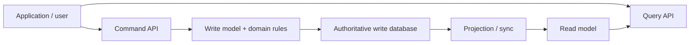
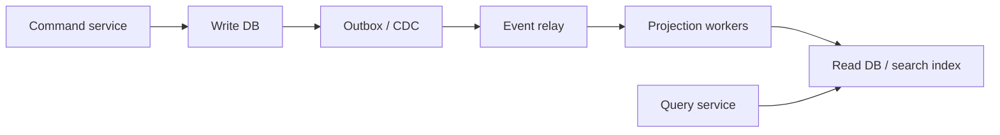
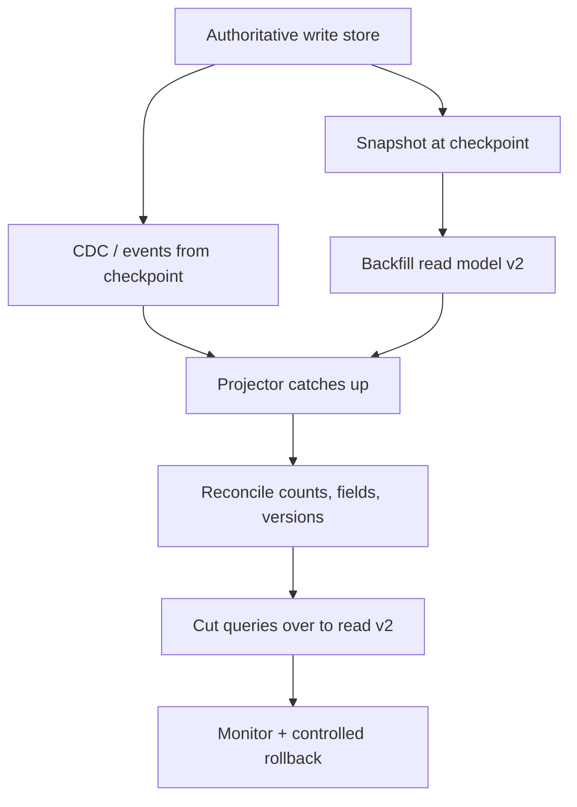
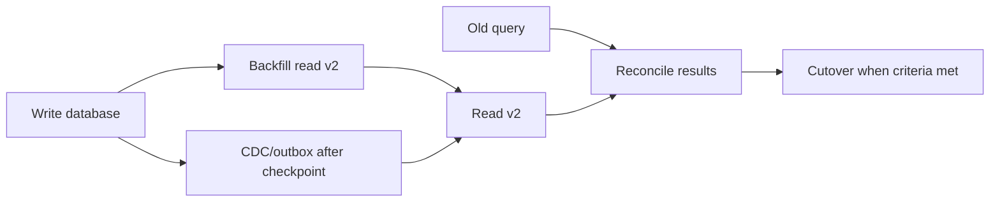

# Separating Read Models from Write Models with CQRS When Needs Diverge

## 1. Why Does One Model Not Always Serve Both Reads and Writes Well?

An operational system typically has two distinct sets of requirements:

- **Writes:** creating orders, enrolling in courses, changing statuses, checking constraints, locking, versioning, update authorization, and atomicity.
- **Reads:** searching, fetching lists, rendering summary screens, multi-condition filtering, pagination, ranking, and reporting.

Early on, a normalized relational schema with suitable SQL queries can satisfy both. As scale and business complexity grow, forcing every query through the same aggregate model can create friction:

- The write model needs to **preserve invariants**, restricting updates outside its responsibility.
- The read model wants **pre-joined data**, fewer joins, and indexes tailored directly to user access patterns.
- Indexes added for search can increase write overhead.
- A report scanning millions of rows should not put unbounded load on the transactional system.
- A dashboard may tolerate a few seconds of lag, whereas allocating the last seat in a class **must never rely on stale data**.

**CQRS (Command Query Responsibility Segregation)** is the practice of separating **the responsibility for executing state-changing commands** from **the responsibility for querying data**. When a real need exists, each responsibility can have its own **model, storage structure, and optimized pipeline**.

This lesson belongs to the **Boundaries and Integration** chapter within **DATABASE_DATA_MODELING**. The module's goal is to build the skill of translating business requirements into clear data models—from entities, relationships, and constraints to keys, indexes, and physical schemas—while comparing relational, document, graph, and analytical models so designs remain evolvable and verifiable.

**After this lesson, you will be able to:**

1. Distinguish commands, queries, write models, read models, and projections.
2. Identify when read/write divergence is large enough to consider CQRS.
3. Choose among logical separation in one app, read tables, or separate read stores.
4. Design a write model that protects invariants and a read model shaped around queries.
5. Implement synchronization via transactions, outbox, or CDC with clear semantics.
6. Handle stale data, duplicate/out-of-order events, and read-your-writes.
7. Rebuild projections, reconcile data, test, and monitor.
8. State clearly when **not** to deploy distributed CQRS.

## 2. What Are Commands, Queries, and Projections?

### 2.1. Commands Express State-Changing Intent

Examples:

```text
PlaceOrder
ConfirmOrder
CancelOrder
EnrollLearner
CompleteLesson
PublishCourse
```

A command is not merely an `INSERT` or `UPDATE` statement. `CancelOrder` must check whether the order is cancellable, whether the caller has permission, whether captured funds need refunding, and whether two concurrent actions conflict.

The **write model** is responsible for enforcing invariants within the appropriate transaction/aggregate boundary and committing accurate results.

### 2.2. Queries Read Data Without Mutating Business State

Examples:

```text
GetOrderDetail
ListOrdersByStatus
SearchOrdersByBuyer
GetLearnerDashboard
CountActiveEnrollments
```

The **read model** organizes data to serve screens and filters. It does not have to share the same relationships, attributes, or JSON shape as the write aggregate.

A query may emit logs or technical metrics, but it must never silently create orders, reserve capacity, or modify state as an undisclosed side effect.

### 2.3. Projections Build Read Models from the Write Source



For instance, the write side stores `orders` and `order_lines`, while the read side produces an order card:

```json
{
  "tenantId": "ORG-07",
  "orderId": "O-1001",
  "status": "CONFIRMED",
  "totalMinor": 350000,
  "itemCount": 3,
  "customerNameAtOrder": "Nguyen An",
  "placedAt": "2026-11-20T09:00:00Z",
  "sourceVersion": 4
}
```

The payload above is a **snapshot for reading**. The authoritative source of status and totals remains on the write side.

### 2.4. CQRS Does Not Equal Event Sourcing or Microservices

- **CQRS:** separates commands and queries; can live inside one application and one DB.
- **Event Sourcing:** events serve as the source for reconstructing business state; can pair with CQRS, but is optional.
- **Event-driven integration:** propagates changes between components; can drive CQRS on top of regular OLTP tables.
- **Microservices:** independent deployment boundaries, not a prerequisite for CQRS.

Needing a well-indexed summary card for an order list **does not mean** you must convert the entire system to event sourcing.

## 3. Requirements Analysis: Query Shapes and Write Invariants

Suppose a course-selling platform has these operations:

| Code | Requirement | Primary Focus |
| --- | --- | --- |
| C1 | Place an order and lock line-item prices | Total-amount invariants, transactions |
| C2 | Confirm an order once conditions are met | State transitions, concurrency |
| C3 | Cancel an order and initiate a refund if eligible | Idempotency, authorization |
| Q1 | Look up one order by tenant and ID | Point read, freshness matters |
| Q2 | List the latest 20 orders by status | Filtering, sorting, cursor pagination |
| Q3 | Search orders by buyer | Search, possibly joining data |
| Q4 | Monthly order count dashboard | Aggregating many records |
| Q5 | Decide whether a refund is permitted | Must rely on authoritative source |

C1–C3 require a model that protects constraints. Q2–Q4 can benefit from denormalized structures, different indexes, or a dedicated read store.

**Even though Q5 looks like a read, it should not default to an eventually consistent projection.** When a result gates a high-risk action, the command handler must re-verify the condition against the authoritative source at commit time.

### 3.1. Questions to Gather Before Choosing an Architecture

- What is read QPS vs. write QPS? How wide is the peak-hour skew?
- Can existing SQL queries be solved with indexes, DTOs, or views?
- Which queries require multi-table joins, full-text search, or large aggregations?
- Is read-after-write needed immediately, within 2 seconds, or is several minutes of lag acceptable?
- Must the read model combine multiple bounded contexts?
- Do queries need historical point-in-time data, or only current state?
- Is there operational budget for queues, consumers, retries, reconciliation, and rebuilds?
- Which constraints **must never** rely on a stale copy?

**Choosing CQRS is simultaneously a data-modeling and operational decision**, not merely splitting two controller classes.

## 4. Three Levels of CQRS Separation and Trade-Offs

### 4.1. Level 1: Separate Handlers/DTOs, Shared Tables

```text
Command handler -> aggregate/domain service -> OLTP tables
Query handler   -> dedicated SQL/DTO        -> same OLTP tables
```

This is the lowest-risk step:

- Commands go through validation, transactions, and authorization checks.
- Queries select only needed fields, using SQL and indexes tailored to query shapes.
- Zero lag from asynchronous replication.
- Code-level read models can differ from write domain objects.

If you only have a slow query due to a missing index, Level 1 is usually the first candidate to try.

### 4.2. Level 2: Separate Read Tables/Views in the Same Database

```text
Write: orders_write, order_lines_write
Read:  order_cards_read, order_daily_summary
```

Read tables can be updated **synchronously inside the same transaction** or **asynchronously via jobs/CDC**. Updating synchronously in the same transaction provides stronger commit-time visibility, at the cost of commands bearing extra overhead to maintain read structures.

### 4.3. Level 3: Separate Read Service and Read Database



Advantages:

- Reads and writes scale independently to match workload demands.
- The read database can specialize in full-text search, documents, or reporting.
- One source change can feed multiple projections.

Costs:

- Synchronization, stale data, event ordering, and idempotency.
- Operating message brokers/CDC and read stores.
- Securing replicas, retention, and rebuild capability.
- Explicitly defining source of truth and incident handling.

| Separation Level | Storage Location | Read Freshness | Complexity |
| --- | --- | --- | --- |
| Separate DTO/handler | Same tables | Depends on transaction/replica read | Low |
| Synchronous read table | Same DB, same transaction | Consistent at commit | Moderate |
| Asynchronous read table | Same DB, separate write path | Has lag | Moderate–high |
| Separate read store | Different DB or engine | Usually has lag | High |

You do not need to adopt a new database engine just to do CQRS. A pattern name **does not substitute for proof of need**.

## 5. Designing the Write Model from Business Invariants

### 5.1. Aggregates and Transaction Boundaries

An `Order` aggregate might contain:

```text
Order
  tenantId, orderId, customerId
  status, version, placedAt
  lines[]
  totalMinor
```

Example invariants:

- Every line has `quantity > 0`.
- Total amount follows the transaction's locked pricing/discount rules.
- Confirmed orders do not change price when today's catalog price changes.
- Status transitions must follow valid state-machine paths.
- The same cancel/refund request is never executed twice due to retries.
- All changes within the aggregate are protected inside the chosen consistency boundary.

An aggregate does not have to fit in one row. In an RDBMS, `orders` and `order_lines` can participate in **one transaction**.

### 5.2. Illustrative PostgreSQL DDL for the Write Side

```sql
CREATE TABLE orders_write (
    tenant_id text NOT NULL,
    order_id text NOT NULL,
    customer_id text NOT NULL,
    status text NOT NULL,
    total_minor bigint NOT NULL,
    placed_at timestamptz NOT NULL,
    version bigint NOT NULL DEFAULT 1,
    PRIMARY KEY (tenant_id, order_id),
    CHECK (status IN ('DRAFT', 'CONFIRMED', 'CANCELLED')),
    CHECK (total_minor >= 0),
    CHECK (version > 0)
);

CREATE TABLE order_lines_write (
    tenant_id text NOT NULL,
    order_id text NOT NULL,
    line_no integer NOT NULL,
    course_id text NOT NULL,
    quantity integer NOT NULL,
    price_minor bigint NOT NULL,
    PRIMARY KEY (tenant_id, order_id, line_no),
    FOREIGN KEY (tenant_id, order_id)
      REFERENCES orders_write(tenant_id, order_id),
    CHECK (quantity > 0),
    CHECK (price_minor >= 0)
);
```

Constraints only protect part of the rules. They do not verify whether `total_minor` equals the policy-compliant sum of line prices; business logic and transactions must still enforce that.

### 5.3. Version-Checked Command Pattern

```sql
UPDATE orders_write
SET status = 'CONFIRMED',
    version = version + 1
WHERE tenant_id = 'ORG-07'
  AND order_id = 'O-1001'
  AND status = 'DRAFT'
  AND version = 3
RETURNING order_id, status, version, total_minor, placed_at;
```

If zero rows are returned, the command has not succeeded. Either the record does not exist, the state has moved, or a concurrent write occurred. Outcomes must be classified alongside proper access controls to avoid leaking another tenant's data.

**A read projection must never be the sole authority deciding whether a command is valid** because it can lag behind the write side.

## 6. Designing Read Models Around Query Shapes

### 6.1. A Pre-Assembled Order Card

For Q2 (list orders by status and time):

```sql
CREATE TABLE order_cards_read (
    tenant_id text NOT NULL,
    order_id text NOT NULL,
    status text NOT NULL,
    customer_name_at_order text NOT NULL,
    total_minor bigint NOT NULL,
    item_count integer NOT NULL,
    placed_at timestamptz NOT NULL,
    source_version bigint NOT NULL,
    is_deleted boolean NOT NULL DEFAULT false,
    projected_at timestamptz NOT NULL DEFAULT now(),
    PRIMARY KEY (tenant_id, order_id),
    CHECK (source_version > 0)
);

CREATE INDEX order_cards_list_idx
ON order_cards_read
    (tenant_id, status, placed_at DESC, order_id DESC);
```

Each row is **one order card**. It does not mirror every write-side detail, only the fields needed for display and filtering.

```json
{
  "tenantId": "ORG-07",
  "orderId": "O-1001",
  "status": "CONFIRMED",
  "customerNameAtOrder": "Nguyen An",
  "totalMinor": 350000,
  "itemCount": 3,
  "placedAt": "2026-11-20T09:00:00Z",
  "sourceVersion": 4
}
```

The field name `customerNameAtOrder` clarifies **snapshot at order placement**, distinct from `customerNameCurrent` meaning the customer's current name. If a screen requires the current name, you must define the update source, rename events, and synchronization rules.

### 6.2. Read Models May Denormalize Intentionally

For every replicated field, document:

| Field | Authoritative Source | When Does It Change? | Editable Directly in Read Store? |
| --- | --- | --- | --- |
| `status` | Order aggregate | On state transition | No |
| `totalMinor` | Locked price on Order | When an allowed command updates it | No |
| `itemCount` | Order line items | When valid lines are added/removed | No |
| `customerNameAtOrder` | Snapshot on Order | Per document amendment rules | Never arbitrarily |
| `projectedAt` | Projection worker | When applying an event | Technical metadata |

**Denormalization does not mean schema-less or contract-free data.** A read model still has keys, types, indexes, field definitions, versions, and security policies.

### 6.3. Multiple Read Models for Multiple Query Shapes

```text
order_cards_read    -> list/filter/sort
order_search_index  -> full-text search
order_daily_totals  -> daily aggregations
order_export_view   -> partner contract file exports
```

Candidate engines include:

- **Relational:** lists with multi-column filters and composite indexes.
- **Document:** screens needing bounded nested aggregates.
- **Search engine:** keywords/language analysis, ranking, faceting.
- **Graph:** multi-hop traversals between entities.
- **Analytical warehouse:** facts/dimensions and large reports.

This is where choosing the right data model pays off. However, every projection carries its own sync, storage, reconciliation, and security costs.

## 7. Synchronous vs. Asynchronous Reads: Choosing Consistency

### 7.1. Synchronous Within the Same Transaction

```text
BEGIN
  validate command
  update write tables
  update read table
COMMIT
```

If the read table resides in **the same database and transaction**, state commits atomically alongside the write row. The benefit is zero separate replication lag between the two tables once committed from a consistent source.

The trade-off: commands must maintain read tables/indexes, and read-model errors can affect the write path. When read layouts change frequently, coupling increases.

### 7.2. Asynchronous

```text
write transaction -> outbox/CDC -> relay/queue -> projector -> read store
```

Benefits: commands do not wait for read indexes to update; the read store scales independently. Trade-off: an intermediate window exists between **write committed** and **read projected**.

### 7.3. Three Moments Never to Equate

- **Accepted:** the system received the request, not necessarily finished processing it.
- **Committed:** the write transaction succeeded.
- **Projected:** the read model reflects the requested version.

If the command API returns:

```json
{
  "orderId": "O-1001",
  "commandStatus": "COMMITTED",
  "writeVersion": 4,
  "status": "CONFIRMED"
}
```

that **does not automatically mean** the list page served from the read store already has `sourceVersion=4`.

### 7.4. Intermediate Options

- Same DB, where the query handler reads another table via a SQL view.
- Batch-refreshed materialized views.
- Read table updated synchronously for critical paths, async projection for search.
- Read replicas to offload traffic, though they still share **the same schema** and can exhibit replication lag.

**A read replica does not create CQRS** if it still uses the exact same write model and query shape. Conversely, CQRS does not mandate replicas.

## 8. Why Direct Dual-Writes Fail Easily

An intuitive but fragile implementation:

```text
1. Update orders_write in DB A.
2. Update order_cards_read in DB B.
3. Return success.
```

If step 1 commits and step 2 fails, the two stores diverge. If step 2 commits and step 1 rolls back, the read side displays state never accepted by the source.

Two independent writes cannot be made atomic with a `try/catch`. Some systems support distributed transactions, but their cost and limits are a separate architectural trade-off.

A **transactional outbox** is commonly used to record **source state and an event record** in the same write transaction, then publish events asynchronously to projectors.

## 9. Transactional Outbox with Relational Databases

### 9.1. Illustrative Outbox Schema

```sql
CREATE TABLE outbox_events (
    event_id uuid PRIMARY KEY,
    tenant_id text NOT NULL,
    aggregate_type text NOT NULL,
    aggregate_id text NOT NULL,
    aggregate_version bigint NOT NULL,
    event_type text NOT NULL,
    event_schema_version integer NOT NULL,
    payload jsonb NOT NULL,
    occurred_at timestamptz NOT NULL,
    published_at timestamptz,
    CHECK (aggregate_version > 0)
);

CREATE INDEX outbox_pending_idx
ON outbox_events (occurred_at, event_id)
WHERE published_at IS NULL;
```

Field meanings:

- `event_id`: identifies the message for deduplication and reconciliation.
- `aggregate_version`: change sequence within **one aggregate**.
- `event_schema_version`: payload format version, distinct from state version.
- `occurred_at`: timestamp per source contract; not equated with projector receive time.
- `published_at`: relay acknowledgment marker per the project's dispatch mechanism.

### 9.2. The Transaction Must Bind Write and Outbox Together

```text
BEGIN TRANSACTION
  validate command, tenant, and state
  conditionally update aggregate with version check
  verify exact expected row count updated
  build event payload from valid new state
  insert outbox_events with unique event_id
COMMIT

If any error occurs in transaction:
  ROLLBACK both aggregate and outbox
```

An illustrative SQL snippet:

```sql
BEGIN;

UPDATE orders_write
SET status = 'CONFIRMED',
    version = version + 1
WHERE tenant_id = 'ORG-07'
  AND order_id = 'O-1001'
  AND status = 'DRAFT'
  AND version = 3
RETURNING order_id, tenant_id, status, version,
          total_minor, placed_at;

-- ONLY insert if UPDATE returned exactly one row and payload matches
-- the new state; this check is enforced by app/procedure logic.
INSERT INTO outbox_events (
    event_id, tenant_id, aggregate_type, aggregate_id,
    aggregate_version, event_type, event_schema_version,
    payload, occurred_at
) VALUES (
    :event_id, 'ORG-07', 'Order', 'O-1001',
    4, 'OrderSummaryChanged', 1,
    :event_payload_jsonb, now()
);

COMMIT;
```

**This is not a complete production procedure**: if `UPDATE` returns 0 rows, the SQL snippet alone does not block the `INSERT`. The transaction coordinator **must check row counts**, roll back, and return an appropriate error. Parameters prefixed with `:` are illustrative placeholders, not universal SQL client bind syntax.

### 9.3. Outbox Does Not Guarantee End-to-End "Exactly Once"

A relay might:

1. Read the outbox.
2. Publish the message successfully.
3. Lose network connectivity before writing `published_at`.
4. Restart and publish the same event again.

Consumers must therefore tolerate **at-least-once delivery** (duplicates) and enforce idempotent handling. Even when a broker or framework advertises "exactly-once", verify whether the **guarantee scope** includes your read-store database writes.

CDC from the transaction log is another candidate; it still requires managing ordering, offsets, retries, and schema evolution. A plain outbox is **not automatically a complete event store** once cleaned up under retention policies.

## 10. Event Contracts for Read Models

A full snapshot event:

```json
{
  "eventId": "3e0242a1-748e-4e0a-8b2b-9d57ae0f1840",
  "eventType": "OrderSummaryChanged",
  "eventSchemaVersion": 1,
  "tenantId": "ORG-07",
  "orderId": "O-1001",
  "sourceVersion": 4,
  "occurredAt": "2026-11-20T09:02:00Z",
  "snapshot": {
    "status": "CONFIRMED",
    "customerNameAtOrder": "Nguyen An",
    "totalMinor": 350000,
    "itemCount": 3,
    "placedAt": "2026-11-20T09:00:00Z",
    "isDeleted": false
  }
}
```

**This is a snapshot event**, meaning it carries all fields needed to replace the order card's contents. It differs from delta events such as `ItemAdded` or `IncrementCount`, which represent only incremental changes.

The contract must define:

1. **Identity:** `(tenantId, orderId)`, preventing collisions if two tenants share an orderId.
2. **Ordering:** `sourceVersion` increases monotonically for changes to the same order.
3. **Schema version:** readers distinguish v1/v2 payloads and migrate safely.
4. **Snapshot semantics:** which fields are point-in-time historical snapshots vs. current state.
5. **Delete/tombstone semantics:** old events must never recreate a deleted order.
6. **Access control:** avoid broadcasting unnecessary sensitive data to every consumer.
7. **Rebuild source:** which write store, event history, or snapshot+CDC suffices for reconstruction.

An event contract is an integration agreement, not a license to serialize your internal domain aggregate verbatim forever.

## 11. Projectors: Idempotency, Ordering, and Version Guards

### 11.1. Events Can Arrive Duplicated or Out of Order

Suppose the source emits:

```text
v3 DRAFT
v4 CONFIRMED
v5 CANCELLED
```

The consumer receives:

```text
v4, v4 (duplicate), v5, v3 (late arrival)
```

If the projector blindly overwrites status from whichever event arrives last, the projection could regress back to DRAFT.

### 11.2. Full Snapshots Can Use Version Guards

In PostgreSQL, when an event carries a **full snapshot** for a read row:

```sql
INSERT INTO order_cards_read (
    tenant_id, order_id, status, customer_name_at_order,
    total_minor, item_count, placed_at, source_version,
    is_deleted, projected_at
)
VALUES (
    :tenant_id, :order_id, :status, :customer_name_at_order,
    :total_minor, :item_count, :placed_at, :source_version,
    :is_deleted, now()
)
ON CONFLICT (tenant_id, order_id)
DO UPDATE SET
    status = EXCLUDED.status,
    customer_name_at_order = EXCLUDED.customer_name_at_order,
    total_minor = EXCLUDED.total_minor,
    item_count = EXCLUDED.item_count,
    placed_at = EXCLUDED.placed_at,
    source_version = EXCLUDED.source_version,
    is_deleted = EXCLUDED.is_deleted,
    projected_at = now()
WHERE order_cards_read.source_version < EXCLUDED.source_version;
```

Snapshot v5 can be applied even before v4 arrives, **provided** v5 contains the complete read-row state and the version belongs to the same aggregate. Afterward, v4 is safely ignored.

**Boundary conditions:**

- Never use this pattern for delta events that depend on prior changes.
- Never rely on a single `sourceVersion` if one read row combines multiple independent aggregates.
- Does not automatically protect side effects like sending emails or incrementing counters.
- Writes must commit atomically per read-row key.
- Deletions require tombstones/versions so stale events cannot "resurrect" deleted rows.

### 11.3. For Delta Events, Sequence Gaps Must Be Detected

If events only express `AddItem` or `RemoveItem`, the projector must track contiguous versions or ensure complete change delivery. Options include:

- Partitioning messages by aggregate key.
- Buffering and retrying when version gaps appear.
- Rebuilding from a source snapshot when deltas are missing.
- Reconciling per aggregate and persisting checkpoints.

Skipping v3 merely because v4 arrived is unsafe if v4 does not encapsulate v3's outcome.

### 11.4. Derived Counters Are Harder Than Single Read Rows

If a report stores `confirmed_count` and increments `count += 1` every time a CONFIRMED event arrives, redeliveries cause double counting. Safer options:

- One contribution row per order, summing active contributions.
- A unique `eventId` ledger updating the counter inside the same transaction.
- Recomputing full totals from conformed state when volume permits.

You must also handle `CONFIRMED → CANCELLED` transitions: adjust the contribution rather than only incrementing.

## 12. Read-Your-Writes: What Does a User See Right After Commit?

Scenario: a user clicks "Confirm Order"; the write DB commits version 4. The list page immediately queries the read store and still displays DRAFT version 3.

This is a consequence of **eventual consistency**, but whether it is acceptable is a product decision.

### 12.1. Handling Strategies

| Strategy | Meaning | Trade-Off |
| --- | --- | --- |
| Return new state in command response | UI can immediately show the committed result | List read model may still lag briefly |
| Optimistic UI | Display intended state temporarily | Must roll back if command fails |
| `minSourceVersion` | Treat query as caught up only once version meets threshold | May wait or time out |
| Fallback to write store | Read authoritative details when projection lags | Increases write-side read load |
| Synchronous read update | Projection commits inside same transaction | Increases command latency/work |
| Display "syncing" state | Transparent about lag | Requires UX and troubleshooting support |

### 12.2. minVersion Contract for a Single Aggregate

```text
GET /orders/O-1001?minSourceVersion=4

If read.sourceVersion >= 4:
  return data from projection.

If read.sourceVersion < 4:
  wait with bounded timeout, return syncing state,
  or fall back to write store per contract.
```

Never block a query indefinitely. `minSourceVersion` is meaningful only for **the same order and version sequence**; it does not prove an entire multi-aggregate dashboard is caught up.

### 12.3. Critical Transactions Require the Authoritative Source

Commands that allocate the last class seat, issue refunds, or deduct quotas must verify invariants against the write model at commit time. Never gate writes on a count from a lagging projection.

### 12.4. Defining Freshness SLOs

**Illustrative** example for discussion:

```text
projection lag p95: under 2 seconds
projection lag p99: under 10 seconds
over 30 seconds: alert
```

This is not a universal standard. SLOs must reflect product behavior, risk, and operational capacity. Track time lag, version gap, and the rate of read rows with missing or corrupted data.

## 13. Query Side: Indexes, Pagination, and Replica Limits

### 13.1. Indexing by Query Shape

Suppose the read table from Section 6 already has:

```sql
CREATE INDEX order_cards_list_idx
ON order_cards_read
    (tenant_id, status, placed_at DESC, order_id DESC);
```

Listing confirmed orders:

```sql
SELECT
    order_id, status, customer_name_at_order,
    total_minor, item_count, placed_at, source_version
FROM order_cards_read
WHERE tenant_id = 'ORG-07'
  AND status = 'CONFIRMED'
  AND is_deleted = false
ORDER BY placed_at DESC, order_id DESC
LIMIT 20;
```

If the index already exists from Section 6's DDL, **do not create a duplicate**. The query filters by equality on the index prefix and sorts along the trailing keys, making it a strong design candidate; verify with actual query plans and data sizes.

### 13.2. Cursor Pagination

For the next page, use the last sort-key pair:

```sql
SELECT
    order_id, status, total_minor, placed_at
FROM order_cards_read
WHERE tenant_id = 'ORG-07'
  AND status = 'CONFIRMED'
  AND is_deleted = false
  AND (
      placed_at < :last_placed_at
      OR (
          placed_at = :last_placed_at
          AND order_id < :last_order_id
      )
  )
ORDER BY placed_at DESC, order_id DESC
LIMIT 20;
```

This is descending **keyset pagination**; it requires `placed_at` and `order_id` to have stable comparison ordering. Cursors should be protected against arbitrary tampering, and tenant authorization must still be enforced on the API/query side.

One key nuance: if an order's status changes between page fetches, records can enter or leave the filter set. Cursors do not provide an **immutable snapshot across requests**. If a business export requires a fixed list, choose a specific cut-off and snapshot mechanism.

### 13.3. A Read Model Does Not Need to Be a "Mega-Document"

If a screen shows order status, buyer info, course description, view counts, and recommendations, putting everything in one document sounds convenient. Yet when one field changes:

- Thousands of read rows may need updating.
- Multiple sources carry different histories and versions.
- Fields carry different access permissions.
- Read rows accumulate unused data that still bloats indexes and storage.

You can split them:

```text
order_cards_read        -> order list
order_details_read      -> order details
course_search_read      -> course search
learner_dashboard_read  -> learner progress
```

These models do not need identical update speeds. Each should state its freshness and boundaries clearly.

### 13.4. Critical Queries Do Not Have to Use the Read Store

An executive dashboard can tolerate a few seconds of delay. Month-end financial settlement, however, needs:

- Exact transaction, cancellation, and refund definitions.
- Data cutoffs and input versions.
- Authoritative financial sources.
- Reconciliation against real transactions.
- Reproducibility when late data arrives.

CQRS enables **purpose-built analytical models**, rather than turning an eventually consistent counter into an accounting ledger.

## 14. Projection Rebuilds Are a Mandatory Part of Design

Ask yourself: **if the read store is wiped or needs a schema change, where does data come from to rebuild it?**

### 14.1. Rebuilding from Current Write-Store State

A projection needing only current state can be rebuilt from:

```text
write orders + order lines
  -> recompute order card for each order
  -> write read store v2
```

Condition: the write store retains every field the read model needs, including true historical snapshots. If the write store holds only current status, you cannot reconstruct **every past status transition** from a single latest snapshot.

### 14.2. Replaying from Sufficiently Deep Event History

If an event store or event log retains full history with proper versions and ordering, projectors can replay history to rebuild read tables.

**An outbox is not automatically a long-term event store.** If outbox rows are purged after seven days, you cannot assume you can replay five years of orders from the outbox. Check retention and rebuild sources before relying on them.

### 14.3. Backfill and Incremental Catch-Up



A safe workflow requires:

1. Taking a **consistent snapshot** of write data or a scan strategy handling concurrent writes.
2. Recording a checkpoint/offset to read subsequent changes after that mark.
3. Backfilling current data into the new read store.
4. Applying post-checkpoint changes without gaps.
5. Guarding against duplicates and out-of-order events using versions/identities.
6. Reconciling key sets, values, statuses, and freshness.
7. Cutting queries over only after criteria pass, while keeping a rollback plan.

You cannot simply scan the write table once and start emitting events **from when the scan finished** if writes occurred during the scan: updates in the gap can be lost.

### 14.4. Is a Projection the Place for Business Corrections?

**No**, if it is defined as a derived replica. An operator manually editing `order_cards_read.total_minor` to make a dashboard match will lose that edit on the next rebuild.

If data needs correction, fix **the authoritative source** or record a versioned correction with lineage, then re-project the read model. If the read side allows direct user edits, it is no longer a passive projection and must be modeled as separate write ownership.

## 15. Sync Failures and Data Reconciliation

### 15.1. Failure Modes to Design For

| Failure Mode | Risk | Required Behavior |
| --- | --- | --- |
| Outbox relay stops | Read side misses new states | Monitor backlog/oldest age; restart |
| Relay redelivers | Duplicate events | Idempotent consumer |
| Newer event arrives before older event | Read row regresses | Version guard on full snapshots |
| Missing delta event | Projection misses a change | Gap detection, retry, or rebuild |
| Unreadable event schema | Consumer stuck on one message | Quarantine, compatibility, alert |
| Read DB runs out of capacity | Lag and query failures | Capacity planning, retry/backpressure, recovery |
| Cache holds stale read row | UI shows inconsistent states | Version-aware cache TTL/invalidation |
| Delete event not processed | Replicated PII outlives policy | Tombstones + delete propagation |
| Rebuild replays from wrong checkpoint | Missing or duplicated changes | Verified snapshot/checkpoint |
| Two workers write same read row concurrently | Projection race condition | Unique key, atomic upsert, version guard |

### 15.2. Contract-Based Projection Reconciliation

Comparing total row counts between write DB and read DB **is not always valid**: the read store may exclude deleted orders or display only specific statuses.

A better reconciliation approach:

1. Pick a checkpoint or set of aggregates with known `sourceVersion`s.
2. Compute **expected read rows** from the write side using official mapping rules.
3. Fetch the same keys and versions from the read side.
4. Compare relevant fields: status, amounts, line counts, dates, deleted flag.
5. Classify discrepancies as missing record, wrong data, stale version, or rule mismatch.
6. Reprocess/rebuild narrowly by root cause instead of bulk manual patching.

If the write store is actively changing, two queries run at different instants can show false drift. Use checkpoints/snapshots or compare only caught-up versions.

### 15.3. What Metrics Does Operations Need?

- Age of oldest unpublished outbox row, pending count, retry rate.
- Consumer lag by time and offset.
- Projection lag by `sourceVersion` for critical aggregates.
- Counts of duplicate events, version-skipped events, deserialization errors, and DLQ items.
- Counts of missing, stale, or mismatched read rows at checkpoints.
- Rebuild and post-incident catch-up duration.
- Command p95/p99 latency, conflict rate, and write throughput.
- Query p95/p99 latency per screen, rows scanned, and index usage.
- Read store/index footprint, broker costs, and number of PII replicas.
- Authorization failures, deletion propagation lag, and cross-tenant anomalies.

Alert thresholds must stem from business SLAs/SLOs; there is no universal "standard CQRS lag."

## 16. Access Control and Data Lifecycles Across Multiple Copies

### 16.1. Tenant Scope Must Be Enforced on Both Sides

`tenant_id` may appear in write rows, outbox events, and read rows. Yet **having a tenant column does not mean authorization is enforced**.

You must:

- Authenticate callers and verify tenant permissions on the command API.
- Apply tenant/role filters on the query API and read database.
- Restrict access to brokers, projectors, staging tables, and export tools.
- Never trust a client-supplied `tenantId` without verifying it against caller permissions.
- Prevent data leaks through counts, full-text search, or cross-tenant error messages.

### 16.2. Minimize Sensitive Data

If an order list only needs order code, status, and total amount, do not copy full emails, phone numbers, addresses, and payment card tokens into every read projection.

A sensitive field replicated across write DB → outbox → broker → search index → cache multiplies the surfaces where you must:

- Enforce access controls.
- Manage retention policies.
- Erase or rectify upon valid request.
- Audit logs, backups, and replay paths.
- Restrict access for consumers that do not need that field.

Hashing an email does not automatically anonymize it; over predictable value sets, dictionary attacks can reverse it.

### 16.3. Deletions, Hiding, and Tombstones

When an order is hidden or deleted from a query model, emit an explicit signal such as:

```json
{
  "tenantId": "ORG-07",
  "orderId": "O-1001",
  "sourceVersion": 9,
  "snapshot": { "isDeleted": true }
}
```

If the projector physically deletes the read row immediately **without preserving a tombstone/version somewhere appropriate**, a late-arriving old event can recreate the order. Decide how long tombstones live, who can access them, and how to prevent "resurrection" after cleanup.

**Tombstones do not mean keeping sensitive data forever.** Store only the minimal identifier/metadata required, adhering to retention and erasure policies.

## 17. CQRS and Bounded Context Boundaries

### 17.1. Update Authority Must Stay Clear

An order screen might display:

```text
Order context:
  orderId, status, totalMinor, locked price

Payment context:
  payment status, refund status

Catalog context:
  current course title, category

Learner context:
  display name / learner cohort
```

A read projection can assemble these fields together, but **must never blur ownership**:

- Payment details are authoritative in the Payment context.
- Order status is authoritative in the Order context.
- Current course title belongs to Catalog.
- Locked order prices do not change when Catalog updates list prices.

If `payment_status` needs correction, never write directly into `order_cards_read` and treat it as processed payment. Commands must go to the authoritative context.

### 17.2. Each Source Has Its Own Version

A read row joining Order, Payment, and Catalog does not share one atomic `sourceVersion` across all three.

You may need:

```json
{
  "orderId": "O-1001",
  "orderVersion": 8,
  "paymentVersion": 5,
  "catalogVersion": 19,
  "projectedAt": "2026-11-21T02:00:00Z"
}
```

Each source's version can only be compared **within that source/aggregate's scope**, never summed into an arbitrary "global version." If a screen requires a cross-context consistent snapshot, document coordination or observation bounds rather than claiming atomic consistency merely from storing three version numbers.

### 17.3. When Complex Queries Span Bounded Contexts

Options include:

- API composition when source count is small and latency permits.
- Read projections with denormalization and asynchronous sync.
- Graph read models for multi-hop relationships.
- Data marts for large-scale reporting.
- Business snapshots published by authoritative contexts.

Choose based on query shapes, consistency needs, access controls, and recoverability. **CQRS does not force every context to operate a separate new database.**

### 17.4. Multi-Context Commands Are a Different Problem

Ordering and payment can be a multi-step workflow. `OrderConfirmed` does not automatically guarantee `PaymentCharged` has occurred.

You may need sagas/process managers, intermediate states, idempotent retries, and compensation/reconciliation actions. This is a cross-context consistency problem—not solved simply by copying state into a read model.

## 18. Incremental Rollout Roadmap Avoiding High-Risk Rewrites

### Phase 1 — Measure Queries and Optimize Existing Bottlenecks

- Classify commands and queries by SLA.
- Measure read/write QPS, p95/p99 latency, and lock contention.
- Inspect query plans, indexes, row counts, and join costs.
- Test whether SQL DTOs, indexes, or views solve the problem.

Do not deploy queues and separate read DBs if the root cause is merely unnecessary `SELECT *` or one missing index.

### Phase 2 — Separate Commands and Queries in Code

- Command handlers pass through domain validation and transactions.
- Query handlers return DTOs without forcing every screen to hydrate aggregates.
- Separate read DTOs from write inputs to prevent mass assignment.
- Document contracts covering fields, permissions, and freshness.

### Phase 3 — Pick One Pilot Read Projection

- Start with a slow or high-load query shape.
- Define what one read row/document represents (grain).
- Document source-to-field mappings and indexes.
- Choose sync vs. async using explicit criteria.
- If async, complete outbox, event contract, projector, and rebuild plan before cutover.

### Phase 4 — Backfill and Shadow Reads



Run read v2 in parallel and compare outputs under identical definitions and checkpoints. Differences may reflect lag, semantic divergence, or bad source data—not automatically a projection bug.

### Phase 5 — Controlled Read Cutover

- Use routing or feature flags where appropriate.
- Monitor errors, freshness, query latency, and mismatches.
- Keep a rollback path for a defined window.
- Never purge rebuild sources or event history before proving recovery plans.

### Phase 6 — Remove Redundant Structures

Once the new read path proves effective and stable, consider removing obsolete indexes or query paths. Do not maintain two update pipelines indefinitely if no business need remains.

## 19. Case Study: Course Enrollment and Learner Dashboard

### 19.1. Business Requirements

A learning platform requires:

1. A learner cannot enroll twice in **the same class/cohort** per rules.
2. Remaining seats can never go negative even under concurrent enrollments.
3. Learners see a dashboard of active courses, statuses, and progress.
4. Instructors see counts of completed learners.
5. The dashboard gets dozens of times more reads than enrollments get writes.
6. After enrolling, the user must immediately see the true enrollment status, while the dashboard may lag within bounded limits.

### 19.2. Proposed Write Model

```text
ClassOffering:
  tenantId, classId, courseId,
  capacity, reservedCount, version

Enrollment:
  tenantId, enrollmentId, learnerId, classId,
  status, version

LessonProgress:
  tenantId, learnerId, lessonId,
  status, completedAt, version
```

**Choose the right grain:** a learner may retake the same course in two different cohorts, so uniqueness on `(learnerId, courseId)` may be too strict. If limiting to one enrollment **per class**, enforce uniqueness on `(tenantId, learnerId, classId)` alongside appropriate lifecycle status rules.

Conditional seat reservation example:

```sql
UPDATE class_offerings
SET reserved_count = reserved_count + 1,
    version = version + 1
WHERE tenant_id = :tenant_id
  AND class_id = :class_id
  AND reserved_count < capacity
RETURNING class_id, reserved_count, version;
```

Create the enrollment only when this statement updates exactly one row and all other enrollment checks pass. Both operations must execute inside **the same transaction or chosen consistency boundary**; if enrollment creation fails, the seat reservation must roll back.

A dashboard showing "1 seat left" may be stale. **The write command must still reject the second learner** once the seat is taken, even if the read projection has not caught up yet.

### 19.3. Candidate Read Models

```text
learner_course_dashboard:
  tenant_id
  learner_id
  enrollment_id
  class_id
  course_title_current
  enrollment_status
  completed_lesson_count
  total_lesson_count
  next_lesson_title
  enrollment_source_version
  progress_source_version
  projected_at

instructor_class_summary:
  tenant_id
  class_id
  enrolled_count
  completed_learner_count
  source_checkpoint
  projected_at
```

These are **two distinct query shapes**, updated by separate projections. `course_title_current` is the current title from Catalog, distinct from the course-title snapshot printed on an issued certificate.

Aggregating progress across many lessons and learners cannot rely on a single Order version. Define data sources, versions/checkpoints, and contribution updates to prevent double-counting events.

### 19.4. User Experience During Enrollment

1. Learner submits the command.
2. Write model checks capacity, permissions, uniqueness, and commits.
3. Response returns `enrollmentId`, true status, and version.
4. UI shows immediate committed confirmation.
5. Dashboard reads the projection; if not caught up yet, shows "syncing" or falls back per contract.
6. Monitor lag and event failures so stale state never gets stuck permanently.

### 19.5. When Should Infrastructure Not Be Split?

If the platform is small, dashboards only join a few well-indexed tables, and strong freshness is required, staying on one RDBMS with separated DTOs/handlers is usually sufficient. Add brokers and separate read DBs only after measurements show clear query, scaling, or evolution benefits.

## 20. Read/Write Benchmarking and Total Cost

### 20.1. Fair Benchmark Setup

Compare at least:

1. Optimized SQL/DTOs on the write DB.
2. Views or synchronous read tables in the same DB.
3. Asynchronous read projections (if the problem warrants testing).

Use identical datasets for order counts, line counts, status distributions, large/small tenants, concurrent read/write loads, and identical query result semantics. Avoid benchmarking a read projection while the write side sits idle if production updates continuously.

### 20.2. Metrics

| Category | Measurements |
| --- | --- |
| Command | p50/p95/p99 latency, throughput, conflicts, rollbacks |
| Query | p50/p95/p99 latency, rows scanned, index usage, memory |
| Projection | p95/p99 lag, version gaps, event retries, oldest backlog |
| Correctness | Missing/wrong read rows, count drift, tenant leaks |
| Rebuild | Backfill duration, catch-up, cutover, and recovery time |
| Operations | Index storage, broker cost, on-call burden, backups |
| Security | Delete propagation, access controls, sensitive data exposure |

**Illustrative** experiment thresholds: list query p95 under 150 ms, command p95 under 300 ms, projection lag p99 under 5 seconds. These are not universal SLAs; real thresholds must come from system requirements.

### 20.3. Do Not Measure Faster SELECTs Alone

A projection can speed up queries while increasing total system cost because:

- The write side must produce outbox events.
- Queues and consumers must run continuously.
- Read stores add indexes and storage replicas.
- Teams must handle stale data, retries, and rebuilds.
- Sensitive data gets copied more broadly.

**Adopt infrastructure-split CQRS only when overall benefits outweigh those costs and risks.**

## 21. When Not to Use Distributed CQRS

CQRS as separation of responsibilities can help even in simple apps, yet **CQRS with two separate data stores** is not the default choice.

Avoid prematurely splitting stores when:

- CRUD is straightforward, table count is low, and queries meet SLAs.
- Read/write QPS are comparable with no independent scaling bottlenecks.
- Every screen requires immediate post-commit freshness and the project lacks UX/read-your-writes strategies.
- No reliable event/CDC source or rebuild plan exists.
- Sensitive data faces strict restrictions against replication.
- The team lacks operational capacity for queues, DLQs, reprocessing, and reconciliation.
- A few indexes or query rewrites would solve most issues.
- Requirements demand cross-context transactions and the team mistakenly thinks CQRS solves them automatically.

**Start with the simplest design that satisfies constraints.** Treat CQRS as an architectural scaling option, not an end in itself.

## 22. Common Misconceptions

**"CQRS requires two databases and multiple microservices."**  
No. You can separate command/query handlers and DTOs inside one application.

**"CQRS is Event Sourcing."**  
No. Event sourcing is a way of storing source state; CQRS works fine with traditional write tables.

**"Once a command returns success, the read store is guaranteed to be in sync."**  
False for async updates. Distinguish accepted, committed, and projected.

**"The event bus guarantees exactly-once processing."**  
Depends on scope. Consumers must be built for retries, duplicates, and network failures.

**"Having an eventId makes incrementing a counter safe no matter how many times it runs."**  
Counters are safe only if checking whether the event was processed happens **in the same transaction** as the increment, or via idempotent contribution rows.

**"The read model is a full replica of the write model."**  
No. Read models serve query shapes and can be DTOs, summary tables, documents, or search indexes.

**"Every query must read from the read DB."**  
Queries gating command decisions may need the authoritative source to avoid stale data.

**"Outbox always allows replaying from day one."**  
No. If outbox records are purged, you can replay only what remains retained.

**"A higher version number always lets you ignore all older events."**  
Safe only for full snapshots containing complete state with valid monotonic versioning; delta events require gap handling.

**"When a projection has bad data, just edit the replica directly."**  
Editing the read side without fixing the source gets wiped on rebuild and hides real drift.

**"Adding a read store automatically makes the system simpler and faster."**  
No. Integration overhead, lag, operations, access control, and recovery costs can outweigh the gains.

## 23. Self-Practice Exercises

### Exercise A — Choosing Separation Level

A system has 5 million orders. Every minute sees 20,000 list views and 500 state-change commands, filtering by tenant/status/date. The team immediately proposes a microservice + Elasticsearch.

**Task:** design at least two alternatives before choosing; specify indexes/SQL to benchmark first, SLOs, costs, and stale-data risks.

**Hint:** benchmark DTO queries and indexes on the RDBMS first; introduce a search engine only when search requirements and measurements justify it.

### Exercise B — Duplicate and Out-of-Order Events

A projector receives snapshots for the same order:

```text
v7 CONFIRMED
v9 CANCELLED
v8 PAID
v9 CANCELLED (duplicate)
```

**Question:** what is the final read-row status? Why does v8 not overwrite v9? If these events were deltas instead, would the answer still hold?

**Hint:** with full snapshots and valid monotonic versions, v9 wins. With deltas, dependent intermediate changes must be applied cleanly.

### Exercise C — Counting Completed Learners

A `LessonCompleted` event is occasionally delivered twice. The dashboard needs each learner's total completed lessons.

**Question:** can you just do `count += 1`? Design a contribution row unique by `(tenantId, learnerId, lessonId)` and explain what happens when a lesson is unmarked back to incomplete.

**Hint:** totals should reflect **current active contributions**, not how many times an event was received.

### Exercise D — Rebuilding 5 Years of Data

The outbox retains 7 days. The write DB keeps 5 years of orders, but only stores each order's latest status. A new requirement asks for the full history of every status change.

**Question:** can the current outbox rebuild the full history? What additional sources and retention policies are needed?

**Hint:** the write DB snapshot suffices for current-status cards, not for overwritten historical transitions.

### Exercise E — Allocating the Last Class Seat

Two learners both view a dashboard showing "1 seat left" and submit enrollment commands at nearly the same time.

**Question:** what transaction, unique key, and capacity check are needed? What role does the read model play? What response should the second learner receive once the seat is gone?

**Hint:** verify capacity and create enrollment against the write side, never relying on the displayed read copy.

### Exercise F — Erasing Personal Data

The write side removed an address from a profile, yet the read search index, event logs, and cache still hold copies.

**Question:** list all places to check, and describe delete/correction events, tombstones, retention, and access controls during rebuilds.

## 24. Design Workflow and Pre-Handoff Checklist

### 24.1. Twelve-Step Workflow

1. **Inventory commands and queries:** inputs, outputs, rates, and freshness requirements.
2. **Identify invariants:** conditions that must hold at commit time.
3. **Document ownership:** which context or source system owns each field.
4. **Design the write model:** aggregates, keys, uniqueness, transactions, concurrency.
5. **Measure current queries:** query plans, indexes, skew, and cost.
6. **Choose the right CQRS level:** separated handlers, read tables, or separate read store.
7. **Design read models per query shape:** grain, fields, indexes, snapshot vs. current semantics.
8. **Define propagation:** sync/outbox/CDC, event schema, retention, versions.
9. **Design projectors:** idempotency, ordering, gaps, retries, tombstones.
10. **Design read-after-write:** command responses, minVersion, fallbacks, UX.
11. **Design recovery:** reconciliation, rebuilds, cutover, rollback, security.
12. **Benchmark and record decisions:** total cost, SLAs, limits, and review triggers.

### 24.2. Checklist

- [ ] Commands and queries are separated by **business responsibility**, not just HTTP method.
- [ ] Write model protects invariants and write authorization at commit time.
- [ ] Read models serve real query shapes rather than pointlessly mirroring write schemas.
- [ ] Simpler options were tested before adding separate read DBs/brokers.
- [ ] Source of truth and snapshot vs. current policy are explicit for every field.
- [ ] Tenant/aggregate keys and versions are properly scoped.
- [ ] If using an outbox, write state and outbox entries commit in the same transaction.
- [ ] Event contracts carry distinct `eventId`, `sourceVersion`, and `eventSchemaVersion`.
- [ ] Projectors handle duplicates, out-of-order delivery, delta gaps, and tombstones.
- [ ] Stale read projections never gate money, seats, or permissions.
- [ ] Read-your-writes contracts and lag SLOs match product expectations.
- [ ] Read queries, sorts, cursors, and indexes are verified on representative data.
- [ ] Sufficient data sources and checkpoints exist for rebuilds and catch-up.
- [ ] Plans exist for backfill, shadow queries, cutover, and rollback.
- [ ] Tenant, privacy, and deletion policies cover caches, brokers, and read stores.
- [ ] Metrics track backlog, lag, retries, mismatches, and command/query p95/p99.
- [ ] Storage, write amplification, operations, and recovery costs are accounted for.
- [ ] Derived replicas do not turn into secret sources of truth.
- [ ] Criteria are documented for revisiting or simplifying the architecture if workloads change.

**Key takeaway:** **CQRS separates the responsibility of writing accurately for the business from reading efficiently for each use case.** The write model prioritizes constraints, transactions, and update authority; the read model prioritizes pre-assembled data, indexes, and query formats. When splitting storage, the system pays for **lag, synchronization, idempotency, traceability, security, and rebuildability**. Decide based on query shapes, invariants, required consistency, and real measurements—not the assumption that CQRS always requires multiple services.
