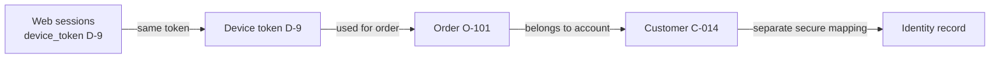
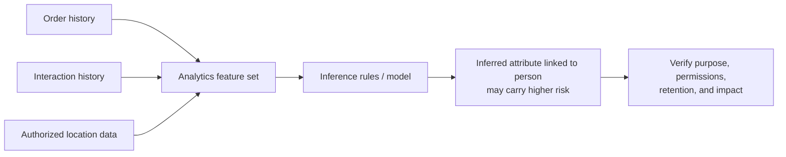
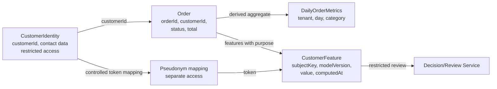
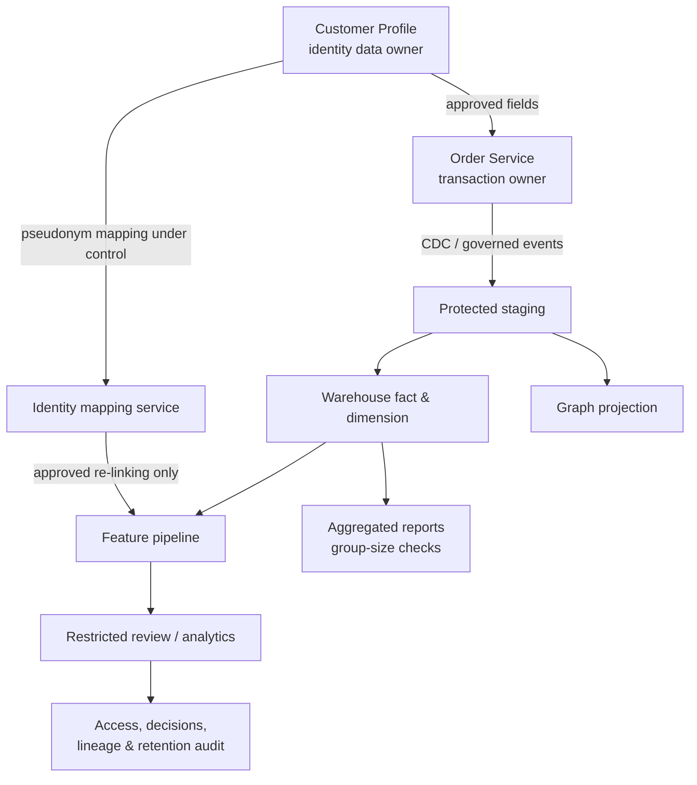

# Identifying Personal Data, Sensitive Data, and Inferred Attributes

A sales system stores customer names, phone numbers, shipping addresses, and order history. These fields are relatively easy to identify as **personal data**. But what about `device_id`, product browsing history, pickup/delivery locations near home, spending segments, and a predicted "return likelihood" score? If each field is viewed in isolation, the design team might judge it harmless. When multiple tables, documents, or graph edges are combined, they can **identify a person, describe their behavior, or infer private information about them**.

This lesson belongs to the **Data Protection** chapter of the **DATABASE_DATA_MODELING** module. The goal of the module is to build the skill of translating business requirements into clear entities, relationships, and constraints, down to physical schemas and verifiable relational, document, graph, or analytical models. Accordingly, we treat data protection as **a modeling design requirement**, not merely adding encryption after tables have already been created.

**Scope note:** legal definitions and categories of sensitive data vary by country, industry, contract, and time. This lesson is a **technical analysis and data governance framework**, not a substitute for a legal assessment of a specific system. All scenarios and identifiers in this lesson are **fictitious data**.

After this lesson, you will be able to:

- Identify data relating to **an individual who can be identified directly or indirectly**, including through combinations of multiple fields.
- Distinguish **direct identifiers**, **indirect identifiers/quasi-identifiers**, **behavioral data**, **sensitive data**, and **inferred attributes**.
- Explain why `customer_id`, devices, cookies, location sequences, or prediction scores can constitute personal data even without containing a name.
- Design a **data inventory**, classify across multiple axes, and record **provenance/lineage** for computed attributes.
- Apply **data minimization, purpose-based access control, retention periods, copy control, and traceable deletion/rectification**.
- Write SQL checks and data contracts to detect unclassified fields, unsourced inferences, or over-scoped data exports.
- Assess privacy impacts when moving data from relational to document, graph, and analytical warehouses.

## 1. Personal Data Is More Than Just "Full Name and Phone Number"

From a design standpoint, start with the question:

> "Does this information **relate to an individual**, and can the organization or a party with access to the data recognize, distinguish, link, or single out that individual using reasonable means in the context of use?"

There are at least three cases to consider:

1. **Direct identification:** a field directly contains identifying information, such as a personal ID number, a name paired with contact details, or a personal email address.
2. **Indirect identification:** an identifier such as `customer_id` or `device_id` points to a person via a mapping table, authentication system, transaction data, or external source.
3. **Relating to a person even when not used for identification:** a review, purchase history, preference, or prediction score tied to a user account can be personal information because it **describes that person**.

Therefore, the statement "this table has no `name` column so it does not contain personal data" is usually **insufficient as a conclusion**. You must examine **join keys, context, access permissions, other datasets, and re-identification capability**.

### 1.1. Distinguish "Identifiable" from "Name Already Known"

An identifier `customer_id = C-014` may not tell an analyst the customer's name. However, the application has a `customer_identity` table mapping `C-014` to a registered account. Someone authorized to join the two tables can still identify the individual. Replacing names with codes **does not automatically make data anonymous**.

Similarly, a system may not know the name of a web visitor yet still **persistently distinguish and track** visits from the same device or profile. Depending on linkability and context, that behavioral sequence still needs to be handled as data relating to an individual.

### 1.2. Context-Based Identification Rather Than Data-Type-Only

| Field | Viewed in isolation | Context that makes data relate to an individual |
| --- | --- | --- |
| `email` | Contact address | Links to a person; including a specific employee's work email |
| `customer_id` | Internal ID | Has a mapping table to an account/customer |
| `device_id` | Device ID | Links sessions/orders to a person or group of people |
| `ip_address` | Network address | Can be combined with timestamps, logs, and accounts to tie a session to a person |
| `delivery_location` | Coordinates/address | Can represent a residence, workplace, or movement history |
| `order_history` | Transaction history | Tied to a buyer, preferences, and purchasing behavior |
| `age_band` | Age bracket | When combined with location, occupation, or customer ID, can help narrow identity |
| `risk_score` | Model score | When computed for a person, describes/evaluates that person |
| `favorite_category` | Preference classification | When tied to an account, is an inferred attribute about a person |
| `daily_revenue_by_category` | Total revenue by category | May be lower risk if groups are broad enough; cells that are too small can still disclose an individual |

Not every IP address, device ID, or aggregate metric carries the same level of risk in every situation. What matters is **evaluating how information is collected, linked, accessed, and used**.

## 2. Four Categories of Information to Identify in a Data Model

### 2.1. Direct Identifiers

Direct identifiers point to an individual by the value itself or within an immediate context:

- Name and contact information tied to a person.
- Personal identity document numbers under the applicable system.
- Account identifiers tied to a verified profile.
- Personal email addresses/phone numbers or other identifying details.
- Facial photos or biometric templates used to recognize a person, depending on purpose.

Some attributes such as a **common name** are not unique enough to identify a person on their own; that does not make them inherently harmless when stored alongside orders, addresses, or accounts.

### 2.2. Indirect Identifiers and Quasi-Identifiers

**Indirect identifiers** may not reveal identity immediately but combine with other tables to identify a person. A **quasi-identifier** is an attribute or set of attributes that can distinguish a person within a group when combined, for example:

- Date of birth or narrow age bracket.
- Small residential area.
- Occupation, work schedule, or organization.
- Rare time–location combinations.
- Service usage paths and devices.
- Customer reference codes or persistent cookie strings.

There is no immutable list of "quasi-identifiers": the same `postal_code` may be common in a large city yet sufficient to identify someone in a small group when paired with age and occupation.

### 2.3. Behavioral Data or Facts Relating to an Individual

Personal data is not limited to identifying data. Purchase history, spending amounts, content choices, login timestamps, support interactions, feedback, or product usage actions can all describe **an identified or identifiable individual**.

In particular, `customer_id` fields appearing across:

```text
orders
search_events
device_sessions
support_tickets
loyalty_transactions
analytics_features
```

can allow reconstructing a detailed profile even when each table stores very little direct identifying information. Therefore, **JOIN capability** and cumulative history must also be inspected during data classification.

### 2.4. Inferred/Derived Attributes

An inferred attribute is computed, classified, or predicted from other facts:

- `preferred_category` = most frequently purchased category.
- `estimated_home_area` = residential area estimated from location history.
- `likely_language` = language predicted from behavior.
- `churn_probability` = probability of service churn.
- `fraud_review_score` = score supporting anomalous transaction review.
- `estimated_income_band` = income bracket estimated from behavioral signals.
- A conclusion about health status, beliefs, opinions, or other private characteristics **predicted** from indirect data.

An inferred attribute is **not a directly observed fact**. It must record **source, method, computation time, confidence level, scope of use, and error potential**. If the result is tied to a person, it can still be personal data—and sometimes highly sensitive—**even if every initial input looked ordinary**.

## 3. Sensitive Data Is a Risk Layer Evaluated in Context

**Sensitive personal data** generally refers to information whose exposure, discrimination, inference, or misuse can cause greater harm. Its scope is **defined differently across laws, regulations, and policies**, so a fixed list should not be treated as a universal legal declaration.

Categories that typically require careful scrutiny include:

| Information category | Conceptual examples | Why careful protection is required |
| --- | --- | --- |
| Health | Lab results, diagnoses, treatment records | Can affect daily life, employment, insurance, and privacy |
| Biometrics used for identification | Fingerprint/facial samples, recognition templates | Hard to replace if exposed; can anchor long-term identification |
| Personal finance | Account details, transactions, financial capacity | Fraud, behavioral exposure, and financial loss |
| Precise location/movement history | Frequent routes, home coordinates | Can reveal habits, living locations, and relationships |
| Opinions/beliefs/private life | Declared or inferred data | Risk of privacy intrusion and discrimination |
| Children or vulnerable groups | Profiles and behaviors tied to groups needing special protection | Risk level and governance responsibility may be higher |
| Credentials/authentication secrets | Passwords, tokens, recovery secrets | Can lead to account takeover and unauthorized access |

**Distinction:** "sensitive personal data" differs from "trade secrets". Product cost, business plans, or API keys may be **confidential organizational information**, but that does not make them **personal data**. Conversely, some personal information that is not a corporate secret still requires appropriate protection.

### 3.1. A `NOT_SENSITIVE` Label Does Not Prove "Safety"

A work email may not fall under a separately regulated sensitive personal data category, yet it remains a person's contact information. A single purchase transaction might be viewed as ordinary; many transactions combined can reveal private conditions or activity patterns.

Therefore, classify **across multiple axes** instead of relying on a single `is_sensitive` flag.

### 3.2. Sensitivity Can Emerge After Inference

For example, purchase records used to predict a health condition or personal status. Even if `product_category` is not classified at a special protection level, the **model output** may belong to a higher-risk tier. Design must review the **output attribute, lineage, and intended purpose**, rather than merely copying protection labels from source columns.

A predicted conclusion about a person does not become "non-sensitive" just because its probability is low. Conversely, low confidence is no excuse for arbitrary use; **incorrect predictions** can cause significant adverse effects.

## 4. Identification by Linkage: An Anonymous Column Can Become Highly Specific

### 4.1. Example of Two Tables That Appear Sparse on Their Own

```text
Table: web_sessions
session_id | device_token | viewed_category | occurred_at
S-01       | D-9          | Home            | 09:00
S-02       | D-9          | Books           | 09:30

Table: order_devices
order_id | device_token
O-101    | D-9
```

A third table can link orders to accounts:

```text
Table: orders
order_id | customer_id
O-101    | C-014
```

This creates a path:



To assemble a user profile, a query does not need a `full_name` field in `web_sessions`. Anyone with access to **all three tables** can associate those sessions with account C-014.

**Inference limits:** `device_token` can be shared; a shared device does not prove all sessions belong to the same person. Data linkage may yield a **candidate identity**, not self-verified proof of a person's identity or actions. Even when uncertain, the fact that data can impact an individual is reason enough for control.

### 4.2. Risk Grows with Data Linkage Capability

| Linkage technique | What can happen |
| --- | --- |
| JOIN on `customer_id` | Combines orders, sessions, and support tickets into a personal profile |
| JOIN on `device_token` | Associates multiple accounts or sessions via one device |
| Time and coordinate correlation | Infers schedules and frequent locations |
| Joining internal and public data | Narrows the set of possible subjects for a record |
| Multi-hop graph traversal | Finds indirect links invisible in isolated tables |
| Very small group reporting | A single metric cell can nearly represent one individual |

Thus, a **list of columns deemed anonymous** is not enough. You must assess **attribute combinations and the entire access surface**: who can join what, through which interfaces, and with what supplementary sources.

### 4.3. Hashing Does Not Automatically Anonymize Data

If `email` is hashed with a standard hash and reused consistently across systems, the hash value can still:

- Link records belonging to the **same person**.
- Be guessed or tested against common email lists if proper safeguards are absent.
- Be re-mapped via an internal table or linked dataset.

**Pseudonymization** reduces exposure of direct identifiers, yet the data can remain personal data. **Anonymization** requires assessing whether identification/linkage remains feasible with reasonable resources and means in context—not simply "deleting names and emails."

## 5. Inferred Attributes: Source, Method, and Decision Meaning

### 5.1. Distinguishing Observations, Deterministic Calculations, and Inferences

| Attribute type | Example | Certainty level |
| --- | --- | --- |
| **Observed** | `order.paid_at` recorded by the transaction system | A statement from the source; still depends on source quality |
| **Derived deterministic** | `total_paid_vnd` = sum of valid converted payments | Exact given inputs and calculation rules; requires period, currency, and refund policies |
| **Heuristic inference** | `likely_home_area` from repeated delivery locations | Only a heuristic guess; prone to false positives |
| **Predictive model output** | `churn_probability = 0.73` | Estimate with error margin, dependent on model/version and data |
| **Human assessment** | Staff note "likely needs support" | Subjective judgment that may be inaccurate |

Do not collapse all of these into a single `customer_status` column that looks verified. In particular, an **inference** must never be promoted to an established fact simply because it has been written to a database.

### 5.2. What Provenance Should an Inferred Attribute Have?

For example, `customer_features` stores `return_risk_score` per person:

```text
subject_key        = PSEUDO-014
feature_code       = RETURN_REVIEW_SCORE
feature_value      = 0.73
value_type         = PROBABILITY
computed_at        = 2026-10-20T10:00:00Z
observation_window = [2026-07-20, 2026-10-20)
input_dataset      = feature_orders_v3
model_id           = review-model
model_version      = 4.2
purpose_code       = FRAUD_REVIEW_SUPPORT
quality_status     = MODEL_ESTIMATE
expires_at         = 2026-11-20T10:00:00Z
```

A score of **0.73** should not be interpreted as "a 73% certainty that the event will occur" unless the model has been calibrated to that definition. `value_type = PROBABILITY` is meaningful only when the model contract clearly defines the target variable, calibration method, and usage boundaries.

To support verification and individual rights under applicable policies, also retain:

- Input data sources and **lineage** by dataset/version.
- Eligibility criteria for including a subject in the model.
- Filtering, labeling, observation window, and missing-data handling rules.
- Potential for adverse impact from the model; **human review** and feedback mechanisms.
- Validity duration of the inference.
- Authorized actors/systems allowed to read it and specific purposes.
- Recompute, deletion, or invalidation strategies when sources change.

### 5.3. Inferred Attributes Can Be More Sensitive Than Sources



A system should not assume that because inputs are permitted for order processing, **every inference purpose derived from those inputs** is also permitted. Secondary purposes, access permissions, and output impacts must be assessed separately.

### 5.4. Proxies Can Reveal Characteristics Not Stored Directly

Even when a database **has no sensitive attribute column**, variables such as residential area, work schedule, purchase history, or content group can **strongly correlate** with a private characteristic. This creates two risks:

1. **Privacy risk:** a model infers an attribute the individual did not actively provide.
2. **Unfair treatment risk:** a system makes decisions based on a proxy for a factor that should not be used.

Merely dropping sensitive columns from the feature set **does not automatically resolve** these two risks. You must review outputs, linkage operations, purposes, decision processes, and impact testing.

## 6. Multi-Axis Data Classification, Not Just a Single Label

A useful metadata model should separate at least four axes:

1. **Personal relation:** is it directly/indirectly related to an individual, or truly non-personal information?
2. **Risk/sensitivity:** is the protection level high or low in context? Does a special sensitive category apply?
3. **Origin:** direct observation, manual entry, copy, deterministic calculation, or statistical inference?
4. **Purpose and permissions:** who may use it, for what purpose, for how long, and under which policy?

You can add axes for **confidence, accuracy, validity period, and storage location**. Avoid encoding everything into a single enum `PUBLIC | PII | SENSITIVE | INFERRED`, because a single column can simultaneously be **PII**, **sensitive**, and **inferred**.

### 6.1. Sample Classification Table

| Data | Personal relation | Sensitivity in example | Origin | Suggested handling rules |
| --- | --- | --- | --- | --- |
| `Customer.email` | Direct | Restricted | User-provided/verified | Read only with authorization; do not emit to logs |
| `Order.customer_id` | Indirect | Restricted | Ordering system | Protect JOIN keys; enforce tenant isolation |
| `OrderLine.product_id` | By relation to customer | Depends on product/context | Transaction | Protect purchase history per subject |
| `Device.device_token` | Linkable | Restricted/linkage risk | Device/SDK | Prevent out-of-scope tracking; appropriate retention |
| `Delivery.precise_location` | Identifiable | High by context | Delivery | Reduce precision after fulfillment if appropriate |
| `Customer.age_band` | Quasi-identifier | Depends on group size | Declared or derived from birth date | Do not expose overly small groups |
| `Feature.likely_home_area` | Relates to person | Potentially high | Inferred | Mark as estimate; restrict purpose |
| `Feature.return_review_score` | Relates to person | Potentially high if decision-impacting | Predictive model | Model/version, expiration, review |
| `Aggregate.category_sales_monthly` | Usually aggregated | Depends on group size | Computed | Prevent disclosure via small cells/differencing queries |
| `Catalog.category_name` | Not inherently personal | Usually low | Catalog | Watch for user-entered names containing PII |

Labels such as `Restricted` and `High` are **internal example suggestions**, not mandatory legal category names. In real deployments, align with organizational standards, laws, and industry policies.

### 6.2. Evaluate at Multiple Levels: Field, Record, Dataset, and Query

A `product_id` column may be considered low-sensitivity in a public catalog table. Yet the same `product_id` within **an individual's purchase history** requires different handling. Likewise, a nationwide `SUM(revenue)` dashboard may disclose far less than a report broken down by rare postal code and exact day.

Therefore, **column-level** classification is only one layer. You also need **data product/dataset classification** and **query result risk assessment** whenever data is joined, grouped, exported, or shared.

## 7. Entity Design Example for a Sales System

Suppose a sales platform has three needs:

- Process orders and deliveries for a customer.
- Support customer care within a defined timeframe.
- Analyze order counts, revenue, and certain account-linked features.

Not every service needs to see phone numbers, exact locations, or inferred customer scores.

### 7.1. Separating Identity, Transactions, and Inferred Features



In this diagram:

- `CustomerIdentity` stores the identifying and contact information required for business operations.
- `Order` stores transactions with `customer_id` and historical snapshots that need preservation.
- `DailyOrderMetrics` contains aggregated data at a defined grain; there is no need to replicate every email.
- `CustomerFeature` stores derived attributes with metadata on purpose, version, and timestamps.
- The pseudonym mapping table is **protected separately** and not broadly shared with analytics pipelines.

**Not every use case needs a separate mapping table.** This is a design choice to segregate access rights; evaluate added complexity, keys, and deletion workflows.

### 7.2. Illustrative Relational Schema

PostgreSQL example; all IDs are fictitious data. This is an **educational schema**, not a template guaranteeing full compliance for real data.

```sql
CREATE TABLE customer_identity (
    tenant_id VARCHAR(32) NOT NULL,
    customer_id VARCHAR(40) NOT NULL,
    contact_email TEXT,
    contact_phone TEXT,
    contact_verified_at TIMESTAMPTZ,
    updated_at TIMESTAMPTZ NOT NULL,
    PRIMARY KEY (tenant_id, customer_id)
);

CREATE TABLE orders (
    tenant_id VARCHAR(32) NOT NULL,
    order_id VARCHAR(40) NOT NULL,
    customer_id VARCHAR(40) NOT NULL,
    status VARCHAR(24) NOT NULL,
    placed_at TIMESTAMPTZ NOT NULL,
    total_minor BIGINT NOT NULL,
    currency_code CHAR(3) NOT NULL,
    PRIMARY KEY (tenant_id, order_id),
    FOREIGN KEY (tenant_id, customer_id)
        REFERENCES customer_identity(tenant_id, customer_id),
    CHECK (total_minor >= 0)
);

CREATE TABLE customer_features (
    tenant_id VARCHAR(32) NOT NULL,
    subject_key VARCHAR(80) NOT NULL,
    feature_code VARCHAR(80) NOT NULL,
    feature_version VARCHAR(40) NOT NULL,
    value_numeric NUMERIC(18,8),
    quality_status VARCHAR(40) NOT NULL,
    purpose_code VARCHAR(80) NOT NULL,
    input_dataset_version VARCHAR(120) NOT NULL,
    computed_at TIMESTAMPTZ NOT NULL,
    expires_at TIMESTAMPTZ,
    PRIMARY KEY (
        tenant_id, subject_key,
        feature_code, feature_version, computed_at
    ),
    CHECK (expires_at IS NULL OR expires_at > computed_at)
);
```

Note the following:

- `orders.customer_id` is **indirect** personal information because it points to an individual's profile.
- `total_minor` and `currency_code` must stay together; payment history can be sensitive depending on context.
- `customer_features.subject_key` is a pseudonym **still linkable through a controlled mapping**; it must not be published as anonymized data.
- `quality_status`, `purpose_code`, `input_dataset_version`, and `computed_at` help distinguish origin/confidence. They **do not automatically authorize using** a feature beyond approved purposes.
- The tables do not show every constraint (such as foreign keys for mapping tables, purpose codes, access controls, data encryption, or deletion conditions). Those requirements need separate contracts and implementation mechanisms.

### 7.3. A Metadata Table for Inventorying Data Fields

You can store field **descriptions** in a separate data catalog without mixing real personal information into the metadata table:

```sql
CREATE TABLE data_field_catalog (
    asset_name VARCHAR(120) NOT NULL,
    field_name VARCHAR(120) NOT NULL,
    business_owner VARCHAR(120) NOT NULL,
    personal_relation VARCHAR(32) NOT NULL,
    sensitivity_tier VARCHAR(32) NOT NULL,
    origin_kind VARCHAR(32) NOT NULL,
    purpose_code VARCHAR(80) NOT NULL,
    retention_policy_id VARCHAR(80) NOT NULL,
    lineage_ref VARCHAR(200),
    last_reviewed_at TIMESTAMPTZ NOT NULL,
    PRIMARY KEY (asset_name, field_name),
    CHECK (
        personal_relation IN (
            'DIRECT', 'INDIRECT', 'CONTEXTUAL', 'NONE', 'UNKNOWN'
        )
    ),
    CHECK (
        origin_kind IN (
            'OBSERVED', 'DECLARED', 'COPIED',
            'DETERMINISTIC', 'INFERRED'
        )
    )
);
```

In practice, **one field can carry multiple tags/purposes**. The table above is simplified to clarify the concept; when multiple purposes and sensitivity categories are needed, use **child relation tables** such as `field_classification_tags`, `field_allowed_purposes`, or an equivalent policy structure rather than packing multiple meanings into one string.

The catalog needs an approval/owner-assignment workflow and **automatic discovery of new fields** after schema migrations. If a schema adds columns without updating the catalog, the system cannot rely on the assumption that all fields are classified.

## 8. Recording Lineage for Inferred Data

**Lineage** shows where a fact originated, through which transformation steps it passed, and which logic version produced it. This is especially important for **derived or predicted** outputs.

### 8.1. Minimal Provenance Model

A `CustomerFeature` record can reference a `FeatureRun`:

```text
FeatureRun
  run_id
  feature_code
  transformation_version
  model_version (if a model is used)
  input_dataset_id
  input_snapshot_or_watermark
  allowed_purpose
  started_at
  completed_at
  validation_status

CustomerFeature
  subject_key
  feature_code
  run_id
  value
  computed_at
  expires_at
  quality_status
```

When a source record is modified, restricted, or deleted under applicable rules, the system can use lineage to identify **which features, projections, and reports need recomputation or retention re-evaluation**.

### 8.2. Lineage Does Not Equal Model Explainability

Knowing `model_version = 4.2` and `input_snapshot = X` supports **production traceability**. It does not explain why a score was assigned to a person, nor does it prove model accuracy or fairness impact. For consequential decisions, appropriate explanations, appeal workflows, audits, and performance monitoring may be required.

### 8.3. Inferred Attributes Need Expiration

A `churn_score` computed from behavior 180 days ago may no longer represent current status. If a feature is only valid for one month, `expires_at` must participate in read checks. Expiration **does not turn a value into non-sensitive data**, and retaining it past expiration requires an independent purpose/retention basis if permitted.

Example of reading a feature with proper purpose and time bounds:

```sql
SELECT
    feature_code,
    value_numeric,
    quality_status,
    computed_at,
    feature_version
FROM customer_features
WHERE tenant_id = :tenant_id
  AND subject_key = :subject_key
  AND purpose_code = :approved_purpose
  AND computed_at <= :as_of_time
  AND (
      expires_at IS NULL
      OR :as_of_time < expires_at
  );
```

**This query only illustrates data filtering**, not a complete authorization check. Never let a client freely supply `:approved_purpose`, `:tenant_id`, or `:subject_key` to bypass permissions. The backend must verify subject, purpose, and privileges from a trusted context; policy may also require excluding features that fail quality checks or are disallowed for automated decisions.

## 9. Access Control by Column, Row, Purpose, and Context

Tables containing personal data usually require **more than a simple "can read table" role**:

- **Row-level/tenant isolation:** users belonging to tenant T-01 must not read T-02.
- **Column-level access:** support agents can view order status without automatically seeing every sensitive field.
- **Purpose-based access:** permission to use data for delivery does not authorize marketing or personal profiling.
- **Contextual access:** may require an active work relationship, support ticket, time window, region, or approval request.
- **Field masking/redaction:** the UI displays only the portion needed for the operational task.
- **Export/downstream control:** permission to view in the UI does not authorize exporting entire profiles to files, logs, or third parties.

### 9.1. Design APIs Around Need, Not Full Entities

An order support API might return:

```json
{
  "orderId": "O-101",
  "status": "DELIVERING",
  "contactPhoneMasked": "***-***-120",
  "deliveryArea": "District-X"
}
```

Do not default to `SELECT * FROM customer_identity JOIN orders` and send every field to the frontend "just in case it is needed later." Unnecessary data becomes a **leakage surface** in responses, browser caches, logs, analytics SDKs, and screenshots.

### 9.2. SQL Example of a Column-Restricted View

```sql
CREATE VIEW support_order_summary AS
SELECT
    tenant_id,
    order_id,
    status,
    placed_at,
    currency_code
FROM orders;
```

Views help provide a **minimal column interface** for a specific need. They do not guarantee tenant isolation or authorization on their own. Production systems still require **revoking direct access to base tables**, granting precise privileges to application roles, tenant boundaries, connection identity controls, and ticket-based filtering policies.

If using PostgreSQL Row-Level Security, setting the tenant context must occur in a **trusted** backend tier without letting clients arbitrarily set session variables; also account for connection pooling and roles capable of bypassing RLS.

### 9.3. Tokens and Encryption Are Different Tools

- **Encryption at rest / in transit:** protects data on disk or over the wire within key and configuration boundaries; anyone authorized to decrypt can still read the data.
- **Tokenization:** replaces values with tokens and isolates a controlled mapping; you must still evaluate whether tokens can be linked to an individual.
- **Pseudonymization:** uses substitute codes/values to reduce direct visibility of identity; the data typically remains personal data.
- **Hashing/HMAC:** supports matching/verification by design; consistent hashes can become linkable identifiers, and keeping the key secret does not automatically yield absolute anonymity.
- **Anonymization:** requires evaluating residual identification risk after processing; it cannot be guaranteed merely by a function name.

No single tool replaces access control, data minimization, purpose governance, and control of copied data.

## 10. Attribute Combinations Can Expose Identity in Reports

### 10.1. The Small-Group Problem

An internal dashboard outputs order counts by:

```text
ward_name
age_band
occupation_group
calendar_day
product_category
```

If a cell contains **only one customer**, someone with external knowledge can tie those transaction figures to the real person. Even when a report shows only **COUNT(*)** and **SUM(amount)**, disclosure risk remains.

Technical mitigations can include a **minimum distinct-subject threshold**, limiting grouping dimensions, rounding, aggregating to broader regions, controlling repeated queries, or other privacy techniques depending on requirements.

### 10.2. SQL Example Checking Distinct Subject Counts

```sql
WITH by_group AS (
    SELECT
        region_code,
        category_id,
        date_trunc('month', placed_at) AS order_month,
        COUNT(DISTINCT customer_id) AS distinct_customers,
        COUNT(*) AS order_count,
        SUM(total_minor) AS total_minor
    FROM order_reporting_view
    WHERE tenant_id = :tenant_id
      AND currency_code = 'VND'
    GROUP BY 1, 2, 3
)
SELECT
    region_code,
    category_id,
    order_month,
    distinct_customers,
    order_count,
    total_minor
FROM by_group
WHERE distinct_customers >= :approved_min_group_size;
```

Here `order_reporting_view` is an **illustrative view** whose `category_id` is mapped at a grain that avoids duplicating monetary amounts. The `:approved_min_group_size` threshold is set by policy. This example is **not a complete anonymization mechanism**:

- Overlapping group queries can be **differenced** to infer suppressed cells.
- Some groups with multiple customers may still be dominated by a single person.
- If multi-category product grouping causes **amount multiplication**, a data-quality bug coexists with privacy risk.
- Users may have access to personal data through other channels, increasing linkage risk.

Evaluate results as **a data product** within the context of permitted queries, rather than trusting a single `HAVING COUNT(DISTINCT ...) >= k` clause to confer anonymity.

### 10.3. Aggregated Data Still Needs Provenance

A `monthly_sales_by_region` table might not contain `customer_id`, yet if computed from personal records, it still needs lineage, metric definitions, cutoff timestamps, and usage policies. That helps verify publication and handle source adjustments. Not every aggregate must be deleted upon every source change; decisions depend on policy and re-identification risk.

## 11. Propagating Data to Document, Graph, and Analytical Warehouses

Correctly classifying a field in a source table **does not mean copies automatically inherit policies**. ETL pipelines, caches, search indexes, graphs, and warehouses can rename fields, merge/de-identify records, or generate new inferences.

### 11.1. Relational Databases

Tables `customers`, `orders`, and `order_lines` separate identity and transactions via keys/foreign keys. Normalization gives each fact a clear update point, yet joining across tables can still assemble highly detailed profiles. Protect **JOIN paths**, access rights, and returned payloads—not just the identity table.

### 11.2. Document Databases

An order document might embed:

```json
{
  "orderId": "O-101",
  "customerId": "C-014",
  "shipping": {
    "deliveryArea": "District-X",
    "recipientPhone": "example-placeholder"
  },
  "items": [
    {"productId": "P-01", "quantity": 1}
  ]
}
```

This structure is convenient for loading a single order, but **duplicating contact details across many documents** multiplies the places that must be updated, deleted, or restricted when a phone number changes or is no longer needed. Distinguish **historical transaction snapshots serving a legitimate purpose** from unnecessary copies.

### 11.3. Property Graphs

```text
(Customer C-014)-[:PLACED]->(Order O-101)
(Order O-101)-[:USED_DEVICE]->(Device D-9)
(Device D-9)<-[:USED_DEVICE]-(Order O-202)
(Customer C-055)-[:PLACED]->(Order O-202)
```

Graphs make multi-hop traversal fast and explicit, while also making **identity, device, and behavioral linkage** easy to query. Never conclude two customers are the same person solely from a shared device; at the same time, treat **entire paths** as potentially personal data and govern edge traversal permissions accordingly.

Derived graphs require version/source lineage and edge deletion rules when sources change. Otherwise, stale edges can preserve linkages that are no longer valid.

### 11.4. Dimensional Models / Warehouses

A `fact_order_line` fact table has `customer_key`, `product_key`, and `amount`. No person's name appears on the fact table, yet if `dim_customer` maps `customer_key` to an identity, the fact still relates to an individual.

If `dim_customer` uses **SCD Type 2**, multiple rows can share one `customer_id`. When executing access requests, data restrictions, or copy reconciliation, locate **every version** belonging to that person, not only the current row. Segmentation and derived feature tables can also hold distinct personal information requiring governance.

### 11.5. Data Flow Diagram with Ownership



This diagram is conceptual: arrows do not grant permissions by themselves. Every data pipeline requires contracts covering **purpose, field allowlists, identity mapping, tenant isolation, lineage, retention, encryption, and update/deletion responsibilities**.

## 12. Defining Purpose of Use at Schema Design Time

**Purpose limitation/data minimization** can be implemented architecturally by asking:

1. Which specific task needs this data?
2. To perform that task, is the **exact value** required, or only a bucket/group?
3. Who or which system actually needs read access?
4. How long is the data retained?
5. Can direct identifiers be separated from tables serving analytics?
6. When purpose changes, who approves it and verifies eligibility?
7. When source data is updated/deleted/restricted, what happens to copies and derived data?

### 12.1. Example of Minimizing Location Granularity

A district-level delivery demand report may only need `district_code`. Once delivery is completed and there is no valid purpose to retain exact coordinates, continuing to propagate **precise lat/lon** into every analytical table increases risk unnecessarily.

However, reducing granularity does not guarantee anonymity: in a small district or rare time slot, combining with order details can still help identify an individual. Assess the **combined dataset** and business requirements.

### 12.2. Field-Level Purpose Differs from Full-Table Read Access

An agent may need a phone number to contact someone about an active delivery, without needing detailed location history or inferred income scores. Overbroad permissions like `ROLE_SUPPORT -> SELECT customer_identity` may fail to reflect actual need.

You can structure APIs/read models per task, combined with field allowlists, auditing, and time-limited access. If the system requires multiple purposes for the same field, the data catalog should use a **field–purpose mapping table**, rather than forcing one purpose per column.

## 13. Event Streams, Logs, Caches, and Backups Are Also Part of the Data Model

Personal data can appear outside operational business tables:

- URL query strings containing emails or tokens.
- Access logs recording request/response bodies.
- Traces containing `customer_id`, location, or transaction state.
- Error messages logging full raw payloads.
- Caches retaining profiles without timely invalidation.
- Search indexes copying extra fields "to search later."
- Snapshots, CSV exports, test databases, and backups.
- Feature stores retaining person-linked derived features.

If policy designates `CustomerIdentity.email` as restricted while automated logging captures emails across uninventoried locations, the system still maintains an **unmanaged personal data storage surface**.

### 13.1. Controlling Logs via Data Contracts

A business event log might retain:

```json
{
  "eventType": "OrderConfirmed",
  "eventId": "EVENT-EXAMPLE-01",
  "tenantId": "T-01",
  "orderId": "O-101",
  "status": "CONFIRMED",
  "occurredAt": "2026-10-01T10:00:00Z"
}
```

Do not include `contact_email`, `recipient_phone`, or private content in events simply because they exist in the source payload, unless consumers have an authorized purpose and permission. Transaction IDs can still be **indirect identifiers**; event streams require access control and retention rather than being treated as public data.

### 13.2. Test Environments Must Also Follow Rules

Do not copy production data containing personal information onto test machines or development environments just to have "realistic" data. Use **synthetic data** or datasets processed under policy controls, and still evaluate re-identification risk when deriving datasets from real sources.

## 14. Propagating Deletion, Rectification, and Restriction to Derived Copies

A user updates contact details or requests data handling under an applicable mechanism. The system needs to know where copies or data derived from that information reside.

### 14.1. Difference Between "Deleting the Source" and "No Longer Using Data"

Deleting a row in `customer_identity` does not automatically delete:

- Emails copied into `orders.shipping_snapshot`.
- `customer_features` scores computed from behavioral history.
- Search documents, graph edges, caches, and warehouses.
- Manual exports, logs, and backups.

You need **data lineage + copy inventory + deletion/retention policies**. Some transaction records or audit logs may need to be retained under applicable obligations; do not promise "erasing every trace" when the architecture has independent retention requirements. In such cases, explicitly define **what data is kept, why, how access is restricted, and when retention ends**.

### 14.2. Do Inferred Attributes Need Recomputation?

If a source changes or is marked restricted from further use, derived features may be:

1. **Recomputed** from remaining authorized source data.
2. **Invalidated/expired** until eligible data exists.
3. **Deleted or restricted from use** per policy.
4. Retained as historical decision records when legitimately justified, with restricted access and preserved lineage.

There is no single answer for all data; consider purpose, retention constraints, feature accuracy, and the impact of relying on stale data.

### 14.3. Late-Arriving Events Can "Resurrect" Deleted Data

If a source emits `ProfileRedacted version 12`, a consumer deletes the email field, and then receives an older event `ProfileUpdated version 11`, a consumer that does not check versions might write the email back.

Common solutions include **versioned tombstones/redaction markers**, idempotent processing, and comparing against authoritative sources. In multi-owner data, versions must have valid aggregate/field scope; do not compare Order and Customer versions on the same axis.

## 15. Data Quality and Privacy Reinforce Each Other

Inaccurate, duplicated, or provenance-less data can cause users to be misattributed behaviors:

- Two people with similar names are erroneously merged.
- A household device is attributed exclusively to one person.
- Defective or refunded items are counted as purchase history.
- A temporary delivery address is inferred as a home address.
- Expired inferred attributes continue to be used in current evaluations.

**Accuracy, ability to correct errors, and provenance** are essential parts of data protection design, especially when data informs decisions affecting an individual.

### 15.1. Checking Design Against Invariants

| Invariant | Verification method |
| --- | --- |
| Identity keys do not collide within a tenant | `(tenant_id, customer_id)` unique; merges follow verification workflows |
| No cross-tenant linkage | Foreign keys, joins, and APIs enforce tenant scope |
| New columns are classified | Compare live schema against data catalog; block release if metadata is missing |
| Derived data has provenance | Features publish only with valid `input_dataset_version` and method/model version |
| Expired features are not used | Query/decision policies filter on `expires_at` |
| Data is not used outside purpose | Field allowlists and purpose-based access controls |
| Copies are inventoried | Search/cache/warehouse/graph appear in the copy inventory |
| Redactions propagate reliably | Reconcile source versions and delete/redaction markers |
| Small-group reports do not expose individuals | Check distinct subject counts and inference risks |
| Access is appropriately audited | Track who accessed which asset, when, and for what purpose |
| Model inputs are evaluated | Check proxies, bias, missingness, confidence, and impact |

### 15.2. Query to Detect Columns Missing Metadata

Suppose the system maintains a catalog of fields across governed tables. In PostgreSQL, you can compare against `information_schema.columns`:

```sql
SELECT
    c.table_name,
    c.column_name
FROM information_schema.columns AS c
LEFT JOIN data_field_catalog AS d
    ON d.asset_name = c.table_name
   AND d.field_name = c.column_name
WHERE c.table_schema = 'public'
  AND c.table_name IN (
      'customer_identity',
      'orders',
      'customer_features'
  )
  AND d.field_name IS NULL
ORDER BY c.table_name, c.ordinal_position;
```

This query returns columns **missing a catalog record**, without automatically determining whether they are sensitive. When a schema migration adds columns, the deployment pipeline should require the owner to classify them and declare their purpose before permitting use.

### 15.3. Query to Detect Features Missing Minimal Metadata

```sql
SELECT
    tenant_id,
    subject_key,
    feature_code,
    computed_at
FROM customer_features
WHERE purpose_code IS NULL
   OR input_dataset_version IS NULL
   OR quality_status IS NULL
   OR (
       expires_at IS NOT NULL
       AND expires_at <= computed_at
   );
```

In the illustrative DDL, several fields have `NOT NULL` and `CHECK` constraints, so the query may return empty when constraints are enforced; however, an analytical warehouse may not enforce constraints like OLTP, or ingested data may bypass validation. This serves as a **supplementary check**; it does not yet verify that `purpose_code` is approved or that lineage metadata actually points to a valid dataset.

### 15.4. Check Classification by Output, Not Only by Source

A pipeline inferring `estimated_home_area` from delivery data must register the **output** with its own classification and purpose. Do not mechanically apply the rule "input delivery area is low-tier, so output is also low-tier," because the output can become an **estimated residential location** carrying different privacy implications.

## 16. Workflow for Evaluating a New Field or Feature

### Step 1 — Describe the Fact in a Business Sentence

For example: "`customer_features.preferred_category` is the product category a customer is estimated to be most interested in based on eligible orders over the past 90 days."

State clearly **whether it is observed or inferred**, **about whom**, **over what window**, and **for what purpose**. A bare column name like `category` or `score` is insufficient.

### Step 2 — Assess Linkability to an Individual

Does the field contain a direct personal ID? If not, are there **join keys**, tokens, devices, locations, timestamps, or mapping tables that tie it to a person? Can it be combined with sources that the organization or recipient can access or obtain?

### Step 3 — Classify Sensitivity and Impact

Does the data fall under a sensitive category per applicable rules? Can combinations of fields reveal sensitive information or cause adverse impact? If inferred, does the **output** elevate risk compared to the inputs?

### Step 4 — Record Lineage, Purpose, and Validity

Which source provides the data? Who is the owner? Which model/rule version produced the feature? When does it expire? What are the valid conditions for operational use? Is there a way to correct or revoke erroneous conclusions?

### Step 5 — Design Storage and Minimal Access Controls

Does the field belong in a source table, projection, feature store, or data mart? Does it need to retain direct identifiers? Who manages mapping tables? Which APIs expose the data, and can it be exported or cached?

### Step 6 — Trace All Data Paths

Follow `source → ETL/CDC → warehouse → feature → BI/API/export`. At each stop, define classification, owner, retention, refresh source, and behavior upon updates/deletions.

### Step 7 — Write Edge-Case Tests

Test at least: two customers sharing a device; two customers with the same name; a customer moving regions; an expired feature; a modified record; a delete event arriving before an older update; a dashboard cell containing one person; a consumer adding an uninventoried column; a request from another tenant.

### Step 8 — Re-Review Periodically as Purpose or Technology Evolves

A low-risk attribute originally used only for debugging can become sensitive when combined with location data or fed into a decision model. Classifications must be **revisited** when new data, new partners, new policies, or new usages appear.

## 17. Common Pitfalls

1. **"There is no name, so it is not personal data."** Tables can still identify indirectly via IDs, devices, and JOINs.
2. **"Hashing emails means they are anonymized."** Consistent hashes can still be linked, guessed, or re-mapped.
3. **"Only user-entered data is personal data."** Behavioral history and inferred attributes can also relate to an individual.
4. **"Predictions are not sensitive because they might be wrong."** Predictions about private traits or impactful decisions still require protection.
5. **"Every column has exactly one classification label."** Personal, sensitive, inferred, and purpose are distinct axes.
6. **"Setting `is_sensitive = false` permits all uses."** Purpose, linkage, and context still matter.
7. **"The graph only contains anonymous IDs so it is safe."** Traversal paths can infer identity or behavior.
8. **"Aggregated data is always anonymous."** Small groups and overlapping queries can expose individuals.
9. **"The data warehouse needs no separate policy because it is a copy."** Projections can contain personal info and new inferences.
10. **"Putting RLS on the source is enough."** Caches, logs, exports, and replicas may not enforce the same policy.
11. **"Inferred attributes do not need expiration."** Stale features can become inaccurate yet still drive decisions.
12. **"Copying a phone number into every document makes reads faster."** Expands leakage surface and complicates updates and deletion.
13. **"One device token equals one person."** Shared devices and identity mismatches make linkage uncertain.
14. **"Encryption alone is sufficient."** Parties authorized to decrypt still need purpose limits and access controls.
15. **"Deleting a source row deletes all data."** Features, graphs, search indexes, logs, and backups need separate policies.
16. **"Storing an inferred score without model version is fine."** Prevents auditing or reliably reproducing results.
17. **"Checking the data catalog once at table creation is enough."** Schemas and use cases evolve continuously.
18. **"Because a fact is numerically accurate, it may be used for decisions."** Technical accuracy does not replace evaluating purpose, authorization, and impact.

## 18. Practice Exercises and Suggested Answers

### Exercise 1 — Data Without Person Names

The `orders` table only has `tenant_id`, `order_id`, `customer_id`, `amount_minor`. The `customer_identity` table maps `customer_id` to email.

**Question:** Can `orders` contain personal data? Why?

**Suggested answer:** **Yes, it can.** `customer_id` is an indirect identifier; orders and amounts can be tied to an individual via the mapping table. The absence of `name` in `orders` does not prove the data is anonymous.

### Exercise 2 — Shared Device

Two customers use the same device to place two orders.

**Question:** Can you conclude they are the same person? How should `device_token` be classified?

**Suggested answer:** You cannot conclude identical identity solely from a shared device. However, the token has the capability to **link** behaviors, so it must be assessed as data potentially relating to individuals, with bounded purpose and retention.

### Exercise 3 — Attribute Inferred from Low-Sensitivity Inputs

A model uses purchase history and access times to predict `estimated_home_area`.

**Question:** Can you keep the same sensitivity label as the input columns for the output?

**Suggested answer:** No. The output is an **inferred attribute about residential location** and may carry higher privacy risk; it must be reclassified, recording method/model version, computation time, confidence, and purpose.

### Exercise 4 — Does Hashing Anonymize Data?

A system hashes emails with the same algorithm and uses the result as `user_hash` across all datasets.

**Question:** Can those datasets be called anonymized?

**Suggested answer:** Not automatically. A consistent hash can join profiles and may be guessed or mapped in context. Treat it as a **pseudonym or linkable identifier** requiring control until a full anonymization assessment is performed.

### Exercise 5 — Inference and Probability

A pipeline stores `return_review_score = 0.73` without recording model version, computation time, or input dataset.

**Question:** What issues arise when using that score in a customer review workflow?

**Suggested answer:** You cannot know the model, input data, validity period, quality, or reproducibility. `0.73` also does not automatically mean a calibrated probability. Lineage, purpose, validation, and an appropriate review process are required.

### Exercise 6 — A Report Cell with One Person

A dashboard returns revenue by region, occupation, and day; one cell has exactly one customer.

**Question:** What is the risk even without emails or customer IDs?

**Suggested answer:** The cell can disclose that person's figures if a reader has supplementary information. Evaluate small groups, differencing queries, analytical scope, and granularity-limiting options.

### Exercise 7 — Updating Copied Information

A customer changes their phone number after placing several orders; the phone number also lives in search documents.

**Question:** Should you edit the search document directly and skip the identity source?

**Suggested answer:** Update through the **authoritative source** per business workflow; then synchronize or preserve historical snapshots according to policy. Search is a derived copy that must stay in sync, and you must also check whether other copies still retain the old number.

### Exercise 8 — Deleting and Recomputing Features

A customer's data is deleted/restricted under applicable policy. The system still holds `customer_features` inferred from that customer's history.

**Question:** Can the features be kept indefinitely because they are "already computed"?

**Suggested answer:** Not by default. Features may still relate to the person and can contain inferred sensitive information. Use lineage and policy to decide whether to delete, restrict, expire, or retain a subset on an independent basis; check all copies.

### Exercise 9 — Multi-Axis Classification

An `inferred_health_flag` field is predicted by a model from app activity and tied to `subject_key`.

**Question:** Which labels should be applied?

**Suggested answer:** It can simultaneously be **personal data via pseudonym**, an **inferred attribute**, **high sensitivity risk**, with dedicated **method/model provenance**, purpose, and retention. Do not use a single enum that only allows choosing `PII` *or* `INFERRED`.

### Exercise 10 — Detecting Uninventoried Schema Fields

The application adds a `contact_phone_backup` column to `customer_identity`, but the data catalog has no corresponding entry.

**Question:** What should the deployment pipeline do?

**Suggested answer:** Detect the schema–catalog drift, require the owner to classify the column, define purpose, permissions, retention, and copies before use; do not assume a new column automatically inherits every permission of older columns.

### Exercise 11 — Relational, Document, and Graph

A system has the relationship `Customer → Order → Device`. A data team wants to export the entire graph for collaborative research.

**Question:** Why is merely removing `Customer.name` insufficient?

**Suggested answer:** `customer_id`, `device_token`, order sequences, and timestamps can link to individuals or other sources. Assess risk across **graph paths**, restrict purposes and fields, reduce granularity, control access, set retention, and enforce appropriate sharing conditions.

### Exercise 12 — Architectural Choices

A platform needs to process orders, store delivery contact information, report monthly sales, and predict customer segments at risk of churn.

**Question:** Which data stores should be designed to minimize exposure while still supporting business operations?

**Suggested answer:** Use an identity source with restricted access; a transaction source with business keys and only genuinely needed snapshots; a fact–dimension warehouse for metrics; a feature store with pseudonyms, versions, lineage, and purposes; a data catalog, access policies, and mechanisms to synchronize updates/deletions across copies. Do not push all contact details into analytics or feature tables by default.

## Summary

**Personal data** is not just names or phone numbers; **customer IDs, devices, transaction histories, locations, and aggregated data** can relate to an individual through context or JOINs. **Sensitive data** must be evaluated by information category, potential harm, and applicable rules; sensitivity can emerge from **data combinations or inferred attributes**, not only from fields entered directly by users. A trustworthy data model classifies across multiple axes, defines owners and purposes, records **provenance and versions** for inferences, minimizes stored and accessed fields, manages copies, and verifies traceable rectification/deletion. **Dropping name fields does not equal anonymization; technically accurate data does not mean it is permitted for every purpose.**
