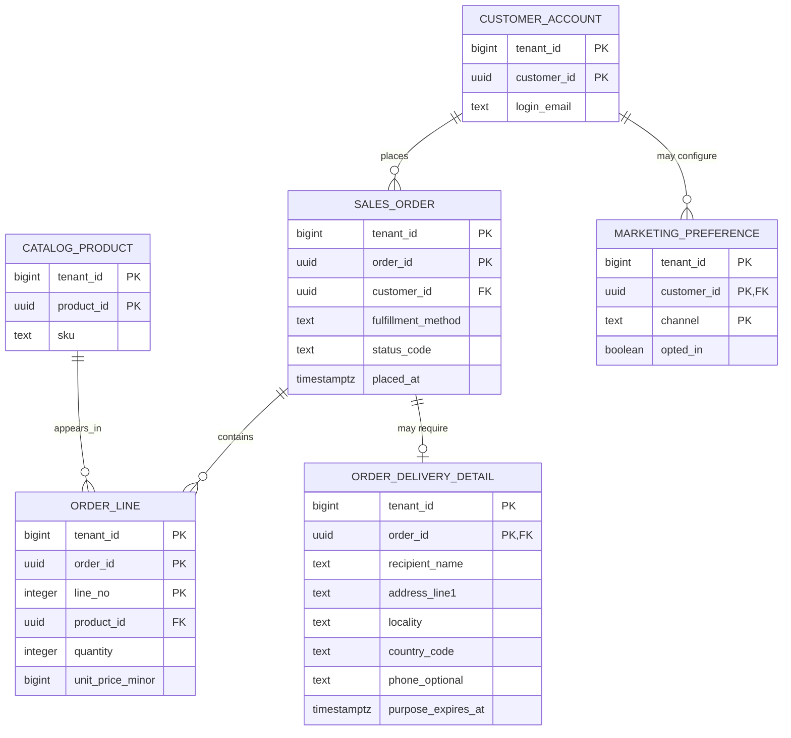
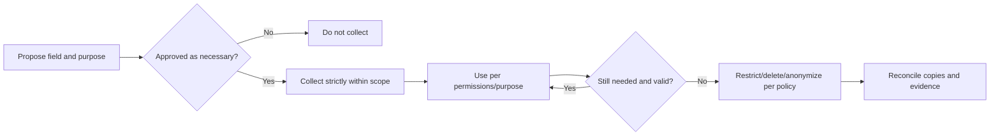

# Model Only Data Necessary for a Defined Purpose

A system can be protected with encryption, strict access control, and secure connections, yet still create unnecessary risk if it **collects and stores data that does not serve a defined purpose**. For example, a physical order checkout screen that only needs a shipping address might inadvertently ask for date of birth, gender, national ID number, and exact GPS coordinates "in case we need it later." Once those fields enter transaction tables, logs, events, caches, backups, and dashboards, deleting or restricting access to them becomes vastly harder.

**Model only data necessary for a defined purpose** is a design principle: before adding an entity, attribute, join key, or replication stream, you must explain **which decision or action the data serves**, why that level of detail is necessary, **who** may use it, for **how long**, and how to tell when the data has outlived its purpose or is no longer valid for use.

This lesson belongs to the **Data Protection** chapter of the **DATABASE_DATA_MODELING** module. In line with the module's goals, we translate business requirements into clear data models—covering entities, relationships, constraints, keys, and physical schemas—while comparing relational, document, graph, and analytical models to choose structures that are **easy to verify and evolve without accumulating excess data**.

The illustrative examples use Java and **PostgreSQL 15+**. The lesson focuses on **data modeling and lifecycle governance techniques**, not legal advice. Legal obligations, lawful bases for processing, retention periods, consent requirements, and data subject rights must be determined according to **jurisdiction, data category, industry, and approved policy**; no single retention day count or consent pattern fits every system.

## 1. Distinguishing Data Security, Data Minimization, and Purpose Limitation

These concepts are closely related but do not replace one another.

| Concept | Question | Example |
|---|---|---|
| **Data minimization** | Is it truly necessary to collect or store **this field, at this granularity, and this specific record**? | Do not request date of birth if order confirmation does not need age |
| **Purpose limitation** | For **what purpose** is the data collected and used, and may it be used for another purpose? | A delivery notification email does not automatically become a marketing list |
| **Data security** | Who may read/write it, and against what risks is the data protected? | Access control, encryption, audit logging, key protection |
| **Retention limitation** | When is the data no longer needed for a valid purpose, and how must it be handled? | Delete shipping addresses after the milestone permitted by approved policy |
| **Quality and accuracy** | Is the data accurate enough to serve its purpose? | Shipping address accurate at the time of parcel dispatch |
| **Accountability** | Can you demonstrate that collection/use is intentional? | Data dictionary, owner, policy, change logs, tests |

Encrypting an unnecessary field **does not make that field necessary**. Conversely, data minimization does not mean skipping encryption or access control for the remaining fields.

### "Necessary" Does Not Mean "Potentially Useful"

An attribute might produce interesting future reports, but without an established use case, usage authorization, owner, and lifecycle policy, "just in case we need it later" is rarely a strong enough reason to place it into the formal model.

The decision to collect a field should be based on a **defined purpose**, not because a partner API happens to include that field or the database has plenty of storage.

## 2. Start from Business Stories and Acceptance Criteria

Consider a multi-tenant sales platform with the following workflows:

1. **Account login:** customers use email to sign in and receive account notices.
2. **Order placement:** customers select products and confirm price/currency.
3. **Physical delivery:** requires recipient name and shipping address during fulfillment.
4. **Digital product sales:** does not require a physical shipping address.
5. **Post-sales support:** needs to look up orders and fulfillment status; only personnel performing delivery tasks need to see the full address.
6. **Marketing communications:** has an optional opt-in workflow independent of purchasing.
7. **Operational reporting:** needs order counts, item quantities, and revenue by day and product group; does not need individual customer addresses.

These are **distinct purposes**, even though they involve the same customer and order.

### Question Template for Every Requirement

Before creating a field, record:

- **Specific purpose:** which decision/action will use the field?
- **Basis and authority:** which workflow is authorized to process it, under which approved policy/legal assessment?
- **Minimum needed:** do you need the raw value, a reduced-granularity value, a boolean flag, or merely a verification result?
- **Authoritative source:** customer self-declaration, payment service, delivery partner, or administrative system?
- **When needed:** at checkout, delivery, support, audit, or aggregation?
- **Subject scope:** all customers or only customers using a specific feature?
- **Authorized people and systems:** which roles, through which APIs, and is it tenant-scoped?
- **Duration and end-of-life handling:** delete, anonymize, aggregate metrics, restrict processing, or retain under a specific obligation?
- **Proof mechanism:** which tests prevent over-collection or out-of-purpose copying?

If answers are missing, mark it as an **open decision** rather than preemptively creating a `VARCHAR(255)` column.

## 3. Purpose → Necessary Data Matrix

The following table is a **design example**, not a ready-made legal conclusion for every business.

| Purpose | Data to consider necessary | Data not automatically needed | Scope of use |
|---|---|---|---|
| Account login | Account ID, login email, securely managed credentials | Gender, shipping address, ID document number | Identity service |
| Order processing | Order ID, customer ID, order lines, quantities, locked unit prices, status | Continuous GPS location, date of birth, browsing history | Order service |
| Physical delivery | Recipient name, address sufficient for delivery; phone number **if the shipping workflow genuinely requires it** | All other identity details, exact coordinates if street address suffices | Authorized delivery staff/partners |
| Digital sales | Email/identifier needed to grant download access or deliver the product as required | Physical shipping address | Digital entitlement service |
| Post-sales support | Order ID, status, necessary handling history | Full customer profile or full address for every ticket | Role-based support staff |
| Marketing email opt-in | Delivery address/channel, subscription status, evidence required by policy | All purchase history as a default precondition | Marketing system for its dedicated purpose |
| Daily sales reporting | Business date, product/category, quantity, currency, revenue | Individual buyers' names, emails, phone numbers, addresses | Data mart/BI |
| Fraud detection/safety protection | Approved signals and thresholds necessary for the purpose | Indefinite collection of all device data "just in case" | Security team with dedicated retention and controls |

This yields two practical rules:

1. **Data needed for one purpose is not automatically authorized for other purposes.**
2. **Data needed during one stage does not automatically need to be kept for the entire lifecycle of the parent entity.**

For instance, order lines and locked prices may need to be retained to fulfill post-sales obligations under policy; shipping addresses may only be needed for a shorter window. Combining everything into one `orders` table and applying the longest retention period to every column can cause shipping data to be kept unnecessarily long.

## 4. Choosing the Right Granularity: Raw Field, Verification Result, or Bucketed Data

A purpose can often be served with **less data** than the original source.

| Business question | Avoid collecting/storing by default | Lower-data representation if it satisfies the purpose |
|---|---|---|
| Does the user meet the age requirement? | Full date of birth | Eligible/ineligible result from an approved verification flow |
| Can we deliver to this area? | Continuous precise GPS coordinates | Zone/postal code matching delivery coverage |
| Has the customer verified their email? | Full OTP history and plaintext OTP codes | Verification flag, timestamp, minimal required proof |
| How many customers are in each age group? | Per-person birthday table in the data mart | Age-bracket statistics if permitted and safe enough |
| Count orders by province/city? | Full home addresses in analytical tables | Standardized region codes or aggregated sets |
| Is the system operating reliably? | HTTP bodies containing personal data for every request | Status codes, latency, constrained request IDs, error counts |

Reducing granularity does not always guarantee **anonymity**: very small groups, multi-attribute combinations, or public datasets can still identify a person. You must assess **linkability and re-identification risk**, not merely check whether a `name` column is absent.

### Data Minimization at Five Levels

- **Entity level:** do we even need a `CustomerProfileExtra` table?
- **Attribute level:** do we need to store `date_of_birth`, or just a verification outcome?
- **Record level:** do we need every click, or only events serving defined metrics?
- **Temporal level:** do we need to store data for a month, a business cycle, or forever?
- **Linkage level:** do we need to join analytical behavior to customer identity, or only aggregate by day/product?

A data model must answer all five levels. Deleting one "sensitive" column while keeping an ID that links a user's entire behavioral history across sources may fail the goal of reducing identifiability.

## 5. Classifying Data Before Drawing the ERD

Distinguish **direct personal data**, **linkable data**, **transactional data**, **inferred data**, and **aggregated data**.

| Category | Examples | What to watch out for |
|---|---|---|
| Direct identifiers | Name, email, phone number, ID document number | Access control, purpose, retention limit |
| Indirect identifiers | Persistent customer ID, device ID, cookie, IP in an identifiable context | Can link to a person even without a name |
| Transactional info | Order ID, purchase time, items, locked price | Can reveal behavior or preferences when tied to an individual |
| Inferred data | Risk segment, priority score, interest group | Can affect rights/outcomes; needs purpose and explainability |
| Location data | Shipping address, coordinates, movement history | Granularity and collection frequency are often critical |
| Aggregated data | Daily revenue by product group | Still carries risk when groups are very small or linkable |
| Technical data | Request logs, traces, tokens, error payloads | Can accidentally capture personal data and secrets |

**Do not confuse a "technical key" with "non-personal data."** A random `customer_id` can still identify someone indirectly if the system holds a mapping table to a person or enough behavioral data to infer identity.

For data categories requiring heightened controls under applicable rules, establish proper approval workflows and assessments before introducing them into the schema. Never treat a generically named table like `metadata_json` as exempt from protection rules.

## 6. From Business Diagram to Minimal Logical Model

One way to enforce boundaries is to keep account identity, orders, shipping information, and marketing preferences in **separate entities**.



From this diagram, we can read:

- A customer can place many orders; each order belongs to one customer within the same tenant.
- An order has many lines; lines capture the **price at purchase time**, rather than forcing reads of current prices.
- An order **may not have** an `OrderDeliveryDetail`. Digital products do not need a shipping address.
- A customer may or may not have a `MarketingPreference` record; making a purchase **does not default to creating an opted-in marketing preference**.
- Delivery data has a different **lifecycle** from order data and can be deleted per policy without deleting the entire order.

The diagram is only a **logical model**. It does not by itself guarantee that every physical delivery order has a delivery detail when shipping begins, or that digital orders never accidentally store an address. State-dependent rules must be specified separately and enforced via use cases/transactions.

### Not All "Related" Information Belongs in the Same Aggregate

A shipping address is **related** to an order, yet it does not need to be a required column on every order. What matters is managing:

- **Purpose:** physical delivery.
- **Read scope:** personnel/processes needed to complete delivery.
- **Creation time:** when the customer selects physical delivery.
- **Usage condition:** order still requires delivery/delivery reconciliation.
- **End time:** per defined retention policy.
- **Source of truth:** the address snapshot locked for that shipment, not the current profile address.

If the business supports multiple shipments/addresses per order, the grain should be **one shipment** or **one address per shipment**, rather than forcing a single `OrderDeliveryDetail`. The one-to-one pattern in this example holds only under the assumption of **at most one shipment to one address per order**.

## 7. Designing Keys and Relationships While Avoiding Unnecessary Linkage

Primary keys, foreign keys, and indexes preserve integrity. However, they also determine **how easily data can be linked** across purposes.

Key principles:

1. **Tenant isolation must be protected:** composite FKs on `(tenant_id, customer_id)` or equivalent mechanisms prevent cross-tenant references.
2. **Do not use email as a pervasive FK:** emails can change, be shared, or embed personal data that shouldn't be copied. Use stable IDs and restrict where they resolve back to emails.
3. **Do not add `customer_id` to every analytical event** if reports do not require per-person analysis.
4. **Do not create a global profile ID linking all behaviors** purely to prepare for an undefined future use case.
5. **Do not treat a missing FK as privacy protection:** relationships can still be reconstructed via source codes, timestamps, devices, and other attributes.
6. **Do not blindly delete business keys needed for reconciliation:** balance auditability with identifier scoping and retention limits.

### Stable Keys Do Not Have to Exist Everywhere Forever

Orders can retain `order_id` for payment reconciliation. A daily/product analytical aggregate table may **not need** `order_id` or `customer_id` at all. A delivery handoff table might only need **an expiring random token** instead of giving a carrier the customer's full profile.

Scoping keys by **purpose** reduces unnecessary linkability. Even so, a token remains linkable data if a service holds a lookup table; protect token lifecycles and usage permissions.

## 8. PostgreSQL: Schema Separating Order and Delivery Data

This is an **illustrative** schema under a simplified assumption: one tenant manages customers, each order has at most one physical shipping address, and digital orders have no address.

```sql
CREATE TABLE customer_accounts (
    tenant_id BIGINT NOT NULL,
    customer_id UUID NOT NULL,
    login_email TEXT NOT NULL,
    created_at TIMESTAMPTZ NOT NULL DEFAULT CURRENT_TIMESTAMP,

    CONSTRAINT pk_customer_accounts
        PRIMARY KEY (tenant_id, customer_id),
    CONSTRAINT uq_customer_login_email
        UNIQUE (tenant_id, login_email),
    CONSTRAINT ck_customer_login_email
        CHECK (btrim(login_email) <> '')
);

CREATE TABLE catalog_products (
    tenant_id BIGINT NOT NULL,
    product_id UUID NOT NULL,
    sku TEXT NOT NULL,

    CONSTRAINT pk_catalog_products
        PRIMARY KEY (tenant_id, product_id),
    CONSTRAINT uq_catalog_sku
        UNIQUE (tenant_id, sku),
    CONSTRAINT ck_catalog_sku CHECK (btrim(sku) <> '')
);

CREATE TABLE sales_orders (
    tenant_id BIGINT NOT NULL,
    order_id UUID NOT NULL,
    customer_id UUID NOT NULL,
    fulfillment_method TEXT NOT NULL,
    status_code TEXT NOT NULL DEFAULT 'DRAFT',
    currency_code CHAR(3) NOT NULL,
    placed_at TIMESTAMPTZ NOT NULL DEFAULT CURRENT_TIMESTAMP,
    fulfillment_completed_at TIMESTAMPTZ,

    CONSTRAINT pk_sales_orders
        PRIMARY KEY (tenant_id, order_id),
    CONSTRAINT fk_order_customer
        FOREIGN KEY (tenant_id, customer_id)
        REFERENCES customer_accounts (tenant_id, customer_id)
        ON DELETE RESTRICT,
    CONSTRAINT ck_fulfillment_method
        CHECK (fulfillment_method IN ('PHYSICAL', 'DIGITAL')),
    CONSTRAINT ck_order_status
        CHECK (status_code IN (
            'DRAFT', 'CONFIRMED', 'SHIPPING',
            'DELIVERED', 'CANCELLED'
        )),
    CONSTRAINT ck_currency
        CHECK (currency_code ~ '^[A-Z]{3}$')
);

CREATE TABLE order_lines (
    tenant_id BIGINT NOT NULL,
    order_id UUID NOT NULL,
    line_no INTEGER NOT NULL,
    product_id UUID NOT NULL,
    quantity INTEGER NOT NULL,
    unit_price_minor BIGINT NOT NULL,

    CONSTRAINT pk_order_lines
        PRIMARY KEY (tenant_id, order_id, line_no),
    CONSTRAINT fk_line_order
        FOREIGN KEY (tenant_id, order_id)
        REFERENCES sales_orders (tenant_id, order_id)
        ON DELETE RESTRICT,
    CONSTRAINT fk_line_product
        FOREIGN KEY (tenant_id, product_id)
        REFERENCES catalog_products (tenant_id, product_id)
        ON DELETE RESTRICT,
    CONSTRAINT ck_line_no CHECK (line_no > 0),
    CONSTRAINT ck_quantity CHECK (quantity > 0),
    CONSTRAINT ck_unit_price CHECK (unit_price_minor >= 0)
);

CREATE TABLE order_delivery_details (
    tenant_id BIGINT NOT NULL,
    order_id UUID NOT NULL,
    recipient_name TEXT NOT NULL,
    address_line1 TEXT NOT NULL,
    locality TEXT NOT NULL,
    country_code CHAR(2) NOT NULL,
    postal_code TEXT,
    contact_phone TEXT,
    collected_at TIMESTAMPTZ NOT NULL DEFAULT CURRENT_TIMESTAMP,
    purpose_expires_at TIMESTAMPTZ NOT NULL,

    CONSTRAINT pk_order_delivery_details
        PRIMARY KEY (tenant_id, order_id),
    CONSTRAINT fk_delivery_order
        FOREIGN KEY (tenant_id, order_id)
        REFERENCES sales_orders (tenant_id, order_id)
        ON DELETE RESTRICT,
    CONSTRAINT ck_delivery_name CHECK (btrim(recipient_name) <> ''),
    CONSTRAINT ck_delivery_address CHECK (btrim(address_line1) <> ''),
    CONSTRAINT ck_delivery_locality CHECK (btrim(locality) <> ''),
    CONSTRAINT ck_delivery_country
        CHECK (country_code ~ '^[A-Z]{2}$'),
    CONSTRAINT ck_delivery_retention
        CHECK (purpose_expires_at > collected_at)
);

CREATE TABLE marketing_preferences (
    tenant_id BIGINT NOT NULL,
    customer_id UUID NOT NULL,
    channel TEXT NOT NULL,
    opted_in BOOLEAN NOT NULL,
    decided_at TIMESTAMPTZ NOT NULL,

    CONSTRAINT pk_marketing_preferences
        PRIMARY KEY (tenant_id, customer_id, channel),
    CONSTRAINT fk_marketing_customer
        FOREIGN KEY (tenant_id, customer_id)
        REFERENCES customer_accounts (tenant_id, customer_id)
        ON DELETE RESTRICT,
    CONSTRAINT ck_marketing_channel
        CHECK (channel IN ('EMAIL', 'SMS'))
);
```

### What the DDL Protects

- The delivery table stores only **one row per order** under the example's assumption; duplicate inserts cannot multiply addresses.
- Relationships use **tenant-scoped** composite FKs, preventing references to customers or products in other tenants.
- Locked unit prices and quantities are stored on order lines; `quantity > 0` and `unit_price_minor >= 0` are enforced.
- `marketing_preferences` is a separate entity; there is **no** `allow_marketing` flag defaulting to `TRUE` on `customer_accounts`.
- Delivery rows carry `purpose_expires_at` for use in an approved retention workflow.

### What the DDL Does Not Protect on Its Own

- `login_email` lacks normalization or verification rules; `UNIQUE` compares values strictly according to DB semantics/collation. You need a clear email handling algorithm and policy.
- `contact_phone` is optional; the database does not know which delivery partners genuinely require a phone number.
- Having `purpose_expires_at` does not prove the timestamp is lawful/policy-compliant or that purging will run automatically.
- `order_delivery_details` could still be inserted for a `DIGITAL` order without an application gate; the FK does not inspect the order's `fulfillment_method`.
- No simple FK/CHECK guarantees "a `SHIPPING` order must have a shipping address" because that is a cross-table, state-dependent invariant.
- Users granted `SELECT` on the entire table can read fields unnecessary for their task without proper access control and APIs.

That is why **schema design is only part of data protection**; it must be combined with business logic, access control, deletion protocols, and reconciliation.

## 9. Placing Purpose-Based Rules in Use Cases and Transactions

A physical order may be created in `DRAFT` status, with the customer providing an address before transitioning to `SHIPPING`. A digital order does not require an address. The rule should be stated explicitly:

> When transitioning a `PHYSICAL` order to `SHIPPING`, valid delivery information still needed for that shipment must exist. When an order is `DIGITAL`, do not collect or store a physical shipping address merely because a shared DTO includes that field.

In a Java application, you can use two request types instead of a single class packed with optional fields:

```java
// Java 17+, illustrating the API contract (validation annotations omitted).
public record CreateDigitalOrderRequest(
    java.util.List<CheckoutLineRequest> lines
) {}

public record CreatePhysicalOrderRequest(
    java.util.List<CheckoutLineRequest> lines,
    DeliveryContactRequest delivery
) {}

public record CheckoutLineRequest(
    java.util.UUID productId,
    int quantity
) {}

public record DeliveryContactRequest(
    String recipientName,
    String addressLine1,
    String locality,
    String countryCode,
    String postalCode,
    String contactPhone
) {}
```

There is no `tenantId`, `customerId`, `unitPriceMinor`, `statusCode`, or `purposeExpiresAt` for clients to define arbitrarily:

- Tenant and customer come from the authorized authentication context.
- Unit prices are locked from a trusted pricing service/catalog.
- Order type governs which delivery data may be collected.
- Purge deadlines are computed from the applicable retention policy, **not** extended by the caller.
- If a phone number is not needed for a specific delivery flow, the application neither writes it to the record nor asks the user to enter it.

### Checking "No Excess Fields Sent"

Omitting `dateOfBirth` from a DTO does not necessarily make a JSON parser **automatically reject** extra fields. Some configurations silently ignore unknown properties. Establish a policy—either fail validation or ignore without persisting/forwarding—and write tests verifying that fields outside the allowlist **never enter the DB, logs, or events**.

### State Transitions Must Be Atomic

When confirming shipment, two concurrent transactions could respectively delete delivery data and transition the order to `SHIPPING`. If each transaction checks preconditions at one point and commits separately, an order could enter shipping without an address.

One approach is to **lock the order row**, verify delivery details, and update the status in the same transaction; all related update/delete paths must follow the same locking and authorization conventions. Optimistic locking or additional constraint mechanisms can also work, provided you prove no write path bypasses them.

**Never trade away business invariants for indefinite retention.** Deletion workflows must recognize when an order is still in delivery/dispute per policy, while delivery workflows must never pull expired addresses.

## 10. Separating "Current Address" from "Delivered Address"

A customer may update their account address after an order has shipped. If `OrderDeliveryDetail` dynamically points to `Customer.currentAddress` and always reads the latest value, delivery records or dispute handling may report the wrong delivery destination.

There are two distinct concepts:

- **Current profile address** if the app has an address book feature: serves future orders; has its own purpose and retention period.
- **Address used for a specific delivery:** snapshot at fulfillment time; its purpose is delivery and delivery reconciliation.

A delivery snapshot **may be necessary**, but must be scoped to physical deliveries, genuinely used fields, and approved timeframes. Do not duplicate the snapshot into `orders`, `order_lines`, every event, and every dashboard without a matching purpose.

If delivery proof must be retained longer than detailed addresses, you can design a **completed delivery record** holding `carrier_reference`, status, and timestamps, then delete or coarsen the street address once its purpose ends. Note that tracking numbers can still link back to recipients via carrier systems, so they must be classified and controlled appropriately.

## 11. Storing Less Does Not Mean Losing Business Integrity

Some data must be preserved **at the right point in time** to ensure transactional accuracy:

| Data | Why retention may be needed | What not to do |
|---|---|---|
| `order_id` | Identifies the order for reconciliation and after-sales linkage | Delete the ID and lose ability to reconcile active obligations |
| `unit_price_minor` at purchase time | Establishes the locked line price | Overwrite with **current** product price during rebuilds |
| `currency_code` | Defines the transaction currency unit | Sum minor units across different currencies |
| `fulfillment_completed_at` | Proves completion milestone needed for workflows | Keep full GPS/route traces when only completion time is needed |
| `delivery_address` | Enables delivery and resolving delivery issues per policy | Keep indefinitely for revenue analytics |
| `marketing_preference` | Enforces communication channel choices | Infer "opted in to marketing" from having placed an order |

**Minimization does not mean deleting data needed for correctness, valid obligations, or audits.** It means identifying precisely what data is genuinely needed and bounding it by purpose, permissions, and retention.

Conversely, "needed for audit" is not a blanket excuse to retain **every copy**, every identifier, or every log. Define specifically what is being audited and the minimum evidence sufficient for that verification.

## 12. Lifecycle Models and Separate Retention Periods per Category

Avoid hardcoding a fixed retention day count in application code merely for cron job convenience. Retention periods should come from approved policy and be tied to **purpose, data category, trigger event, legal scope, and exceptions**.

| Data category | Retention clock trigger | Expected end-of-life/handling per policy |
|---|---|---|
| Login profile | Account creation, account termination | Revoke access, handle account details per policy |
| Orders and locked price lines | Order placement/obligation completion | Retain necessary transactional portion for applicable period |
| One-time delivery address | Delivery completion/cancellation and end of support window | Delete or coarsen granular details from the order |
| Support data | Ticket closure and related milestones | Delete content/attachments holding excess info per policy |
| Marketing data | Preference change or channel discontinuation | Stop processing; retain minimal proof if required |
| Security logs | Security event timestamp | Bound retention, access, and sensitive fields |
| Analytical datasets | Snapshot/dataset creation date | Aggregate/anonymize/delete based on necessity and risk |
| Backups | Backup timestamp and cycle | Rotation and policy-compliant restore handling |

Never treat an example like "delete all addresses after 30 days" as a **universal rule**. Returns, disputes, contractual obligations, or industry regulations can alter start triggers or end conditions. Require **accountable review**, versioned policies, and execution audit trails.

### Data Lifecycle State Model



Crucially, **one purpose ending does not necessarily mean deleting the entire entity**. You can stop keeping detailed street addresses while still retaining the order, pricing, and reconciliation records for another valid, defined purpose.

## 13. Verifiable Deletion Workflows, Not Just a DELETE Statement

Suppose `order_delivery_details.purpose_expires_at` is computed from approved policy. You can **identify candidates** with:

```sql
-- Find candidates only; NOT sufficient condition for immediate deletion.
SELECT
    d.tenant_id,
    d.order_id,
    d.purpose_expires_at
FROM order_delivery_details AS d
JOIN sales_orders AS o
  ON o.tenant_id = d.tenant_id
 AND o.order_id = d.order_id
WHERE d.purpose_expires_at < CURRENT_TIMESTAMP
  AND o.status_code IN ('DELIVERED', 'CANCELLED')
ORDER BY d.purpose_expires_at;
```

This query does **not** yet check every exception: holds due to open disputes, evidence preservation requests, active support purposes, or incomplete delivery events. Nor does it touch caches, search systems, queues, exports, or backups.

A purge workflow should:

1. **Select scope:** tenant, purpose, data class, policy version, and timestamp.
2. **Verify active conditions:** order status, valid milestones, and authoritative exceptions (legal/retention holds if applicable).
3. **Coordinate with writers:** locks/versions/write gates so one process does not delete while another writes an older address from an in-flight request.
4. **Delete or transform the right data:** address/phone in the delivery table; do not delete the order table if transactions are still needed.
5. **Emit copy-cleanup notifications:** caches, search indexes, read projections, and event materializations via appropriate mechanisms.
6. **Record minimal audit:** run ID, processed count, policy version, outcome, and errors; never copy the address back into the audit log.
7. **Reconcile:** verify target stores hold no active records outside documented exceptions.
8. **Handle retries/partial failures:** support idempotency and remediation queues for incomplete steps.

### Deletion Can Be a Multi-System Workflow

Never assume "deleted from PostgreSQL means done" if the address still lives in:

- Search indexes or document read models.
- Edge caches or carrier services.
- Event payloads persisted by consumers into new tables.
- User-exported CSV files.
- Dev/test databases populated from production.
- Logs, traces, attachments, and dead-letter queues.
- Backups with separate retention schedules and restore procedures.

For **backups**, maintain retention/rotation policies and procedures ensuring restores do not inadvertently re-expose deleted data to users contrary to policy. Never promise that one SQL command immediately erases every byte across all physical copies.

### Keep Audit Logs Minimal

A log entry "purged delivery address for order 9001" may be needed to prove the operational job ran, yet it **does not need to record the address itself**. Order/tenant IDs can still link back to an individual, so audit logs require their own read permissions and retention limits.

## 14. Restricting Access by Purpose, Not Only by Tenant

Tenant isolation answers one question: users in tenant A must not read tenant B's data. It does **not** answer: should a support agent in tenant A see full phone numbers and street addresses?

Example across three roles:

| Role | Needs to see | Does not automatically need |
|---|---|---|
| Order operations staff | ID, status, quantity, delivery progress | Marketing emails, non-order identity data |
| Assigned delivery staff | Delivery contact info for orders assigned to them | Customer's full purchase history, marketing preferences |
| Analysts | Date/product group/currency and aggregated metrics | Individual names, addresses, phone numbers |

You can expose dedicated **APIs or database views**:

```sql
-- View for operational tasks not requiring detailed addresses.
CREATE VIEW order_operations_view AS
SELECT
    tenant_id,
    order_id,
    status_code,
    fulfillment_method,
    placed_at,
    fulfillment_completed_at
FROM sales_orders;
```

Creating a view **does not restrict access by itself** if the same database role can still `SELECT` from `order_delivery_details`. You need actual privilege grants, API authentication/authorization, tenant controls (potentially RLS by design), and auditing on sensitive accesses.

### Privilege Reduction Principles

- **Least privilege:** each service holds only the minimum permissions needed for its job.
- **Purpose-based access:** a role receives only information relevant to its active task.
- **Field-level exposure:** response DTOs enforce allowlists; never return raw JPA entities or `SELECT *` across APIs.
- **Time-bound access:** delivery permissions/tokens expire once the task finishes.
- **Separation of duties:** analysts do not automatically read shipping addresses; marketing does not automatically read full support histories.

Never build one `GET /customer/{id}/everything` API for all purposes simply because the database joins all tables.

## 15. Encryption, Tokenization, Hashing, and Anonymization Do Not Replace Minimization

Technical measures are often misunderstood as "the data is safe now, so we can keep as much as we want."

| Measure | What it accomplishes | What it does NOT mean |
|---|---|---|
| **Encryption** | Reduces risk without the decryption key; requires key management and access control | The field ceases to be personal data |
| **Tokenization** | Replaces raw values with tokens, keeping mappings/reversal in a controlled store | Tokens cannot be linked or reversed |
| **Pseudonymization** | Separates certain direct identifiers from operational data | The data is completely anonymous |
| **Identifier hashing** | Supports matching/checks in certain designs | Standard email hashing is "anonymous" |
| **Aggregation** | Reduces per-person record granularity | Zero re-identification risk in very small groups |
| **Access control** | Restricts which people and systems can access data | Unnecessary data becomes justified to collect |

### Why `SHA256(email)` Is Not Guaranteed Anonymization

Email addresses have a predictable value space where attackers can test common addresses and compare hashes. If a hash **has no secret**, guessing is often relatively easy. Using HMAC with a well-managed secret reduces unkeyed guessing risk, yet consistent HMAC values still **link records** within key scope and remain re-identifiable if the secret or mapping source is accessed.

Do not push `email_hash` into every analytical fact table simply because "it is hashed." If the purpose is daily revenue by product group, **no customer ID is needed**—not in plaintext, token, hash, or HMAC form.

### Encryption Has Operational Trade-offs

Application-level column encryption can prevent ordinary search, deduplication, or sorting queries. If searching customers by sensitive attributes is required, design **approved lookup indexes, access controls, and query-pattern leakage mitigations**. Never add a plaintext column "for easier search" while ignoring the original data-minimization goal.

## 16. DTOs, Events, Logs, and Caches: Where Excess Data Spreads Easily

A relational schema might have only a few personal fields, yet the application can broadcast them across communication layers.

### Anti-Pattern DTO vs. Minimal DTO

```json
{
  "eventType": "ORDER_CONFIRMED",
  "orderId": "O-100",
  "customerName": "Example",
  "email": "example@invalid.test",
  "deliveryAddress": "Illustrative address",
  "phone": "000000000",
  "dateOfBirth": "2000-01-01",
  "notes": "User-entered content"
}
```

If consumers only need to know "order O-100 is confirmed to start downstream processing," most of the fields above need not be broadcast to **every** subscriber.

```json
{
  "eventId": "EVT-500",
  "eventType": "ORDER_CONFIRMED",
  "tenantId": 42,
  "orderId": "O-100",
  "occurredAt": "2026-10-01T03:00:00Z",
  "schemaVersion": 1
}
```

Minimal events carry **identity, type, scope, and timestamp**, without full recipient details. The delivery service can use an **authenticated/authorized, audited fetch channel**, scoped to its purpose, to retrieve the subset of data it is permitted to use.

Note: `orderId` remains a linkable identifier; smaller events **reduce data exposure scope** without necessarily becoming anonymous.

### Checkpoints Across Every Data Channel

- **Request/response DTOs:** why is each field in the contract? Do list endpoints need addresses?
- **Integration events:** which fields does each consumer genuinely need? Are "fat events" acting as accidental profile stores?
- **Logging:** are request bodies, headers with tokens, user info, or error payloads being logged?
- **Tracing/metrics:** are emails, sensitive order IDs, or addresses placed in metric labels, inflating cardinality and leaking data?
- **Caches:** do keys/values contain PII, and what TTL/invalidation aligns with retention?
- **Dead-letter queues:** how long do failed messages containing personal data survive?
- **Search indexes:** are full addresses indexed for every service to query?
- **Exports/testing:** is production data copied into dev/BI environments without a clear purpose?

**Do not log entire requests for debugging convenience**—this is one of the most practical risk reductions. Prefer request IDs, error categories, status codes, trace correlation, and reproduction details free of unnecessary personal data. When special error evidence must be captured, use an isolated pipeline with strict access, retention, and auditing.

## 17. Analytical Models: Capture Metrics, Avoid Storing Granular Identifiers

A dashboard showing **daily sales per product** typically does not need a full copy of the customer table. Define the fact and grain:

> One row of `fact_product_sales_daily` represents sales for **one tenant × business date × product × currency**.

Illustrative schema:

```sql
CREATE TABLE fact_product_sales_daily (
    tenant_id BIGINT NOT NULL,
    business_date DATE NOT NULL,
    product_id UUID NOT NULL,
    currency_code CHAR(3) NOT NULL,
    order_count BIGINT NOT NULL,
    units_sold BIGINT NOT NULL,
    gross_amount_minor NUMERIC(28,0) NOT NULL,

    CONSTRAINT pk_product_sales_daily
        PRIMARY KEY (
            tenant_id, business_date, product_id, currency_code
        ),
    CONSTRAINT fk_daily_sales_product
        FOREIGN KEY (tenant_id, product_id)
        REFERENCES catalog_products (tenant_id, product_id),
    CONSTRAINT ck_daily_order_count CHECK (order_count >= 0),
    CONSTRAINT ck_daily_units CHECK (units_sold >= 0),
    CONSTRAINT ck_daily_amount CHECK (gross_amount_minor >= 0)
);
```

This table **does not contain** `customer_id`, `email`, `recipient_name`, or addresses. Illustrative source query (assuming only `CONFIRMED` orders count; the business must finalize which statuses count as revenue):

```sql
SELECT
    o.tenant_id,
    (o.placed_at AT TIME ZONE 'Asia/Ho_Chi_Minh')::DATE
        AS business_date,
    l.product_id,
    o.currency_code,
    COUNT(DISTINCT o.order_id) AS order_count,
    SUM(l.quantity)::BIGINT AS units_sold,
    SUM(l.quantity::NUMERIC * l.unit_price_minor)
        AS gross_amount_minor
FROM sales_orders AS o
JOIN order_lines AS l
  ON l.tenant_id = o.tenant_id
 AND l.order_id = o.order_id
WHERE o.status_code = 'CONFIRMED'
GROUP BY
    o.tenant_id,
    (o.placed_at AT TIME ZONE 'Asia/Ho_Chi_Minh')::DATE,
    l.product_id,
    o.currency_code;
```

**Notes:**

- `COUNT(DISTINCT o.order_id)` counts **orders containing that product**, not total company-wide orders if an order spans multiple products; summing across product groups will count multi-product orders multiple times. Never sum `order_count` across products and label it total orders.
- If reports require unique company-wide daily orders, build an aggregate at the **tenant × day × currency** grain or apply an appropriate distinct strategy.
- Monetary totals must share the **same currency**. Never sum VND with USD without explicit exchange rates/policies.
- `CONFIRMED` status can later transition to `CANCELLED`; projections need refresh/reconciliation mechanisms rather than treating initial ingestion as immutable.
- Very small cells, such as a unique product sold on one day, can still allow inferring one person's transaction. Assess **publication audience, read permissions, group-size thresholds**, and external linkage risks.

### Pseudonymous Data Also Requires a Purpose

If analytics genuinely needs **cohort-based customer behavior analysis**, clearly define the purpose and risk, then design an analytical ID with appropriate scope and linkability. Do not automatically inject `customer_id` into every fact "for convenient joins later."

The more identifying dimensions or high-cardinality attributes you include, the higher the risk of **re-identification and relationship fan-out**. Data marts must follow the same data minimization principles as OLTP, not be treated as an exempt zone.

## 18. Document, Graph, and Denormalized Tables: Intentional Copying

### Document Stores

An order document might embed an address for fast reads:

```json
{
  "orderId": "O-100",
  "status": "SHIPPING",
  "lines": [
    {"productId": "P-7", "quantity": 2}
  ],
  "delivery": {
    "recipient": "Example",
    "address": "Illustrative address"
  }
}
```

If the document is kept for multi-year order history, the embedded address risks being kept **for the same lifecycle**, even after the delivery purpose ends. You can use a **separate subdocument/collection with dedicated retention and permissions**, or an update job that strips fields after an approved milestone. Still, if the document is replicated to read models/search caches, manage those copies too.

Faster reads are not an automatic justification to duplicate personal data into every related document.

### Graphs

A graph can store `Customer → Order → Product` relationships. Adding nodes/edges linking emails, devices, locations, views, and purchases can construct a **detailed identity network** even when individual attributes seem non-sensitive.

Ask what **query/purpose** each edge serves, whether history or only current state is needed, who may run multi-hop traversals, and when edges must be deleted/pruned. Do not create "everything connects to everything" edges merely because a graph engine makes pathfinding convenient.

### Relational Denormalization and Caches

An `order_read_model` table might copy `customer_email` or `delivery_address` to reduce joins. Yet every copy multiplies:

- Places requiring access control/encryption.
- Places requiring deletion when purpose expires.
- Risk of data drift when the source is updated.
- Exposure surface if a read model is mis-shared.

Before copying a field, ask **which query truly needs it**, acceptable latency, whether an authorized service fetch works when needed, and how derived copies are purged/rebuilt. Record **source of truth, rule version, retention, and owner** for any projection holding personal data.

## 19. Designing Data for Development, Testing, and Partner Sharing

An internal workflow often overlooked in modeling: production data copied to development environments, sent to partners, or exported to files for manual analysis.

### Test Data Is No Excuse for Holding Real Profile Copies

Prefer generating **synthetic data** with the relationships and distributions needed for testing:

- Two tenants sharing an illustrative email but having distinct IDs.
- A physical order with a fake address, and a digital order without an address.
- Multi-line orders and catalog price changes after purchase.
- Retention data spanning milestones to test purging.
- Customers with and without marketing opt-in.

If real data must be used to reproduce a complex bug, enforce formal approval, narrow scoping, masking/reduction, access controls, expiration, and proof of deletion. **Changing names while keeping real addresses, phone numbers, or transaction histories** is not sufficiently safe de-identification.

### Data Contracts for Partner Sharing

For a delivery partner, a data contract might only require:

```text
DeliveryAssignment
  shipment_reference
  recipient_name
  delivery_address
  contact_phone      // only if the confirmed workflow requires it
  delivery_window
```

You do not need to send internal `customer_id`, total order value, purchase history, or full support notes. If the partner needs to confirm successful delivery, they can return **shipment reference + status + completed_at** instead of echoing back the full recipient profile.

The contract must specify processing purpose limits, access controls, error handling, retention duration, return/deletion mechanisms, and incident procedures per agreement and applicable rules.

## 20. Testing and Reconciling Data Minimization

You cannot prove a design enforces minimization solely by saying "no extra fields appear in the ERD." Verify **collection, storage, copying, usage, and deletion rules** at every boundary.

| Test case | Layer | Expected result |
|---|---|---|
| Create `DIGITAL` order | API + database | Does not request or store `OrderDeliveryDetail` |
| Create draft `PHYSICAL` order | Domain | Address not yet required before entering delivery step |
| Transition physical order to `SHIPPING` without address | Transaction/domain | Rejected; no half-baked state created |
| Send request with out-of-contract `dateOfBirth` | API contract | Not persisted or forwarded to events/logs; unknown field handled per policy |
| Client supplies another tenant's `tenantId` | Security | Caller value not used to cross tenant boundaries |
| Assign cross-tenant product to order | Database | Composite FK rejects |
| Existing login email within tenant | Database + policy | Uniqueness/normalization works as defined |
| Marketing opt-in not enabled | Application | Purchase does not create `opted_in = TRUE` |
| Marketing opt-out | Application + integrations | Outbound sending stops per contract and policy |
| Support agent lists orders | API/authorization | Does not receive address/phone unless required by role |
| Unassigned delivery driver | Authorization | Cannot read details of other orders |
| Cache or search index holds addresses | Integration | Enforces purpose/permissions/TTL and matching deletion handling |
| `ORDER_CONFIRMED` event | Contract | Does not contain full customer profile if consumers do not need it |
| Log failed request | Logging | Does not unconditionally log tokens, addresses, or sensitive payloads |
| Purge address past valid purpose | Lifecycle | Deletes delivery details while preserving required order fields |
| Purge hits active hold | Lifecycle | Does not delete contrary to policy; clear decision/audit recorded |
| Restore backup containing purged record | Recovery test | Procedure verifies/re-applies deletion state before serving traffic |
| Daily/product analytical query | Warehouse | Does not load emails, addresses, or customer IDs into aggregate facts |
| Small-group report | Privacy review | Restricted or assessed for identification risk per policy |
| Retention policy change | Migration | Purge deadlines evaluated/migrated cleanly without arbitrary overwrites |
| Export data to partner | Contract test | Contains only essential allowlisted fields at the right version |

### Testing "Fields That Must Not Appear" Is Just as Important as "Required Fields"

In API and event contract tests, maintain a **forbidden-fields list** alongside required fields. A serializer automatically emitting a newly added field can introduce a **data protection defect** even while all legacy business unit tests keep passing.

Run tests against both **final DB state and side channels** (events, mock logs, caches, projections), because a request might fail validation after its full payload was already logged.

### Lifecycle Reconciliation

A retention operations report might include:

- Records due for processing by purpose and tenant.
- Records processed, legitimately held, or failed.
- Maximum age of overdue records.
- Unacknowledged copy-deletion notifications and completion latency.
- Read model/search/cache cleanup error rate.
- Active policy version applied.
- Minimal processing proof without original content.

Never use those metrics as an excuse to copy deleted addresses back into audit tables.

## 21. Review Checklist When Adding a New Field

Before merging a schema change, a team can use this checklist:

1. **Purpose:** which specific use case and owner requested it?
2. **Necessity:** if omitted, which behavior fails or lacks required accuracy?
3. **Lower-data alternative:** would a boolean, bucket, token, or aggregate suffice?
4. **Grain:** entity row, transaction, shipment, or event?
5. **Source and permissions:** where does the value come from, who writes it, who reads it?
6. **Tenant and linkage:** does it expand ability to tie data to identity?
7. **Timing:** when is it collected—is it needed right at account creation?
8. **Retention:** what rules define duration, exceptions, and deletion workflows?
9. **Copies:** do DTOs, events, caches, BI, logs, search, or backups receive this field?
10. **Accuracy:** is a transaction-time snapshot required, or only the current value?
11. **Testing:** are there tests proving **no over-collection, no leakage, and no over-retention**?
12. **Future change:** when the purpose ends, can the field be deleted without breaking keys/relations/reconciliation?

If a requested addition lacks a defined retention period or accountable owner, mark it **needs review** rather than implementing it "temporarily." Fixing it upfront costs far less than purging data already propagated across copies.

## 22. Practice Exercise: Home Appliance Repair Booking Platform

A platform supporting **home appliance repair bookings** has these requirements:

- Users create accounts with email; they can book for themselves or another recipient.
- For a technician to arrive at the right home, the system needs the address and time window for **one appointment**.
- Recipient phone numbers are requested only if dispatch workflows confirm calling is genuinely required; never collect government IDs by default.
- Technicians see only details for **appointments assigned to them**, not histories of other customers.
- Upon completion, the system retains status, completion timestamp, service type, and amount for reconciliation.
- Analytics wants appointment completion rates by region and month, without tracking individuals.
- Marketing wants to send promotions to customers who opt in, without inferring consent from booking a repair.
- Data must follow lifecycle policies covering cancellations, disputes, and account termination requests.
- There are dispatch partner webhooks, application logs, an analytical warehouse, and backups.

Complete the following tasks:

1. **Write a purpose-to-data matrix** for accounts, booking, technician dispatch, support, reconciliation, marketing, and reporting.
2. **Draw a minimal logical ERD** including `Account`, `Appointment`, `AppointmentVisitDetail`, `AssignedTechnician`, `MarketingPreference`, and a region/month aggregate fact.
3. **Define grain and keys:** one appointment, one technician visit, or one reschedule? When an appointment is rescheduled, is a separate historical event needed?
4. **Distinguish necessary vs. unnecessary data:** full address for active appointments; aggregated regions for BI; no precise technician/user GPS unless a purpose is approved.
5. **Design FKs and permissions** so technicians cannot read appointments of other tenants/teams; explain why FKs do not replace authorization.
6. **Design request/response DTOs** for customers, technicians, and analytics; state which fields must not appear in each response.
7. **Define lifecycle policies** for addresses, contact details, appointments, logs, webhooks, exports, and backups. Do not invent one universal deadline; note open decisions needing owner/legal confirmation.
8. **Propose a purge workflow** checking statuses, holds, retries, copy cleanup, and post-restore verification.
9. **Build a test matrix** covering draft bookings without addresses, active visits missing addresses, unassigned technicians, requests with extra fields, over-sharing webhooks, address deletion, and small-group reports.
10. **Compare relational, document, and graph models:** how to store single-visit data, risks of embedding addresses/histories, managing technician–appointment edges, and retention.
11. **Write a partner data contract** for dispatch containing only essential information, access controls, purpose, and lifecycle.
12. **Define acceptance criteria** so the team can verify the system does not collect, over-retain, or transmit unnecessary information.

**Success criteria:** every table, field, and replication flow has a purpose, owner, and lifecycle; analytical data does not gratuitously keep personal identities; user permissions are scoped by task and tenant; deletion workflows do not corrupt still-needed transactional data.

## 23. Summary

- **Model only data needed for a defined purpose**: purpose, granularity, subject scope, usage rights, and retention must be decided before adding columns or tables.
- Minimization **differs from encryption and access control**; all three are essential, yet they answer different questions.
- Preserve **necessary transactional data** such as locked prices, currencies, and reconciliation IDs; do not keep addresses, GPS, or customer profiles longer than needed out of convenience.
- Separate entities with **distinct lifecycles**: orders from delivery details, accounts from marketing preferences, OLTP from analytical facts.
- Keys, FKs, and tenant scopes protect structural integrity, but **do not automatically enforce access purpose** or processing expiration.
- DTOs, events, logs, caches, search indexes, exports, test environments, and backups are all **within assessment scope**, not just primary tables.
- Hashes, tokens, and pseudonyms do not equal **complete anonymization**; aggregated data can also carry risk when overly granular.
- Retention requires **approved policies**, exception handling, writer coordination, and copy verification, rather than a lone `DELETE` statement.
- A good data model can prove **why each field exists, why other fields are excluded, who may use it, and when it must disappear**.
