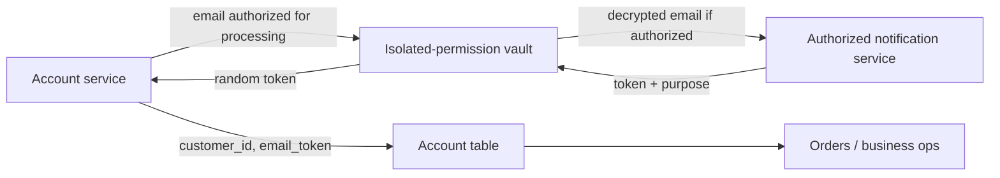
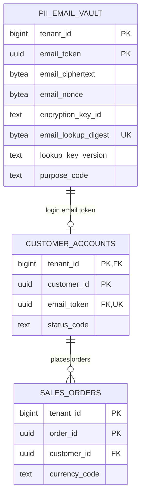

# Tokenization, Encryption, and Their Impact on Queries and Constraints

An account management system wants to **avoid storing emails as readable text** in tables accessible to ordinary application queries. Yet it still needs to support email-based login, reject duplicate email registrations within the same tenant, update contact addresses, and join accounts to orders. If you merely "encrypt the email column" while leaving `WHERE email = ?`, `UNIQUE(email)`, or `JOIN ... ON email` queries unchanged, the system can easily lose lookup capability or accidentally weaken a data invariant.

The same sensitive value can appear in multiple representations: **plaintext**, **ciphertext**, **replacement token**, **keyed blind index**, or **lower-granularity derived information**. Each representation serves a distinct role; one cannot substitute for another simply because none of them directly displays the raw email.

This lesson belongs to the **Data Protection** chapter in the **DATABASE_DATA_MODELING** module, which builds the skill of translating business requirements into clear entities, relationships, keys, indexes, constraints, and physical schemas. We will model a multi-tenant login system, demonstrate how encryption and tokenization affect **lookups, uniqueness, foreign keys, sorting, analytics, performance, and key-lifecycle maintenance**, and compare approaches across relational, document, graph, and analytical systems.

Examples use **Java 17+** and **PostgreSQL 15+**. The Java HMAC code illustrates blind-index computation principles; AEAD encryption should be implemented using vetted libraries, KMS/HSM, and real key-management workflows. This lesson does not prescribe a default security configuration or legal conclusion applicable to every product.

## 1. Start from Usage Purpose, Not from Encryption Algorithms

Suppose a SaaS platform has the following requirements:

1. Users register an account with an email and may change their email after verifying control of the new address.
2. Emails **only need to be unique within the same tenant**; two tenants may use the same address.
3. Login can locate an account by entered email, yet only the identity service may read the plaintext email when genuinely needed.
4. `sales_orders`, `audit_events`, and revenue reports only need `customer_id`, without copying emails.
5. Notification services are granted read access to contact addresses strictly for that purpose; other services see only a token or ID.
6. Distinguish login emails from marketing opt-ins: holding the same email does not grant unrestricted permission for both purposes.
7. The database must prevent two concurrent requests from creating duplicate email accounts under the agreed normalization rule.
8. Processes exist for key rotation, legacy data migration, error handling, and deletion/minimization when valid purposes end.

From this, we separate **three distinct decisions**:

| Question | Design decision | Do not confuse with |
|---|---|---|
| Who is authorized to know the raw email? | Decryption rights, token vault, controlled APIs | Who has `SELECT` on the account table |
| How do we locate an account by email? | Lookup index using normalized value and appropriate key | Using ciphertext directly as a search key |
| When are two emails considered duplicates? | Normalization invariant + tenant scope + atomic constraint | Checking with `SELECT` before `INSERT` |

**Purpose determines the required structure first; algorithms are merely tools to enforce that structure.** If email lookup is unnecessary, avoid building an email-linking index. If only verifying a condition is needed, store the appropriate verification result instead of retaining the raw value longer than necessary.

## 2. Distinguishing Tokenization, Encryption, Hashing, and Blind Indexes

These techniques are often lumped together as "hiding data," yet they have very different properties.

| Representation | Can recover original value? | Can check equality? | Risks to watch for |
|---|---|---|---|
| **Plaintext** | Yes, directly readable | Yes, under DB collation rules | Directly exposed on unauthorized read |
| **Disk encryption / TDE** | Database decrypts transparently during authorized queries | Normal SQL queries continue working | Does not block roles with `SELECT` from reading plaintext |
| **Randomized AEAD field encryption** | Yes, with valid key and decryption context | **Cannot** compare ciphertexts to test plaintext equality | Keys, nonces, decryption rights, metadata |
| **Deterministic encryption** | Yes, with key | Ciphertexts for the same plaintext match under the scheme | Leaks equality and frequency patterns; never roll your own |
| **Opaque random token** | Yes, if token vault stores mapping and grants detokenization | Same token means same **issued entry**, not proof of equal plaintext if issued carelessly | Vault availability, token lifecycle, linkability |
| **Unkeyed hash** | Not directly decryptable | Identical hashes suggest identical inputs | Predictable values like emails are vulnerable to dictionary attacks |
| **HMAC blind index** | Not decryptable from digest without source and secret | Supports equality lookup for normalized input/key | Still leaks equality and query patterns; compromised secret enables guessing |
| **Aggregated / truly anonymized data** | Depends on technique and re-identification risk | Does not necessarily preserve per-person lookup | Small cells or joins with external data can re-identify |

**Encryption** protects confidentiality when the key is absent. **Tokenization** substitutes a value with an identifier to limit where the raw value lives. An **HMAC blind index** enables a specific query—typically **equality lookup**—without storing plaintext in the index.

These approaches **can be combined**. For instance, store email with AEAD, reference it via a random token in other tables, and use HMAC to locate the token for a normalized email.

### Why Unkeyed Email Hashing Is Not Equivalent to Encryption

`SHA-256("a@example.test")` has no secret key and cannot be inverted by a direct mathematical inverse. Yet emails contain many predictable values that attackers can guess, hash, and match. A value that is not immediately human-readable **does not mean it is anonymous**.

HMAC adds a dedicated secret so parties lacking that secret cannot easily compute digests for candidate emails. Even so, a persistent digest can **link records sharing the same email** and becomes guessable if the secret leaks. Never publish an HMAC blind index as a "risk-free" public identifier.

## 3. Threat Model: Who and What Are We Protecting Against?

A sound design must name concrete risks.

| Actor / incident | Protection goal | Appropriate measure |
|---|---|---|
| Disk/backup accessed without authorization | Data unreadable without keys | Encryption at rest, backup and key management |
| SQL user with read access to certain tables | Cannot read plaintext emails outside task | App-level field encryption, restricted permissions/decryption |
| Analytics service reading order tables | Receives no unnecessary identifiers | Omit emails from facts; use surrogate keys and aggregates |
| Event consumer only needing account creation notice | Does not receive full user profile | Minimal event containing ID and status |
| Attacker obtains DB dump without lookup secret | Harder to probe emails via blind index | Isolated HMAC secret, access controls, key management |
| Caller allowed to query lookup API repeatedly | Cannot abuse API to enumerate accounts | Authorization, rate limits, anti-enumeration responses |
| Attacker gains DB access **and** decryption keys | Limit blast radius and detect abuse | Privilege separation, auditing, key scoping, operational controls |

A design may defend well against **stolen database backups** yet offer little protection if a compromised application server can call KMS to decrypt every record. Evaluate the entire data path, including APIs, secret stores, runtime permissions, logs, caches, and decrypted data in memory.

**No algorithm compensates for collecting excessive data.** If a use case only needs an email, do not also collect birth date or government ID and encrypt them "just to be safe."

## 4. Encryption at Rest vs. Field-Level Encryption

### 4.1. Encryption at Rest / TDE

A database can encrypt files, disk volumes, or backups. During authorized application queries, the database still processes `SELECT email` and returns plaintext. This effectively mitigates lost disks, snapshots, or backup media, but does not stop users with query privileges from reading sensitive fields.

### 4.2. Application-Level Field Encryption

With **application-level field encryption**, the database sees only:

```text
email_ciphertext: BYTEA
email_nonce: BYTEA
encryption_key_id: TEXT
```

An authorized application retrieves the ciphertext, requests the appropriate key/decryption operation, and returns the result for the valid use case. The DB can compare ciphertext bytes, yet **has no knowledge of the email**, cannot run regex validation on real emails, and cannot match identical emails by comparing randomized ciphertexts.

### 4.3. Using AEAD Properly

A common choice is **AES-GCM** with an appropriate key and a nonce **never reused under the same key**, or another modern AEAD supported by vetted libraries/KMS. Authenticated Encryption with Associated Data (**AEAD**) detects unauthorized tampering with ciphertext or bound metadata.

For an email, Associated Authenticated Data (**AAD**) might include:

```text
purpose = ACCOUNT_LOGIN_EMAIL
tenant_id = 42
contact_token = token-opaque
schema_version = 1
```

Decryption must reconstruct the exact same AAD; if ciphertext is moved to another token, tenant, or purpose, authentication fails. AAD is not secret: **never place plaintext email inside AAD** and assume it is encrypted.

The schema example in Section 8 assumes a **96-bit (12-byte) nonce** for AES-GCM and ciphertext carrying the **authentication tag**. Nonces must come from a CSPRNG under proper key-usage limits and strategies; random nonces make collision probability negligible rather than mathematically zero. Reusing a nonce with the same AES-GCM key breaks critical security guarantees.

**Never "make AES-GCM deterministic" by fixing the IV/nonce to support `UNIQUE`.** That is not a safe search mechanism.

## 5. Tokenization: Substituting Data with Identifiers, Not Eliminating All Linkage

A **token** represents a sensitive record or value without typically revealing the underlying value in the token's own structure.



A random token like a vault-issued UUID carries no semantics of "normalized email." It is a **reference key**. If two calls with the same email produce two distinct tokens and the vault lacks reuse/uniqueness rules, tokenization alone **does not** prevent duplicate-email accounts.

### Scoped Tokens by Purpose and Boundary

Depending on architecture, tokens may be issued:

- **Per record:** the same email across two accounts gets two distinct tokens.
- **Per value within a tenant and purpose:** the same normalized email under `ACCOUNT_LOGIN` maps to the same vault record/token.
- **Per partner or session:** a token in system A is unusable in system B, curbing cross-system correlation.

No single token policy fits all cases. When a system requires `UNIQUE(tenant, email)`, per-tenant value tokens can help **provided issuance uses atomic uniqueness checks**. When restricting cross-service linkage, purpose-scoped tokens outperform a single global token broadcast everywhere.

**Tokenization reduces exposure; it does not automatically anonymize data.** If a persistent token resolves to an email via a vault, or multiple tables join behavior on that token, it remains linkable to an individual.

## 6. Equality Lookups When Ciphertext Is Randomly Encrypted

Suppose you encrypt `an@example.test` twice using AEAD with distinct nonces:

```text
Plaintext:  an@example.test
Nonce 1  -> ciphertext A
Nonce 2  -> ciphertext B
A != B   even though plaintext is identical
```

Consequently, the following query **does not work semantically for finding emails**:

```sql
-- Semantically wrong for randomized AEAD:
SELECT contact_token
FROM pii_email_vault
WHERE email_ciphertext = :encrypt_email_again;
```

Re-encrypting the email generally produces a different ciphertext. Switching to deterministic encryption solely to run `WHERE ciphertext = ?` **leaks equality and frequency**, and still fails to natively support prefix matching, alphabetical sorting, or range queries.

### Keyed Blind Index for Equality Lookup

Choose an email normalization algorithm per policy:

\[
c = normalize(email)
\]

and a dedicated HMAC for indexing:

\[
I=HMAC_{K_{lookup}}(
\text{purpose}\parallel\text{tenant}\parallel c).
\]

Where:

- `K_lookup` is a **separate secret** from the email encryption key.
- `purpose` is a scope label restricting digest reuse for other purposes.
- `tenant` scopes lookups and prevents cross-tenant index collisions.
- `c` is the consistently normalized email applied before registration, login, and email changes.
- Components are encoded unambiguously (length-prefixed, fixed-width framing, or an explicit protocol), not arbitrary string concatenation.

Within the same algorithm/secret version, identical tenant + normalized email yields the same digest, supporting:

```sql
SELECT contact_token
FROM pii_email_vault
WHERE tenant_id = :tenant_id
  AND email_lookup_digest = :hmac_digest;
```

The query performs **equality comparison on the digest** without decrypting the email. The application must still enforce **lookup authorization**, prevent endpoint abuse, and avoid logging emails or HMAC secrets.

### Equality Leakage Risk

Even without knowing the raw email, anyone permitted to inspect all digests can tell which rows share a digest. If an API allows unrestricted email lookups, callers can abuse responses to **enumerate accounts**. Blind indexes do not replace authorization, rate limiting, or anti-enumeration responses.

## 7. Which Constraints Remain Enforceable When Storing Protected Data?

Distinguish **physical columns in the database** from data only the application can decrypt.

| Invariant | Enforceable in SQL with only ciphertext/tokens? | Limitations |
|---|---|---|
| Unique `customer_id` | **Yes**, PK/UNIQUE on ID | Does not prove one person lacks two accounts |
| Unique token in vault | **Yes**, PK/UNIQUE on token | Distinct tokens do not guarantee distinct emails |
| Account token exists in vault | **Yes**, FK | FK does not prove caller may decrypt |
| Token belongs to same tenant | **Yes**, composite FK `(tenant_id, token)` | Queries/APIs must still enforce tenant scope |
| Normalized email unique per tenant | **Conditionally**, UNIQUE on HMAC blind index | Holds only with consistent normalization, key/version, and collision policy |
| Email syntax valid | **No** via `CHECK` on ciphertext | Trusted app must validate before encryption |
| Email ownership verified | **No** via encryption/UNIQUE | Requires a dedicated verification workflow |
| Raw email length bounds | **Not directly** from ciphertext alone | Requires app validation and policy |
| Two emails share a domain | **No** from randomized ciphertext | Only possible with purpose-built derived metadata |
| Encryption used proper AAD and key | **No** via standard PK/FK | AEAD decrypt checks, key management, tests |
| Email not leaked to logs | **No** via DB schema | Logger, tracing, event/DTO tests, and permissions |

**Each layer protects a different boundary**: SQL constraints guard stored column integrity; AEAD protects ciphertext confidentiality and authenticity; the application/identity service guards email semantics and authorization.

Crucially, if the same email is HMAC'd with **two different lookup keys** during an upgrade without a migration plan, the two digests differ. `UNIQUE(tenant_id, email_lookup_digest)` **cannot automatically recognize** they represent the same email.

## 8. PostgreSQL 15+: Vault Table and Token-Referenced Accounts

We model two parts with distinct lifecycles and permissions:

- `pii_email_vault` stores ciphertext and lookup digests, managed by the identity service.
- `customer_accounts` stores account IDs, reference tokens, and statuses, without plaintext emails.

This example focuses on **login emails**—never treat this vault row as blanket permission to process the email for marketing.

### 8.1. Relationship Diagram



The `||--o|` notation reflects that **each token in this example serves at most one account**, though the vault may temporarily hold an unlinked token during reservation/migration. The one-to-one invariant must be backed by a real unique constraint, not just a diagram.

### 8.2. Minimal DDL

```sql
CREATE TABLE pii_email_vault (
    tenant_id BIGINT NOT NULL,
    email_token UUID NOT NULL,
    purpose_code TEXT NOT NULL,
    email_ciphertext BYTEA NOT NULL,
    email_nonce BYTEA NOT NULL,
    encryption_key_id TEXT NOT NULL,
    email_lookup_digest BYTEA NOT NULL,
    lookup_key_version TEXT NOT NULL,
    created_at TIMESTAMPTZ NOT NULL DEFAULT CURRENT_TIMESTAMP,

    CONSTRAINT pk_pii_email_vault
        PRIMARY KEY (tenant_id, email_token),

    -- This UNIQUE constraint operates on the DIGEST, not on plaintext.
    CONSTRAINT uq_email_lookup_in_tenant
        UNIQUE (tenant_id, email_lookup_digest),

    CONSTRAINT ck_email_vault_purpose
        CHECK (purpose_code = 'ACCOUNT_LOGIN'),
    CONSTRAINT ck_email_nonce_length
        CHECK (octet_length(email_nonce) = 12),
    CONSTRAINT ck_email_ciphertext_min_length
        CHECK (octet_length(email_ciphertext) > 16),
    CONSTRAINT ck_email_digest_length
        CHECK (octet_length(email_lookup_digest) = 32),
    CONSTRAINT ck_encryption_key_id
        CHECK (btrim(encryption_key_id) <> ''),
    CONSTRAINT ck_lookup_key_version
        CHECK (btrim(lookup_key_version) <> '')
);

CREATE TABLE customer_accounts (
    tenant_id BIGINT NOT NULL,
    customer_id UUID NOT NULL,
    email_token UUID NOT NULL,
    status_code TEXT NOT NULL DEFAULT 'PENDING_VERIFICATION',
    created_at TIMESTAMPTZ NOT NULL DEFAULT CURRENT_TIMESTAMP,

    CONSTRAINT pk_customer_accounts
        PRIMARY KEY (tenant_id, customer_id),

    CONSTRAINT uq_account_email_token
        UNIQUE (tenant_id, email_token),

    CONSTRAINT fk_account_login_email
        FOREIGN KEY (tenant_id, email_token)
        REFERENCES pii_email_vault (tenant_id, email_token)
        ON UPDATE RESTRICT
        ON DELETE RESTRICT,

    CONSTRAINT ck_account_status
        CHECK (
            status_code IN (
                'PENDING_VERIFICATION',
                'ACTIVE',
                'SUSPENDED',
                'CLOSED'
            )
        )
);

CREATE TABLE sales_orders (
    tenant_id BIGINT NOT NULL,
    order_id UUID NOT NULL,
    customer_id UUID NOT NULL,
    currency_code CHAR(3) NOT NULL,
    order_total_minor NUMERIC(20, 0) NOT NULL,

    CONSTRAINT pk_sales_orders
        PRIMARY KEY (tenant_id, order_id),

    CONSTRAINT fk_order_account
        FOREIGN KEY (tenant_id, customer_id)
        REFERENCES customer_accounts (tenant_id, customer_id)
        ON DELETE RESTRICT,

    CONSTRAINT ck_order_total
        CHECK (order_total_minor >= 0),
    CONSTRAINT ck_order_currency
        CHECK (currency_code ~ '^[A-Z]{3}$')
);
```

**Exact assumptions of this example:**

- The application encrypts emails with an approved **AES-GCM AEAD** scheme; `email_ciphertext` includes the authentication tag, and `email_nonce` is 12 bytes. The database does not encrypt, hold AES keys, or offer decrypt functions to ordinary roles.
- `email_lookup_digest` is the **full 32-byte HMAC-SHA-256** of the normalized email scoped by tenant/purpose. Never use bare SHA-256 or arbitrarily truncate digests.
- All active records currently share **the same lookup key version and normalization algorithm**. Rotation is a dedicated process covered in Section 14.
- `email_token` is a random token carrying no email info, issued by a trusted service.
- Each vault row serves at most one account per tenant/purpose; if the business allows multiple accounts with the same email, change the invariant and schema rather than forcing data against requirements.
- These tables illustrate **structural integrity**, not complete TTL policies, KMS permissions, email verification, or anti-enumeration controls.

### 8.3. Enforced Invariants

1. No two vault rows share `(tenant_id, email_token)`.
2. No two vault rows share `(tenant_id, email_lookup_digest)`.
3. An account cannot reference a nonexistent token or one from another tenant.
4. In this example, one token cannot be assigned to two accounts in the same tenant.
5. Orders reference accounts in the same tenant via composite FKs.
6. Technical fields are `NOT NULL` and several metadata columns enforce format/length checks.

### 8.4. Unenforced Invariants

- Does `email_ciphertext` actually decrypt to a valid email?
- Does the HMAC digest match the **encrypted plaintext**?
- Does the registrant own the email?
- Was ciphertext encrypted using the mandated AAD/nonce/key?
- Are all writers using the same lookup key version and canonicalization?
- Was a vault row created solely to retain data past its valid purpose?

You need **trusted write paths, crypto contracts, authorization, verification, and tests**. PKs/FKs cannot verify plaintext contents the database cannot see.

## 9. Race-Safe Account Creation Workflow

Suppose a user registers `An@Example.test` in tenant 42. The identity service performs:

1. Check permission to create accounts in tenant 42.
2. Validate email per policy and compute `canonical_email`. If policy treats `An@Example.test` and `an@example.test` as equivalent, all write paths must normalize consistently.
3. Compute `email_lookup_digest` via HMAC using the separately protected **lookup key**.
4. Generate a random `email_token`.
5. AEAD-encrypt the email with the **encryption key**, fresh nonce, and AAD binding tenant/token/purpose.
6. Within **one transaction**, insert the vault row and account row; let unique/FK constraints resolve concurrency.
7. Verify address ownership and transition account state per use case; never treat insertion as proof of ownership.
8. Commit; only after success emit events/side effects via an appropriate mechanism (e.g., outbox if needed).

```text
T1: HMAC(email) = digest D
T2: HMAC(email) = digest D

T1: INSERT vault (tenant=42, digest=D) -> succeeds
T2: INSERT vault (tenant=42, digest=D) -> waits / conflict
T1: INSERT customer account + COMMIT
T2: handle unique conflict per policy
```

**Avoid:**

```text
IF NOT EXISTS (SELECT ... WHERE digest = D)
THEN INSERT ...
```

Two transactions can both observe "does not exist" before inserting. The database `UNIQUE(tenant_id, email_lookup_digest)` constraint is the atomic arbiter picking a winner. The application catches the unique violation, inspects/reconciles per policy, and returns a response that does not disclose other users' accounts.

### HMAC Collision and Email Equality Are Not Strictly Identical

If two distinct normalized emails collide under HMAC-256, identical digests would trigger a unique conflict despite differing plaintexts. Collision probability for full HMAC-SHA-256 at practical scales is vanishingly small, yet **not mathematically zero**.

Upon a unique conflict:

- Do not immediately assume the user is registering their own email.
- Handle per use case and threat model: never decrypt arbitrarily if the caller lacks authorization.
- An authorized inspection path can decrypt the candidate to compare canonical values or detect system/lookup-version skew.
- Never return public API error messages that enable **enumerating registered emails**.

An HMAC blind index is a **practical commitment with negligible collision probability**, not exact plaintext comparison verified automatically by SQL.

## 10. Email Login Lookup via Blind Index

Input enters a trusted service:

```text
input_email
  -> validate & canonicalize
  -> HMAC(lookup_secret, purpose | tenant | canonical_email)
  -> equality query by digest
  -> fetch account/token
  -> apply authentication and authorization
```

PostgreSQL query:

```sql
-- :email_digest is the 32-byte HMAC computed by the application.
SELECT
    a.tenant_id,
    a.customer_id,
    a.status_code,
    v.email_token,
    v.encryption_key_id
FROM pii_email_vault AS v
JOIN customer_accounts AS a
  ON a.tenant_id = v.tenant_id
 AND a.email_token = v.email_token
WHERE v.tenant_id = :tenant_id
  AND v.purpose_code = 'ACCOUNT_LOGIN'
  AND v.email_lookup_digest = :email_digest;
```

`UNIQUE(tenant_id, email_lookup_digest)` already builds a B-tree index supporting lookups on those two columns in PostgreSQL. Avoid adding a duplicate index just to "make the query fast."

**Login does not require decrypting the email.** If you only need the account ID to verify credentials, the login path can skip decryption altogether. Only use cases that send mail or display a verified email need plaintext via an authorized service.

### Equality Queries Are Not Plaintext Queries

SQL cannot answer "which addresses contain `@example.test`" because digests retain no text structure. If domain-level analytics serve an approved purpose, design a lower-granularity source (such as normalized domains) and reassess re-identification risk before storing it.

When an email changes in the vault, compute and write the new HMAC digest in the same transaction as the new ciphertext. Never update `email_ciphertext` while leaving the old `email_lookup_digest` intact: lookups will match the wrong address or fail.

## 11. Foreign Keys and JOINs: Use Stable Identifiers, Not Ciphertext

Using email in FKs or JOINs creates problems:

- Emails change, making them unstable account identifiers.
- Comparing randomized ciphertexts does not reflect plaintext equality.
- Joining on HMAC digests creates unnecessary cross-dataset linkability.
- One account may have multiple contact addresses for different purposes.
- Changing lookup algorithms/versions alters the meaning of digest-based joins.

In our design:

```sql
SELECT
    o.order_id,
    o.currency_code,
    o.order_total_minor,
    a.customer_id
FROM sales_orders AS o
JOIN customer_accounts AS a
  ON a.tenant_id = o.tenant_id
 AND a.customer_id = o.customer_id
WHERE o.tenant_id = :tenant_id
  AND o.order_id = :order_id;
```

Routine order queries perform no email joins, token vault lookups, or personal-data decryption. **Composite foreign keys** ensure orders and accounts share a tenant; PKs/indexes accelerate joins on technical identifiers.

### Tokens as Reference Keys

If a service genuinely needs to reference the vault without plaintext emails, it may store `email_token` with an FK to the vault. Keep in mind:

- Scope strictly to tenant/purpose.
- Holding a token does not automatically grant detokenization rights.
- Avoid broadcasting a global token to every service when cross-purpose linkage is unnecessary.
- Tokens have lifecycles: revocation or rotation requires a mapping or token-replacement strategy across authorized references.

### FKs Do Not Replace Authorization

A `FOREIGN KEY (tenant_id, email_token)` only guards **existence and tenant scope**. It does not prove an API caller is authorized to read that token's email. Read authorization must be enforced at the application/service boundary and via DB roles by design.

## 12. Impact on Search, Sorting, Filtering, and GROUP BY

A DBMS can only operate directly on structures it can see.

| Query need | Plaintext / TDE | Randomized AEAD ciphertext | Token or blind index |
|---|---|---|---|
| `WHERE email = ?` | Works with proper normalization/index | **No** via newly encrypted ciphertext | Blind index supports equality; token supports token lookup |
| `WHERE email LIKE 'an%'` | Possible depending on index/collation | No | Not natively supported by full-email token/HMAC |
| `ORDER BY email` | Possible by collation | Sorting ciphertext bytes **has no alphabetical meaning** | Sorting tokens/digests is not email order |
| `GROUP BY email` | Possible if authorized | Cannot group identical plaintexts | Grouping digests works per scope/key with leakage |
| `UNIQUE(email)` | Works under DB comparison | Randomized ciphertext cannot enforce plaintext uniqueness | Conditional unique digest; unique token only guards tokens |
| `MIN/MAX(email)` | Alphabetical if meaningful | No | Meaningless on digests |
| JOIN by email | Possible, but creates coupling/PII spread | Unreliable | Prefer joining on `customer_id` or scoped tokens |
| Fuzzy / full-text search | Possible with right engine and access controls | Not available out of the box | Requires dedicated design, not automatic |
| Filter by created date, status | Yes | **Yes** if metadata columns are unencrypted | **Yes** on permitted non-sensitive metadata |

### Technically "Cheap" Queries Can Be "Expensive" for Data Protection

Adding columns like `email_domain`, `email_prefix`, region codes, or sort keys can accelerate a new query. Yet every derived column **leaks part of the plaintext** and becomes personal/linkable data with its own purpose.

Ask:

1. Which approved use case does the new query serve?
2. Can **aggregated** results suffice instead of storing partial identifiers?
3. Must search span all users directly, or only an authorized subset?
4. Can non-sensitive metadata narrow candidates before decrypting **within a small authorized scope**?
5. Are the query savings worth the information-leakage risk of a revealing index?

Avoid **order-preserving encryption**, homemade "searchable encryption," or arbitrary deterministic encryption merely to keep `ORDER BY`/`LIKE`. Specialized schemes carry specific leakage profiles and security assumptions requiring independent review.

## 13. Java 17: Computing HMAC Lookup Digests Within Proper Boundaries

The Java snippet below **only illustrates blind-index computation**; it does not encrypt emails or manage secrets. In production, HMAC keys must come from a trusted key/secret management service with access controls, versioning, and rotation workflows.

```java
package example.identity;

import java.nio.ByteBuffer;
import java.nio.charset.StandardCharsets;
import java.security.GeneralSecurityException;
import java.util.Locale;
import java.util.Objects;
import javax.crypto.Mac;
import javax.crypto.SecretKey;

public final class EmailLookupIndex {
    private EmailLookupIndex() {}

    // Illustrative normalization policy; requires business approval.
    public static String canonicalize(String email) {
        Objects.requireNonNull(email, "email");
        String result = email.strip().toLowerCase(Locale.ROOT);
        if (result.isEmpty()) {
            throw new IllegalArgumentException("empty email");
        }
        return result;
    }

    public static byte[] compute(
            SecretKey lookupKey,
            long tenantId,
            String canonicalEmail) throws GeneralSecurityException {

        if (tenantId <= 0) {
            throw new IllegalArgumentException("invalid tenant");
        }
        Objects.requireNonNull(canonicalEmail, "canonicalEmail");

        Mac mac = Mac.getInstance("HmacSHA256");
        mac.init(lookupKey);

        // Domain separation + fixed-length tenant identifier.
        mac.update(
            "ACCOUNT_LOGIN_EMAIL:v1".getBytes(StandardCharsets.UTF_8)
        );
        mac.update((byte) 0);
        mac.update(
            ByteBuffer.allocate(Long.BYTES)
                .putLong(tenantId)
                .array()
        );
        mac.update((byte) 0);

        return mac.doFinal(
            canonicalEmail.getBytes(StandardCharsets.UTF_8)
        );
    }
}
```

### What Matters More Than Those Few Lines of Java?

- `SecretKey` is **injected from a key/secret management service**—never hardcoded, logged, or placed in public config files.
- A fresh `Mac` instance is initialized **per computation** in the example to avoid unsafe shared state across requests.
- Tenant ID is encoded as **fixed-width 8 bytes**; the purpose label provides domain separation.
- Canonicalization must run **identically** during registration, lookup, updates, and migrations.
- `compute` assumes the argument is already **canonicalEmail**; naming and APIs must prevent passing raw unnormalized strings. A `CanonicalEmail` value object adds type safety.
- HMAC-SHA-256 outputs **32 bytes**, matching the DDL `CHECK` constraint.

**Important caveat:** `strip().toLowerCase(Locale.ROOT)` is purely illustrative. Real emails involve Unicode, IDN, local-part rules, dots, `+tag` conventions, and provider policies. Never blindly strip dots or `+tag` for all addresses, and do not assume all providers treat local parts case-insensitively. Changing canonicalization can **alter equality semantics and `UNIQUE` outcomes**, so version and migrate it like a data change.

### What Should the Crypto Service Expose?

An application interface might expose semantics such as:

```java
public interface EmailProtectionService {
    ProtectedEmail protectForLogin(long tenantId, String validatedEmail);
    String decryptForAuthorizedUse(
        long tenantId,
        java.util.UUID emailToken,
        String authorizedPurpose
    );
}

public record ProtectedEmail(
    java.util.UUID emailToken,
    byte[] ciphertext,
    byte[] nonce,
    String encryptionKeyId,
    byte[] lookupDigest,
    String lookupKeyVersion
) {}
```

This is an **illustrative contract**, not a full implementation of AEAD, KMS, authorization, or defensive immutability for byte arrays. In real Java code, `byte[]` is mutable; use defensive copies inside DTOs/records. `decryptForAuthorizedUse` must never trust a caller-supplied `authorizedPurpose` string alone: permissions and purpose must be verified from a **trusted security context**.

## 14. Key Rotation: Encryption and Blind Indexes Have Different Lifecycles

**Rotating encryption keys** and **rotating lookup keys** are distinct operations. Conflating them easily breaks lookups or lets duplicate records slip in.

### 14.1. Rotating the AEAD Encryption Key

While keeping `email_lookup_digest` under the same lookup key, you can:

1. Identify records needing re-encryption by `encryption_key_id`.
2. Decrypt in an authorized environment, verifying AAD and plaintext.
3. Re-encrypt with the new encryption key, fresh nonce, and valid AAD.
4. Write the new **ciphertext, nonce, and key ID** atomically per record/batch.
5. Verify decryption succeeds; confirm the lookup digest stays unchanged since canonical input did not change.
6. Retire the old key **only after** verifying backups/restores, active dependents, and key-rotation policies.

Re-encryption produces new ciphertext **without needing to change tokens** if vault record identity remains intact.

### 14.2. Rotating the HMAC Lookup Key Is More Complex

For the same email:

\[
HMAC_{K_1}(email)\neq HMAC_{K_2}(email)
\]

in the normal case. If half the table uses the new key and half uses the old key, a unique index on a **single digest column** cannot enforce email uniqueness across both halves.

**Never simply bump `lookup_key_version` and let new writers store K2 digests while old rows still hold K1.** Two accounts with the same email would yield different digests and bypass `UNIQUE`.

A viable plan:

1. Freeze current canonicalization and lookup key semantics; block bypassing writers.
2. Add a **new digest column** or controlled secondary mapping table; retain the old digest during transition.
3. During dual-write, compute **both K1 and K2** on every insert/update and enforce uniqueness across **both versions**.
4. Backfill K2 digests for existing rows in batches using versioning/row locks to avoid overwriting concurrent updates.
5. Verify K2 has full coverage and uniqueness across the dataset; resolve errors, collisions, or canonicalization discrepancies before cutover.
6. Switch reads to K2 once all writers and readers are compatible; prohibit single-key writes during transition.
7. Once proven safe, drop K1 dependencies and retire the old secret per policy.

**Watch out for `UNIQUE` with `NULL` during migration:** a new `lookup_digest_v2` column initially holding `NULL` does not enforce uniqueness across unbackfilled rows; rely on the active K1 invariant across all rows during that phase. If a writer only knows K2 while older rows only have K1, a duplicate window opens. Schedule transitions to eliminate that window explicitly.

### 14.3. Changing Canonicalization Policy Is Harder Than Rotating Keys

If v1 treated `A@example.test` and `a@example.test` as distinct emails while v2 merges them, a v2 backfill may uncover **real business conflicts**. You cannot simply swap HMAC keys or auto-delete an account. You need an identity-resolution workflow, ownership verification, user notifications, and policy-compliant handling of associated records.

Changing normalization is a **business identity migration**, not merely an algorithm swap.

## 15. Tokens, Erasure Rights, and Data Lifecycle

Suppose an account is closed. Separate:

- **Data to retain:** transactions/orders, statuses, and evidence required under valid purposes or active obligations.
- **Contact data no longer needed:** plaintext email, vault tokens, or decryption capability per policy.
- **Linkage identifiers:** `customer_id` may still be needed for transactions, while evaluating person-linkability and access controls.
- **Copies:** search indexes, caches, messages, logs, exports, and backups have independent lifecycles.

`ON DELETE RESTRICT` in the example prevents deleting a vault row while an account still references it. That is an **intentional integrity guard**: removing contact data requires an explicit workflow to retire or replace references first, rather than bypassing FKs by disabling checks.

### Conditional Crypto-Shredding

If data is encrypted with a **dedicated key not shared** with retained records, verifiably destroying that key can render ciphertext undecryptable within the threat model. However:

- It has no effect on **plaintext already copied to logs, caches, or exports**.
- If multiple records share one key, destroying the key can make still-needed records unreadable.
- Copies of the key in caches, backups, HSM replicas, or secondary stores must be accounted for.
- Tokens, HMAC digests, and linkage metadata persist unless separately deleted or minimized.

Never claim "data has been erased" merely by dropping a DEK without inventorying copies and related obligations.

### Purpose-Based Retention

A login email may be needed while the account is active; a physical order's shipping address has a different lifecycle. Avoid issuing one global vault token across every purpose and retaining it for the longest retention period of any single purpose. Design or split records by purpose, retention policy, and authorized mappings.

## 16. Migrating from Plaintext Columns to a Protected Model

Suppose the legacy table is:

```text
customer_accounts_old(
  tenant_id,
  customer_id,
  login_email,
  ...
)
```

We want to migrate to `customer_accounts` + `pii_email_vault` without breaking uniqueness or transactions.

### Phase 1 — Inventory and Lock Invariants

- Locate every store holding `login_email`: DBs, indexes, logs, CDC, events, caches, exports, warehouses, backups.
- Confirm **UNIQUE scope**: per tenant or platform-wide?
- Lock canonicalization and conflict handling if two emails collide after normalization.
- Finalize key management, AEAD, HMAC lookup, token scope, privileges, and retention policies.
- Audit downstream consumers joining by email or using email as a business key.

### Phase 2 — Build New Schema and Controlled Write Paths

- Provision the vault, unique digest constraint, new account table, and composite FKs.
- Build the isolated service handling validation, canonicalization, protection, and decryption.
- All writers must persist ciphertext + digest + account link in **one transaction** or a proven consistency protocol.
- Never let one writer populate the new tables while another still writes legacy plaintext without identity synchronization.

### Phase 3 — Backfill and Verify

Batch by batch:

1. Read legacy rows using minimal migration privileges.
2. Normalize email per the new policy.
3. Compute HMAC and check duplicates; route conflicts for business resolution.
4. Generate tokens, AEAD-encrypt, and insert vault rows and account mappings.
5. Reconcile customer counts, unique emails per tenant, FKs, and undecryptable records.
6. Never write plaintext into migration logs; log only run IDs and minimal error info.

### Phase 4 — Cutover

Once all readers/writers use the new path and tests pass:

- Stop querying legacy plaintext columns.
- Drop or isolate plaintext from application tables under a safe migration plan without losing needed transactions.
- Revoke legacy read permissions; inspect backups, logs, indexes/snapshots, and caches per policy.
- Reconcile post-cutover and rehearse restore/rollback to ensure plaintext does not reappear out of purpose.

**Never treat "backfill succeeded" as sufficient proof.** Migrations involving personal data require **verification metrics**, data lineage tracking, and checks across every replication path.

## 17. Performance and Query Costs of Protecting Fields

Data protection changes storage footprints, indexing, and CPU/network costs.

| Impact | Cause | How to evaluate |
|---|---|---|
| Ciphertext larger than plaintext | Nonce, authentication tag, header/version, optional padding | Measure real row, index, and backup sizes |
| Equality lookup via HMAC | Canonicalization + HMAC + B-tree lookup | Benchmark app + DB latency; safe caching if permitted |
| Decryption consumes CPU/KMS calls | Crypto/KMS overhead and permissions | Decrypt only when needed; bounded batching; monitor KMS |
| Loss of prefix/range sorting | Randomized ciphertext and digests drop text structure | Redesign use cases or reviewed secondary indexes |
| Rotation generates I/O | Re-encryption/reindexing, write amplification | Batching, rollback, and throughput throttling |
| Token vault adds lookups | Extra fetch/remote call | Assess latency, availability, and bounded caching |
| Key/version skew | Lookups and uniqueness break | Consistency tests, version monitoring |
| High-volume lookup calls | Account-enumeration oracle risk | Rate limits, authorization/anti-enum responses, anomaly detection |

### Choosing Indexes Based on Real Queries

For the DDL in Section 8:

- `PRIMARY KEY (tenant_id, email_token)`: vault lookup by token.
- `UNIQUE (tenant_id, email_lookup_digest)`: equality lookup by HMAC.
- `PRIMARY KEY (tenant_id, customer_id)`: account and order joins by ID.
- `UNIQUE (tenant_id, email_token)`: one token per account within a tenant.
- `FOREIGN KEY` guards references; child-side indexes depend on real queries and engine behavior.

Adding an index on `email_ciphertext` **does not enable plaintext equality lookups** under randomized encryption. A B-tree index on `email_lookup_digest` handles equality, yet does not natively support `LIKE` or `ORDER BY` on emails.

**Balance:** never restore a disabled query by accidentally creating a **shadow plaintext column** or placing raw emails into another index. Re-examine the purpose, choose access-controlled alternatives, and justify business value.

## 18. Securing Write Paths, Read Paths, and Logging

Cryptography can be implemented correctly and still leak data through application paths.

### Write Paths

- Validate emails before encryption; never echo raw email input in error messages.
- Compute HMAC inside an authorized service; never send secrets to the DB.
- Never log both plaintext and ciphertext in one audit event "for debugging."
- Prevent mass assignment: never trust client-supplied `email_lookup_digest`, `email_token`, `encryption_key_id`, or `tenant_id`.
- Emit protection audit events with minimal data, correlation IDs, and restricted viewing rights.

### Read Paths

- Default to fetching `customer_id` and status; decrypt only with **purpose + authorization**.
- Filter tenant directly in queries; never rely on unguessable UUID tokens as access control.
- Never cache decrypted emails across layers without TTLs, access controls, and deletion policies.
- Never serialize raw vault entities to REST/GraphQL; DTOs expose only explicitly allowed fields.
- Audit logs, APM, tracing, and error reporting to ensure no unnecessary emails or ciphertext/tags leak.

### A Service Authorized to Call KMS Should Not Access Every Purpose

A service sending login verification mail needs only the right user's email for that job. That does not grant permission to scan the entire vault or decrypt data for other purposes. Scoping keys, vault namespaces, service roles, and audits by purpose limits damage if one component is compromised.

## 19. Identifiers and Linkage Permissions in Analytical Systems

Order data can be served via:

```text
FactOrderLine
  tenant_id
  order_id
  product_id
  quantity
  unit_price_minor
  business_date
```

Most daily/product revenue reports **do not need** emails, vault tokens, or HMAC digests. When aggregation suffices, model a mart at this grain:

```text
FactProductSalesDaily
  tenant_id
  business_date
  product_id
  currency_code
  units_sold
  gross_amount_minor
```

No `customer_id`, `email_token`, or `email_lookup_digest`. This lowers the linkability of analytical data to individuals.

If an approved purpose requires customer cohort analytics, verify:

- Data purpose and ownership.
- Must the analytical ID tie directly to the platform-wide customer ID?
- Can you use a token scoped to **one analytical workload**?
- Is joining cohorts across multiple purposes permitted?
- When customers close accounts or revoke permissions, how are analytical tables and mappings updated?
- Can small statistical cells re-identify users?

**Pseudonymized analytics can remain personal data legally and technically** whenever linkability exists. Never assume random tokens or HMACs make datasets safe for unrestricted sharing.

## 20. Relational, Document, Graph, and Distributed Systems

### 20.1. Relational Databases

PKs/FKs/UNIQUE on tokens, customer IDs, and blind indexes express invariants cleanly. Still, `CHECK` cannot inspect email syntax inside ciphertext, and a unique digest holds only under **consistent normalization, key, and version**.

If partitioned by tenant, `UNIQUE(tenant_id, email_lookup_digest)` works whenever all rows for a tenant route to the same constraint enforcement point. If sharded by another key or split across independent databases, **local uniqueness** may not guarantee global uniqueness across business scope; use proper routing, registries, or global uniqueness coordination.

### 20.2. Document Databases

An account document might hold:

```json
{
  "tenantId": 42,
  "customerId": "account-opaque",
  "emailToken": "token-opaque",
  "status": "ACTIVE"
}
```

Encrypted emails live in a separately permissioned collection/vault. Unique indexes on digests must be verified against **shard keys and the engine's actual uniqueness guarantees**; never assume per-shard indexes protect the whole cluster. Avoid embedding ciphertext into every transaction document needlessly, as deletion and rotation would have to hunt down every copy.

### 20.3. Graphs

A graph storing `Account → Order` or `Account → Device` edges can traverse relationships via IDs/tokens. Using a **persistent token as a node key across many purposes** lets a graph connect extensive behaviors even without plaintext emails. Those joined paths themselves elevate re-identification risk.

Scope edges by purpose, enforce graph-traversal authorization, bound edge retention, and avoid creating a central "Person" node tying every source together merely for graph convenience. When an email is needed, only authorized services query the vault.

### 20.4. Distributed Systems and Event Sourcing

An `ACCOUNT_CREATED` event can carry just `tenant_id`, `customer_id`, event ID, and timestamp—no raw email for every consumer. If one consumer needs to send verification, pass a **restricted-access reference** rather than broadcasting emails across the bus.

In event sourcing, events are typically retained long-term for replay; storing sensitive plaintext or ciphertext inside immutable streams complicates key rotation, erasure, and purpose limitation. Store the **minimum data** in events and design lifecycle-aware references before committing to an immutable event log.

## 21. Testing: Data Correctness and Data Protection Together

An effective test suite proves **both business integrity and representation security**.

| Scenario | Expected outcome |
|---|---|
| Encrypt same email twice with different nonces | Distinct ciphertexts; both decrypt to identical plaintext |
| Decrypt ciphertext with wrong tenant AAD | AEAD authentication fails |
| Flip one byte in ciphertext | AEAD authentication fails |
| Register same canonical email in same tenant | One request succeeds; the other gets a unique conflict |
| Register same email in different tenants | Permitted when uniqueness is tenant-scoped |
| Change letter casing per policy | Same canonical email yields identical digest |
| Two different inputs treated similarly by some provider | Not merged unless normalization is approved |
| HMAC under K1 vs K2 | Digests differ; rotation allows no duplicates across versions |
| Two concurrent requests register same email | DB unique/transaction prevents race, not `SELECT`-first checks |
| Same token assigned to two accounts | `UNIQUE(tenant, email_token)` rejects |
| Account references another tenant's token | Composite FK rejects |
| Insert account without vault row | FK rejects |
| Client supplies forged `email_lookup_digest` | API ignores caller value |
| Service lacking decrypt permission | Receives no plaintext and cannot call key service |
| Query `WHERE email_ciphertext = encrypt(input)` | Rejected as an invalid equality pattern |
| Query via blind index | Finds right account when normalization/key match |
| `LIKE` or `ORDER BY` on digest | Never claimed to have plaintext semantics |
| Lookup secret revoked prematurely | Tests/monitoring detect inconsistent lookups |
| Update email ciphertext but forget digest | Contract/integration test catches and rolls back |
| Migration from plaintext | Record counts, unique scope, FKs, decryptability, and lookups match source |
| Registration audits/events/logs | Contain no plaintext email outside approved purpose/permission zones |
| Account/vault deletion per policy | Leaves no orphans; handles copies and lawful history retention |
| Restore backup after purge | Workflow prevents deleted data from reappearing contrary to policy |
| Two-shard deployment | Prevents duplicates via routing/global unique guarantees |
| Rare HMAC collision on two distinct emails | Does not assume same person; flags for investigation |

### Concurrency Tests Must Run Two Real Transactions

A unit test running "check email then insert" sequentially twice will not catch races. Test two concurrent transactions targeting the same digest:

```text
T1: start INSERT vault(digest=D), not yet committed
T2: start INSERT vault(digest=D)
T1: COMMIT
T2: must receive unique conflict or equivalent outcome
Verify: number of vault rows with digest D in tenant = 1
```

For document or distributed backends, test against the **exact sharding topology** used in production. Never assume a local unique index enforces global uniqueness.

### Permission and Leakage Tests

Beyond happy paths, test:

- Tenant A probing tenant B's tokens.
- Unauthorized user guessing another user's valid email.
- Repeatedly querying thousands of emails to enumerate accounts.
- Services serializing full vault entities in responses.
- Migration logs printing plaintext inside exception stack traces.
- Tokens appearing in unrelated data marts lacking the same purpose.
- Decryption attempted after account closure or purpose expiration.

Never treat "ciphertext looks like random bytes" as sufficient proof that the system protects data properly.

## 22. Technique Selection Matrix by Requirement

| Requirement | Preferred approach to consider | Avoid by default |
|---|---|---|
| Protect data against stolen disks | Encryption at rest / backups | Treating TDE as replacing SQL permissions |
| Hide emails from ordinary DB roles | App-level AEAD + separated privileges | `pgcrypto` with keys exposed in SQL/logs |
| Look up login accounts by email | HMAC blind index, clear normalization & scope | Searching randomized ciphertext |
| Unique email per tenant | Unique digest under consistent key/version + transaction | `SELECT` before `INSERT` |
| Reduce email copies across services | Opaque purpose-scoped token + vault | One global token for every use case |
| Join orders to customers | `customer_id`, tenant-composite FK | Joining on encrypted email or digest |
| Prefix or domain search | Re-evaluate purpose; use bounded derived attribute if truly needed | Homemade deterministic AES or shadow plaintext |
| Sort by email | Only in authorized flows with purpose-built search | `ORDER BY ciphertext` |
| Revenue analytics by product | Aggregates without email or token | Putting HMAC emails in every fact "just in case" |
| Rotate encryption key | Verifiable re-encryption; keep stable lookup if still valid | Changing lookup secret simultaneously without migration |
| Rotate lookup secret | Dual index / dual validation / controlled cutover | Mixing K1 and K2 writers unchecked |
| Delete contact data | Verify purpose, FKs, vault, caches, logs, backups | Dropping ciphertext and claiming all copies vanished |
| Protect test environments | Synthetic data, verified permissions & masking | Copying production and only renaming users |
| Multi-shard scaling | Constraints with routing key or global coordination | Assuming per-shard `UNIQUE` covers the cluster |

**No single design is universally optimal**: if the business never performs equality lookups by email, skip the blind index. If frequent low-latency lookups are required under strict access controls, a keyed blind index can be a sound trade-off. Every auxiliary field added for faster queries must be evaluated for **what information it leaks**.

## 23. Practice Exercise: Multi-Purpose Membership Profile

A service-booking platform spans three systems:

- **Identity Service** stores tenant accounts; login uses email and requires `UNIQUE(tenant, canonical_email)`.
- **Booking Service** stores appointments, referencing accounts without needing plaintext emails.
- **Notification Service** needs verified emails only when actually sending appointment notices; it must not view full customer profiles.
- **Marketing Service** sends emails only when users have opted in per policy; booking an appointment does not imply marketing consent.
- **Analytics** needs booking counts by month, service, and region, without tracking individuals.
- Data lives in one PostgreSQL cluster with plans to shard tenants later. The system must retain appointment history longer than contact emails upon approved account closure.

Complete the following:

1. Write a **purpose → data → permissions → retention → owner** matrix for all five systems.
2. Decide which data stays plaintext in memory during use, which uses AEAD, which is tokenized, and which should never enter downstream tables.
3. Define **canonical_email** and uniqueness scope. Explain why dots or `+tag` are not stripped by default.
4. Design the vault containing `tenant_id`, `email_token`, ciphertext, nonce, key ID, lookup digest, lookup key version, and purpose. Draw an ERD with Account and Booking.
5. Write PostgreSQL DDL for tenant-composite PK/UNIQUE/FK constraints, explaining **which invariants constraints still check** after encryption.
6. Write pseudocode for two concurrent registrations with the same email: HMAC, vault insert, account insert, commit, and conflict handling.
7. Write the account lookup query by digest; explain why `WHERE email_ciphertext = encrypt(input)` fails.
8. Design verified email updates and atomic ciphertext/digest updates; explain how to avoid leaving an account on an unverified email mid-change.
9. Suppose rotating `K_lookup_v1` to `K_lookup_v2`: plan backfill, rollback, and cutover with zero duplicate windows.
10. Design Notification Service authorization: token usage, purpose verification, scope limits, and minimal auditing.
11. Identify queries lost without plaintext email (`LIKE`, sorting, domain filtering) and decide which use cases truly justify dedicated search.
12. Design an aggregate data mart **without emails or tokens**; assess small-group and linkability risks.
13. Write at least 12 test cases covering races, cross-tenant attempts, wrong AAD, rotation, lookup key versions, FKs, token reuse, log/event leaks, purging, and restores.
14. Explain how sharding changes affect `UNIQUE(tenant, email)` and why arbitrary per-shard unique indexes are insufficient.
15. Compare latency, CPU, index, KMS cost, and leakage risk across three options: plaintext with TDE, AEAD + HMAC blind index, and token vault.

**Success criteria:** clearly distinguish **content encryption**, **reference tokenization**, and **blind-index uniqueness enforcement**; never rely on randomized ciphertext for equality lookups; never use unkeyed hashes to protect emails; leave zero uniqueness gaps during rotation; and never equate tokenization with anonymization.

## 24. Summary

- **Tokenization** replaces raw values with managed identifiers; persistent tokens can still link records and do not prove plaintext uniqueness on their own.
- **Application-level AEAD** hides plaintext emails from DB roles lacking decryption rights, while sacrificing direct plaintext `WHERE`/`UNIQUE`/`ORDER BY`.
- **HMAC blind indexes** support equality lookups and conditional uniqueness enforcement **under consistent normalization, tenant, purpose, key, and version**, with leakage and collision risks that must be managed.
- **PKs/FKs/UNIQUE on IDs/tokens** still protect relational structure; they do not verify email validity, ownership verification, or caller read permissions.
- **Never fix nonces to make AES-GCM deterministic**, never treat bare SHA-256 of emails as anonymous, and never rely on `SELECT`-then-`INSERT` against concurrency races.
- **Join on customer IDs**, not encrypted emails or blind indexes unless an approved need exists.
- Prefix/range/order searches do not work out of the box on randomized ciphertext or HMACs; auxiliary indexes always trade off information leakage.
- **Encryption key rotation and lookup key rotation differ**; rotating lookup keys must preserve cross-version uniqueness throughout transition.
- Risk reduction applies **end-to-end**: inputs, vaults, APIs, logs, events, caches, analytics, backups, retention, and decryption rights.
- A solid design explicitly documents **what data is kept, why, how it is protected, which constraints truly hold, and how both correctness and security are tested**.
