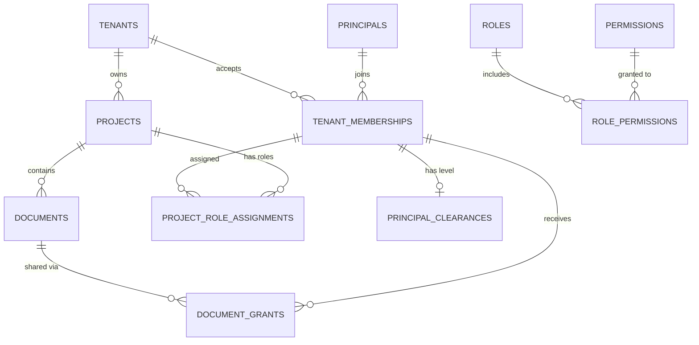
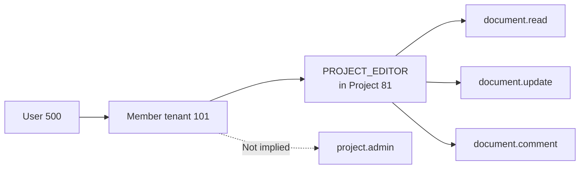
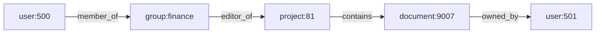
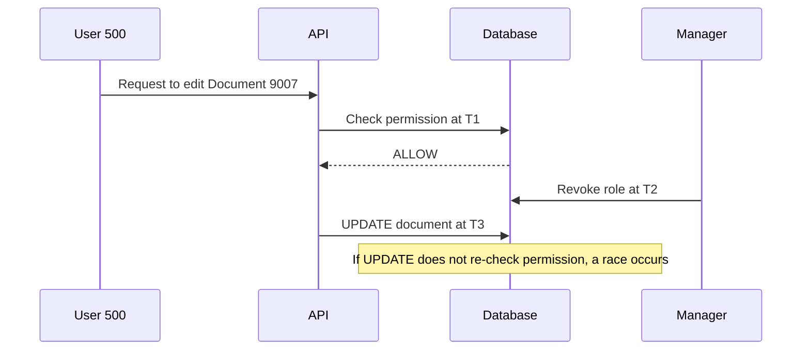

# Access Control Models by Subject, Resource, Role, or Attribute

A multi-tenant document management system serving multiple enterprises has the following requirements: employees can only view documents in projects they participate in; project leads can edit them; document owners can view their own drafts; **restricted** documents are only opened to users with the appropriate clearance level; users whose access is revoked must not be able to continue downloading files even if they know the old ID or URL. Should permissions be stored directly on each document, assigned via roles, evaluated from user/document attributes, or determined by relationships between entities?

That is the problem of **authorization modeling**. It is not just an `if (role == "ADMIN")` statement in Java. The choice of subjects, resources, actions, scopes, and SQL constraints determines whether the system can protect data as the number of users, tenants, roles, and policies grows.

This lesson belongs to the **Data Protection** chapter in the **DATABASE_DATA_MODELING** module: it builds skills to translate requirements into verifiable entities, keys, relationships, constraints, indexes, and storage schemas. The focus is on distinguishing **RBAC** (role-based), **ABAC** (attribute-based), **ACL** (direct access control list), and **ReBAC** (relationship-based), and how to combine them into a secure data model. The examples use PostgreSQL and illustrative SQL, but the principles apply to relational, document, or graph-based authorization models.

## 1. Who You Are Differs From What You Are Allowed to Do

**Authentication** verifies the identity or entity calling the system: a user, a service account, or an automated job. **Authorization** answers whether an authenticated entity is allowed to perform a specific action on a resource under the current context.

An authorization decision typically has the form:

```text
allow(
    subject,       // Who is making the request?
    action,        // What do they want to do?
    resource,      // On which resource?
    context        // Tenant, time, status, environment...
) -> ALLOW | DENY
```

Example:

```text
subject  = user:500
action   = document.read
resource = document:(tenant=101, document=9007)
context  = {project=81, status=ACTIVE, classification=RESTRICTED}
result   = DENY because subject lacks the required clearance
```

Having access to a project **does not mean** being able to view every restricted document in that project; having clearance also **does not mean** automatically having access to every project.

### 1.1. Six Concepts to Separate

| Concept | Meaning | Example |
|---|---|---|
| **Subject/principal** | Identity performing an action | `user:500`, `service:exporter` |
| **Resource** | Object that needs protection | Document, project, order, API, file |
| **Action/permission** | Operation being evaluated | `document.read`, `document.update` |
| **Role** | Functional grouping of permissions | `PROJECT_VIEWER`, `PROJECT_EDITOR` |
| **Attribute** | Property of subject/resource/context | Tenant, classification, status, timestamp |
| **Relation** | Relationship between subject and resource | Project member, document owner, shared recipient |

From this, **users**, **roles**, and **permissions** are not the same entity. A user can hold multiple roles in different scopes; a role contains multiple permissions; a permission is usually tied to a **stably named action**, not hardcoded to a specific resource ID.

### 1.2. Default Deny Principle

A verifiable policy should start with:

```text
If identity, tenant, or required permission data is missing -> DENY.
If membership has been revoked or the resource is no longer valid -> DENY.
ALLOW only when all mandatory conditions hold and at least one valid grant path exists.
```

**Default deny** ensures a new resource is not accidentally exposed publicly simply because no rule has been added yet. Never turn a database read error or policy timeout into `ALLOW` to "avoid hurting user experience."

## 2. Defining the Scope of Resources and Subjects

Suppose the application has:

- `Tenant`: an enterprise using the system.
- `Principal`: an authenticated user or service account.
- `TenantMembership`: which tenants a principal is allowed to participate in.
- `Project`: a workspace belonging to a tenant.
- `Document`: a document belonging to a project and a tenant.
- `Role`/`Permission`: task-based permissions.
- `DocumentGrant`: direct permission sharing on a specific document.
- `PrincipalClearance`: maximum classification level allowed for access.

An invariant:

> A document belonging to tenant A must never be granted access or linked to a member of tenant B by accidentally joining IDs without a tenant scope.



In this model, `principal_id` may be a global identifier, but **tenant-scoped permission assignment tables must still include `tenant_id`**. A user can be an `EDITOR` for a project in tenant 101 and a `VIEWER` in tenant 202 without creating two separate login accounts.

### 2.1. Grain of Authorization Tables

| Table | What One Row Represents |
|---|---|
| `principals` | One actor identity recognized by the system |
| `tenant_memberships` | One principal's membership relationship with one tenant |
| `permissions` | One named and managed action |
| `roles` | One functional set of permissions |
| `role_permissions` | One permission belonging to one role |
| `project_role_assignments` | One principal holding one role in one project of a tenant |
| `document_grants` | One principal receiving one permission directly on one document |
| `principal_clearances` | Approved classification level for a principal in a tenant |

Clear grain helps define the **PK**, **UNIQUE** constraints, and revocation logic. Do not store a list of allowed user IDs as a string `"1,2,3"` in a document column: it is hard to enforce relationships, assign multiple permissions, handle expiration, and index.

## 3. ACL: Direct Permission Grants on Resources

An **Access Control List (ACL)** is typically a list of entries expressing "subject X can perform action Y on resource Z." For example:

| Document | Subject | Permission | Expires |
|---|---|---|---|
| `doc:9007` | `user:500` | `document.read` | None |
| `doc:9007` | `user:501` | `document.read` | 2027-01-01 |
| `doc:9010` | `user:501` | `document.update` | None |

If only a few documents have special sharing, an ACL is very intuitive. However, when each project has thousands of documents and hundreds of employees, assigning individual permissions on each document creates **a huge number of entries** and becomes hard to manage when employees change teams.

### 3.1. Strengths and Limitations

**Strengths:** exception sharing is easy to express; per-document revocation is clear; well suited for guest collaboration and temporary read grants.

**Limitations:** grant rows can grow proportionally to users × resources; hard to understand a user's effective permissions from multiple sources; inherited permissions or rules like "all documents in a project" often get duplicated if relying only on ACLs.

### 3.2. Does an ACL Contain Only ALLOW or Also DENY?

This lesson's example stores only **allow grants**. The absence of an entry means no permission via the ACL path, though the subject may still be allowed via a role or ownership relation. If a system supports **explicit DENY**, the evaluation precedence must be stated explicitly:

```text
Mandatory restrictions (tenant, state, classification) -> must pass
Explicit deny (if supported by the model) -> deny
At least one allow grant/role/relation -> allow
Otherwise -> deny
```

Do not add an `effect='DENY'` column and let individual services pick their own evaluation order. A model mixing ALLOW/DENY without defined precedence will yield different results depending on the query path.

## 4. RBAC: Assigning Permissions Through Roles

**Role-Based Access Control (RBAC)** decouples actions from individual users. A role maps to a set of permissions; a subject receives a role within a scope.



Example matrix:

| Role in project | `document.read` | `document.comment` | `document.update` | `project.manage_members` |
|---|---|---|---|---|
| `PROJECT_VIEWER` | Yes | No | No | No |
| `PROJECT_COMMENTER` | Yes | Yes | No | No |
| `PROJECT_EDITOR` | Yes | Yes | Yes | No |
| `PROJECT_ADMIN` | Yes | Yes | Yes | Yes |

This matrix is only the **contract for this example**, not a mandatory definition for every product. Permissions such as `document.delete` or `billing.refund` should be separated into distinct permissions because their risk differs from `document.update`.

### 4.1. Roles Must Be Scoped

Assigning `PROJECT_EDITOR` to user 500 without specifying **which project** is usually an incomplete model. Role assignments must carry `tenant_id` and `project_id`:

```text
principal 500:
  tenant 101 / project 81 -> PROJECT_EDITOR
  tenant 101 / project 82 -> PROJECT_VIEWER
  tenant 202 / project 10 -> PROJECT_COMMENTER
```

A global role such as `PLATFORM_SUPPORT` should not be used as a shortcut to read all tenant data without dedicated authorization and audit mechanisms.

### 4.2. Roles Are Not Business States

`order.status='CONFIRMED'` is an order state, not a role. "Admins can edit canceled orders" may be a business rule violation even when an admin has the `order.update` permission. Behavioral rules must combine **permissions** and **resource state**.

### 4.3. Role Hierarchy and Separation of Duties

If `PROJECT_ADMIN` inherits permissions from `PROJECT_EDITOR`, you can model a role hierarchy instead of duplicating the matrix. However, you must prevent inheritance cycles (`A→B→A`), define negation handling, and cache effectively. For smaller systems, a direct role–permission matrix is often easier to verify.

Some business domains require **separation of duties**: the person who creates a payment request must not approve that same request. Even if that person holds the `APPROVER` role, the policy must check `resource.created_by != principal_id` or enforce an independent approval workflow. Pure RBAC is **not sufficient** to express actor-conflict constraints.

## 5. ABAC: Attribute-Based Decisions

**Attribute-Based Access Control (ABAC)** evaluates attributes of the subject, resource, action, and environment. You do not need to create a new role for every combination of "user in group A, confidential document, in region X, during hours Y."

Example read condition:

```text
subject.membership.status = ACTIVE
AND subject.clearance_level >= resource.classification_level
AND resource.status = ACTIVE
AND subject.tenant_id = resource.tenant_id
AND has_project_role_or_document_grant(subject, resource, "document.read")
```

Attributes may include:

| Attribute Source | Examples | Trust Considerations |
|---|---|---|
| Subject | Tenant membership, clearance, department | Sourced from an authoritative store with change controls |
| Resource | Classification, owner, status, project ID | Attributes must be protected against arbitrary edits |
| Action | Read, update, export, approve | Standardized names and semantics |
| Environment | Time, login session, MFA verified | Never trust client-asserted sensitive factors |
| Relationship | Document owner, project member, manager | Requires accurate and active relational data |

### 5.1. Where Should Attributes Be Stored?

Some attributes belong directly as columns, such as `documents.classification_level` and `documents.status`. Attributes that require history or an approval workflow, such as clearance, should live in a dedicated table with FKs and change metadata.

Do not dump all attributes into a single JSON column just because "ABAC is flexible." JSON can suit custom metadata, but **security-critical attributes** need strong typing, validation, indexes, edit controls, and clear auditing.

### 5.2. Document Classification Example

Suppose sensitivity levels are coded as:

```text
0 = PUBLIC_WITHIN_TENANT
1 = INTERNAL
2 = RESTRICTED
```

A user with `max_classification_level=1` must not view level 2 documents, **even** with the `PROJECT_EDITOR` role. "PUBLIC_WITHIN_TENANT" still requires tenant membership in this example policy; it **does not mean** the document is public on the Internet.

Classification is only one dimension. If a document is under legal hold or in `DELETED` status, corresponding policies must be added; do not create an ultra-high clearance level to bypass all other constraints.

### 5.3. ABAC Requires a Coherent Policy

A system with multiple conditions may encounter:

- One policy allowing access based on role.
- One policy denying access based on classification.
- One exception policy based on ownership.

The combined outcome must be defined **before writing code**. In this lesson: tenant + membership + status + classification are **mandatory conditions** for every read path; after those pass, ownership, role, or ACL provides an ALLOW path. No role bypasses classification just because its name contains `ADMIN`.

## 6. ReBAC: Relationship-Based Access Control

**Relationship-Based Access Control (ReBAC)** derives permissions from graph relationships: a user is a member of a group, the group belongs to a project, the project contains a document; or the user is the document owner.



A rule might look like:

```text
can_read(user, document)
  = user is owner of document
    OR user is member of a group with reader/editor relation
       to the parent project of document
    OR user has direct document.read grant
```

ReBAC is useful when there are multiple levels of groups, organizations, folders, projects, documents, and **inherited** permissions. However, you must define traversal direction, depth, cycle handling, and how relationship revocation works.

### 6.1. ReBAC Differs From RBAC, Yet They Often Combine

`PROJECT_EDITOR` is a role name and permission bundle; "user 500 is an editor of project 81" is a **resource-scoped relationship**. The same `project_role_assignments` table can represent both RBAC (roles) and ReBAC (assigned at the project node and inherited by child documents).

You do not have to choose RBAC **or** ReBAC as mutually exclusive options. What matters is that the policy has explainable, verifiable, and revocable permission paths.

### 6.2. Inherited Relationships Are Not Naturally Unbounded

A subfolder may inherit permissions from its parent folder, while a `restricted` folder may break inheritance. If the domain has multi-level folders, you must define:

- Does inheritance flow parent → child?
- Are there exceptions that break inheritance?
- How are multiple parents or nested groups combined?
- Can relationship chains contain cycles, and how are they handled?
- How must queries listing permitted resources perform on a large graph?

For stable tree data, a parent–child relationship table and recursive CTEs may suffice. For complex multi-type/multi-path relationships, consider a graph model or a dedicated permission-checking service, while still keeping the source of truth and tenant invariants explicit.

## 7. Combining RBAC, ABAC, ACL, and ReBAC Into One Clear Policy

No single mechanism fits every system. This lesson uses a **hybrid policy**:

```text
can_read_document(principal, tenant, document)
  = authenticated(principal)
    AND active_member(principal, tenant)
    AND belongs_to(document, tenant)
    AND document.status = ACTIVE
    AND principal.clearance >= document.classification
    AND (
        principal = document.owner
        OR has_role_permission(
            principal, document.project, "document.read"
        )
        OR has_valid_direct_grant(
            principal, document, "document.read"
        )
    )
```

In this policy:

- **Tenant + membership** form the organizational boundary layer.
- **Classification + status** are mandatory ABAC conditions.
- **Owner/project membership** represents ReBAC relationships.
- **Role-permission** represents project-scoped RBAC.
- **Direct grant** represents ACL exceptions.

A level 2 document is only opened when the user has clearance of at least 2, **even if that user is the owner or holds the EDITOR role**. In this policy, there is no "super admin who bypasses everything"; any break-glass privilege, if it exists, must be defined separately with strict controls and auditing.

### 7.1. Policies Must Specify Behavior When Data Is Missing

If a clearance record does not exist, this lesson's policy defaults to **DENY** rather than assuming level 2. If membership is `SUSPENDED`, any role assignments remaining in the DB are ineffective. If the document is `DELETED`, lingering ACL entries still do not grant read access to its content.

This is why **mandatory conditions are placed outside the permission OR branches**: so no grant branch can accidentally bypass tenant, classification, or resource-state protections.

### 7.2. Do Not Infer One Permission From Another

`document.read` does not necessarily permit `document.export`, `document.print`, or `document.share`. An API exporting thousands of documents carries different risk than viewing one document; define distinctly named actions and evaluate them by contract.

Similarly, `document.update` does not automatically allow changing `classification_level` or `owner_principal_id`. Security-sensitive attributes may require `document.reclassify` and `document.transfer_owner`, along with dedicated approval workflows.

## 8. Designing a PostgreSQL Relational Schema for Access Control

A minimal model sufficient for our example:

```sql
CREATE TABLE tenants (
    tenant_id BIGINT PRIMARY KEY,
    tenant_code VARCHAR(80) NOT NULL UNIQUE
);

CREATE TABLE principals (
    principal_id BIGINT PRIMARY KEY,
    principal_kind VARCHAR(12) NOT NULL
        CHECK (principal_kind IN ('USER', 'SERVICE')),
    display_name VARCHAR(160) NOT NULL
);

CREATE TABLE tenant_memberships (
    tenant_id BIGINT NOT NULL REFERENCES tenants(tenant_id),
    principal_id BIGINT NOT NULL REFERENCES principals(principal_id),
    membership_status VARCHAR(12) NOT NULL
        CHECK (membership_status IN ('ACTIVE', 'SUSPENDED', 'REVOKED')),
    PRIMARY KEY (tenant_id, principal_id)
);

CREATE TABLE projects (
    tenant_id BIGINT NOT NULL REFERENCES tenants(tenant_id),
    project_id BIGINT NOT NULL,
    project_name VARCHAR(200) NOT NULL,
    PRIMARY KEY (tenant_id, project_id)
);

CREATE TABLE documents (
    tenant_id BIGINT NOT NULL,
    document_id BIGINT NOT NULL,
    project_id BIGINT NOT NULL,
    owner_principal_id BIGINT NOT NULL,
    title VARCHAR(300) NOT NULL,
    classification_level SMALLINT NOT NULL
        CHECK (classification_level BETWEEN 0 AND 2),
    document_status VARCHAR(12) NOT NULL
        CHECK (document_status IN ('ACTIVE', 'ARCHIVED', 'DELETED')),
    version BIGINT NOT NULL DEFAULT 0 CHECK (version >= 0),
    PRIMARY KEY (tenant_id, document_id),
    FOREIGN KEY (tenant_id, project_id)
        REFERENCES projects(tenant_id, project_id),
    FOREIGN KEY (tenant_id, owner_principal_id)
        REFERENCES tenant_memberships(tenant_id, principal_id)
);

CREATE TABLE roles (
    role_code VARCHAR(60) PRIMARY KEY
);

CREATE TABLE permissions (
    permission_code VARCHAR(80) PRIMARY KEY
);

CREATE TABLE role_permissions (
    role_code VARCHAR(60) NOT NULL REFERENCES roles(role_code),
    permission_code VARCHAR(80) NOT NULL
        REFERENCES permissions(permission_code),
    PRIMARY KEY (role_code, permission_code)
);

CREATE TABLE project_role_assignments (
    tenant_id BIGINT NOT NULL,
    project_id BIGINT NOT NULL,
    principal_id BIGINT NOT NULL,
    role_code VARCHAR(60) NOT NULL REFERENCES roles(role_code),
    effective_from TIMESTAMPTZ NOT NULL DEFAULT CURRENT_TIMESTAMP,
    expires_at TIMESTAMPTZ,
    PRIMARY KEY (tenant_id, project_id, principal_id, role_code),
    FOREIGN KEY (tenant_id, project_id)
        REFERENCES projects(tenant_id, project_id),
    FOREIGN KEY (tenant_id, principal_id)
        REFERENCES tenant_memberships(tenant_id, principal_id),
    CHECK (expires_at IS NULL OR expires_at > effective_from)
);

CREATE TABLE document_grants (
    tenant_id BIGINT NOT NULL,
    document_id BIGINT NOT NULL,
    principal_id BIGINT NOT NULL,
    permission_code VARCHAR(80) NOT NULL
        REFERENCES permissions(permission_code),
    granted_at TIMESTAMPTZ NOT NULL DEFAULT CURRENT_TIMESTAMP,
    expires_at TIMESTAMPTZ,
    PRIMARY KEY (
        tenant_id, document_id, principal_id, permission_code
    ),
    FOREIGN KEY (tenant_id, document_id)
        REFERENCES documents(tenant_id, document_id),
    FOREIGN KEY (tenant_id, principal_id)
        REFERENCES tenant_memberships(tenant_id, principal_id),
    CHECK (expires_at IS NULL OR expires_at > granted_at)
);

CREATE TABLE principal_clearances (
    tenant_id BIGINT NOT NULL,
    principal_id BIGINT NOT NULL,
    max_classification_level SMALLINT NOT NULL
        CHECK (max_classification_level BETWEEN 0 AND 2),
    PRIMARY KEY (tenant_id, principal_id),
    FOREIGN KEY (tenant_id, principal_id)
        REFERENCES tenant_memberships(tenant_id, principal_id)
);

CREATE INDEX idx_documents_project
    ON documents(tenant_id, project_id, document_id);

CREATE INDEX idx_project_roles_principal
    ON project_role_assignments(
        tenant_id, principal_id, project_id, role_code
    );

CREATE INDEX idx_grants_principal
    ON document_grants(
        tenant_id, principal_id, permission_code, document_id
    );
```

This is a **design model for the lesson**, not a complete production migration script. The DDL assumes principal, tenant, project, and document IDs are generated by a separate mechanism with appropriate uniqueness, and that role and permission tables are seeded validly before assignment. Authentication/login, file storage, login sessions, auditing, approval workflows, and encryption keys are modeled separately during implementation.

### 8.1. Role of Primary Keys, Foreign Keys, and Constraints

| Constraint | Protected Invariant |
|---|---|
| `PRIMARY KEY(tenant_id, document_id)` | The same document ID can appear in another tenant, but never twice within the same tenant |
| `FOREIGN KEY(tenant_id, project_id)` | A document belongs to a project of **that same tenant** |
| `FOREIGN KEY(tenant_id, owner_principal_id)` | The owner must be a registered membership of the tenant |
| `FOREIGN KEY(tenant_id, principal_id)` on ACL | Cannot issue a direct grant to a principal who is not a tenant member |
| `PRIMARY KEY(role_code, permission_code)` | The same permission cannot be inserted twice into the same role |
| `CHECK classification_level BETWEEN 0 AND 2` | Classification level stays within the designed value domain |
| `CHECK expires_at > granted_at` | Grant validity window is valid when an expiration is set |

**An FK does not verify whether membership is still `ACTIVE`**, because status is a dynamic policy condition. A grant record may still exist when membership is `REVOKED`, but permission queries must deny access by checking membership status before evaluating grants. Cleaning up grants along with membership lifecycle is a separate data-management policy to design.

### 8.2. Roles and Permissions Can Be Global or Tenant-Specific

The example uses platform-wide `roles(role_code)` and `permissions(permission_code)`, so `PROJECT_EDITOR` has the same permission set across all tenants. If each tenant can customize roles, you must switch to scoped keys like `roles(tenant_id, role_code)` and `role_permissions(tenant_id, role_code, permission_code)`, and add composite FKs on assignments.

Do not allow tenants to freely create roles containing dangerous platform permissions like `platform.read_all_tenants` merely because role names live in the same table. The set of assignable permissions must have a clear boundary.

### 8.3. Why Is a Document Version Needed?

`documents.version` does not decide who has permission; it supports **detecting stale updates** when multiple users edit a document concurrently. A safe write operation typically requires all of:

```text
authorized(subject, "document.update", resource)
AND resource.version = expected_version
AND resource.status = ACTIVE
```

Permissions and optimistic locking address **two different risks**: an unauthorized user modifying data, and an authorized user overwriting changes based on an outdated version. Certain state changes or policy updates involving revocation also require appropriate transaction/isolation guarantees, discussed later.

### 8.4. Why Not Store an `allowed_user_ids` Column?

```json
{"allowed_user_ids":[500,501,502]}
```

If you stuff this array/JSON into `documents`, it becomes very hard to enforce via FKs that each user belongs to the same tenant, and hard to express separate permissions, expiration times, group roles, and grant history. JSON can be useful for non-critical metadata or versioned policy structures in a policy engine, but **core security grants and relational constraints** should be modeled explicitly.

## 9. A Practical Read Authorization Decision Query

Suppose the client has authenticated as `principal_id = 500`. The server has verified that the principal is allowed to target tenant 101, but still needs to check access on a **specific document**.

### 9.1. An `EXISTS` Query Combining Permission Paths

```sql
SELECT EXISTS (
    SELECT 1
    FROM documents AS d
    JOIN tenant_memberships AS m
      ON m.tenant_id = d.tenant_id
     AND m.principal_id = :principal_id
     AND m.membership_status = 'ACTIVE'
    LEFT JOIN principal_clearances AS c
      ON c.tenant_id = d.tenant_id
     AND c.principal_id = :principal_id
    WHERE d.tenant_id = :tenant_id
      AND d.document_id = :document_id
      AND d.document_status = 'ACTIVE'
      AND COALESCE(c.max_classification_level, -1)
          >= d.classification_level
      AND (
          d.owner_principal_id = :principal_id
          OR EXISTS (
              SELECT 1
              FROM project_role_assignments AS a
              JOIN role_permissions AS rp
                ON rp.role_code = a.role_code
               AND rp.permission_code = 'document.read'
              WHERE a.tenant_id = d.tenant_id
                AND a.project_id = d.project_id
                AND a.principal_id = :principal_id
                AND a.effective_from <= CURRENT_TIMESTAMP
                AND (
                    a.expires_at IS NULL
                    OR a.expires_at > CURRENT_TIMESTAMP
                )
          )
          OR EXISTS (
              SELECT 1
              FROM document_grants AS g
              WHERE g.tenant_id = d.tenant_id
                AND g.document_id = d.document_id
                AND g.principal_id = :principal_id
                AND g.permission_code = 'document.read'
                AND (
                    g.expires_at IS NULL
                    OR g.expires_at > CURRENT_TIMESTAMP
                )
          )
      )
) AS allowed;
```

This query enforces the exact policy from Section 7:

1. Evaluates only the document with the **matching tenant and ID**.
2. Principal must be an `ACTIVE` member of the tenant.
3. Document must be `ACTIVE`.
4. Clearance must be sufficient; **missing clearance is denied** because of `COALESCE(...,-1)`.
5. Requires at least one allow path: owner, project role, or valid direct grant.

The result is only `true/false`. It **does not return the document content itself**. In production APIs, embed the authorization predicates directly into the data-retrieval query, or guarantee transactional consistency between the authorization check and the data read. Checking `allowed=true` and then opening an unguarded query to read the document introduces a **time-of-check/time-of-use** vulnerability.

### 9.2. Owner Is Not a Superuser Permission

In the query above, the owner is allowed to **read** once all mandatory gates pass. Do not infer that the owner can permanently delete the document, lower its classification, add members, or transfer ownership. Each action needs its own policy or permission.

### 9.3. Permission Names Must Match Use Cases

A query containing `rp.permission_code = 'document.read'` must not be copy-pasted and reused to approve payments. Build actions with specific semantics and avoid a generic `WRITE` permission for operations with different consequences.

## 10. Queries Returning Results Must Enforce Tenant Scope and Permissions at Read Time

### 10.1. Never Load Everything and Filter in the Application

Wrong for large lists:

```java
List<Document> docs = repository.findAll();
return docs.stream()
    .filter(doc -> permissionService.canRead(user, doc))
    .toList();
```

While waiting to filter, the server has pulled data from multiple tenants into memory, potentially logging, caching, or failing during serialization unexpectedly. Pagination also breaks because the DB paginates across the whole table and the application discards unauthorized rows.

A list query must apply tenant + policy predicates at the **data source** before pagination, or use a verified effective-permissions index strategy:

```sql
-- Example listing documents accessible via an appropriate PROJECT_VIEWER/EDITOR role.
-- Illustrates ONLY THE ROLE BRANCH; a complete API must also include owner/ACL.
SELECT d.document_id, d.title, d.classification_level
FROM documents AS d
JOIN tenant_memberships AS m
  ON m.tenant_id = d.tenant_id
 AND m.principal_id = :principal_id
 AND m.membership_status = 'ACTIVE'
JOIN principal_clearances AS c
  ON c.tenant_id = d.tenant_id
 AND c.principal_id = :principal_id
WHERE d.tenant_id = :tenant_id
  AND d.document_status = 'ACTIVE'
  AND c.max_classification_level >= d.classification_level
  AND EXISTS (
      SELECT 1
      FROM project_role_assignments AS a
      JOIN role_permissions AS rp
        ON rp.role_code = a.role_code
       AND rp.permission_code = 'document.read'
      WHERE a.tenant_id = d.tenant_id
        AND a.project_id = d.project_id
        AND a.principal_id = :principal_id
        AND a.effective_from <= CURRENT_TIMESTAMP
        AND (a.expires_at IS NULL
             OR a.expires_at > CURRENT_TIMESTAMP)
  )
ORDER BY d.document_id DESC
LIMIT 50;
```

This query **intentionally covers only role-based access**, to illustrate pushing predicates down to the database. To satisfy the full policy in this lesson, include both the owner and ACL branches from Section 9 in the same query (and apply identical mandatory conditions). Do not use this query alone as "the list of all permitted documents."

### 10.2. Pagination, Counts, and Search Must All Check Permissions

`COUNT(*)` and search facets can leak how many restricted documents exist even when their bodies are hidden. Title search, full-text indexes, autocomplete, CSV export, document printing, and URL-based file retrieval must enforce the **same access boundaries**, not just `GET /documents/{id}`.

With cursor pagination, a cursor is not proof of authorization. Every page fetch must re-verify permissions against current state and use a deterministic ordering. If permissions change between two pages, the results may shift; that behavior should be defined explicitly rather than falsely promising an immutable snapshot list.

### 10.3. Write Paths Must Check Permissions and State in the Same Transaction

Example of an `UPDATE` query that modifies a row only if the policy still holds:

```sql
UPDATE documents AS d
SET title = :new_title,
    version = version + 1
WHERE d.tenant_id = :tenant_id
  AND d.document_id = :document_id
  AND d.document_status = 'ACTIVE'
  AND d.version = :expected_version
  AND EXISTS (
      SELECT 1
      FROM tenant_memberships AS m
      JOIN principal_clearances AS c
        ON c.tenant_id = m.tenant_id
       AND c.principal_id = m.principal_id
      WHERE m.tenant_id = d.tenant_id
        AND m.principal_id = :principal_id
        AND m.membership_status = 'ACTIVE'
        AND c.max_classification_level
            >= d.classification_level
  )
  AND (
      EXISTS (
          SELECT 1
          FROM project_role_assignments AS a
          JOIN role_permissions AS rp
            ON rp.role_code = a.role_code
           AND rp.permission_code = 'document.update'
          WHERE a.tenant_id = d.tenant_id
            AND a.project_id = d.project_id
            AND a.principal_id = :principal_id
            AND a.effective_from <= CURRENT_TIMESTAMP
            AND (a.expires_at IS NULL
                 OR a.expires_at > CURRENT_TIMESTAMP)
      )
      OR EXISTS (
          SELECT 1
          FROM document_grants AS g
          WHERE g.tenant_id = d.tenant_id
            AND g.document_id = d.document_id
            AND g.principal_id = :principal_id
            AND g.permission_code = 'document.update'
            AND (g.expires_at IS NULL
                 OR g.expires_at > CURRENT_TIMESTAMP)
      )
  )
RETURNING d.document_id, d.version;
```

This illustrative query **does not grant UPDATE purely because the user is the owner**; if owners should be able to update, add an explicit policy branch. In addition, it allows editing **title**, not modifying `classification_level`, `owner_principal_id`, or `tenant_id` through the same API.

If `UPDATE` returns no rows, the cause could be non-existence, insufficient permission, disallowed status, or a stale version. The server must handle the error according to the API contract without inadvertently confirming the existence of a confidential document.

**Note on permission contention:** under `READ COMMITTED`, policy subqueries inside a single statement see a snapshot per database semantics, but a **concurrent membership revocation** can happen right alongside an update. If the requirement is "the moment revocation commits, no in-flight transaction may still write," you must design explicit locking, fencing, policy versioning, and commit ordering; do not assume the SQL above guarantees strict revocation across every concurrent interleaving.

## 11. Row-Level Security: Additional Protection at the Database Layer

**Row-Level Security (RLS)** in PostgreSQL can force a DB role to read/write only rows belonging to the tenant selected by the server. This is **defense in depth** that limits the blast radius if application code forgets a tenant predicate.

Assume the DB role `app_runtime` has been created with appropriate privileges, is **not a superuser, does not have BYPASSRLS, and is not the table owner**.

```sql
ALTER TABLE documents ENABLE ROW LEVEL SECURITY;
ALTER TABLE documents FORCE ROW LEVEL SECURITY;

CREATE POLICY documents_tenant_scope
ON documents
FOR ALL
TO app_runtime
USING (
    tenant_id =
    NULLIF(current_setting('app.tenant_id', true), '')::BIGINT
)
WITH CHECK (
    tenant_id =
    NULLIF(current_setting('app.tenant_id', true), '')::BIGINT
);
```

`USING` restricts which existing rows are visible; `WITH CHECK` constrains newly inserted or updated rows. When `app.tenant_id` is unset, comparison against `NULL` denies row access. If the setting has a non-numeric format, the operation raises a cast error rather than allowing all rows.

Inside an application transaction:

```sql
BEGIN;
SELECT set_config('app.tenant_id', '101', true);

SELECT document_id, title
FROM documents
ORDER BY document_id;

COMMIT;
```

The `true` argument scopes the setting to the transaction. The application must authenticate the principal, verify tenant membership, and set the context on the **exact connection used for queries** after the transaction starts. With connection pooling—especially transaction pooling—never rely on a tenant session setting persisting across requests.

### 11.1. Tenant RLS Is Not Enough to Decide Document Permissions

The policy above only blocks rows from **other tenants**. It **does not know** whether the user is a VIEWER or EDITOR in project 81, nor does it know clearance or document grants. Therefore, you must still enforce the policy from Sections 7–10 or an equivalent, separately designed and tested advanced RLS policy.

For example, if RLS allows reading all `documents` in tenant 101 and an API runs `SELECT *` under that DB role without applying object-level policy, restricted documents belonging to others in the same tenant can still leak. **Tenant isolation and intra-tenant authorization are two distinct boundaries.**

A stricter RLS design could depend on `current principal`, membership, project roles, and clearance; however, you must control read privileges on policy tables, `SECURITY DEFINER` functions, recursion, and query cost. Do not treat adding an `EXISTS` expression to RLS as complete security for every write path.

### 11.2. What RLS Does Not Solve Automatically

- Roles that are superuser or have `BYPASSRLS` bypass RLS; table owners have special rules, although `FORCE ROW LEVEL SECURITY` makes the owner subject to policies in many cases.
- Custom settings like `app.tenant_id` can be altered by any session able to execute arbitrary SQL; they are not tamper-proof credentials.
- RLS on `documents` does not automatically protect `document_contents`, files in object storage, search indexes, caches, or export tables.
- FK/unique constraints and error messages have specific behaviors; do not use RLS as a substitute for same-tenant FKs or side-channel analysis.
- When admin/support roles have a bypass path, it must use dedicated grant workflows, time limits, and auditing.

If the threat model allows tenants to submit raw SQL directly, you need per-tenant DB principals/roles that cannot arbitrarily pick a tenant, or stronger isolation architecture. **App-set GUCs should only be treated as a defense layer under the assumption that the application controls SQL and tenant context.**

## 12. Field-Level, Record-Level, and File-Content Permissions

A `document.read` permission may allow reading metadata while disallowing the document body or the list of granted users. Therefore, distinguish:

| Scope | What Needs Protection | Design Choice |
|---|---|---|
| Row/resource | Document 9007 | Object-level predicate/RLS |
| Column/field | `salary_amount`, `secret_notes` | View/DTO + column privileges, table splitting when appropriate |
| Attachment | PDF stored in object storage | Authorize before serving content/URL |
| Aggregate metrics | Count of restricted documents | Policy-enforced query, prevent metadata leakage |
| Search results | Title/snippet in search index | Permission filter before display |
| Export/batch | Thousands of exported documents | Dedicated `document.export` permission, batch validation |

### 12.1. Splitting Sensitive Data When Beneficial

Suppose document content is stored in another table:

```sql
CREATE TABLE document_contents (
    tenant_id BIGINT NOT NULL,
    document_id BIGINT NOT NULL,
    body_text TEXT NOT NULL,
    PRIMARY KEY (tenant_id, document_id),
    FOREIGN KEY (tenant_id, document_id)
        REFERENCES documents(tenant_id, document_id)
);
```

Splitting tables helps assign different `SELECT` privileges and reduces the chance of accidentally reading the body in metadata list queries. However, **table splitting does not create security by itself**: `document_contents` also needs appropriate DB policies and API protections. If the runtime role has broad `SELECT` on it and an arbitrary query endpoint exists, the entire body can still leak.

### 12.2. Column Masking and Encryption Are Different Mechanisms

Masking an email as `a***@example.com` in the UI is **masking**, not proof that another endpoint cannot read the raw email. Encryption protects data at rest or in transit, yet an application holding the decryption key can still return unauthorized data if authorization is broken.

A sound design combines:

- Permissions controlling which fields may be viewed.
- Queries/DTOs selecting only the required fields.
- Appropriate storage and transport protection.
- Auditing when sensitive content is viewed or exported per policy.

### 12.3. Signed URLs Are Not Permanent Permissions

If files reside in object storage, the server may issue a signed URL after checking permissions. That URL typically remains usable until it expires or is invalidated via a provider-supported mechanism, **even if the user's role was just revoked**. If immediate revocation is required, use a proxy that checks permissions on every download, very short-lived URLs, or provider-supported invalidation.

Never allow clients to construct object keys directly from `document_id` and access the bucket; enforce owner/tenant bindings and file-level authorization.

## 13. Least Privilege, Separation of Duties, and Privilege-Escalation Prevention

**Least privilege** means granting only the permissions needed for the job, in the smallest scope and for the required duration. A service that only reads reports should not use an account allowed to assign roles or delete documents.

### 13.1. Granting Permissions Is Also a Controlled Action

An API:

```http
POST /tenants/101/projects/81/members
Content-Type: application/json

{"principalId":500,"roleCode":"PROJECT_ADMIN"}
```

must not insert into `project_role_assignments` just because the caller has `document.update`. It requires a permission such as `project.manage_members`, constraints on which roles may be granted, membership checks, and auditing.

If someone is allowed to add members but not assign the ADMIN role, a policy is needed:

```text
can_assign_role(actor, project, target, requested_role)
  = actor can manage project membership
    AND actor's grantable_roles contains requested_role
    AND target is valid tenant member
    AND no separation-of-duties rule is violated
```

Do not rely on hiding the `PROJECT_ADMIN` option in the frontend; enforce it on the server and in the persisted data.

### 13.2. Separation of Duties

The rule "the creator of an invoice cannot approve their own invoice" comprises:

```text
can_approve(invoice, actor)
  = has_permission(actor, "invoice.approve")
    AND invoice.status = PENDING
    AND invoice.created_by != actor
```

If two transactions concurrently approve or update the state, enforce the condition and update atomically inside SQL/a transaction or via optimistic locking. Having **the right role but the wrong state or relationship** must still result in DENY.

### 13.3. Exception Administrators

A **break-glass** mechanism for incidents must stay outside normal traffic paths: strong authentication, justification, time/scope limits, approval if required, immutable auditing, and post-use notification. An uncontrolled `is_super_admin=true` flag is a major risk, especially in multi-tenant systems.

## 14. Time-Bounded Validity, Revocation, and Permission Consistency

A grant may be valid from 09:00 to 17:00. This lesson uses `effective_from`/`expires_at` on role assignments and `expires_at` on direct grants. Standardize on a **half-open interval**:

```text
[effective_from, expires_at)
```

Meaning it is valid at the start timestamp and no longer valid at `expires_at`. For direct grants, `granted_at` acts as the start time in this simplified DDL. Use `TIMESTAMPTZ` / consistent server instants; never rely on the client clock.

### 14.1. Membership Revocation Is a Mandatory Condition

If you run:

```sql
UPDATE tenant_memberships
SET membership_status = 'REVOKED'
WHERE tenant_id = :tenant_id
  AND principal_id = :principal_id;
```

then the policy in Section 9 must deny access, even if rows in `document_grants` or `project_role_assignments` still exist. This is the advantage of placing **active membership outside the permission OR branches**.

However, in-flight queries, jobs that previously fetched permissions, caches, and signed URLs require separate revocation policies. You cannot claim "setting `REVOKED` in the table stops every running task instantaneously" without defining distributed-system semantics.

### 14.2. Permissions Can Change Between Check Time and Use Time



Combining permission checks into the write statement (Section 10), consistent transactions, or locks/versions reduces the race window. Still, requiring revocation to "take effect immediately after T2 commits for every uncommitted write" is stronger than a simple check under standard isolation; it may require fencing tokens, row locking on permission rows, serialization, or session coordination.

Explicitly document the **revocation SLA**: immediate for requests starting after revocation, or also covering in-flight requests? The difference dictates engineering cost.

### 14.3. Permission History for Auditing

If you directly delete grant rows, the question "did user 500 have read access to this document on Monday?" cannot be answered from current-state tables. You need change/decision logs or a historical model:

```text
grant_created  @09:00 by admin:800
grant_revoked  @12:00 by admin:801
policy_version = v12
principal = 500
resource = document:9007
permission = document.read
```

Distinguish **what permission was effective in the business domain at time T** from **what the system knew about permissions at time T** when retroactive edits or corrections occur. Strict audit requirements may call for a bitemporal model or revisioned event log rather than only current-state assignment tables.

### 14.4. Policy Versioning

If tomorrow `PROJECT_EDITOR` is no longer allowed to view restricted documents, the permission codes might not change while the classification rule does. Maintain a policy version or changelog, along with a cache-refresh plan and behavioral tests. Never let two services run different logic versions without a clear version marker.

## 15. Preventing Information Leakage Through Errors, Metadata, and Failures

A system can deny reading the body while still leaking information via:

- Returning `404` for nonexistent documents and `403` for existing confidential documents.
- Counts, sort order, filenames, previews, thumbnails, and autocomplete.
- Unique/FK violation errors exposing IDs or codes of other tenants.
- Logs and traces containing titles, bodies, tokens, or signed URLs.
- Noticeable latency differences between existing and nonexistent documents.

### 15.1. Choosing API Responses by Contract

For private resources, returning `404 Not Found` for both "does not exist" and "not allowed to know this resource exists" may be required, depending on the specification. `403 Forbidden` is useful when the user is allowed to know the resource exists but lacks permission to act on it. What matters is **never disclosing anything beyond the caller's authorization** and keeping the policy consistent across endpoints.

Never return full SQL stack traces, schema names, other tenants' memberships, or internal policy details to the client. Internal audit logs may store necessary reason codes, while restricting read access to those audit logs.

### 15.2. Failing Closed on System Errors

If the authorization service or policy DB is unavailable:

```text
Decision service timeout -> Do not issue a new ALLOW.
Missing membership        -> DENY.
Missing clearance         -> DENY (per this lesson's policy).
Unknown permission code   -> DENY.
Unknown resource          -> Return no data.
```

Some applications with special availability needs may use short-TTL decision caches with explicitly accepted risk rules, but never interpret a timeout error as ALLOW. **Fail-closed** is the right default for sensitive data.

## 16. Authorization Performance at Scale

A list page of 50 documents might involve evaluating thousands of role/group/ACL relationships. Calling an authorization service **50 separate times** after loading documents can cause N+1 overhead and break pagination.

### 16.1. Place Predicates Close to the Data

In a relational model, you can use:

- `EXISTS`/semi-joins scoped by tenant, project, and principal, avoiding multi-table joins that duplicate document rows.
- Set-based queries by ID list when checking multiple documents in one request.
- Views/read models containing relationship edges for controlled permission lookups.
- Authorization predicates in list queries **before** `LIMIT` and sensitive aggregations.
- Indexes on high-cardinality lookup paths, verified with query plans.

`EXISTS` is usually the right expression for "does at least one matching grant/role exist?" because it does not produce duplicate document rows when a user has both a role and an ACL grant. Not every DBMS picks the same execution plan; always measure.

### 16.2. Choosing Indexes Based on Queries

The schema in Section 8 already defines:

```sql
CREATE INDEX idx_project_roles_principal
ON project_role_assignments(
    tenant_id, principal_id, project_id, role_code
);

CREATE INDEX idx_grants_principal
ON document_grants(
    tenant_id, principal_id, permission_code, document_id
);
```

These two statements **restate the indexes already created in the DDL**, not extra migrations to run a second time. For single-document checks, the PKs on `documents`, `project_role_assignments`, and `document_grants` may already support efficient lookups. Do not add redundant indexes unless query plans prove a benefit.

To decide whether additional indexes are needed, examine:

- Are you checking **one document** or listing **all documents for a principal**?
- Do queries filter by `tenant_id`, `project_id`, and `permission_code`?
- What is the volume of grants/roles, and is there skew across projects?
- What is the read-query rate relative to grant/revocation frequency?
- Must the engine scan many documents just to return 50 permitted ones?

### 16.3. Permission Caches Must Use Complete Keys

An easily broken cache key:

```text
canRead(documentId=9007) -> true
```

It omits subject, tenant, and action. A context-complete key:

```text
principal=500
tenant=101
resource=document:9007
action=document.read
policy_version=v12
membership_version=4
attribute_version=9
```

If policies depend on time, MFA, network zone, or grant expiration, the cache must also account for **validity windows/context**. Never cache `ALLOW` indefinitely when roles, memberships, or classifications can change.

Some systems use a dedicated **authorization graph/cache** to answer relationship queries quickly, yet they must still verify freshness after revocation and token/version mechanisms. A cache is only an accelerator over authoritative permission data, never an unrevocable independent source of truth.

### 16.4. Measuring Policy Overhead

```sql
EXPLAIN (ANALYZE, BUFFERS)
SELECT document_id, title
FROM documents
WHERE tenant_id = 101
  AND project_id = 81
ORDER BY document_id DESC
LIMIT 50;
```

This query is **only for evaluating the baseline index path** and does not enforce full authorization; do not use it as-is in a restricted-document API. When benchmarking, include the full real policy and use representative data for users with many/few roles, grants, and documents. Measure query count, rows scanned, CPU, p95 latency, time for revocation to take effect, and cache miss frequency.

Never optimize by **removing permission predicates** from list queries and filtering in the frontend. A fast result that returns unauthorized data is still a data-protection failure.

## 17. Auditing, Permission Lineage, and Policy Governance

An important `DENY` or `ALLOW` decision may need explanation after an incident. The system should distinguish:

1. **Current policy**: which role holds which permissions, and which ABAC rules are active.
2. **Permission lineage**: who granted which role/grant to whom, on which resource, and since when.
3. **Decision history**: which requests were allowed/denied under which policy version and state.
4. **Access history**: which resources were actually read, edited, downloaded, exported, or deleted.

An ALLOW decision does not prove the client successfully downloaded the file; a request to a nonexistent resource does not by itself prove data was accessed. Auditing must distinguish **decision** from **execution/outcome**.

### 17.1. Illustrative Audit Schema

```sql
CREATE TABLE authorization_audit (
    audit_id BIGINT GENERATED ALWAYS AS IDENTITY PRIMARY KEY,
    tenant_id BIGINT,
    principal_id BIGINT,
    resource_type VARCHAR(80) NOT NULL,
    resource_id VARCHAR(120),
    action_code VARCHAR(80) NOT NULL,
    decision VARCHAR(8) NOT NULL
        CHECK (decision IN ('ALLOW', 'DENY', 'ERROR')),
    reason_code VARCHAR(60) NOT NULL,
    policy_version VARCHAR(40) NOT NULL,
    request_id VARCHAR(120) NOT NULL,
    decided_at TIMESTAMPTZ NOT NULL DEFAULT CURRENT_TIMESTAMP
);

CREATE INDEX idx_authorization_audit_tenant_time
    ON authorization_audit(tenant_id, decided_at DESC);
```

`tenant_id` or `resource_id` can be null when a failed request cannot identify a tenant or resource, so this example audit table **has no FK constraint to documents**: audit logs also need to retain history after a resource is deleted, while audit retention and deletion/anonymization follow separate policies.

Do not store tokens, passwords, full document bodies, or unnecessary sensitive attributes in `reason_code`. Logs require restricted access, integrity protection against unauthorized modification/deletion per threat model, and appropriate retention.

### 17.2. Reason Codes Help Testing and Investigation

Some example codes:

```text
TENANT_MISMATCH
NO_ACTIVE_MEMBERSHIP
INSUFFICIENT_CLEARANCE
NO_APPLICABLE_ALLOW
GRANT_EXPIRED
RESOURCE_NOT_ACTIVE
POLICY_EVALUATION_ERROR
```

Reason codes are **internal metadata**; they should not necessarily be returned verbatim to clients. By recording `policy_version`, operators can understand why outcomes changed after a rule update.

### 17.3. Manage Policy Changes Like Critical Data Changes

Modifying `PROJECT_EDITOR` to add `document.export` could open access for thousands of users. You should:

- Assess the blast radius of affected users/resources before rollout.
- Use versioned policy migrations and an approval workflow.
- Run negative tests to prevent over-permissioning.
- Have a clear policy rollback and cache invalidation plan.
- Monitor deny/allow rates and anomalous access after changes.

Never let separate teams maintain their own role–permission tables for the same action and hope they stay aligned.

## 18. Testing Authorization With Matrices and Adversarial Scenarios

### 18.1. Test Dataset

Assume document `(tenant=101, document=9007)` belongs to project 81, has status `ACTIVE`, classification 2 (`RESTRICTED`), and owner principal 500.

| Principal | Tenant membership | Role in project 81 | Clearance | Direct grant |
|---|---|---|---:|---|
| 500 | 101: ACTIVE | None | 2 | None |
| 501 | 101: ACTIVE | PROJECT_EDITOR | 1 | None |
| 502 | 101: ACTIVE | PROJECT_VIEWER | 2 | None |
| 503 | 101: ACTIVE | None | 2 | Valid `document.read` |
| 504 | 101: REVOKED | Former PROJECT_EDITOR | 2 | Old grant |
| 600 | Only 202: ACTIVE | PROJECT_ADMIN in 202 | 2 in 202 | None |

Assume `PROJECT_VIEWER` has `document.read` and `PROJECT_EDITOR` has both `document.read` and `document.update`.

### 18.2. Read Outcomes for Document 9007

| Subject | Expected | Reason |
|---|---|---|
| 500 | ALLOW | Owner, ACTIVE membership, clearance 2 |
| 501 | DENY | Has read role, but clearance 1 is below 2 |
| 502 | ALLOW | Valid read role, sufficient clearance |
| 503 | ALLOW | Valid direct ACL, sufficient clearance |
| 504 | DENY | Membership is REVOKED |
| 600 | DENY | Does not belong to tenant 101 |
| Anonymous | DENY | No authenticated principal |

If the document changes to `DELETED`, **every subject gets DENY** under this lesson's read policy, including owner 500. If 503's grant expires, 503 loses its ALLOW path; if 502's role is revoked, 502 also loses its ALLOW path.

### 18.3. Tenant-Boundary Violation Tests

Create:

```text
Tenant 101: Document (101, 9007) in Project (101, 81)
Tenant 202: Document (202, 9007) in Project (202, 81)
```

Local IDs **can collide across tenants**. Verify:

- Queries with `WHERE document_id = 9007` without tenant context are never used in APIs.
- Attempting to assign a tenant 101 project role to a project existing only in tenant 202 is rejected by the composite FK.
- Attempting to issue `document_grants` to a principal without membership in tenant 101 is rejected by the FK.
- `JOIN`s between documents and assignments always include full tenant/project IDs, never joining only on `project_id`.
- Cache keys and download URLs never return tenant 202's document to a subject who belongs only to 101.

### 18.4. State and Time Tests

| Scenario | Expected Outcome |
|---|---|
| Grant not yet effective or expired | DENY unless another allow path exists |
| Membership changes ACTIVE → REVOKED | DENY for new requests per policy |
| Document ACTIVE → DELETED | DENY all normal read paths |
| Classification increases 1 → 2 | Principal with clearance 1 loses access |
| Role removed from project | Role-based access disappears; another ACL may still allow |
| Document owner changes | Former owner retains access only if another role/ACL applies |
| Policy engine error/timeout | No new ALLOW granted |
| Export requested with only `document.read` | DENY when export requires a separate permission |

### 18.5. Concurrency and Multi-Path Access Tests

Run two transactions: one revoking a role, one updating a document; verify the exact **point at which** revocation takes effect per contract. Test optimistic locking when two editors edit concurrently. Then test:

- Search and faceted counts.
- Bulk export, import, delete, and background jobs.
- Object storage downloads and signed URLs.
- GraphQL APIs with nested relations, REST list/detail endpoints, and pagination.
- Cold/warm caches and tenant switching across connection pools.
- Reporting/warehouse pipelines and lagged read replicas.
- Admin/support impersonation and break-glass access.

A test suite that only calls `GET /documents/9007` is not enough to prove the system is secure.

### 18.6. Authorization Testing Is Not Only Policy Unit Tests

**Unit tests** verify individual ALLOW/DENY rules. **Integration tests** verify SQL/FKs/RLS actually block access. **End-to-end tests** verify responses, files, caches, and exports do not leak data. **Migration tests** verify schema/policy upgrades do not over-grant privileges.

In particular, test with the **actual runtime DB role**. A test running as superuser bypasses RLS and gives results that do not represent production.

## 19. Common Mistakes When Designing Access Control

**Mistake 1 — "If you can log in, you can view documents."** Authentication only proves identity; authorization decides per resource and action.

**Mistake 2 — "A single `is_admin` column on users is enough."** A global flag cannot express tenant/project roles, administrative scope, or restricted-data constraints.

**Mistake 3 — "User has EDITOR role in tenant A, so they can edit in B."** Roles must be scoped; memberships and permissions are evaluated within the **exact tenant**.

**Mistake 4 — "Having a direct grant bypasses classification."** An ACL provides one permission path, yet it must still obey mandatory ABAC/tenant conditions.

**Mistake 5 — "The owner has every permission."** Ownership may grant certain actions, but it does not automatically permit permanent deletion, ownership transfer, declassification, or overriding legal holds.

**Mistake 6 — "`document.read` automatically allows export and share."** Every high-impact action needs its own permission and semantics.

**Mistake 7 — "Storing an array of user IDs on the document is enough."** It makes same-tenant FKs, expiry, role inheritance, revocation, and auditing very difficult.

**Mistake 8 — "FKs only need document ID or principal ID."** When IDs are tenant-local, FKs must include tenant scope to prevent cross-tenant references.

**Mistake 9 — "Hiding the button in the frontend blocks access."** The server and DB must enforce authorization regardless of what requests the client sends.

**Mistake 10 — "Load all rows in the list query and filter in Java."** This wastes memory, risks data exposure, and breaks pagination and counts.

**Mistake 11 — "If one policy allows and one denies, either outcome is fine."** Precedence must be defined; mandatory conditions and explicit denies must never be overridden by another OR branch.

**Mistake 12 — "Cache `allowed=true` forever."** Revocation, clearance changes, document status, and expiry change authorization decisions.

**Mistake 13 — "RLS with a session variable is absolute security."** Runtime role privileges, SQL injection, session context, and the ability to alter custom GUCs determine actual safety.

**Mistake 14 — "DB RLS on documents automatically secures bucket files."** Object storage, search, caches, logs, and exports require their own enforcement policies.

**Mistake 15 — "Checking ALLOW once and updating in another transaction is safe."** Permissions and state can change between check and write; design appropriate consistency guarantees.

**Mistake 16 — "Deleting a grant completes auditing."** Grant/revocation history and decisions may need retention by policy; current-state tables cannot answer historical questions.

**Mistake 17 — "On deny, return the entire policy reason to the client."** Details like "restricted document exists" can leak sensitive information.

**Mistake 18 — "Service accounts are exempt from permissions because they are not humans."** Batch jobs, exporters, and service-to-service callers are principals requiring scope and least privilege.

**Mistake 19 — "Keep creating new roles for every combination of attributes."** Role explosion makes administration unmanageable; attributes and relationships handle variation better.

**Mistake 20 — "You must pick strictly one of RBAC, ABAC, ACL, or ReBAC."** In real systems, they complement each other; what matters is a coherent, testable unified policy.

## 20. Process for Building an Authorization Model From Business Requirements

**Step 1 — List subjects.** Users, groups, service accounts, support accounts, bots/jobs; identify authentication mechanisms and authoritative identity sources.

**Step 2 — List resources and grain.** Tenants, projects, documents, comments, attachments, exports; state what each row represents and what scope the resource belongs to.

**Step 3 — Name actions.** Distinguish `read`, `comment`, `update`, `delete`, `export`, `share`, `approve`, `manage_members`. Avoid vague `ALL` permissions.

**Step 4 — Write mandatory invariants.** Same tenant, active membership, active document, sufficient clearance, valid business state; define behavior when data is missing.

**Step 5 — Define ALLOW paths.** Project roles, owner, direct ACL grants, inherited relationships; define precedence if explicit deny exists.

**Step 6 — Choose table and key structure.** Tenant-scoped PKs and FKs, role–permission mappings, resource-scoped assignments, grants, and attributes with time-validity constraints.

**Step 7 — Design enforcement paths.** DB/query predicates, APIs, policy services, and where appropriate RLS and column privileges; never let different access paths interpret permissions inconsistently.

**Step 8 — Design revocation and time handling.** Expiry, membership status, policy versions, cache invalidation, signed URLs, in-flight requests, and historical reconstruction.

**Step 9 — Design auditing.** Who granted/revoked access, which decision used which policy version, and which resources were actually accessed; protect logs and avoid logging unnecessary secrets.

**Step 10 — Test boundaries.** ALLOW and DENY cases, colliding tenant IDs, expired grants, role changes, concurrent revocation, API bypass attempts, search/export, and connection pooling.

**Step 11 — Measure performance.** Policy-enforced list queries, grant cardinality, indexes, cache hit rate, p95 latency, and permission-update cost.

**Step 12 — Manage changes.** Policy reviews, data migrations, regression tests, and post-release monitoring; sensitive permissions require dedicated approval workflows.

### 20.1. Checklist When Reviewing an Authorization Model

| Question | Red Flag to Re-examine |
|---|---|
| Is the subject authenticated? | Trusting a client-supplied user ID |
| Are actions clearly named and scoped? | `WRITE_ALL` used for both editing and approval |
| Which tenant does the resource belong to? | Queries filtering only by document ID |
| Do grant FKs block cross-tenant references? | FKs referencing only `principal_id` or `project_id` |
| Are role assignments scoped? | A global EDITOR role covering all projects |
| Which conditions are always mandatory? | ACL/owner bypassing classification |
| What happens when permission data is missing? | Defaulting to ALLOW |
| Is resource state checked? | `DELETED` documents still downloadable by URL |
| Are expiry, revocation, and cache invalidation handled? | Revoked permissions remaining alive in cache |
| Are field, export, and search permissions separated? | Detail blocked while search snippets leak |
| Does the policy have a single source of truth? | Backend and workers interpreting rules differently |
| Is auditing sufficient to explain decisions? | Deleting grants erases all history |
| Do tests run under the real DB role and tenant context? | Tests running only as superuser |
| Is the model tested at scale? | Filtering 10,000 documents after loading into Java |

## 21. Practice Exercise: Access Control for a Multi-Company Document Repository

**Context:** A SaaS platform stores contract files for 100 companies. Each company has projects and documents. Employees may belong to multiple companies. Data has three levels: `0=PUBLIC_WITHIN_TENANT`, `1=INTERNAL`, `2=RESTRICTED`. The system needs VIEWER, EDITOR, and ADMIN roles per project; document owners can read their own documents if they meet the classification limit; external partners may be invited into a tenant and granted read access to a specific document for 7 days.

Requirements:

- Records from other companies must never be viewable.
- Editors can modify documents in assigned projects, but cannot change classification levels or assign the ADMIN role.
- Partners can only view shared documents, and lose access upon expiration.
- Employees whose membership is revoked are denied immediately for new requests.
- Under concurrent edits, an editor must not overwrite content using a stale version.
- It must be possible to audit who granted permissions and why a document download was allowed.

### 21.1. Questions

1. Identify the subject, resource, action, and context for downloading `Document 9007`.
2. Classify which requirements belong to RBAC, ABAC, ACL, and ReBAC; do they need to be combined?
3. Write the grain, PK, and unique keys for `tenant_memberships`, `project_role_assignments`, and `document_grants`.
4. Write FKs so a direct grant in tenant A cannot point to a document in tenant B or a user outside A.
5. Why must the `PROJECT_EDITOR` role not bypass `classification_level`?
6. A user is the OWNER of a document, but has clearance 1 while the document has classification 2. What is the read result?
7. A partner is granted read access for 7 days, but after 2 days their membership is revoked. Does the still-unexpired grant in the table allow reading?
8. When a document moves from `ACTIVE` to `DELETED`, can old direct grants still read it?
9. Is RLS by `tenant_id` enough to protect RESTRICTED documents between two users in the same tenant?
10. What must a list of 50 permitted documents do before applying `LIMIT 50`?
11. Propose indexes to speed up permission checks for a user across multiple projects and documents.
12. Design a test where one request revokes a role while another updates a document.
13. Design how to handle signed file download URLs when a user's permissions are revoked.
14. Why should `document.export` have a separate permission from `document.read`?
15. To explain last week's permissions, what additional data must be stored beyond the current grant tables?

### 21.2. Practice Matrix to Solve

Assume Document 9007 belongs to tenant 101 / project 81, classification 2, status ACTIVE.

| Principal | Role | Clearance | Other Relationships | Expected Read |
|---|---|---:|---|---|
| Alice | VIEWER project 81 | 2 | Active member 101 | ALLOW |
| Binh | EDITOR project 81 | 1 | Active member 101 | DENY |
| Chi | No role | 2 | Owner, active member 101 | ALLOW |
| Dung | No role | 2 | Unexpired direct grant, active member 101 | ALLOW |
| Ha | EDITOR project 81 | 2 | Membership REVOKED | DENY |
| Lan | ADMIN tenant 202 | 2 in tenant 202 | Not a member of tenant 101 | DENY |

From this matrix, try changing `document_status` to `DELETED`, expiring Dung's ACL, or lowering Alice's clearance to 1, and explain why the outcomes change under the policy.

### 21.3. Solution Guide

**1.** Subject is the authenticated principal, resource is `document:(tenant=101,id=9007)`, action is `document.read` (or `document.download` if the system separates download permission), and context includes project, membership, status, classification, time, and policy version.

**2.** RBAC manages project-level role permissions. ABAC checks classification, status, and tenant. ReBAC evaluates owner/member relationships with projects and documents. ACL handles exception sharing for partners on a single document. The unified policy must default to DENY and check mandatory gates before ALLOW branches.

**3.** `tenant_memberships` has PK `(tenant_id, principal_id)`; assignments have PK `(tenant_id, project_id, principal_id, role_code)`; grants have PK `(tenant_id, document_id, principal_id, permission_code)`. If multiple historical grant/revoke cycles under the same key must be retained, use an audit table or a separate revisioned model.

**4.** `document_grants(tenant_id, document_id)` references `documents(tenant_id, document_id)`, and `(tenant_id, principal_id)` references `tenant_memberships`. FKs on `document_id` or `principal_id` alone are insufficient if IDs are not globally unique.

**5–8.** Classification, active membership, and document status are mandatory conditions across all permission paths. A low-clearance owner still gets DENY; a REVOKED membership renders an unexpired grant ineffective; a DELETED document is no longer readable under the current policy.

**9.** RLS checking only tenant ID is **not enough** for roles, ACLs, and clearances within the same tenant. You need object-level policies in queries or extended RLS, proper DB privileges, and thorough testing.

**10.** Apply authorization predicates to the **source dataset** before pagination; never fetch the top 50 rows and filter in the application.

**11.** Use indexes matching lookups on `(tenant_id, principal_id, project_id)` for role assignments and `(tenant_id, principal_id, permission_code, document_id)` for grants; verify with `EXPLAIN` on realistic data.

**12.** Define when revocation takes effect; test writes inside transactions with permission/version predicates, then test different commit interleavings. If immediate revocation is required for all uncommitted writes, design appropriate locking, fencing, or serialization.

**13.** Signed URLs can outlive revocation. Use very short lifetimes, a proxy checking permissions on every request, or actual provider-supported invalidation mechanisms, depending on SLA and threat model.

**14.** Export typically covers broad scope and moves data outside the system; it should have a separate permission and audit trail rather than being inferred from reading a single document.

**15.** You need logs of grant/revocation events, validity windows, actors, policy versions, and actual decisions; if retroactive changes occur, consider recording both effective time and system-recorded time.

### 21.4. Self-Run SQL Verification

In a test environment, create two documents with the same `document_id = 9007` in tenants 101 and 202. Create a read grant for a tenant 101 user, then try inserting a grant:

```sql
-- Assume Document (101, 9999) does not exist,
-- only Document (202, 9999) exists.
INSERT INTO document_grants (
    tenant_id, document_id, principal_id,
    permission_code, granted_at
)
VALUES (
    101, 9999, 500,
    'document.read', CURRENT_TIMESTAMP
);
-- Expected: same-tenant FK violation; cannot reference (202, 9999).
```

Next, verify the query from Section 9 matches the matrix; remove the role from the project, lower clearance, revoke membership, and change document status. Finally, run queries as the runtime DB role—not superuser—to verify that tenant RLS and **object-level permissions work together**.

## 22. Takeaways

**Authorization** must answer: *which subject*, *can perform which action*, *on which resource*, *within which scope and context*. **RBAC** groups permissions by role, **ACL** grants permissions directly on resources, **ABAC** enforces attribute-based conditions, and **ReBAC** evaluates ownership/membership relationships and inherited permissions. In many systems, the right policy **combines all four** instead of picking an extreme single approach.

A data model that protects access needs **tenant-scoped grain and keys**, PK/FK/UNIQUE constraints enforcing valid relationships, time-bounded assignment/grant tables, controlled modification of sensitive attributes, queries enforcing permissions before returning data, and a default-deny policy when data is missing. RLS, column privileges, encryption, caching, signed URLs, and auditing are complementary layers with distinct responsibilities—none replaces all the others.

Finally, permissions **change over time** and are affected by concurrency, caches, policy versions, search, exports, file storage, and background jobs. Only after verifying cross-tenant, classification, revocation, query-error, concurrent-write, and decision-history reconstruction cases is an authorization model clear enough to evolve safely with business requirements.
