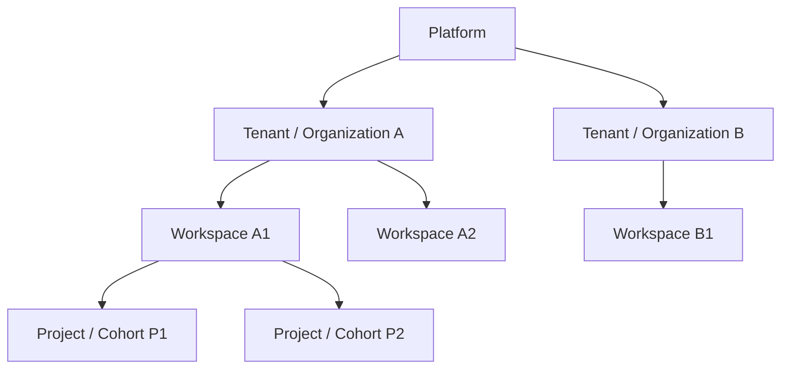
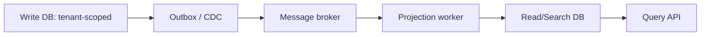
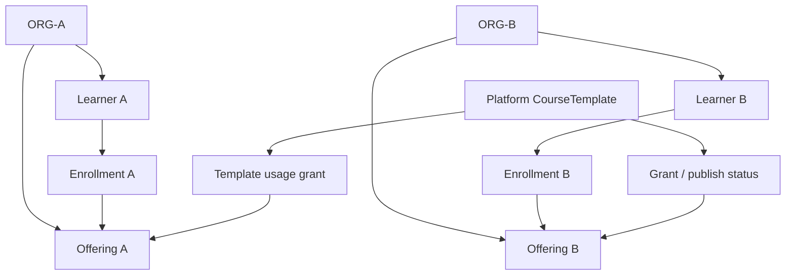

# Organizational Boundaries and the Risk of Cross-Scope Data Linkage

## 1. A Syntactically Valid Foreign Key Can Still Violate Access Boundaries

In a multi-enterprise learning platform, two organizations may both have a learner with code `U-100` or both use a course titled "Introduction to SQL." A query that joins solely on learner ID can be completely valid SQL while mixing **organization A's data with organization B's data**.

For example, suppose a system has:

```text
Organization ORG-A:
  Learner U-100 = learner An
  Course  C-01  = Basic SQL

Organization ORG-B:
  Learner U-100 = learner Binh
  Course  C-01  = Advanced SQL
```

If you run:

```sql
SELECT l.display_name, c.title
FROM enrollments AS e
JOIN learners AS l
  ON l.learner_id = e.learner_id
JOIN courses AS c
  ON c.course_id = e.course_id;
```

then overlapping `U-100` or `C-01` codes across organizations can cause the system to connect the wrong records. The risk goes beyond reporting bugs: personal data, learning results, administrative permissions, or business decisions can be exposed or used out of scope.

**Organizational boundaries** are the rules determining who owns data, which scope data belongs to, which links are valid, and who is permitted to observe or modify them. **Cross-scope data linkage** is joining, referencing, aggregating, inferring, or copying data across scopes without corresponding authorization or contract.

This lesson belongs to the **Data Protection** chapter of the **DATABASE_DATA_MODELING** module. The module focuses on translating business requirements into clear data models—entities, relationships, constraints, keys, indexes, and physical schemas—while comparing relational, document, graph, and analytical models to choose structures that are fit for purpose, evolvable, and verifiable.

**After this lesson, you will be able to:**

1. Distinguish tenants, organizations, workspaces, projects, owners, and shared scopes.
2. Define data boundaries directly in conceptual models, keys, foreign keys, and queries.
3. Prevent accidental cross-tenant linkage using composite keys/FKs, permission checks, and RLS where appropriate.
4. Analyze risks from global identifiers, emails, third-party codes, and inferred data.
5. Design legitimate shared links with permissions, validity windows, revocation, and auditing.
6. Spot cross-scope vulnerabilities across SQL, document stores, graphs, caches, search, and data warehouses.
7. Design negative tests, threat models, and migrations that preserve isolation.

## 2. "Scope" Is Not Just a Single `tenant_id` Column

A system can have multiple boundary layers:



Terms can carry different meanings depending on the system:

| Concept | Question to Ask | Example |
| --- | --- | --- |
| **Tenant** | Unit of data isolation, routing, and policy? | A company subscribing to a SaaS service |
| **Organization** | Business entity managing members/resources? | Company, school, partner |
| **Workspace** | Group of resources and collaboration within an org? | Regional operations team |
| **Project / Cohort** | Smaller business scope needing access control? | Classroom, private project |
| **Owner** | Who is responsible for updates and data lifecycle? | Organization that created the course |
| **Viewer / Grantee** | Who is granted permission to view or use? | Partner allowed to view statistics |
| **Data subject** | Who is the data about, whose privacy is impacted? | Learner, customer |

**Never assume tenant and organization are always one-to-one.** One tenant may manage multiple legal entities; one organization may participate in multiple workspaces; there may be shared resources owned by the platform.

Distinguish:

- **Ownership scope:** where authority resides to write, edit, and delete the authoritative record.
- **Storage scope:** the partition, database, or region holding the record.
- **Access scope:** the organizations or users permitted to see the data.
- **Linkage scope:** which types of relationships are permitted to connect two entities.
- **Analytical scope:** at what level data may be aggregated or compared.

Having a `tenant_id` column on a table is a good sign, yet **it does not prove that every relationship, index, replica, and query is properly isolated**.

## 3. Why Is Cross-Scope Linkage Especially Dangerous?

There are at least four failure modes:

1. **Direct leakage:** a query for ORG-A returns names or emails of ORG-B learners.
2. **Corrupting business facts:** learner A's grades are attached to learner B's profile due to matching internal codes.
3. **Inference leakage:** even without returning B's rows, counts or "has link" results reveal the existence of a person or project in B.
4. **Propagation to copies:** a bad link in the source gets pushed to caches, search indexes, graph projections, or warehouses, making the breach persist longer.

Example:

```text
ORG-A has 15 learners who completed class X.
ORG-B has 8 learners who completed class X.

Faulty query JOINing on course_id while omitting tenant_id:
  COUNT(DISTINCT learner_id) can yield an arbitrary number:
  - mixes learners from both organizations,
  - undercounts if learner_id values collide,
  - overcounts due to duplicated join rows.
```

You cannot fix this by indiscriminately adding `DISTINCT`. `DISTINCT` may mask row duplication, but it does not establish permission to link data, and it can even mask two distinct entities being collapsed into one.

**Cross-linkage bugs are not merely API authorization bugs.** They can originate from key design, foreign keys, identity mappings, queries, integration pipelines, or analytical models.

## 4. Establish Scope Invariants Before Drawing Tables

Before choosing a schema, write down the **invariants** data must obey. For the learning platform example:

- Each `Learner` is managed by one organization, unless an agreed platform-wide identity mechanism exists.
- An `Enrollment` always points to a `Learner` and a `CourseOffering` within the exact defined **enrollment scope**.
- A class may use a **shared course published by the platform**, but only under a specific grant/version relationship.
- An organization permitted to view aggregate reports does not automatically have permission to read detailed profiles.
- Sharing a resource does not transfer ownership of the original, unless specified by business rules.
- When a sharing grant is revoked, queries and derived copies must reflect the revocation within the published freshness SLA.
- Two identities must never be merged into "the same person" solely because their email or full name matches.

### 4.1. Scope Matrix of Entities

| Entity | Grain | Owner | Default Access Scope |
| --- | --- | --- | --- |
| `Learner` | One learner profile in a tenant | Organization | Tenant and granted roles |
| `CourseOffering` | One class offering | Organization hosting the class | Authorized workspace/class |
| `Enrollment` | One learner enrollment in a class | Organization managing enrollment | Tenant and relevant actors |
| `CourseTemplate` | One course content definition | Platform or authoring organization | Depends on ACL/publishing rights |
| `Payment` | One payment transaction | Payment/Order context | Finance roles and related subjects |
| `AuditEvent` | One audit event | Authoritative governance system | Restricted, least-privilege access |

The "scope" may be a combination of `tenant_id`, `workspace_id`, `course_offering_id`, or a dynamic ACL. Choose the right grain before creating keys.

### 4.2. Classifying Relationships

Every business relationship should be classified into one of these types:

- **Mandatory intra-scope:** a learner in tenant A enrolls in a class in tenant A.
- **To an allowed shared resource:** a class in tenant A uses a template published by the platform.
- **Explicitly authorized sharing:** tenant A allows tenant B to view a specific resource.
- **Separately governed cross-tenant:** e.g., a coordinating body permitted to aggregate cross-organization reports after approval.
- **Disallowed:** staff member A accessing private grading records of learner B without authorization.

Never use a generic foreign key without distinguishing these five categories.

## 5. Keys and Identifiers: Same Code Does Not Mean Same Entity

### 5.1. Scoped Local Keys

If learner codes are issued independently inside each tenant, the business key must include the scope:

```text
Learner business key = (tenant_id, learner_code)

(ORG-A, U-100) ≠ (ORG-B, U-100)
```

`learner_code` alone is insufficient as a system-wide identity. This affects:

- Primary/unique keys.
- Foreign keys on Enrollment.
- Cache keys.
- Search document keys.
- Event and projection IDs.
- Filenames and object storage keys.
- Mappings in warehouses or data lakes.

### 5.2. Global UUIDs Still Do Not Replace Access Control

A UUID `learner_id` has low collision probability and reduces ID-clash risk, yet it does not by itself answer:

- Which tenant does the learner belong to?
- Who is allowed to read or edit the profile?
- Is it permitted to join with a class in another tenant?
- Within what scope may the data be transferred or combined?

Even when IDs are globally unique, **relationships and permissions must still verify scope**. "No key collision" and "authorized to link" are two different properties.

### 5.3. Third-Party Identifiers Must Be Namespaced

Suppose two partners both send `external_student_id = 12345`. Never merge them into one person without knowing the issuing source:

```text
External identity:
  (provider_id, provider_tenant_or_account, external_student_id)
```

The same applies to `crm_contact_id`, `customer_code`, and `payment_reference`. A provider may guarantee uniqueness only within one account, not across the entire platform.

**An equivalence (`same-as`) link** must be an explicit business assertion with provenance, scope, validity, and revocability—never a JOIN on matching strings.

## 6. Relational Schema: Composite Keys Enforce Tenant Boundaries

### 6.1. PostgreSQL DDL Protecting Same-Tenant References

The following example assumes **Learner, CourseOffering, and Enrollment are all intra-tenant data**. Cross-tenant sharing relationships will be designed separately later.

```sql
CREATE TABLE organizations (
    org_id text PRIMARY KEY,
    org_name text NOT NULL
);

CREATE TABLE learners (
    org_id text NOT NULL REFERENCES organizations(org_id),
    learner_id text NOT NULL,
    display_name text NOT NULL,
    PRIMARY KEY (org_id, learner_id)
);

CREATE TABLE course_offerings (
    org_id text NOT NULL REFERENCES organizations(org_id),
    offering_id text NOT NULL,
    title text NOT NULL,
    capacity integer NOT NULL CHECK (capacity >= 0),
    PRIMARY KEY (org_id, offering_id)
);

CREATE TABLE enrollments (
    org_id text NOT NULL,
    learner_id text NOT NULL,
    offering_id text NOT NULL,
    status text NOT NULL,
    enrolled_at timestamptz NOT NULL DEFAULT now(),

    PRIMARY KEY (org_id, learner_id, offering_id),
    FOREIGN KEY (org_id, learner_id)
      REFERENCES learners (org_id, learner_id),
    FOREIGN KEY (org_id, offering_id)
      REFERENCES course_offerings (org_id, offering_id),
    CHECK (status IN ('ACTIVE', 'COMPLETED', 'CANCELLED'))
);

CREATE INDEX enrollment_offering_lookup
    ON enrollments (org_id, offering_id, learner_id);
```

**Why must the foreign keys be composite?**

If you used two separate FKs `enrollments.learner_id → learners.learner_id` and `enrollments.offering_id → course_offerings.offering_id`, no constraint would ensure all three records belong to the same tenant. In the schema above, PostgreSQL accepts an Enrollment only when:

- `(org_id, learner_id)` exists in Learners.
- `(org_id, offering_id)` exists in CourseOfferings.

Including the same `org_id` in both FKs enforces the **same-tenant invariant at the referential level**.

### 6.2. A Rejected Write Scenario

Suppose only the following exist:

```text
learners:         (ORG-A, U-100)
course_offerings: (ORG-B, CLASS-01)
```

The command:

```sql
INSERT INTO enrollments
    (org_id, learner_id, offering_id, status)
VALUES
    ('ORG-A', 'U-100', 'CLASS-01', 'ACTIVE');
```

must fail because `(ORG-A, CLASS-01)` does not exist in `course_offerings`. It **must not be allowed** to point to `(ORG-B, CLASS-01)` just because `offering_id` matches.

If the business **genuinely** allows a learner from A to attend a class from B, do not "fix" it by dropping `org_id` from the FK. Design an explicitly authorized cross-tenant relationship recording who owns the enrollment, who owns the offering, and what permissions are recognized.

### 6.3. Never Use Foreign Keys as a Substitute for Authorization

Composite FKs prevent data from referencing the wrong tenant, but they do not stop a **valid user in A** from viewing all learners in A if their role only permits viewing a specific class. Nor do they protect API read queries that omit permission predicates.

You need all of these together:

- **Referential integrity:** keys/FKs/checks.
- **Access scope:** authentication, authorization, row/column policies.
- **Authoritative source:** who may create/edit/delete.
- **Integration flows:** replicas/read projections and events must preserve the same scope.

## 7. Unscoped Queries vs. Scoped Queries

### 7.1. JOIN Missing Organization

Faulty query:

```sql
SELECT e.offering_id, l.display_name
FROM enrollments AS e
JOIN learners AS l
  ON l.learner_id = e.learner_id
WHERE e.org_id = 'ORG-A';
```

Even though `e.org_id` is filtered, a JOIN condition omitting `l.org_id` can still return a learner from B with a matching `learner_id`. **Filtering tenant on one table does not automatically protect joined tables.**

Correct intra-tenant query:

```sql
SELECT e.offering_id, l.display_name
FROM enrollments AS e
JOIN learners AS l
  ON l.org_id = e.org_id
 AND l.learner_id = e.learner_id
WHERE e.org_id = :trusted_org_id;
```

`:trusted_org_id` must come from an **authenticated/authorized context**. Never take a user-submitted `orgId` directly and treat it as proof of access.

### 7.2. Filter Completely Inside Subqueries Too

Example query for "learners not yet enrolled in a class":

```sql
SELECT l.learner_id
FROM learners AS l
WHERE l.org_id = :trusted_org_id
  AND NOT EXISTS (
      SELECT 1
      FROM enrollments AS e
      WHERE e.org_id = l.org_id
        AND e.learner_id = l.learner_id
        AND e.offering_id = :offering_id
  );
```

If `e.org_id = l.org_id` is omitted, an enrollment from another organization with the same learner/offering ID can cause the query to exclude the wrong learner.

### 7.3. `GROUP BY` Also Needs Scope

The query:

```sql
SELECT learner_id, COUNT(*)
FROM enrollments
GROUP BY learner_id;
```

can merge different learners from multiple tenants who share the same code. If the report is **per organization**:

```sql
SELECT org_id, learner_id, COUNT(*) AS enrollment_count
FROM enrollments
WHERE org_id = :trusted_org_id
GROUP BY org_id, learner_id;
```

You must also check whether the user is permitted to see metrics for all learners in the tenant or only a specific workspace/class. **Grouping by the right key does not equal having reporting authority.**

## 8. Row-Level Security: A Defense Layer in the Database

PostgreSQL supports **Row-Level Security (RLS)** to filter rows that a database role may SELECT, INSERT, UPDATE, or DELETE. It provides extra protection for multi-tenant applications using shared tables.

### 8.1. Example Policy by Organization Context

Suppose `learners`, `course_offerings`, and `enrollments` all have an `org_id` column. Enable RLS:

```sql
ALTER TABLE learners ENABLE ROW LEVEL SECURITY;
ALTER TABLE course_offerings ENABLE ROW LEVEL SECURITY;
ALTER TABLE enrollments ENABLE ROW LEVEL SECURITY;

-- Protect even when accessed by a table owner without BYPASSRLS.
ALTER TABLE learners FORCE ROW LEVEL SECURITY;
ALTER TABLE course_offerings FORCE ROW LEVEL SECURITY;
ALTER TABLE enrollments FORCE ROW LEVEL SECURITY;

CREATE POLICY learners_org_policy ON learners
USING (org_id = current_setting('app.org_id', true))
WITH CHECK (org_id = current_setting('app.org_id', true));

CREATE POLICY offerings_org_policy ON course_offerings
USING (org_id = current_setting('app.org_id', true))
WITH CHECK (org_id = current_setting('app.org_id', true));

CREATE POLICY enrollments_org_policy ON enrollments
USING (org_id = current_setting('app.org_id', true))
WITH CHECK (org_id = current_setting('app.org_id', true));
```

In this example, `current_setting('app.org_id', true)` returns `NULL` if the session has not set it, so equality with `org_id` is not TRUE and the policy **fails closed** when context is missing.

**Important:** RLS does not replace role protection:

- PostgreSQL superusers and roles with `BYPASSRLS` bypass RLS; never use those roles on normal application paths.
- Table owners can usually bypass RLS without `FORCE ROW LEVEL SECURITY`.
- Using session parameters is only safe when connections/SQL are controlled by a **trusted application**. A SQL user able to run `set_config('app.org_id', ...)` can impersonate organizations; RLS based on client-chosen GUCs is **not** a security boundary for untrusted connections.
- Operations through views, functions, `SECURITY DEFINER`, and derived data have their own privilege semantics; inspect the full execution path, not only the three tables.
- The policy here illustrates only organization-level isolation. Role, class, or workspace permissions must be designed separately as required by the business.

### 8.2. Binding Context Within a Transaction

A Java application using a connection pool should bind the tenant **per transaction**, never leaving session state behind from a prior request:

```sql
BEGIN;

SELECT set_config('app.org_id', :authorized_org_id, true);

SELECT learner_id, display_name
FROM learners
ORDER BY learner_id;

COMMIT;
```

The `:authorized_org_id` parameter must be determined by the authentication/authorization layer. The final `true` argument restricts the setting to the **current transaction**. Upon rollback/commit, it cannot be reused as another request's authority.

If the app uses connection pooling, transaction pooling, async tasks, or queries spanning connections, verify the context is set on the **exact connection executing the SQL**. Never rely on a global Java variable to represent per-request authority.

### 8.3. RLS and Composite FKs Solve Two Different Problems

- **Composite FK:** prevents an Enrollment from linking a learner/offering outside the row's own organization.
- **RLS:** restricts which rows a role can read/write based on context.

Both are needed in many systems. RLS alone does not prove every FK is modeled properly. Composite FKs alone do not stop a user from reading an intra-tenant row they are not authorized to view.

## 9. Legitimate Sharing: Explicit Permission Models Instead of Dropping Boundaries

Not every cross-organization link is wrong. Valid scenarios include:

- A platform-owned course used by multiple schools.
- Two companies collaborating on a project with bounded shared resources.
- An external specialist invited to view a partner's workspace.
- An umbrella organization granted access to view aggregate metrics across branches.

**The difference is that permissions are explicitly granted and verifiable.**

### 9.1. Ownership Differs From Visibility

A resource should have one primary authority responsible for updates:

```text
resource:
  owner_org_id
  resource_id
  content_version
  lifecycle_status
```

Other organizations do not automatically gain write rights simply by viewing or referencing the resource. You can model a grant relation:

```text
resource_grant:
  owner_org_id
  resource_id
  grantee_org_id
  permission
  effective_from
  effective_to
  granted_by
  revoked_at
```

Here `permission` may be `VIEW`, `USE_AS_TEMPLATE`, or another clearly defined set of rights. `VIEW` does not imply `EDIT` or `EXPORT` by default.

### 9.2. Illustrative DDL for Authorized Sharing

```sql
CREATE TABLE shared_resources (
    owner_org_id text NOT NULL REFERENCES organizations(org_id),
    resource_id text NOT NULL,
    title text NOT NULL,
    version bigint NOT NULL,
    PRIMARY KEY (owner_org_id, resource_id),
    CHECK (version > 0)
);

CREATE TABLE resource_grants (
    owner_org_id text NOT NULL,
    resource_id text NOT NULL,
    grantee_org_id text NOT NULL REFERENCES organizations(org_id),
    permission text NOT NULL,
    effective_from timestamptz NOT NULL,
    effective_to timestamptz,
    revoked_at timestamptz,
    granted_by text NOT NULL,

    PRIMARY KEY (
        owner_org_id, resource_id,
        grantee_org_id, permission, effective_from
    ),
    FOREIGN KEY (owner_org_id, resource_id)
      REFERENCES shared_resources(owner_org_id, resource_id),
    CHECK (permission IN ('VIEW', 'USE_AS_TEMPLATE')),
    CHECK (effective_to IS NULL OR effective_from < effective_to)
);
```

This illustrative schema records basic grant history; it does not yet prevent overlapping grant windows or verify that `granted_by` had authority to grant. Production systems need appropriate constraints/transactions, grant versioning, and auditing.

### 9.3. Querying Shared Resources With Explicit Conditions

```sql
SELECT r.owner_org_id, r.resource_id, r.title
FROM shared_resources AS r
JOIN resource_grants AS g
  ON g.owner_org_id = r.owner_org_id
 AND g.resource_id = r.resource_id
WHERE g.grantee_org_id = :authorized_org_id
  AND g.permission = 'VIEW'
  AND g.effective_from <= :as_of
  AND (g.effective_to > :as_of OR g.effective_to IS NULL)
  AND (g.revoked_at > :as_of OR g.revoked_at IS NULL);
```

**Query limitations:** this illustrates evaluating permissions **at a declared point in time**, not a complete security policy. Business rules must decide:

- Does `USE_AS_TEMPLATE` implicitly allow viewing?
- Can a grant be revoked immediately or scheduled for a future timestamp?
- Can a caller view a resource solely because they created the grant?
- Can the owner modify or hide a resource currently being shared?
- Which user roles **within the grantee organization** get access?
- If a shared resource holds sensitive content, what extra approvals are needed?

Point-in-time queries may not reconstruct past authorization decisions accurately if grant records are mutated in place. Use auditing or bitemporal modeling when historical reconstruction is required.

### 9.4. Revocation Must Propagate to Copies

Suppose a resource is shared with ORG-B and then revoked. If a read projection or search index still holds a copy of the content, deleting the grant in the primary DB **does not automatically revoke the copy**.

Design for:

- **Access-time** permission checks when content is sensitive and freshness is mandatory.
- A `ResourceGrantRevoked` event, grant versions, and projectors.
- Cache invalidation/TTLs and policies for handling consumer lag.
- Rules for already-issued exports and data residing outside the primary system.
- Auditing and reconciliation of revoked permissions.

**Never rely on an eventually consistent cache as the sole authorization check when business rules require immediate revocation.**

## 10. Cross-Organization Identity Linkage: The Risk Goes Beyond JOINs

Two organizations may share the same email:

```text
ORG-A learner U-100 -> email@example.com
ORG-B learner B-808 -> email@example.com
```

There are at least three possibilities:

1. It is the same person participating in both organizations.
2. It is a shared or reassigned email address.
3. It is erroneous, outdated, or unverified data.

**Never assume possibility (1) merely because strings match.**

### 10.1. Never Merge People by Email as a Default Rule

Mistake:

```sql
SELECT a.learner_id, b.learner_id
FROM learners_a AS a
JOIN learners_b AS b
  ON lower(a.email) = lower(b.email);
```

Such a join may help **generate reconciliation candidates** in an authorized system, but it is **not enough to confirm identical identity**. Using it to combine learning records, purchase histories, or user permissions can cause leaks and business corruption.

To govern identity mappings, define:

- Who is permitted to assert `same_person`?
- Which proof is trustworthy enough (direct authentication, account-linking event, integration agreement)?
- Scope of the mapping: login only, aggregate reporting, or personal profiles?
- Does linking require consent/approval under applicable policy?
- When does the mapping take effect, and who can revoke it?
- What happens if an account splits or was merged erroneously?

### 10.2. A Governed Identity-Link Structure

```text
identity_links:
  link_id
  source_namespace
  source_subject_id
  target_namespace
  target_subject_id
  purpose
  assertion_source
  asserted_at
  effective_from
  revoked_at
  verified_by
```

**Linked identities do not grant access to all data on both sides.** You might confirm that "two profiles belong to the same person" while still disallowing transfer of learning scores between two organizations without proper authority and purpose.

### 10.3. Hashing and Pseudonymization Do Not Automatically Break Linkability

Example:

```text
hash(email) = SHA-256(normalized_email)
```

If two parties hash the same email using the same rule, they can **link records** without seeing the plaintext email. For emails from a guessable domain, an unsalted/unprotected hash can also be brute-forced via dictionary attacks.

Keep in mind:

- **Pseudonymization** reduces direct exposure of certain fields; it does not automatically make data anonymous.
- Data can still be cross-linked via tokens, hashes, device IDs, IPs, timestamps, or rare attributes.
- Scoped tokenization with separate key management reduces accidental linkage, but does not exempt permission and purpose checks.
- Systems needing identity reconciliation can use a controlled identity service rather than issuing deterministic hashes to every consumer.

**Protecting against cross-scope linkage includes preventing inference of the same identity**, not just blocking queries from returning an email column.

## 11. Choosing Link Structures by Boundary Type

A common architectural mistake is using a generic `target_id` field for every relationship and letting the application guess what it points to. That loses information about **entity type, scope, and authority**.

Instead, ask:

- Is the relationship **strictly intra-tenant** or can it span two tenants?
- Is the target owned by a **tenant**, the **platform**, or **another provider**?
- Is access **role-based**, **resource-based**, or **subject-consent-based**?
- Can the right be revoked, expire, or change by version?
- Does the link point to the **authoritative source** or an **authorized snapshot copy**?
- If one side deletes the resource, what will the other side see?

### 11.1. Candidate Models

| Relationship Type | Representation to Consider | Core Invariant |
| --- | --- | --- |
| Strictly same-tenant | Composite FK with `tenant_id` and ID | Cross-scope references forbidden |
| Tenant uses platform resource | FK to platform resource + grant/publishing table | Tenant uses only authorized versions |
| Two tenants share a resource | Resource owner + grant/ACL/version and audit | Ownership not transferred; access requires active grant |
| Identity equivalence across sources | Identity mapping with provenance and purpose | Matching name/email does not imply same person |
| Multi-tenant reporting | Dedicated data warehouse and aggregation/access policies | No unauthorized row-level or small-group exposure |
| Cross-domain workflow | Explicit API/event contracts, no direct joins on internal tables | Each domain retains state ownership |

**Never use `"cross-tenant=true"` on rows as an unrestricted access switch.** Define **who**, **can do what**, **to which resource**, **during which window**, and **for what purpose**.

### 11.2. When a Resource Is Intentionally Copied

For example, tenant A uses a template course published by the platform. There are two options:

1. **Reference the original directly** and check permissions at read/use time.
2. **Copy into a tenant-A-owned version**, retaining `source_template_id` and `source_version` for lineage.

The two options differ in ownership:

- With a direct reference, edits or revocation of the original can affect tenant A.
- With a copy, tenant A can edit independently; the copy needs licensing policies, sensitive-content handling, and rules when the original is deleted.

If you keep `source_template_id` for lineage, **never treat it as proof that tenant A may still read the original content after permissions are revoked**.

## 12. Document Models: Nested Data Can Hide Cross-Scope Links

In a document database, many systems store an aggregate as JSON:

```json
{
  "tenantId": "ORG-A",
  "offeringId": "CLASS-01",
  "title": "Basic SQL",
  "learners": [
    { "learnerId": "U-100", "progress": 0.5 }
  ]
}
```

Having `tenantId` at the root of a document **does not prove** every nested `learnerId` actually belongs to ORG-A. If the app looks up a learner in cache by `learnerId` without verifying the tenant, ORG-B's data can be embedded into A's document.

### 12.1. When Embedding Data, Validate at Write Time

Example API input:

```json
{
  "tenantId": "ORG-A",
  "offeringId": "CLASS-01",
  "learnerIds": ["U-100", "U-200"]
}
```

Never accept an ID array merely because the request came from an ORG-A user. The write service must:

1. Authenticate the organization and class-management permission.
2. Verify each learner belongs to the authorized scope.
3. Reject or quarantine invalid IDs.
4. Write atomically within the database/aggregate boundary.
5. Emit events with verified `tenantId`, `offeringId`, and identities if projections are built.

### 12.2. MongoDB: `$lookup` Must Carry Scope Boundaries

A dangerous join might match only on learner ID. A safer illustrative pattern using a pipeline inside `$lookup`:

```javascript
db.enrollments.aggregate([
  {
    $match: {
      tenantId: trustedTenantId,
      offeringId: requestedOfferingId
    }
  },
  {
    $lookup: {
      from: "learners",
      let: {
        enrollmentTenant: "$tenantId",
        enrollmentLearner: "$learnerId"
      },
      pipeline: [
        {
          $match: {
            $expr: {
              $and: [
                { $eq: ["$tenantId", "$$enrollmentTenant"] },
                { $eq: ["$learnerId", "$$enrollmentLearner"] }
              ]
            }
          }
        }
      ],
      as: "learner"
    }
  }
]);
```

`trustedTenantId` must come from an authorized context, not an arbitrary request field. Match both `tenantId` and `learnerId` on the target collection; if the collection spans multiple namespaces, include the corresponding scope.

**Note:** this example illustrates query logic, not an automatic database constraint preventing all cross-tenant references. You still need indexes on `(tenantId, learnerId)`, write-time validation, tests, and application access control. Index utilization for `$expr` depends on engine version and data layout.

### 12.3. A Global Document ID Does Not Mean Global Content

A collection-wide unique `_id` simplifies record retrieval, yet the API must still verify ownership or sharing grants. Never implement a GET by `_id` that returns the document before checking `tenantId` or resource permissions.

## 13. Graph Models: Paths Can Cross Boundaries Through Intermediate Nodes

Graphs excel at traversing multi-hop relationships, yet they also increase the risk of **unintended linkage** because a path can pass through nodes and edges across different scopes.

Example:

```text
(User A, ORG-A)
     -> (Course X, ORG-A)
     -> (Skill S, Shared)
     -> (Course Y, ORG-B)
     -> (Learner B, ORG-B)
```

If a query recommends learners based on "related paths" without restricting scope, results can infer the existence or details of ORG-B entities.

### 13.1. Checking Only Endpoints Is Insufficient

An insufficiently constrained query pattern:

```cypher
MATCH p = (start:Learner {tenantId: 'ORG-A', learnerId: 'U-100'})
          -[*1..4]->
          (candidate:Learner)
WHERE candidate.tenantId = 'ORG-A'
RETURN p;
```

Both endpoints are in ORG-A, yet an **intermediate node** might belong to ORG-B or traverse a forbidden edge. That path can still leak unauthorized relationships.

An illustrative pattern checking nodes along the path:

```cypher
MATCH p = (start:Learner {tenantId: 'ORG-A', learnerId: 'U-100'})
          -[:KNOWS|MEMBER_OF*1..3]->
          (candidate)
WHERE all(n IN nodes(p) WHERE n.tenantId = 'ORG-A')
RETURN p;
```

This is **not yet** a complete policy. It only illustrates filtering **all nodes**; you must also constrain edge types, edge properties, individual permissions, and whether `Shared` data may be traversed under business rules. Variable-length syntax and path matching depend on the graph database version.

### 13.2. A Shared Node Does Not Grant Traversal Across All Its Edges

For instance, `Skill: SQL` may be a platform-wide shared node. That does not mean a tenant A query may traverse from Skill to **every learner who has the SQL skill** in tenant B.

Distinguish:

- Permission to use/see a **shared reference node**.
- Permission to traverse an **edge** carrying personal data.
- Permission to observe a **target node** and the existence of a path.
- Permission to compute counts or communities across edges, even without returning IDs.

A safe design starts queries from an authorized set, checks each step, and bounds relationship types and traversal depth.

### 13.3. Never Use Graph Traversal to Infer Identity Equivalence

Two profiles sharing an email, IP, or device may be **related**, yet that alone does not prove they are the same person. If the graph links them and merges permissions or state automatically, the impact can be worse than a bad SQL JOIN because effects propagate across multiple hops.

## 14. Caches, Search Indexes, and Vector Search: Boundaries Must Follow the Key

### 14.1. Cache Keys Missing Tenant

Wrong:

```text
cache key = "learner:" + learnerId

ORG-A fetches learner U-100:
  cache["learner:U-100"] = An's data

ORG-B fetches learner U-100:
  cache hit -> receives An's data
```

Minimum key structure:

```text
cache key = tenantId + ":learner:" + learnerId
```

Even so, **tenant-aware keys are insufficient** when a user may view only a subset of learners within the tenant. When cached data depends on permissions:

- Never share permission-filtered responses between non-equivalent principals.
- Include **permission scope or ACL version** in cache keys where appropriate.
- Check authorization before serving cached items.
- Invalidate when grants are revoked or sensitive data is deleted.
- Choose TTLs aligned with acceptable consistency bounds.

Shared caching of genuinely public data may omit tenant keys, yet **public** status must stem from an authoritative policy—never assumed because many users read it.

### 14.2. Search Indexes Missing Scope Filters

A search document might contain:

```json
{
  "documentId": "ORG-A:CLASS-01",
  "tenantId": "ORG-A",
  "offeringId": "CLASS-01",
  "title": "Basic SQL",
  "learnerNames": ["An", "Binh"]
}
```

When ORG-B searches "Binh," it must never receive ORG-A's document simply on a full-text match. Search APIs must enforce tenant/ACL filters before returning hits, facets, and counts.

**Inference risk from statistics:** even when hit lists are filtered, some engines compute search suggestions, facets, highlights, or total hit counts over broader sets. Those outputs must obey scope too.

### 14.3. Vector Search and Embeddings

When storing embeddings of internal content in a shared vector index:

- Nearest-neighbor retrieval does not enforce authorization automatically.
- Apply `tenantId`/resource ACL metadata filters inside the engine's capabilities—not merely post-filtering a top-K list that risks leakage or empty results.
- Snippets in results and context passed to language models must pass authorization checks.
- Embeddings can retain signals of source content; never treat them as safe for public release by default.
- When sharing grants are revoked, update related indexes and caches per policy.

Separate per-tenant indexes reduce operational mistake risk for some workloads while raising ops cost. Shared indexes with strict ACL pre-filtering suit other workloads. **Choose based on threat model, engine limits, and real testing.**

### 14.4. Filenames, Object Storage, and CDNs

Never let users download files just by guessing paths such as:

```text
/exports/ORG-A/report-2026.csv
```

Tenant-prefixed object keys are organization, not access control. Enforce signed URLs or proper access-control proxies, expiration limits, no public bucket exposure, and lifecycle management for issued exports.

## 15. Events, CQRS, CDC, and Cross-Domain Synced Data

A system can guard its write DB with composite FKs and RLS yet still leak through read projections.



At each hop, scope can be lost:

- Events omit `tenantId` or carry unnamespaced IDs.
- Consumers read all tenants' messages and overwrite read rows sharing an ID.
- Projectors key on `orderId` instead of `tenantId + orderId`.
- Search indexes omit `owner_org_id`.
- Query caches are not partitioned by permissions.
- Batch rebuilds ignore past grants/revocations.

### 15.1. Event Contracts Should Carry Scope

```json
{
  "eventId": "ca6a712a-8ca2-4488-9f07-0f44fac1bb33",
  "eventType": "EnrollmentChanged",
  "eventSchemaVersion": 1,
  "ownerOrgId": "ORG-A",
  "enrollmentId": "E-100",
  "learnerId": "U-100",
  "offeringId": "CLASS-01",
  "sourceVersion": 6,
  "occurredAt": "2026-11-20T10:00:00Z"
}
```

This metadata helps consumers route, deduplicate, and reconcile. Yet **having `ownerOrgId` in the payload does not let consumers skip authorization**; broker topics, consumer service accounts, and read APIs all need appropriate access control.

### 15.2. Idempotency Keys Must Also Be Scoped

If each tenant generates `requestId = 123`, an idempotency table unique only on `requestId` will treat B's request as a replay of A's.

Keys should reflect scope and command type, such as:

```text
(tenant_id, command_type, idempotency_key)
```

Not every idempotency key sits at tenant scope; multi-tenant transactions need a different scope. What matters is **never colliding independent requests across namespaces**.

### 15.3. Projections Need Independent Versions and Revoke Handling

For a read row owned by tenant A, projectors can key on `(ownerOrgId, resourceId)` and apply only snapshot events with newer `sourceVersion`. When B is granted access, a projection may build **a view serving B** if the contract allows.

Upon revocation:

- Do not just delete the grant row in the write DB.
- Issue invalidations or versioned revoke notifications.
- Prevent late-arriving older events from recreating the grant.
- If revocation must take effect immediately, reads must consult the authoritative permission source or equivalent guarantee; eventually consistent replicas may be insufficient.

**Projection lag is part of the security model**, not merely a UX concern.

## 16. Warehouses, Reporting, and Re-Identification Risk

When data lands in a data warehouse or data lake, some stacks detach from OLTP authorization. If pipelines load `tenant_id` while BI queries omit filters, cross-scope linkage can occur at massive scale.

### 16.1. Star Schemas Must Preserve Scope in Facts and Dimensions

Example:

```text
fact_enrollment:
  tenant_id
  learner_sk
  offering_sk
  event_date
  enrollment_count

dim_learner:
  learner_sk
  tenant_id
  learner_bk
  segment

dim_offering:
  offering_sk
  tenant_id
  offering_bk
  category
```

A warehouse-wide unique surrogate key enables technically accurate joins, yet does not authorize analyzing all tenants' data. BI requires permission policies, user-to-tenant mappings, and trusted metric definitions.

Example intra-tenant aggregation:

```sql
SELECT
    f.tenant_id,
    d.category,
    SUM(f.enrollment_count) AS enrollments
FROM fact_enrollment AS f
JOIN dim_offering AS d
  ON d.offering_sk = f.offering_sk
 AND d.tenant_id = f.tenant_id
WHERE f.tenant_id = :authorized_tenant_id
GROUP BY f.tenant_id, d.category;
```

The `d.tenant_id = f.tenant_id` predicate is a **scope consistency check**, not a substitute for building facts and dimensions cleanly in ETL.

### 16.2. Cross-Organization Reports Can Be Valid, Never Default

Some programs need multi-partner aggregates, such as "overall completion rate across participating organizations." Specify:

- Who is authorized to request the report?
- Which tenants participate, and is membership checked dynamically?
- Is data aggregated sufficiently, and must small cells be suppressed?
- Are exports or joins with external datasets permitted?
- What retention, purpose, and opt-out/revocation rules apply?
- Does the derived dataset preserve lineage to each source?

**Aggregation does not equal anonymity.** A cell with one learner, one transaction, or a rare value can disclose personal information even when a report prints only counts.

### 16.3. Combining Multiple Datasets Can Create New Leaks

Two separate tables might hold no names:

```text
dataset A: tenant, age_group, class_code, average_score
dataset B: tenant, enrollment_date, class_code, gender
```

Joined by small cohorts, timestamps, or rare attributes, an observer can single out an individual. Risk rises further against public sources.

Mitigations include:

- Reducing granularity and restricting fields before release.
- Controlling small cells and repeated differencing queries.
- Separating row-level read access from aggregate access.
- Applying evaluated statistical disclosure controls when needed, never treating a single group-size threshold as an absolute guarantee.
- Documenting purpose, lineage, and retention periods.

If using differential privacy, design privacy budgets and semantics rigorously; never inject arbitrary noise and declare data protected.

## 17. Physical Boundaries: One Database or Many Databases?

A multi-tenant model can be deployed across several topologies:

| Architecture | Typical advantages | Risks to evaluate |
| --- | --- | --- |
| **Shared tables, tenant column** | Easy infra consolidation, fewer schemas | Missing scope in queries, misconfigured RLS, cross-tenant cache/queries |
| **Schema per tenant** | Clearer DB object isolation | Routing/schema drift, migrations, role management |
| **Database per tenant** | Better resource and blast-radius isolation | Ops overhead, backups, upgrades, global analytics |
| **Shard/bucket by tenant** | Scaling and load distribution | Misrouting, rebalance/cutover bugs, cross-shard transactions |
| **Region-specific tenancy** | Placement per data residency rules | Replicas/logs/backups drifting across regions without policy |

**Physical isolation does not solve application authorization.** If an API uses credentials able to read every tenant DB and routes on an unverified client `tenantId`, IDOR/BOLA vulnerabilities remain.

Conversely, a shared database is **not inherently insecure** when carefully designed, configured, and tested; suitability depends on threat model, customer requirements, product limits, and operations.

### 17.1. Moving Tenants Between Shards Must Preserve Scope

When moving ORG-A from shard 1 to shard 2:

- Routers must reflect the current owner.
- Stale route caches must not write to the wrong shard.
- ORG-B's data on the old shard must never be copied along.
- Reconcile by `org_id` and source IDs after migration.
- Protect logs, backups, and temporary copies per policy.
- For separate read projections, coordinate cutover timing and catch-up.

Partition keys and organizational boundaries may coincide or differ. Choosing the right storage layout never replaces authorization checks.

## 18. APIs and Java: Authorized Context Must Flow Through Every Layer

Consider endpoint:

```text
GET /organizations/{orgId}/learners/{learnerId}
```

A classic mistake is trusting `orgId` straight from the URL as authorization. A caller in ORG-A can swap the URL to ORG-B.

### 18.1. Checking Permissions Before Calling Repositories

Java pseudocode:

```java
record AuthorizedOrgScope(String orgId, String actorId) {}

AuthorizedOrgScope requireOrgScope(
        AuthenticatedPrincipal principal,
        String requestedOrgId,
        Permission requiredPermission) {

    if (!authorizationService.isAllowed(
            principal.userId(), requestedOrgId, requiredPermission)) {
        throw new AccessDeniedException();
    }

    return new AuthorizedOrgScope(requestedOrgId, principal.userId());
}

LearnerDto getLearner(
        AuthenticatedPrincipal principal,
        String requestedOrgId,
        String learnerId) {

    AuthorizedOrgScope scope = requireOrgScope(
        principal, requestedOrgId, Permission.VIEW_LEARNER);

    return learnerRepository.findInOrg(
        scope.orgId(), learnerId);
}
```

Types like `AuthenticatedPrincipal`, `Permission`, `AccessDeniedException`, and services above are **illustrative pseudocode**, not a standalone compilable Java file.

**Rule:** repositories accept an authenticated scope, and SQL still enforces the org predicate. Never query a learner by `learnerId` alone and check tenant after data is already fetched or logged.

### 18.2. Context Must Never Leak Across Requests

In Java apps using connection pools:

- Never store `orgId` in shared mutable static fields.
- Never store tenant state in `ThreadLocal` and forget to clear it across thread reuse.
- Never reuse DB session variables across requests.
- For PostgreSQL transaction-local settings, bind scope in the **exact transaction/connection** executing the query.
- For async execution, pass context explicitly and verify it—never depend on accidental thread affinity.
- Background jobs aggregating multiple tenants need dedicated roles and contracts, never arbitrary `tenant=*`.

### 18.3. Authorization Must Never Depend on Client Filters

A list API:

```text
GET /learners?orgId=ORG-A&limit=20
```

is valid when `orgId` merely selects among **authorized organizations**. Before querying, verify the principal holds permission for that organization. For multi-org accounts, explicitly define which scopes may be queried and whether mixed results are allowed.

Apply identical rules consistently to pagination, counts, and exports—never filter only in the frontend.

## 19. Threat Modeling: Identifying Which Boundaries Can Be Bypassed

**Threat modeling** asks not just "are there external hackers?" but "could a limited-privilege user or component cause the system to use data out of scope?" Causes include malice, mistakes, or sync glitches.

### 19.1. Typical Attack and Failure Vectors

| Scenario | Weakness | Consequence | Primary defense |
| --- | --- | --- | --- |
| User A changes `orgId` to B in URL | BOLA/IDOR, missing object-level authorization | Reads or mutates B's data | Check resource and scope permissions; distrust URLs |
| JOIN Enrollment to Learner solely on ID | Missing scope key in join condition | Mixes identities/grades across tenants | Composite keys/FKs, full join predicates |
| Outer query filters tenant, subquery does not | Scope fails to propagate across relations | Infers or returns out-of-scope data | Enforce scope in every query branch |
| Cache keyed only by `learnerId` | Missing cache namespace | Serves another tenant's response | Permission-aware cache keys and policies |
| Search docs have tenant, query lacks filter | Unscoped search index query | Leaks hits and facets | Authorization-aware search |
| Matching email hash across two sources | Unauthorized identity linkage | Infers user presence in another system | Scoped tokens, restricted mapping & purpose |
| Export uses global-privilege service account | Bypasses user policy | Bulk exports out-of-scope data | Scoped export roles, auth checks, audits |
| VIEW granted, read projection stays stale post-revoke | Stale cache/projection | Continued access to revoked resource | Authoritative checks, invalidation |
| CDC omits tenant in event | Unscoped projection key | Overwrites another tenant's row | Event contracts, scoped keys, reconciliation |
| RLS relies on client-set SQL GUC | Missing trusted identity boundary | SQL user impersonates tenants | Trusted app/DB auth, restricted roles |
| Single-person group report | Aggregate re-identification | Infers personal facts | Publication controls, small-cell & access checks |
| Shard router trusts client tenant | Routing without authorization | Hits right shard, wrong tenant | Auth before routing, shard-side policy |

**BOLA (Broken Object Level Authorization)** frequently appears on endpoints exposing resource IDs directly. Unpredictable IDs never replace object-level authorization checks.

### 19.2. Steps for a Simple Threat Model

1. Trace data flow: client → API → service → DB → event → projection → cache/search → export.
2. Mark at every node: which org owns the data, and who may read/write it?
3. Locate **trust boundaries**: which inputs come from clients, which are authenticated, and which come from peer systems?
4. Spot joins, searches, or aggregations where **scope could disappear**.
5. Trace system behavior when permissions are revoked, events arrive late, or caches hold stale tokens.
6. Write negative tests proving unauthorized users cannot read, modify, or infer out-of-scope data.
7. Document residual risks, ownership, and limits of each control.

### 19.3. Proper API Authorization Cannot Rescue Unscoped Pipelines

Even if APIs filter accurately, a nightly ETL using global DB credentials that joins two sources improperly still pollutes analytics. Threat models must cover **background jobs, batches, replays, migrations, and admin tasks**, not just online requests.

## 20. Migration: Adding Tenant Boundaries to Existing Data

A legacy system might only have:

```text
learners(learner_id PRIMARY KEY, display_name)
courses(course_id PRIMARY KEY, title)
enrollments(learner_id, course_id, status)
```

When evolving to multi-tenant SaaS, simply adding a `tenant_id` column and updating code is insufficient.

### 20.1. Step 1 — Define Namespaces and Tenant Provenance

Before adding keys:

- Which organization owns each existing learner, and what evidence proves it?
- Do legacy IDs collide across sources?
- Is each course tenant-owned or a platform resource?
- Can any existing enrollment legitimately span organizations?
- How are records with unknown tenant handled?

When a record's true organization is unknown, **never guess tenant from names, emails, or nearest relations** and persist it as truth. Place it in quarantine/reconciliation, fetch authoritative mappings, or explicitly mark limitations.

### 20.2. Step 2 — Backfill and Verify References

Once `org_id` populates tables, verify Enrollment rows reference same-tenant learners and offerings.

PostgreSQL-style reconciliation query:

```sql
SELECT
    e.org_id, e.learner_id, e.offering_id
FROM enrollments AS e
LEFT JOIN learners AS l
  ON l.org_id = e.org_id
 AND l.learner_id = e.learner_id
LEFT JOIN course_offerings AS c
  ON c.org_id = e.org_id
 AND c.offering_id = e.offering_id
WHERE l.learner_id IS NULL
   OR c.offering_id IS NULL;
```

This checks **tenant-scoped orphan references**. It does not catch deeper authorization errors, such as whether a learner was permitted in that class; check those separately.

If the live DB lacks `org_id` yet, run this query **only after schema backfill** in an appropriate environment.

### 20.3. Step 3 — Resolve Key Collisions and Add Constraints

A `U-100` once treated as globally unique may need conversion to composite key `(org_id, learner_id)`. Resolve collisions or invalid references before adding FKs.

For large deployments, use **expand–migrate–contract**:

1. **Expand:** add compatible columns, indexes, and new write paths.
2. **Migrate:** backfill authoritative tenants; update FKs, read APIs, and batches.
3. **Verify:** reconcile row counts, referential integrity, and permission boundaries.
4. **Enforce:** add `NOT NULL`, `UNIQUE`, composite FKs, and RLS as planned.
5. **Contract:** retire unsafe legacy access paths and keys.

Never enable strict constraints before understanding violating rows and resolution plans; never weaken protections merely to let a migration "pass."

### 20.4. Step 4 — Upgrade Every Query and Copy

Do not update only the primary API. Audit:

- SQL JOINs, subqueries, GROUP BYs, stored procedures, and views.
- Repository methods and cache keys.
- Search indexes and read projections.
- Event keys, idempotency keys, and broker partition keys.
- Object storage paths, exports, backups, and restores.
- Partner sync jobs, data marts, and ML models.
- Monitoring/alert queries and admin tools.

If older copies lack tenant metadata, **rebuild from source** after adding scope metadata rather than patching one filter line.

### 20.5. Step 5 — Cut Over with Safe Rollbacks

Run shadow queries and reconciliation before cutting traffic over. Rollback plans must account for the fact that once writes use composite keys, legacy single IDs may no longer route unambiguously.

Never roll back to an API using "only `learnerId`" if that reopens cross-tenant leaks. Safe rollbacks either disable the feature or keep legacy paths wrapped with complete authorization checks.

## 21. Case Study: Multiple Enterprises Sharing Course Content

### 21.1. Context

The `LearnHub` platform (illustrative name) serves three organizations:

- **ORG-A:** has its own learners and internal training classes.
- **ORG-B:** has its own learners; some learner codes collide with ORG-A.
- **ORG-C:** a coordinating body that licenses platform course templates for authorized members.

The platform provides a shared **CourseTemplate** catalog, while each organization creates its own **CourseOffering** (classes/cohorts) and manages **Enrollment** and **Progress** independently.

Requirements:

1. ORG-A must never know ORG-B's learners or scores.
2. ORG-A and ORG-B can both use a public template.
3. Non-public templates can be used only with a valid grant.
4. Revoking a grant does not erase authorized historical records, yet blocks creating new classes from that template.
5. Aggregate reporting serves an approved cross-org program without exposing detailed profiles.
6. Search data and caches must never mix organizations.

### 21.2. Conceptual Model



This model separates:

- **Intra-tenant identity and classes:** Learner, Offering, Enrollment.
- **Platform resources:** versioned CourseTemplate.
- **Resource usage rights:** grants or publish policies.
- **Cross-org reporting:** derived model with dedicated authority.

### 21.3. Candidate Schema

```text
organizations(org_id, ...)

learners(
  org_id, learner_id, ...
  PK(org_id, learner_id)
)

course_templates(
  owner_org_id, template_id, published_version, visibility, ...
  PK(owner_org_id, template_id)
)

template_grants(
  owner_org_id, template_id,
  grantee_org_id, permission, effective_from, revoked_at, ...
)

course_offerings(
  org_id, offering_id,
  source_template_owner_org_id,
  source_template_id,
  source_template_version,
  ...
  PK(org_id, offering_id)
)

enrollments(
  org_id, learner_id, offering_id, status, ...
  PK(org_id, learner_id, offering_id)
)

learner_progress(
  org_id, learner_id, offering_id, lesson_id,
  progress_state, ...
)

authorized_program_members(
  program_id, org_id, permission, effective_from, revoked_at
)

program_aggregate_report(
  program_id, metric_version, period, cohort_count, ...
)
```

**Additional invariants:**

- Every Offering belongs to exactly one tenant per system policy.
- Template references include owner and version; never use `template_id` alone if IDs are only unique per owner.
- When creating an Offering, commands verify template usage rights at **the business-defined check time**.
- When writing an Enrollment, learner/offering FKs share `org_id`.
- Cross-org reports include only organizations holding active program participation rights at the defined timestamp.
- Read projections holding shared content must check current grants if immediate revocation is required.

### 21.4. Safe Enrollment Flow

```text
1. ORG-A user requests enrolling learner U-100
   into offering CLASS-01 belonging to ORG-A.

2. Auth service verifies caller may enroll
   learner U-100 into that class.

3. Command handler uses org_id=ORG-A from authenticated
   context, ignoring any client-supplied scope override.

4. Transaction verifies class capacity/eligibility,
   writes Enrollment with same-org_id composite FKs.

5. Outbox event carries (org_id, enrollmentId, version).

6. Projector writes read row keyed with org_id,
   retaining source and version for reconciliation.

7. Query API returns data only to authorized callers,
   even when read stores and caches hold multiple tenants.
```

### 21.5. Safe Template Sharing Flow

```text
1. CourseTemplate is managed by platform/owner.
2. Owner publishes or grants access to ORG-B.
3. ORG-B creates CourseOffering referencing exact template/version.
4. Command verifies grant/visibility at creation time.
5. ORG-B's Learners and Enrollments remain owned by ORG-B.
6. When template usage rights are revoked:
   - block creating new classes if policy requires;
   - determine whether existing classes continue or must be hidden;
   - update search/cache/read projections;
   - never delete enrollment history contrary to policy.
```

Never infer from "ORG-B uses the same CourseTemplate" that "ORG-B can view ORG-A's learner list."

### 21.6. Open Business Decisions to Confirm

- If a learner moves from ORG-A to ORG-B, may their learning history move too, and who authorizes it?
- If the platform releases a new template version, do running offerings auto-upgrade?
- If ORG-C is granted aggregate-only reporting, what minimum group size and export permissions apply?
- If ORG-B cloned a template copy before grant revocation, what rights govern that copy?
- If ORG-A deletes a learner under data policy, how are search copies and reports handled?

**No universal default fits every product**; document explicit permission contracts, validity windows, and authoritative sources.

## 22. Negative Testing: Proving Data Cannot Be Mislinked

Security testing must include **unauthorized scenarios**, not only verifying valid queries return expected rows.

### 22.1. Test Dataset with Intentional ID Collisions

Construct test fixtures:

```text
ORG-A:
  learner U-100 = An
  offering CLASS-01 = A-Intro
  enrollment (U-100, CLASS-01) = ACTIVE

ORG-B:
  learner U-100 = Binh
  offering CLASS-01 = B-Intro
  enrollment (U-100, CLASS-01) = COMPLETED
```

If tests only generate distinct IDs everywhere, JOIN bugs missing tenant predicates can **go undetected**. Use colliding IDs and mixed-privilege resources to force the system to prove boundaries.

### 22.2. Suggested Test Matrix

| Test | Expected result |
| --- | --- |
| User A views learner U-100 in ORG-A | Sees only An per permissions |
| User A requests learner U-100 in ORG-B | Denied or not found per policy; never leaks Binh |
| User A swaps `orgId` in URL/body | Scope does not change without authorization |
| Create Enrollment in org A pointing to learner B | Composite FK/validation rejects |
| JOIN on `learnerId` with colliding IDs | Test catches bug if tenant is omitted |
| `NOT EXISTS` subquery missing org | Test catches wrong exclusion |
| `GROUP BY learnerId` in intra-tenant report | Includes only authorized tenant's data |
| Cache accessed by A then B with same ID | Never returns cross-tenant cached response |
| Same search keyword queried by A and B | No unauthorized hits or facets leaked |
| Graph path traverses B's node back to A | Path blocked if traversal violates policy |
| User B views template validly shared by A | Correct content and permitted actions only |
| Revoke B's grant then re-read | Reflects revocation within committed consistency SLA |
| Projection receives event lacking tenant | Reject/quarantine instead of guessing scope |
| Two sources share identical email hash | Never auto-merges profiles without verified mapping |
| Export/analytics run by service account | Exports only authorized tenants/programs |
| Personal data deleted/redacted | Read stores, indexes, caches, and pipelines obey policy |
| RLS active without `app.org_id` | Returns zero intra-tenant rows |
| Connection pool reused between two tenants | Zero context bleed from prior request |

### 22.3. Test RLS with the Real Runtime Role, Not Superuser

An RLS test must execute as **the application role lacking RLS bypass privileges**:

1. Start transaction; set `app.org_id = 'ORG-A'` from an approved context.
2. `SELECT` ORG-A learners and confirm only authorized records return.
3. Attempt to `SELECT` a colliding ID in ORG-B and confirm zero leakage.
4. Attempt `INSERT/UPDATE` with `org_id='ORG-B'` and confirm `WITH CHECK` rejects.
5. Commit/rollback, reuse the connection for ORG-B, and confirm A's scope does not persist.
6. Run a query with scope unset and confirm the policy fails closed.

Never validate RLS as superuser and conclude the policy works. Also inspect views, functions, and service roles that could introduce bypass paths.

### 22.4. Property-Based Testing

Beyond fixed fixtures, generate many tenants and colliding IDs asserting invariants:

```text
For every authorized tenant T:
  All returned tenant-scoped rows must satisfy
    row.tenantId == T
  unless there is an explicit, valid sharing rule.

For every enrollment E:
  learner(E).tenantId == E.tenantId
  offering(E).tenantId == E.tenantId
  or E must use a separate, formally authorized cross-scope model.
```

For shared resources, never apply `row.tenantId == T` mechanically: grants may allow another tenant to read a resource. Base assertions on the **explicit sharing policy**, not solely tenant equality.

### 22.5. Testing Failure States and Concurrency

Test edge timings:

- Grant revoked mid-query or mid-search.
- Projector receives revoke and grant events out of order.
- Two concurrent requests create the same identity link.
- Tenant shard route changes while connection pools serve in-flight requests.
- Batch ETL restarts after failing midway.
- User permissions change while JWT/session/cache retains old claims.

Every test must verify **fail-safe behavior**: deny, retry, re-verify permissions, quarantine, or restrict access—never fall back to querying unfiltered data.

## 23. Reconciliation, Monitoring, and Auditing

Defensive layers require ongoing production observation. Cross-scope data bugs can silently persist for days if monitoring only watches HTTP 500s.

### 23.1. Metrics to Track

- Records missing `tenant_id/org_id` or holding invalid namespaces.
- Cross-tenant FK violations or orphan references in batches.
- Rate of requests denied for scope/ACL violations.
- Frequency of role/permission edits and grant issuances/revocations.
- Out-of-scope results caught in shadow testing or canaries.
- Events/projections missing tenant or carrying wrong namespace keys.
- Revocation propagation lag into read stores, search, and caches.
- Count of cross-tenant reports/exports and authorized principals.
- Discrepancy between per-tenant sums and approved aggregate totals.
- Identity mappings pending verification or revoked.
- Tenant-related migration/backfill errors and resolution time.

These metrics must **never expose personal data** on monitoring dashboards. Avoid logging raw payloads, emails, or tokens; use scoped trace IDs with explicit permissions and retention.

### 23.2. Useful Audits Record Authoritative Decisions

For an access to a shared resource, an audit entry may capture:

```text
requestId
actorId (protected per policy)
authorizedOrgId
resourceOwnerOrgId
resourceId
permissionChecked
grantId / policyVersion
decision = ALLOW | DENY
eventTime
serviceName
```

Audits are essential for investigation, yet **never an excuse to retain sensitive data indefinitely**. Restrict audit read access, prevent tampering, and synchronize clocks.

### 23.3. Data Lineage Reconciliation

A cross-organization program KPI should trace cleanly:

```text
Aggregate report
  -> metric rule version
  -> authorized tenant/program set
  -> verified fact set
  -> sourced identity/resource mapping
  -> source data and effective timestamp
```

When an erroneous identity mapping is discovered, you must know which reports, caches, and copies are affected so they can be corrected procedurally and republished if necessary.

## 24. Common Misconceptions and Mistakes

**"Global UUIDs make cross-tenant leakage impossible."**  
UUIDs reduce key collisions; they do not enforce authorization or relationship boundaries.

**"We added `WHERE tenant_id = ?` on the first table, so JOINs are safe."**  
Joined tables and subqueries can still match unscoped IDs.

**"Every table has `tenant_id`, so composite FKs are unnecessary."**  
Independent tenant columns do not force matching values on references; composite FKs guard that invariant.

**"RLS alone covers every permission and connection type."**  
RLS depends on roles, policies, bypass privileges, and trusted context sources. It does not replace API authorization or guard downstream pipelines.

**"Matching email or hash means same person, so merge profiles."**  
Matching values are signals, not proof of identity or permission to combine records.

**"Sharing a template shares the learners using that template."**  
Rights to a shared resource never extend automatically to tenant-private data.

**"Deleting a grant in the write DB revokes access on all read replicas immediately."**  
Projections and caches lag. Sensitive permissions need authoritative checks or strict freshness guarantees.

**"Aggregated numbers cannot expose personal data."**  
Small groups, rare attributes, and report differencing can leak individual data by inference.

**"Including `tenantId` in cache keys lets everyone in the tenant share responses."**  
Workspace, role, and resource permissions still apply.

**"A separate database per tenant guarantees zero IDOR bugs in APIs."**  
Over-privileged routers or service accounts can still read the wrong database.

**"Search/vector indexes hold only metadata or embeddings, so no permissions are needed."**  
Hits, snippets, facets, and existence signals still leak confidential information.

**"Adding a tenant column finishes the migration."**  
You still need authoritative backfills, data cleanup, constraints, queries, caches, events, search, warehouses, and negative tests.

## 25. Design Process and Handoff Checklist

### 25.1. Twelve-Step Process

1. **Map scopes:** platform, tenant, organization, workspace, project, and roles.
2. **Define ownership:** who updates each entity/attribute and manages its lifecycle.
3. **Define grain:** what entity or relationship each row/document/edge represents, and in which scope.
4. **Classify links:** intra-tenant, shared platform, explicitly granted, cross-org analytics, or forbidden.
5. **Design keys:** namespaced business keys, composite PKs/FKs, authoritative identity mappings.
6. **Design authorization:** checks in APIs, DB/RLS where appropriate, read projections, and background jobs.
7. **Design sharing:** resource owner, grants, purpose, validity windows, revocation, and auditing.
8. **Design copies:** events, caches, search, graphs, and data marts preserving scope, lineage, permissions, and deletion semantics.
9. **Design analytical data:** metrics, aggregation levels, small-cell anti-inference, and export controls.
10. **Run negative tests:** cross-tenant colliding IDs, bad links, role bypasses, stale caches, migrations, and concurrency.
11. **Monitor and reconcile:** orphan references, projection drift, grant-revocation lag, and audits.
12. **Document trade-offs:** shareable scope, revocation latency, engine limits, approvers, and review triggers.

### 25.2. Checklist

- [ ] Distinguished tenant, organization, workspace, project, and permission scopes.
- [ ] Every data category has a clear owner and grain.
- [ ] Business keys include namespaces/scopes that genuinely ensure uniqueness.
- [ ] Global UUIDs are not treated as an authorization mechanism.
- [ ] Mandatory same-tenant relationships enforce composite FKs or equivalent strong checks.
- [ ] Queries (`JOIN`, subqueries, `GROUP BY`) carry full scope semantics.
- [ ] Query scope originates from authenticated context, never arbitrary client input.
- [ ] If using RLS, audited roles, `BYPASSRLS`, owners, GUCs, and connection pooling.
- [ ] APIs verify resource/workspace permissions, not just high-level tenant.
- [ ] Sharing rights are explicit, time-bounded, revocable, and audited.
- [ ] Shared resources never leak unauthorized private links.
- [ ] Profiles are never auto-merged on matching email, phone, external ID, or hash.
- [ ] Identity mappings track provenance, purpose, permissions, and revocability.
- [ ] Document embedding and graph traversals enforce scope across all required relations.
- [ ] Cache keys, search, and vector retrieval never mix tenants or roles.
- [ ] Read projections, outbox, CDC, and event keys carry necessary scope metadata.
- [ ] Revocation and deletion propagate to copies with bounded latency.
- [ ] Cross-org reports use only authorized datasets and mitigate inference risks.
- [ ] Indexes, partitions, shards, and regions are storage structures—never mistaken for access rights.
- [ ] Migrations include backfills, quarantine, constraints, and pre-cutover verification.
- [ ] Tests deliberately reuse colliding IDs across tenants and verify unauthorized responses.
- [ ] Negative tests cover RLS, IDOR/BOLA, cache leaks, exports, and revocation.
- [ ] Audits and metrics support investigation without leaking sensitive data.
- [ ] Plans exist to reconcile and rebuild projections when erroneous mappings are fixed.
- [ ] Admin permissions, service accounts, and background jobs follow least privilege.

### 25.3. Self-Check Exercises

1. ORG-A and ORG-B both have `learnerId = U-100`. Which fields should Enrollment's primary key and foreign keys contain?
2. A SQL query filters `e.org_id = ORG-A` yet joins `learners` solely on `learner_id`. Why is it still unsafe?
3. If ORG-A uses a platform CourseTemplate, can it automatically view ORG-B's list of learners using that template? Why or why not?
4. Is RLS relying on `app.org_id` secure when users can submit arbitrary SQL through the same database role?
5. Read access to a resource was just revoked. A read projection lags by 10 seconds: how should you handle this if business rules require immediate revocation?
6. Two CRM sources emit the exact same email hash. What is missing before confirming `same-as`?
7. When a graph query checks only the tenant of the start and end nodes, where can cross-scope data leak?
8. A cached response in the same tenant belongs to a confidential workspace and is read by someone lacking that role. Why are tenant-only cache keys insufficient?
9. Why can an aggregate report cell containing only one person still disclose personal information?
10. When retrofitting `tenant_id` onto legacy data, how should records whose authoritative organization cannot be inferred be handled?
11. An export job runs under a platform-wide service account. What must be verified before returning the file to a user?
12. A search projection carries the right `ownerOrgId` yet still returns another tenant's hits. Beyond the data model, which layers must be checked?

**Key takeaway:** **Protecting organizational boundaries does not stop at adding a `tenant_id` column or a `WHERE` clause.** You must accurately model **owners, scoped keys, valid relationships, access permissions, and authoritative sources**, then enforce them consistently across SQL, documents, graphs, search, caches, events, analytics, and copies. Legitimate cross-organization links must be explicitly authorized, revocable, and verifiable. A sound design proves **data connects only to the right subject, for the right purpose, and within the right scope**—even under colliding IDs, late events, or component failures.
