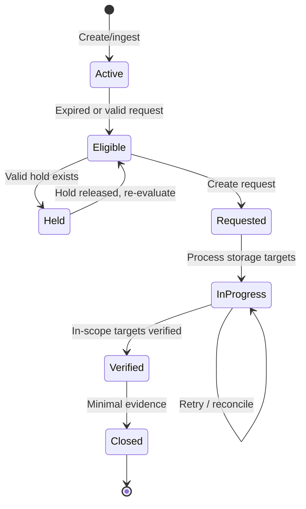
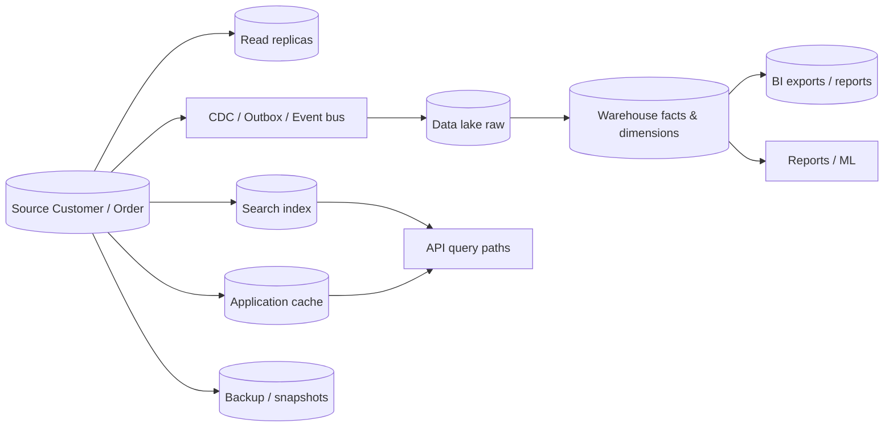
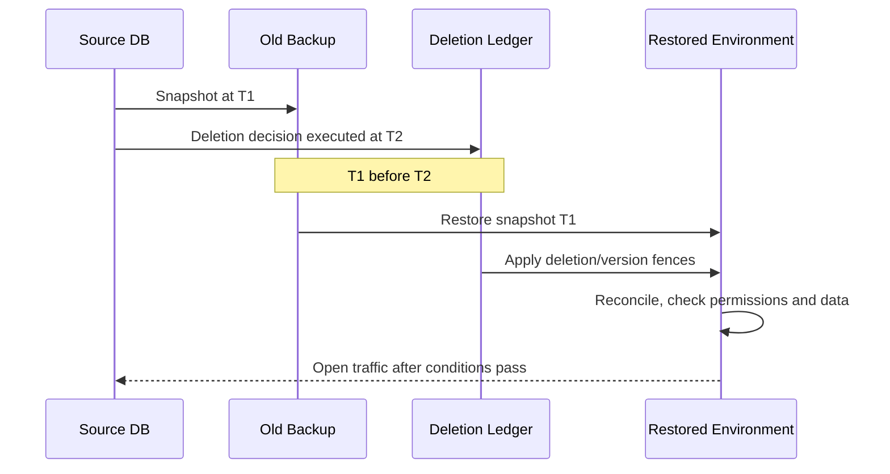
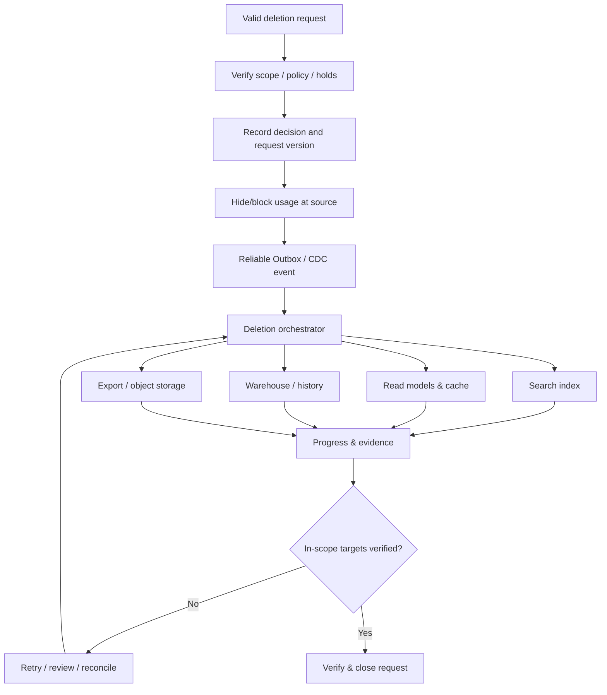

# Retention Periods, Deletion Conditions, and Data Remaining in Copies or History

## Learning Objectives

After this lesson, you will be able to:

- Distinguish **retention period**, **expiration timestamp**, **deletion eligibility conditions**, **logical deletion**, **physical deletion**, and **no longer accessible via the application**.
- Translate business rules on retention and deletion into **data lifecycle contracts** with owners, subjects, timestamps, exceptions, scope, and verifiable evidence.
- Design models that separate **transactional data to retain**, **personal identifying data**, **derived data**, **historical events**, and **indexes** so the right subset is deleted without breaking business invariants.
- Build a **copy map**: primary, replicas, read models, materialized views, caches, search indexes, analytics, CDC/outbox, queues, object storage, snapshots, backups, and test environments.
- Explain why `DELETE` or TTL expiration **does not prove** data has vanished from every file, replica, and backup.
- Design deletion workflows that are **fault-tolerant, idempotent, and ordered**, preventing old events and old snapshots from resurrecting deleted data.
- Separate deletion execution from **deletion-evidence auditing** without creating a new sensitive-data store.
- Define how to test, reconcile, and monitor **deletion lag, orphan records, restore rehydration, and lifecycle policy violations**.
- Evaluate trade-offs across **auditability, retention obligations, security requirements, disaster recovery, and historical analytics**.

In the **DATABASE_DATA_MODELING** module, translating business requirements into a data model does not stop at primary keys, relationships, normalization, indexes, and physical schemas. When designing **data protection**, you must also answer: **why is an entity still stored, who may view it, when must its use stop, under what conditions may it be deleted, and how do copies and historical stores follow the same decision?**

This lesson focuses on **modeling data boundaries and lifecycles**. Specific legal obligations vary by country, industry, data category, and processing basis; the retention windows below are **design examples**, not mandatory limits for every organization.

---

## 1. The Problem: Deleting a Profile Does Not Mean Deleting Everything Related

Suppose a commerce platform has the following systems:

- **Identity/Customer Service:** customer accounts, emails, phone numbers, addresses.
- **Order Service:** orders, order lines, statuses, and change history.
- **Payment/Accounting:** payment collections, refunds, and records needed for reconciliation.
- **Catalog:** products, SKUs, and categories.
- **Search/Analytics:** indexes and aggregated data for search and reporting.
- **Infrastructure:** caches, replicas, message buses, CDC, object stores, and backups.

A customer requests account closure and deletion of personal data. What happens if you only execute:

```sql
DELETE FROM customers
WHERE customer_id = 'user_42';
```

The `customers` table no longer has that row, yet data may still remain in:

```text
orders.customer_email_snapshot
shipments.delivery_phone
search_customer_index
customer_profile_cache
analytics_customer_dimension_history
cdc_raw/customer_events
data_export/customer_2026.csv
database_snapshot_yesterday
offsite_backup_last_week
support_ticket_attachments
```

If you blindly delete every order line too, the organization may accidentally break refund resolution or valid retention obligations. Conversely, keeping all personal info "just in case we need it later" can violate defined purposes and retention limits.

**The design problem** is to **define the retention/deletion scope by purpose and data relationships**, then ensure write paths and copies enforce the exact decision.

### 1.1. Four Questions to Answer Before Writing DELETE

1. **Which data?** The entire account, one attribute, a relationship, an event, or historical records?
2. **Why retain or delete?** End of purpose, expired duration, authorized request, cancelled transaction, or another basis?
3. **Starting from when?** Creation, completion, account closure, last transaction, contract end, or another event?
4. **Which locations are affected?** Primary store, read replicas, history, exports, snapshots, and backups?

Missing any of these four questions yields a schema that allows SQL deletion yet remains **impossible to operate and verify deletion reliably**.

## 2. Six Lifecycle Concepts That Must Be Separated

| Concept | Meaning in the model | Must never be assumed |
| --- | --- | --- |
| **Retention** | Duration/rules for keeping data by purpose and basis | One TTL fits every table |
| **Expiration** | Timestamp when a value is no longer valid for a specific purpose | Bytes have already been reclaimed from disk |
| **Logical delete / soft delete** | Record marked deleted or hidden from app queries | Physical or backup copies are gone |
| **Physical deletion / purge** | Reclaiming or removing data via storage mechanisms | Backups, logs, and other copies are already handled |
| **Archival** | Moving data to another storage tier per policy | Deleted or no longer sensitive data |
| **Deletion evidence** | Proof of workflow execution and outcome within stated scope | Absolute proof that every bit on every medium vanished |

A session has a 30-minute TTL, financial records carry multi-year retention policies, audit events have distinct retention/redaction rules, and product caches live for minutes. You cannot assign a **session's** TTL to **every record containing `userId`**.

### 2.1. Deletion Happens Across Multiple Levels

1. **No longer served by active APIs:** normal queries/commands stop returning the data.
2. **Primary and operational copies processed:** primary, replicas, search/indexes/caches/read models.
3. **Derived and historical systems handled per policy:** analytics, event logs, exports, identifiable history.
4. **Backups governed safely:** not served directly; expire on schedule or re-apply deletions before restored environments serve traffic.
5. **Physical reclamation / cryptographic erasure per system capabilities:** documented with clear evidence and limits.

An API returning `204 No Content` confirms **the request was accepted or processed within a defined scope**, not automatically all five levels.

### 2.2. Expiration Differs from "Deleted"

```text
T0        Record created, expiresAt = T0 + 90 days
T0+90d    Record expires per policy
T0+90d+δ  Background worker/lifecycle job physically deletes or hides it
T0+90d+Δ  Old backups expire on their own schedule
```

The intervals δ and Δ are workflow/infrastructure characteristics; they must be measured and bounded, never assumed equal to 0.

## 3. Classify Data Before Setting Retention Periods

An `orders` table may hold both monetary amounts needed for audits and delivery emails that should not be kept for the same duration.

| Data group | Examples | Primary purpose | Considerations upon deletion |
| --- | --- | --- | --- |
| Identity profile | Name, email, phone | Authentication, customer support | Field-level vs. full profile deletion |
| Transactional info | Order ID, total amount, payments/refunds | Fulfillment, transaction accountability | Separate retention periods and exceptions |
| Delivery data | Recipient address, phone | Parcel delivery | Does not necessarily match financial record retention |
| Sessions/tokens | Session ID, refresh token | Temporary authentication | Short TTL; timely revocation |
| Telemetry/logs | Request ID, IP, traces, payloads | Operations, security | Limit PII, retention, and redaction |
| Search/indexes/caches | Email index, summary profile | Read optimization | Synchronize updates and deletions |
| Analytics/features | Customer SCD2, behavior, cohorts | Reporting, forecasting | Assess identifiability and retention need |
| Backups/snapshots | Historical data images | Disaster recovery | Retention, isolation, restore controls |
| Audit evidence | Request ID, timestamps, outcomes | Proof of processing | Avoid re-storing deleted payloads |

**A single entity can fall under multiple policies at the field and purpose level.** Monolithic table design makes selective deletion harder, especially when fields are copied across stores.

### 3.1. A Retention Matrix Should Not Be Just "Number of Days"

| Attribute | Illustrative example |
| --- | --- |
| `data_class` | `DELIVERY_CONTACT` |
| `purpose` | Delivery and delivery issue support |
| `authority_owner` | Fulfillment domain |
| `scope` | Tenant, profile type, policy region |
| `retention_start_event` | `shipment_delivered_at` |
| `retention_duration` | 90 days in this example |
| `not_before_condition` | No active valid hold in effect |
| `expiration_action` | Redact phone/address |
| `downstream_targets` | Search, cache, analytics, object store |
| `exception/hold_policy` | Open disputes follow dedicated workflow |
| `verification_method` | Residual query + job manifest + restore test |
| `policy_version` | `delivery_contact_v3` |
| `service_level` | E.g., executed within 24 hours after eligibility |

**90 days and 24 hours are strictly hypothetical numbers for this lesson.** Never copy them into unapproved legal rules.

## 4. Retention Start Triggers Are Business Decisions

Different start anchors cause records to be deleted too early or too late:

- **CreatedAt:** when the entity was first created.
- **LastActivityAt:** from the last valid activity; fits certain sliding-retention data.
- **CompletedAt/ClosedAt:** from transaction completion or case closure.
- **ContractEndedAt:** from termination of contractual relationship.
- **EventTime:** when the event occurred at the source.
- **ReceivedAt:** when the system ingested the data.
- **BusinessTriggerAt:** a policy-defined milestone.
- **DeletionRequestAt:** upon receiving a valid deletion request—does not mean all data vanishes immediately.

Basic formula:

\[
expiresAt = retentionStartAt + retentionDuration
\]

Yet **deletion eligibility** often requires multiple conditions:

\[
eligibleToPurge =
expired \land \neg activeHold \land \neg requiredDependency
\]

Here `requiredDependency` is a policy-defined condition—not every foreign key should block deletion forever.

### 4.1. Business Time Differs from Ingestion Time

A device sends:

```json
{
  "eventId": "evt_120",
  "observedAt": "2026-10-01T10:00:00Z",
  "receivedAt": "2026-10-20T10:00:00Z",
  "deviceId": "dev_8"
}
```

Illustrative policy: retain measurements for 30 × 24 hours from `observedAt`. Writing `TTL = 30 days` upon receipt keeps the data 19 days past its intended deadline.

```text
expiresAt = observedAt + 30 days
ttlRemainingSeconds = max(0, expiresAt - now)

if ttlRemainingSeconds <= 0:
    handleAlreadyExpiredEvent()
else:
    storeWithAppropriateDeadlineOrTTL()
```

Account for rounding, TTL caps, clock skew, and overwrite semantics. If policies forbid returning data after `expiresAt` even when background cleanup lags, read paths must enforce the deadline themselves.

### 4.2. Calendar Days Differ from Fixed Durations

"90 days" can mean 90 × 24 hours from a UTC instant, 90 calendar days in the store's timezone, until fiscal period end, or until ledger close. Across DST transitions, calendar days vary from 24 hours. Contracts must specify **timezones, boundaries, missing timestamps, and late-arriving events**.

### 4.3. When Data Is Modified

If staff edit a delivery address on day 80, does retention restart? Never let the answer depend accidentally on whether an `UPDATE` resets a TTL:

- **Absolute retention:** deadline remains fixed despite metadata edits.
- **Sliding retention:** only contractually eligible events extend the clock.
- **Case-based retention:** measured from case closure.
- **Exceptions:** require an owner, reason, limits, and review schedule.

## 5. Deletion Conditions: Request Rights, Retention Bases, and State

A valid deletion request does not always erase all related data immediately. Conversely, a basis to retain one category never justifies keeping unnecessary fields indefinitely.

| Subject | Question | Viable design direction |
| --- | --- | --- |
| Sessions, refresh tokens | Still needed for the account? | Revoke/invalidate per contract |
| Marketing profile | Valid purpose/basis still active? | Delete/hide and clean indexes |
| Shipping address | Still needed for delivery/support? | Separate deadline/redaction |
| Order ID and total amount | Needed for valid transaction accountability? | Retain minimum required per policy |
| Payment records | Needed for accounting/reconciliation? | Retain under dedicated rules and tight access |
| Personal behavioral events | Purpose still valid? | Delete or reduce identifiability |
| Aggregates | Truly non-identifying? | Assess re-identification risk |

### 5.1. Holding by Exception (Hold)

Deletion may be paused for disputes, investigations, or valid obligations. A hold must be a **structured, permissioned object**, never an unbounded `do_not_delete=true` flag:

```text
retention_hold:
    hold_id
    subject_type
    subject_id
    scope_of_data
    reason_code
    authorized_by
    effective_from
    review_at
    released_at
    policy_reference
```

Rules:

1. Holds apply only to **the necessary scope**.
2. Creating/releasing holds requires explicit authorization.
3. Holds carry audits, reason codes, and review schedules.
4. When a hold is released, **re-evaluate deletion eligibility** rather than resetting the entire retention age.
5. A hold is never an excuse to retain all PII and copies forever by default.

### 5.2. Deletion State Model



In practice, states may also include `REJECTED`, `PARTIALLY_COMPLETED`, `BLOCKED`, and `REQUIRES_REVIEW`. Never silently mark everything `DONE` to make dashboards look green.

**Deletion request** and **deleted data** are distinct entities. Requests track workflow progress without storing sensitive original payloads.

## 6. Designing Schemas for Selective Deletion Without Breaking Transactional Data

Initial order schema:

```sql
CREATE TABLE orders (
    shop_id             VARCHAR(40),
    order_id            VARCHAR(40),
    customer_id         VARCHAR(40),
    customer_email      VARCHAR(255),
    shipping_phone      VARCHAR(30),
    shipping_address    TEXT,
    status              VARCHAR(24),
    total_minor         BIGINT,
    currency_code       CHAR(3),
    completed_at_utc    TIMESTAMP,
    PRIMARY KEY (shop_id, order_id)
);
```

This table mixes transactional facts, contact info, and customer–order linkage. A single retention period risks deleting or keeping the wrong parts.

### 6.1. Separating by Lifecycle

```text
order_core
    PK (shopId, orderId)
    status, totalMinor, currencyCode, completedAt
    retentionPolicyRef, retentionStartAt

order_customer_link
    PK (shopId, orderId)
    customerId, linkState, expiresAt

order_delivery_contact
    PK (shopId, orderId, contactVersion)
    encryptedAddress, encryptedPhone, validFrom, expiresAt

customer_profile
    PK (tenantId, customerId)
    fields following profile lifecycle

order_audit_events
    PK (shopId, orderId, eventId)
    eventType, occurredAt, minimalActorRef
```

This illustrates **boundary separation**, not a mandate for exactly five tables. Relational or document models work as long as transactions, queries, permissions, and lifecycles are explicit.

When delivery purpose ends, `order_delivery_contact` can be purged without corrupting `order_core`. When a profile is deleted, `order_customer_link` can be terminated per policy without losing required financial records.

### 6.2. Referential Integrity During Deletion

`ON DELETE CASCADE` deletes multiple rows in one database transaction, yet:

- Can delete **too much** transactional data that must be retained.
- Does not propagate to search, analytics, caches, object stores, or backups.
- Does not handle cross-service references.
- Cannot arbitrarily set mandatory business relationships to `NULL`.

| Relationship | Behavior to consider |
| --- | --- |
| Session → Account | Revoke/cascade within appropriate scope |
| Order core → Delivery contact | Delete/redact contacts on their own timeline |
| Order core → Payment reference | Retain/handle as financial records; never cascade blindly |
| Order → Search index | Sync via index engine or deletion events |
| Fact → Customer dimension | Decide between severing identifying links vs. handling facts |
| Historical actor reference | Review audit needs and reduce identifiability |

### 6.3. Pseudonymization Does Not Equal Anonymization

- **Pseudonymization:** replaces emails/user IDs with another code, yet remains re-linkable via mappings or auxiliary data.
- **Anonymization:** no longer identifiable under applicable standards and evaluation context, factoring in combinable datasets.

Keeping `SHA256(email)` does not make data anonymous: emails can be guessed and re-hashed. Random tokens can still link to granular orders. Assess **granularity, rarity, external linkage, and permissions**.

## 7. Data Inventory: Which Copies Must Be In Scope?

A value can be **copied, transformed, cached, exported, or snapshotted** across many pipelines.



Copy categories:

1. **Near-verbatim copies:** replicas, snapshots, backups.
2. **Reorganized read copies:** by-customer tables, search indexes, materialized views.
3. **Attribute-bearing derivatives:** feature stores, dimension histories, caches.
4. **Extracts:** CSVs, object exports, attachments, test environments.
5. **Logs/events:** outbox, CDC, dead-letter queues, audits, traces.
6. **Identifiable metadata:** keys, URLs, filenames, object tags, index terms.

Personal data can live inside **object names or partition keys**, not only payloads.

### 7.1. Copy Inventory Table

| Field | Example | Meaning |
| --- | --- | --- |
| `dataset_id` | `search_customer_v2` | Identifies the store |
| `owner_service` | Customer Search | Who executes deletion |
| `upstream_dataset` | Customer profile CDC | Derivation source |
| `data_classes` | Email, display name | Data categories present |
| `storage_type` | Index, cache, table, object | Deletion/redaction mechanism |
| `record_locator` | `(tenantId, customerId)` | How to locate records |
| `lineage_version` | Search pipeline v2 | How data is built |
| `retention_policy` | customer-index-v3 | Retention rules |
| `deletion_capability` | delete by ID / rebuild | Execution behavior |
| `maximum_delete_lag` | Illustrative SLA | Expectation/alerting threshold |
| `restore_behavior` | Rebuild only from sanitized source | Prevents resurrecting old data |
| `verification_procedure` | Query index + replay test | Verification evidence |

Without knowing where copies live or lacking a **record locator**, verifiable deletion is nearly impossible. That is why **lineage** and **stable locators** are part of data protection design.

### 7.2. Are Aggregates Truly Non-Identifying?

A mart with `orders_per_day_by_region` having only one customer in a region/day can still expose info when combined with external knowledge. Omitting `customerId` or running `GROUP BY` does not guarantee anonymity.

Inspect which facts retain personal IDs, which dimensions keep mappings, small cell sizes, published dimensional combinations, and exports holding sensitive attributes.

## 8. Deletion in Primary Tables, Read Models, and Indexes

An order is keyed by `(shopId, orderId)` yet served across multiple read paths:

```text
orders_by_id(shopId, orderId)
orders_by_customer_month(shopId, customerId, month, createdAt, orderId)
orders_by_status_day(shopId, status, day, changedAt, orderId)
orders_search_index(orderId, customerEmail, ...)
orders_analytics_fact(orderId, customerSk, ...)
```

When an order is deleted or stripped of identifying info:

- Deleting/hiding the primary row may be just **one step**.
- `orders_by_customer_month` still exposes the customer–order link.
- Search indexes still allow lookups by email.
- Status-indexed read models may hold customer names.
- Analytics dimensions may retain emails while facts still join to those dimensions.

### 8.1. Two Distinct Action Types

**Contractual entity deletion:** when eligible, remove derived representations of the entity.

**Selective redaction:** keep minimal transactional records while stripping unnecessary contact details and identifying links. Here, "delete `orderId` from every table" can be wrong if the order still serves valid business obligations.

An event can specify:

```json
{
  "eventId": "evt_del_17",
  "subjectType": "CUSTOMER",
  "subjectId": "user_42",
  "tenantId": "shop_17",
  "action": "REDACT",
  "dataClasses": ["CONTACT_EMAIL", "DELIVERY_PHONE"],
  "policyVersion": "customer-contact-v3",
  "subjectVersion": 18,
  "requestedAt": "2026-11-22T10:00:00Z"
}
```

**This is an illustrative event contract**, not a universal format. `dataClasses` must map to concrete fields in each target without embedding sensitive payloads in the event.

### 8.2. Contracts for Read Models

| Attribute | Question |
| --- | --- |
| Source of truth | Where does the authoritative original live? |
| Granularity | What entity or event does one row represent? |
| Replicated fields | Which attributes are copied? |
| Deletion semantics | Delete row, delete column, or redact? |
| Propagation | Transaction, index engine, CDC, or projector? |
| Staleness SLA | How far may the copy lag? |
| Rebuild source | Where can it be reconstructed from? |
| Deletion fence | How are older events prevented from resurrecting data? |
| Verification | Which queries/evidence confirm completion? |

Read models lacking a clear source of truth and rebuild path quickly turn into **orphan data stores** with unknown retention and deletion rules.

## 9. Replicas, MVCC History, Tombstones, and Physical Storage

Distinguish data **no longer visible to queries** from data **no longer present in storage structures**.

### 9.1. Physical Replicas

Distributed stores replicate across nodes/regions for availability. On deletion:

- Changes propagate according to the product's consistency model.
- Offline replicas may not yet have received/reconciled deletes.
- Slow-replica read paths can exhibit different consistency guarantees.
- In some engines, dropping deletion markers too early risks resurrecting stale values.

Never generalize one database's tombstone mechanics to every engine. LSM, MVCC, hash/range partitioning, and replication mechanisms each impose distinct limits.

### 9.2. MVCC History and Versioned Objects

In many relational DBs or versioned warehouses:

- `DELETE` usually makes rows **invisible to new snapshots**.
- Older versions persist for active transactions, snapshots, or time-travel.
- VACUUM/compaction/GC reclaim space once eligibility conditions pass.
- Snapshots, object versions, or replicas may still hold older copies.

If a DB offers `AS OF` or time-travel queries, define **how long deleted data remains queryable historically**, who may query it, and how deletion policies apply.

### 9.3. Tombstones in LSM / Wide-Column Stores

Some LSM engines write **tombstones** marking a key/cell/range as deleted so reads and replica sync ignore older values.

```text
T1: Old SSTable stores key=K -> value=V1
T2: DELETE(K) writes new tombstone
T3: GET(K) hides V1 under reconciliation rules
T4: compaction/GC reclaims old bytes once eligible
```

If a replica holding stale V1 rejoins after tombstones were purged without safe sync, **zombie data** can reappear in certain setups. Keep in mind:

- Storage tombstones are not application soft-delete flags.
- `gc_grace_seconds` in some engines does not mean "guaranteed date bytes vanish."
- Never shrink tombstone windows blindly without understanding repair and offline-node intervals.
- TTLs can generate tombstone/compaction overhead depending on the engine; not every key-value store behaves like Cassandra.

### 9.4. Business History Is a Copy with a Different Purpose

A `customer_history` table or SCD2 dimension stores past states:

```text
customer_dimension_history:
  customer_sk, customer_id, segment,
  valid_from, valid_to,
  email_snapshot
```

Deleting email from `customers_current` while `customer_dimension_history` retains `email_snapshot` leaves an unaddressed identifying path. You can separate **segment history** from **identifying attribute history** per legal basis and purpose—never wipe an entire SCD2 table solely for one PII column when non-identifying history may legitimately stay.

## 10. Backups, Snapshots, and the Risk of Resurrecting Deleted Data

Backups exist to restore **older** states. If the Nov 1 backup contains data deleted on Nov 15, restoring it directly on Nov 20 can **resurrect deleted data**.



**Backup workflows and deletion workflows cannot be designed independently.**

### 10.1. Minimal Restore Runbook

1. Identify **backup timestamp**, tenant scope, and data being restored.
2. Query deletion requests processed after that backup timestamp.
3. Restore into an **isolated environment**, with APIs and downstream pipelines closed.
4. Replay required deletions/redactions from a **trusted deletion ledger** and sufficiently retained source logs.
5. Reconcile versions, identities, deletion targets, and permissions.
6. Rebuild indexes/caches/read models **only from verified scrubbed sources**.
7. Record test/approval evidence before opening traffic.
8. If deletion logs expired and cannot cover the gap, treat as a **blocker**—never expose unscrubbed sources to users.

This is a conceptual runbook; actual execution depends on backup tooling, DR architecture, encryption, and policy rules.

### 10.2. Immutable Backups Do Not Support Row-Level DELETE

Many snapshots/backups are immutable blocks where `DELETE WHERE customer_id=...` cannot run directly. Options to evaluate:

- **Bounded backup retention:** older backups expire on a controlled schedule.
- **Access isolation:** backups are never queried as live databases.
- **Restore-and-reapply:** apply the deletion ledger before serving restored traffic.
- **Key lifecycle:** use encryption and key scoping aligned with lifecycle needs.
- **Backup architecture fit:** if policy mandates rapid selective erasure in backups, pick storage/partitioning architectures that support it.

Never report "physically erased" when access was merely restricted. Document **mechanism, latency, and limits** accurately.

### 10.3. Conditional Cryptographic Erasure

Destroying encryption keys **can** render data undecryptable if:

- Data exists solely encrypted under the destroyed keys.
- No plaintext remains in logs, caches, or exports.
- No copies of the key, key-wrapping material, or escrow recovery exist.
- Key destruction does not destroy unrelated data that must be retained.
- Key lifecycle destruction has verifiable evidence per policy.

One key shared across millions of users cannot be destroyed to selectively erase one user without breaking everyone else. Per-subject or per-object key architectures must be designed from **the modeling stage** if relied upon. Crypto erasure never affects plaintext previously exported outside encrypted zones.

## 11. Event Logs, CDC, and Histories Can Recreate Deleted Data

A profile might be reconstructed from events:

```text
CustomerCreated(v1)
EmailChanged(v2)
AddressChanged(v3)
CustomerDeleted(v4)
```

If a consumer replays only up to v3, or v4 aged out of topic retention, rebuilds can **recreate the old profile**. If v4 arrives before v3, applying events in arrival order resurrects data.

### 11.1. Four Distinct Deletion Layers

- **Storage tombstone:** engine metadata for record/replica reconciliation and compaction.
- **Domain deletion event:** notification that an entity/field was deleted per decision.
- **Application deletion fence:** durable state blocking older events from being reapplied.
- **Audit record:** request/progress trail with minimal PII.

None of these layers can substitute for the others to solve every problem.

### 11.2. Deletion Events Need Identifiers and Versions

```json
{
  "eventId": "del_evt_902",
  "entityType": "CUSTOMER",
  "tenantId": "shop_17",
  "subjectId": "user_42",
  "subjectVersion": 18,
  "action": "DELETE_OR_REDACT",
  "policyVersion": "customer-retention-v3",
  "requestId": "req_301",
  "effectiveAt": "2026-11-22T09:00:00Z",
  "scope": ["PROFILE", "CONTACT_SEARCH", "IDENTITY_LINK"]
}
```

Illustrative event contract, **not a standard format**. Payloads should suffice for locating and scoping without carrying raw emails/addresses unnecessarily.

- `subjectVersion` has an authoritative issuer and monotonic ordering per entity scope.
- `eventId` differs from `subjectId`: one entity emits many events.
- `requestId` tracks the workflow without replacing per-target idempotency.
- `policyVersion` explains why the target was requested deleted.
- If recreating a new profile is allowed later, maintain an **identity epoch/generation** and explicit history-linking rules.

### 11.3. Projections That Can Replay Safely

```text
onCustomerEvent(event):
    key = (event.tenantId, event.subjectId)
    state = durableProjectionState.readOrDefault(key)

    if event.generation < state.activeGeneration:
        return

    if event.generation == state.activeGeneration
       and event.subjectVersion <= state.lastAppliedVersion:
        return

    if event.action == DELETE_OR_REDACT:
        applyIdempotentRedactionOrDeletion(key, event.scope)
        recordDeletionFence(key, event.subjectVersion, event.generation)
    else:
        if event.generation == state.activeGeneration
           and event.subjectVersion <= state.deletionFenceVersion:
            return
        applyIdempotentUpsert(key, event)

    commitCheckpointWithConcurrencyControl(
        key, event.subjectVersion, event.generation
    )
```

**Pseudocode expressing invariants**, not a complete transaction. Handle missing intermediate deltas, checkpoints in external stores, and guard `version check + write` with CAS, transactions, or serialized processing; an unguarded `GET` then `PUT` still races.

### 11.4. Why Deletion Fences Have Their Own Retention

If event logs replay for two years while fences expire after one day, a consumer backfilling a week later can resurrect deleted data.

Conceptual rule:

\[
T_{\text{fence}} \geq T_{\text{replay horizon}}
\]

Even this is not absolute safety alone: consider backups, snapshots, external exports, legacy pipelines, and ID reuse. When fences cannot remain in identifiable form long enough, use generation markers, scrubbed snapshots, replay filters, and restore controls per policy.

## 12. Distributed Deletion Without a Cross-System Transaction

Suppose the authoritative source must delete a profile and propagate to search, caches, warehouses, object storage, and read models.



Even when source mutation and outbox commit atomically, downstream targets still delete **asynchronously**.

### 12.1. Naive Dual-Write Failure

```text
deleteCustomerInSource()
deleteSearchIndex()
deleteAnalyticsDimension()
deleteCache()
return "done"
```

If the process crashes after step 1, copies linger. Retries must be safe, offline targets need durable queues—never silent skips. Better workflow:

1. Authenticate and persist the request.
2. Execute the source change with appropriate transactional guarantees.
3. Emit commands via transactional outbox/CDC where supported.
4. Track per-target progress: `PENDING/IN_PROGRESS/VERIFIED/FAILED/BLOCKED`.
5. Retry keyed by `requestId + target + action/version`.
6. Verify actual state at the target rather than trusting a blind ACK.
7. Block stale data from recreating records during and after deletion.

### 12.2. DDL for Tracking Deletion Progress

```sql
CREATE TABLE deletion_request (
    request_id        VARCHAR(64) PRIMARY KEY,
    tenant_id         VARCHAR(64) NOT NULL,
    subject_type      VARCHAR(40) NOT NULL,
    subject_id        VARCHAR(100) NOT NULL,
    policy_version    VARCHAR(80) NOT NULL,
    request_version   BIGINT NOT NULL,
    requested_at      TIMESTAMPTZ NOT NULL,
    effective_at      TIMESTAMPTZ,
    status            VARCHAR(32) NOT NULL
);

CREATE TABLE deletion_target_progress (
    request_id        VARCHAR(64) NOT NULL,
    target_id         VARCHAR(100) NOT NULL,
    action_code       VARCHAR(40) NOT NULL,
    target_status     VARCHAR(32) NOT NULL,
    last_attempt_at   TIMESTAMPTZ,
    verified_at       TIMESTAMPTZ,
    attempt_count     INTEGER NOT NULL DEFAULT 0,
    failure_code      VARCHAR(80),
    PRIMARY KEY (request_id, target_id, action_code),
    FOREIGN KEY (request_id)
        REFERENCES deletion_request(request_id)
);
```

A ledger holding `subject_id` is itself identifiable data. Apply access controls, encryption, retention, and consider protected tokens/lookups where appropriate.

### 12.3. `VERIFIED` Must State the Exact Type of Evidence

Checks can include:

- Queries no longer return in-scope fields/records.
- Job manifests confirm target objects/files were processed.
- Search indexes no longer contain documents or sensitive fields.
- Projections are scrubbed and subsequent jobs do not recreate them.
- Restore drills apply the deletion ledger before opening APIs.
- Immutable backups follow documented lifecycle controls.

**Never equate "command sent" with "verified across every copy."**

## 13. Correctness Under Concurrent Updates: Delete, Update, Recreate

A customer requests profile deletion while another worker receives an older email-update event:

```text
T1: Profile v17, email=old@example.test
T2: Delete request/version v18
T3: Search projection deletes profile
T4: Event v17 arrives late
```

If the projection applies `UPSERT` v17 at T4, the deleted email reappears.

You need source versions, deletion fences, conditional updates, retry/reconciliation, and clear semantics for **valid profile recreation**.

### 13.1. Write Fence When Deletion Begins

Beyond emitting a delete event, consider a **write fence** at the source:

```text
profile_state = DELETION_IN_PROGRESS
eligible_commands = RESTRICTED
```

For example, while deletion is running, block marketing pipelines from importing old CSV emails; permit only commands needed to complete the authenticated deletion. Exact rules vary by domain, yet **stale data must never flow back in**.

### 13.2. Recreating Under the Same Identifier

If the user later signs up again with the same email:

- **New generation:** gets a fresh identity for the new permission/purpose, never silently linking to deleted history.
- **Restoring old profile:** permitted only if policy and permissions allow, using validly retained data.

Reusing `customerId` risks misattaching old orders/history. Issue new IDs or epochs/generations with explicit identity-resolution rules.

## 14. SCD Type 2 and History Tables Still Hold Data to Delete

A customer dimension holds multiple versions:

```text
dim_customer_history:
  customer_sk=101, customer_id=user_42,
  email=old@example.test, valid_to=2026-08-01

  customer_sk=205, customer_id=user_42,
  email=new@example.test, valid_to=NULL
```

Deleting email from the current row is insufficient while older versions still store emails.

### 14.1. Separating Semantic History from Identifying Info

Consider designing:

```text
dim_customer_segment_history:
    customer_sk, canonical_customer_id,
    segment, valid_from, valid_to

restricted_customer_identity:
    canonical_customer_id, encryptedContact,
    contactRetentionDeadline

fact_order:
    order_id, amountMinor, currencyCode,
    customer_sk_if_permitted
```

When removing identifiers, determine:

- May segment history be kept at **individual grain**?
- If not, sever the link or retain only permitted aggregates?
- Does `customer_sk` still link to another upstream mapping?
- When transaction facts remain, are unnecessary PII fields stripped?
- Does editing/deleting dimension rows distort published metrics?

### 14.2. Deleting Dimension Rows Can Break Facts

If facts FK to `customer_sk`, deleting dimensions can fail FK checks, drop facts in inner joins, or corrupt segment metrics.

Choose among **attribute redaction**, **keeping minimal non-identifying members**, **remapping to an unknown/erased member**, or **deleting facts** per policy. Never simply run `DELETE FROM dim_customer` and ignore facts.

### 14.3. Aggregation Is Not Automatically Anonymous

A region/day mart with only one customer in a cell can be re-identified using external knowledge. Aggregation/anonymization assessments must inspect **group sizes, rarity, dimensions, and combinable datasets**.

## 15. TTLs, Batch Purges, and Time-Bucketed Partitions

TTLs automate expiration in some engines without replacing retention contracts.

### 15.1. Key, Item, and Cell TTLs

Key-value stores apply TTL per key; document stores use TTL indexes per document; wide-column stores can attach TTL per cell:

- Updating one field may or may not refresh the TTL.
- One row can retain some cells after others expired.
- Background sweepers run asynchronously.
- Tombstones/compaction incur storage/read cost before bytes are reclaimed.
- Locators, indexes, and caches do not automatically share the source's deadline.

**Test the actual engine** rather than guessing generic semantics from the word `TTL`.

### 15.2. Batch Purges

A purge job should:

1. Select eligible records in bounded batches.
2. Re-verify holds, policy versions, and invariants at commit time.
3. Use idempotent markers so retries never delete newer versions.
4. Persist checkpoints and progress.
5. Emit cleanup commands to copies.
6. Monitor backlog and deletion lag.
7. Throttle load to protect online traffic.

Candidate-selection query—**not a complete safe delete command**:

```sql
SELECT d.record_id, d.entity_version, d.expires_at
FROM retention_candidates AS d
WHERE d.expires_at <= CURRENT_TIMESTAMP
  AND d.lifecycle_status = 'ACTIVE'
ORDER BY d.expires_at, d.record_id
FETCH FIRST 1000 ROWS ONLY;
```

Between `SELECT` and `DELETE`, a new hold or new record version may appear. Deletes must re-verify or execute conditional version-checked transactions rather than blindly trusting prior reads.

### 15.3. Day Buckets Assist Lifecycle Without Auto-Deleting Data

Example:

```text
sensor_events_by_device_day
    partition = (tenantId, deviceId, dayBucketUTC)
    sort      = (observedAt DESC, eventId)
```

Day buckets bound history and help target cleanup, yet:

- Dropping partitions can still leave tombstones or lag physical reclamation.
- Drop physical partitions only when **every record inside is eligible** and hold-free.
- Late-arriving events can land in older buckets.
- Records sharing a bucket may carry different retention rules.
- Overly fine buckets increase fan-out; overly coarse buckets create hotspots and read overhead.

Design partitions for queries and lifecycle while still respecting **record-level conditions**.

## 16. Privacy, Security, and Audit Evidence

Deletion workflows touch sensitive data, so the deletion tracking system itself must be protected.

### 16.1. Useful Evidence Types

- `requestId` and request confirmation timestamp.
- Subject type and processed data classes/scope.
- Policy version and retain/delete decision.
- Required targets and per-target progress.
- Error codes and retry timestamps, without sensitive payloads.
- Verification method and outcome.
- Request closure timestamp and exception owners.

**Never copy emails or deleted profiles into audit logs** merely to prove deletion happened. If identifying references are needed to block replay or support audits, enforce access controls and retention on those references too.

### 16.2. Encryption Does Not Replace Lifecycle Governance

Encryption at rest/in transit protects against unauthorized reads, yet never defines **how long data may be kept**. Likewise:

- Hashing does not automatically anonymize data.
- Pseudonymization remains linkable.
- Archival is not deletion.
- An API hiding a field does not mean backups lost the data.
- Stale read replicas do not mean a record was permanently destroyed.

### 16.3. Tenant Scope

When `user_42` is unique only **within a tenant**, deletion requests must carry an authenticated `tenantId` in the key and enforce authorization.

```text
targetKey = (tenantId, subjectType, subjectId)
```

Never accept unverified client-supplied tenant IDs. Cross-tenant identity crosswalks do not grant permission to read or delete data across tenants.

## 17. Retention Registry and Deletion Ledger

A multi-system architecture can organize two logical components:

1. **Retention registry:** rules and versions per data class and owner.
2. **Deletion ledger:** verified decisions and per-target execution status.

### 17.1. Illustrative Retention Policy

```yaml
policyId: delivery-contact-v3
owner: fulfillment-domain
dataClasses:
  - DELIVERY_ADDRESS
  - DELIVERY_PHONE
scope:
  entityType: SHIPMENT
  regionPolicy: example-policy
startEvent: DELIVERED_AT
duration: P90D
action: REDACT
holds:
  - OPEN_DISPUTE
verification:
  - primary-field-absent
  - search-index-absent
  - analytics-identity-link-removed
restoreRule: reapply-deletion-ledger-before-serve
```

This YAML is an **illustrative contract**, not a specific library config or universal legal rule. `holds` must bind to approved policies, permissions, and authoritative data.

### 17.2. Registries Do Not Replace Business Sources of Truth

A policy registry manages rules, yet does not know on its own:

- Whether an order was delivered.
- Whether refunds or disputes are closed.
- Whether a contract ended.
- Which tenant owns a profile.
- Whether a record is a primary source or a derived cache.

Those facts must come from **authoritative domains** at matching versions when evaluating policies.

### 17.3. Relational Structure

```text
RetentionPolicy 1 ---- N DataClassPolicy
DataClassPolicy N ---- N DatasetTarget
DeletionRequest 1 ---- N TargetProgress
DatasetTarget 1 ---- N VerificationRule
DeletionRequest N ---- 1 SubjectScope
Hold 1 ---- N SubjectScope / DataClass
```

Many-to-many relationships require keyed, effective-dated bridge tables in relational databases. When a data class spans three datasets, track **how each dataset executes** rather than a single "deleted" flag.

## 18. Backfills, Migrations, and Retention Policy Changes

Suppose an organization previously kept delivery info longer and now shortens retention. Existing records must be evaluated using **effective dates and exceptions**, rather than only updating TTLs for new writes.

### 18.1. Process for Shortening Retention

1. Confirm new policy, scope, effective date, and approvers.
2. Inventory datasets/copies holding the affected data classes.
3. Compute `expiresAt` for **historical records** from actual business timestamps, not backfill execution time.
4. Detect active holds, exceptions, and records missing timestamps.
5. Run a **dry run** inspecting counts, distributions, and especially held records.
6. Batch-delete/redact with checkpoints, conditional checks, and rate limits.
7. Synchronize search, analytics, caches, and read models.
8. Reconcile counts by data class, tenant, date, and version; inspect samples and KPIs.
9. Deploy updated policy to write pipelines.
10. Audit backups/restores, exports, and ingestion paths that might reintroduce old data.

When a policy **extends retention**, apply it only to validly existing records; never assume data already deleted under the prior policy can be recovered.

### 18.2. Old Snapshots Must Never Overwrite Newer Deletions

```text
T1: raw customer snapshot still holds user_42
T2: deletion request for user_42 is VERIFIED
T3: backfill job reads T1 snapshot
T4: backfill writes dim_customer -> user_42 reappears
```

Protect using:

- Snapshot/log checkpoints and deletion fences.
- Publish datasets only after applying all relevant deletion requests.
- Idempotent, version-aware jobs.
- Testing rebuilds from snapshots deliberately seeded with deleted records.
- Write permissions blocking stale workers from overwriting newer states/policies.

### 18.3. New Copies Must Have a Deletion Path Before Launch

Before releasing `customer_search_v2`, a new CSV export, or an email-bearing mart to production, register it in both the **copy inventory** and **deletion orchestration**.

Design rule: **never add a copy holding sensitive data without an owner, purpose, retention, deletion/rebuild path, and tests**.

## 19. Verifying Deletion: Layered and Scoped

No single SQL query proves data disappeared from **every replica, log, and backup**. Verify per target.

### 19.1. Operational Source

```sql
-- Only inspects data paths visible to this database.
SELECT COUNT(*) AS remaining_contact_rows
FROM order_delivery_contact
WHERE tenant_id = :tenant_id
  AND customer_id = :customer_id
  AND email IS NOT NULL;
```

This query says nothing about search indexes, snapshots, or backups. If email lives elsewhere, verify the relevant fields from the inventory—never treat `count=0` here as complete proof.

### 19.2. Read Models, Search, and Caches

- Query by `(tenantId, customerId)` and secondary index keys.
- Verify PII fields are stripped or documents removed per scope.
- Probe by email/phone **without logging sensitive values**.
- Verify cache invalidation even before TTL expiration.
- Reconcile applied deletion versions in projections.

### 19.3. Analytics and History

- Check current dimensions and **every SCD2 version**.
- Check raw/event/feature tables within policy scope.
- Check fact FKs to redacted dimensions to ensure no unexpected KPI loss or inflation.
- Reconcile metrics by currency and grain.
- Audit exports, dashboard snapshots, and external sharing channels.

### 19.4. Backups and Restores

- Manifests, backup ages, and lifecycle schedules.
- Access/isolation controls on backup vaults.
- Deletion ledger entries required post-snapshot.
- **Restore drill** outcomes: zero API traffic before scrubbing and reconciliation.
- Documented limitations for immutable archives unable to erase selectively on demand.

Never claim **physically erased** when you only verified primary queries.

## 20. Operational Metrics and SLAs

| Metric | Meaning | Response when threshold exceeded |
| --- | --- | --- |
| `retention_eligible_backlog` | Eligible records awaiting processing | Inspect purge workers, holds, throughput |
| `expiration_visibility_lag` | Time from expiration until API stops returning value | Check TTLs and read guards |
| `deletion_target_lag` | Time for each target to reach verified state | Retry/investigate lagging target |
| `deletion_request_p95` | Request completion time distribution | Compare against per-data-class SLA |
| `unverified_deletion_targets` | Targets lacking verification evidence | Block premature request closure |
| `orphan_index_count` | Index entries pointing to deleted records | Run cleanup/reconciliation |
| `rehydration_incidents` | Deleted data resurrected by replay/restore | Fix fences/generations |
| `historical_pii_findings` | PII found in history post-processing | Inspect SCD/exports/raw zones |
| `retention_policy_drift` | Datasets applying wrong duration/version | Fix pipelines, backfill |
| `hold_review_overdue` | Holds past review deadline | Escalate to owner |
| `backup_retention_violations` | Overdue backups | Inspect lifecycle jobs |
| `restore_scrub_failures` | Restore missed required deletions | Block traffic cutover |
| `purge_retry_dead_letters` | Repeated deletion failures unhandled | Review/escalate |

SLAs must specify **deletion depth**. "Within 24 hours of eligibility, APIs and search stop returning PII" is completely different from "all physical backups vanish within 24 hours."

Never attach emails, phones, or addresses as metric labels—that inflates cardinality and leaks PII.

## 21. Mandatory Test Suite

| Category | Scenario | Required proof |
| --- | --- | --- |
| Policy | Record reaches expiration | `expiresAt` computed from business trigger |
| Event time | Event arrives 20 days late | Ingestion does not reset retention |
| Boundary | Exactly at `expiresAt` | Consistent equality boundary semantics |
| Timezone | Business date across DST | Avoid 24-hour shortcuts for calendar-day policies |
| Hold | Deletion during active hold | Retains held scope; enters held/waiting state |
| Hold | Hold released | Re-evaluates cleanly without infinite backlog |
| Selective | Purge delivery phone, keep order total | Valid transaction facts remain intact |
| Foreign key | Delete profile, order facts remain valid | No bad cascades or lost KPIs |
| Index | Source customer deleted | Caches/search/read models meet SLA |
| History | Dimension has 3 email versions | All in-scope versions processed |
| Replica | Replica offline then rejoins | Does not resurrect old values |
| Tombstone | Bulk deletes in one partition | Measure latency/compaction and repair safety |
| CDC | v18 delete precedes v17 update | Older event does not recreate profile |
| Retry | Same delete request sent 3 times | Idempotent; no false verification |
| Partial failure | Search deleted, warehouse failed | Independent target retries |
| Snapshot | Backfill from pre-delete snapshot | Deletion fence blocks recreation |
| Backup | Restore older snapshot | Scrubbed/reapplied before serving |
| Metadata | PII in object keys/filenames | Inventoried and handled |
| Identity | Identifier reused | No history bleed across generations |
| Multi-tenant | Tenant A deletes Tenant B's record | Rejected |
| Aggregate | Region/day cell has one customer | Re-identification risk assessed |
| Policy migration | 180 days shortened to 90 days | Overdue records and exceptions classified cleanly |
| Evidence | Target `VERIFIED` | Accurate proof without storing payloads |
| Performance | Millions expire in one day | Batched/throttled without breaking online SLAs |

### 21.1. Fault Injection

Testing only happy paths misses critical failures:

- Consumer crashes **after deleting from index, before ACK**.
- Older event arrives **after** deletion event.
- Replica disconnects before deletion and rejoins later.
- Old snapshot restored in an isolated environment.
- Hold created concurrently with purge execution.
- Two purge workers race on the same record/version.
- Mart rebuilt from old raw files and newer mappings.
- Tenant permissions change mid-propagation across copies.

The goal is proving the system **converges to the right state** via retries, fencing, and reconciliation, rather than working only when every component stays online.

## 22. Common Design Mistakes

| Mistake | Consequence | Fix |
| --- | --- | --- |
| Writing `retention=90d` with no start anchor | Premature or delayed deletion | Explicit trigger, timezone, expiry |
| One TTL for a multi-purpose table | Deletes needed records or over-retains PII | Separate data classes and lifecycles |
| Every `UPDATE` resets TTL | Data retained past limit | Absolute deadlines |
| `DELETE` on primary and claim everything is gone | Copies remain in indexes/backups/replicas | Copy inventory and verification |
| Treating soft-delete as purge | Bytes and history linger | Distinguish visibility from purge |
| Using TTL instead of authorization | Pre-expiry queries or copies still leak | AuthZ and redaction |
| Cascading Orders when Customer is deleted | Loses financial/transactional records | Separate PII, distinct policies |
| Order snapshot keeps email forever | PII persists across tables | Minimize duplication, field lifecycles |
| Forgetting SCD2/logs/exports | Historical PII survives | Inventory every version |
| Backfilling from old snapshots | Deleted data resurrects | Deletion fences, restore scrubbing |
| Retaining fences shorter than replay window | Late replays recreate records | Size fence >= replay horizon |
| Last-write-wins by ingestion time | Stale events overwrite deletes | Source versions/generations |
| Blindly lowering `gc_grace_seconds` | Zombie data depending on engine | Engine-appropriate repair/compaction |
| Hashing emails and calling them anonymous | Re-identifiable | Contextual assessment |
| Treating archival as deletion | Data still exists | Separate retention/access/purge rules |
| Destroying a shared key to erase one user | Breaks others' data or leaves plaintext | Key scoping and copy inventory |
| Closing requests upon ACK | Target state unverified | Independent verification |
| Storing no evidence | Impossible to audit/reconcile | Minimal, permissioned metadata |
| Logging profiles into audit logs | Creates a new sensitive copy | Audit by ID/status only |
| Skipping auth because key includes tenant | Cross-tenant deletion possible | Enforce AuthN/AuthZ |
| Policy change ignores history | Legacy records stay overdue | Reconciled backfill |
| Checking only row counts post-delete | Can mask broken joins/KPIs | Reconcile by grain and metric |

## 23. Repeatable Design Process

1. **Identify purpose and data classes:** PII, transactions, telemetry, events, indexes, aggregates.
2. **Name owners:** authoritative domain and approved policy.
3. **Define retention triggers/actions:** start event, duration, timezone, exceptions, eligibility.
4. **Choose grain and boundaries:** entity, attribute, relationship, or event deletion?
5. **Design permissions:** who can request, execute, verify, and inspect evidence?
6. **Build copy inventory:** primary, replicas, caches, indexes, history, raw zones, CDC, exports, snapshots, backups.
7. **Design orchestration:** states, outbox, target progress, retries, idempotency, fencing.
8. **Manage history:** SCDs, time-travel, replay horizons, deletion ledgers.
9. **Design restores:** backup isolation, scrubbing, deletion reapplication, pre-publish checks.
10. **Review business impacts:** FKs, KPIs, retention duties; avoid under- or over-deletion.
11. **Test and observe:** boundaries, races, stale replicas, orphans, p95 lag.
12. **Plan evolution:** new copies or policy updates needing migrations/backfills.
13. **Publish scope commitments:** API visibility, operational copies, history, backups, physical reclamation.

### 23.1. Decision Card for a Data Class

| Item | Example `DELIVERY_PHONE` |
| --- | --- |
| Entity | Delivery contact |
| Grain | One contact version/shipment |
| Purpose | Delivery and related support |
| Source of truth | Fulfillment Service |
| Retention start | `shipment_delivered_at` |
| Expiration | Per example policy, explicit timezone |
| Exceptions | Approved holds, periodic review |
| Action | Redact phone; keep order core if needed |
| Copies | Search, caches, analytics, object exports |
| History | Audit versions and logs holding phone |
| Restore | Reapply deletion ledger before serving |
| Verification | Field/index absent, target progress |
| Metrics | P95 deletion lag, orphan index count |
| Owner | Fulfillment + Data Protection |

## 24. Practice Exercises

### Exercise A — Two Retention Periods on One Order

An `orders` table holds `orderId`, `totalMinor`, `customerEmail`, and `shippingPhone`. Delivery details are needed briefly, while financial transaction data has a longer retention policy.

**Question:** Should you apply one shared TTL? Propose a schema or redaction strategy.

**Hint:** Separate `order_core` from `order_delivery_contact`/`order_customer_link` by lifecycle; assign owners, deadlines, and target copies to clean; never cascade valid transactional records.

### Exercise B — Late-Arriving Event

A device recorded an event on Nov 1, and the system received it on Nov 20; the illustrative policy retains data 30 × 24 hours from `observedAt`.

**Question:** How much TTL remains upon receipt? If the record is edited on Nov 25, does retention auto-extend?

**Hint:** Roughly 11 days at the same time of day; compute deadlines from `observedAt`. Editing metadata does not extend retention under an absolute policy.

### Exercise C — Profile Deletion with an Open Refund

A customer requests profile deletion while having completed orders, an open refund, and sales dashboard aggregates.

**Question:** What gets deleted vs. retained, and which domains decide?

**Hint:** Classify profile, delivery PII, customer–order links, and transactional facts; check holds/policies per category; keep only what is validly required without retaining unnecessary PII.

### Exercise D — Backup Restoring Deleted Data

Backup taken Nov 1, customer deleted Nov 15, restore needed Nov 20.

**Question:** Which steps run before opening the restored system?

**Hint:** Isolate, apply the deletion ledger and post-snapshot logs, verify primary/indexes/caches/analytics/permissions, and only then open APIs—never check only that restore "succeeded."

### Exercise E — Out-of-Order Events

```text
v18 CUSTOMER_DELETE
v17 EMAIL_CHANGED (late)
v18 CUSTOMER_DELETE (retry)
```

**Question:** What breaks if processed in arrival order? What idempotency mechanism fits?

**Hint:** v17 can resurrect the email; use version/generation checks, deletion fences, conditional writes, and checkpoints.

### Exercise F — SCD2 and Email Deletion

A customer dimension has three email versions; facts reference `customer_sk`.

**Question:** Is deleting the email from the current row enough? How does deleting the dimension break KPIs?

**Hint:** Inspect every version; redact PII while keeping minimal members or remapping facts per policy; test orphan FKs and total metrics.

### Exercise G — New Search Index

A product team builds `customer_search_v2` from CDC, searchable by email, without informing the deletion orchestrator.

**Question:** What is required before production launch?

**Hint:** Register in copy inventory, assign owner and data classes, wire deletion consumer/version fence, define rebuild/restore policy, add tests, and track SLA metrics.

### Exercise H — Concurrent Hold and Purge

A purge worker selects an expired record; a valid hold is created right before the worker deletes it.

**Question:** Why is `SELECT candidate` followed by unconditional `DELETE` dangerous?

**Hint:** Conditions changed mid-flight; re-check hold/version inside transactions or conditional deletes, backed by orchestration states and audits.

### Exercise I — Encryption and Selective Deletion

Object storage is encrypted, yet logs hold plaintext emails and the entire tenant shares one key.

**Question:** Does destroying the key safely delete one individual's data?

**Hint:** No; plaintext persists in logs and a shared key destroys other users' data. You need an inventory and scoped keys.

### Exercise J — Deletion KPIs

A system handles 10,000 deletion requests/month, and a dashboard reports "99% commands dispatched successfully."

**Question:** What is missing to prove policy compliance?

**Hint:** Target `VERIFIED` counts, request lag, backlogs, orphan indexes, historical PII checks, restore drills, per-data-class SLAs, and separating API visibility from backup lifecycles.

## Summary

**Retention periods** are rules bound to purpose, data class, trigger timestamp, scope, and exceptions. **Deletion eligibility** is never just "after N days": verify permissions, processing bases, holds, business relationships, and record versions. **Logical deletion**, **hiding from APIs**, **deleting from copies**, **physical reclamation**, and **backup governance** are distinct steps requiring separate design and verification.

Good designs **separate identifying data from transactional records that must remain**, maintain copy inventories, fault-tolerant deletion workflows, target-level tracking, idempotency, and defenses against stale events/snapshots resurrecting deleted records. SCD history, replicas, caches, indexes, CDC, and backups belong inside the design scope from day one.

Before finalizing a schema, ask: **"Can I show exactly which data is kept for which purpose, when each category expires, which copies have been processed, and what evidence proves restores or event replays will never bring deleted data back?"**
