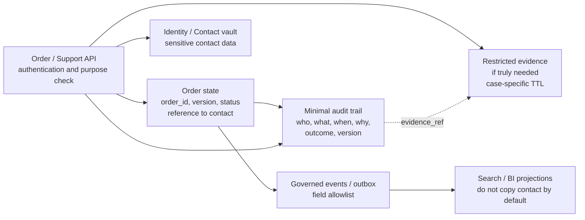
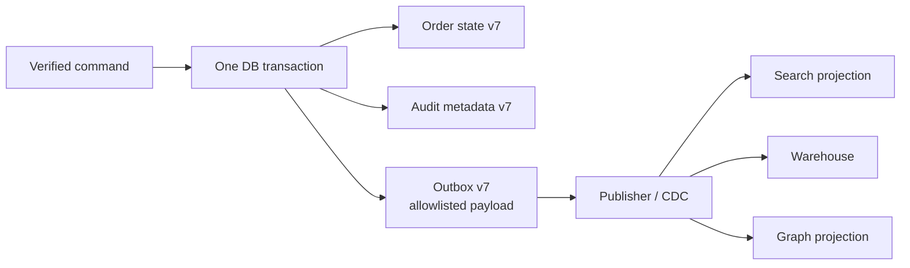

# Balancing Business Traceability with Sensitive Data Minimization

A customer requests to change their delivery phone number. The support team needs to prove **who requested the change, who processed it, when, through which business flow, and what the outcome was**. However, if the application puts the **old phone number, new phone number, delivery address, authentication token, and conversation content** into the audit log "just to make future investigations easier," the log becomes another store of sensitive data, widely replicated and potentially retained longer than the primary data.

The problem is not choosing between **tracing everything** and **keeping no trace at all**. Good design must determine **the minimum business evidence that must be kept**, **which detailed information belongs in a restricted evidence store**, **who has permission to link back to a real identity**, and **how long the data still needs to be retained**.

This is a lesson in the **Data Protection** chapter, part of the **DATABASE_DATA_MODELING** module. The module builds the ability to translate business requirements into entities, relationships, constraints, keys, indexes, and physical schemas; while also weighing relational, document, graph, and analytical models. Therefore, this lesson approaches traceability and data protection as **modeling and operational decisions**: what a record represents, which attributes it carries, whom it can be linked to, where it is copied, and how it is verified.

**Scope:** examples and retention periods in this lesson are purely hypothetical for learning purposes. Legal requirements on data protection, record retention, data subject rights, investigations, and audit obligations depend on jurisdiction, industry, contracts, and processing purposes. This lesson does not provide legal conclusions for any specific system.

After this lesson, you will be able to:

- Distinguish **business traceability**, **access logs**, **data lineage**, **transaction evidence**, and **state reconstruction capability**.
- Design a **minimal audit event** that still explains who did what, when, why, on which object, and with what outcome.
- Separate **identity vault**, **business state**, **audit metadata**, and **restricted evidence** by access scope and retention period.
- Understand why **pseudonymous codes, order IDs, correlation IDs, and hashes** can still relate to an individual.
- Choose appropriate controls for **PII in logs, CDC, outbox, search, analytics, graph, backups, and file exports**.
- Design updates, deletion/anonymization, retention, legal hold, tombstones, and replay so they do not accidentally resurrect restricted data.
- Test **traceability completeness** alongside **data minimization**, rather than optimizing only one side.

## 1. Why Do Traceability and Data Minimization Seem Contradictory?

Business teams typically need to answer:

1. When did order `O-101` transition from `CREATED` to `CONFIRMED`?
2. Which system or staff member executed it?
3. Did the command arrive from an API, a queue, or an administrative operation?
4. Which rule or policy version was applied?
5. Were there any subsequent incidents, corrections, or rollbacks?
6. Is the trace sufficient to reconcile transactions and explain incidents?

Data protection teams simultaneously need to ask:

1. What information is actually needed to answer those six questions?
2. Is it necessary to store the **old and new values** of the phone number, or only the category of field that changed?
3. Who is allowed to link `actor_ref` or `customer_ref` back to a person?
4. To which monitoring, log search, and service providers are log copies sent?
5. When there is no longer a valid purpose, under what obligation is the data deleted, restricted, or retained?
6. From an audit ID, to what extent can a viewer infer a customer's private history?

These two sets of questions are not mutually exclusive. **Good traceability means keeping exactly the necessary evidence; good minimization means eliminating the parts unnecessary for that purpose.**

### 1.1. "Audit" Does Not Mean Storing the Entire Payload

Consider the "update delivery phone number" business flow. There are three designs:

| Design | What is stored in audit | Benefits | Risks |
| --- | --- | --- | --- |
| **Full before/after** | Old and new phone numbers; request body; headers; tokens | Easy to reconstruct payload | Sensitive data is copied, logged long-term, and accessed by many people |
| **Timestamp only** | "Operation occurred at 10:00" | Minimal exposure | Insufficient to know the object, action, outcome, and accountability |
| **Controlled audit metadata** | Event ID, order ID, actor ref, action, field group, version, reason, outcome, time, evidence ref | Traces the business flow | Still contains indirect data; requires separate permissions, retention, and evidence |

The third design is usually better balanced **if the goal is only to prove the operation and its outcome**. However, for a dispute that requires proving **the exact value approved by the customer**, metadata may not suffice; in that case, store **separately protected detailed evidence** and only within the necessary scope and duration.

### 1.2. "Needed for Investigation" Does Not Mean "Retain Forever"

Data might be useful in a hypothetical investigation, yet that alone is not enough to justify retaining every payload indefinitely. It is necessary to define:

- **Specific investigation scenarios**, such as a delivery address dispute during the support window.
- **Minimum evidence**, such as confirmation timestamp, state version, and verification result.
- **Retention period**, specifying which event starts the clock and whether approved retention exceptions exist.
- **Access surface**, for example operations can view metadata while dispute handlers only view evidence for assigned cases.
- **Integrity verification methods**, preventing log tampering or evidence substitution.
- **Post-purpose behavior**, deleting, restricting, aggregating, or retaining a minimal record under applicable obligations.

## 2. Five Types of Data Often Mistaken for One "Audit Log"

### 2.1. Business Event — Business State-Change Event

For example, `OrderConfirmed`, `DeliveryContactChanged`, or `RefundApproved`. It indicates that **a change has been accepted within the business domain**.

Typical attributes:

```text
event_id
tenant_id
aggregate_type / aggregate_id
aggregate_version
event_type
occurred_at
actor_ref / actor_type
reason_code
outcome
policy_version
correlation_id
```

An event does not necessarily have to contain every field of the object. You must decide whether it is a **full-state snapshot** or a **delta**. If events are used to reconstruct full state, the design must address how to hold or reference sensitive information in a controlled way.

### 2.2. Access Log — Data Access Log

A request to read sensitive information, even if it **does not modify** business state, may still need to be recorded:

```text
actor_ref       = STAFF-PSEUDO-09
resource_type   = CustomerContact
resource_ref    = CONTACT-REF-01
action          = READ
purpose_code    = DELIVERY_SUPPORT
decision        = ALLOW
accessed_at     = ...
request_id      = ...
```

This log proves **who accessed which resource for what purpose according to the system**. It does not necessarily need to contain **the phone number that was read**. To evaluate authorization, it may be necessary to distinguish **the access request**, **the authorization decision**, and **whether data was actually delivered successfully**.

### 2.3. Data Lineage — Data Origin and Transformation Process

A `fraud_review_score` field may be computed from multiple sources. Lineage records:

```text
dataset/source version
pipeline run
transformation/model version
input time window
output data asset
quality and validation status
```

Lineage shows **how a value was produced**, not proof that a staff member clicked an approval button. It may contain IDs or links to individuals and therefore also requires classification and access control.

### 2.4. Evidence — Detailed Evidence

For example, a payment voucher, a delivery confirmation, or a document provided by a customer to resolve a dispute. This data may contain **contact information, signatures, addresses, conversation content**, and other attributes requiring high protection.

**Do not cram evidence into every business event**. A metadata record can hold an `evidence_ref` pointing to a separate store with its own approval policy, retention period, and access audit.

### 2.5. Operational Logs — Operational Logs

HTTP logs, traces, exceptions, metrics, and debug logs are typically intended for **observing system health**. They do not automatically become a trustworthy audit trail simply because they are written to disk. They may be sampled, dropped under overload, change format, have short retention, or only reflect intended outcomes prior to transaction commit.

For example, `"Attempting to confirm order"` in an application log **does not prove** the order transitioned to `CONFIRMED`. To prove a committed change, the audit must be tied to **the actual outcome of the transaction** or an equivalent reliable mechanism.

## 3. Analyzing Personal Data Inside a Traceability System

### 3.1. Indirect Identifiers Can Still Be Personal Data

An audit event that contains no email, yet has:

```text
tenant_id = T-01
order_id = O-101
customer_ref = C-014
actor_ref = STAFF-PSEUDO-09
request_id = REQ-... 
```

A system can join `order_id` to an order, from the order to a customer, and from `actor_ref` to a staff member. **Not storing a direct name does not mean a log is anonymized.** Permissions to JOIN or resolve linkage mappings must be controlled.

Furthermore, an audit trail tied to staff members can be data about **an individual's work activities**. Data protection applies not only to customers, but also to employees, partners, delivery recipients, and other identifiable individuals.

### 3.2. Correlation ID and Request ID Are Also Linkage Paths

`correlation_id` helps link events across APIs, message brokers, and pipelines. If an ID is stable and reused across multiple systems or sessions, it can enable behavioral profiling. Do not use account IDs, emails, or login session tokens **in raw form** as a correlation ID.

Generating random or opaque IDs reduces direct identifier exposure, but **the ability to link records** still exists. Logs and tracing must therefore be governed as data assets that can relate to individuals.

### 3.3. Hashes and Tokens Do Not Automatically Make Data Anonymous

Hashing an email with a standard algorithm does not prove the information is anonymized: emails can be guessed from common value sets, or the hash can be used as a linkage key across multiple sources.

Options carry trade-offs:

| Technique | Utility | What it does not automatically guarantee |
| --- | --- | --- |
| **Random opaque reference** | References a record without carrying raw content | Does not prevent internal mapping from recovering identity |
| **Tokenization** | Isolates identity mapping in a restricted vault | Tokens can still be linked to the same person |
| **Keyed HMAC** | Consistent verification/matching if properly designed | Still linkable; depends on key protection |
| **Encryption** | Restricts reading values without the key | Does not govern usage permissions after decryption |
| **Hash chain** | Helps detect tampering in a sequence of records | Does not prove the original source data was accurate |
| **Anonymization** | Aims to reduce practical identifiability | Not achieved merely by removing names or hashing one column |

If a digest is taken over highly predictable data, such as a status with only `PAID/PENDING` or a phone number from a narrow set, **an unkeyed hash** can reveal the value via guessing attacks. When the goal is merely to prove **that a group of fields changed**, you may **not need to store any digest of the sensitive value at all**.

### 3.4. Inferred Data in Audits Also Requires Protection

A record like `"RISK_REVIEW_SCORE_CHANGED"` can reveal that a person underwent risk review, even without containing the score itself. The level of protection depends on purpose, impact, and linkability. Audit events may require a **generic `event_type`**, restricted permissions, or split facts so private inferences are not exposed to operations teams who have no need to know.

## 4. Building a Traceability Contract from Business Requirements

Do not pick log columns by "copying the whole object." Start from the **audit questions**.

| Question to answer | Minimum evidence typically needed | Are raw PII values needed? |
| --- | --- | --- |
| Did the order status change? | Aggregate key, version, before/after **status code**, commit time | Usually no |
| Who approved the refund? | Actor ref, role/permission at approval time, action, decision, reason, version | Usually no name/email needed in every event |
| Who viewed the phone number? | Actor ref, resource ref, action, purpose, policy decision, timestamp | No phone number needed in the access log |
| Did the customer confirm the new phone number? | Verification workflow, confirmation time, controlled evidence ref | May need separate evidence for a valid retention window |
| Which interface originated the change? | Request/correlation ID, source service, command ID, time | Full request body not needed |
| Why was a feature generated? | Dataset/model version, input window, run ID, approved purpose | Metadata is usually sufficient; input details must be restricted |
| In which copies was data deleted/restricted? | Deletion request ID, scope, consumer acknowledgments, watermarks | Can keep a restricted reference token; no need to keep deleted content |

**A good audit contract also explicitly states what MUST NOT be recorded:** passwords, bearer tokens, secret keys, unfiltered free-text content, raw phone numbers, full addresses, or raw payloads when not strictly necessary.

### 4.1. Classifying Evidence Tiers

Requirements can be divided into three tiers:

- **Tier A — business metadata:** who/object/action/time/outcome/version/purpose. Preferred by default.
- **Tier B — bounded facts:** status values, changed field group, monetary amount and currency under authorization; stored only if needed for explanation or reconciliation.
- **Tier C — sensitive evidence:** documents, payloads, identifying data, or high-impact records; stored separately with explicit justification, permissions, and retention.

"Tier A" is **not public**. Even metadata can link back to individuals; it simply exposes less content than the other tiers.

### 4.2. Distinguishing Actor, Subject, and Recipient

An address-change action may involve:

- **Actor:** the support agent or the customer submitting the command.
- **Subject:** the person whose data is being modified.
- **Business object:** the affected order.
- **Recipient:** the delivery recipient, who may differ from the buyer.
- **Approver:** the person approving a sensitive action.

Do not collapse all of these into `user_id` when their meanings differ. An audit event recording `actor_ref` without a subject makes auditing impact on individuals difficult if the business requires it. Conversely, embedding full names of every role into the event increases redundant data; use **scoped references and protected mappings** where appropriate.

## 5. End-to-End Example: Updating Delivery Information for Order O-101

Suppose an e-commerce system has these requirements:

1. Customer C-014 places order `O-101`.
2. Support agent S-09 processes a request to change the recipient's phone number.
3. The system must record **who, why, when, which verification steps passed, and the outcome**.
4. If a dispute arises within an approved timeframe, a dedicated team can inspect the evidence.
5. Contact information must not automatically flow into logs, search, analytics, or general audits.
6. Once the purpose and retention period expire, there must be a properly scoped deletion/restriction policy that does not break necessary transaction record keeping.

### 5.1. Four Data Zones



**Authoritative owners**:

- `Order Service` owns order state and version.
- `Contact/Profile Service` manages contact values, verification policy, and read permissions.
- `Audit service/transaction` holds metadata for committed actions.
- `Restricted evidence store` stores specific evidence according to defined purpose, permissions, and retention.
- Search/warehouse are **derived projections**, do not own contact values, and must not implicitly reconstruct sensitive fields.

This separation is a **reference model**, not a mandate for four physical databases. It can be implemented as separate schemas, tables, keyspaces, access controls, and encryption keys as long as control boundaries are genuinely enforced.

### 5.2. Record Grain for Each Data Asset

| Data Asset | Grain | Key | Attributes to note |
| --- | --- | --- | --- |
| `orders` | One current order | `(tenant_id, order_id)` | `version`, status, contact reference |
| `contact_records` | One governed contact profile or contact version | `(tenant_id, contact_ref)` | Actual info, retention, status, permissions |
| `order_audit_event` | One **accepted** business change of one order | `(tenant_id, event_id)` | aggregate version, actor ref, reason, outcome |
| `data_access_audit` | One access attempt or access decision per contract | `(tenant_id, access_event_id)` | actor, resource, purpose, decision |
| `restricted_evidence` | One managed evidence artifact | `evidence_ref` | evidence type, encrypted object ref, retention |
| `order_search_projection` | One order index document | `(tenant_id, order_id)` | allowlisted fields only, source version |
| `deletion_work_item` | One restriction/deletion action for one target asset | `(request_id, destination)` | scope, status, completion evidence |

Keys enable tracing across components, but **permissions to JOIN and decrypt mappings must be restricted**. A table containing multiple pseudonymous codes can still be personal-related data.

### 5.3. Updating Contact Does Not Have to Copy Old Values Into the Audit

Example metadata:

```json
{
  "eventId": "4b32fd40-b111-4e68-8b25-005100000001",
  "tenantId": "T-01",
  "aggregateType": "Order",
  "aggregateId": "O-101",
  "aggregateVersion": 7,
  "eventType": "DELIVERY_CONTACT_UPDATED",
  "fieldGroup": "DELIVERY_CONTACT",
  "actorType": "STAFF",
  "actorRef": "STAFF-REF-09",
  "purposeCode": "ORDER_SUPPORT",
  "reasonCode": "CUSTOMER_VERIFIED_REQUEST",
  "policyVersion": "support-policy-v3",
  "outcome": "COMMITTED",
  "occurredAt": "2026-10-01T10:00:00Z",
  "correlationId": "REQ-RANDOM-01",
  "evidenceRef": "EV-CASE-01"
}
```

This payload **does not contain the old or new phone number**, address, authentication credentials, or login token. `evidenceRef` can only be dereferenced through the evidence store's policy; it is not a public URL.

The event above proves **an accepted change to the contact information group occurred**, with recorded actor and reason. It **does not allow recovering the old phone number**, which is an intentional boundary. If the business is obligated to retain old/new values for a specific period, it must design a **restricted evidence store**, rather than turning the general audit into a permanent copy of sensitive data.

### 5.4. Two Query Flows with Different Permissions

Standard operational flow:

```text
Support ticket -> order_id -> audit event metadata
               -> actor/purpose/version/outcome
Does not read contact value or evidence content
```

Approved investigation flow:

```text
Case assignment + verified purpose + policy decision
    -> audit event -> evidence_ref
    -> restricted evidence store
    -> decrypt/view only approved fields
    -> access log for evidence read
```

Thus, **permission to view metadata does not imply permission to view evidence**. The system must log the act of viewing evidence itself, avoiding a setup where "the audit log is freely accessible because it is for auditing."

## 6. Illustrative Relational Schema Design

The examples below use **PostgreSQL** at a conceptual level. They are not sufficient to replace authentication, key security, authorization, or legal policies. All IDs and timestamps are hypothetical.

### 6.1. Business and Audit Metadata Tables

```sql
CREATE TABLE orders (
    tenant_id VARCHAR(32) NOT NULL,
    order_id VARCHAR(64) NOT NULL,
    version BIGINT NOT NULL DEFAULT 1,
    status VARCHAR(30) NOT NULL,
    contact_ref VARCHAR(100),
    currency_code CHAR(3) NOT NULL,
    total_minor BIGINT NOT NULL,
    updated_at TIMESTAMPTZ NOT NULL,
    PRIMARY KEY (tenant_id, order_id),
    CHECK (version > 0),
    CHECK (total_minor >= 0)
);

CREATE TABLE order_audit_event (
    tenant_id VARCHAR(32) NOT NULL,
    event_id UUID NOT NULL,
    order_id VARCHAR(64) NOT NULL,
    order_version BIGINT NOT NULL,
    event_type VARCHAR(80) NOT NULL,
    field_group VARCHAR(80),
    actor_type VARCHAR(32) NOT NULL,
    actor_ref VARCHAR(100) NOT NULL,
    purpose_code VARCHAR(80) NOT NULL,
    reason_code VARCHAR(80),
    policy_version VARCHAR(80) NOT NULL,
    outcome VARCHAR(30) NOT NULL,
    correlation_id VARCHAR(100),
    evidence_ref VARCHAR(100),
    occurred_at TIMESTAMPTZ NOT NULL,
    recorded_at TIMESTAMPTZ NOT NULL DEFAULT CURRENT_TIMESTAMP,

    PRIMARY KEY (tenant_id, event_id),
    UNIQUE (tenant_id, order_id, order_version),
    CHECK (order_version > 0),
    CHECK (outcome = 'COMMITTED')
);

CREATE INDEX order_audit_by_object_time_idx
    ON order_audit_event
    (tenant_id, order_id, order_version);
```

**Very important assumption:** every increment of `orders.version` in this example produces **exactly one business audit event**. That is why `UNIQUE(tenant_id, order_id, order_version)` exists. If one version can have multiple independent events or multiple entities change together, you must **define a different grain/key**; do not let this constraint silently drop valid events.

The column `outcome = COMMITTED` stores only **committed actions**. Requests that are **rejected**, **fail authentication**, or are **denied by policy** can be recorded in a separate **security/access audit** with its own schema, retention, and permissions. Do not put `DENIED` into the same log and misinterpret it as an actual state change of the order.

`contact_ref` on `orders` is an indirect identifier that can point to sensitive information; the orders table still requires properly scoped access permissions. Indexes aid querying by ID, **not security**.

### 6.2. Separating the Evidence Store with Metadata and Retention

```sql
CREATE TABLE restricted_evidence_index (
    tenant_id VARCHAR(32) NOT NULL,
    evidence_ref VARCHAR(100) NOT NULL,
    case_ref VARCHAR(100) NOT NULL,
    object_storage_ref VARCHAR(300) NOT NULL,
    evidence_type VARCHAR(80) NOT NULL,
    purpose_code VARCHAR(80) NOT NULL,
    retention_policy_id VARCHAR(80) NOT NULL,
    retention_due_at TIMESTAMPTZ,
    hold_status VARCHAR(24) NOT NULL DEFAULT 'NONE',
    created_at TIMESTAMPTZ NOT NULL,
    created_by_ref VARCHAR(100) NOT NULL,
    PRIMARY KEY (tenant_id, evidence_ref),
    CHECK (hold_status IN ('NONE', 'APPROVED_HOLD'))
);
```

This table **does not store raw contact data**; evidence content resides in object storage protected by appropriate permissions and encryption. `object_storage_ref` also needs protection: it is a reference to data and can leak sensitive paths if poorly designed; never use URLs containing long-lived access tokens as the indexed value.

Declaring `retention_due_at` **does not automatically delete data**. An approved execution job/workflow with reconciliation is required; at the same time, **different retention periods across business records, audit metadata, and evidence** must be accounted for, with special handling for `APPROVED_HOLD`.

### 6.3. Access Audit Table for Restricted Data

```sql
CREATE TABLE data_access_audit (
    tenant_id VARCHAR(32) NOT NULL,
    access_event_id UUID NOT NULL,
    actor_ref VARCHAR(100) NOT NULL,
    resource_type VARCHAR(80) NOT NULL,
    resource_ref VARCHAR(100) NOT NULL,
    action_code VARCHAR(32) NOT NULL,
    purpose_code VARCHAR(80) NOT NULL,
    policy_version VARCHAR(80) NOT NULL,
    decision VARCHAR(16) NOT NULL,
    accessed_at TIMESTAMPTZ NOT NULL,
    request_id VARCHAR(100),
    PRIMARY KEY (tenant_id, access_event_id),
    CHECK (decision IN ('ALLOW', 'DENY'))
);
```

This record describes a **logged access decision**, which does not by itself guarantee accurate recording of **bytes returned**, **who actually consumed the content**, or **what information was exported**. If auditing requirements distinguish `AUTHZ_DECISION` from `DATA_DELIVERED`, the schema/event types must represent both stages.

In particular, `DENY` must be logged through an appropriate channel without exposing sensitive payloads from the rejected request.

### 6.4. Do Not Use an `audit_payload JSONB` Column as a Backdoor

A table with a free-form `payload JSONB` column allowing any service to push arbitrary objects will quickly accumulate phone numbers, addresses, tokens, or request bodies. If extensible metadata is needed, use a **controlled schema with a field allowlist and automated validation**, rejecting unknown keys by default.

Example allowlist:

```text
allowed:
  order_id, event_type, aggregate_version,
  actor_ref, purpose_code, reason_code,
  field_group, policy_version, outcome,
  correlation_id, evidence_ref, occurred_at

not allowed in general audit:
  old_phone, new_phone, full_address,
  authorization_header, access_token,
  full_request_body, identity_document,
  raw_health_detail, unrestricted_notes
```

Even `free_text_reason` can be filled with personal data by users. Use a **cataloged reason code**, opening free-text notes only where a dedicated policy exists if needed.

## 7. Tying Audits to Actually Committed Transactions

### 7.1. Why Logging Outside the Transaction Easily Breaks

Two separate operations:

```text
1. UPDATE orders SET contact_ref = ...
2. INSERT audit_event ...
```

If updating the order succeeds but the process crashes before step 2, **data changed without an audit trail**. If the audit is written first and the `UPDATE` rolls back, **the audit claims a change occurred when the source did not change**.

For changes within the **same database**, state and audit events can be written in **one transaction**. If a change spans an external contact vault or multiple services, a local transaction **is not enough** to guarantee everything is atomic together; you need events/outbox, a stateful workflow, idempotency, and reconciliation.

### 7.2. Example Versioned Update and Audit in One Transaction

Suppose the API has already verified the staff member, purpose, and customer request; the new `contact_ref` is issued by the contact management service. The transaction updates only the **reference**, without containing the actual phone number.

```sql
BEGIN;

WITH changed AS (
    UPDATE orders
       SET contact_ref = :new_contact_ref,
           version = version + 1,
           updated_at = CURRENT_TIMESTAMP
     WHERE tenant_id = :tenant_id
       AND order_id = :order_id
       AND version = :expected_version
    RETURNING tenant_id, order_id, version, updated_at
),
audit_written AS (
    INSERT INTO order_audit_event (
        tenant_id, event_id, order_id, order_version,
        event_type, field_group,
        actor_type, actor_ref,
        purpose_code, reason_code, policy_version,
        outcome, correlation_id, evidence_ref, occurred_at
    )
    SELECT
        tenant_id, :event_id, order_id, version,
        'DELIVERY_CONTACT_UPDATED', 'DELIVERY_CONTACT',
        'STAFF', :verified_actor_ref,
        'ORDER_SUPPORT', :approved_reason_code,
        :policy_version,
        'COMMITTED', :correlation_id,
        :evidence_ref, updated_at
    FROM changed
    RETURNING event_id
)
SELECT COUNT(*) AS committed_audit_rows
FROM audit_written;

-- The application must verify committed_audit_rows = 1.
-- If 0, handle not-found/version conflict; do not report success.
-- The application COMMITs only when the check passes; otherwise ROLLBACK.
-- Do not auto-COMMIT in this example.
```

In real application code, **never COMMIT unconditionally** as if running the example line by line. You must verify row counts and business conditions before committing; otherwise `ROLLBACK`. The SQL above illustrates **same-transaction** writing and optimistic concurrency, not a complete stored procedure with error branches.

This mechanism gives audit metadata visibility into the same transaction as `orders`; it does not by itself prove the external evidence artifact already exists or is valid. If the workflow requires evidence, its existence and linkage state must be confirmed and managed according to the designed workflow.

### 7.3. Retries and Idempotency

An API or consumer may receive the same command again. A stable `event_id` and `order_version` prevent duplicate writes, yet **a retry** might encounter an already incremented `version` and return "conflict" even though the previous attempt succeeded. If the contract requires retries to return the prior result, you need a `command_id/idempotency_key` and a **command-result table** or reliable lookup mechanism, rather than relying solely on `event_id`.

Never let a retry produce an additional `"COMMITTED"` audit event when no source change occurred. Nor should a business failure be called "confirmed" simply because an earlier log recorded an "attempt."

### 7.4. Outbox and Audit Serve Two Different Needs

**Audit events** trace committed activities. **Transactional outbox** delivers changes to consumers through a retryable publishing path.



When the same transaction produces both audit and outbox records, downstream copies can update from a single versioned change. However, **outbox does not guarantee exactly-once delivery to every consumer**: duplicate publishes can happen, or a consumer may write without acknowledging. Projections must handle duplicates and out-of-order delivery using `event_id`, `aggregate_version`, or an appropriate strategy.

An outbox event **does not need to carry full evidence**. Publish only fields consumers are permitted to receive; a consumer needing additional restricted information must call a policy-enforced service rather than using the broker as an expanded PII store.

## 8. What Can Be Queried When the Audit Holds Only Metadata?

### 8.1. Tracing the Business Change Sequence

```sql
SELECT
    order_version,
    event_type,
    field_group,
    actor_type,
    actor_ref,
    purpose_code,
    reason_code,
    policy_version,
    outcome,
    occurred_at,
    recorded_at,
    evidence_ref
FROM order_audit_event
WHERE tenant_id = :tenant_id
  AND order_id = :order_id
ORDER BY order_version;
```

This query establishes **the order of changes by version**. `occurred_at` and `recorded_at` may differ due to latency; do not replace version with timestamps alone to determine authoritative ordering. For multi-source events, ordering must be tracked per aggregate/source; Order `version 7` cannot be compared directly against Customer version.

This is a **metadata query** and does not verify whether the caller is authorized to view the audit. The backend must enforce tenant isolation, purpose, and permissions for staff/customer-related data; never let clients supply `actor_ref` or `tenant_id` arbitrarily to receive all logs.

### 8.2. Checking for Gaps in the Audit Sequence

Suppose the contract specifies that from `version = 1` to the current version, each version must have exactly one committed event. You can run a check:

```sql
SELECT
    o.tenant_id,
    o.order_id,
    o.version AS current_version,
    COUNT(a.event_id) AS audit_event_count,
    MIN(a.order_version) AS first_audit_version,
    MAX(a.order_version) AS last_audit_version
FROM orders AS o
LEFT JOIN order_audit_event AS a
  ON a.tenant_id = o.tenant_id
 AND a.order_id = o.order_id
WHERE o.tenant_id = :tenant_id
GROUP BY o.tenant_id, o.order_id, o.version
HAVING COUNT(a.event_id) <> o.version
    OR MIN(a.order_version) IS DISTINCT FROM 1
    OR MAX(a.order_version) IS DISTINCT FROM o.version;
```

This example checks **under the assumption that versions start at 1 and every version has one event**, including the initial creation event. If the system imported legacy data with baseline `version 20` or auditing only began after a certain date, this condition is **inappropriate** for historical records and must use a recorded `audit_baseline_version`.

Checking counts and versions **does not prove event content is accurate**. Evidence might still be missing, an actor misattributed, or changes might bypass the command path; additional transaction, policy, and reconciliation checks are needed.

### 8.3. Access Logs Must Record Evidence Usage

```sql
SELECT
    actor_ref,
    resource_type,
    resource_ref,
    action_code,
    purpose_code,
    decision,
    policy_version,
    accessed_at
FROM data_access_audit
WHERE tenant_id = :tenant_id
  AND resource_type = 'RESTRICTED_EVIDENCE'
  AND resource_ref = :evidence_ref
ORDER BY accessed_at;
```

This log shows access decisions related to the evidence, but if there is a requirement to prove whether content was **successfully delivered**, more granular access events are needed. An `ALLOW` log does not automatically mean the user read the entire document, nor is it proof that the document was exfiltrated.

### 8.4. Proving "Deleted" Does Not Mean Keeping the Deleted Data

A deletion manifest may contain:

```text
deletion_request_id
subject_ref (in protected zone)
scope + purpose
approved_policy_version
target_asset
processed_at
result_status
consumer_watermark
verification_run_id
exception_or_hold_code
```

This metadata helps explain the execution process. It **does not need to copy the restricted phone number or profile content**. Even so, `subject_ref` and `target_asset` can still be indirect identifiers, so the manifest must remain subject to appropriate retention and access controls.

## 9. Audit Integrity and Limits of Cryptographic Techniques

If someone with arbitrary write access can alter audits to cover their tracks, traceability is untrustworthy. Controls should match the threat model:

- Separate business write privileges, audit storage privileges, and evidence store administration privileges.
- **Append-only** or WORM (*write once, read many*) policies where appropriate.
- Backups, independent storage, and versioned immutability checks.
- Digital signatures, MAC/HMAC, hash chains, or Merkle commitments when integrity requirements demand them.
- Protected keys and administrative privileges; rotation, revocation, and access auditing.
- Detection of gaps, unauthorized modifications, or late-arriving records.
- Post-incident recovery and reconciliation mechanisms.

### 9.1. Under What Conditions Does a Hash Chain Detect Tampering?

A conceptual scheme:

```text
H_0 = trusted_anchor
H_i = H( H_(i-1) || canonical_event_i )
```

If someone alters an event, subsequent hash values will diverge **if the chain is verified against a trusted anchor**. However:

- Anyone with permission to rewrite the entire chain **and the anchor** can forge a new chain if there is no independent anchor/trust boundary.
- A hash does not prove the original event reflected a genuine business change.
- A hash does not inherently provide confidentiality; hashed metadata or payloads can still be linked to individuals.
- Hashes of low-entropy data can be guessed; never assume a digest is safe for PII.
- Without a signing key, a hash chain does not itself prove **who** wrote the entry.
- A single global chain in a distributed system incurs ordering overhead; you must define chain scope or checkpoint mechanisms.

Therefore, **tamper-evidence is distinct from privacy and distinct from business correctness**.

### 9.2. Digital Signatures and Rights to Rectify/Delete Can Coexist

If provenance must be proven, **carefully designed metadata or commitments** can be signed. If sensitive content must be deleted after a retention window, separate sensitive payloads from retained metadata and avoid assuming that a permanent digest of PII is always safe.

One strategy is to sign **event manifests with restricted identifiers** and store encrypted evidence under its own retention period. Once the evidence expires, the remaining audit confirms "evidence existed according to procedure" without allowing content recovery. This is an **intentional trade-off**, not a system bug.

### 9.3. Encryption and Conditional Crypto-Shredding

If evidence is encrypted with a per-object or per-scope key, destroying that key (*crypto-shredding*) can render the encrypted content unreadable **to the extent that all copies of the ciphertext depend solely on the destroyed key**.

Never claim "completely deleted" solely because a key was destroyed if:

- Plaintext copies exist in logs, caches, exports, search indexes, or temporary files.
- Backups of the key or decrypted copies exist.
- Data was transformed into features capable of revealing the original content.
- Remaining metadata still identifies individuals beyond the valid purpose.
- Another key in the system can still decrypt it.

Crypto-shredding is **one tool in a data minimization strategy**, not a substitute for copy inventory and completion verification.

## 10. Designing Retention by Data Type and Trigger Event

### 10.1. Do Not Apply a Single TTL Across the Entire System

An illustrative policy (figures are **examples, not legal requirements**):

| Asset | Purpose | Retention trigger | Example retention | Cases requiring review |
| --- | --- | --- | --- | --- |
| Request/debug log | Short-term incident debugging | Time of occurrence | 14 days | Ongoing incident investigation |
| Contact snapshot for delivery | Fulfillment/support completion | Upon delivery completion | 30 days after trigger | Open complaint |
| Dispute restricted evidence | Reviewing a specific claim | Upon case closure | 90 days after trigger | Approved hold |
| Order audit metadata | Tracing transaction changes | Upon order closure/completion | Per business schedule and applicable obligations | Audit, disputes, retention |
| Person-linked analytics features | Purpose-bound analytics | Recompute/end of use | Per feature contract | Model review, related rights |
| Backup | System recovery | Backup cycle | Per backup policy | Does restore reapply deletions? |

Retention periods must be established based on **purpose, obligations, and recoverability**; some data must be kept longer, other data must be purged sooner. Choosing `14/30/90 days` here only illustrates **different tiers having different lifetimes**, not default recommendations.

### 10.2. Retention Must Have a Trigger and Stopping Rules

A policy clearer than "keep for two years":

```text
asset: restricted_delivery_evidence
purpose: DELIVERY_DISPUTE_HANDLING
start_event: dispute_case_closed
retention_duration: policy_specific_duration
access: approved_case_reviewers_only
deletion: purge ciphertext and eligible derivatives
exceptions: documented legal/regulatory hold
owner: privacy_and_dispute_team
verification: deletion job + reconciliation
```

If `start_event` is undefined, systems may mistakenly use `created_at`, `last_updated_at`, or `case_closed_at` and delete too early or too late. If a field is retained to satisfy two independent obligations, overlaps must be evaluated and **permission for purpose A must not implicitly extend to purpose B**.

### 10.3. Holds Must Not Become an Excuse for Indefinite Storage

A **legal/regulatory hold** or procedural evidence preservation order must specify:

- Specific target/scope.
- Authorized approver.
- Justification and start timestamp.
- Review/termination conditions.
- Narrowed access permissions during the hold.
- Audit trail when placing, extending, and releasing the hold.

A hold does not mean every employee may read the evidence or keep extra copies outside the system.

### 10.4. "Deleting Source Data" May Be Invalid or Insufficient

When a user requests data restriction or deletion, distinguish between:

1. **Information that can be deleted immediately** because no purpose or retention obligation remains.
2. **Information that must be retained with limits** under applicable obligations and restricted in access/use.
3. **Information that is de-identified/anonymized** if the method and assessment genuinely meet requirements.
4. **Derived data** that must be deleted, invalidated, or recomputed.
5. **Backups** that must follow recovery policies and reapply deletions within feasible/required scope.

There is no single legal answer for all situations; the data model's job is to **enable identifying and enforcing the right approved decision**.

## 11. Copies, CDC, Outbox, Caches, and Backups Can Leak Data

### 11.1. Data Copy Inventory Must Record Both Fields and Purpose

A data flow diagram is insufficient if it only draws an arrow "database → warehouse." You must maintain an inventory:

| Copy | Fields it may contain | Allowed to read identity? | Timing/refresh | Update/deletion handling |
| --- | --- | --- | --- | --- |
| Orders OLTP | order, contact ref | Via backend command | Realtime | Source-of-truth workflow |
| Identity/contact vault | raw contact | Highly restricted | Per business flow | Authoritative policy |
| Outbox/stream | event ID, allowed metadata | Not by default | Per log retention | Tombstone and policy-compliant purge |
| Search | order ID, status, field allowlist | Raw contact not needed | Async | Versioned delete/redaction |
| Warehouse | fact, dimension, pseudonym | Per data product | Batch/CDC | SCD, retention, erasure map |
| Graph projection | customer/order/device relation | Indirect linkage | Async | Delete edges, audit graph |
| Cache | Query/API results | Depends on cache key and scope | TTL/invalidate | Invalidate/rekey |
| Monitoring/logs | request ID, actor ref | Linkable | Streaming | Redaction/short retention |
| Backup/archive | Data/key snapshots | Per recovery procedure | Backup schedule | Reapply deletion on restore |

A **field allowlist** per consumer reduces risk better than "copy all columns and hide them in the UI." Access controls must be enforced at storage and API layers, not only in the UI.

### 11.2. Event Replay Can Resurrect Restricted Data

Scenario:

```text
v11: ContactUpdated(new_value_ref)
v12: ContactRedacted
Consumer applies v12, removes info
Later, delayed replay of v11 arrives
```

If the consumer only checks event type without storing a **version or marker**, it may recreate old data.

Solutions typically include:

- **Versioned tombstone/redaction marker**.
- Consumers only applying newer versions within the exact aggregate/source scope.
- Snapshots/rebuilds carrying a **watermark** and reapplying active deletion/restriction decisions.
- Mechanisms preventing old events from overwriting redacted fields even if old payloads remain in the broker.
- Reviewing event stream retention so sensitive content does not persist longer than necessary.

`aggregate_version` is ordered only within **one change stream of the exact aggregate/owner**. Do not compare Contact version 12 with Order version 12 as if they were equivalent.

### 11.3. Restoring a Backup Can Violate New Deletion Decisions

Suppose the system restores a backup **taken before a deletion request was processed**. Deleted records may reappear in the restored database. The backup plan must specify:

1. Restored data is quarantined before access is permitted.
2. Active deletion/redaction lists are preserved and can be reapplied.
3. Keys/policies/consumers are synchronized to the correct versions.
4. Reconciliation runs before reopening the system to users.
5. Unresolvable exceptions and responsible owners are documented.

Without a restore procedure, the promise "deleted at the source" may hold only for the live database, not for the full data lifecycle.

## 12. Controlling Access to Audits and Evidence

### 12.1. Do Not Create an `AUDIT_ADMIN` Role with Full Access to Everything

Access control should reflect **purpose and accountability**:

| Role/task | Allowed to view | Should not view by default |
| --- | --- | --- |
| Order support | Status, minimal audit events for the case | Sensitive evidence content of all customers |
| Process auditor | Change sequence, policy version, outcome, actor ref | Phone numbers, tokens, request bodies |
| Assigned investigator | Case evidence, per approval | Unrelated profiles |
| Data engineer | Schema/quality/lineage/metrics | Real identities or private content |
| Security incident responder | Metadata, case-granted evidence | Unrestricted access outside investigation scope |
| Analytics | Approved facts/aggregates/features | Contact values or pseudonym mapping tables |
| Infrastructure operations | Minimal system logs | Business evidence read access merely from operating servers |

Use **RBAC** for baseline roles and **ABAC** for purpose, case assignment, tenant, time, sensitivity, and approval state. A policy decision point must evaluate **runtime conditions**, not just role names. Technical administrator privileges must be restricted, monitored, and segregated by risk.

### 12.2. Column-Restricted Views Are One Layer, Not the Whole Policy

```sql
CREATE VIEW order_audit_summary AS
SELECT
    tenant_id,
    order_id,
    order_version,
    event_type,
    field_group,
    actor_type,
    purpose_code,
    reason_code,
    outcome,
    occurred_at
FROM order_audit_event;
```

This view **omits `actor_ref`, `evidence_ref`, and `correlation_id`** to reduce exposure on certain dashboards. However, `order_id` can still link to a person, and SQL views do not automatically enforce tenant isolation. You must:

- Revoke direct read permissions on the base table from roles that only need the view.
- Ensure the backend derives tenant and purpose from authenticated context.
- Use row-level policies or API filtering that clients cannot arbitrarily override.
- Check permissions on other mapping tables to prevent bypassing via JOINs.
- Audit export privileges and bulk access.

With PostgreSQL Row-Level Security or session context, untrusted SQL users must never be allowed to set `tenant_id` themselves to read another tenant's data. Roles with `BYPASSRLS` and connection pooling behavior must also be evaluated separately.

### 12.3. Break-Glass Access Requires Approval and Its Own Trail

An emergency procedure may allow bypassing standard evidence access paths during an incident, but it requires:

- Identifying the incident, requester, and approver.
- Scoping privileges narrowly by resource, duration, and purpose.
- Auditing access and actions taken once granted.
- Post-incident notification/review per policy.
- Automatic revocation when the window expires.
- Protecting the break-glass audit itself against unauthorized modification or deletion.

Never build an unlogged "bypass authorization button" for troubleshooting or operational convenience.

## 13. Balancing Traceability with Data Reconstruction

### 13.1. Audit Logs Are Not Identical to Event Sourcing

**Minimal audit logs** answer: what changed, by whom, when, under which rule. They may **not hold enough data to reconstruct full state**.

**Event sourcing** stores the event sequence as the source of state. If every event embeds full PII to rebuild historical state, restriction/deletion requests become harder. Consider:

- Keeping raw PII out of long-lived event streams.
- Storing **references to a restricted data vault** along with versioning/retention mechanisms.
- Separating business-meaningful events from time-bounded payloads.
- Using controlled encryption/key separation when evidence must be retained.
- Managing snapshots, redaction events, and replays so data is not re-exposed.
- Documenting the boundary: once evidence is deleted, **historical values cannot all be reconstructed**; that may be the intended design requirement.

Never claim "event sourcing guarantees data erasability" or "event sourcing inevitably violates erasure rights": both are oversimplifications. You must examine **payloads, keys, copies, policies, and reconstruction needs**.

### 13.2. Bitemporal/History Models Do Not Imply Keeping PII Forever

A bitemporal model may track:

- **Valid time:** when was the fact effective in the business domain?
- **System/record time:** when did the system learn and record that version?

This helps trace retroactive corrections. Yet keeping every version of sensitive information forever is not automatically justified merely because the system is bitemporal. You can retain **business status history**, **change metadata**, and **sensitive evidence under different retention periods**.

### 13.3. Business Values and Evidence Can Have Different Retention Periods

Example:

```text
Order.status transition: needed to audit order lifecycle
Changed field group: DELIVERY_CONTACT
Contact value old/new: only needed for substantiated disputes
Access log: needed to investigate who viewed evidence
Evidence content: retained per case-specific policy
```

Not all of these components need the **same retention period**. Conversely, evidence deletion should be honestly reflected in metadata so viewers understand why old values can no longer be recovered.

## 14. Traceability Across Relational, Document, Graph, and Analytical Models

### 14.1. Relational

**Strengths:** transactional tables have keys, foreign keys, transactions, versions, and indexes; easy to write audit metadata in the same transaction within one database.

**Watch out for:** normalization does not automatically protect data. `customer_id` on `orders` can still JOIN to contact, audit, and features. Schema separation, column/row permissions, and mapping controls must be applied.

A change spanning **multiple databases/services** is not guaranteed atomic by a single-table transaction; it requires workflows with durable events and reconciliation.

### 14.2. Document

An `OrderDocument` may embed a contact snapshot for fast display, which also duplicates contact data across many documents and backups. If a snapshot must be retained as a document record, document its purpose and retention; if it is only for display convenience, consider a **reference to the contact service** instead of copying.

Audit documents can enforce an explicit allowlist; a `metadata: {...}` field must not accept arbitrary phone numbers or tokens.

### 14.3. Property Graph

A graph can represent:

```text
(Customer C-014)-[:PLACED]->(Order O-101)
(Staff S-09)-[:PERFORMED]->(AuditEvent E-07)
(AuditEvent E-07)-[:AFFECTED]->(Order O-101)
(AuditEvent E-07)-[:SUPPORTED_BY]->(Evidence EV-01)
```

Relationship networks aid investigating "who changed which object," yet they also increase **identity linkage** capability. `AuditEvent`, `Actor`, and `Customer` nodes/edges can be personal data even without names. Traversal paths must be protected, avoiding broad permissions that let viewers browse the whole graph.

Graph projections must have rules to **delete or prune edges/nodes** when the source changes or data is no longer permitted to be retained. Never use a stale graph to assert a current relationship or permission.

### 14.4. Dimensional/Analytical Warehouse

A warehouse may contain:

```text
fact_order_line         -- each order line
fact_order_status       -- each status event or snapshot per contract
fact_data_access        -- each access activity
dim_customer            -- possibly SCD Type 2
dim_actor               -- restricted pseudonymous identifier
dim_date
```

Do not merge `order_status`, `access_log`, and `order_line` into one fact without a clear grain. If `dim_customer` holds multiple versions for one customer, deletion/restriction must locate **all versions and related facts**, not only the current row. Small-cell aggregate reports may still pose re-identification risks through dimension combinations.

A warehouse does not need to copy raw contact info just to count orders per month. Use keys and dimensions sufficient for approved metrics; govern permissions on customer keys and drill-through paths.

### 14.5. Comparing by Traceability Need

| Question | Suitable model to evaluate | Data controls |
| --- | --- | --- |
| Who changed the order status? | Relational audit/event table | Metadata, actor ref, version, access policy |
| Who viewed the evidence? | Separate access audit | Resource ref, purpose, decision/outcome |
| What was the state on date X? | Temporal/history or event model with sufficient data | Retain only needed history; separate retention for PII |
| Which copies received redaction? | Deletion manifest/CDC acknowledgments | Protected token, version/watermark |
| Which entities relate to a case? | Graph or authorized relational JOIN | Control traversal and identity linkage |
| How many orders changed contact per month? | Event-grained analytical fact | Aggregate at grain; raw contact not needed |
| Is there evidence to handle a dispute? | Restricted evidence store | Approval, encryption, retention, and access audit |

Do not pick a storage technology **solely because it has a built-in audit feature**. Verify exactly whether that audit writes **before or after commit**, whether it can drop events, whether it tracks actor/purpose, whether it inadvertently includes sensitive data, and to what extent it can serve as evidence.

## 15. Reconciling Completeness and Data Minimization

A system aiming for both goals must test **audit completeness** and **privacy minimization** independently.

### 15.1. Traceability Invariants

| Invariant | Check |
| --- | --- |
| Every accepted change has a trail | Each `aggregate_version` has a corresponding event per contract |
| No duplicate business events | ID/version keys and command idempotency |
| Versions scoped to exact aggregate | Do not compare streams without shared ordering |
| Audit reflects committed state, not mere attempts | Same-transaction write or mechanism with reliable proof |
| Trace queries explain the action | actor, command/event type, occurred/recorded, purpose, reason, policy, outcome |
| Referenced evidence is locatable while within retention | Valid evidence index, access policy, and storage ref |
| Every evidence access is recorded | Separate access audit, anomaly monitoring |
| Audits cannot be tampered with silently | Append controls, integrity checks, and independent review |

### 15.2. Data Protection Invariants

| Invariant | Check |
| --- | --- |
| No raw PII in general audits | Schema allowlist, payload checks, and log redaction tests |
| No secrets in telemetry | Test with dummy tokens/headers, scan destinations |
| Pseudonym mappings are protected | Separate authorization and access audit |
| Each consumer receives no more data than needed | Event payload allowlist, data contract |
| No cross-tenant writes | `(tenant_id, object_id)` key across source, audit, projections |
| Evidence has explicit retention/purpose | Policy metadata, due date, and hold status |
| Expired data is processed | Execution job, verification, and exception tracking |
| Old events do not resurrect redacted content | Versioned tombstone, replay test |
| Backup restores reapply deletions | Restore drill and reconciliation |
| Features/graph/warehouse are inventoried | Lineage and copy inventory |
| Roles see only necessary fields | Permission tests, redacted views/APIs |
| Aggregate audits/reports do not expose small groups | Query/linkage evaluation and risk rules |

### 15.3. SQL to Detect Evidence Due for Retention Without a Hold

```sql
SELECT
    tenant_id,
    evidence_ref,
    retention_policy_id,
    retention_due_at,
    hold_status
FROM restricted_evidence_index
WHERE retention_due_at IS NOT NULL
  AND retention_due_at <= CURRENT_TIMESTAMP
  AND hold_status = 'NONE';
```

This is a **review/processing queue**, not a command authorizing immediate deletion of every object. The execution job must verify policy, case state, hold authority, copies, and active transactions; after deletion, it must record results and reconcile. If the index still holds `object_storage_ref`, do not expose sensitive paths on general dashboards.

### 15.4. SQL to Reconcile Audit Version Against Orders

```sql
SELECT
    o.tenant_id,
    o.order_id,
    o.version,
    MAX(a.order_version) AS last_audit_version
FROM orders AS o
LEFT JOIN order_audit_event AS a
  ON a.tenant_id = o.tenant_id
 AND a.order_id = o.order_id
WHERE o.tenant_id = :tenant_id
GROUP BY o.tenant_id, o.order_id, o.version
HAVING MAX(a.order_version) IS DISTINCT FROM o.version;
```

This query catches cases where **the last audit version differs from the source**, yet **does not catch every intermediate gap between versions**. You must check grain and baseline per contract, as shown earlier, or reconcile individual change IDs. An audit record whose version matches the source **does not prove** excess data was removed; separate privacy checks must still run.

### 15.5. Schema Review and Extensible Payload Testing

If a developer adds a `request_body` field to an event schema or enables body-dumping middleware in logs, PII can leak even if the primary data model did not change. The release process should:

1. Compare **schema/API/event contracts** against the field allowlist.
2. Reject unclassified or unapproved fields.
3. Use synthetic payloads containing tokens/emails/phone numbers to test **redaction**.
4. Inspect paths to log collectors, error trackers, brokers, warehouses, and exports.
5. Verify retention/access at consumers, not just at the source.
6. Document changes and accountable owners.

Do not rely on regex scanning as the sole guarantee: PII can appear in free text, encoded values, unfamiliar identifiers, or inferred features.

## 16. Step-by-Step Design Process: Traceable by Design, Minimal by Default

### Step 1 — State Business Questions and Risks

For example: "When delivery contact changes, we must know **who processed it, which field group changed, when, whether the request was verified, and whether it committed**."

Separate questions answerable by metadata from questions requiring detailed values. Do not log full payloads first and figure out how to protect them later.

### Step 2 — Identify Source Owners and Identity Boundaries

Who owns contact values? Who owns order state? How can actor, subject, and recipient differ? Which IDs link back to a person? Choose tenant-scoped keys and never mix versions across sources.

### Step 3 — Write a Grain-Specific Data Contract

One `order_audit_event` is one committed change to exactly one order per contract. One `data_access_audit` is one access activity/decision per contract. One `restricted_evidence` is one artifact with a lifecycle. Never overload one table with multiple grains that cannot be cleanly interpreted.

### Step 4 — Design Minimal Metadata and Forbidden Fields

Allow `event_id`, `aggregate_key`, `version`, `event_type`, `actor_ref`, `purpose`, `reason_code`, `policy_version`, `time`, `outcome`, and `evidence_ref` if needed. Forbid tokens, passwords, raw contacts, free-form request bodies, and sensitive data outside purpose.

### Step 5 — Store Evidence with Separate Permissions and Retention

If a use case must retain content, create a restricted zone with approvals, object encryption, key management, retention triggers, holds, and access audits. Never replicate that content into general logs.

### Step 6 — Tie Audits to Commits and Handle Idempotency

Use a single transaction when within one source; across multiple services, use outbox/stateful workflows, source versions, retries, and reconciliation. Avoid logging `"COMMITTED"` before the business operation succeeds.

### Step 7 — Govern Read Paths and Linkage Paths

Views/APIs return only appropriate metadata; identity/evidence resolution passes through policy decisions. Audit read access does not imply permission to JOIN every dataset. Validate tenant and case/purpose from trusted context.

### Step 8 — Manage All Copies and Lifecycle

Inventory streams, search, graphs, warehouses, caches, files, and backups; define deletion/redaction/recomputation, watermarks, and tombstones. Drill restores so restricted data is not re-exposed.

### Step 9 — Measure Two Groups of SLOs

One SLO group for **completeness, ordering, integrity, and reconciliation**; another for **data exposure, access permissions, overdue retention, deletion propagation, and unauthorized exports**. Improving one group must not break the other.

### Step 10 — Test Edge Cases Before Going Live

Test duplicate commands, failover, out-of-order events, colliding tenant IDs, expired evidence, approved holds, access denials, replays after redaction, small groups/reports, and backfills from old backups. Only with empirical test results can you conclude the trace path is trustworthy and the retained data volume is appropriate.

## 17. Edge Cases and How to Handle Them

| Scenario | Common mistake | Required design |
| --- | --- | --- |
| Order update succeeds but audit write fails | Loss of change trail | Shared transaction or workflow with reconciliation |
| Log `"update attempted"` while transaction rolls back | Misinterpreted as committed | Distinguish attempted/denied/committed |
| Same command retried three times | Creates three "success" events | Idempotency key and version |
| User changes phone number | Audit stores both old/new numbers indefinitely | Metadata + restricted evidence when needed |
| Staff reads dispute evidence | No access trail | Access audit by resource, purpose, decision |
| Old event arrives after redaction | Data is resurrected | Tombstone/version, replay policy |
| Backup from before deletion is restored | Data reappears | Restore quarantine + reapply deletion |
| Actor token used system-wide | Broad employee history linkage | Limit scope, mapping, and retention |
| Outbox copies entire request body | Broker becomes a PII store | Field allowlist, schema validation |
| Search index still contains contact | Deleting at source is insufficient | Copy inventory, deletion propagation |
| Warehouse SCD stores multiple identity versions | Only current row is deleted | Locate all versions and derived facts |
| Evidence is under hold | TTL job deletes it or reader group is too broad | Approved/scoped hold, restricted permissions |
| Report group has only one person | Aggregated yet still exposes privacy | Small-group risk, query controls |
| Event hashes raw email | Digest can still be guessed | Proper commitment/secret design or omit digest |
| Two tenants share `O-101` | Audits mix people across tenants | Tenant-scoped keys, query authorization |
| Audit service has UPDATE permission on old rows | Traces can be erased | Append restrictions, integrity monitoring |
| Events span multiple owners | Comparing versions across different axes | Version per owner/aggregate and lineage |
| Export audit CSV | Data leaves controlled boundary | Export approval, watermark, access logging |

## 18. Common Mistakes to Avoid

1. **"The more payload in the audit, the better."** Sensitive data gets copied into a system with different retention and access permissions.
2. **"Logging nothing protects data best."** You can lose necessary evidence of operations and unauthorized access.
3. **"A timestamp is enough."** You cannot tell actor, object, action, outcome, or version.
4. **"Storing hashes of all PII makes it anonymous."** Stable hashes can still be linked or guessed and do not govern data usage permissions.
5. **"Pseudonyms are no longer personal data."** Mappings, JOINs, and context can still identify individuals.
6. **"Event sent means transaction committed."** Publishing and committing must have a reliable link, not an assumption.
7. **"Transactional outbox guarantees exactly-once everywhere."** Consumers must still guard against duplicates.
8. **"One audit log fits every purpose."** Access, business changes, lineage, and evidence have different grains and retentions.
9. **"No need to store purpose because actor is recorded."** The same actor may be authorized for task A but not task B.
10. **"Protect only tables containing people's names."** Order IDs, graph edges, and correlation IDs can also link to individuals.
11. **"Third-party logs do not count in data inventory."** Exports, telemetry, and auxiliary services are still data surfaces.
12. **"TTL in metadata automatically deletes content."** Execution, verification, and hold handling are required.
13. **"Having backups means deletion never needs checking."** Restores can resurrect restricted data.
14. **"Once encrypted, anyone can have read access."** Encryption and authorization solve two different problems.
15. **"A hash chain proves events are true."** It helps detect tampering under assumptions, not validate source business truth.
16. **"Event sourcing must keep all PII forever for replay."** Separate lifecycle-managed evidence and design bounded replay/redaction.
17. **"Deleting at the source deletes across the system."** Caches, warehouses, graphs, search, outboxes, and logs all need policies.
18. **"Without storing the new number, you cannot audit a number change."** Metadata still proves the change when purpose-aligned; value evidence uses a separate store when truly needed.
19. **"Audit `actor_ref` is definitely not sensitive."** An employee's action history can also be personal data.
20. **"Having `status=COMMITTED` confirms everything."** You must distinguish source transactions, external evidence, consumer lag, and UI display actions.
21. **"Permission to read summary equals permission to view evidence."** Two separate policies and access audits are required.
22. **"Keep all logs for the same duration to simplify operations."** Each purpose and data category has a different retention period.
23. **"A large enough group threshold anonymizes all statistics."** Values can still be inferred via differencing, linkage, and overlapping groups.
24. **"Regex scanning alone catches all PII."** Inferred information, indirect IDs, and free text require contextual review.

## 19. Practice Exercises and Suggested Answers

### Exercise 1 — Choosing Minimum Evidence

A staff member updates the delivery phone number for order `O-101`. The system needs to know who processed it, when, why, under which policy, and whether the transaction succeeded.

**Prompt:** Propose audit fields; which fields should not be written directly?

**Hint:** `event_id`, `tenant_id`, `order_id`, `order_version`, `event_type`, `field_group=DELIVERY_CONTACT`, `actor_ref`, `purpose_code`, `reason_code`, `policy_version`, `occurred_at`, `outcome`, and possibly `evidence_ref`. Do not write old/new phone numbers, authentication tokens, or full request bodies into general audits unless required for that purpose.

### Exercise 2 — When Is Metadata Insufficient?

A dispute requires proving the recipient confirmed **a specific phone number** at delivery time, under an authoritative policy.

**Prompt:** Should the value be pushed into every audit event?

**Hint:** No. Audit metadata can reference `evidence_ref` pointing to an encrypted evidence store with narrow permissions, case assignment, retention, and its own access log. If there is no basis for retaining the value, do not store it merely "just in case."

### Exercise 3 — Hashes and Pseudonymous Identifiers

A system replaces `customer_id` with a stable HMAC shared across order audits, the warehouse, and the graph.

**Prompt:** Is it anonymous yet? What risks can arise?

**Hint:** Not by default. A stable value still allows linking multiple behaviors; mappings or other access permissions can identify the person. HMAC helps prevent certain guessing attacks when the key is protected, but does not remove personal relation and does not guarantee valid usage purpose.

### Exercise 4 — Missing Audit Due to Dual Write

The application updates `orders.status` and only then sends an audit event. It crashes immediately after DB commit.

**Prompt:** What is the bug and how should the design change?

**Hint:** A source change occurred without an audit trail. Write audit metadata in the same source database transaction when feasible, or use an outbox/durable workflow and reconciliation when multiple services are involved. Never record `"COMMITTED"` before the source commits.

### Exercise 5 — Reading Audits vs. Reading Evidence

The operations team needs to know whether a case had a contact change. An assigned investigator needs to view the evidence.

**Prompt:** Should both teams be granted `SELECT * FROM restricted_evidence`?

**Hint:** No. Operations receives metadata views/audits; investigators go through policy enforcement by case, purpose, timeframe, and access audit. Audit read access does not automatically grant evidence decryption access.

### Exercise 6 — Replay Resurrects PII

Contact `v12` was redacted, yet a consumer later applies event `v11` containing the old reference.

**Prompt:** How should this be handled?

**Hint:** Keep a versioned tombstone/redaction marker; ignore older events, or reapply redaction decisions during rebuilds. Review stream retention and any copies no longer permitted to hold content.

### Exercise 7 — Backups and Deletion Requests

The source processed a deletion request for a contact field; two days later the system must restore a backup taken before the deletion date.

**Prompt:** Why can't the restored system be opened immediately? What steps are needed?

**Hint:** The backup may contain data that was already restricted. You must isolate the restore environment, reapply deletions/redactions and policies, reconcile projections and permissions before opening access; document any exceptions under the applicable workflow.

### Exercise 8 — What Can Be Verified from a Hash Chain?

A system uses `H_i = H(H_(i-1) || event_i)` for its audit.

**Prompt:** What does a hash chain guarantee, and what does it not guarantee?

**Hint:** It helps detect tampering if the anchor/checkpoint is trustworthy. It does not prove event content is accurate, who wrote it, or that data is kept private; if an attacker controls both the chain and the anchor, they can recompute the chain. Authorization, signing/anchoring where appropriate, key protection, and source validation are still required.

### Exercise 9 — Purpose-Based Retention

Debug logs are used for short-term troubleshooting; evidence supports disputes; transaction audits must be kept under applicable obligations.

**Prompt:** Should all three share a 5-year TTL for "easier administration"?

**Hint:** Not by default. You must define the purpose, retention start trigger, approved duration, holds, and separate deletion/restriction handling. Specific year counts must come from authorized policy/assessment, not administrative convenience.

### Exercise 10 — Overly Granular Reports

The warehouse reports "number of contact change requests by region, day, and age group"; one cell contains only a single customer.

**Prompt:** Can this be considered anonymous data simply because it only uses `COUNT`?

**Hint:** Unlikely. Small cells and overlapping queries can allow inferring an individual's activity. You must evaluate the user audience, granularity, group thresholds, differencing, and other linkage paths.

### Exercise 11 — Reconciling Both Goals

A new pipeline has complete audit events, yet includes `request_body` and `authorization_header` in search logs.

**Prompt:** Has the system met requirements? What should be checked?

**Hint:** Not yet. Completeness does not substitute for privacy. Check field allowlists, redaction, log collector and consumer access/retention; remove tokens/PII, handle exposed records per incident procedure, and add regression tests.

### Exercise 12 — Choosing Analytical Facts and Dimensions

The BI team wants to count monthly contact changes while also measuring how often staff read evidence.

**Prompt:** Should one fact table contain both order changes and evidence accesses?

**Hint:** Separate the grains: **one committed business change** and **one evidence access/decision** are two distinct event types. Use two fact tables or datasets with time dimensions and allowed reference codes, without raw contact data. Do not join two facts directly and run `COUNT(*)` if it causes fan-out multiplication.

### Exercise 13 — Concurrent Operations by Two Staff Members

Two staff members submit change commands for the same order at `version = 6`. One succeeds and increments to v7; the other fails due to optimistic concurrency.

**Prompt:** Should two `COMMITTED` audit events be stored?

**Hint:** No. Only the actually committed command creates audit version 7. The failed command can be logged separately in an operational/security attempt log if needed, but must never be represented as a successful state change.

### Exercise 14 — Data Needed for Retention but Restricted in Use

An order must be retained to satisfy a valid obligation, yet detailed contact information is no longer needed for daily operations.

**Prompt:** Must the entire order be deleted, or must all departments continue seeing the contact info?

**Hint:** Neither choice can be asserted without evaluating applicable obligations. You can retain necessary transaction details while restricting/isolating/minimizing contact data with strict authorization; every decision must have a policy, purpose, and auditability.

## Summary

**Business traceability** does not mean **storing all sensitive data**, and **data protection** does not mean **erasing every trace**. Maintain a **minimal yet structured audit trail**, including object, action, actor reference, timestamp, purpose, reason, version, outcome, and referenced evidence when truly necessary. Isolate **contact/identity content** and **sensitive evidence** into restricted-access zones with separate retention and access audits. Tie trace records to committed transactions, guard against duplicates/out-of-order events, and govern copies, tombstones, and restores. Always remember that **pseudonyms, log metadata, graph links, and granular aggregates can still relate to individuals**. A trustworthy design must prove two things simultaneously: **sufficient evidence to explain and reconcile business operations**, and **never retaining or exposing more data than necessary for an authorized purpose**.
