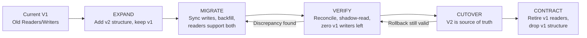

# Reading or Writing Multiple Versions During Transition

## 1. Model Evolution Does Not Happen in One Deploy

In the `DATABASE_DATA_MODELING` module, we translate business requirements into clear data models—from entities, relationships, and constraints to normalization, keys, indexes, and physical schemas—while weighing relational, document, graph, and analytical models for verifiability and evolvability. In the **Model Evolution** chapter, the real-world challenge is that **a data change normally spans multiple coexisting application versions and data batches**.

Suppose an e-commerce app currently stores product weight in column `weight_grams INTEGER` (v1). A new version wants to use `weight_kg NUMERIC(12,3)` (v2), canonicalized in kilograms. The team plans a rolling deployment:

1. Some servers still run app v1, reading/writing only `weight_grams`.
2. Some servers run app v2, able to read/write the new format.
3. Millions of historical rows remain unmigrated.
4. Independent import tasks and consumers have not upgraded yet.
5. Reporting pipelines may read both old and new data within the same day.

Running `ALTER TABLE ... DROP COLUMN weight_grams` in one release breaks legacy apps. Adding the new column and letting each app update both columns independently without a single source of truth lets values diverge. Backfilling old rows while writers still mutate them allows a buggy job to **overwrite newer updates**.

**Goal:** transition gradually from v1 to v2 while knowing at every moment **who may write, who may read, the conversion rules, data invariants, and how to detect drift**.

### Learning Outcomes

After this lesson, you will be able to:

1. Distinguish **schema version**, **data version**, **API/event version**, and **application version**, and understand why they do not change in lockstep.
2. Plan `expand → migrate → contract` with a compatibility matrix for v1–v2 readers and writers.
3. Design **dual-reads**, fallbacks, shadow reads, read repair, controlled dual-writes, and an explicit **source of truth**.
4. Detect and resolve races among backfills, old/new writers, CDC, and retries.
5. Choose local transactions, triggers, outbox/inbox, idempotency, or eventual consistency based on database boundaries.
6. Operationalize cutover, rollback, deprecation, and post-deploy verification criteria.
7. Separate lossless conversions from irreversible semantic shifts to avoid fabricating historical data.

## 2. Four Things Called "Version" With Different Lifecycles

| Version Type | Example | Owner | What to Control |
|---|---|---|---|
| **Database schema version** | v1 has `weight_grams`; v2 adds `weight_kg` | Schema/DB owner | DDL, locks/constraints, indexes, compatibility with running old apps |
| **Record/data format version** | Legacy rows hold only grams; new rows hold kilograms | Data owner + migration | Backfill, nulls, equivalence, provenance |
| **Application version** | App v1 knows only grams; app v2 understands both | Each service/deployment team | Rolling deploys, feature flags, caches, write flows |
| **API/event contract version** | `ProductWeightChanged v1` carries `weight_grams`; v2 carries `weight_kg` | Contract producer | Consumer compatibility, retries, replays, mappings |

Never set a `schema_version = 2` column and assume everything is on v2. That column may only indicate **payload** shape; active apps may still read legacy tables or consumers may still receive v1 events.

### A Foundational Principle

**Only one source decides truth at any transition stage**, even when multiple representations coexist. For example:

- Stage A: `weight_grams` is the source of truth; `weight_kg` is a derived representation.
- Stage B: new readers consume `weight_kg`, yet all writers still update `weight_grams` or enforce verified conversion.
- Stage C: once zero v1 writers remain and reversal conditions are met, `weight_kg` becomes the source of truth.
- Stage D: only once zero v1 readers remain, drop `weight_grams`.

Two columns are never "two equal sources of truth." If a system accepts two disagreeing values without a precedence rule, semantic corruption has occurred even though every SQL statement succeeded.

## 3. Expand–Migrate–Contract Instead of a "Big-Bang Schema Change"



| Phase | How It Works | Mandatory Proof |
|---|---|---|
| **Expand** | Add new columns/tables/indexes/fields without breaking legacy apps | App v1 keeps running normally |
| **Migrate – compatibility** | Guard old and new writes; apply consistent converter | No new rows written to v1 unseen by v2 |
| **Migrate – backfill** | Convert legacy rows in idempotent batches | Zero data loss from concurrent writers |
| **Migrate – dual-read** | Reader v2 understands both old and new forms | Accurate reads on unbackfilled rows |
| **Verify** | Compare semantics, row counts, values, p95, errors | Discrepancies explained within approved limits |
| **Cutover** | Shift write ownership and default read path | Zero legacy write paths causing drift |
| **Contract** | Drop legacy fields/schemas/compatibility code | Consumers, rollback/replay, and retention ready |

**Phases are not always strictly linear.** You can shadow-read before backfill finishes, or roll out reads per tenant; however, every step needs **explicit invariants and stop conditions**. Dropping old structures is far harder to reverse than adding new ones, so it must follow evidence.

## 4. Compatibility Matrix: Who Can Read or Write What?

Before every deployment, build a matrix instead of vaguely writing "backward compatible".

| Component | Data Only in v1 | Consistent v1 and v2 Data | Data Only in v2 |
|---|---|---|---|
| **Reader v1** | Readable | Reads `weight_grams` | **Unreadable** |
| **Reader v2 with fallback** | Converts v1 → v2 on read | Reads `weight_kg` | Readable |
| **Writer v1** | Writes v1 | Can make v2 stale without sync | Lacks v1 field to write |
| **Writer v2 dual-write** | Writes both if bidirectional conversion is deterministic | Writes consistently | May keep writing both during overlap |
| **Writer v2-only** | Unsafe while reader v1 lives | Safe only after v1 dependency ends | Suitable for final state |

The matrix highlights a subtle trap: **reader v2 with fallback is not enough**. If writer v1 keeps mutating `weight_grams` without updating `weight_kg`, a new reader preferring v2 reads a **stale** value.

Likewise, **dual-writing only in the new app is not enough** while un-upgraded legacy writers, SQL batches, import jobs, or CDC handlers remain. Inventory **every actual write path**, not just the main HTTP endpoint.

### Distinguishing Compatibility Dimensions

- **Backward-readable:** new code can read old data.
- **Forward-readable:** old code tolerates data written by new code.
- **Backward-writable:** old code writes without breaking new structures/values.
- **Forward-writable:** new code writes without breaking data needed by old code.
- **Semantic compatibility:** converted results retain **business meaning**, not just matching types.

A schema can be syntactically compatible yet semantically incompatible. Switching `amount` from **cents** to **dollars** while keeping `INTEGER` passes every type checker while breaking meaning.

## 5. Primary Example: Grams to Kilograms in PostgreSQL 16

We use an equivalence-verifiable conversion:

\[
\mathrm{weight\_kg}=\frac{\mathrm{weight\_grams}}{1000}
\]

Business assumptions: each product has one shipping weight, possibly unknown (`NULL`), non-negative, with **current precision of one gram**. `0` is a true zero weight, **never meaning unknown**. Tenant and product scope is identified by a composite key.

### 5.1. Initial v1 Schema

```sql
CREATE TABLE product_shipping_profile (
    tenant_id BIGINT NOT NULL,
    product_id BIGINT NOT NULL,
    weight_grams INTEGER,
    updated_at TIMESTAMPTZ NOT NULL DEFAULT CURRENT_TIMESTAMP,
    CONSTRAINT pk_product_shipping_profile
        PRIMARY KEY (tenant_id, product_id),
    CONSTRAINT ck_weight_grams_nonnegative
        CHECK (weight_grams IS NULL OR weight_grams >= 0)
);

INSERT INTO product_shipping_profile (
    tenant_id, product_id, weight_grams
)
VALUES
    (42, 1001, 1250),
    (42, 1002, 0),
    (42, 1003, NULL);
```

All three rows are valid:

- Product 1001: 1.250 kg.
- Product 1002: 0.000 kg, not to be treated as missing.
- Product 1003: `NULL`, meaning unknown per the example contract.

**Never turn `NULL` into `0` during backfill.** If weight has not been measured, writing `0` makes data look complete while miscalculating shipping fees.

### 5.2. Expand: Add v2 Column While Keeping v1 Intact

```sql
ALTER TABLE product_shipping_profile
    ADD COLUMN weight_kg NUMERIC(12, 3);
```

Adding a nullable column without a large default is typically a relatively lightweight metadata change in PostgreSQL, **yet still requires DDL locks and a migration plan**. Never assume every `ALTER TABLE` is "zero downtime"; test against your real table size, load window, and DBMS version.

Immediately after the DDL, old rows have `weight_kg IS NULL`; app v1 knows nothing of the new column and keeps running. **Do not blindly trust `weight_kg` in new readers yet.**

## 6. Single Authoritative Write Direction During Overlap

While app v1 still writes, designate `weight_grams` as the **canonical source of truth**. Column `weight_kg` is purely derived from `weight_grams`.

A temporary PostgreSQL trigger protects even un-upgraded legacy writers:

```sql
CREATE OR REPLACE FUNCTION product_weight_v1_to_v2()
RETURNS TRIGGER
LANGUAGE plpgsql
AS $$
DECLARE
    expected_kg NUMERIC(12, 3);
BEGIN
    -- Under the current contract, conversion is exact to one gram.
    expected_kg := (NEW.weight_grams::numeric / 1000)::numeric(12, 3);

    IF TG_OP = 'INSERT' THEN
        -- Old app omits weight_kg (defaults to NULL): accepted.
        -- New app sends weight_kg differing from v1-derived value: rejected.
        IF NEW.weight_kg IS NOT NULL
           AND NEW.weight_kg IS DISTINCT FROM expected_kg THEN
            RAISE EXCEPTION
                'weight_kg conflicts with canonical weight_grams'
                USING ERRCODE = '23514';
        END IF;
    ELSE
        -- If client EXPLICITLY modifies weight_kg, it must match v1.
        -- Old writer modifies only grams: weight_kg unchanged from OLD,
        -- and the trigger recomputes the derived representation.
        IF NEW.weight_kg IS DISTINCT FROM OLD.weight_kg
           AND NEW.weight_kg IS DISTINCT FROM expected_kg THEN
            RAISE EXCEPTION
                'weight_kg conflicts with canonical weight_grams'
                USING ERRCODE = '23514';
        END IF;
    END IF;

    NEW.weight_kg := expected_kg;
    RETURN NEW;
END;
$$;

CREATE TRIGGER trg_product_weight_v1_to_v2
BEFORE INSERT OR UPDATE ON product_shipping_profile
FOR EACH ROW
EXECUTE FUNCTION product_weight_v1_to_v2();
```

Explanation:

1. Writer v1 sends `weight_grams = 1500`; the trigger computes `weight_kg = 1.500` in the **same transaction/row**.
2. Writer v2 temporarily sends **both** `weight_grams = 1750` and `weight_kg = 1.750`; the trigger confirms equivalence.
3. If a request sends `weight_kg = 1.750` while leaving `weight_grams = 1500`, the trigger rejects it rather than silently tolerating two conflicting truths.
4. To accept updates from both interfaces, **the new API must convert kg → grams per exact rule and send both**; never assume this trigger supports v2-only writes.
5. `NULL` remains distinct from `0`; arithmetic on `NULL` yields `NULL`.

**Example boundaries:** triggers guard normal PostgreSQL writes executed with triggers enabled. Privileged bypasses, replication, special bulk imports, or temporary trigger disabling must be governed by permissions and runbooks. Nor does a trigger prove a weight is physically accurate in the real world.

### 6.1. Testing Both Old and New Writers

```sql
-- Writer v1 updates only the legacy column.
UPDATE product_shipping_profile
SET weight_grams = 1500,
    updated_at = CURRENT_TIMESTAMP
WHERE tenant_id = 42 AND product_id = 1001;

-- Writer v2 in dual-write mode.
UPDATE product_shipping_profile
SET weight_grams = 1750,
    weight_kg = 1.750,
    updated_at = CURRENT_TIMESTAMP
WHERE tenant_id = 42 AND product_id = 1001;

-- Query verifying both representations.
SELECT tenant_id, product_id, weight_grams, weight_kg
FROM product_shipping_profile
WHERE tenant_id = 42 AND product_id = 1001;
```

Run the above only on test data. Product 1001 ends with `weight_grams = 1750`, `weight_kg = 1.750`. If concurrent transactions update the same product, PostgreSQL row locks serialize updates in execution order; however, preventing **user-level lost updates** still requires optimistic versioning or conditional writes.

## 7. Dual-Read: Prefer New Format With Controlled Fallback

While the new column is still backfilling, reader v2 must understand both representations:

```sql
SELECT
    tenant_id,
    product_id,
    CASE
        WHEN weight_kg IS NOT NULL THEN weight_kg
        WHEN weight_grams IS NOT NULL
            THEN (weight_grams::numeric / 1000)::numeric(12, 3)
        ELSE NULL
    END AS effective_weight_kg,
    CASE
        WHEN weight_kg IS NOT NULL THEN 'V2'
        WHEN weight_grams IS NOT NULL THEN 'V1_FALLBACK'
        ELSE 'UNKNOWN'
    END AS read_source
FROM product_shipping_profile;
```

Here `read_source` is a useful telemetry signal measuring fallback ratio. **Never use `COALESCE(weight_kg, 0)`**, because `0` is a real weight whereas `NULL` means unknown. Without triggers or trustworthy write sync, "prefer v2" can serve **stale** values, so enable it only after protecting the write path.

### 7.1. Read Modes With Different Goals

| Mode | How It Works | Benefit | Risk |
|---|---|---|---|
| **V1 primary, V2 shadow** | Serve v1; compute v2 for comparison without affecting users | Spot drift before cutover | CPU/I/O cost; keep PII out of logs |
| **V2 preferred, V1 fallback** | Read v2 if present; fall back to v1 if missing | Ship new reader before backfill ends | If v2 is stale, fallback won't trigger; requires reconciliation |
| **V2 only** | Read only v2 | Simpler, fewer branches | Safe only once coverage and writers meet thresholds |
| **Read repair** | On missing v2, backfill from v1 by policy | Accelerates migration of "hot" rows | Write-on-read, races, retries, side effects |

**Never run `UPDATE` inside every `SELECT` for read repair by default.** Heavy read traffic triggers write storms, deadlocks, and latency spikes. If used, dispatch idempotent tasks and verify newer writes are not overwritten.

### 7.2. Shadow Reads Should Compare Semantics, Not Display Strings

Do not string-compare `"1.25"` and `"1.250"` and flag an error—both represent the same numeric value. Conversely, `"1.25kg"` and `"1250g"` look different yet represent the same quantity under unit conversion.

Compare after **verified normalization**:

- Numeric value and canonical unit.
- `NULL`/not-applicable/unknown per contract.
- Precision and rounding rules.
- Identifier scope (`tenant_id`, `product_id`).
- Data version and source timestamp; never diff two distinct write snapshots and call it drift.

Shadow reads should emit dedicated `disagreement_count`, `fallback_ratio`, sample mismatch, and latency metrics. Log only necessary keys; never leak sensitive values into telemetry outside authorized boundaries.

## 8. Backfill Must Not Overwrite Concurrent Updates

Once the trigger protects new writes, backfill legacy rows missing v2 in batches. **Idempotency** condition:

> Re-running a batch yields identical results when source data is unchanged; if the source changes mid-batch, the row converts from the **latest locked and read** source version.

In PostgreSQL 16:

```sql
WITH batch AS (
    SELECT tenant_id, product_id
    FROM product_shipping_profile
    WHERE weight_kg IS DISTINCT FROM
          (weight_grams::numeric / 1000)::numeric(12,3)
    ORDER BY tenant_id, product_id
    LIMIT 500
    FOR UPDATE SKIP LOCKED
)
UPDATE product_shipping_profile AS p
SET weight_kg =
        (p.weight_grams::numeric / 1000)::numeric(12,3)
FROM batch AS b
WHERE p.tenant_id = b.tenant_id
  AND p.product_id = b.product_id
RETURNING p.tenant_id, p.product_id,
          p.weight_grams, p.weight_kg;
```

Key points:

- `FOR UPDATE SKIP LOCKED` lets multiple workers process disjoint rows; it does not globally block business writers.
- `UPDATE` still fires the trigger, recomputing v2 from current `weight_grams` under the v1-authoritative policy.
- Small batches reduce lock hold times and WAL bursts; `500` is illustrative and must be benchmarked.
- When another writer locks a row, the job **skips it temporarily** and catches it later. Therefore never declare "done" just because one batch returns 0 rows under active writes.
- If legacy rows contain invalid values, route exceptions to a report rather than replacing `NULL`, negatives, or out-of-range values with fake numbers.

### 8.1. Classic Race When Backfill Runs Outside One Transaction

```text
Time          Backfill Worker                  Application Writer
-----------   --------------------------------  ----------------------
t1            Reads weight_grams = 1250
t2                                               Updates grams to 1500
t3            Writes weight_kg = 1.250 (stale)
t4            Reader v2 sees 1.250, reader v1 sees 1500
```

This bug strikes when a job separates read and write without guards. Adding delays or retries does not reliably fix it. Safe protocols include:

- Computing directly from the locked row inside the `UPDATE`/transaction.
- Or using **optimistic compare-and-set** on `row_version`/source value, writing only if unchanged.
- Enforcing equivalence triggers/constraints throughout the overlap window.
- Reconciling post-backfill and monitoring drift while old writers remain.

### 8.2. Optimistic Concurrency for Business Operations

When multiple users concurrently edit the same product's weight, the trigger only keeps **both units consistent**; it does not prevent "the second writer silently overwriting the first writer's update". A `row_version` column helps:

```sql
ALTER TABLE product_shipping_profile
    ADD COLUMN row_version BIGINT NOT NULL DEFAULT 1;

-- API UPDATE executes only if the version the user read
-- is still current. 0 rows returned => report conflict.
UPDATE product_shipping_profile
SET weight_grams = 2000,
    row_version = row_version + 1,
    updated_at = CURRENT_TIMESTAMP
WHERE tenant_id = 42
  AND product_id = 1001
  AND row_version = 1
RETURNING tenant_id, product_id, row_version, weight_grams, weight_kg;
```

In production, every payload-mutating write path must honor versioning, not just the new API; if writer v1 ignores `row_version`, optimistic concurrency is not globally enforced. A DB trigger can increment versions on business writes, provided technical backfill updates are distinguished so they do not trigger false user conflicts.

## 9. Verifying Post-Backfill Consistency With Unambiguous SQL

```sql
-- Drift count must be 0 before trusting v2 completely.
SELECT COUNT(*) AS mismatched_rows
FROM product_shipping_profile
WHERE weight_kg IS DISTINCT FROM
      (weight_grams::numeric / 1000)::numeric(12,3);

-- Coverage summary (NULL/NULL rows are not counted as drift).
SELECT
    COUNT(*) AS total_rows,
    COUNT(*) FILTER (WHERE weight_grams IS NOT NULL)
        AS rows_with_known_weight_v1,
    COUNT(*) FILTER (WHERE weight_kg IS NOT NULL)
        AS rows_with_known_weight_v2,
    COUNT(*) FILTER (
        WHERE weight_grams IS NOT NULL AND weight_kg IS NULL
    ) AS rows_missing_v2
FROM product_shipping_profile;
```

**Never use `weight_kg <> weight_grams / 1000` for full checks**, because comparing against SQL `NULL` yields `UNKNOWN`, hiding rows where only one side is `NULL`. `IS DISTINCT FROM` treats `NULL` deterministically.

On massive tables, a full scan can strain I/O. Slice by tenant/key range across checkpointed passes, while explicitly noting that **sampling does not prove zero drift**; cutover may still require full validation or validated DB constraints.

### 9.1. Tightening Constraints Once Data Is Clean

After backfilling and fixing discrepancies:

```sql
ALTER TABLE product_shipping_profile
ADD CONSTRAINT ck_weight_v1_v2_equivalence
CHECK (
    weight_kg IS NOT DISTINCT FROM
        (weight_grams::numeric / 1000)::numeric(12,3)
) NOT VALID;

ALTER TABLE product_shipping_profile
    VALIDATE CONSTRAINT ck_weight_v1_v2_equivalence;
```

`NOT VALID` adds the `CHECK` without scanning all rows immediately while enforcing it on subsequent writes per PostgreSQL behavior. `VALIDATE CONSTRAINT` checks historical rows. This narrows certain operational steps—**never guaranteeing lock-free or zero-impact execution**.

This constraint encodes a **1-gram conversion rule**. If v2 later allows sub-gram precision, values can no longer reverse into integer grams losslessly; update contracts, retire old readers/writers, and evolve constraints accordingly. **Never keep a constraint forever just because an earlier migration added it.**

## 10. Dual-Write: "Writing Two Places" Does Not Mean Atomic

Different dual-write topologies behave very differently:

| Case | Atomic in One DB Transaction? | Key Considerations |
|---|---|---|
| Two columns in the **same row** of one DB | Yes, via update/trigger/constraint | Conversion invariants, business races, write cost |
| Two tables in the **same database** | Yes, if all changes share one transaction | Writes must route through unified owner/protocol |
| Two independent databases | Usually non-atomic across two separate calls | Crash between commits causes drift; needs sync strategy |
| DB + message broker | Non-atomic across two standalone calls | Transactional outbox/inbox, retries/idempotency |
| OLTP + search index/warehouse | Typically eventual consistency | CDC/streams, watermarks, reconciliation, replay |

**Common mistake:**

```text
API handler:
  UPDATE database_v1
  UPDATE database_v2
  return HTTP 200
```

If v1 commits and v2 fails, the systems diverge. If the client retries, v1 updates again while v2 duplicates or reorders events. `try/catch` blocks or naive retries **do not create cross-system atomicity**.

### Single Write Source and Derived Data

When splitting v2 into a new database, a safer architecture is:

1. Designate which DB is the **source of truth** in each phase.
2. Commit business writes there with monotonic revisions / event IDs.
3. Write to the outbox **in the same transaction** as the source change.
4. Sync to the target DB via idempotent consumers preserving per-aggregate order.
5. Reconcile lag, versions, counts, and payloads across both sides.
6. Cut reads over to v2 only after lag, coverage, and semantics meet criteria.

This provides **controlled eventual consistency**; a read may briefly see v1 ahead of v2. APIs and read paths must disclose or handle user consistency expectations rather than pretending two DBs are always synchronous.

## 11. Outbox/CDC: Moving Data Without Dropping Events

A minimal illustrative outbox table in the **source database**:

```sql
CREATE TABLE migration_outbox (
    event_id UUID PRIMARY KEY,
    tenant_id BIGINT NOT NULL,
    entity_type VARCHAR(60) NOT NULL,
    entity_id BIGINT NOT NULL,
    entity_revision BIGINT NOT NULL,
    event_type VARCHAR(100) NOT NULL,
    payload JSONB NOT NULL,
    created_at TIMESTAMPTZ NOT NULL DEFAULT CURRENT_TIMESTAMP,
    delivered_at TIMESTAMPTZ,
    CONSTRAINT ck_migration_event_revision
        CHECK (entity_revision > 0),
    CONSTRAINT ck_migration_payload_object
        CHECK (jsonb_typeof(payload) = 'object')
);

CREATE INDEX idx_migration_outbox_pending
    ON migration_outbox (created_at, event_id)
    WHERE delivered_at IS NULL;
```

For each business update, source row and outbox event commit **in the same transaction**. Here, emitting `ProductWeightChanged` with `weight_grams`/`weight_kg` and revision lets consumers discard stale versions.

**An outbox does not automatically yield exactly-once delivery.** A publisher can send successfully, lose the ACK, and resend. Consumers need an inbox/dedup ledger keyed by `event_id` processed inside the target transaction. A `delivered_at` column alone solves neither ordering nor consumer commit confirmation.

### CDC and "Snapshot + Stream" Have Their Own Race

Copying data from an old database to a new one commonly combines:

1. Taking a **snapshot/backfill** of existing rows.
2. Consuming a **change stream** (CDC) for updates occurring while the snapshot runs.

Starting the stream too late leaves a **gap**; applying stream and snapshot out of order lets an older snapshot **overwrite** a newer update.

The fix requires an engine-appropriate **high-watermark/LSN or checkpoint** paired with monotonic versioned applies. Never "copy the whole table, then turn on CDC" assuming changes during the copy won't be lost.

### Distinguishing Broker Offset From Business Revision

A broker/partition offset tracks stream position, not necessarily entity version across multiple writers. For a given product, enforce ordering by entity ID, source-assigned sequence, or proven high-resolution timestamps—never use `received_at` to decide which message is "newer" when events arrive out of order.

## 12. Target Writes Guarded by Revision Comparison

A monotonically increasing per-entity revision from the source lets consumers discard late stale updates.

Example separate target table (PostgreSQL syntax for illustration; in practice this could be another store):

```sql
CREATE TABLE product_weight_projection_v2 (
    tenant_id BIGINT NOT NULL,
    product_id BIGINT NOT NULL,
    weight_kg NUMERIC(12,3),
    source_revision BIGINT NOT NULL,
    updated_from_event UUID NOT NULL,
    CONSTRAINT pk_weight_projection_v2
        PRIMARY KEY (tenant_id, product_id),
    CONSTRAINT ck_weight_projection_revision
        CHECK (source_revision > 0),
    CONSTRAINT ck_weight_kg_nonnegative
        CHECK (weight_kg IS NULL OR weight_kg >= 0)
);

-- Apply revision 15; retried revision 15 or late event 14 will not overwrite.
INSERT INTO product_weight_projection_v2 (
    tenant_id, product_id, weight_kg,
    source_revision, updated_from_event
)
VALUES (
    42, 1001, 1.750,
    15, '00000000-0000-4000-8000-000000000015'::uuid
)
ON CONFLICT (tenant_id, product_id)
DO UPDATE SET
    weight_kg = EXCLUDED.weight_kg,
    source_revision = EXCLUDED.source_revision,
    updated_from_event = EXCLUDED.updated_from_event
WHERE product_weight_projection_v2.source_revision
      < EXCLUDED.source_revision;
```

**Crucial limitation:** `ON CONFLICT ... WHERE revision < ...` blocks overwrites by smaller revisions, yet if **the same revision arrives with a different payload**, it silently skips updating. Consumers should detect and alert on **revision collisions**, compare canonical hashes/content, or retain a ledger. It also works only when the source strictly guarantees monotonic revisions per entity.

For deletes/tombstones, the target must retain deletion state or tombstone revision. Hard-deleting a projection row and forgetting its last revision allows a late-arriving update event to **resurrect** the deleted record.

## 13. When Multiple Writers Are Needed, and When to Refuse Them

Never allow v1 and v2 to **write independently** without a conflict-resolution protocol. "Multi-master" raises questions schema changes cannot answer:

- If v1 writes `1.250 kg` at t1 and v2 writes `1.300 kg` at t2, yet t2's event arrives before t1's, which wins?
- If clocks drift across systems, whose timestamp governs `last write wins`?
- If one side updates weight while the other updates unit/measurement source, should fields merge?
- If the business requires human conflict confirmation, may the system pick one side automatically?

### Well-Grounded Policies

| Policy | When Appropriate | What Must Be Guarded |
|---|---|---|
| **Single writer / source of truth** | Most OLTP migrations | Clear write path, derived events, read models |
| **Single owner + adapters** | Multiple APIs/consumers still need differing formats | All writes go through owner; never write back into projections |
| **Optimistic concurrency / CAS** | Concurrent edits to the same aggregate | Expected revision check; client conflict handling |
| **Application-level merge** | Independent fields with approved merge rules | Provenance, ordering, cross-field constraints |
| **Last-write-wins** | Only when dropping an update is acceptable and clocks/order are trusted | Clock skew, ties, audits; unsuitable for most financial data |
| **CRDT / commutative ops** | Truly associative/commutative operations exist | Never apply arbitrarily to every field |

For product weights, **single writer + CAS** is far simpler and easier to verify than letting v1 and v2 writers mutate independently throughout migration.

## 14. API/Event Contract Versions Are Not DB Schema Versions

Suppose external consumers currently receive:

```json
{
  "event_id": "evt-81001",
  "event_type": "catalog.product-weight-changed",
  "schema_version": 1,
  "product_ref": "SKU-1001",
  "weight_grams": 1750
}
```

A v2 contract might look like:

```json
{
  "event_id": "evt-81001",
  "event_type": "catalog.product-weight-changed",
  "schema_version": 2,
  "product_ref": "SKU-1001",
  "shipping_weight": {
    "value": "1.750",
    "unit": "kg"
  }
}
```

Both JSON payloads express **one logical event** in two representations. Under dual-publishing, define an ID/dedup policy: if a consumer subscribes to both v1 and v2, it **must never count that as two weight changes**. Share a `logical_event_id` with deliberate deduplication, or publish on clearly versioned channels with controlled consumer migration.

### API Read/Write Compatibility

- Consumer v1 may not understand v2's `shipping_weight` object.
- Consumer v2 should include a v1 decoder for old events still in retention or replay.
- If emitting v1 and v2 concurrently, specify which consumers receive which and when v1 stops.
- Test optional fields, new enums, and `NULL` shifts; JSON Schema may pass while unit semantics break.
- Monetary or measurement fields should carry explicit types/precision and units—never just rename `weight`.

**Never update a contract by changing a field's meaning in place.** If `weight` meant grams yesterday and kilograms today under the same name and numeric type, consumers multiply or divide by 1,000 silently without parser errors.

## 15. Data Versions in Documents/JSON vs. DB Schemas

In document databases or `JSONB` columns, adding fields needs no DDL, yet **data contracts still require versioning** when structure or semantics change:

```json
{
  "product_ref": "SKU-1001",
  "schema_version": 2,
  "shipping_weight": {
    "unit": "kg",
    "value": "1.750"
  }
}
```

A versioned document design must answer:

1. Does `schema_version` cover the **entire document**, one sub-object, or an event?
2. Can v1 values convert losslessly to v2? If not, which fields become "undetermined"?
3. Which branch does the decoder take when `schema_version` is missing or invalid?
4. Does the system permit a **mixed-version collection** or require backfill before v2-only reads?
5. On concurrent subdocument updates, do `etag`/revisions or optimistic CAS guard writes?
6. How might indexes/queries spanning old and new fields duplicate or omit results?

A transitional `JSONB` query pattern:

```sql
-- Assumes staging document table: product_payload(product_ref, payload JSONB).
-- Illustrative SQL only; this table is not part of Section 5's DDL.
SELECT
    product_ref,
    CASE
        WHEN payload ->> 'schema_version' = '2'
            THEN (payload #>> '{shipping_weight,value}')::numeric
        WHEN payload ->> 'schema_version' = '1'
            THEN ((payload ->> 'weight_grams')::numeric / 1000)
        ELSE NULL
    END AS normalized_weight_kg
FROM product_payload;
```

**Caution:** `::numeric` fails if payloads are unvalidated. Production pipelines must verify JSON type, numeric bounds, units, `NULL`s, missing keys, and versions before casting. `CASE ELSE NULL` is also insufficient as production policy for unsupported versions: quarantine/alert instead of silently turning data errors into unknown values.

### Irreversible Mappings

Splitting `full_name` into `first_name`/`last_name` or free-text addresses into country/province/street may have **no valid split for all historical records**. Never mark a v2 record "verified" just because a heuristic string splitter ran without crashing.

A sound model will:

- Preserve verbatim source values and verification provenance when needed.
- Track conversion statuses like `PARSED`, `MANUAL_REVIEW`, `UNRESOLVED`.
- Gate critical business decisions on verified confidence.
- Avoid reverse dual-writes if rejoining loses nuances or changes meaning.

## 16. Lossless Conversions vs. Business Model Changes

| Change | 1-to-1 Convertible? | Practical Risk |
|---|---|---|
| `weight_grams INTEGER` → `weight_kg NUMERIC(12,3)` at 1 g precision | Yes, within current data domain | Increasing precision later breaks reverse writes |
| `price_cents` → decimal price with known currency | Conditionally | Must lock minor unit, currency, and rounding |
| `full_name` → `given_name`/`family_name` | Not in general | Naming conventions vary across cultures; heuristics fail |
| `status_text` → new status enum | Conditionally | Legacy values rarely map 1–1 to new states |
| `order.shipping_address_text` → structured address | Not in general | Missing/non-standard data; requires verification |
| One order has one payment → multiple payment transactions | Not simply equivalent | Changes cardinality and grain; cannot infer payment history from order status alone |
| One customer → party roles buyer/payer/recipient | Not a field rename | Distinct identities and roles; requires contract |
| Order-grain fact → event-grain fact | Changes grain | Multiplies metrics and breaks idempotency without event IDs |

**Changing schemas does not automatically populate new semantics.** If v2 requires an attribute v1 never recorded, backfill cannot conjure historical facts out of thin air. Document source limits and handle exceptions explicitly.

## 17. Derived Data: Projections, Materialized Views, and Search Indexes

Sometimes v2 is not a new column but a **different read model**:

- OLTP writes normalized orders; v2 builds a search document for queries.
- Account changes emit events; v2 builds a `customer_summary` table.
- Time-series events roll up into 5-minute/1-hour buckets.
- Transaction facts map into a data warehouse star schema.

Here, **dual-write** is best implemented as **writing once to the source and updating derived stores via a change stream** where architecture permits, rather than having every API write directly to every store.

### Three Things to Reconcile

1. **Coverage:** is every eligible source entity or event present in the projection?
2. **Freshness:** how far behind the source is the projection, and when must APIs read the source directly?
3. **Semantic equivalence:** do transforms preserve names, IDs, units, timestamps, grain, and statuses?

Row counts need not match 1:1 between v1 and v2: one order has many lines; one event may emit multiple index documents; many facts aggregate into one bucket. Reconcile per the **defined grain relationship**, never forcing mismatched grains to match row counts.

## 18. Read Cutover: From Shadow to v2-Only

A safe progression:

1. **Shadow-read:** reader v1 serves users while reader v2 runs in parallel to compare (within sampling and resource caps).
2. **Canary:** a small tenant or cohort switches to v2; others remain on v1.
3. **Progressive rollout:** ramp up percentage per metrics and rollback readiness.
4. **V2 preferred:** readers use v2 with monitored fallback; explicit v2 errors must never silently fall back to v1 if doing so breaks invariants.
5. **V2 only:** only once all required records hold v2, writers are guarded, and rollback paths are defined.

### Layered Cutover Metrics

| Category | Metric | Purpose |
|---|---|---|
| Coverage | % records with v2 data per tenant/partition | Know when fallback can retire |
| Correctness | Canonical value drift, type errors, bad FKs, invalid states | Catch bugs before v2-only reads |
| Performance | p50/p95/p99 latency, DB load, lock waits | Prevent migrations from causing outages |
| Availability | Error rate, timeouts, circuit breakers, fallback rate | Keep app serving reliably |
| Pipeline | CDC lag, outbox backlog, DLQ, retry counts | Confirm projections caught up |
| Business | Monetary totals / quantities / ratios per grain | Validate semantics, not just row counts |
| Operational | Active v1 writers/readers, deployed app versions | Prove readiness to drop compatibility |

**Never pick an arbitrary "99% coverage is good enough" threshold.** On critical records like invoices, access permissions, or shipping fees, **the remaining 1%** can contain the highest-stakes transactions. Cutover sign-off must explicitly document gaps, risk tolerance, and exception policies.

## 19. Shifting Write Authority From v1 to v2

Write cutover is usually riskier than read cutover, because v2-only writers can produce data **unrepresentable** in v1.

### Overlap Phase: v1 Remains Source of Truth

- All app v1 writes update v2 via trigger/shared bridge.
- New apps can read v2, while writes send equivalent grams and kilograms.
- v2-only writers are rejected.
- Constraints/reconciliation verify both columns match.

### Write-Ownership Handover Phase

Only after:

1. Zero v1 apps/batches/jobs retain write access (verified via telemetry, code paths, and actual permissions).
2. Backfill meets data acceptance criteria.
3. API/event consumers support v2 or retain a **losslessly regenerable** v1 projection.
4. Rollback compatibility policies are selected.

At that point, switch canonical writes to `weight_kg`. If v1 readers remain, a reverse v2 → grams adapter/trigger can maintain v1 **only while reverse conversion stays lossless**. For example, `1.750 kg ↔ 1750 g` is exact, whereas `1.7505 kg` cannot be represented cleanly in integer grams.

**Never invert an existing trigger without re-verifying rules and writers.** Section 6's trigger deliberately treats `weight_grams` as canonical; flipping ownership requires deploying a **new protocol**, testing remaining v1 readers, precision bounds, and `NULL` handling. Often the lowest-risk option keeps v1 canonical longer until old readers retire.

### V2-Only Phase

Allow v2-only writes only once v1 compatibility is no longer required; drop the **`v1 = v2`** constraint when it blocks widening v2 semantics. You may leave v1 as a deprecated read-only field briefly, with explicit sunset dates and confirmation it is no longer canonical.

## 20. Contract: Dropping the Old Column Is the Final Step, Not Harmless Cleanup

Only after zero v1 readers/writers remain, no replays require the old format, and the rollback window closes, retire v1 compatibility:

```sql
-- ILLUSTRATIVE FINAL PHASE ONLY; DO NOT RUN WHILE APP V1 IS ACTIVE.
DROP TRIGGER IF EXISTS trg_product_weight_v1_to_v2
    ON product_shipping_profile;

DROP FUNCTION IF EXISTS product_weight_v1_to_v2();

ALTER TABLE product_shipping_profile
    DROP CONSTRAINT IF EXISTS ck_weight_v1_v2_equivalence;

ALTER TABLE product_shipping_profile
    DROP COLUMN weight_grams;
```

After this step, app v1 can no longer function. **Code rollback alone is insufficient** because the old column is gone; reverting requires backups, reversible data, and a recovery plan for writes committed post-contract.

Before dropping v1, double-check:

- Do indexes, triggers, views, functions, ORM mappings, or jobs still reference v1?
- Do APIs/events replay archived v1 payloads?
- Do backups/restores handle the new schema and new data?
- Do retention or audit policies require the old representation?
- Do `weight_kg`'s definition and unit match every consumer's expectation?

When in doubt, **delay `contract`** rather than dropping early for a "cleaner schema".

## 21. Rollback: Planned Before Cutover, Not After an Outage

| Phase | What Rollback Can Do | Risk |
|---|---|---|
| Expand | Stop v2 readers/writers, keep v1 | Minimal v2 coupling; easy rollback |
| Dual-read/shadow | Disable feature flag; keep v1 canonical | Ensure v1 data stayed consistent |
| Dual-write (v1 canonical) | Turn off new writers; keep or carefully retire v1→v2 trigger | Triggers/DDL still require lock and write oversight |
| V2-only reads while v1 stays full | Point reads back to v1 | Latency or semantic shifts if v2 altered rules |
| V2 canonical with values unrepresentable in v1 | Cannot just roll back binary | Needs forward fix or controlled reverse migration (may lose nuance) |
| Post-drop v1 | Must recreate schema/data and catch up new writes | Compatibility-breaking; may require downtime |

**Rollback must never discard valid data committed after cutover.** Incomplete plans just say "redeploy v1" without answering **how v1 will read v2-only records written in the meantime**.

### Rollback vs. Roll-Forward

On mapping/semantic bugs, **rolling forward** is often safer: keep v2 code, fix the converter, rerun backfill/CDC from source, and reconcile. It is not always the right answer, but evaluate it whenever backward migration loses data or halts many consumers.

## 22. Financial, Temporal, and Fact-Table Cases

Schema transitions **must never accidentally alter grain, time semantics, or business invariants**:

### Transaction Lines and Money

If v1 stored `order.total_amount` and v2 splits into `order_line` plus separate discounts/taxes, never assume backfill can reconstruct **exact historical components** from the total alone. Keep an approved `LEGACY_ADJUSTMENT` line or mark incomplete details rather than fabricating discount rows to force totals to match.

### SCD Type 2 and Category Changes

Moving current `product.category_id` into a historical relation table does not let current categories **infer historical categories**. Backfill from verified logs/sources or explicitly bound unknown history. Reader v2 must never join last month's fact to today's category and label it as-of.

### Fact Grain and Deduplication

If v1 has order-grain facts and v2 has line-grain facts, one order legitimately yields multiple lines. Never assert `COUNT(v1) = COUNT(v2)`; reconcile by **grain**, line counts, monetary sums, and source identifiers. When dual-publishing v1/v2 events, consumers must never double-count the same transaction.

### Temporal Validity and Event Ordering

When v2 adds `valid_from`/`valid_to`, never substitute `loaded_at` as effective date if business allows future-dated or retroactive edits. An event with an old `occurred_at` and recent `received_at` must still obey proper temporal rules.

## 23. Common Design and Operational Mistakes

| Misconception | Why It Is Dangerous | Fix |
|---|---|---|
| "Adding the column means we migrated." | Legacy rows unbackfilled; new readers see `NULL` | Expand + backfill + monitor coverage |
| "Dual-write in app v2 is enough." | App v1/batches still write one side | Inventory all writers; trigger/owner or gate |
| "Prefer v2 if non-null is always safe." | v2 can go stale after an app v1 write | Guard write path and measure drift |
| "`COALESCE` to 0 solves missing data." | Turns unknown into a real value | Respect `NULL` / not-applicable |
| "Read first, write later in backfill is fine." | Concurrent updates get overwritten by stale reads | Lock/CAS; compute from source in transaction |
| "`ON CONFLICT DO NOTHING` means idempotent retry." | Same ID with different payload is silently ignored | Compare payloads, revisions, and corrections |
| "Outbox guarantees exactly once." | Brokers/consumers can still retry | Inbox idempotency and effect deduplication |
| "Starting CDC after snapshot never loses data." | Changes occur between snapshot and stream start | Consistent snapshot + CDC watermark/checkpoint |
| "Timestamp last-write-wins is always fair." | Clock skew/reordering drops updates | Per-entity revisions or explicit conflict handling |
| "Valid v2 schema means right v2 semantics." | Different units/meanings under valid types | Semantic contracts and validation |
| "Backfill can synthesize history v1 never stored." | No source exists to infer past values | Mark unknown; use evidenced sources |
| "v1 and v2 events are two separate changes." | Double counting in consumers listening to both | Logical event identity and version plan |
| "Matching row counts is sufficient." | Grain may differ; values may still be wrong | Reconcile by grain, measures, and domain |
| "Switch to v2-only at 99% coverage." | The remaining 1% may be critical records | Coverage and exceptions weighted by criticality |
| "Drop v1 right after cutover." | Rollbacks, replays, and legacy consumers still need it | Contract only after deprecation window |
| "Roll back by redeploying the old build." | Old build cannot read v2-only data | Analyze reversibility and write history |

## 24. State-Based Transition Test Suite

| Case | Scenario | Expected Result |
|---|---|---|
| T1 | App v1 writes `weight_grams = 1250` post-expand | App v1 succeeds; v2 becomes `1.250` via sync |
| T2 | App v2 sends both `1500g` and `1.500kg` | Accepted; values consistent |
| T3 | App v2 sends `1500g` and `1.700kg` | Rejected before commit |
| T4 | App attempts v2-only write while v1 is canonical | Rejected or routed via approved kg→gram adapter |
| T5 | `weight_grams = NULL` | v2 stays `NULL`, never `0` |
| T6 | `weight_grams = 0` | v2 becomes `0.000`, not treated as unknown |
| T7 | Backfill and writer update same row concurrently | v2 not overwritten with stale v1 snapshot |
| T8 | Backfill runs multiple passes | Final state unchanged; zero added drift |
| T9 | Reader v2 reads unbackfilled row | Clean fallback; fallback metric incremented |
| T10 | v2 holds stale non-null value | Drift monitor catches it; not silently accepted |
| T11 | Consumer receives duplicate `event_id` | No second business side effect |
| T12 | Consumer receives revision 16 before revision 15 | Revision 15 does not overwrite 16 |
| T13 | Same revision arrives with differing payload | Collision alert raised; never silently ignored |
| T14 | DB v1 snapshot and CDC stream overlap | Zero lost events; zero backward revision writes |
| T15 | JSON v1 payload lacks `schema_version` | Explicit detection/quarantine rule applied |
| T16 | v1 event replayed after system emits v2 | Legacy decoder or migration route supports it |
| T17 | v1 and v2 differ due to unit/rounding | Compare canonical value and precision rules |
| T18 | Two users edit same record concurrently | CAS catches lost update instead of silent overwrite |
| T19 | Switching to v2-only reads with unbackfilled rows | Canary/guardrail blocks or requires explicit exception |
| T20 | Rollback needed after v2 wrote unrepresentable values | No blind rollback; choose reverse migration / forward fix |
| T21 | v2 change impacts FKs or reference data | Violations surfaced, never silently dropped |
| T22 | All v1 apps stopped, yet monthly batch still uses v1 | Writer/reader inventory catches job before column drop |

### 24.1. An Assertion Beyond Row Counts

```sql
-- Check final values in the example while v1 remains authoritative.
SELECT
    tenant_id,
    product_id,
    weight_grams,
    weight_kg,
    CASE
        WHEN weight_kg IS NOT DISTINCT FROM
             (weight_grams::numeric / 1000)::numeric(12,3)
        THEN 'CONSISTENT'
        ELSE 'DRIFT'
    END AS validation_state
FROM product_shipping_profile
WHERE tenant_id = 42
ORDER BY product_id;
```

For row `1001` updated in Section 6, `validation_state` must be `CONSISTENT` with `1750g`/`1.750kg`. Row `1002` has `0` matching `0.000`, and row `1003` has `NULL` on both sides. If even one row shows `DRIFT`, never shrug it off as "tiny fraction, ignorable"—trace which write path violated the source of truth.

## 25. Practical Exercise: Migrating From One Price Field to Multi-Currency Representation

**Context:** a B2B sales platform has 30 million product rows across multiple tenants. v1 stores `price_cents INTEGER` assuming a fixed currency per tenant; v2 must store `amount NUMERIC(18,4)` and `currency_code` per price list. Some tenants settle in currencies without standard two-decimal minor units; legacy v1 rows lack per-row currency codes. During a 6-week rollout, v1 and v2 apps run side by side; the analytics warehouse syncs via CDC, and the search index lags 1–5 minutes. Month-end billing software has not upgraded yet.

### Tasks

1. **Establish v1 facts:** did `price_cents` always genuinely represent cents? Which tenants have fixed currencies, currency-change effective dates, and unverified values?
2. **Build a compatibility matrix:** v1 readers/writers, v2 fallback readers, v2 dual-writers, month-end billing, CDC consumers, and search index; mark unsupported cells.
3. **Designate per-phase source of truth:** when is v1 authoritative, when is v2 authoritative, and what conditions keep reversal **lossless**?
4. **Design `expand`:** add new columns or tables, FK/currency catalog, testable constraints, without blocking app v1.
5. **Design migration/backfill:** handle tenants with historical currency changes, rows missing currency, amounts outside new bounds, and concurrent updates.
6. **Dual-read:** specify fallback read logic for tenants with verified currency; unverified records must error/quarantine or return `UNKNOWN` rather than guessing.
7. **Dual-write:** while app v1 still writes cents, how does v2 stay consistent? If v2 writes fractional decimals unrepresentable in cents, can v2-only writes start before billing upgrades?
8. **CDC/replay:** choose high-watermarks and source revisions, prevent stale snapshots from overwriting new events, and design idempotency across both payload versions.
9. **Reconcile:** compare record counts, converted totals per currency and tenant, unconvertible counts, p95 latency, and rollback eligibility.
10. **Cutover:** set feature flags, canary cohorts, and owner-approved go/no-go gates; decide when `price_cents` can drop.
11. **Rollback:** suppose v2 wrote a four-decimal price unrepresentable in integer cents. Choose between rollback, compensation, or forward fix, and explain what data would be lost on reversal.
12. **Reporting:** explain why amounts in different currencies cannot be summed without exchange-rate/timestamp policies, and why fact reconciliation must preserve grain.

### Checklist Before Closing the Migration

- [ ] Identified all existing schema, data, app, API/event, and consumer versions.
- [ ] Read/write compatibility matrix tested across every write path, including batches, imports, and CDC.
- [ ] Every phase has one source of truth and exact conversion rules, covering `NULL`s, units, and precision.
- [ ] Dual-reads track shadow comparisons, fallbacks, and metrics—never masking v2 errors with blind fallbacks.
- [ ] Backfill uses checkpoints, idempotency, concurrent-write protection, and race tests.
- [ ] Single-DB dual-writes use transactions/constraints; cross-DB uses replication/outbox and lag reconciliation.
- [ ] Source revisions, event IDs, and ordering policies guard retries, corrections, and deletions.
- [ ] Lossy or unconvertible data is identified and handled explicitly without fabricating values.
- [ ] Coverage, semantic drift, p95/p99, backlogs, errors, and business metrics are all measured.
- [ ] Cutover gates verify zero remaining old writers/readers and define clear rollback windows.
- [ ] Contract executes only after verifying replays, retention, permissions, and recovery plans.
- [ ] Rollback or roll-forward decisions never discard valid data committed post-cutover.

**Reading and writing multiple versions is not a permanent goal—it is a well-contracted transition state.** Safe design requires knowing which version holds authority, which readers/writers remain active, which data converts losslessly, and proving it under concurrent writes and late-arriving data. With a single source of truth per phase, repeatable backfills, rebuildable projections, and evidence-backed cutovers, a new model can replace an old one without trading away correctness.
