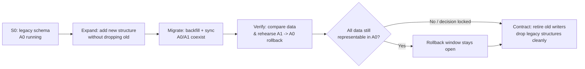
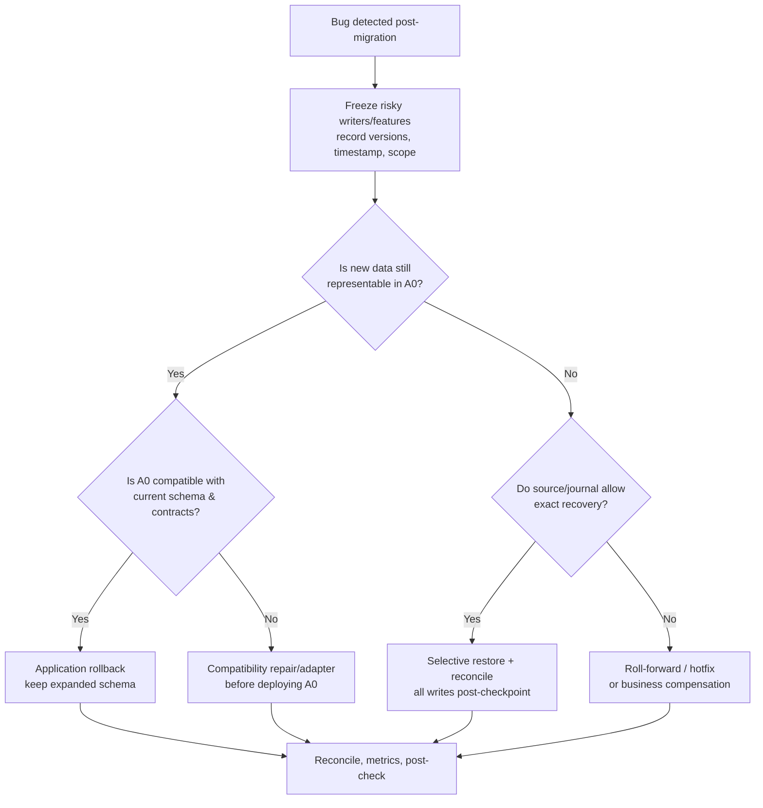

# Verifying Rollback Capability and Limits Under Information Loss

An engineering team replaces two columns `first_name` and `last_name` with `display_name` to support free-form display names. The migration succeeds; the new app reads and writes names properly. When a business bug appears, the team plans to redeploy the old application. Yet the old version still requires **two separate name fields**, while new customers have entered `display_name = "An (Support Team)"` and no reliable rule exists to split it back into `first_name` and `last_name`.

The ability to **execute a reverse `ALTER TABLE` statement** does not mean **data values and semantics have been restored**. If original data was deleted, normalization discarded detail, multiple states were collapsed into one, or new values unintelligible to the old version were written, rollback can be **information-theoretically impossible**, even if the reverse DDL executes cleanly.

This lesson belongs to the **Model Evolution** chapter of **DATABASE_DATA_MODELING**. The module's goal is translating business requirements into data models with clear keys, constraints, and physical schemas—comparing relational, document, graph, and analytical models so systems evolve and verify cleanly. Here we focus on the question: **Can the old version still read/write data created by the new version accurately? If not, where was information lost and which safeguards are needed?**

## 1. "Rollback" Encompasses Distinct Operations

During a deployment, at least four layers can change independently:

| Component | Example Change | What Does "Going Back" Actually Require? |
| --- | --- | --- |
| **Application** | `A0` uses `first_name/last_name`, `A1` uses `display_name` | Re-run `A0` code and handle **all existing data** meaningfully |
| **Schema** | Add then drop columns, alter constraints/indexes | Schema remains compatible with `A0` queries and writes |
| **Data** | Merge fields, convert units, update statuses, swap keys | Restore **reversible** values without fabricating lost info |
| **External contracts** | API/event v2 adds enum values, alters IDs, or shifts field meaning | Old producers/consumers understand new data or use safe adapters |

**Application rollback** redeploys old code; **schema rollback** alters database structure; **data rollback** restores/reverts values; **business rollback** returns workflows to a valid state (often needing compensating entries rather than deleting history). These four do not happen automatically together.

Suppose a team ran `A1` on expanded schema `S1` and wrote some v2 events. Reverting to `A0` is safe only if:

1. `A0` can still connect and query the current schema.
2. `A0` understands **every existing value** or goes through a verified projection/adapter.
3. Subsequent writes from `A0` neither corrupt new data nor violate constraints.
4. Side effects already emitted (payments, emails, published events) are handled consistently.
5. Historical report reproducibility, measurements, and semantics stay intact.

Never judge rollback readiness merely by asking "does the migration suite include a `down.sql` file?".

## 2. Three Levels of Change Reversibility

| Category | Examples | Reversibility |
| --- | --- | --- |
| **Relatively straightforwardly reversible** | Adding unused nullable column; adding index; adding standalone auxiliary table | Usually safe to drop new structures **if no data or consumer depends on them** |
| **Reversible when data and conditions are preserved** | Renaming column; splitting fields with complete mapping; unit conversion with exact precision; key swap with lookup table | Safe only if sufficient original data is retained, an inverse exists, and no values outside the old domain were written |
| **Lossy / not accurately reversible** | Deleting source data; rounding off digits; merging statuses; reducing precision; deduplicating without source tracking; irreversible anonymization | No general inverse; requires **restoring from original sources** or accepting roll-forward / degraded functionality |

A seemingly safe `ADD COLUMN` becomes hard to roll back once the new version writes **values stored solely in the new column**. Conversely, a `RENAME COLUMN` is DDL-reversible yet breaks concurrent old/new app versions with missing-column errors. Evaluate **data + version behavior + rollout timing**, not DDL syntax alone.

### 2.1. Is the Transformation Invertible?

Let `f` be the data transformation from old to new format:

\[
f: D_{\mathrm{old}} \rightarrow D_{\mathrm{new}}
\]

To recover the **exact** old value from the new value, we need an inverse `g` such that:

\[
g(f(x)) = x
\quad \text{for all valid } x \text{ in the old domain}
\]

This requires `f` never to map two **distinct** old values onto the **same** new value within the recovery scope—meaning `f` must be **non-lossy (*injective*)** over the real domain, or discarded details must be retained in a trusted auxiliary source.

Example:

- `("Mary Ann", "van der Meer")` → `"Mary Ann van der Meer"`.
- `("Mary", "Ann van der Meer")` → **also** `"Mary Ann van der Meer"`.

You cannot deterministically recover the original pair from the combined string alone. Even `split(" ", 2)` fails on the first case—it merely picks an arbitrary split.

**Conclusion:** Schema reversal is a technical operation; data reversal requires enough retained information to reconstruct the original values. Retaining originals, mappings, or version histories turns an otherwise lossy migration into one **recoverable within bounded scope and time**.

## 3. Three Questions Before Accepting a Rollback Plan

### 3.1. **Read** Compatibility

Can the old application read rows just written by the new application? Check:

- Were old columns dropped or renamed?
- Did a new enum introduce values absent from old code?
- Did `NULL` become valid where old code crashes on `NULL`?
- Are new keys or currency units outside the old range?
- Did data move to another document/collection/table?

Being able to parse data **does not mean understanding its meaning**. If v2 introduces `PAYMENT_AUTHORIZED` where v1 has only `PAID`, mapping `AUTHORIZED → PAID` can trigger premature shipping or revenue recognition.

### 3.2. **Write** Compatibility

Can the old application keep writing without breaking v2 data?

- Do new constraints reject valid v1 writes?
- Does v1 omit a new field that v2 treats as mandatory?
- Does v1 overwrite a new field with `NULL`/default during full-row updates?
- Do both running versions share definitions for `version`, timestamps, and statuses?
- Can old code replay a side effect already executed by the new version?

While two versions coexist, **read compatibility** and **write compatibility** must be tested **in both directions** across relevant producers and consumers.

### 3.3. Recoverability of **Transformed Data**

Before deleting data, ask:

- Are original values or a change journal sufficient for recovery preserved?
- Does new data contain values **unrepresentable** in the old model?
- Can we trace **which rule version** transformed each record?
- Can counts, monetary sums, keys, and checksums reconcile after backfill/reversal?
- Must we recover **updates made while the migration ran**?

A pre-migration backup alone fails the last question: restoring the raw backup wipes valid transactions committed **after the backup timestamp**.

## 4. Application and Schema Compatibility Matrix

Example on a customer table:

- `A0`: legacy app reading/writing `first_name, last_name`.
- `A1`: transitional compatible app aware of `display_name` while still maintaining legacy fields.
- `A2`: new app writing **only** `display_name` and allowing unsplittable strings.
- `S0`: schema with only the two old columns.
- `S1`: expanded schema with all three columns.
- `S2`: contracted schema with only `display_name`.

| Application | `S0` old | `S1` expanded | `S2` legacy columns dropped |
| --- | --- | --- | --- |
| `A0` | Works | **Works if** triggers/write paths maintain compatibility and constraints don't block | Fails if it still accesses old columns |
| `A1` | Fails if `A1` requires new column | **Works**, within the domain where bidirectional compatibility holds | Fails if `A1` still writes old fields |
| `A2` | Fails | Runs, yet **breaks return to A0** once unsplittable names are written | Works once migration/feature is complete |

The matrix is **not an automatic truth table**. Every "Works" cell requires real testing of code, SQL, migration tools, new data, triggers, queues, and active writers. A real feature can make `A1` handle both `S0` and `S1` via feature detection, but only through explicit design and testing—never by assumption.

### 4.1. "Rollback Window" Is a Contract

The **rollback window** is the period during which evidence confirms the system can revert to legacy operations. It ends **not only when columns are dropped**, but can close the moment **a new writer creates data unrepresentable in the old model**.

For instance, when `A2` writes `display_name = "Store #7"` for a customer lacking first/last names, even while `S1` retains both legacy columns, `A0` may read blank names and write corrupt updates. From that point, reverting to `A0` must be blocked or routed through an approved compatibility adapter.

## 5. Expand → Migrate → Contract Instead of Immediate Breaking Changes

A common evolution pattern is **expand–migrate–contract**:



In practice, enter `Contract` only after **deciding to end legacy app support** or establishing a verified reverse translation. Do not misread the diagram as "wait until compatibility breaks before contracting"; the core point is that every phase has clear **entry/exit gates and rollback boundaries**.

| Phase | Main Action | App Rollback to A0 Possible? | Conditions |
| --- | --- | --- | --- |
| **Expand** | Add nullable columns/tables/indexes and adapters | Usually yes | Does not break legacy reads/writes |
| **Migrate** | Backfill data, sync writers, verify projections | Conditionally | Old data preserved and new updates kept in sync |
| **Verify** | Shadow reads, diffs, replays, rollback drills | Conditionally | Test newly written data and concurrency |
| **Cutover** | Shift reads/writes to new model | Depends on new data | Re-evaluate point of no return |
| **Contract** | End legacy support; drop old columns/indexes/mappings | Usually not directly | Zero legacy consumers; recovery/roll-forward plan ready |

This is a **decision workflow**, not a promise that every engine runs DDL online without locks. Across PostgreSQL, MongoDB, Cassandra, or data warehouses, lock durations, backfills, replication lag, and transaction semantics vary. Test on your actual engine, version, and scale before rollout.

## 6. PostgreSQL Example: Merging Two Names Into One Display Name

Initial schema:

```sql
CREATE TABLE customer_profile (
    customer_id BIGINT PRIMARY KEY,
    first_name TEXT,
    last_name TEXT,
    updated_at TIMESTAMPTZ NOT NULL DEFAULT now()
);

INSERT INTO customer_profile (
    customer_id, first_name, last_name
) VALUES
    (101, 'Mary Ann', 'van der Meer'),
    (102, 'Mary', 'Ann van der Meer'),
    (103, 'An', NULL);
```

Rows 101 and 102 have **different original name pairs**, yet concatenation cannot distinguish them:

```sql
SELECT
    customer_id,
    CONCAT_WS(' ', first_name, last_name) AS display_name
FROM customer_profile
ORDER BY customer_id;
-- 101: Mary Ann van der Meer
-- 102: Mary Ann van der Meer
-- 103: An
```

This illustrates information loss at the **boundary between two fields**; it is not a recommendation to force personal names into fixed first/last schemas across all cultures.

### 6.1. Expand: Add Column While Preserving Source Info

```sql
ALTER TABLE customer_profile
ADD COLUMN display_name TEXT;
```

During compatibility, designate **`first_name`/`last_name` as the source of truth**, with `display_name` temporarily acting as a **derived projection**. Any edit to the two old fields must refresh the projection, even from `A0`. One PostgreSQL option is a trigger:

```sql
CREATE OR REPLACE FUNCTION set_display_name_from_legacy()
RETURNS trigger
LANGUAGE plpgsql
AS $$
BEGIN
    NEW.display_name := NULLIF(
        CONCAT_WS(
            ' ',
            NULLIF(BTRIM(NEW.first_name), ''),
            NULLIF(BTRIM(NEW.last_name), '')
        ),
        ''
    );
    RETURN NEW;
END;
$$;

CREATE TRIGGER trg_customer_display_name_legacy
BEFORE INSERT OR UPDATE OF first_name, last_name
ON customer_profile
FOR EACH ROW
EXECUTE FUNCTION set_display_name_from_legacy();
```

The trigger keeps `display_name` synced **whenever a writer inserts or updates the source fields**. It does **not** guard against an `A2` app writing **only `display_name`**; during the rollback window, **forbid** `A2` write patterns unrepresentable in the legacy fields.

Application-level dual-writes, CDC, or read-on-fallback can also fit, provided they handle **old writers, concurrent update races, retries, and lag**—never just two standalone SQL calls assumed atomic.

### 6.2. Migrate: Backfill and Reconcile

After installing the trigger, backfill existing rows:

```sql
UPDATE customer_profile
SET display_name = NULLIF(
    CONCAT_WS(
        ' ',
        NULLIF(BTRIM(first_name), ''),
        NULLIF(BTRIM(last_name), '')
    ),
    ''
)
WHERE display_name IS DISTINCT FROM NULLIF(
    CONCAT_WS(
        ' ',
        NULLIF(BTRIM(first_name), ''),
        NULLIF(BTRIM(last_name), '')
    ),
    ''
);
```

On real data, a full-table `UPDATE` causes locks, WAL, bloat, replication lag, and I/O spikes. Benchmark and use **key-range batching**, checkpoints, rate limits, and retries/resumes; the monolithic query above only illustrates the logic.

Verify every row's `display_name` matches the projection:

```sql
SELECT COUNT(*) AS inconsistent_rows
FROM customer_profile
WHERE display_name IS DISTINCT FROM NULLIF(
    CONCAT_WS(
        ' ',
        NULLIF(BTRIM(first_name), ''),
        NULLIF(BTRIM(last_name), '')
    ),
    ''
);
-- 0 means the projection is consistent at read time.
```

This is a **projection consistency check**. It does not prove string concatenation matches the user's desired display name. Distinguish:

- *Correct transformation*: faithful to the defined function.
- *Correct business meaning*: whether that function reflects business needs.

### 6.3. Deploy Compatible Application `A1`

`A1` can read `display_name` for display while **writing via the legacy pair** as long as the rollback window stays open. Once the product allows unsplittable display names, that is a **semantic and write-contract change** requiring a dedicated cutover milestone.

While `A0` and `A1` coexist:

- `A0` reads and writes old columns; the trigger updates the projection.
- `A1` reads both ways or reads `display_name` once backfilled and verified.
- Block `A1` from writing `display_name` values without maintaining the legacy pair.
- Define cache, search index, and event payload refresh/invalidation rules.
- Monitor lag/consistency and test rollback on **recently mutated rows**, not just untouched rows.

### 6.4. Rollback `A1 → A0` Within the Safe Window

At this stage, reverting safely typically means:

1. Disabling the new feature / adjusting writers so no out-of-domain values are created.
2. Ensuring `A0` stays compatible with expanded schema **`S1`**.
3. Redeploying `A0` or routing traffic back to `A0`.
4. **Keeping `display_name` and the trigger** temporarily—no need to run `DROP COLUMN display_name` during incident response.
5. Reconciling recently written records, metrics, and business side effects.

Application rollback **does not require DDL rollback**. Leaving an unused nullable column in place is far safer than running destructive schema DDL during an outage.

### 6.5. When Does `A2 → A0` Rollback Become Impossible?

Suppose `A2` lets users freely enter:

```sql
UPDATE customer_profile
SET display_name = 'An (Support Team)'
WHERE customer_id = 103;
```

The `UPDATE OF first_name, last_name` trigger does not fire here. Row 103 still holds `first_name = 'An'`, `last_name = NULL`, while `display_name` holds the new string. `A0` reads **"An"** instead of what the user expects. If `A0` edits `first_name`, the trigger overwrites the new projection.

The moment `A2` writes data understood only by the new model, **semantic-preserving rollback to `A0` is no longer safe**, even though both old columns **remain in the table**. Options:

- Disable the incompatible feature and **roll forward with a hotfix**.
- Use an approved **compatibility adapter** with explicit rules (may degrade functionality without recovering original first/last).
- If legacy data was preserved and no out-of-domain records were written, revert to `A0` after reconciliation.
- If **another authoritative source** holds the details, reconstruct verifiably and record provenance.

Never arbitrarily split `display_name` into first/last and declare "rollback succeeded." An arbitrary split **invents data** rather than proving original values.

### 6.6. Contract: Drop Columns Only After Legacy Support Ends

Illustrative **DDL executed only after go/no-go confirms the rollback window has closed**:

```sql
-- Illustrative Contract step ONLY; DO NOT run while A0/A1 still use
-- legacy columns or rollback to A0 may still be required.
DROP TRIGGER trg_customer_display_name_legacy
ON customer_profile;

DROP FUNCTION set_display_name_from_legacy();

ALTER TABLE customer_profile
    DROP COLUMN first_name,
    DROP COLUMN last_name;
```

This is an **information- and compatibility-destroying change**, not harmless cleanup. Apps, views, ETL jobs, indexes, triggers, and partners referencing old columns must migrate first; the engine may reject `DROP` on live dependencies, and never use `CASCADE` blindly without understanding the blast radius.

After `Contract`, returning to `A0` requires recreating schemas **and** restoring valid first/last data—which normally **cannot** be derived from `display_name`.

## 7. Why a `DOWN` Migration Does Not Prove Reversibility

A migration tool may define:

```sql
-- up.sql
ALTER TABLE customer_profile ADD COLUMN display_name TEXT;

-- down.sql (easy to write, blind to newly created data)
ALTER TABLE customer_profile DROP COLUMN display_name;
```

That `down.sql` merely drops the new column. If the new version wrote unique information into `display_name`, running it **destroys new data**. It neither restores first/last names nor undoes emitted external events and side effects.

A syntactically valid down script answers only **"can we revert the structural shape?"**; a real rollback check must answer:

1. Does the old schema work with the old code?
2. Are all new values **accurately representable** in the old model?
3. Is newly written data preserved rather than dropped or partially recovered?
4. Do external systems accept/understand events emitted by the new code?
5. Can valid business state be restored after already-executed side effects?

## 8. Data Transformations That Easily Lose Information

| Transformation | Old Form | New Representation | Why Is It Hard to Reverse? |
| --- | --- | --- | --- |
| **Concatenating fields** | `first_name` + `last_name` | `display_name` | Field boundary is lost |
| **Rounding** | `DECIMAL(12,4)` price | `DECIMAL(12,2)` | Trailing fractional digits discarded |
| **Shrinking width/precision** | `BIGINT` | `INT` | Legacy values may overflow; casts fail or truncate |
| **Coercing IDs to numbers** | Code `"00123"` | Integer `123` | Leading zeros, formatting, and namespace lost |
| **Normalizing without keeping raw** | `"AbC"` and `"abc"` | `"abc"` | Distinct inputs collapse into one |
| **Collapsing statuses** | `AUTHORIZED`, `CAPTURED` | `PAID` | Original payment stage is lost |
| **Aggregating events** | Per-event details | Daily totals | Per-event distribution, IDs, and order lost |
| **Merging identities** | Two customer BKs | One canonical ID | Without mapping history, cannot tell which record owned each fact |
| **Deduplicating without evidence** | Multiple source rows | One surviving row | Discarded rows and merge rationale cannot be recovered |
| **Dropping timezone/offset** | Local time + zone/offset | Zone-less date/time | Original instant ambiguous, especially across DST |
| **Redaction/anonymization** | Identifying PII | Token / erased record | By design without recovery keys, reversal is forbidden or impossible |

Some transformations can be reversed if **trusted source data remains**. That depends on retention, permissions, completeness, consistency, and replaying post-migration writes. "We have backups" never means "every operation is reversible".

### 8.1. Units of Measure and Currencies

Converting `amount_cents BIGINT` → `amount DECIMAL` reverses cleanly if currency/exponent is known and no rounding occurred. Storing a bare `amount` without `currency`, or using binary floats with differing rounding rules, prevents reliably recovering exact original cents.

If v2 adds a new currency while v1 supports only VND, even without losing digits, **the old model cannot represent the new currency**. That is **domain-compatibility loss**, distinct from function information loss.

### 8.2. Changing Status Semantics

A legacy `PAID` enum may have meant "payment settled"; v2 splits `PAYMENT_AUTHORIZED` and `PAYMENT_CAPTURED`. Never map both back to `PAID` if v1 treats `PAID` as settled cash, as that triggers premature fulfillment or revenue booking.

You might map v2 `PAYMENT_AUTHORIZED` back to v1 `PENDING` if an equivalent state exists, **only after proving every downstream workflow behaves properly**—losing detail never justifies mapping to a merely "similar-sounding" state.

## 9. Retaining "Enough Information to Revert": Keep Both Values and Provenance

Common recovery mechanisms:

| Mechanism | What It Preserves | Limitations |
| --- | --- | --- |
| **Parallel legacy columns** | Legacy values on the same row | Goes stale if new writers stop updating it |
| **Migration journal** | Before/after values, row ID, rule version, timestamp | Write/storage cost; must protect sensitive data |
| **ID/version mapping table** | Links between pre- and post-migration business/surrogate keys | Does not restore deleted content if mapping is incomplete |
| **Retained event log** | Original events to rebuild projections | Requires complete logs, per-key ordering, versioned schemas, and correction handling |
| **CDC / change log** | Data mutations within tracking window | Retention-bounded; does not replace source of truth if offsets expire |
| **Snapshot/backup + PITR** | Point-in-time recoverable state | May omit valid post-backup writes; restores must be verified |
| **Dual-format read/write** | Serves multiple versions during transition | Sync overhead, conflicts, write amplification, complex logic |

An illustrative audit/journal schema:

```sql
CREATE TABLE customer_name_migration_journal (
    migration_id TEXT NOT NULL,
    customer_id BIGINT NOT NULL,
    row_version BIGINT NOT NULL,
    legacy_first_name TEXT,
    legacy_last_name TEXT,
    new_display_name TEXT,
    transform_version TEXT NOT NULL,
    captured_at TIMESTAMPTZ NOT NULL DEFAULT now(),
    PRIMARY KEY (migration_id, customer_id, row_version)
);
```

This is a **reference journal schema**, without triggers or pipelines attached yet. To use a journal for recovery, guarantee **atomicity or reconciliation between row updates and journal writes**, clear version ordering, capture of all in-migration updates, and proper permissions/retention.

**Never retain PII indefinitely just "in case of rollback":** names, addresses, and IDs are sensitive data. Balance recoverability against data minimization, encryption, erasure requests, and retention limits. Hiding copies in a side table does not make retention compliant with privacy rules.

## 10. When Should Reversibility Conditions Be Tested?

Never wait for a production outage to test rollback.

| Milestone | Question | Required Evidence |
| --- | --- | --- |
| **Before DDL** | Does `A0` still run on the expanded schema? | Migration dry-run + `A0`/`S1` integration tests |
| **After expand** | Do new constraints/defaults/indexes break old writers? | Shadow/compat tests; write-error monitoring |
| **During backfill** | Do concurrently updated rows get stale projections or get skipped? | Sample diffs, counters, checkpoints, retries |
| **Before reader cutover** | Do new reads match legacy outputs? | Controlled paired-read comparisons and mismatch stats |
| **After `A1` canary** | Does `A0` accurately read/write rows `A1` just touched? | Rollback drill on fresh writes and concurrent traffic |
| **Before `A2` new-only writes** | Are all new values representable in v1? | Domain compatibility tests; rollback window sign-off |
| **Before contract** | Do any old consumers remain? Is old data still needed? | Dependency inventory, telemetry, backup/recovery test |
| **After contract** | If a bug hits, what is the realistic recovery path? | Roll-forward/hotfix runbook + restore drill |

Stage **`A1`** is the time to test "new app writes, old app reads; old app writes, new app reads" using **realistic new data and edge cases**, not just legacy v1 fixtures.

## 11. Controlled-Data Rollback Drill Procedure

A **rollback drill** is a recovery rehearsal with explicit pass criteria on a representative environment with protected data.

1. **Capture baseline:** app versions, migration/schema versions, row counts, scoped checksums or aggregates, contract versions, queue states, and source snapshots.
2. **Expand:** execute non-destructive DDL, start `A0` on `S1`; verify legacy CRUD and transactions.
3. **Backfill:** intentionally include `NULL`s, Unicode strings, whitespace, concurrent updates, retries, and late events.
4. **`A1` mixed traffic:** run `A0`/`A1` concurrent reads and writes per permitted scenarios; watch divergence and locking.
5. **Simulate incident:** disable feature, redeploy `A0` **while keeping `S1`**, drain queues and active retries.
6. **Compare results:** can `A0` read rows `A1` wrote? Do monetary sums, fact counts, and FKs hold? Any lost updates, duplicates, or bad fallbacks?
7. **Re-enable `A1`:** verify rolling forward after rollback rather than stranding data halfway.
8. **Test irreversible boundary:** enable `A2` to write new-only data; verify **rollback guardrails**, operator alerts, and alternative recovery.
9. **Record evidence:** measured recovery duration, potential data loss under restore, mismatches, manual steps, and go/no-go decision.

**Never run destructive `DROP`/restore drills on production** just to prove rollback works. Drill against clones/fixtures with controlled scenarios; production execution needs a change plan, verified backups, permissions, and an appropriate maintenance window.

### 11.1. Invariants Matter More Than "Error-Free SQL"

| Invariant | What to Verify |
| --- | --- |
| **Identity** | Zero duplicate business keys; PKs/FKs and mappings intact |
| **Aggregates** | Revenue, balances, and event counts unchanged outside valid corrections |
| **Completeness** | Zero missing required rows/fields; new `NULL`s handled properly |
| **Metric definitions** | `AUTHORIZED` never merged into `CAPTURED` to inflate revenue |
| **Precision** | Money, FX rates, units, and decimal precision never silently truncated/rounded |
| **States** | Old app never performs dangerous transitions on new values |
| **Idempotency** | Reprocessing never duplicates payments, shipments, or events |
| **History** | Event time, effective time, and SCD versions remain reconstructible |
| **Freshness** | Backfill and rollback never make dashboards claim completeness prematurely |
| **Security** | Access policies and erasure requests remain honored post-restore/replay |

## 12. Application Rollback Differs From Backup/PITR Restore

**Point-in-time recovery (PITR)** rewinds the entire database to a point supported by backups and WAL/redo logs. It is **state restoration**, not the exact inverse of a single migration.

Example:

```text
09:00  pre-migration backup/snapshot
09:15  add display_name column
09:30  backfill finishes
10:00  2,000 new valid orders written
10:30  migration discovered to corrupt reports
```

Restoring the database directly to 09:00 **wipes 2,000 valid orders** and side effects committed between 09:00 and 10:30. Restoring just one table from an old backup into a live DB risks breaking FKs, versions, sequences, transaction histories, event offsets, and cross-table consistency.

A safer recovery approach:

1. **Restore an isolated clone** to the pre-migration timestamp.
2. Extract original values needed for recovery from that clone.
3. Reconcile against valid updates committed after the restore timestamp.
4. Design verified conflict resolution keyed by business key / event ID / version.
5. Apply results to production only after proving invariants and ensuring the repair step itself is reversible.

Never assume PITR can cleanly restore **a single row or table** in isolation from the rest of the database; actual capabilities depend on the DBMS, tooling, and recovery plan. Business-defined **RPO** (acceptable data loss) and **RTO** (acceptable recovery time) must be **measured in drills**, not copied from slides.

### 12.1. Backups Do Not Replace Reversibility Checks

Backups supply raw source data for recovery, yet:

- Retention may have expired or missed the most recent writes.
- They may exclude CDC logs, event buses, or linked object storage.
- Restoring terabytes can take hours or days—violating RTO.
- Restoring a DB cannot "unsend" emails, notifications, or bank transfers.
- Snapshots holding PII remain subject to access controls and erasure rules.

Classify upfront which migrations can roll back via **config/code**, which require **data repair**, and which allow **roll-forward only**.

## 13. When Should You Roll Forward Instead of Rolling Back?

**Roll-forward** keeps the new schema/data and ships a code fix or supplemental migration. It is usually safer once new data can no longer fit the old model.

| Scenario | Priority Path to Evaluate | Why |
| --- | --- | --- |
| Only added nullable column; no new-only writes yet | Roll back code `A1 → A0`, keep expanded schema | Minimal data risk; easy to observe |
| Buggy backfill, original data still intact | Pause writers; verified repair/re-backfill | Avoids full DB restore |
| New writer created states outside old domain | Hotfix/roll-forward or approved compatibility adapter | v1 cannot accurately represent new data |
| Source column already `DROP`ped without trusted source | Recover from backup/journal if sufficient, or handle intentional loss | Down migration cannot recreate values |
| External payments/emails/events already emitted | Business compensation, idempotency, and reconciliation | DB rollback does not undo external side effects |
| Catastrophic outage with PITR as last resort | Disaster recovery per approved RPO/RTO | Accepts bounded post-restore data loss |

**Not every rollback is bad.** What matters is matching the technique to **data state and blast radius**, rather than reflexively running `down.sql` when CI/CD flags an error.

## 14. API and Event Contract Compatibility

A data model is more than database tables. Event schemas, REST DTOs, search indexes, and analytics projections evolve too.

### 14.1. Adding Fields Is Easier Than Changing Field Meanings

Event v1:

```json
{
  "schema_version": 1,
  "payment_id": "p-100",
  "status": "PAID"
}
```

Event v2:

```json
{
  "schema_version": 2,
  "payment_id": "p-100",
  "status": "PAYMENT_AUTHORIZED",
  "authorization_expires_at": "2030-05-10T00:00:00Z"
}
```

Consumer v1 may not understand `PAYMENT_AUTHORIZED`, even though the JSON parses and the new field is optional. The break lies in **meaning and value domain**, not syntax.

| Event Change | Consumability by Legacy Consumers | What to Verify |
| --- | --- | --- |
| Add optional field without changing semantics | Often compatible if unknown fields are ignored | Strict vs. lenient parsers, defaults, contracts |
| Remove field required by old consumers | Typically breaking | Can a v1 adapter/payload be maintained? |
| Add new enum value | Often breaking despite valid JSON | Unknown-enum policy, dead-letter queues, state rules |
| Change unit from cents → major unit | Semantically breaking | Versioning, explicit units, precision |
| Collapse granular events into summaries | Lossy for consumers needing every event | Retain raw events / dual streams if needed |
| Change IDs or keys | Can break dedup and joins | Mappings, migration windows, versions |

### 14.2. Reader–Writer Compatibility Must Be Tested Directionally

Between producers `P0/P1` and consumers `C0/C1`, test all cases:

- `P0 → C1`: does the new consumer read old events cleanly?
- `P1 → C0`: does the old consumer read and interpret **new data** accurately?
- `P1 → C1`: are new-version semantics right?
- Does replaying v1 events through the new consumer reproduce historical state per rules?

If `P1 → C0` is unsafe, **you cannot roll back just the consumer** to `C0` while `P1` keeps emitting v2 events. Coordinate the producer, use semantically faithful down-conversion adapters, controlled dual-publish, or roll forward.

### 14.3. Dropping Old Schemas Is Not Enough: Queues Still Hold Old Events

Even after every producer switches to v2, brokers/DLQs and event logs still retain v1 messages. Consumer v2 must support v1 throughout the retention/replay window or use dedicated migration/reprocessing. Likewise, rolling a producer back to v1 fails if consumers only accept v2 without a compatibility contract.

**Never "keep a v1 field for show" while reassigning it a new meaning.** Schema compatibility must pair with **semantic compatibility**.

## 15. Differences When Evolving Different Storage Models

| Model | Typical Changes | Characteristic Rollback Limits |
| --- | --- | --- |
| **Relational (PostgreSQL/MySQL...)** | DDL, constraints/indexes, normalization/splits, PK/FK changes | DDL may reverse, yet data migrations/re-joins lack inverses; locking varies by engine |
| **Document** | Add/remove fields, reshape nested arrays, schema-on-read | Mixed document versions in one collection; dropping fields or flattening arrays loses order/cardinality |
| **Wide-column/KV** | Change partition key, clustering, TTL, key encoding | Often requires new tables/backfills; expired TTL data or changed routing will not auto-reappear |
| **Graph** | Merge nodes, rename edge types, normalize identities, flip direction | Merging identities and dropping edges loses provenance; old traversals shift meaning |
| **Columnar/warehouse** | Change fact grain, partition/sort, aggregate, Parquet schema | Aggregation discards detail; partition rewrites, materialized views, and reports need restatement |

General rules:

- **Document:** `field absent`, `field: null`, and `field: []` often carry distinct meanings. A migration filling everything with `null` breaks recovering "never provided".
- **Wide-column:** TTL expires data per engine compaction/policy. Once expired and purged, lowering TTL never brings records back—you need valid sources/backups.
- **Graph:** merging two business entities into one node blurs relationship boundaries unless original IDs and per-edge provenance are kept.
- **Analytical facts:** coarsening grain from **transaction lines** to **daily totals** drops event IDs; you can verify totals, never rebuild line items from sums alone.

Never assume "schema-less NoSQL is always backward compatible". Schemas still exist in **code, indexes, keys, contracts, and data meaning**, even when the DB does not enforce uniform columns per document.

## 16. Data Correctness During Dual-Write and Backfill

"Write both old and new" sounds safe yet easily breaks:

```text
time  old_first,last      new_display_name
10:00 "Mary", "Smith"    "Mary Smith"
10:01 old writer changes last -> "Jones"
10:01 new reader still sees  "Mary Smith"  (stale)
```

Dual-writes across separate stores without a shared transaction risk **partial success**. Even inside one DB, two apps can update the same row in unexpected order. Define:

1. **Authoritative representation:** during the rollback window, which is the source of truth?
2. **Sync direction:** old → new, new → old, or bidirectional? Is reverse sync lossy?
3. **Consistency:** in-transaction sync, trigger, CDC/outbox, or async eventual?
4. **Conflict resolution:** row versions, compare-and-set, event ordering, trusted timestamps?
5. **Backfill race:** can a job overwrite newer updates written while scanning?
6. **Completeness:** at cutover, how do we verify every row synced and async lag hit zero?

In the name example, **old → new** sync is deterministic. **New → old** sync for free-form names **has no exact rule**. Thus never claim "bidirectional dual-write keeps rollback open forever"—bound permitted values per phase.

### 16.1. Ensuring Backfill Does Not Clobber Concurrent Updates

Engine-specific safeguards:

- Update only rows with unprocessed `projection_version`/`source_version`.
- Use version comparisons or conditional updates so freshly mutated rows are never overwritten.
- Pair snapshots with CDC to capture changes occurring during backfill.
- Use idempotent reprocessing keyed by primary/business key.
- Monitor row counts, per-cohort mismatches, max lag, and checkpoints.

**Never check only "backfill job completed".** A completed job that missed concurrent updates still leaves old or new apps reading wrong values.

## 17. Lossy Decisions Must Be Explicitly Documented

Before an irreversibly lossy migration, engineering and business owners must sign off on an **evidenced decision record**:

| Decision Item | Example Entry |
| --- | --- |
| What data is lost? | `first_name/last_name` boundary, price precision, event granularity |
| Where can it be recovered from? | Legacy columns, mappings, backups, event logs; retention limits |
| Which versions break? | `A0`, v1 consumers, legacy ETL, historical dashboards |
| When does the rollback window close? | Once `A2` enables new-only writes or before `DROP` legacy |
| Action if bugs appear past that point? | Roll-forward, degraded adapter, or reconciled restore |
| RPO/RTO and business impact? | Risk of losing valid transactions or disabling features |
| Who approves and verifies? | Business owner, data steward, SRE/DBA per org policy |
| Audit trail? | Migration ID, code/schema versions, timestamps, runbook, drill results |

**Sometimes originals must not be preserved:** e.g., legal personal-data erasure requests. Once recovery is intentionally removed, design rollback **without resurrecting erased data**—never stash secret copies "just in case". Reversibility is always bounded by **privacy rights and data policies**.

## 18. Safe Retreat Paths by Incident Severity



"Freezing writers" does not necessarily mean shutting down the whole system: disable a feature flag, block new event types, or route traffic back to compatible paths. The goal is **stopping creation of data the retreat path cannot understand**, while keeping safe operations running.

### 18.1. Short Runbook

1. Identify **running versions** (app, schema, event producers/consumers, migration/transform versions).
2. Block **incompatible write paths**; distinguish read-only bugs from corrupted writes.
3. Inspect the compatibility matrix and **actual written records**, not just feature flag configs.
4. Prefer **application-only rollback** on the expanded schema when safe.
5. If repair is required, restore an isolated clone to read original values, then reconcile newer writes.
6. If exact semantics cannot be restored, roll forward and run verified compensation workflows.
7. Reconcile PKs/FKs, counts, amounts, statuses, event IDs, queue lag, dashboards, and permissions.
8. File an incident postmortem and tighten **irreversible boundary gates** for future changes.

## 19. Common Misconceptions

| Misconception | What Actually Happens | Fix |
| --- | --- | --- |
| "We have a down migration so it's fully reversible" | DDL reverses, yet new data was lost or shifted meaning | Check transform invertibility, schema, and app versions |
| "Old column isn't dropped yet so rollback always works" | New writers may have written values unrepresentable in v1 | Bound write contracts and rollback windows |
| "Just restore from backup" | Drops valid post-backup transactions and desyncs side effects | Isolated restore + reconciliation; measure RPO/RTO |
| "Split on spaces to recover first/last names" | Concatenation has no unique inverse | Retain original fields or accept semantic loss |
| "Rounding 4 decimals to 2 hurts nothing" | Precision is lost; reports/reconciliation drift | Assess error bounds and retain originals |
| "Adding a new enum value is backward compatible" | v1 code may crash or misinterpret the value | Test v2 payloads against v1 consumers |
| "Dual-write automatically keeps formats identical" | Partial writes, races, stale projections, non-invertible maps | Single source of truth, versioning, sync/reconcile |
| "Backfill job succeeded means data is right" | Concurrent updates may have been skipped or overwritten | Shadow diffs, lag checks, invariants, replays |
| "Unchanged row count means clean migration" | Same row count can hide lost currency/status/precision | Verify business semantics |
| "DB rollback also reverts emails/payments" | External side effects already executed | Idempotency and business compensation |
| "Drop legacy right after cutover" | Old consumers and queues still depend on it | Audit all dependencies and retention before contract |
| "Schema-less document DBs evolve freely" | Apps still enforce expected shapes and semantics | Versioning and backward/forward compatibility tests |
| "Retain PII forever for rollback safety" | Violates data-protection policies | Honor retention and erasure; use alternative designs |

## 20. Practice Exercises

### Exercise A — Merging Names

A legacy system has `first_name = "Mary Ann"`, `last_name = "van der Meer"`. The new system stores only `display_name`. Prove with **two distinct name pairs** why two fields cannot be uniquely recovered from one string. Design the expand/migrate phase, compatible write path, and rollback cutoff.

**Hint:** keep legacy fields during compatibility, restrict new writers to legacy-representable data, and test multi-part names, `NULL`s, Unicode, and concurrent updates.

### Exercise B — Reducing Monetary Precision

Old table stores `unit_price DECIMAL(12,4)`; new schema stores `DECIMAL(12,2)`. Construct two distinct prices that round to the same new value; explain why reversing via `ALTER COLUMN ... TYPE DECIMAL(12,4)` **cannot recover** the lost digits.

**Hint:** changing precision alters information; exact recovery requires preserving original prices, units, and rounding rules in a trusted source.

### Exercise C — Adding Payment States

v1 uses `PENDING, PAID, CANCELLED`. v2 adds `PAYMENT_AUTHORIZED` and `PAYMENT_CAPTURED`, where v1 `PAID` meant captured funds. Build the v1/v2 producer/consumer matrix, identify when `v2 → v1` rollback is dangerous, and propose a compatibility mapping that never misinterprets authorization as captured cash.

**Hint:** a parseable code can still be semantically incompatible; never downgrade captured states or unlock fulfillment solely from authorization.

### Exercise D — Partitioning and Retention

A new telemetry system switches from daily to hourly buckets and reduces TTL from 365 days to 30 days. After 60 days, a team wants to roll back to the old model to query 1-year history. What **cannot** be recovered merely by flipping routing and raising TTL? Specify required raw sources/backups and how to verify reconstructed event counts.

**Hint:** data purged by retention does not reappear; routing versions, event IDs, and replayable raw sources must be retained across the required horizon.

### Exercise E — Aggregated Reports

A warehouse collapses `sales_line` (item grain) into `daily_revenue_by_store`. A rollback plan demands reconstructing retail orders from the summary table. Explain why that is impossible, design a transactional/append-only event log for reprocessing, and define reconciliation metrics.

**Hint:** daily totals lack order IDs, line quantities, order, and item breakdown. You can check matching sums, never reconstruct source lines from aggregates.

### Exercise F — Testing Rollback Under Concurrent Writes

`A0` and `A1` run together. `A0` writes `first_name/last_name`; `A1` reads `display_name`. Backfill scans all records amid 1,000 updates over 10 minutes. Design an experiment using triggers/CDC or source versions to prove zero stale/lost updates and safe `A1 → A0` canary rollback.

**Hint:** inject updates right before, during, and after backfill; reconcile freshly mutated rows—not just the initial snapshot—and measure lag and mismatches per cohort.

### Exercise G — PITR With Valid Post-Migration Transactions

09:00 backup, 09:30 migration, 10:00 2,000 valid orders committed, 10:30 bug detected. Propose a recovery plan that does not wipe those 2,000 orders just to restore the 09:00 schema. State PITR's limits, the event log's role, and required RPO/RTO approvals.

**Hint:** restore an isolated clone, extract original values, reconcile new records by ID/version, or roll forward if the migration only broke a read projection.

## 21. Checklist Before Claiming "Rollback Is Possible"

- [ ] Distinguished **application**, **schema**, **data**, and **contract/business rollback**.
- [ ] Built `A0/A1/A2` × `S0/S1/S2` compatibility matrix covering **both reads and writes**.
- [ ] Defined the **rollback window** and which events/features close it.
- [ ] Evaluated invertibility for every data transform: exact inverse exists, or original sources are retained?
- [ ] Preserved originals/mappings where merges, rounding, deletes, deduplication, aggregations, or ID swaps occur if recovery is needed.
- [ ] Designated the **source of truth** and synchronization rules across columns/formats during compatibility.
- [ ] Backfill uses checkpoints, idempotency, concurrent-update handling, lag tracking, and reconciliation.
- [ ] Tested `A0` reading `A1` writes and `A1` reading `A0` writes before cutover.
- [ ] Tested new values outside the old domain, not just legacy v1 fixtures.
- [ ] Verified PKs/FKs, counts, aggregates, precision, enum semantics, event idempotency, and version histories.
- [ ] Kept legacy structures uncontracted while consumers, queues, batches, or read models still depend on them.
- [ ] Prepared **roll-forward** or compensation plans for irreversible changes.
- [ ] Rehearsed backup/PITR restores with realistic RPO/RTO and post-backup reconciliation.
- [ ] Journal/backup/provenance storage complies with security, retention, and erasure policies.
- [ ] Measured canary outputs, metrics, drift, queue lag, and recovery times before go/no-go.
- [ ] Runbook names who authorizes rollback, who approves data loss, and how impact is communicated.
- [ ] Verified **data semantics and business impact**, not merely migration tool exit status.

**Key takeaway:** **Safe rollback is an engineered and verified property**, never something inferred from having a `down.sql` file or a "Redeploy old version" button. Once data passes through a lossy transform, new apps emit values beyond the old domain, or side effects reach external systems, retreat may narrow to **selective restoration, reconciliation, or roll-forward**. Preserve authoritative originals while policy permits, mark the point of no return, and test **both reads and writes on new data** before claiming the system still has a way back.
