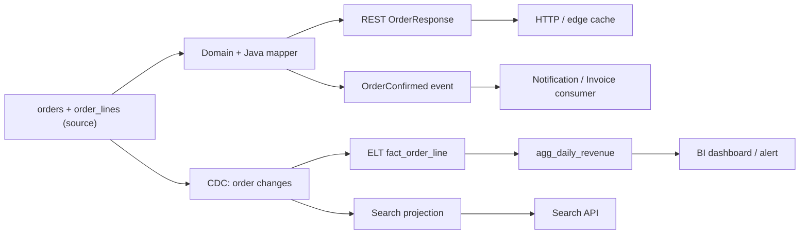
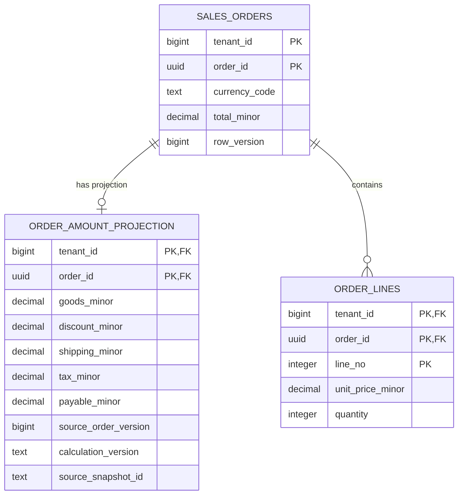

# Assessing Impact on Consumers and Derived Data

A change to a data model rarely affects only a single table. When changing how an order's total amount is represented, the source table may migrate cleanly, yet the API still returns the legacy field; event consumers keep using the old formula; caches hold stale entries; analytical tables have already aggregated by the prior rule; a dashboard may display revenue higher or lower than reality even though every SQL query succeeds.

The core question of **model evolution** is: **which consumers and derived datasets are reached by a change in structure, identity, or data semantics; who must change, in what order, and what evidence is required before retiring the old model?**

This lesson belongs to the **Model Evolution** chapter of the **DATABASE_DATA_MODELING** module. Aligned with the module's learning goals, we translate business requirements into verifiable entities, relationships, constraints, keys, indexes, and physical schemas while evaluating how relational, document, graph, and analytical choices affect evolvability. This lesson focuses on **impact assessment**: dependency mapping, data compatibility checks, derived-data classification, migration/backfill planning, reconciliation, and verifying rollback readiness when a change falls short.

Implementation examples use **PostgreSQL 15+** and Java 17+, though impact assessment principles do not depend on a specific ORM, database, or message broker. Code snippets assume the application has proper transactions, authorization, and pipelines; no checklist replaces measuring and testing on your actual architecture.

## 1. Do Not Equate Schema Changes With Data Contract Changes

The **physical schema** comprises tables, columns, types, indexes, partitions, and FKs. A **data contract** also includes meaning, units, grain, timing, completeness, mutability, and who is authorized to use that data.

| Contract Layer | Example | What Can Break on Change |
|---|---|---|
| **Business/domain** | "Total payable = goods − discount + shipping fee + tax" | Old and new values no longer share the same meaning |
| **SQL schema** | `orders.total_minor NUMERIC(20,0)` | Queries, views, triggers, ORMs, and stored procedures cannot find the column |
| **Identity and relationships** | `(tenant_id, order_id)` as logical key | FKs, joins, deduplication, upserts, API routes |
| **API** | Response `totalAmountMinor`, status, and currency | Mobile apps / integrating clients misread or fail to parse |
| **Event/message** | `OrderConfirmedV1.totalMinor` | Event consumers, replay, schema registry |
| **CDC / replication** | `orders` rows emitted over a change stream | Connectors, pipelines, and downstream schema mappings |
| **Derived data** | `order_read_model`, search index, cache, data mart | Stale un-converged results, unable to rebuild, or wrong metrics |
| **Operations** | Backups, audits, permissions, retention, alerts | Restores bring back legacy data, incomplete purge workflows |

A change can be **syntactically compatible while breaking the semantic contract**. For instance, keeping the name `total_minor` and type `BIGINT` while shifting its meaning from "net total after discount" to "gross total before discount" lets every existing query run while producing wrong figures.

Conversely, renaming a physical column while preserving the same meaning through a compatibility view/adapter may have far less impact on the API.

**Rule:** before asking "will this migration run?", ask "**who relies on what this data means?**".

## 2. Identify the Right Subjects and Assessment Scope

A **consumer** is not just someone opening a dashboard. It is any component that depends on data structure or meaning:

- **Write path:** controllers, command handlers, domain services, batch importers, schedulers, webhook receivers.
- **Read path:** repositories/queries, Java/JPA entities, APIs, mobile/web clients, exports, invoice templates.
- **Integrations:** event publishers/consumers, CDC connectors, ETL/ELT, CRM/ERP syncs, third parties.
- **Derived data:** summary tables, materialized views, search indexes, read models, caches, warehouse facts/dimensions, feature stores.
- **Controls:** alerts, fraud rules, reconciliations, data quality checks, audit logs, retention/purges, backups/restores, permissions.
- **People and processes:** analysts owning metrics, partners receiving files, finance teams, support/reconciliation teams.

A consumer might run an **older application version** for several days, or a batch job might run only at month-end. Checking only currently deployed application code easily misses infrequently running consumers.

### Data Scope Must Be Stated Precisely

For every change, document:

1. **Entity:** `Order`, `OrderLine`, `Customer`, revenue fact, or graph edge?
2. **Tenant/partition/region:** changing all data or only a subset?
3. **Effective period:** forward-only from now on, or applied retroactively to historical data?
4. **Semantics:** is the field changing type, grain, formula, status, or time policy?
5. **Write and read paths:** are there multiple writers, multiple app versions, or offline systems?
6. **Source of truth:** which component has authority to explain the final value?
7. **SLAs:** which consumers require immediate consistency, and which tolerate lag?
8. **Protection requirements:** are new PII fields or copies of sensitive data introduced?

A document stating only "change field A to B" without scope and effective timing is **insufficient** for impact assessment.

## 3. Build an Inventory of Data Consumers and Derived Datasets

Create a **dependency inventory** before drafting a migration plan.

| Consumer / Dataset | What It Reads and Where | Dependent Contract | Owner | Verification Method |
|---|---|---|---|---|
| Order service | `orders.total_minor` | Type, currency, status | Order team | Integration tests/queries |
| REST API `GET /orders/{id}` | Domain order → response | `totalAmountMinor` | API team | Two-version contract tests |
| Java/JPA repository | Columns, nullability, enums | Mapping and transactions | Backend team | Real-DB tests |
| `OrderConfirmedV1` | Event snapshot | Total + V1 schema | Integration team | Consumer compatibility |
| CDC connector | WAL/row changes | Column names and DDL | Platform/Data team | End-to-end CDC |
| Search index | Order ID, amount, status | Mapping, freshness | Search team | Reindex + query assertions |
| Cache | Response by `tenant:orderId` | TTL, invalidation | Backend/Infra | Read-after-write tests |
| `fact_order_line` | Price × quantity, discount | Grain and amount definition | Data team | Source–fact reconciliation |
| `agg_daily_revenue` | `SUM` by day/currency | Metric version, timezone | BI owner | Cohort total comparisons |
| Invoice renderer | Printable invoice amount | Authoritative historical value | Finance team | Golden invoice comparison |
| Audit/retention | Fields and copies to keep/delete | Policy, permissions | Security/Compliance | Purge/restore tests |

Never mark a consumer as "unknown" and treat it as non-existent. There must be an **owner or explicit risk assumption**, a dependency-discovery plan, and a cutover blocker if critical consumers remain unidentified.

### Sources for Building the Inventory

- API specifications, schema registries, event contracts, Java DTO definitions.
- Metadata catalogs, ETL lineage, SQL dependency tables, materialized views, dashboard definitions.
- Query telemetry, table/column access logs, job schedulers, CDC topics and subscriptions.
- Active contract tests for legacy applications/deployments.
- Team-owned consumer lists, including CSV exports and critical ad-hoc queries.

**Limitations:** runtime telemetry can miss a quarterly job; static search can miss dynamic SQL; catalogs may omit file exports and off-DB caches. Combine multiple sources and require owner confirmation rather than declaring "zero users" when logs are empty.

## 4. Draw a Lineage Graph to Expose Direct and Transitive Impact

One source can feed multiple derived layers. A change at the root can ripple into second- and third-tier layers unseen by the table designer.



Each edge should carry metadata:

| Edge Attribute | Example | Why It Matters |
|---|---|---|
| Source → target | `orders.total_minor → order_read_model.payable_minor` | Shows which consumer actually reads what |
| Transformation | Copy, `SUM`, join, normalize, currency conversion | Clarifies what needs recomputation |
| Target grain | One order; one line; one day × product | Prevents measure fan-out during rebuilds |
| Synchronization | Synchronous, CDC, scheduled batch | Clarifies latency and ordering |
| Row key/idempotency | `(tenant_id,order_id)` | Defines how overwrites or dedupes behave |
| Effective time | Order date vs. payment date vs. completion date | Prevents shifting reporting periods |
| Rule/version | `amount_rule_v1` | Enables comparing old vs. new outputs |
| Owner and SLA | Data team, ≤ 15 minutes | Identifies approvers and acceptable lag |

### Direct vs. Transitive Impact

- **Direct:** dropping `orders.total_minor` causes a `SELECT total_minor` query to fail.
- **Transitive:** CDC drops the legacy field, causing ETL to fail computing `fact_order_line`, making `agg_daily_revenue` stale, and triggering a false "revenue drop" alert.

**Never stop at the first-hop edges.** Impact assessment must trace the dependency graph all the way to where decisions or publications occur, while avoiding double-counting a consumer reached via multiple paths.

## 5. Classify Changes by Impact, Not DDL Size

| Change Type | Example | Typical Impact |
|---|---|---|
| **Additive compatible** | Add nullable column, keep old readers | New writers/readers, backfill, null bounds |
| **Removal/rename** | Drop `total_minor` | SQL/ORM/API/CDC may break directly |
| **Type change** | `BIGINT → NUMERIC`, `TEXT → ENUM` | Overflow, serialization, precision, Java mapping |
| **Nullability change** | Nullable → `NOT NULL` | Late data, legacy rows, old writers omitting value |
| **Enum/contract value change** | `PAID → SETTLED` | State machines, filters, dashboards, retries |
| **Key/identity change** | Legacy `customer_id` → canonical ID | PK/FK, joins, dedupe, event IDs, cache keys |
| **Grain change** | One order → one order line | Measure fan-out, aggregate queries, uniqueness |
| **Formula change** | Gross revenue → net after discount | Metric drift even without schema changes |
| **Timestamp reference change** | Created date → completed date | Period attribution, partitions, watermarks |
| **SCD/history change** | Current category → as-of transaction | Historical classification and restatement |
| **Protection-level change** | Plaintext email → token/AEAD | Search/sort/unique, permissions, and lifecycle |
| **Partition/shard change** | By tenant → by date | Global uniqueness, FKs, lookups, retention |

### Compatibility Has Multiple Dimensions

A change must be evaluated across at least:

1. **Schema compatibility:** can old and new data both be parsed?
2. **API/event compatibility:** can current clients/consumers still operate?
3. **Semantic compatibility:** does the same field keep the same meaning?
4. **Historical compatibility:** does past data remain comparable?
5. **Operational compatibility:** are zero-downtime, latency, transactions, and rollback satisfied?
6. **Security/privacy compatibility:** do permissions, encryption, retention, and data minimization remain intact?

Adding a nullable column may be compatible with old DB readers yet break a JSON consumer configured to **reject unknown fields** if the field also appears in responses. Thus "additive = always safe" is an oversimplification.

## 6. Running Example: Changing Order Total Representation

Current system:

```text
sales_orders
  tenant_id
  order_id
  placed_at
  currency_code
  status_code
  total_minor            -- Total payable by customer at placement
  row_version

order_lines
  tenant_id
  order_id
  line_no
  quantity
  unit_price_minor       -- Locked-in line price
```

`total_minor` is defined as the **amount payable at placement**, in a single currency per order. It may include order-level discounts, shipping fees, and taxes. Order lines only store `quantity × unit_price_minor`, which is **insufficient** to recompute the full payable amount without additional locked-in pricing documents/sources.

New requirement: Finance wants to separate components:

\[
\text{payable\_minor}
=
\text{goods\_minor}
-\text{discount\_minor}
+\text{shipping\_minor}
+\text{tax\_minor}.
\]

Definitions to lock down:

- `goods_minor`: locked-in goods value, same currency as the order.
- `discount_minor`: locked-in total discount, represented as a **non-negative number** subtracted **once**.
- `shipping_minor`: collectible shipping fee, non-negative.
- `tax_minor`: tax added to payable amount, non-negative.
- `payable_minor`: amount payable by customer at the defined business milestone.
- `calculation_version`: pricing rule version, including rounding and allocation.
- `source_order_version`: order mutation version applied by the projection.

**Do not default** `goods_minor = total_minor` and the other three components to 0 for all legacy data. That makes components look exact even though past discounts, taxes, and fees are unknown. When history retains only the old total, accurately reconstructing components may be **impossible**.

### Impact Map for the Example

| Consumer | Current Dependency | What Must Be Verified |
|---|---|---|
| Checkout | Produces `total_minor` | Source and calculation order of components |
| Domain `Order` | Amount invariants | Formula, currency, overflow, rounding |
| API v1 | `totalAmountMinor` | Preserve meaning, deprecate, or version? |
| Invoice | Payable total at purchase | Do not recompute using current prices |
| Event `OrderConfirmedV1` | Single total | Can legacy consumers still run? |
| CDC | `total_minor` column | Do mappers handle new or old fields? |
| Search/card | Displayed order total | Rebuild or update index |
| Cache | JSON response | TTL/invalidation and key versioning |
| BI | `SUM(total_minor)` | Grain, status filters, and metric definition |
| Finance control | Locked-in payable total | Reconciliation between vouchers and projection |

This change is both **schema evolution** and **semantic and derived-data evolution**. You can add new columns without breaking the API, yet if new reports switch from payable to goods while keeping the label "revenue," the numbers will be wrong.

## 7. Step One: Lock Down Source of Truth and Reconstructability

Every value must be classified as **source** or **derived**.

| Value | Classification in Example | How to Verify |
|---|---|---|
| Line `unit_price_minor` | Source transaction snapshot | Reconcile against locked-in order lines |
| Applied discount amount | Locked-in promo snapshot/event | Reconcile against promo history/rules |
| Locked-in shipping fee | Invoice/transaction snapshot | Do not read current shipping rates |
| Locked-in tax | Voucher or effective rule snapshot | Verify rate, rounding, and timestamp |
| Legacy `total_minor` | Locked-in historical total | Serves as control source during migration |
| New `order_amount_projection` | Derived from complete sources | Rebuildable and reconcilable |
| `agg_daily_revenue` | Aggregate across multiple orders | Rebuild by grain/metric version |
| Cache/search | Read-serving copy | Has separate TTL/refresh/rebuild |

History falls into two categories:

1. **Reconstructable:** sufficient transaction snapshots remain for exact calculation, independent of current prices/taxes.
2. **Not fully reconstructable:** only `total_minor` remains, missing one or more locked-in components.

For group (2), mark them `UNRECONSTRUCTABLE` or preserve the legacy total representation per contract; never fabricate numbers for new columns. Depending on purpose and approval, estimated values may be used in a separate statistical model **clearly labeled as estimates**, never written as original accounting figures.

### Why "Rebuilding From Current Data" Is Dangerous

If catalog prices changed after purchase, or tax/discount policies were updated, running the formula on current state yields results different from the past transaction. You need **snapshots, effective-time, rule version, currency, and rounding policy**. Never overwrite locked-in historical pricing with a fresh calculation merely to make two reports appear to match.

## 8. New Design: A Monetary Projection With Explicit Grain

Instead of dropping the old column immediately, add a dedicated table to enable backfilling and side-by-side comparison.



**Grain:** one row in `order_amount_projection` represents **one order in one tenant, at a processed source version and under a specific calculation rule**. The table below stores only the **latest projection state** per order, not every historical version. If you need calculation version history or multiple parallel policies, choose a different grain/table; never silently change the PK without reviewing consumers.

### Illustrative PostgreSQL DDL

```sql
-- Example table for an application that already has sales_orders.
-- Assumes sales_orders has PK (tenant_id, order_id).
CREATE TABLE order_amount_projection (
    tenant_id BIGINT NOT NULL,
    order_id UUID NOT NULL,
    goods_minor NUMERIC(20,0) NOT NULL,
    discount_minor NUMERIC(20,0) NOT NULL,
    shipping_minor NUMERIC(20,0) NOT NULL,
    tax_minor NUMERIC(20,0) NOT NULL,
    payable_minor NUMERIC(20,0) NOT NULL,
    source_order_version BIGINT NOT NULL,
    calculation_version TEXT NOT NULL,
    source_snapshot_id TEXT NOT NULL,
    computed_at TIMESTAMPTZ NOT NULL DEFAULT CURRENT_TIMESTAMP,

    CONSTRAINT pk_order_amount_projection
        PRIMARY KEY (tenant_id, order_id),

    CONSTRAINT fk_projection_order
        FOREIGN KEY (tenant_id, order_id)
        REFERENCES sales_orders (tenant_id, order_id)
        ON DELETE RESTRICT,

    CONSTRAINT ck_components_nonnegative
        CHECK (
            goods_minor >= 0
            AND discount_minor >= 0
            AND shipping_minor >= 0
            AND tax_minor >= 0
            AND discount_minor <= goods_minor
        ),
    CONSTRAINT ck_payable_formula
        CHECK (
            payable_minor =
                goods_minor - discount_minor
                + shipping_minor + tax_minor
        ),
    CONSTRAINT ck_source_order_version
        CHECK (source_order_version >= 0),
    CONSTRAINT ck_calculation_version
        CHECK (btrim(calculation_version) <> ''),
    CONSTRAINT ck_source_snapshot
        CHECK (btrim(source_snapshot_id) <> '')
);

CREATE INDEX ix_projection_rule
    ON order_amount_projection (calculation_version, computed_at);
```

**Enforced by SQL:** one projection per order per tenant, same-tenant FK, component formula, non-negative numbers, and non-empty source metadata.

**Not enforced by SQL:** whether `goods_minor` equals the sum of source lines, whether `discount_minor` actually belongs to this order, whether `source_snapshot_id` exists in another system, and whether `source_order_version` is the latest version. These are **cross-table/cross-system invariants**, requiring trusted writers, transactions/snapshots, and reconciliation.

If the domain permits negative amounts due to adjustments or credit notes, do not force every transaction type under the same `>= 0` rule; separate voucher types and formulas by domain rather than relaxing constraints merely to make inserts succeed.

## 9. Build a Compatibility Matrix: Old/New Readers and Writers

During rollout, two application versions may coexist simultaneously.

| Writer / Reader | Old Reader (reads `total_minor`) | New Reader (reads projection) |
|---|---|---|
| **Old writer** writes only total | Must continue working correctly | Correct only if projection is updated from complete sources or reader has a labeled fallback |
| **New writer** writes source/total/projection | Must preserve total meaning until all old readers retire | Correct if transaction and projection formula stay consistent |
| **Legacy batch import** | May work on expanded schema | Easily creates **missing projections** |
| **CDC/replay** | Old consumer must parse transitional schema | New consumer must handle late/out-of-order events and rebuilds |

Never claim "dual-write is in place" if an import pipeline or repair tool still writes only to the legacy column.

### Choosing a Write Strategy

- **Single source of truth + derived projection:** writers write trusted transaction sources; the projection is built synchronously in the same transaction or asynchronously with watermarks/SLAs. Makes it clear where to fix discrepancies.
- **Controlled dual-write:** within a single database transaction, the writer updates both the legacy compatibility column and the projection; every write path must participate. Across multiple databases, two separate write calls are **not atomic**.
- **CDC/outbox:** publish changes/events post-commit so derived consumers update idempotently. Accepts lag and handles replay.
- **Compatibility view:** preserves old shape via a view or adapter if meaning matches, though a view cannot fix a changed business formula.

Never place two independent values in the role of "both are sources of truth" without a tie-breaking rule. When drift occurs, the system must fix the projection from the source rather than "averaging" the two values.

## 10. Expand: Deploy Compatible Structures Before Switching Readers

An **expand–migrate–contract** plan should begin with additive steps that do not break legacy clients:

1. Add new tables/fields allowing missing data initially.
2. Add the new read path **disabled publicly** or behind a feature flag.
3. Update controlled writers to record complete source data and projections where possible.
4. Add metrics distinguishing new complete-component records from un-rebuilt historical data.
5. Test the **old application against the expanded schema**; do not test only the new code.
6. Do not drop `total_minor` or alter its semantics while legacy consumers remain active.

### Adding NOT NULL, UNIQUE, or FK on Large Datasets

For column changes:

- Typically **add a nullable column**, backfill, verify all writers populate it, and only then tighten `NOT NULL`.
- Adding `UNIQUE` requires resolving duplicates and partition relationships first; do not expect DDL migration to fix history automatically.
- Before adding a new FK, confirm every source row has a valid target reference and no import path bypasses it.
- Evaluate locks, scan duration, WAL, replication lag, and online validation features **for your exact DBMS/version**.
- When expanding a status enum or event schema, update readers before writers start emitting new values.

The sequence "expand first, writers next, readers after, drop last" reduces risk but **does not automatically guarantee zero downtime** if multiple writers exist or versions differ semantically.

## 11. Backfill: Historically Accurate, Snapshot-Consistent, Checkpointed

**Backfill** is not merely running one `UPDATE` across every row. It is a process of building derived data from historical sources that may be changing concurrently.

### 11.1. Classifying Reconstructability

| Order Group | Complete Locked-in Snapshots? | Action |
|---|---|---|
| New orders with full breakdown | Yes | Generate projection using locked-in rule version |
| Old orders with discount/shipping/tax docs | Yes | Rebuild from historical snapshots and reconcile total |
| Old orders with total only, missing components | No | Keep total, record `UNRECONSTRUCTABLE` in tracking |
| Orders modified while batch runs | Yes, but data mutated | Read consistent snapshot, verify version, or retry |
| Exception orders / unsupported currency | Insufficient | Quarantine and escalate to owner |

You do not need to put tracking status inside `order_amount_projection` itself if that table enforces `NOT NULL` components. Use a separate operational table:

```text
ProjectionBackfillStatus
  tenant_id, order_id
  attempt_no
  source_order_version
  rule_version
  result: DONE | UNRECONSTRUCTABLE | FAILED | RETRY
  reason_code
  last_attempt_at
```

The tracking table should hold minimal metadata with clear retention and ownership. Do not dump full payment payloads into error logs solely for debugging.

### 11.2. Each Order Must Be Computed From a Consistent Source State

Reading `order_lines` at T1 while reading discount/shipping at T2 can produce a result that never existed as a valid order state.

A safe algorithm chooses among:

- Reading related data **within a single transaction at an appropriate isolation/snapshot level**, then building the projection.
- Using **source versions** and validating consistency before commit; retrying if the source changed.
- Emitting a **transactional outbox event** referencing the locked-in transaction snapshot/version so the projection builder recomputes the exact version.

**Checking `orders.row_version` alone is sufficient only if every formula-affecting change increments that version.** If a batch modifies a discount or order line without bumping the parent version, the version check falsely reports stability. Define a **version covering the entire source set** or ensure all write paths share the same versioning/locking protocol.

### 11.3. Idempotent Backfill and Versioning

A job may restart after network errors. Verify:

- The same `(tenant,order_id,source_order_version,calculation_version)` yields **identical results** given immutable snapshot sources.
- Re-ingesting the same version does not create duplicate projections.
- Late-arriving older data never overwrites a projection already processed at a newer version.
- When **changing the rule version**, the system can rebuild even if the source version did not change.
- Checkpoints track progress; they do **not** prove pre-checkpoint records are accurate without reconciliation.

Never base idempotency solely on the `computed_at` timestamp; job execution time does not identify source content.

## 12. Projection UPSERT Example and Version-Ordering Limits

For a projection updated strictly from **newer source versions**, a conditional upsert works:

```sql
-- Parameterized SQL pseudocode computed from a trusted snapshot.
INSERT INTO order_amount_projection (
    tenant_id, order_id,
    goods_minor, discount_minor, shipping_minor, tax_minor,
    payable_minor, source_order_version,
    calculation_version, source_snapshot_id
)
VALUES (
    :tenant_id, :order_id,
    :goods, :discount, :shipping, :tax,
    :payable, :source_order_version,
    :calculation_version, :source_snapshot_id
)
ON CONFLICT (tenant_id, order_id)
DO UPDATE SET
    goods_minor = EXCLUDED.goods_minor,
    discount_minor = EXCLUDED.discount_minor,
    shipping_minor = EXCLUDED.shipping_minor,
    tax_minor = EXCLUDED.tax_minor,
    payable_minor = EXCLUDED.payable_minor,
    source_order_version = EXCLUDED.source_order_version,
    calculation_version = EXCLUDED.calculation_version,
    source_snapshot_id = EXCLUDED.source_snapshot_id,
    computed_at = CURRENT_TIMESTAMP
WHERE order_amount_projection.source_order_version
    < EXCLUDED.source_order_version;
```

This snippet **intentionally guards only increasing `source_order_version`**. It fits consumers updating projections under a fixed `calculation_version`. It **does not automatically support** rule changes when `source_order_version` stays constant: a rebuild under a new rule will be skipped.

Rule-change scenarios require dedicated design:

- Create **another projection version** keyed by `(tenant,order_id,calculation_version)` for side-by-side comparison, or
- Stop legacy writers, execute an authorized cutover, reset/rebuild the projection set, and verify, or
- Use a **projection generation/epoch** coordinated by the system to establish valid precedence.

Never take `MAX(source_version, rule_version)` or compare strings like `"v10" > "v2"` to determine what is "newer": those two version dimensions mean completely different things.

### Preventing Late Events From Overwriting Newer Results

Suppose CDC delivers version 8 and then version 7 due to a retry. Unconditional `UPSERT DO UPDATE` reverts the projection to stale data. Likewise, a full rebuild under a new rule version must prevent a lingering old-rule consumer from overwriting it. You need **explicit writer/generation ownership rules**, not just a conditional update.

## 13. Reconciling Source and Derived Data With SQL

A baseline check compares projection payable against legacy `sales_orders.total_minor`, strictly on orders where both columns **share the same agreed semantics** and source version.

```sql
SELECT
    o.tenant_id,
    o.order_id,
    o.total_minor AS legacy_payable_minor,
    p.payable_minor AS projection_payable_minor,
    p.source_order_version,
    o.row_version AS current_order_version,
    p.calculation_version
FROM sales_orders AS o
LEFT JOIN order_amount_projection AS p
  ON p.tenant_id = o.tenant_id
 AND p.order_id = o.order_id
WHERE
       p.order_id IS NULL
    OR p.source_order_version <> o.row_version
    OR p.payable_minor IS DISTINCT FROM o.total_minor;
```

**Interpreting results:**

- `p.order_id IS NULL`: projection missing, either backfill is unfinished or the order is unreconstructable.
- `source_order_version <> row_version`: projection may be stale; verify whether the version covers **every required source field**.
- `payable_minor IS DISTINCT FROM total_minor`: amounts differ; inspect rules, rounding, currency, source data, and historical compatibility.

Never auto-patch via `UPDATE projection SET payable = legacy_total` just to shrink error counts: that breaks the `CHECK` formula or hides root causes.

### Why Grouping and Control Totals Are Needed

A full-table query can return millions of un-backfilled orders mid-migration, creating noise. Build a control dashboard:

| Metric | Example Definition | Usage |
|---|---|---|
| `coverage_rate` | Valid projections / orders requiring projection | Backfill pass criterion |
| `stale_rate` | Projections with older source version / total projections | Monitor consumer lag |
| `amount_delta_minor` | `projection.payable − legacy.total` | Semantic monetary reconciliation |
| `unknown_history_count` | Orders missing component snapshots | Avoid fabricating figures |
| `error_by_reason` | Error counts by currency/rule/tenant | Systematic diagnostics |
| `max_projection_lag` | Latency between source commit and projection | Async read SLA |
| `rule_version_mix` | Share of results by rule version | Determine cutover readiness |
| `orphan_derived_rows` | Projections lacking valid sources | Retention and referential integrity |

Comparing global totals across all tenants is insufficient: +100 in group A and −100 in group B cancel out. Reconcile **by tenant, currency, business date, status, and cohort**, with drill-down to source IDs.

## 14. Grain Changes Are a Major Risk for Derived Data

Suppose the legacy table has **one row per order** with `total_minor`. The new model has **one row per order line**. One order has three lines and a total of 300,000.

If someone writes:

```sql
-- COUNTER-EXAMPLE: the order total is duplicated across every order line.
SELECT
    o.tenant_id,
    SUM(o.total_minor) AS reported_total
FROM sales_orders AS o
JOIN order_lines AS l
  ON l.tenant_id = o.tenant_id
 AND l.order_id = o.order_id
GROUP BY o.tenant_id;
```

The order total is summed **once per order line**, causing fan-out. A three-line order gets reported as 900,000 instead of 300,000.

**Never use `SUM(DISTINCT o.total_minor)` as a fix**: two distinct orders with identical totals collapse into one value.

To aggregate order-level amounts, sum `sales_orders` at order grain. To allocate order-level shipping/discounts down to lines for product analytics, define an explicit **allocation rule** (e.g., by goods value, quantity, rounding remainder handling) and verify allocated parts sum **exactly to the order total**.

### Grain Matrix During Migration Review

| Before → After | What Must Be Verified |
|---|---|
| Order → order line | Prevent total multiplication, unnatural amount allocation |
| Customer row → multiple SCD2 versions | Business-key joins can multiply facts |
| Order → multiple shipments | Revenue totals can duplicate per parcel |
| One payment → multiple payment–order allocations | Requires bridge and weights; do not sum payment repeatedly |
| Event → hourly/daily aggregate | Avoid replay double-counting; align event-time/watermarks |
| One current address → multiple historical snapshots | "Address at time T" queries require valid-time |

**Grain is part of the contract**, not an optional note. Changing grain usually requires updating downstream formulas and metric tests, even when column names stay identical.

## 15. CDC, Messages, Event Schemas, and Legacy Consumers

A table migration can impact external systems via **Change Data Capture (CDC)** or domain events.

### 15.1. CDC Carries Source Structure

A CDC stream from `sales_orders` emits row-level changes. When columns change:

- Consumers enforcing strict schemas may fail when payloads change.
- Consumers reading `total_minor` break when the column is dropped.
- Pipelines deriving data from update events may need **before-images**, transaction ordering, or an initial snapshot.
- Connectors may treat a rename as **drop + add** depending on mechanism/schema; never guess without testing.
- Adding a new source table requires configuring streams, permissions, snapshots, and offsets for it.

CDC is a **change-transport mechanism**, not a business guarantee that a new field has the same meaning as an old one.

### 15.2. Integration Events Are Separate Contracts

Example:

```json
{
  "eventType": "OrderConfirmedV1",
  "eventId": "evt-100",
  "tenantId": 42,
  "orderId": "2b2657a3-13ec-44c0-a4c5-3cf02ff0a6ab",
  "totalMinor": 300000,
  "currency": "VND"
}
```

An invoicing consumer interprets `totalMinor` as the **payable amount at confirmation**. Suppose schema v2 adds a breakdown:

```json
{
  "eventType": "OrderConfirmedV2",
  "eventId": "evt-100",
  "tenantId": 42,
  "orderId": "2b2657a3-13ec-44c0-a4c5-3cf02ff0a6ab",
  "goodsMinor": 320000,
  "discountMinor": 30000,
  "shippingMinor": 10000,
  "taxMinor": 0,
  "payableMinor": 300000,
  "currency": "VND",
  "calculationVersion": "pricing-v2"
}
```

Just because the new payable happens to equal 300,000 does not mean a V1 consumer can read V2. You need **versioning, schema compatibility, consumer readiness, and deprecation notice strategies**.

If publishing **both V1 and V2** for the same event, prevent consumers from counting it **twice**. `eventId` and event type/version need clear semantics; should a consumer subscribed to both topics process one logical event or two distinct events? Pick a deduplication policy and test it. Never call dual-publishing safe if invoices get generated twice.

### 15.3. Eventual Consistency Needs Explicit Targets

A committed order may immediately return its new status from the source API while search/read models still hold old data. That is acceptable only with explicit SLAs and observability signals:

- Commit timestamp / source version.
- Event ID and partition/offset or log position.
- Latest version processed by the consumer.
- Freshness lag and dead-letter errors.
- Snapshot rebuild mechanism when event history is insufficient.

Never promise "instant synchronization" when the actual architecture relies on asynchronous CDC.

## 16. Derived Data: Caches, Search, Materialized Views, and Read Projections

Derived datasets have **different lifecycles** and need tailored upgrade strategies.

| Derived Type | Characteristics | Impact Plan |
|---|---|---|
| **HTTP/cache response** | TTL, cache keys, API snapshots | Version keys / invalidate, test against staleness |
| **Search index** | Denormalized documents, mappings | Reindex/backfill, alias switch, query quality |
| **Materialized view** | Query snapshot at refresh time | Update definition, refresh dependencies in order, check uniqueness |
| **CQRS read model** | Ordered event stream with retries | Rule version, idempotency, rebuild from source |
| **BI aggregate** | Time/product/tenant grain | Lock metric, timezone, backfill, and restatement |
| **Feature store** | Values used for automated decisions | Prevent training-serving skew and future leakage |
| **File export** | Data that has left the system | Version schema, notify recipients, re-delivery schedule |
| **Mobile/offline cache** | Clients do not upgrade simultaneously | Backward-compatible contracts, conflict handling |

### 16.1. Caches Are Not Automatically Cleared by ALTER TABLE

If V1 and V2 responses share a cache key, a V2 client can receive a payload missing fields. Use versioned cache keys such as:

```text
order:tenant=42:id=O100:api=v1
order:tenant=42:id=O100:api=v2
```

Yet cache versioning **does not solve freshness** if both keys are built from a stale projection. Apply TTLs, source-version invalidation, or a read mechanism with appropriate freshness guarantees.

### 16.2. Search Indexes Require Checking Permissions and Redundant Data

A search document may embed `amountMinor` and customer info for fast filtering. When changing formulas:

1. Map old/new fields.
2. Rebuild documents from authoritative sources.
3. Compare sample queries/filters/sorts between old and new indexes.
4. Switch aliases / read traffic only with quality evidence.
5. Handle late events so they do not overwrite rebuilt docs.
6. Delete the old index per retention/permissions.

**Never add PII into search documents just because ETL can read it.** Evaluate purpose, permissions, and retention for every derived field.

### 16.3. Materialized Views

A materialized view must be checked for both definition and freshness. In PostgreSQL, `REFRESH MATERIALIZED VIEW CONCURRENTLY` has specific prerequisites (including a suitable unique index, not an arbitrary or partial index), and should not be treated as a blanket "zero-downtime" promise for all models. Changing a materialized view's defining query also requires a proper rebuild/object-swap plan.

A standard SQL view reads live data at query time, whereas a materialized view stores results from **a specific refresh point**. Never rename fields and assume materialized results refresh automatically.

## 17. Facts, Dimensions, and Metric Definitions Are Part of Migration

In analytical warehouses, OLTP changes can alter **metric meaning**, not just column names.

### 17.1. Lock Down Grain and Formula

A revenue fact should state:

```text
FactOrderAmount
  grain: one order × one tenant × one published rule version
  event_time: order confirmation timestamp
  business_date: confirmation date in defined timezone
  amount: payable_minor (same currency)
  status_filter: set of accepted statuses
  source_version: source data version
  metric_rule_version: formula version
```

If an existing dashboard labels `SUM(total_minor)` as "Revenue," verify whether it represents **recognized revenue**, **customer payable amount**, or **created order value**. Changing the payable formula does not automatically make it accounting revenue.

### 17.2. Historical Backfills Can Alter Published Numbers

If all prior months are recomputed under new rules, historical dashboards may shift. Decide among:

- **As-was:** keep published figures under the rule active at that time.
- **Restated:** recompute history under the new definition, clearly labeled and versioned.
- **Dual view:** publish v1 and v2 metrics side by side during transition.

Never silently overwrite closed-period reports and claim "the schema only changed one column." Metric owners and report consumers must approve how history is interpreted.

### 17.3. SCD2 and Dimension Keys

If product `category_code` changes from Type 1 to Type 2:

- One `canonical_product_id` can map to multiple `product_sk` surrogates.
- Sales facts must resolve by **event time** for as-was reporting.
- Joining on business key without valid-time filtering **multiplies facts**.
- Reporting by current category is a different contract from reporting by category at time of sale.

Modifying a dimension and running "rebuild aggregate" without specifying time alignment can unexpectedly shift category totals.

## 18. Key, Identity, and Partition Changes Often Have Cross-System Impact

Migrating `customer_id` from a legacy ID to a new canonical ID is never a simple `UPDATE`.

### 18.1. Potentially Affected Dependencies

- Primary keys, foreign keys, and M:N junction tables.
- Idempotency keys and legacy event deduplication.
- REST routes `/customers/{id}` and client deep links.
- Cache keys, search document IDs, and partition/shard routing.
- CDC upsert keys; if a new key makes an old row look new, duplicates arise.
- Warehouse facts/bridges and SCD dimensions.
- History/audit trails, retention, and per-tenant permissions.

When two old IDs **merge** into one canonical ID, join cardinality changes; facts must retain source traceability and a duplicate-resolution policy. When one old ID **splits** into two new identities, the mapping requires time validity or explicit rules to avoid misattributing historical events.

### 18.2. Key Mappings May Require Time Validity

```text
CustomerIdentityMap
  tenant_id
  source_system
  source_customer_id
  canonical_customer_id
  valid_from
  valid_to
  confidence_status
  approved_at
```

Never join all history solely on "current source code" if codes can be recycled. Never assume two customers sharing an email are the same person.

### 18.3. Partition Key Changes Affect Uniqueness

If a table is partitioned monthly, `UNIQUE(tenant_id,order_id,ordered_on)` is not equivalent to global historical `UNIQUE(tenant_id,order_id)`. When switching pipelines from tenant-partitioned to date-partitioned, re-verify global uniqueness, FKs, and late-event replay.

**Never trade a system-wide invariant for local uniqueness** without a global registry, co-located key routing, or appropriate engine constraints.

## 19. Data Protection and Erasure Rights Must Follow Lineage

A model change can introduce new copies of sensitive data or render existing deletion workflows incomplete.

For example, a new projection copies customer emails into `order_search_document` for convenience. Even if the source table is encrypted, the new index may store plaintext emails, be queried by more services, and outlive the original purpose.

### Questions to Ask Before Release

1. Is each new field necessary for a stated purpose?
2. Does the projection unnecessarily retain names, emails, addresses, or linked IDs?
3. Do read permissions change across roles or tenants?
4. When the source deletes or redacts data per policy, are derived copies **deleted/rebuilt** properly?
5. How long do events and CDC retain old data? Can a replay resurrect erased data?
6. Do backups/restores include procedures to re-apply purge decisions?
7. Do audits retain minimal evidence without copying full sensitive payloads?

Separating domain, DTO, and persistence models helps control data exposure, yet **does not automatically stop** a new mapper from leaking internal fields into an API. Include **forbidden-field lists** in contract tests.

## 20. Contract Tests: Verify Consumer Behavior, Not Just Migration DDL

Tests can be categorized into layers:

| Test Layer | Example | What It Proves |
|---|---|---|
| **Schema migration** | Create new table, add FK, constraints | DDL runs and structure is valid |
| **Domain invariants** | Formula/overflow/rounding/currency | Business semantics hold in Java |
| **Persistence integration** | Concurrent read/write, PK/FK, versioned UPSERT | Real consistency in the DB |
| **Old-app compatibility** | V1 binary/API against expanded schema | Running version is not broken |
| **New-app compatibility** | V2 reader when data is missing | Fallback/unknown/error matches contract |
| **Event contract** | V1/V2 consumers and schema registry | Messages parse without duplicate processing |
| **CDC/replay** | Snapshot + stream, late/out-of-order | No lost or duplicated projections |
| **Metric reconciliation** | Source vs. mart totals by grain | No fan-out or unintended semantic drift |
| **Search/cache** | Invalidation, reindex, query accuracy | Reads return right version/freshness |
| **Security/retention** | Tenant isolation, field exposure, purge/restore | No leaks or copies outliving policy |
| **Performance** | Migration load and P95 queries | Meets time/resource targets under load |
| **Rollback/recovery** | Revert to old reader, recover from failures | Retreat works within promised bounds |

**Mapper unit tests do not prove** CDC behaves under replay, and successful DDL does not prove external consumers parse events properly. Run end-to-end or contract tests with representative data.

### Datasets Must Include Counter-Examples

- Multi-line orders to catch fan-out.
- Orders with coupons, shipping fees, taxes, and rounding rules.
- Legacy orders having totals only, lacking snapshots.
- Multiple distinct currencies.
- Orders modified after backfill started.
- CDC event version 8 arriving before version 7.
- V1 reader reading while V2 writer is active.
- V1 consumer receiving both V1 and V2 events during transition.
- A dimension changing category on an effective-date boundary.
- Source record deleted while cache/search still holds a derived copy.
- One large tenant and one tenant lacking historical data.
- Failure/rollback mid-way between switching writers and refreshing projections.

**Test pass criteria** must specify concrete expected metrics, not just "job exited without errors."

## 21. Canary, Shadow Reads, and Dual Reporting

Before users read new outputs, run **shadow comparisons**:

1. Let the new write path populate complete sources and projections.
2. Keep the legacy API/consumer as the primary display path.
3. Have a shadow path read the projection for selected orders/tenants/currencies.
4. Compare `payable_minor` against legacy total, checking matching source versions.
5. Categorize mismatches by root cause; never silently patch them.
6. Gradually expand canary scope once criteria pass.
7. Shift read traffic incrementally to V2 behind a feature flag.

### Shadow Reads Must Never Cause Double Side Effects

A shadow read must **never trigger payments, notifications, new orders, or invoices**. If testing event consumers in shadow mode, ensure side effects are disabled and idempotency is strictly enforced.

### 100% Match Rate Can Be Wrong When Two Metrics Differ in Meaning

When a formula changes intentionally, V2 totals cannot equal V1 totals for **every order**. Group comparisons into buckets:

- **Semantic-equivalent cohort:** payable is defined identically; require exact match for same currency and rounding rule.
- **Intentional-change cohort:** differences under the new formula must be explained and approved by metric owners.
- **Missing-history cohort:** insufficient trustworthy data; report `unknown` rather than monetary mismatch.
- **Source-error cohort:** investigate and fix at the authoritative source.

A flattering metric like "99.99% match" means nothing if the remaining 0.01% holds the highest-value orders or most history was excluded from comparison.

## 22. Cutover, Contract, and Rollback Require Approval Gates

**Cutover** is when the system adopts the new model as the primary path; **contract** is when legacy compatibility structures are removed. These two do not have to happen together.

### Suggested Pre-Cutover Gates

| Gate | Required Evidence |
|---|---|
| Consumer inventory | Critical consumers identified and confirmed by owners |
| Old/new compatibility | Running versions tested on expanded schema |
| Data completeness | Coverage meets scope and policy for unknowns |
| Data accuracy | Line/total/rule-version reconciliations meet approved thresholds |
| Late/replay | Old events do not overwrite newer results |
| CDC/event readiness | V1/V2 consumers have versioning/dedupe plans |
| Search/cache | Reindex/invalidation achieves target freshness |
| Security/privacy | No excess data; copies protected and purgeable |
| Performance | Queries, writes, and backfill within target budgets |
| Recovery | Tested flag disablement, code/schema rollback within safe bounds |

### Rollback Is Not Always Reverting the Migration

Once data is written in the new model without populating legacy fields, redeploying the old application can leave **old readers unable to parse new data**. That is the rollback illusion.

Viable options:

- **Read rollback:** flip the feature flag back to V1, provided V1 columns **are still maintained with accurate semantics**.
- **Stop-the-line:** pause traffic shifts or new writers, keeping data intact for reconciliation/repair.
- **Forward fix:** patch the new projection/mapper without undoing the physical migration.
- **Rebuild derived stores:** regenerate caches, search indexes, and marts from the authoritative source.
- **Backup restore:** strictly an emergency resort affecting committed writes, CDC offsets, idempotency, and permissions; requires a full-system restore plan, never a naive single-table restore.

In particular, after dropping legacy columns or purging data under privacy policies, restoring the exact prior state may be **legally or technically impossible**. Thus execute **contract (dropping old structures)** only after proving all consumers have migrated and retention/dependencies are resolved.

## 23. Operational Runbook for a Multi-Derivative Change

A solid runbook specifies who executes what and how each stage is verified.

### Phase A — Pre-Change

1. Write a change RFC: goal, invariants, types/grain, owners, historical scope.
2. Build consumer inventory and bidirectional lineage: source → derived → final decisions.
3. Classify what is rebuildable versus non-rebuildable.
4. Finalize old/new contracts and metric versions.
5. Build tests, counter-example datasets, and recovery procedures.
6. Prepare quality/lag/error dashboards sliced by tenant/currency/cohort.
7. Obtain sign-off from data, application, operations, and metric owners.

### Phase B — Expand and Build New Data

1. Deploy additive schema changes.
2. Deploy compatible writers/services.
3. Enable reliable writes for sources/snapshots/projections.
4. Run batched, checkpointed backfills without overloading the DB.
5. Reconcile versions, formulas, idempotency, and exceptions.
6. Rebuild or create new indexes/aggregates under distinct names/versions.
7. Run legacy-app compatibility and event/replay tests.

### Phase C — Shadow and Shift Reads

1. Run shadow comparisons at matching source versions.
2. Canary with representative tenants/cohorts; avoid picking only easy tenants.
3. Monitor P95/P99 latency, conflicts, mismatches, and projection lag.
4. Ramp up read traffic per approved gates.
5. Monitor slow consumers, cache hit rates, and published reports.

### Phase D — Contract and Closeout

1. Confirm V1 consumers are retired or running via compatibility adapters.
2. Handle unreconstructable history per public policy; never silence-delete it.
3. Retire dual-writes/legacy events in an order that prevents data loss.
4. Drop old columns/indexes/consumers only once zero dependencies are verified.
5. Re-test purge/backup/restore and data governance controls.
6. Archive decisions, metric versions, lineage docs, and sign-off evidence.

Never treat "drop old table" as an unowned, unconditioned manual task. It can break a quarterly job or offline consumer weeks later.

## 24. Track Changes With Quality Metrics

A migration involving derived data needs **operational quality metrics** beyond raw processed record counts.

| Metric | Formula / Definition | Alert Condition |
|---|---|---|
| **Coverage** | Valid projections / in-scope records needing projection | Below cutover threshold |
| **Unreconstructable** | Records lacking required sources | Spikes after pipeline change |
| **Value mismatch** | Count/amount drifting for same rule and currency | New mismatches or exceeding monetary threshold |
| **Stale derived** | Projections with source version behind source | Sustained lag |
| **Rebuild throughput** | Records processed per second or batch | Drop or overload |
| **DLQ/retry backlog** | Unprocessed failed events | Growing backlog |
| **Consumer contract failures** | Parse/schema/field errors | Spike during rollout |
| **Duplicate source IDs** | Duplicate business keys / event IDs | Risk of inflated metrics |
| **Fan-out factor** | Post-join rows / source events per check | Unexpectedly > 1 |
| **Report drift** | Controlled cohort diff between v1 and v2 metrics | Unexplained shift |
| **P95/P99 latency** | API/query/lookup duration | Breaches SLA |
| **Deletion propagation lag** | Delay from source deletion to derived deletion | Breaches policy |

Do not force every mismatch metric to 0 just to get a green dashboard. Separate **unbuilt data, stale data, intentional diffs, and true defects**. Every metric needs an owner, formula, threshold, response plan, and review cadence.

### Aggregate Metrics Can Hide Group-Level Errors

A +100 error in tenant A and −100 error in tenant B yield a system-wide net drift of 0. Reconcile by **tenant, currency, business date, rule version, status, and cohort**, then roll up to totals.

## 25. How Relational, Document, Graph, and Analytical Models Differ

### 25.1. Relational

RDBMSs express PK/FK/UNIQUE/CHECK constraints and views explicitly. When changing keys, nullability, indexes, or partitions, verify:

- Which constraints are enforced and at what scope?
- Do views/materialized views, triggers, functions, ORMs, or historical migrations still reference old columns?
- Do query plans shift, slowing reads or locking writes?
- Which transactions must update atomically to preserve invariants?

A DDL migration succeeding in the database **does not** mean CDC or event consumers remain compatible.

### 25.2. Document

A document may embed normalized or denormalized data:

```json
{
  "orderId": "O100",
  "totalMinor": 300000,
  "pricing": {
    "goodsMinor": 320000,
    "discountMinor": 30000,
    "shippingMinor": 10000,
    "taxMinor": 0,
    "payableMinor": 300000,
    "ruleVersion": "pricing-v2"
  }
}
```

Document schema evolution may require **per-document schema versions**, multi-version readers, or batch migrations. Do not expect old documents to transform into the new schema automatically upon read. When a source record changes, embedded projections across multiple collections can go stale, and deleting a sensitive field requires locating every copy.

### 25.3. Graph

Migrating from `Customer → Order` to `Account → Booking → Customer` can alter traversal paths and edge semantics. Graph queries matching node/edge labels can return different counts without raising syntax errors.

When node IDs merge or split, verify identity mappings, uniqueness, edge valid-times, and counting behavior. A query counting orders across multiple paths can **double-count the same order**; preserving identity grain matters just as much as in SQL.

### 25.4. Analytics

Warehouses hold derived facts/aggregates, conformed dimensions, semantic models, and dashboards. Lock down:

- Grain, event time, business date, currency, metric version.
- SCD as-was vs. as-is semantics.
- Whether previously published figures will be restated.
- Whether source history suffices for backfill.
- Quality of joins, allocations, deduplication, and snapshots.
- Metric consumer list and deprecation policy.

A data mart is not a free copy of OLTP; it is a **semantic contract used for decision-making**, so changes require deliberate design and sign-off.

## 26. Anti-Patterns to Recognize

| Anti-Pattern | Consequence | Alternative |
|---|---|---|
| "Just adding a column, no need to tell anyone" | JSON/CDC/ETL consumers break | Inventory + contract tests |
| "Just grep the column name in this repo" | Misses batch jobs, mobile, external consumers | Catalogs, runtime telemetry, owner sign-off |
| "Backfill everything with current prices" | Corrupts transaction history | Snapshots/effective-time, mark unknown if missing |
| "No SQL errors means metrics are right" | Silent semantic drift | Reconcile formulas/grain/currency |
| "Dual-writing two DBs is atomic" | Inconsistency when one write fails | Outbox/CDC/idempotency/reconciliation |
| "`SELECT` then `INSERT` enforces uniqueness" | Race conditions | Atomic constraints at the proper scope |
| "Swap keys and keep existing joins" | Fan-out, orphans, wrong tenant | Key mappings and FK/grain tests |
| "Default NULL to 0 for missing data" | Masks missing history | Unknown/stale flags and completeness metrics |
| "Use `SUM(DISTINCT amount)` to stop fan-out" | Merges distinct equal-amount orders | Pre-aggregate at the right grain |
| "Update rule versions by comparing strings" | Old consumer overwrites new result | Generations/dual indexes/controlled cutover |
| "Drop old columns right after new app deploys" | Offline jobs and old clients break | Gated expand–migrate–contract |
| "Code rollback is always enough" | Old code cannot read new data | Data rollback readiness and bounded writers |
| "Deleting projection from DB is enough" | Caches/search/backups retain copies | Deletion propagation and restore tests |
| "Refreshing views covers all derivatives" | Search/events/BI remain stale | Trace lineage to terminal consumers |

A change can make aggregate totals **look plausible** while failing on rare cohorts or historical boundaries. Use counter-example test cases rather than checking only a handful of common orders.

## 27. Practice Exercise: Evolving Customer and Revenue Models

A multi-tenant application has:

- `customer_accounts(tenant_id, customer_id, email)`.
- `sales_orders(tenant_id, order_id, customer_id, placed_at, total_minor, currency_code)`.
- `order_lines(tenant_id, order_id, line_no, product_id, quantity, unit_price_minor)`.
- `OrderCreatedV1` containing order ID, customer ID, and total.
- CDC streaming `orders` to a data lake, feeding an **order-line grain** fact, daily revenue aggregates, an order search index, and response caches.
- One BI tool uses customer ID to count **unique buyers**; another joins to CRM using email.
- Upcoming changes: emails move into a token vault; order totals split into goods, discount, shipping, and tax; historical data contains **some orders missing discount snapshots**.
- A large tenant will migrate to a new shard; old events may arrive late or be replayed.

Plan this change within a zero-business-disruption rollout.

Tasks:

1. Specify **invariants and contracts** for `customer_id`, email, `total_minor`, monetary components, currency, timezone, lock-in timestamp, and valid statuses.
2. Draw the **lineage graph** from order/customer sources to APIs, events, CDC, caches, search, facts, aggregates, BI, and partners.
3. Build a **consumer inventory** with owners, SLAs, versioning capability, error handling, and retirement criteria for legacy fields.
4. Classify each change (additive/breaking/semantic/key/grain/security) and trace **direct and transitive** impacts.
5. Design the **new schema** with tenant-scoped FKs and an order-grain monetary projection; include appropriate `CHECK` formulas and source/rule version metadata.
6. Design **expand–migrate–contract**: deployment order for schema, writers, readers, CDC, V2 events, cache/search, BI, and V1 deprecation.
7. Define a **backfill policy** separating snapshot-complete orders from unreconstructable ones; never default discount/tax to 0.
8. Design reconciliation by `(tenant, currency, business_date, status, version)`, covering coverage, staleness, mismatches, unknowns, duplicates, and fan-out.
9. For the order-line fact, explain why joining `orders.total_minor` to every line and running `SUM` inflates measures; propose the right fix.
10. Design a **CDC replay** path preventing older versions from overwriting newer projections; explain how to rebuild when calculation rules change without a source version change.
11. Assess the impact of the **token vault** on email lookups, uniqueness, API DTOs, FKs, and BI joins.
12. Assess migrating the tenant to a new shard: unique routing, preventing split-brain writers, preserving FKs/idempotency, and CDC sourcing.
13. Write **at least 15 tests**: old/new compatibility, missing snapshots, currencies, multi-line orders, SCDs, v1/v2 events, out-of-order delivery, stale caches, search rebuilds, deletion propagation, and rollback.
14. Propose **canary + shadow comparison**, distinguishing true mismatches from intentional metric shifts.
15. Write a **runbook and go/no-go criteria**, named approvers, flag-off plan, forward-fix plan, and exact criteria for dropping legacy columns/V1 events.

**Pass criteria:** identify not only which tables change, but **who depends on them**, which derived datasets need rebuilding, which history is unreconstructable, how to prevent measure inflation, how compatibility is preserved, and how safety is proven before cutover.

## 28. Short Checklist for Schema Evolution Reviews

Before approving a change:

- [ ] Stated **business purpose**, change type, invariants, and tenant/time scope.
- [ ] Distinguished **structure** from **semantics** and **grain**.
- [ ] Built a consumer inventory from apps to dashboards/exports with owner confirmation.
- [ ] Mapped lineage across all critical derivatives, including caches/search/CDC/events.
- [ ] Identified **source-of-truth** data, rebuildable parts, and non-rebuildable history.
- [ ] Documented old/new contracts and an old/new writer–reader compatibility matrix.
- [ ] Planned migration, backfill, idempotency, late/replay handling, and checkpoints.
- [ ] Preserved PK/FK/unique/tenant scopes and system-wide constraints.
- [ ] Prevented measure inflation across grain changes, joins, and allocations.
- [ ] Planned metric/SCD/timezone changes and historical restatement if needed.
- [ ] Tested permissions, data minimization, purges, and restores.
- [ ] Defined grain/cohort reconciliation and approved acceptance thresholds.
- [ ] Prepared canary rollout, monitoring, and stop/rollback/forward-fix options.
- [ ] Scheduled legacy removal only after proving zero remaining consumer dependencies.

## 29. Summary

- **Model change impact must be assessed across all contracts**: domain, persistence, APIs, events, CDC, analytics, and operations.
- **Build a consumer inventory and lineage graph** to uncover both direct and transitive impacts rather than just grepping a single repository.
- **Changes to types, keys, grain, timestamps, or formulas** can break semantics without breaking syntax; tests must validate meaning.
- Derived datasets like caches, search indexes, materialized views, read models, and warehouses each have **distinct versions, latencies, and rebuild strategies**.
- **Sources of truth and historical snapshots** determine whether exact backfill is possible; never fabricate missing monetary components as original data.
- **Expand–migrate–contract** provides a safer rollout sequence; maintain an old/new compatibility matrix and never drop legacy fields while consumers remain.
- **Replays, concurrency, and rule-version updates** require idempotency, source versions/generations, and explicit cutover protocols rather than unconditional UPSERTs.
- **Reconcile by grain, currency, time, status, cohort, and rule version**; global totals can mask offsetting errors.
- **Rollback and data protection** must be planned before release, covering caches, search, backups, and erasure workflows.
- A change is ready only with **evidence that consumers are compatible, measures are accurate, derived datasets converge, and recovery meets requirements** — not merely because DDL executed.
